# 细胞周期与细胞分裂 { #_1 }

下图是虎耳兰属植物（*Haemanthus*）细胞的两张显微照片。左边的染色体还集中在细胞中央，右边已经分成两组、向两极移去。分开这一下看起来很快，准备工作却早已开始：DNA 要先复制，两份拷贝要保持联系，纺锤体还得分别接住它们。

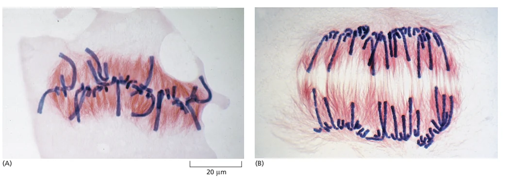{ width="800" height="287" }
/// caption
A 为中期，B 为后期；比较中央染色体的排列与两组分离后的方向。比例尺 20 μm。[^fig-haemanthus]
///

细胞周期把这些工作排成有次序的过程。它既要让事情发生，也要限制下一件事何时发生：复制尚未完成，就不宜凝缩和分离；姐妹染色单体没有接到合适的方向，就不宜解除黏连。本页从周期各阶段进入控制机制，再追踪染色体怎样被分开、细胞怎样一分为二。[^cell-cycle-control][^osm-cell-cycle]

## 从一次分裂走到下一次 { #cycle-states }

典型增殖的真核体细胞依次经历 **G$_1$、S、G$_2$ 和 M 期**。G 来自 gap，但这段“间隔”里细胞可没有闲着：它要合成蛋白质、增加膜和细胞器，也要整合营养与外界信号。S 期的主要事件是核 DNA 复制；M 期包括有丝分裂，以及通常从后期开始、与核分裂后半程重叠的胞质分裂。

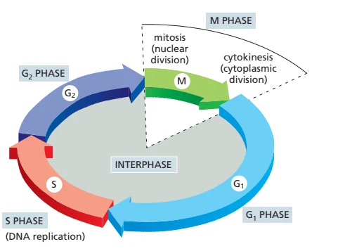{ width="420" height="312" loading=lazy }
/// caption
沿环走一圈，DNA 复制与核分裂各发生一次；胞质分裂与有丝分裂部分重叠。各区段所占角度不代表所有细胞的实际时长。[^fig-phases]
///

**间期包括 G$_1$、S 和 G$_2$。** G$_1$ 承接上次分裂，S 期复制染色体并建立姐妹染色单体黏连，G$_2$ 则继续为分离和细胞结构重组作准备。组蛋白的供应、新 DNA 的核小体装配，也必须跟上复制的进度。

G$_1$ 长短常是不同细胞周期时长的重要差别，但 S、G$_2$、M 也会变化。细胞类型、营养、复制压力和发育阶段，都可能改变某一段的停留时间。

| 阶段 | 染色体主要发生什么 | 以普通二倍体细胞为例的核 DNA 量 |
| --- | --- | --- |
| G$_1$ | 染色体尚未复制，复制起点可获得许可 | 2C |
| S | DNA 复制，形成相连的姐妹染色单体 | 由 2C 增至 4C |
| G$_2$ | 姐妹染色单体仍相连，继续准备分裂 | 4C |
| M | 姐妹染色单体分离，两个子核重建 | 分离前共 4C；每个正常子核获 2C |

这里的 C 表示一套单倍体基因组的 DNA 量，n 表示染色体组数。**S 期使 DNA 量加倍，并没有把二倍体立即变成四倍体**：复制后的每条染色体包含两条姐妹染色单体，它们要到分离后才分别成为子染色体。

周期还可以暂时退出。静息 **G$_0$** 细胞仍有代谢、能够感受信号，并可能重新进入周期；终末分化细胞则常长期不再增殖。早期胚胎走的是另一种节奏：卵细胞预先储备大量物质，最初的卵裂可以主要交替进行 S 与 M，G$_1$、G$_2$ 很短，总体积变化不大，分出的细胞越来越小。

在培养细胞中，即使刚刚完成有丝分裂，两个后续方向也可能已经出现：一部分子细胞的 CDK2 活性继续上升，另一部分维持低水平。Spencer 等的活细胞追踪表明，增殖与静息的决定可以承接母细胞经历，不能只盯住晚 G$_1$ 的一个时刻。[^proliferation-quiescence]

## 周期蛋白怎样改变 CDK 的工作 { #cyclin-cdk-engine }

### 结合、磷酸化与抑制 { #cdk-activation }

**周期蛋白依赖性激酶（cyclin-dependent kinase，CDK）**通过磷酸化底物改变细胞状态。它需要结合合适的**周期蛋白（cyclin）**，才能有效识别并处理这些底物。周期蛋白的合成与降解使不同复合物依次占优势，底物由此在合适的阶段被修饰。

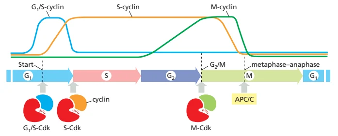{ width="720" height="290" loading=lazy }
/// caption
三条曲线表示教材概括的周期蛋白变化；下方标出相应 CDK 及 APC/C 活动，不是所有细胞通用的定量曲线。[^fig-cyclins]
///

| 主要阶段 | 脊椎动物中的常见配对 | 主要作用 |
| --- | --- | --- |
| G$_1$ | cyclin D–CDK4/6 | 将促分裂信号接到 RB–E2F 等调节环节 |
| G$_1$/S | cyclin E–CDK2 | 推动进入 S 期前的转换 |
| S、G$_2$ | cyclin A–CDK2／CDK1 | 支持复制及后续准备 |
| G$_2$/M、早期 M | cyclin B–CDK1 | 协调染色体凝缩、核被膜与纺锤体重组 |

这张表列的是主要配对。酵母可用一个主要 CDK 依次更换周期蛋白；哺乳动物中，不同 CDK 也能在某些条件下相互代偿。CDK1 的旧名 **Cdc2** 便来自裂殖酵母的细胞分裂周期研究。

周期蛋白怎样“打开”一个激酶？下图按 CDK2–cyclin A 的结构作了简化。游离 CDK 的 T 环挡住底物进入；结合周期蛋白后，T 环和活性位点附近的螺旋重排，活化环再被 **CDK 激活激酶（CAK）**磷酸化，稳定更适合催化的构象。CDK 中的 **PSTAIRE** 螺旋参与这类构象调节与周期蛋白接触；周期蛋白自身则含有称为 **cyclin box** 的保守结构。[^cdk-structure-source]

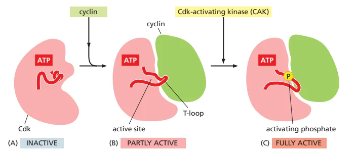{ width="720" height="314" loading=lazy }
/// caption
从左至右：游离 CDK、结合周期蛋白、再经 CAK 磷酸化。红色 ATP 的位置帮助定位活性位点，红色曲线为 T 环。[^fig-cdk-structure]
///

对于 CDK1，CAK 修饰的是活化环 **Thr161**。另外两个邻近活性位点的位点 **Thr14、Tyr15** 则起抑制作用：Wee1 主要作用于 Tyr15，Myt1 可作用于 Thr14 和 Tyr15；**CDC25 磷酸酶**除去这些抑制性磷酸。磷酸化能开也能关，区别落在具体位点上。

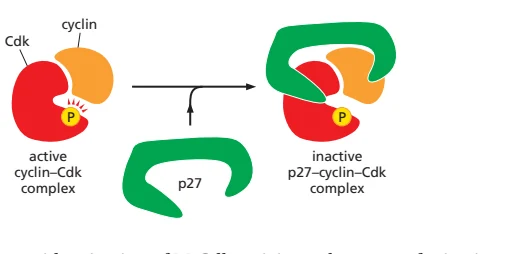{ width="460" height="229" loading=lazy }
/// caption
绿色 p27 跨在两种蛋白上，改变 CDK 的活性位点结构。[^fig-p27]
///

**CDK 抑制因子（CKI）**提供另一层调节。Cip/Kip 家族包括 p21、p27 等，可结合 cyclin–CDK 复合物；INK4 家族的 p16 等主要结合 CDK4/6，限制其工作。它们的表达、降解和定位变化，会改变细胞跨越转换所需的条件。

p27 的图很直观：抑制蛋白不一定要把两个伙伴拆开，也可以跨在复合物上，直接妨碍催化。

G$_2$ 中，cyclin B–CDK1 可以已经积累，却仍被抑制性磷酸压住。当一小部分 CDK1 活化后，它会促进 CDC25、抑制 Wee1，帮助更多 CDK1 活化，构成正反馈。这样，缓慢积累的蛋白质可以带来较陡的入 M 转换。

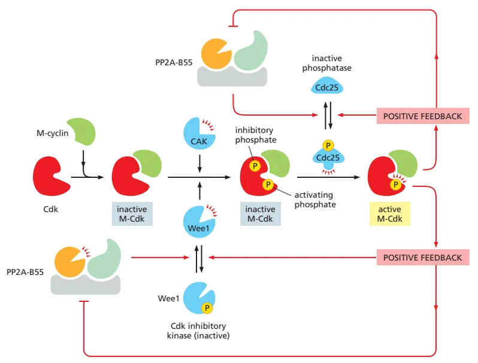{ width="760" height="577" loading=lazy }
/// caption
先沿中央的结合、磷酸化、去抑制过程读，再看红色回路：活化的 M-CDK 继续促进自身活化。[^fig-feedback]
///

与此同时，**磷酸酶也必须受到调节**。PP2A-B55 会除去许多 M-CDK 底物上的磷酸；入 M 时，M-CDK 激活 Greatwall 激酶（脊椎动物中又称 MASTL），后者磷酸化 ENSA／ARPP19，使其抑制 PP2A-B55。加磷酸的一边增强，去磷酸的一边减弱，才能迅速改变大量底物。退出 M 时，CDK 活性降低，磷酸酶逐步恢复工作。[^mitotic-phosphatases]

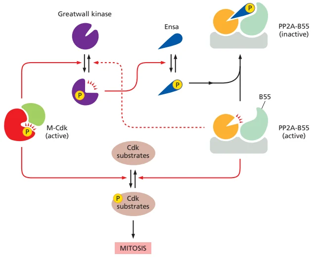{ width="570" height="462" loading=lazy }
/// caption
图中的 Ensa 代表这一类磷酸酶抑制蛋白；其被 Greatwall 磷酸化后，才有效抑制 PP2A-B55。[^fig-pp2a]
///

### 降解让周期向前走 { #regulated-proteolysis }

有些转换靠去磷酸化便能回转，有些则把调节蛋白本身降解掉。**SCF** 和 **后期促进复合物／周期体（APC/C）**都是 E3 泛素连接酶，把选中的底物接入泛素—蛋白酶体系统。SCF 的不同 F-box 蛋白识别不同底物，许多识别依赖预先的磷酸化；某些 CKI 由此在进入 S 期前后被清除。

APC/C 则随激活因子更换任务。**APC/C$^{Cdc20}$**促进 securin 和 cyclin B 等底物降解，分别解除姐妹染色单体分离的抑制、降低 M-CDK 活性；**APC/C$^{Cdh1}$**在有丝分裂退出及 G$_1$ 维持较低的周期蛋白水平。这些底物的降解时序部分重叠，各自速度也不同，不是一条所有底物严格排队的单线流程。

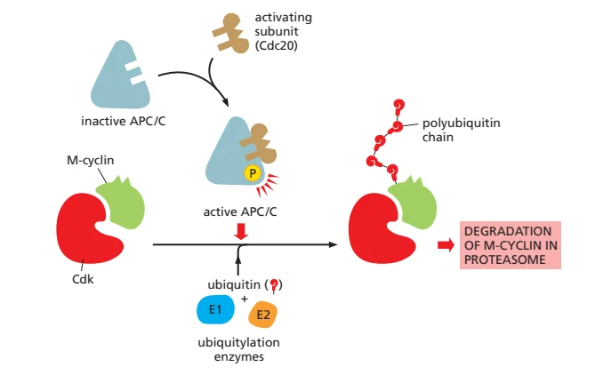{ width="650" height="410" loading=lazy }
/// caption
APC/C 负责底物选择和泛素转移的组织，真正将蛋白降解的是下游蛋白酶体。[^fig-apc]
///

识别通常依靠蛋白上的短序列，例如 APC/C 底物常见的**破坏框（D box）**和 KEN box。富含 Pro、Glu、Ser、Thr 的 **PEST 区段**也曾被用来描述某些快速周转蛋白的特征，但看到这一序列特征，并不能单独判定某蛋白一定在某一周期阶段降解。周期蛋白的周转尤其显著，CDK 的丰度和周转也会受到调节。[^degron-specificity]

???+ abstract "先找到一种活性，再认出它是什么"

    蛙卵足够大，研究者可以抽取少量胞质，再注入另一枚尚未成熟的卵母细胞。后者停留在减数分裂前期，核仍完整。取自 M 期卵的胞质可以使它的核被膜解体、形成纺锤体；取自间期卵的胞质则没有同样的效果。

    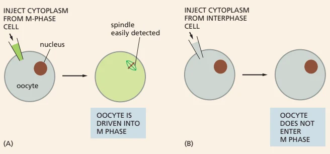{ width="650" height="303" loading=lazy }
    /// caption
    教材对 MPF 活性测定的示意。A：M 期胞质诱导成熟；B：间期胞质对照。图示实验关系，并非原始显微记录。[^fig-mpf-transfer]
    ///

    这先证明胞质中有一种可转移、随周期变化的促成熟活性，研究者称它为 **成熟促进因子（MPF）**。纯化和分子鉴定随后才把它落实到 CDK1–cyclin B。与此同时，酵母的 `cdc` 突变提供了遗传学入口；Evans、Hunt 等在海胆等动物卵中观察到，某些新合成蛋白在每轮卵裂时被快速降解，因而得名 cyclin。三条线索后来接到了一起。[^cell-cycle-history]

    哺乳动物细胞融合实验也显示，M 期胞质可使间期细胞核发生**早熟染色体凝缩（PCC）**。G$_1$ 核常呈单染色单体形态，G$_2$ 核呈双染色单体，正在复制的 S 期核则表现为不均匀、碎片样的凝缩。形态反映了原先的复制状态；强迫凝缩本身不等于已经完成一次正常分裂。[^premature-condensation]

## G$_1$ 中的增殖承诺与复制许可 { #g1-s-commitment }

### 生长信号怎样经 RB–E2F 起作用 { #restriction-point }

促分裂原（mitogen）到达动物细胞后，可经 Ras–ERK、PI3K–AKT 等通路提高 cyclin D 的表达或稳定性。cyclin D–CDK4/6 与随后增强的 cyclin E–CDK2 改变 **RB 家族蛋白**对 **E2F 转录因子**的约束，促进 DNA 复制、核苷酸合成和周期控制基因表达。E2F 又能促进 cyclin E 等组分积累，形成反馈。受体到这些效应器的过程见[细胞信号转导](cell_signaling.md#enzyme-linked-receptors)。[^restriction-point]

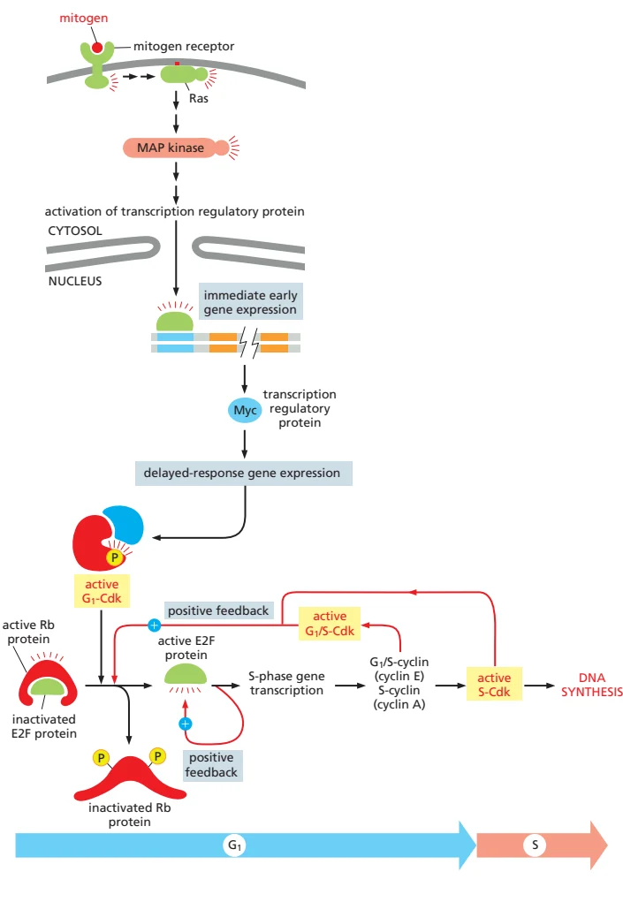{ width="610" height="883" loading=lazy }
/// caption
沿膜受体向下追踪到细胞核，再看下方的 RB–E2F 反馈；图概括主要连接，具体磷酸化状态和依赖关系随细胞而变。[^fig-rb-e2f]
///

经典**限制点（restriction point，R 点）**由一种操作定义：在不同时间撤去促分裂原，看细胞是否仍能进入 S 期并完成本轮分裂。通过这个点，表示对外界促分裂刺激的依赖降低；受到 DNA 损伤等新干扰时，细胞仍可以停下来。芽殖酵母中相应的周期进入转换常称 **Start**。

???+ abstract "同一种抑制，为什么加早与加晚不同"

    Cappell 等在 MCF10A 细胞中追踪 APC/C$^{Cdh1}$ 活性。他们把 geminin 的降解片段接到荧光蛋白上：APC/C 活跃时，报告蛋白不断被降解；APC/C 关闭后，它才积累。下图灰线是报告蛋白量，红线是结合报告蛋白变化动力学推算的 APC/C 活性，两条线的含义正好相反。[^apccdh1-commitment]

    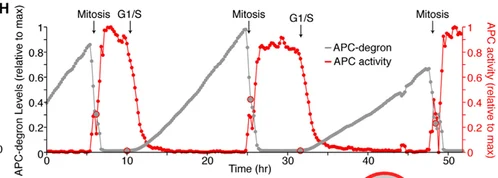{ width="720" height="257" loading=lazy }
    /// caption
    原文图 1H。灰色为报告蛋白，红色为推算活性；箭头标出有丝分裂和 G$_1$/S 转换，横轴单位为小时。[^apccdh1-commitment]
    ///

    再比较下面两组干预。I 中，CDK1/2 抑制剂在 APC/C 仍活跃的 G$_1$ 加入，APC/C 就难以下降；J 中，相同抑制剂在 APC/C 已关闭后加入，却不能使它重新开启。每条红线是一枚细胞，黑线是中位数轨迹，虚线为加药时刻。

    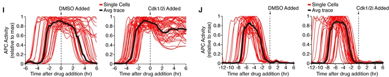{ width="800" height="160" loading=lazy }
    /// caption
    原文图 2I、J，保留 DMSO 对照。I 为 G$_1$ 加药；J 为 S 期加药。两组各自以加药时刻对齐。[^apccdh1-commitment]
    ///

    这说明，维持 APC/C 的关闭状态，不再需要启动关闭时同样的 CDK 活性。研究进一步发现，降低 **Emi1** 会使关闭过程变慢，并使已关闭的 APC/C 对 CDK 抑制重新敏感。cyclin E–CDK2 参与启动，Emi1 帮助维持状态，构成具有记忆性的开关。

    在这些细胞中，RB 磷酸化和失去对促分裂原的依赖，可以早于 APC/C 关闭。两者之间若受到某些应激，细胞仍能返回静息；APC/C 关闭后则较难如此。因而，“不再需要促分裂原”和“不能返回静息”需要分别测量。即使作出了进入本轮周期的承诺，后面的复制或损伤检查点也仍然可以延迟进程。

### 把复制起点的装载与启动分开 { #replication-licensing }

每条染色体有许多潜在复制起点。怎样让每段 DNA 在一轮周期中只被复制一次？关键在于，**装载解旋酶的条件，与启动它的条件相互错开**。

晚 M／G$_1$ 的低 CDK 状态允许 **ORC、CDC6、CDT1** 将 **MCM2–7 双六聚体**装到 DNA 上，形成复制前复合体，这称为**复制许可**。进入 S 期后，S-CDK 与 **Dbf4 依赖性激酶（DDK）**促进 Cdc45、GINS 等加入，生成有活性的 **Cdc45–MCM–GINS（CMG）解旋酶**，建立向相反方向推进的复制叉。[^replication-licensing]

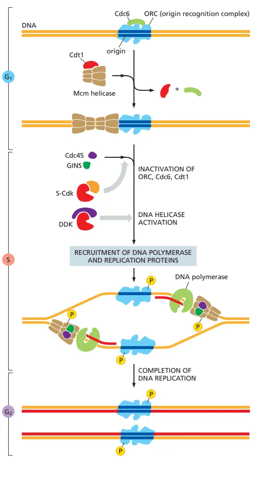{ width="490" height="898" loading=lazy }
/// caption
沿左侧周期轴从上往下读。橙色 DNA 上的蓝色 ORC 帮助装载；S 期之后，已经启动与尚未启动的起点都不能随意再装一次 MCM。[^fig-license]
///

启动后的高 CDK 状态，同时抑制新的许可。CDT1 可被降解；后生动物的 **geminin** 还可结合并抑制 CDT1。不同物种对 ORC、CDC6、CDT1 的修饰、降解与定位调节各有侧重，但共同结果是将“再装载”限制到下一次低 CDK 窗口。

被许可的起点多于平时实际启动的起点。邻近复制叉受阻时，一些备用起点可以启动，帮助完成剩余区域。DNA 是否全部复制完，最终取决于所有复制叉的推进与终止；不能只凭某一种促进因子的浓度判断。

起点选择、复制叉组装和两条新链的合成，见[真核复制许可](../molecular/dna_replication/index.md#eukaryotic-licensing)与该页后续章节。

## 检查点怎样争取处理时间 { #cell-cycle-checkpoints }

未完成的复制叉、DNA 断裂或未正确附着的动粒，可以持续生成抑制信号，压低 CDK 活性或抑制 APC/C。这样的监控与延迟机制称为**检查点**。缺少检查点的细胞未必立即不能分裂，却更容易带着断裂、重排或分配错误继续前进。

### DNA 损伤与复制压力 { #dna-damage-replication-checkpoints }

DNA 双链断裂可由 **MRN 复合物**参与识别并招募 **ATM**；带有 RPA 包被单链 DNA、以及单链与双链交界结构的受阻复制叉，则可通过 **ATR–ATRIP**等组分触发响应。两类输入与下游并非完全分开，ATM–CHK2、ATR–CHK1 只是常用的主要连接。[^dna-damage-checkpoints]

这些激酶可以抑制 CDC25、支持抑制性 CDK 磷酸化，延迟进入 M；在 S 期内，它们还会调节起点使用并保护受阻复制叉。染色体结构蛋白也参与响应：在人细胞受电离辐射的实验中，ATM 在 NBS1 依赖的条件下磷酸化 cohesin 组分 **SMC1**，这一支路参与 S 期内对 DNA 合成的抑制。[^smc1-checkpoint]

较持久的损伤响应可稳定 **p53**，使 **p21** 增加，维持对 CDK 的抑制。

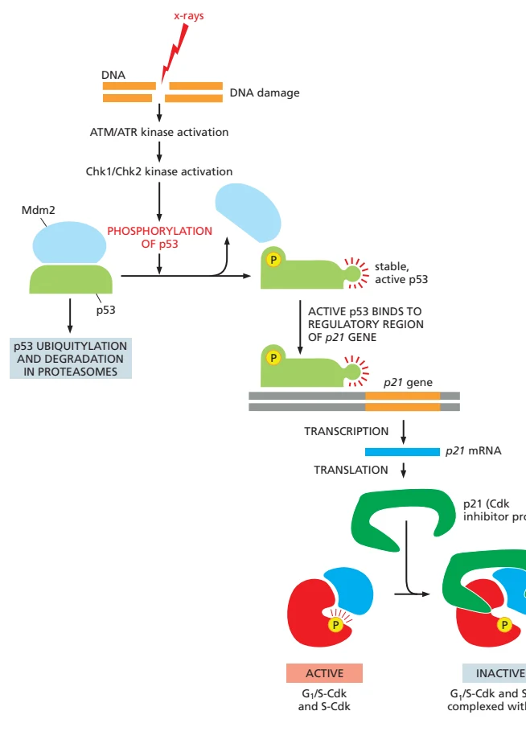{ width="650" height="924" loading=lazy }
/// caption
图集中展示 p53–p21 支路：损伤信号改变 p53 与 MDM2 的关系，减少 p53 降解，随后增加抑制 CDK 的 p21。[^fig-dna-damage]
///

检查点延迟提供的是处理时间。细胞能否重启周期，要看损伤能否修复、复制是否恢复；持续响应也可转向衰老或受调控死亡。具体的损伤类型与修复途径见[DNA损伤与修复](../molecular/dna_repair.md)，后续命运见[细胞增殖、分化、死亡与衰老](cell_life_cycle.md)。

## 进入 M 期，搭起双极纺锤体 { #mitotic-entry-spindle }

### 染色体与核被膜一起重组 { #mitotic-reorganization }

cyclin B–CDK1 活性升高后，细胞内许多结构开始改变。**凝缩蛋白复合体（condensin）**帮助染色质形成有组织的环并轴向压缩；**拓扑异构酶 II**处理复制后 DNA 之间的缠结。核纤层、核孔及核被膜连接蛋白受到磷酸化，许多动物和植物细胞的核被膜随之开放，胞质中的微管得以接近染色体。[^mitosis-textbook]

复制后的姐妹染色单体仍由**黏连蛋白复合体（cohesin）**联系着。下图中，SMC 蛋白的长臂与连接亚基围成环状结构；SMC 头部具有 ATPase 活性，ATP 的结合与水解参与复合物的构象变化及 DNA 结合、重塑。cohesin 由此维系复制后的两份 DNA，形成稍后可以解除的约束。在脊椎动物细胞中，大部分染色体臂上的 cohesin 在前期便被释放，着丝粒附近的黏连则保留到后期启动。

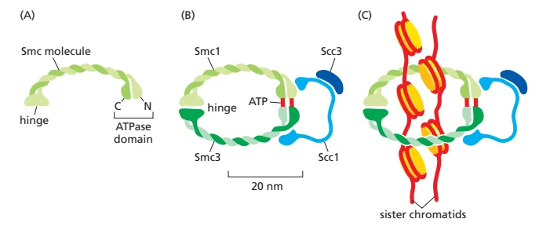{ width="740" height="334" loading=lazy }
/// caption
A 为 SMC 蛋白；B 为 cohesin 复合体；C 为姐妹黏连的简化环模型。Scc1 是酵母中连接 SMC 头部的 kleisin 亚基。[^fig-cohesin]
///

从显微镜看，**前期**的染色体逐渐变得短粗，纺锤极开始分离；核被膜开放后进入**前中期**，微管反复捕获、释放染色体。到**中期**，多数染色体已在赤道附近整列。下面将结构示意与荧光照片放在一起，绿色是微管，橙红色是染色体。

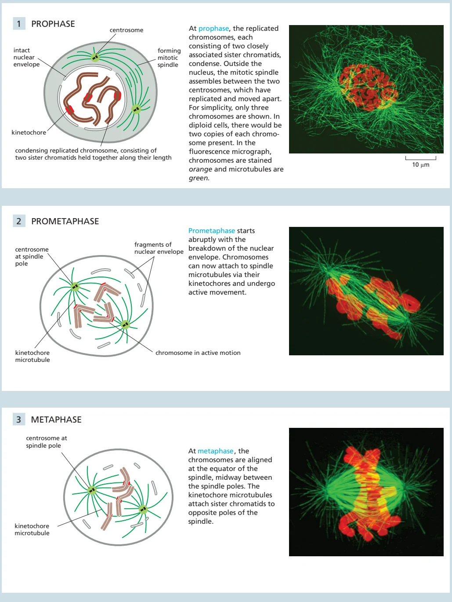{ width="820" height="1091" loading=lazy }
/// caption
从上到下比较染色体的位置，以及绿色微管能否进入原先的核区域。照片与旁边模型对应的是同一阶段，并非同一细胞的连续拍摄。[^fig-mitosis-early]
///

核仁在这一过程中解体，许多转录活动下降，翻译和膜运输也重新安排。不过，M 期并非所有 RNA 合成都绝对停止：直接标记新生 RNA 的实验仍能检测到部分基因的有丝分裂期转录。染色体的功能元件及核内结构，见[细胞核与染色质](nucleus_chromatin.md#chromosome-architecture)。[^mitotic-transcription]

### 两极怎样形成 { #spindle-assembly }

典型动物细胞中的**中心体**由一对中心粒及周围的中心粒周物质构成。新的中心粒通常在 G$_1$/S 附近开始组装，随后延长；进入 M 期前后，中心粒周物质扩大、微管成核能力增强，两个中心体分离，帮助建立两个纺锤极。上一轮结束时的中心粒脱离等事件，又为下一次复制创造条件。中心粒复制、中心体成熟、两个中心体分离，是相互协调的不同过程。

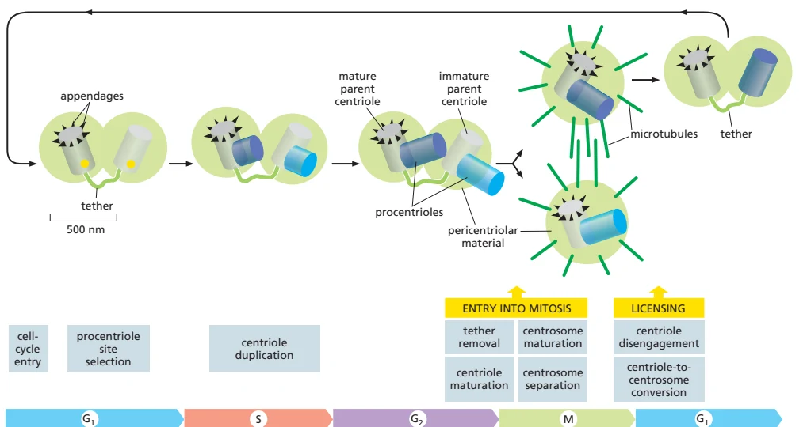{ width="820" height="435" loading=lazy }
/// caption
下方色带给出阶段；上方每根短柱代表一根中心粒。比较 S 期的新生中心粒与入 M 时扩大的周围物质。[^fig-centrosome-cycle]
///

纺锤体中的微管可以按连接对象分成三组：**动粒微管**连接染色体；**极间微管**在中部与来自另一极的微管反向重叠；**星体微管**向外伸到细胞皮层。进入 M 期时，许多间期微管转为较短、周转更快的状态；交联蛋白和马达不断重排它们，共同维持双极结构。

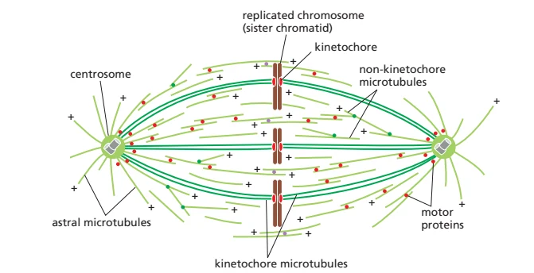{ width="760" height="390" loading=lazy }
/// caption
图中的正号标微管正端。动粒微管止于染色体，极间微管在中央重叠，星体微管向细胞外周伸展。[^fig-spindle]
///

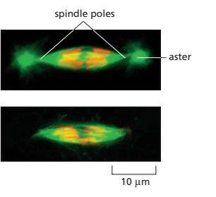{ width="410" height="374" loading=lazy }
/// caption
上：正常受精胚胎，两极有星体；下：孤雌发育胚胎，仍形成双极纺锤体，但没有明显星体。微管绿、染色体红，比例尺 10 μm。[^fig-acentrosomal]
///

**中心体能帮助组织纺锤体，却不是形成双极结构的唯一起点。** 高等植物体细胞和许多动物卵母细胞本来就能在没有典型中心体的条件下分裂。

染色质附近的 **Ran-GTP**可释放纺锤体组装因子；**augmin**帮助在已有微管旁继续成核，增加局部微管；kinesin、dynein 等再交联、滑动和聚拢微管。图中的蕈蚊胚胎展示了这种可能性。星体缺失仍可能影响纺锤体在细胞中的定位。

部分真菌则保持核被膜完整，由核膜上的**纺锤极体（spindle pole body）**组织核内纺锤体，称为封闭式有丝分裂。微管动态和马达的共同原理见[细胞骨架中的分裂装置](cytoskeleton.md#division-cytoskeleton)。

## 接住染色体，再解除姐妹黏连 { #chromosome-segregation }

### 动粒怎样维持可变长的连接 { #kinetochore-attachments }

**动粒（kinetochore）**组装在着丝粒染色质上，内侧联系含 CENP-A 的核小体，外侧的 **Ndc80 复合物**等接触微管。微管可以先从侧面被捕获，再转为正端朝向动粒的连接。许多弱相互作用共同保持接触，使动粒在微管加聚或解聚时仍能跟随其末端。

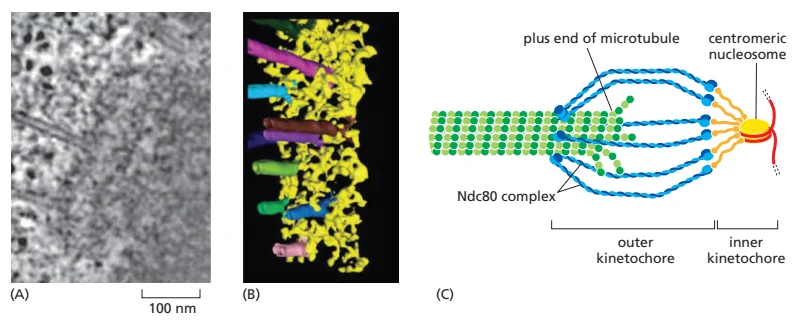{ width="820" height="327" loading=lazy }
/// caption
A 为电镜，比例尺 100 nm；B 为三维重建；C 为连接模型。注意右图微管末端的原丝已经弯曲，连接仍可由多个分子共同维持。[^fig-kinetochore]
///

有丝分裂中，理想状态是**两个姐妹动粒分别朝向相反的纺锤极**，称为双向附着。微管搜索并不保证第一次就连对，下面三种中间状态都可能出现。

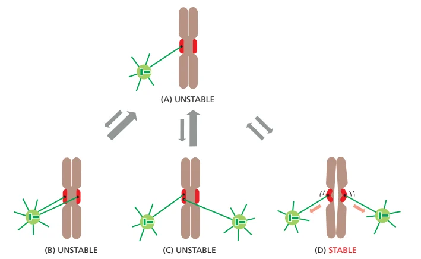{ width="640" height="394" loading=lazy }
/// caption
A：单侧附着（monotelic）；B：同极附着（syntelic）；C：一个动粒连到两极的混合附着（merotelic）；D：正确双向附着（amphitelic）。图省略了许多实际连接的微管。[^fig-attachments]
///

两极的拉力受到姐妹黏连的抵抗，使双向附着产生张力。**Aurora B 激酶**可以磷酸化 Ndc80 等微管结合组分，降低错误连接的稳定性，给微管重新尝试的机会。正确双向附着建立后，这些组分的磷酸化降低，连接趋于稳定。下图展示的是空间分离模型：受力使外动粒底物与内侧 Aurora B 的关系改变；真实调节还涉及激酶定位、磷酸酶和动粒自身的力学响应。

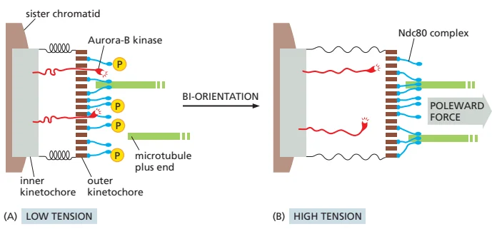{ width="790" height="392" loading=lazy }
/// caption
左侧低张力时，外动粒组分较易被磷酸化；右侧双向附着产生拉力后，底物磷酸化减少，微管连接得到稳定。[^fig-aurora]
///

### 纺锤体组装检查点 { #spindle-assembly-checkpoint }

纠错要有时间，后期便不能来得太早。未附着动粒可利用 **MPS1、MAD1–MAD2、BUB1、BUBR1、BUB3** 等建立信号平台，促进形成**有丝分裂检查点复合物（MCC）**。其中 MAD2、BUBR1、BUB3 与 CDC20 结合，抑制 APC/C$^{Cdc20}$，使 securin 得以保留，延迟姐妹染色单体分离。在许多动物细胞中，一个未附着动粒就足以明显延迟后期。[^spindle-checkpoint]

???+ abstract "关掉检查点，细胞会发生什么"

    Waters 等先用 taxol 处理 PtK1 细胞，使其停留在分裂期，再显微注射抗 MAD2 抗体。下图上、中两行的细胞随后出现染色单体分离并退出分裂期；下排注射的是先用抗原封闭的抗体，细胞在 3 小时后仍保持阻滞。[^spindle-checkpoint]

    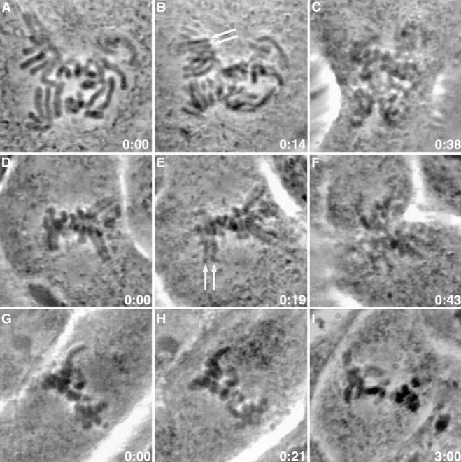{ width="650" height="651" loading=lazy }
    /// caption
    原文图 7。A—C、D—F 为抗 MAD2 抗体处理的两个细胞；G—I 为抗原封闭对照。右下角时间为小时:分钟；箭头标分离的染色单体。[^spindle-checkpoint]
    ///

    这表明，MAD2 的持续作用是维持这类阻滞所需的环节。taxol 对微管运动的干扰并未消失，染色体也未正常移向两极；“准许退出”与“分配正确”可以在实验中被拆开。

附着纠错和检查点信号彼此配合，却不完全等同。**混合附着**可能保留足够的微管连接，减少 MAD2 信号，即使一个动粒仍受来自两极的牵引，细胞也可能进入后期，留下滞后的染色体。染色体整列则依靠微管长度变化、染色体臂上的排斥力及马达作用；MAD、BUB 主要参与监控，不承担运输马达的工作。

### 微管持续周转，染色体仍能停在中央 { #spindle-flux }

中期纺锤体的外形相对稳定，里面的微管并不静止。向细胞中加入少量荧光标记微管蛋白，可在微管上形成稀疏亮斑，用来追踪晶格本身。下图 C 将选定窄条沿时间展开：亮斑轨迹向上下两极倾斜，显示**微管极向通量（poleward flux）**。

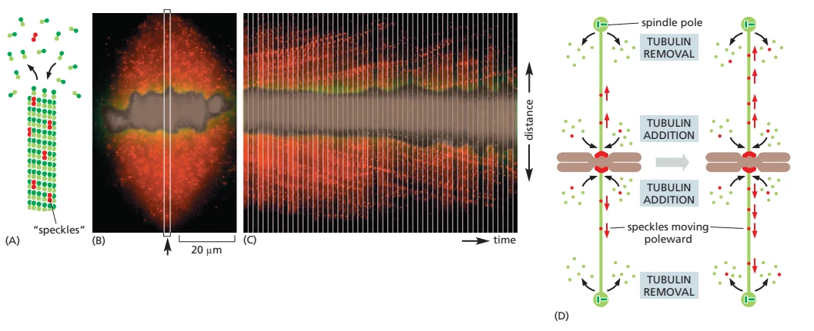{ width="830" height="338" loading=lazy }
/// caption
B 中白框为取样区域；C 横轴为时间、纵轴为位置；D 解释动粒端加入与极端丢失微管蛋白如何伴随晶格向极移动。[^fig-flux]
///

因此，染色体暂时停在赤道附近，可以同时伴随微管蛋白加入、移位和丢失。进入后期时，动粒端的解聚、极端的周转及马达作用又会改变相对贡献。

### 切开 cohesin，启动后期 { #anaphase-onset }

当检查点信号消退，APC/C$^{Cdc20}$ 得以促成**安全蛋白（securin）**降解，释放**分离酶（separase）**。separase 切开 cohesin 的 kleisin 亚基，解除剩余的姐妹黏连，两条染色单体开始各自移动。[^separase-cohesin]

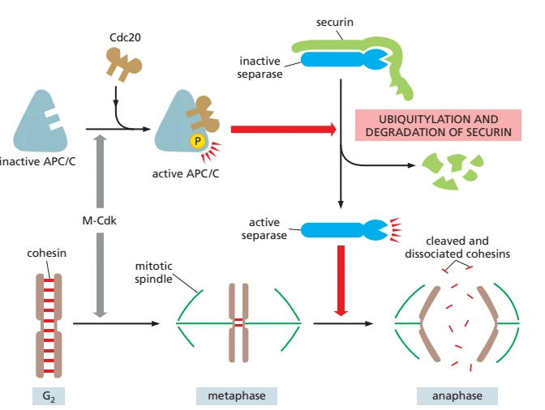{ width="730" height="550" loading=lazy }
/// caption
上方是抑制与释放关系，下方是相应的染色体变化；大红箭头表示 separase 对 cohesin 的切割。[^fig-separase]
///

???+ abstract "把切割位点换掉，直接检验黏连解除"

    Uhlmann 等把芽殖酵母 cohesin 亚基 Scc1 的一个 separase 切割位点，替换成 **TEV 蛋白酶**能识别的序列。TEV 来自烟草蚀纹病毒，酵母原本不用它控制分裂；这样便能绕过正常开关，单独切开 Scc1。[^separase-cohesin]

    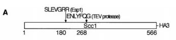{ width="480" height="110" loading=lazy }
    /// caption
    原文图 7A。保留另一个天然位点，并将图中 268 位附近的位点改为 TEV 识别序列。[^separase-cohesin]
    ///

    研究者抑制 CDC20 的表达，将细胞阻滞在中期，然后诱导 TEV。下图上排的 Scc1–TEV 细胞出现分开的 DNA 与延长的纺锤体；保留野生型 Scc1 的对照即使表达 TEV，也大多不进入后期。三列分别显示 DNA、微管和 TEV 蛋白。

    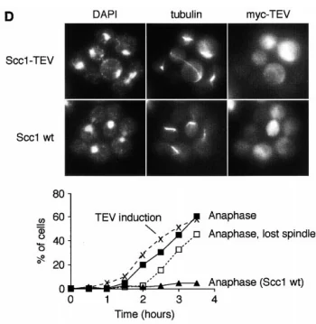{ width="570" height="585" loading=lazy }
    /// caption
    原文图 7D。实心方块为进入后期的细胞，空心方块为已分离但随后丢失纺锤体的细胞；三角形为野生型 Scc1 对照。横轴以小时计。[^separase-cohesin]
    ///

    这把“切开 cohesin”与“开始分离”建立了直接因果联系。不过，一些细胞随后丢失纺锤体，说明解除黏连足以启动这些后期运动，并不足以替代正常有丝分裂退出的全部调节。

后期的运动可以分成两个相互重叠的部分。**后期 A**是子染色体与相应纺锤极之间的距离缩短，依赖动粒微管的解聚、通量及相关蛋白；**后期 B**是两个纺锤极继续远离，极间微管的反向滑动与延长、皮层 dynein 对星体微管的牵引都可参与。不同细胞对这些力的依赖程度不同。

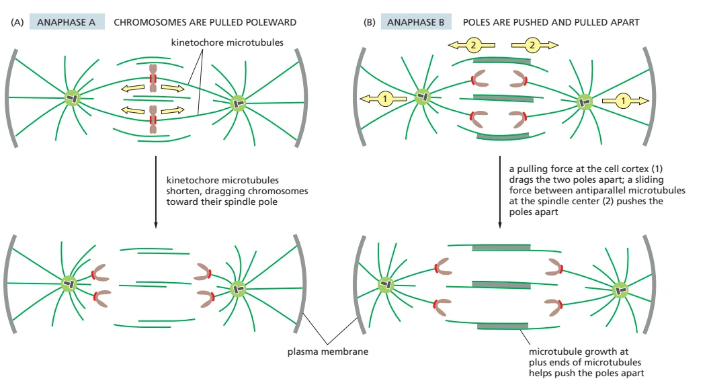{ width="840" height="465" loading=lazy }
/// caption
左侧观察染色体到极的距离，右侧观察两极间距。箭头表示微管滑动、皮层牵引与微管生长。[^fig-anaphase]
///

APC/C 对 cyclin B 的清除降低 M-CDK 活性，PP1、PP2A 等磷酸酶逐步除去底物上的磷酸。进入**末期**后，染色体去凝缩，核被膜、核孔和核仁重新建立；复制许可也在恢复的低 CDK 状态下重新开放。

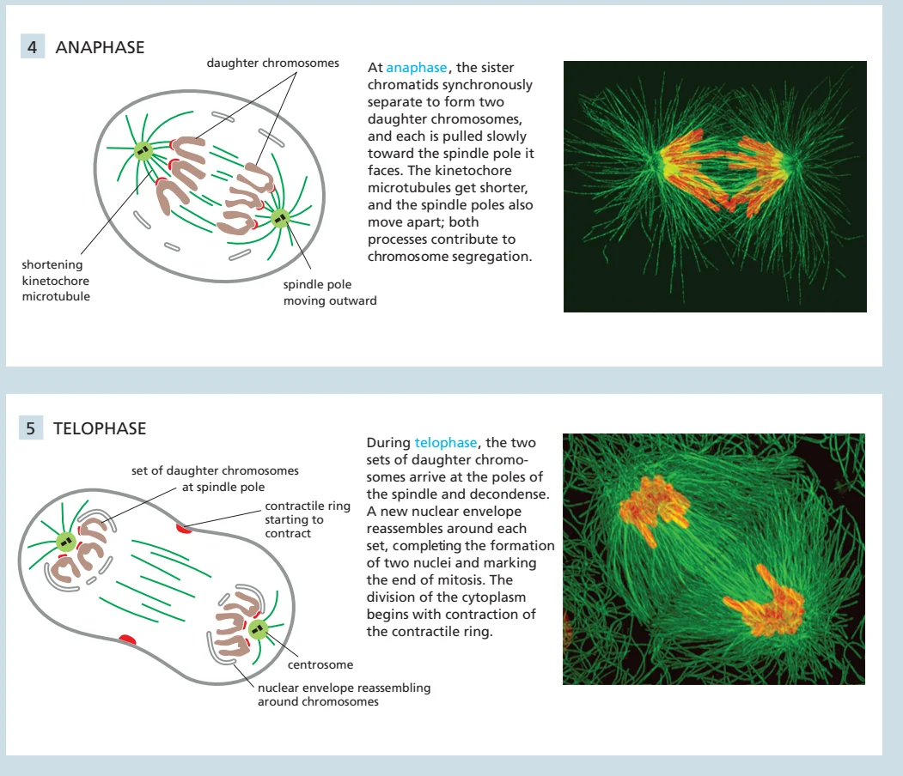{ width="820" height="705" loading=lazy }
/// caption
上：姐妹已经分离；下：两组染色体周围开始重建细胞核，纺锤体中部仍保留微管。[^fig-mitosis-late]
///

## 把细胞质分给两个子细胞 { #cytokinesis }

核染色体分开后，细胞质还要分给两个子细胞，并建立各自的边界。内质网、高尔基体、线粒体等在分裂前后发生不同程度的重排、分割和运输，细胞器的数量、骨架联系及细胞极性共同影响继承方式。有丝分裂保证的主要是核染色体分离，胞质成分还需要各自的分配与质量控制机制。

### 动物细胞的分裂沟与最后切断 { #animal-cytokinesis }

动物细胞的质膜可以从外向内收缩，形成**分裂沟**。在其内侧，actin 与 myosin II 组成动态**收缩环**：formin 促进局部线性 actin 组装，myosin II 产生收缩力，膜运输为增加的表面积补充膜。环缩小时，丝本身也在持续更新与拆解。[^animal-cytokinesis]

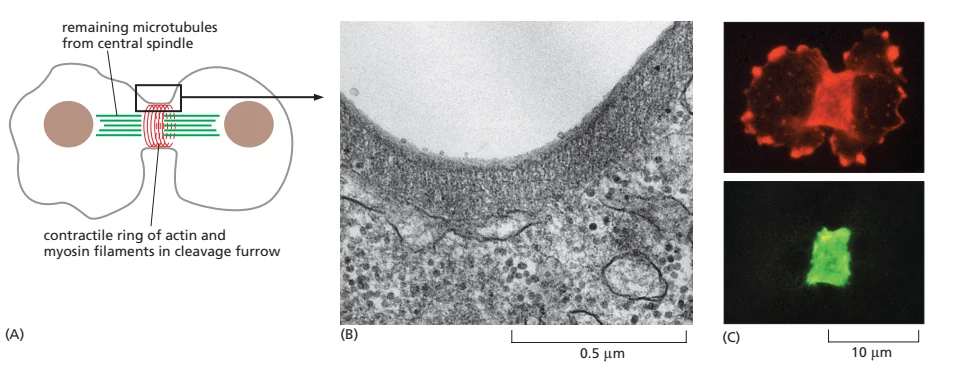{ width="820" height="319" loading=lazy }
/// caption
A 为模型；B 为分裂沟内陷边缘的电镜，比例尺 0.5 μm；C 为分裂中的黏菌阿米巴细胞，actin 红、myosin II 绿，比例尺 10 μm。actin 也保留在两个子细胞的皮层。[^fig-ring]
///

分裂沟的位置由纺锤体向皮层传递的信息决定。中央纺锤体中的 **centralspindlin 复合物**与 **Ect2** 等使赤道皮层的 **RhoA**活化。Ect2 是促进 GDP 换成 GTP 的交换因子；RhoA-GTP 随后通过 formin 增加 actin，通过 ROCK 等促进 myosin II 活性，从而将局部信号变成收缩。

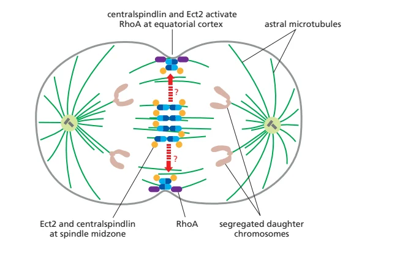{ width="660" height="425" loading=lazy }
/// caption
中央微管上的组分与赤道皮层相联系，在两组已分离的染色体之间建立分裂面。[^fig-rho-zone]
///

分裂沟收窄后，两个子细胞仍由细桥相连。桥内紧密排列的中央纺锤体残余及其蛋白形成**中体（midbody）**，最后再由 **ESCRT-III**等促成膜的切断。染色质若仍横跨桥内，Aurora B 等调节可延迟切断，减少将 DNA 直接切断的风险；桥部张力也会影响这一步的时机。

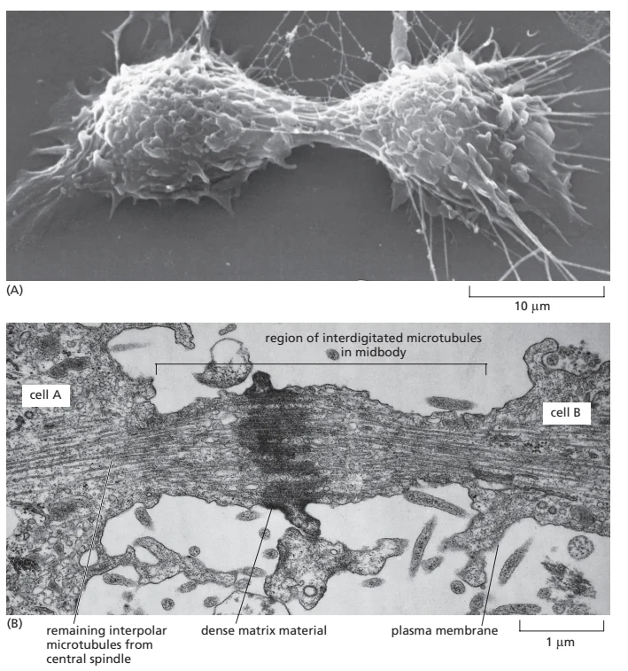{ width="670" height="715" loading=lazy }
/// caption
A 显示仍相连的两个子细胞，比例尺 10 μm；B 显示桥内紧密排列的微管与中体物质，比例尺 1 μm。[^fig-midbody]
///

???+ note "分裂面偏一点，子细胞就可以不同"

    皮层马达对星体微管的牵引，可以使纺锤体偏向细胞一端；若某些 RNA、蛋白或细胞器此前已极性分布，两个子细胞便可能获得不同的大小与成分。

    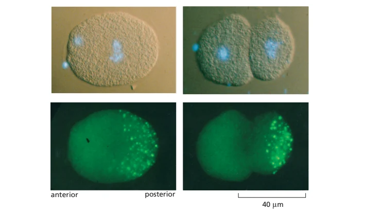{ width="760" height="440" loading=lazy }
    /// caption
    左为分裂前，右为分裂后；上排显示形态与蓝色 DNA 染色，下排绿色为 P 颗粒。后端在右，P 颗粒主要进入后方子细胞；比例尺 40 μm。[^fig-asymmetric]
    ///

    这里的 P 颗粒由 RNA 和蛋白组成，与生殖系发育有关。照片同时展示了两件事：物质先偏向后端，分裂面再将它们分给特定的子细胞。

### 植物的细胞板与真菌的分隔 { #plant-fungal-cytokinesis }

植物细胞外有细胞壁，分隔通常从内部开始。许多高等植物细胞在 G$_2$ 至前期形成**早前期带（preprophase band）**，为将来的分裂面留下皮层定位信息。早前期带在核被膜解体前后消失，但相应位置的皮层标记继续指导后来细胞板的接合。到末期，**成膜体（phragmoplast）**中的微管、actin 等组织囊泡运输；来自高尔基体等膜系统的囊泡在中央融合，形成**细胞板（cell plate）**。[^plant-cytokinesis]

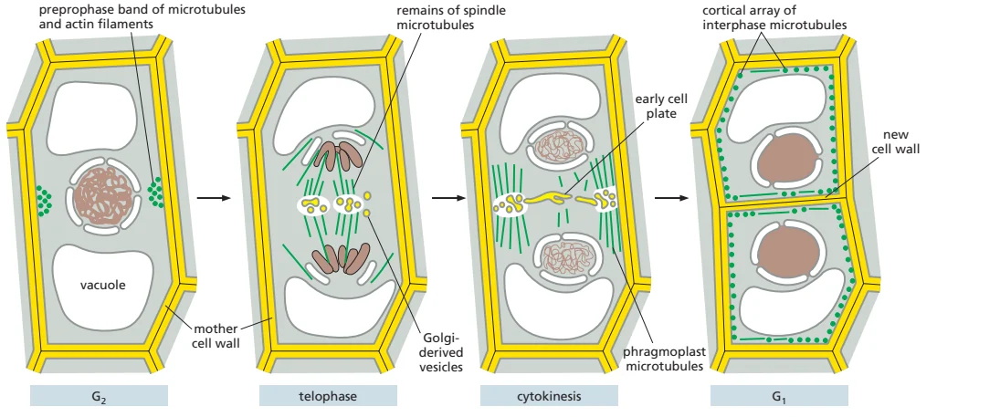{ width="850" height="355" loading=lazy }
/// caption
从左至右：分裂面定位、末期、细胞板扩展、两个子细胞形成。细胞板由中央向外围生长，最后接上母细胞的质膜与细胞壁。[^fig-plant-plate]
///

细胞板两侧的膜成为两个子细胞的新质膜，中间积累的材料继续形成新细胞壁。成膜体也随细胞板的外扩而重组，把新囊泡送到生长边缘。

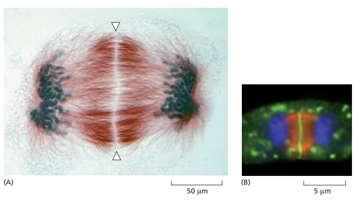{ width="790" height="481" loading=lazy }
/// caption
A 的两个箭头标早期细胞板，微管红褐、DNA 深蓝，比例尺 50 μm；B 中微管红、DNA 蓝、syntaxin 绿，绿色信号勾出囊泡融合发生的细胞板，比例尺 5 μm。[^fig-plant-micrographs]
///

真菌有自己的分隔方式。芽殖酵母在母细胞与芽体之间的颈部形成收缩环和隔膜，裂殖酵母通常在细胞中央形成分隔结构。是否保持核被膜完整，与胞质怎样被分隔，是两个需要分别比较的特征。

## 减数分裂：先分同源体，再分姐妹 { #meiosis }

有丝分裂通常把一套复制后的基因组平分，维持子细胞的染色体组数。**减数分裂**则在一次 S 期后连续进行两次分离：第一次分开同源染色体，第二次分开姐妹染色单体，最终把二倍体核变为单倍体核。

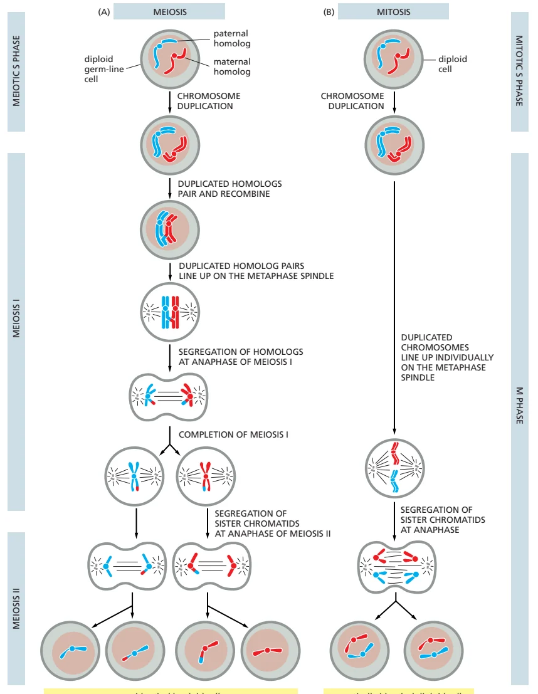{ width="670" height="864" loading=lazy }
/// caption
左侧为减数分裂，右侧为有丝分裂。红、蓝表示父母来源的同源染色体；减数分裂第一次分离后，每个核只保留每对同源体中的一条，但该染色体仍有两条姐妹染色单体。[^fig-meiosis-compare]
///

| 时刻 | 每个相应细胞核的染色体组数与 DNA 量 | 主要连接状态 |
| --- | --- | --- |
| 减数前 S 期之前 | 2n，2C | 同源染色体尚未复制 |
| S 期之后、前期 I | 2n，4C | 每条染色体含两条姐妹，同源体配对 |
| 第一次分裂完成后 | n，2C | 同源体已分开，姐妹仍相连 |
| 第二次分裂完成后 | n，1C | 姐妹也已分开 |

### 前期 I：让同源染色体找到彼此 { #meiotic-prophase }

有丝分裂时，两条同源染色体通常各自处理自己的姐妹；减数分裂 I 则需要它们相遇、配对并形成可协调分离的结构。一对已复制的同源染色体称为**二价体**，其中共有四条染色单体，因此也称四分体。

在多数具有经典联会过程的物种中，染色体先形成轴，同源体逐渐靠近。**联会复合体（synaptonemal complex）**的横向丝连接两条同源染色体的轴，使它们沿长度紧密并排，称为**联会**。每条轴组织的是一条同源染色体的两条姐妹，不是四条染色单体分别各占一条轴。[^meiosis-cohesin]

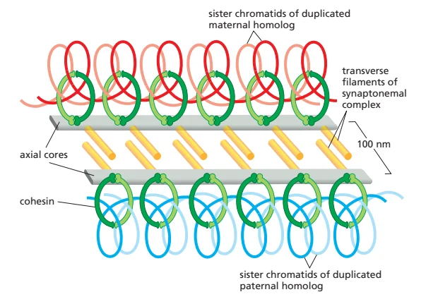{ width="710" height="494" loading=lazy }
/// caption
红、蓝分别代表两条同源染色体的 DNA；各自的两条姐妹由 cohesin 联系，向轴外伸出环。黄色横向丝连接两条同源体轴，间距约 100 nm。[^fig-synaptonemal]
///

前期 I 的五个时期，主要依据这套结构的形态变化划分。

| 时期 | 主要可见变化 |
| --- | --- |
| **细线期**（leptotene） | 染色体轴形成，染色体呈细长线状 |
| **偶线期**（zygotene） | 同源体逐段联会，联会复合体沿轴组装 |
| **粗线期**（pachytene） | 同源体大体完成联会，重组中间体继续处理 |
| **双线期**（diplotene） | 联会复合体解体，同源体逐渐分开，交叉处仍相连 |
| **终变期**（diakinesis） | 染色体进一步凝缩，为第一次分裂的纺锤体连接作准备 |

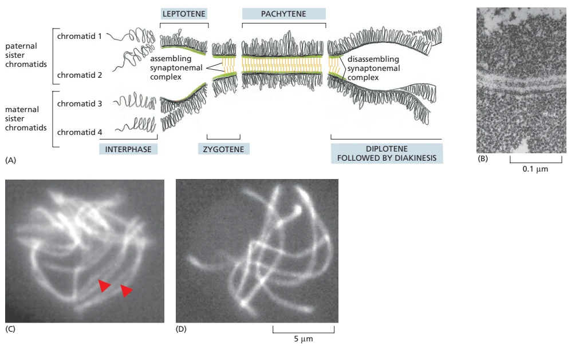{ width="840" height="496" loading=lazy }
/// caption
A 为过程模型；B 为百合粗线期细胞的联会复合体电镜，比例尺 0.1 μm；C、D 为真菌 Sordaria 的部分联会与充分联会，比例尺 5 μm。[^fig-synapsis]
///

不同物种也有例外。裂殖酵母不形成典型的三层联会复合体，却仍能发生减数重组；其染色体上的**线性元件（linear elements）**联系重组相关蛋白，参与这一过程。[^fission-yeast-meiosis]

同源配对还伴随染色体运动。一些物种在早期前期 I 出现端粒向核被膜局部聚集的**花束状排列（bouquet）**，有助于调整染色体的相对位置；其时机、持续时间和必要性并不在所有生物中相同。

与此同时，**Spo11**等引发程序化 DNA 双链断裂。断端经过处理，与同源染色体上的非姐妹染色单体发生重组，部分事件成为**相互交换（crossover）**，另一些则以不交换两侧染色体臂的方式修复。断裂数、显微镜下的重组结数与最终交换数，不能不加条件地看作相等。

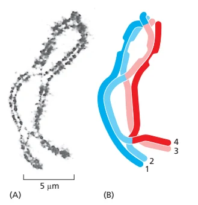{ width="340" height="351" loading=lazy }
/// caption
A 为含三个交叉的二价体，比例尺 5 μm；B 用不同颜色追踪四条染色单体。交换联系了非姐妹染色单体，姐妹臂黏连使交叉结构得以维持。[^fig-chiasmata]
///

联会复合体拆掉以后，同源体仍在**交叉（chiasma）**处相连。形成这种连接，既需要先前的 DNA 交换，也需要交换位点以远的姐妹染色单体臂保持黏连。由此，两条同源染色体才能在第一次分裂的两极牵引下保持为一个二价体。

基因组主体的复制已经在减数前 S 期完成。前期 I 的 DNA 修复合成局限于被处理的区域；某些卵母细胞还会扩增特定基因，例如爪蟾的 rDNA，但这属于特殊的局部扩增。其电镜证据见[滚环复制与基因扩增](../molecular/dna_replication/index.md#_6)。

交换的发生概率怎样反映在子代组合中，见[连锁与遗传图距](../genetics/linkage_mapping.md#recombination-distance)。

### 两次分裂，分两次解除黏连 { #meiotic-segregation }

减数分裂 I 中，一条染色体的**两个姐妹动粒共同朝向同一极**，同源染色体则朝向另一极。到后期 I，separase 切开染色体臂上的减数分裂 cohesin；许多物种使用 **Rec8**作为相应的 kleisin 亚基。臂上黏连解除，交叉不再把同源体维系在一起，它们便可以分离。

着丝粒附近却暂时保留黏连。**守护蛋白 shugoshin**招募 **PP2A 磷酸酶**，降低这一带 cohesin 的磷酸化，使其较难被 separase 切割。两条姐妹因此一起经过第一次分裂。

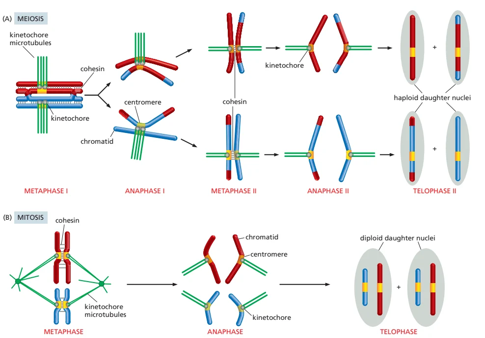{ width="860" height="600" loading=lazy }
/// caption
A 中先去除染色体臂黏连，着丝粒附近的黄色黏连保留到第二次分裂；B 中姐妹在同一次有丝分裂后期分离。[^fig-meiotic-cohesin]
///

**两次分裂之间不再进行一轮基因组复制。** 减数分裂 II 中，姐妹动粒重新建立双向附着；保护解除，剩余着丝粒黏连被切开，姐妹才分别进入两极。相似的 APC/C–separase 控制，在不同动粒朝向和黏连保护条件下，完成了不同的分离。

减数分裂的时间也随生活史改变。哺乳动物卵母细胞可长期停在前期 I，恢复后再停在中期 II，等待受精信号；精子发生、植物孢子发生则有各自的时空安排。雄性果蝇等还采用无经典交换的同源体分离方式，性染色体、无交叉同源体和多倍体都需要结合具体物种讨论，不能套用每对染色体都有交叉的图像。

## 周期变体与倍性变化 { #cycle-variants }

复制、核分裂和胞质分裂可以有不同的组合。**内周期（endocycle）**在 G 与 S 状态间重复，跳过完整 M 期；**内有丝分裂（endomitosis）**进入部分 M 期，却未完成通常的核分裂或胞质分裂。它们都可产生多倍体细胞，见于植物、昆虫的部分组织以及哺乳动物滋养层、巨核细胞等。巨核细胞常形成一个多倍体、分叶的核，并不能简单当作多个独立细胞核的集合。[^endoreplication]

**多倍体与多核是两种描述。** 核分裂继续而胞质暂不分割，可以形成多个核共用细胞质的状态，例如果蝇早期胚胎；细胞融合也能形成多核体，例如骨骼肌纤维。多倍化可能支持细胞增大、基因剂量与组织功能，也会改变后续分裂的难度，其意义取决于组织和发育阶段。

??? note "不同谱系怎样分配细胞核"

    典型有丝分裂的形态并不覆盖全部真核生物。许多甲藻在周期的大部分时间里保持高度凝缩的染色体，分裂时核被膜仍完整，微管可穿过由核膜形成的通道。具体结构在甲藻之间也有差异。[^dinoflagellate-mitosis]

    **无丝分裂（amitosis）**指没有典型有丝纺锤体分离过程的核分配。纤毛虫提供了清楚的例子：同一细胞中的生殖系小核可正常有丝分裂，多倍体大核却通过无丝分裂分配。大核中许多 DNA 拷贝的分配具有随机成分；核的职责与发育关系见[纤毛虫的核二型](../zoology/invertebrates/protists_boundary.md#ciliates)。[^ciliate-amitosis]

细菌的染色体复制与细胞分裂又是另一套系统。快速生长时，新一轮复制可以在上一轮尚未完成时启动，形成多叉复制。它们仍需协调复制与分配，但没有真核的核被膜、有丝纺锤体及同样的 G$_1$–S–G$_2$–M 结构。

## 怎样判断细胞走到哪一步 { #cell-cycle-evidence }

### DNA 含量与正在发生的合成 { #dna-content-assays }

用与 DNA 结合的荧光染料配合流式细胞术，可以快速测量大量单细胞的 DNA 含量。普通二倍体增殖群体通常出现复制前的 **2C 峰**、复制后的 **4C 峰**，以及中间的 S 期细胞。图中横轴用相对量 1、2 表示这两倍关系。[^cell-cycle-measurement]

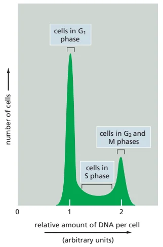{ width="390" height="592" loading=lazy }
/// caption
横轴为每个细胞的相对 DNA 量，纵轴为细胞数；图中 1 对应未复制、2 对应已复制。[^fig-flow]
///

只有 DNA 含量，还分不开 G$_0$ 与 G$_1$，也分不开 G$_2$ 与 M。多倍体细胞、细胞黏连形成的双细胞事件，也可能落到相似位置。因此要结合样品背景、单细胞筛选与其他标记判读；用 PI 等也能结合 RNA 的染料时，还需控制 RNA 对信号的影响。

短脉冲 **EdU／BrdU**标记读出当时的 DNA 合成，再追踪可以观察这一批细胞如何前进。它们不能单独证明这些细胞后来成功分裂，长时间或较强标记还可能扰动复制。

### 在活细胞里追踪一个完整周期 { #live-cycle-reporters }

**FUCCI**是利用蛋白质周转建立的荧光细胞周期指示系统。经典设计把 Cdt1 和 geminin 的片段分别接到红、绿荧光蛋白上，使它们在不同阶段积累或降解；由此可在同一枚活细胞中连续观察状态变化，沿分裂继续追踪子细胞。

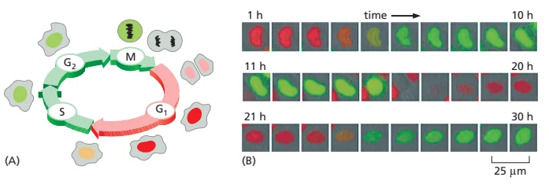{ width="820" height="281" loading=lazy }
/// caption
A 为设计原理，B 为每隔 1 小时拍摄的 30 小时序列；第 16—17 小时附近发生分裂，此后只继续展示一个子细胞。[^fig-fucci]
///

???+ abstract "颜色转换离真正的 S 期边界有多远"

    Grant 等在 U2OS 细胞中同时追踪经典 FUCCI 报告器和 **PCNA**。PCNA 在复制期形成核内斑点，可用来独立定位 S 期。下图的灰色 PCNA 图像先出现复制斑点时，红色 Cdt1 片段信号仍然存在。[^fucci-calibration]

    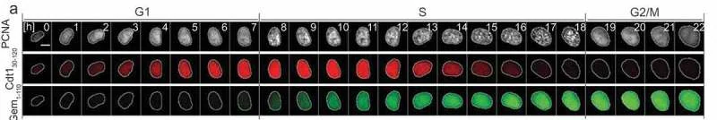{ width="840" height="141" loading=lazy }
    /// caption
    原文图 1a。上排为 PCNA，中排为 Cdt1$_{30–120}$ 报告器，下排为 geminin$_{1–110}$ 报告器；上方阶段依 PCNA 判定。[^fucci-calibration]
    ///

    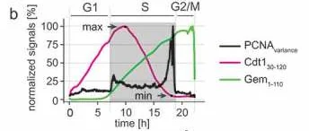{ width="520" height="221" loading=lazy }
    /// caption
    原文图 1b。灰区为 S 期；红、绿曲线为相应 FUCCI 信号，黑线为 PCNA 核内信号的空间变异度，用来反映复制斑点。[^fucci-calibration]
    ///

    这个例子说明，报告器积累与降解需要时间，经典 FUCCI 的红绿边界并不精确等于 DNA 复制开始或结束。该研究进一步改造降解片段，建立 PIP-FUCCI；选用哪种报告器，应取决于要区分的是大致周期状态，还是精确的复制边界。

几类常见证据可以互相补足：

| 方法或标记 | 主要回答什么 | 需要一起核对什么 |
| --- | --- | --- |
| DNA 含量，结合 Ki-67、RNA 等 | 群体中复制前后及增殖状态的比例 | 倍性、双细胞事件；G$_0$/G$_1$ 与 G$_2$/M 的重叠 |
| EdU／BrdU 脉冲与追踪 | 哪些细胞正在合成 DNA，这批细胞怎样推进 | 标记扰动、修复合成与后续命运 |
| 磷酸化组蛋白 H3、cyclin B、染色体及纺锤体形态 | M 期进入、形态阶段与连接结构 | 标记的时间范围，以及是否真正完成正常分配 |
| FUCCI、CDK 活性传感器、延时成像 | 单细胞停留时间和母子细胞轨迹 | 报告器动力学、表达量及成像光毒性 |
| 急性抑制、诱导降解、遗传救援 | 某组分在什么时间是必要的 | 脱靶、慢性适应、细胞背景与独立救援对照 |

### 同步化得到的是富集群体 { #synchronization }

为了在相近阶段比较细胞，可以轻柔振荡收集变圆、附着较弱的 M 期细胞，也可以按体积、密度进行分离。化学方法则常用 thymidine、hydroxyurea 干扰 DNA 合成后洗脱，或用 nocodazole、colchicine、vinblastine 等干扰微管，再观察释放后的推进。

每种方法都有选择作用。振荡挑出较易脱离的细胞，药物阻断又会改变复制压力、微管和应激状态；释放后，各细胞也不会永远同步。研究周期依赖的现象时，可以把未处理单细胞追踪、不同原理的富集以及多种标记放在一起比较。培养条件及同步化方法的取舍见[细胞培养中的生长状态与同步化](../exptech/cell/culture_fractionation.md#passage-growth)。[^synchronization-artifacts]

## 参考资料与延伸阅读 { #references }

[^cell-cycle-control]: 周期阶段及控制机制主要参考 Alberts、Heald 等，*Molecular Biology of the Cell*，第 7 版（2022），第 17 章，pp.1027–1088；公开旧版见[细胞周期控制系统](https://www.ncbi.nlm.nih.gov/books/NBK26824/)。
[^osm-cell-cycle]: 周期状态—控制系统—M 期的组织实质性改编自 osm.bio《[第十七章 细胞周期](https://osm.bio/index.php?title=第十七章_细胞周期&oldid=11577)》固定版本，贡献者为长河、Sofia，原文按 [CC BY-SA 4.0](https://creativecommons.org/licenses/by-sa/4.0/deed.zh-hans) 许可；相关内容经教材和所列研究交叉核验。
[^proliferation-quiescence]: 有丝分裂退出时 CDK2 活性分叉及母细胞状态对增殖—静息决定的单细胞证据见 Spencer 等的[研究](https://pubmed.ncbi.nlm.nih.gov/24075009/)。
[^cell-cycle-history]: `cdc` 基因、CDK 与 cyclin 发现的历史脉络见 Nobel Prize Outreach 的[2001 年生理学或医学奖说明](https://www.nobelprize.org/prizes/medicine/2001/7743-the-nobel-prize-in-physiology-or-medicine-2001/)；海胆卵 cyclin 合成—降解的原始观察见 Evans 等的[研究](https://pubmed.ncbi.nlm.nih.gov/6134587/)。
[^restriction-point]: G$_1$ 期限制点、RB–E2F 与生长因子依赖的经典框架见 NCBI Bookshelf 的[限制点章节](https://www.ncbi.nlm.nih.gov/books/NBK6318/)。
[^apccdh1-commitment]: Cappell SD 等（2016），*Irreversible APC/C Cdh1 Inactivation Underlies the Point of No Return for Cell-Cycle Entry*，Cell 166:167–180，[全文](https://pmc.ncbi.nlm.nih.gov/articles/PMC6649667/)。本页裁取图 1H、2I–J，保留报告器、推算活性、加药时刻和对照；Emi1 干预见图 3。
[^replication-licensing]: ORC–CDC6–CDT1 装载 MCM、S 期 CMG 激活及高 CDK／geminin 防止重新许可见 Sclafani 与 Holzen 的[复制许可综述](https://pmc.ncbi.nlm.nih.gov/articles/PMC3032801/)。
[^dna-damage-checkpoints]: ATM／ATR、CHK1／CHK2、CDC25、p53–p21 与周期延迟的网络见 Reinhardt 与 Yaffe 的[DNA 损伤检查点综述](https://pmc.ncbi.nlm.nih.gov/articles/PMC2699687/)。
[^spindle-checkpoint]: 检查点网络与附着纠错的背景见 Musacchio 与 Salmon 的[综述](https://www.nature.com/articles/nrm2163)。本页实验图来自 Waters JC 等（1998），*Localization of Mad2 to Kinetochores Depends on Microtubule Attachment, Not Tension*，JCB 141:1181–1191，[全文与图 7](https://pmc.ncbi.nlm.nih.gov/articles/PMC2137189/)；PtK1 细胞先用 10 μM taxol 处理至少 45 分钟，再注射抗 MAD2 抗体或抗原封闭对照。
[^mitosis-textbook]: 有丝分裂与胞质分裂主要参考 MBoC 第 7 版，pp.1045–1071；公开旧版见[有丝分裂](https://www.ncbi.nlm.nih.gov/books/NBK26934/)和[M 期概述](https://www.ncbi.nlm.nih.gov/books/NBK26931/)。
[^separase-cohesin]: Uhlmann F 等（2000），*Cleavage of Cohesin by the CD Clan Protease Separin Triggers Anaphase in Yeast*，Cell 103:375–386，[文献记录](https://pubmed.ncbi.nlm.nih.gov/11081625/)，[论文公开教学副本](https://www.andrew.cmu.edu/course/03-541/papers/P1.pdf)。本页裁取图 7A、7D；7D 通过抑制 CDC20 表达阻滞中期，与原图 7B、7C 的 nocodazole 条件不同。
[^animal-cytokinesis]: 收缩环、分裂沟定位、膜补充与胞质分裂时序的教材框架见 Alberts 等的[胞质分裂章节](https://www.ncbi.nlm.nih.gov/books/NBK26831/)；ESCRT-III 切断与染色质桥延迟机制见 Liu 与 Robinson 的[综述](https://pmc.ncbi.nlm.nih.gov/articles/PMC6259594/)。
[^plant-cytokinesis]: preprophase band、成膜体动态和细胞板由中央向外形成见 Li、Sun 与 Ren 的[植物有丝分裂与胞质分裂综述](https://pmc.ncbi.nlm.nih.gov/articles/PMC4410512/)。
[^meiosis-cohesin]: 前期 I、联会、交换与分步去除黏连见 MBoC 第 7 版，pp.1071–1077；Rec8、shugoshin–PP2A 与哺乳动物减数分裂轴结构另见 Ishiguro 的[综述](https://pmc.ncbi.nlm.nih.gov/articles/PMC7379579/)。
[^endoreplication]: endocycle、endomitosis 与发育性多倍化的共同控制逻辑见 Fox 与 Duronio 的[综述](https://pmc.ncbi.nlm.nih.gov/articles/PMC3513989/)。
[^cell-cycle-measurement]: DNA 含量与 Ki-67 联合流式的判读见 Kim 与 Sederstrom 的[方法综述](https://pubmed.ncbi.nlm.nih.gov/26131851/)；FUCCI 报告器的设计和组织应用见 Sakaue-Sawano 等的[原始研究](https://pubmed.ncbi.nlm.nih.gov/18267078/)。
[^synchronization-artifacts]: serum starvation、thymidine 与 nocodazole 富集对细胞大小和核性质的持续影响见 Chen 等的[比较研究](https://pmc.ncbi.nlm.nih.gov/articles/PMC3813296/)。
[^smc1-checkpoint]: Yazdi PT 等（2002），[SMC1 在人细胞 ATM／NBS1 支路中的检查点作用](https://pmc.ncbi.nlm.nih.gov/articles/PMC155356/)，Genes & Development 16:571–582。研究检验电离辐射后 SMC1 的磷酸化与 S 期内 DNA 合成抑制，不能概括为所有 S 期检查点只依赖 SMC1。
[^fission-yeast-meiosis]: Lorenz A 等（2006），[减数重组蛋白在裂殖酵母线性元件上的定位](https://pubmed.ncbi.nlm.nih.gov/16532353/)，Chromosoma 115:330–340；典型联会复合体缺失与线性元件组成另见其 [2004 年研究](https://pubmed.ncbi.nlm.nih.gov/15226405/)。
[^cdk-structure-source]: Jeffrey PD 等（1995），[cyclin A–CDK2 复合物结构揭示 CDK 活化机制](https://www.nature.com/articles/376313a0)，Nature 376:313–320；T 环与 PSTAIRE 螺旋的构象变化来自结构比较。Wee1 与 Myt1 的抑制位点区别见 Mueller 等（1995）的[Myt1 原研究](https://pubmed.ncbi.nlm.nih.gov/7569953/)。
[^mitotic-phosphatases]: Greatwall–ENSA／ARPP19–PP2A-B55 的机制与反馈见 MBoC 第 7 版，pp.1035–1037；相关原研究见 Mochida 等（2010），[Greatwall 对磷酸酶抑制蛋白的磷酸化](https://doi.org/10.1126/science.1195689)，以及 Gharbi-Ayachi 等（2010），[Arpp19 通过抑制 PP2A 控制入 M](https://doi.org/10.1126/science.1197048)。
[^degron-specificity]: D box、KEN box 与底物识别见 Pfleger 等的[APC 激活因子与底物结合研究](https://pmc.ncbi.nlm.nih.gov/articles/PMC312782/)；PEST 最初作为序列组成与短半衰期的相关特征提出，见 Rogers、Wells、Rechsteiner（1986）的[原研究](https://pubmed.ncbi.nlm.nih.gov/2876518/)。
[^premature-condensation]: Johnson RT、Rao PN（1970），[哺乳动物细胞融合诱导早熟染色体凝缩](https://pubmed.ncbi.nlm.nih.gov/5443247/)，Nature 226:717–722；G$_1$、S、G$_2$ 凝缩形态的比较另见 Unakul、Johnson、Rao（1973），[Giemsa 染色的早熟凝缩染色体](https://doi.org/10.1038/newbio242106a0)。
[^mitotic-transcription]: Palozola KC 等（2017），*Mitotic Transcription and Waves of Gene Reactivation During Mitotic Exit*，Science 358:119–122，[全文](https://pmc.ncbi.nlm.nih.gov/articles/PMC5727891/)。新生 RNA 标记与单分子 RNA FISH 支持有丝分裂期仍保留部分转录。
[^dinoflagellate-mitosis]: Gavelis GS 等（2019），[甲藻细胞核膜网络的三维超微结构研究](https://pmc.ncbi.nlm.nih.gov/articles/PMC6351617/)，Scientific Reports 9:839；研究材料为 Polykrikos kofoidii，文章亦比较不同甲藻的核膜通道和封闭式分裂。
[^ciliate-amitosis]: 纤毛虫大小核的分工见本站原生生物专节；多倍体大核 DNA 片段的随机分配与共同分离证据见 Wong 等（2000）的[四膜虫大核研究](https://pmc.ncbi.nlm.nih.gov/articles/PMC1461174/)。
[^fucci-calibration]: Grant GD、Kedziora KM、Limas JC、Cook JG、Purvis JE（2018），*Accurate delineation of cell cycle phase transitions in living cells with PIP-FUCCI*，[全文](https://pmc.ncbi.nlm.nih.gov/articles/PMC6342071/)。本页分别裁取图 1a、1b，保留 PCNA 参照、FUCCI 片段名称及 S 期灰区；这两幅图检测的是经典 FUCCI，PIP-FUCCI 的设计与验证见原文后续图版。
[^fig-haemanthus]: Alberts、Heald 等，*Molecular Biology of the Cell*，第 7 版（2022），图 17-38，p.1061。从原书裁取，保留原标注。
[^fig-phases]: Alberts、Heald 等，*Molecular Biology of the Cell*，第 7 版（2022），图 17-4，p.1029。从原书裁取，保留原标注。
[^fig-cyclins]: Alberts、Heald 等，*Molecular Biology of the Cell*，第 7 版（2022），图 17-10，p.1033。从原书裁取，保留原标注。
[^fig-cdk-structure]: Alberts、Heald 等，*Molecular Biology of the Cell*，第 7 版（2022），图 17-11，p.1034。从原书裁取，保留原标注。
[^fig-p27]: Alberts、Heald 等，*Molecular Biology of the Cell*，第 7 版（2022），图 17-13，p.1035。从原书裁取，保留原标注。
[^fig-feedback]: Alberts、Heald 等，*Molecular Biology of the Cell*，第 7 版（2022），图 17-16，p.1037。从原书裁取，保留原标注。
[^fig-pp2a]: Alberts、Heald 等，*Molecular Biology of the Cell*，第 7 版（2022），图 17-15，p.1036。从原书裁取，保留原标注。
[^fig-apc]: Alberts、Heald 等，*Molecular Biology of the Cell*，第 7 版（2022），图 17-18，p.1039。从原书裁取，保留原标注。
[^fig-rb-e2f]: Alberts、Heald 等，*Molecular Biology of the Cell*，第 7 版（2022），图 17-59，p.1080。从原书裁取，保留原标注。
[^fig-license]: Alberts、Heald 等，*Molecular Biology of the Cell*，第 7 版（2022），图 17-22，p.1044。从原书裁取，保留原标注。
[^fig-dna-damage]: Alberts、Heald 等，*Molecular Biology of the Cell*，第 7 版（2022），图 17-60，p.1081。从原书裁取，保留原标注。
[^fig-cohesin]: Alberts、Heald 等，*Molecular Biology of the Cell*，第 7 版（2022），图 17-23，p.1046。从原书裁取，保留原标注。
[^fig-mitosis-early]: Alberts、Heald 等，*Molecular Biology of the Cell*，第 7 版（2022），图 Panel 17-1，p.1048。从原书裁取，保留原标注。 保留前三阶段的结构模型、英文说明与显微图。
[^fig-mitosis-late]: Alberts、Heald 等，*Molecular Biology of the Cell*，第 7 版（2022），图 Panel 17-1，p.1049。从原书裁取，保留原标注。 保留后期、末期的结构模型、英文说明与显微图。
[^fig-spindle]: Alberts、Heald 等，*Molecular Biology of the Cell*，第 7 版（2022），图 17-26，p.1051。从原书裁取，保留原标注。
[^fig-centrosome-cycle]: Alberts、Heald 等，*Molecular Biology of the Cell*，第 7 版（2022），图 17-29，p.1054。从原书裁取，保留原标注。
[^fig-acentrosomal]: Alberts、Heald 等，*Molecular Biology of the Cell*，第 7 版（2022），图 17-32，p.1056。从原书裁取，保留原标注。 原显微图来自 de Saint Phalle、Sullivan（1998），[JCB 141:1383–1391](https://doi.org/10.1083/jcb.141.6.1383)。
[^fig-kinetochore]: Alberts、Heald 等，*Molecular Biology of the Cell*，第 7 版（2022），图 17-34，p.1057。从原书裁取，保留原标注。 A 为电镜图，B 为电子断层成像重建，C 为分子连接模型。
[^fig-attachments]: Alberts、Heald 等，*Molecular Biology of the Cell*，第 7 版（2022），图 17-35，p.1058。从原书裁取，保留原标注。
[^fig-aurora]: Alberts、Heald 等，*Molecular Biology of the Cell*，第 7 版（2022），图 17-36，p.1059。从原书裁取，保留原标注。
[^fig-flux]: Alberts、Heald 等，*Molecular Biology of the Cell*，第 7 版（2022），图 17-37，p.1060。从原书裁取，保留原标注。
[^fig-separase]: Alberts、Heald 等，*Molecular Biology of the Cell*，第 7 版（2022），图 17-39，p.1061。从原书裁取，保留原标注。
[^fig-anaphase]: Alberts、Heald 等，*Molecular Biology of the Cell*，第 7 版（2022），图 17-41，p.1063。从原书裁取，保留原标注。
[^fig-ring]: Alberts、Heald 等，*Molecular Biology of the Cell*，第 7 版（2022），图 17-43，p.1065。从原书裁取，保留原标注。
[^fig-midbody]: Alberts、Heald 等，*Molecular Biology of the Cell*，第 7 版（2022），图 17-44，p.1066。从原书裁取，保留原标注。
[^fig-rho-zone]: Alberts、Heald 等，*Molecular Biology of the Cell*，第 7 版（2022），图 17-47，p.1068。从原书裁取，保留原标注。
[^fig-plant-plate]: Alberts、Heald 等，*Molecular Biology of the Cell*，第 7 版（2022），图 17-48，p.1068。从原书裁取，保留原标注。
[^fig-plant-micrographs]: Alberts、Heald 等，*Molecular Biology of the Cell*，第 7 版（2022），图 17-49，p.1069。从原书裁取，保留原标注。 A 由 Andrew Bajer 提供；B 来自 Ho 等（2011），Plant Cell 23:2909–2923，原书注明。
[^fig-asymmetric]: Alberts、Heald 等，*Molecular Biology of the Cell*，第 7 版（2022），图 17-50，p.1070。从原书裁取，保留原标注。 原书注明显微图由 Susan Strome 提供。
[^fig-meiosis-compare]: Alberts、Heald 等，*Molecular Biology of the Cell*，第 7 版（2022），图 17-52，p.1072。从原书裁取，保留原标注。
[^fig-synaptonemal]: Alberts、Heald 等，*Molecular Biology of the Cell*，第 7 版（2022），图 17-54，p.1073。从原书裁取，保留原标注。
[^fig-synapsis]: Alberts、Heald 等，*Molecular Biology of the Cell*，第 7 版（2022），图 17-55，p.1074。从原书裁取，保留原标注。
[^fig-chiasmata]: Alberts、Heald 等，*Molecular Biology of the Cell*，第 7 版（2022），图 17-56，p.1074。从原书裁取，保留原标注。
[^fig-meiotic-cohesin]: Alberts、Heald 等，*Molecular Biology of the Cell*，第 7 版（2022），图 17-57，p.1075。从原书裁取，保留原标注。
[^fig-flow]: Alberts、Heald 等，*Molecular Biology of the Cell*，第 7 版（2022），图 17-7，p.1031。从原书裁取，保留原标注。
[^fig-fucci]: Alberts、Heald 等，*Molecular Biology of the Cell*，第 7 版（2022），图 17-6，p.1031。从原书裁取，保留原标注。 原显微序列来自 Sakaue-Sawano 等（2008），[Cell 132:487–498](https://pubmed.ncbi.nlm.nih.gov/18267078/)。
[^fig-mpf-transfer]: Alberts、Hopkin 等，*Essential Cell Biology*，第 5 版（2019），图 18-7，p.616；裁取 MPF 胞质转移实验的教材示意。
