# 细胞外基质、黏附与连接 { #_1 }

肠上皮每天接触食物和微生物，皮肤反复受到拉扯，心肌则一刻不停地收缩。细胞膜能包住一个细胞；要让许多细胞合成这样的组织，还得处理细胞之间的缝隙、把力传给邻居，并在细胞外铺设合适的材料。

**细胞连接**把相邻细胞的膜组织成封闭、承力或交换物质的界面；**细胞外基质**（extracellular matrix，ECM）则由细胞分泌的蛋白质和多糖组成。在上皮中，拉力主要沿细胞骨架和细胞连接传播；到了下方的结缔组织，大量胶原纤维直接承受拉伸。两者在基底膜处相接，构成从细胞内部一直延伸到细胞外基质的受力网络。[^cell-interactions-overview]

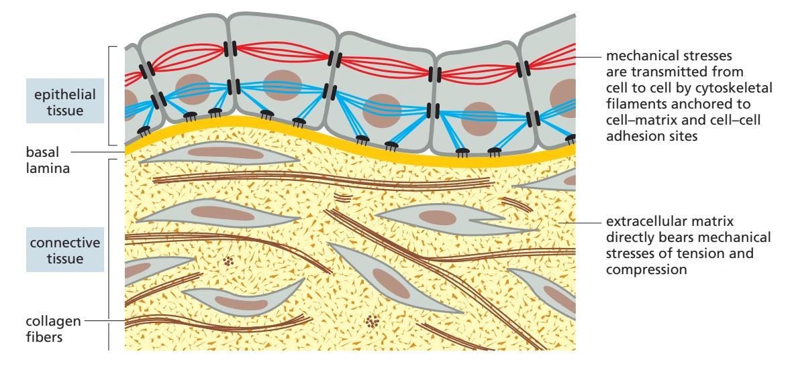{ width="700" height="334" loading="lazy" }
/// caption
上方的细胞通过连接传递拉力，下方的胶原纤维在基质中承力；黄色薄层为基底膜。[^fig-tissue-force]
///

下面先沿上皮细胞表面看各种连接，再进入基质的合成、装配与重塑，最后比较植物用细胞壁和胞间连丝完成的组织联系。[^osm-cell-junctions-ecm]

## 细胞连接的分工 { #junction-systems }

沿一个肠上皮细胞从顶端往下看，最靠近肠腔的是紧密连接，接着是与肌动蛋白相连的黏着连接；桥粒分布在侧面，把邻细胞的中间丝网络联系起来。基底面则通过细胞—基质连接附着于基底膜。缝隙连接在相邻细胞间提供小分子通道，其位置和数量随组织而变。一个细胞可以同时使用几套连接，分工也有重叠。[^cell-junctions-textbook]

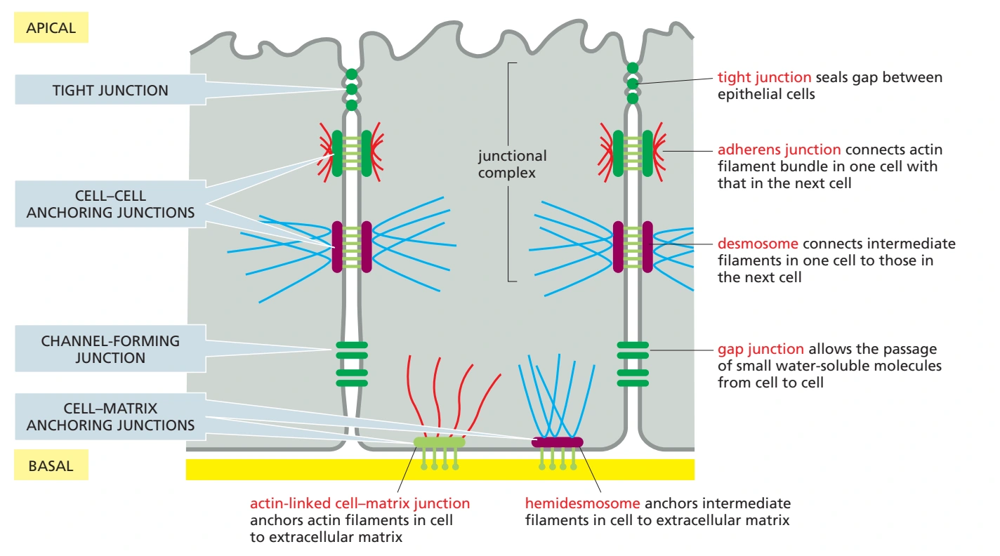{ width="720" height="400" loading="lazy" }
/// caption
红色为肌动蛋白，蓝色为中间丝。图把几种连接放在一起比较，实际组织的分布并不都如此整齐。[^fig-junction-map]
///

| 连接或结构 | 主要跨膜元件 | 主要连接对象 | 作用与常见位置 |
| --- | --- | --- | --- |
| 紧密连接 | claudin、occludin、JAM 等 | 经 ZO 蛋白联系肌动蛋白皮层 | 调节旁细胞通路、帮助分隔膜域；上皮和部分内皮 |
| 黏着连接 | 经典钙黏蛋白 | 经连环蛋白等联系肌动蛋白 | 细胞间黏附和张力传递；上皮黏着带、组织重排界面 |
| 桥粒 | desmoglein、desmocollin | 经桥粒斑联系中间丝 | 分散拉伸和剪切；表皮、心肌等 |
| 黏着斑 | 整联蛋白 | 胞外接基质，胞内经 talin 等接肌动蛋白 | 黏附、牵引和机械感知；多种基质接触面 |
| 半桥粒 | 整联蛋白 $\alpha6\beta4$、XVII 型胶原 | 胞外接层粘连蛋白，胞内接角蛋白中间丝 | 将上皮固定到基底膜；受摩擦上皮的基底面 |
| 缝隙连接 | 连接蛋白组成的连接子 | 两细胞的半通道对接 | 直接交换离子和小分子；多种脊椎动物组织 |
| 胞间连丝 | 连续质膜及内质网来源的中央管 | 穿过细胞壁的胞质通路 | 植物细胞间的共质体交换 |

这张表以脊椎动物和植物为主。许多无脊椎动物用**有隔连接**（septate junction）承担上皮封闭，用**内连接蛋白**（innexin）组成细胞间通道。与 innexin 同源的泛连接蛋白（pannexin）在脊椎动物中通常形成通向细胞外的单膜通道，例如参与 ATP 释放；它与两细胞半通道对接的标准缝隙连接有不同的工作方式。

## 上皮屏障与极性 { #epithelial-barrier-polarity }

### 紧密连接与旁细胞通路 { #tight-junctions }

物质穿过上皮有两条路线：进入一个细胞，再从另一侧离开，称为**跨细胞通路**；沿相邻细胞间的间隙通过，称为**旁细胞通路**。即使每个细胞都有很好的转运蛋白，只要细胞间隙敞开，上皮两侧的浓度差仍会迅速消失。

电镜示踪可以把这条缝隙显示出来。从肠腔侧加入的示踪物进入微绒毛之间，却在侧膜顶端的紧密连接处止步；从基底侧进入的示踪物也到达同一边界。这说明屏障位于一段特定的细胞接触区。

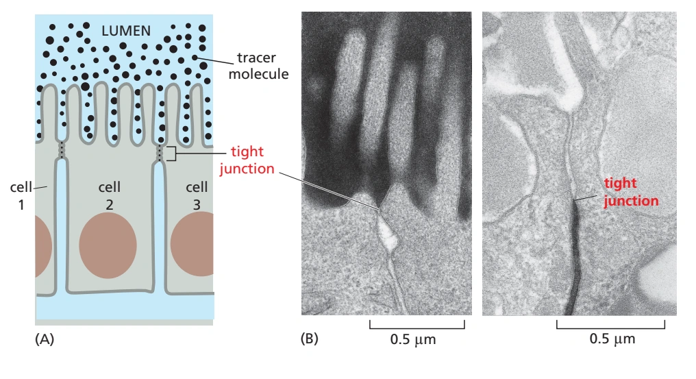{ width="720" height="392" loading="lazy" }
/// caption
左为路线示意；中、右电镜分别显示来自顶端和基底侧的示踪物。两张电镜比例尺均为 0.5 μm。[^fig-tight-tracer]
///

紧密连接并不是把两片脂双层熔在一起。其核心蛋白 **claudin** 四次穿膜，在同一细胞膜内聚合，并与邻细胞的 claudin 接触，形成多条相互分支的连接链。不同 claudin 的组合决定这些链对离子的选择性：有些形成允许特定离子通过的旁细胞孔道，有些则使屏障更严密。因而，肾小管可以一边维持上皮边界，一边让离子沿受控的旁细胞路线重吸收。

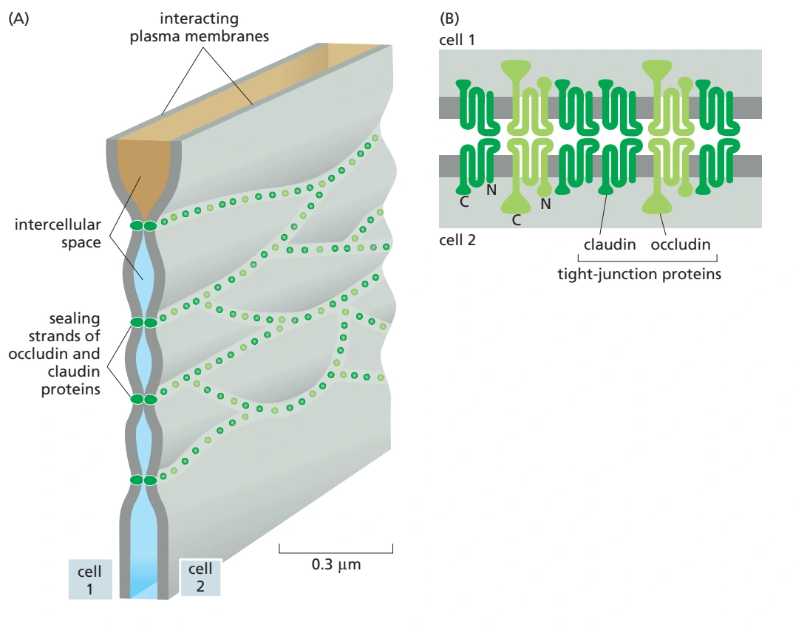{ width="660" height="525" loading="lazy" }
/// caption
左图把两细胞膜稍稍拉开，显示相互配对的连接链；右图标出 claudin 与 occludin 的跨膜方式。[^fig-tight-strands]
///

闭锁蛋白（occludin）、连接黏附分子 JAM 和 tricellulin 等参与屏障调节和稳定，其中 tricellulin 特别关联三个细胞相遇处的封闭。膜内侧的 ZO 蛋白提供结合位点，把这些膜蛋白与肌动蛋白皮层及调节蛋白联系起来。炎症、骨架张力、连接蛋白内吞或三细胞交界的变化，都会改变最终的旁细胞通量。

???+ abstract "只表达一种 claudin，能长出连接链吗？"

    Furuse 等选择了缺少内源紧密连接的 L 成纤维细胞，分别让它们表达带标记的 claudin-1 或 claudin-2，再用冷冻断裂电镜观察接触面。两组细胞都出现了分支成网的链与沟槽，免疫金标记又将 claudin 定位到这些结构上。原来，形成这种基本结构并不要求先把整套上皮分化程序搬进细胞。[^claudin-strands]

    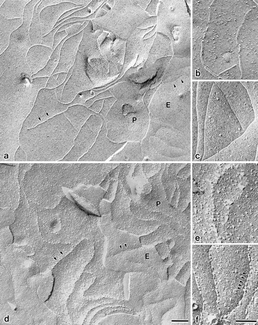{ width="429" height="540" loading="lazy" }
    /// caption
    a–c 为 claudin-1，d–f 为 claudin-2；P、E 是膜的两种断裂面。a、d 比例尺为 0.2 μm，其余为 0.1 μm。[^claudin-strands]
    ///

    这个实验直接回答的是“谁能组织连接链”。重建出链状结构后，仍需测离子电导和示踪物通量，才能知道它封得怎样、允许什么通过。图中两种 claudin 在断裂面上的颗粒分布也不同，不能单凭链的外观认定二者功能相同。

紧密连接还帮助限制部分膜脂和膜蛋白在顶端域与基底外侧域之间自由混合，这称为“栅栏”作用。顶端和基底侧的转运蛋白因而能维持不同分工。膜蛋白分选、极性复合物和细胞骨架同时参与极性的建立；膜内运动受到限制的观察见[受限的侧向运动](membrane_transport.md#membrane-domains-caveolae)。

!!! note "同是屏障，封闭它的细胞可以不同"

    血脑屏障的低旁细胞通透性主要由特化的脑微血管内皮实现，周细胞、星形胶质细胞终足和基底膜参与维持其状态。血睾屏障则有相邻支持细胞之间的紧密连接参与。[^blood-testis-barrier]屏障仍通过特定转运系统交换营养物和代谢物。

    claudin 的组织差异也有遗传学证据：CLDN16 功能缺陷可造成肾脏镁丢失，CLDN14 突变可导致遗传性耳聋。一个连接家族在肾和内耳维持的是不同的局部离子环境。[^claudin-tissues]

### 黏着连接与上皮张力 { #adherens-junctions }

紧密连接封闭细胞间隙，紧邻它的**黏着连接**（adherens junction）则将相邻细胞的肌动蛋白网络接起来。其跨膜核心是经典**钙黏蛋白**（cadherin）。以 E-cadherin 为例，胞外部分由一串重复结构域组成，Ca$^{2+}$ 结合在结构域之间，使整段保持较伸展、稳定的构象，便于末端与邻细胞上的钙黏蛋白结合。

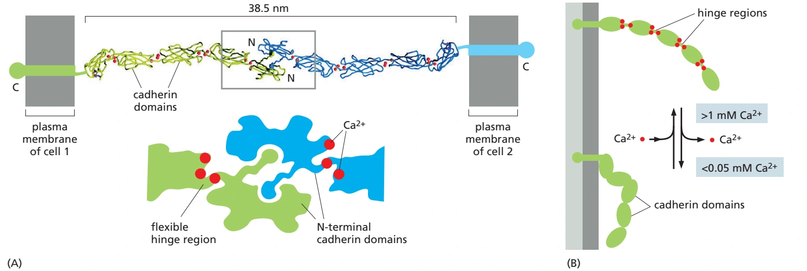{ width="760" height="256" loading="lazy" }
/// caption
Ca$^{2+}$ 位于结构域之间；右图比较有钙与低钙时的伸展和弯曲状态。左侧结构依据 C-cadherin 的晶体学研究。[^fig-cadherin-calcium]
///

单个钙黏蛋白之间的结合可以拆开，许多分子聚簇后却能形成稳定接触。培养时用 EDTA 螯合 Ca$^{2+}$，常可削弱这类黏附；它也会改变其他依赖二价离子的黏附系统，因此“EDTA 使细胞散开”本身还不能锁定是哪一种蛋白发挥作用。

胞内连接也有分工。$\beta$-连环蛋白（$\beta$-catenin）结合钙黏蛋白尾部，并招募 $\alpha$-连环蛋白；p120-catenin 结合尾部更靠近膜的位置，参与稳定细胞表面的钙黏蛋白。$\alpha$-连环蛋白及其结合伙伴把复合物接到肌动蛋白。这样，肌球蛋白 II 拉动肌动蛋白时，张力就可以沿连接传给邻细胞。

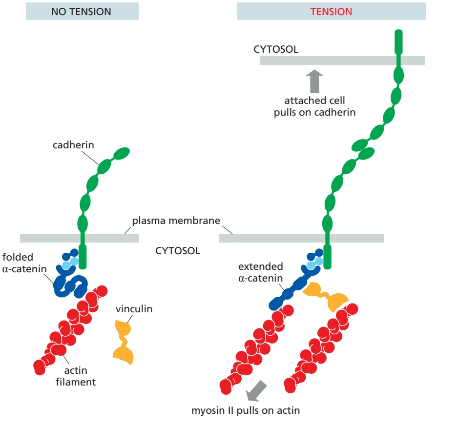{ width="570" height="529" loading="lazy" }
/// caption
两端分别受到邻细胞和肌动蛋白—肌球蛋白的拉力。伸展后的 α-连环蛋白暴露结合位点，招募黄色的纽蛋白 vinculin，增加与肌动蛋白的联系。[^fig-catenin-force]
///

这个连接会随受力而改变。$\alpha$-连环蛋白自身与肌动蛋白的结合具有力依赖性；受拉伸后，它还可暴露纽蛋白（vinculin）的结合位点，增强骨架联系。单分子实验已直接测到 $\alpha$-连环蛋白—肌动蛋白相互作用随受力改变。[^alpha-catenin-force] 上皮中的黏着带由此能协调多个细胞的顶端收缩，使一张细胞片弯曲、折叠成管，也能在细胞更换邻居时局部拆解和重建。

细胞刚接触时，接触处往往先减小局部皮层收缩，使两细胞接触面扩大；成熟连接随后组织能传递张力的肌动蛋白束。钙黏蛋白聚簇、骨架重排和连接更新必须配合，组织才既连得住，又改得动。

## 桥粒、半桥粒与黏着斑 { #load-bearing-adhesions }

### 桥粒：把拉力分散到中间丝 { #desmosomes }

桥粒（desmosome）的电镜形态很醒目：两片相邻细胞膜的胞质面各有一块致密斑，许多中间丝接入其中。在表皮，中间丝主要是角蛋白；在心肌，结蛋白（desmin）网络与桥粒相联系。中间丝能够承受较大的形变，适合反复摩擦、拉伸和收缩的组织。

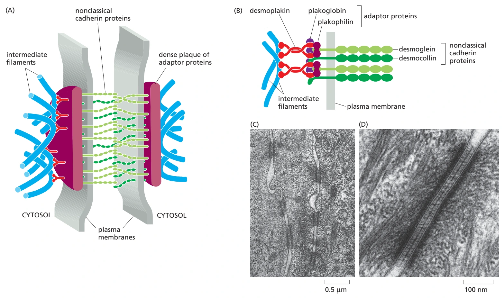{ width="760" height="450" loading="lazy" }
/// caption
A、B 显示连接关系，C、D 为幼鼠皮肤电镜。蓝色中间丝停留在各自细胞内，通过胞质斑和跨膜黏附分子传力。[^fig-desmosome]
///

桥粒中的两类钙黏蛋白——桥粒芯糖蛋白（desmoglein）和桥粒胶蛋白（desmocollin）——在细胞外结合。胞质侧的 plakoglobin、plakophilin 等帮助组成致密斑，桥粒斑蛋白（desmoplakin）再把中间丝锚定在斑上。拉力从一侧中间丝经过这串蛋白，再进入另一侧细胞，中间丝本身并不穿膜。桥粒蛋白也与信号、分化和连接周转相联系。

### 半桥粒：把上皮锚定到基底膜 { #hemidesmosomes }

半桥粒（hemidesmosome）在电镜下像半个桥粒，但对面是基底膜，跨膜元件也换成了整联蛋白 $\alpha6\beta4$ 和 XVII 型胶原。胞内的 plectin、BP230 等把它们与角蛋白连接，胞外则结合层粘连蛋白，形成从角蛋白到基底膜的连续受力路径。

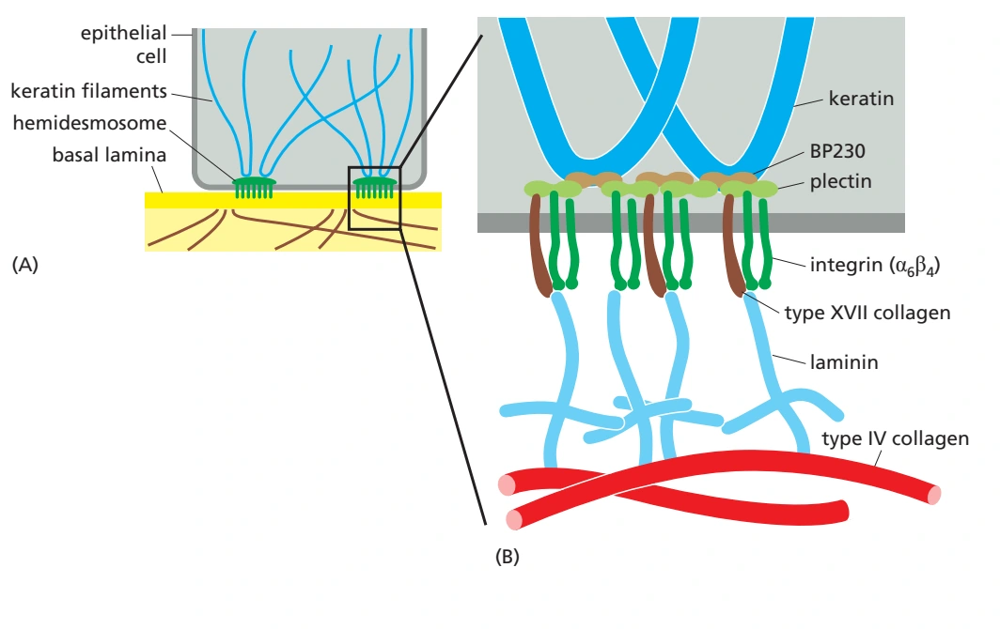{ width="640" height="403" loading="lazy" }
/// caption
沿蓝色角蛋白向下追踪，可依次看到胞质连接蛋白、跨膜受体和层粘连蛋白。基底膜中的 IV 型胶原另成网络。[^fig-hemidesmosome]
///

皮肤中的层粘连蛋白-332 是这条路径的重要成员。遗传缺陷或自身抗体破坏不同连接环节，组织就可能沿不同层面起疱：天疱疮中的抗桥粒蛋白自身抗体可使表皮细胞之间失去黏附；半桥粒或基底膜连接受损，则可能使表皮与下方组织分离。裂隙所在的位置，正好能反映力原本从哪里传过去。[^junction-blisters]

### 黏着斑：可周转的基质牵引点 { #focal-adhesions }

**黏着斑**（focal adhesion）连接的骨架主要是肌动蛋白。其跨膜核心**整联蛋白**（integrin，也称整合素）由 $\alpha$、$\beta$ 两个亚基组成，胞外结合纤维连接蛋白、胶原或层粘连蛋白等配体，胞内通过 talin 等连接肌动蛋白。

talin 和 kindlin 结合整联蛋白的胞质尾部，帮助调节受体活性；vinculin 增加与骨架的联系，paxillin 提供多种蛋白的结合位置，黏着斑激酶 FAK 则把局部黏附状态接入信号通路。随着拉力增加，一些接触可招募更多元件而成熟；随着后缘回收或局部信号改变，连接又能拆解。细胞爬行时的[突出、黏附、牵引与后缘回收](cytoskeleton.md#migration-cycle)就在这样的周转中衔接。

???+ abstract "拉长一条 talin，数一数多结合了几个蛋白"

    talin 杆状区由多个折叠结构域组成，一些 vinculin 结合位点埋在其中。del Rio 等取了含这些位点的 talin 片段，将一端固定在玻璃上，另一端接到磁珠，用磁镊向上拉。溶液中加入带单个荧光标记的 vinculin 头部片段（Vh），结合后洗去游离分子。[^talin-mechanosensing]

    

    

    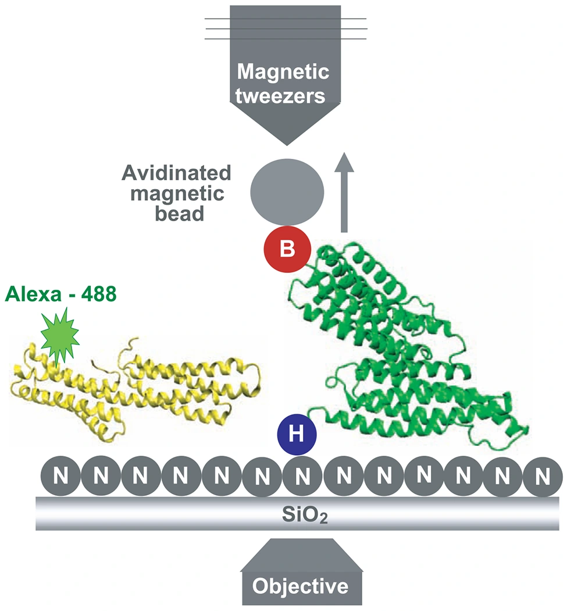{ width="410" height="442" loading="lazy" }
    /// caption
    绿色为 talin 片段，黄色为带荧光标记的 Vh。磁珠提供拉力，显微镜记录结合分子的荧光。[^talin-mechanosensing]
    ///

    

    

    荧光分子在持续照射下会逐个漂白。如果强度出现三个大小相近的下降台阶，就提示原先有三个可被逐一漂白的标记分子。这里数的是已结合的 Vh，而非直接看见蛋白被拉开的全过程。

    不施力时，单个 talin 片段通常检出零个或一个结合的 Vh；施加 12 pN 后，最多可见三个。将两个 talin 片段串联，最多可增至六个；换成具有可接近结合位点的 α-actinin，对照中施力前后最多仍是一个。

    

    

    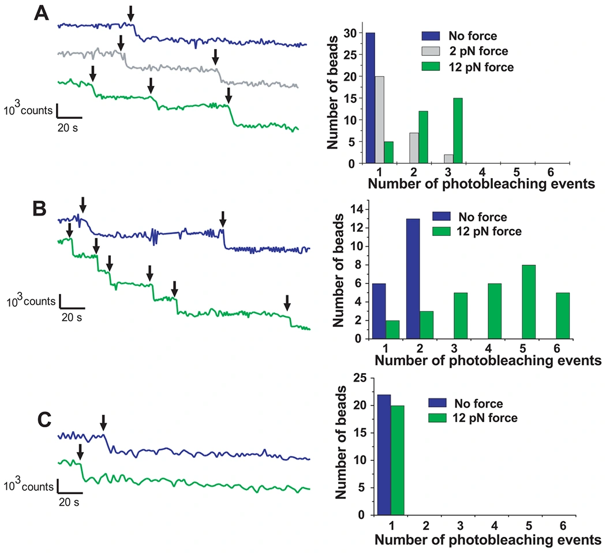{ width="760" height="694" loading="lazy" }
    /// caption
    A：单 talin 片段；B：串联片段；C：α-actinin 对照。蓝、灰、绿分别对应无外加力、2 pN、12 pN；箭头标出漂白台阶，右侧为事件数分布。[^talin-mechanosensing]
    ///

    受力使 talin 上更多结合位点可被 Vh 使用，配合论文的原子力显微镜拉伸结果，支持“结构域展开—位点暴露—增加结合”的机制。实验使用的是纯化片段；在黏着斑内，还需考虑全长蛋白的自抑制、其他结合伙伴及载荷变化。

## 黏附分子怎样识别与切换 { #adhesion-molecules }

稳定连接和短暂接触都要从分子识别开始。相同种类的分子相互结合叫**同类结合**，例如许多经典钙黏蛋白之间的结合；不同分子相互结合叫**异类结合**，例如整联蛋白 LFA-1 与 ICAM-1。两个细胞也可分别附着在共同的基质上，由胞外材料将它们联系起来。[^cell-adhesion-textbook]

钙黏蛋白的种类和表达量会影响细胞分选。E-cadherin 常见于上皮，N-cadherin 广泛参与神经、肌肉等组织的黏附，VE-cadherin 则参与血管内皮连接；名称提示了发现背景，分布未必严格局限于字面上的组织。不同细胞表达不同钙黏蛋白时，可以出现偏好的相邻关系，但皮层张力、极性和其他黏附分子也会改变分选结果。

小鼠基因缺失实验显示这些成员的功能并不等价：缺少合子来源 E-cadherin 的胚胎仍可借母源蛋白短暂致密化，却不能形成正常滋养外胚层和囊胚腔；N-cadherin 缺失明显影响早期心脏等结构。P-cadherin 在胎盘和部分上皮中表达，其缺失小鼠仍可存活，但未孕雌鼠的乳腺出现过早分化；VE-cadherin 缺失则严重扰乱血管形态发生。[^cadherin-genetics] 原钙黏蛋白（protocadherin）以及前面的桥粒钙黏蛋白属于这个超家族的其他分支，胞内结合伙伴和组织作用各有特点。

!!! info "E-cadherin 减少与上皮—间充质转变"

    上皮—间充质转变（EMT）涉及连接、极性、骨架、迁移方式、基质相互作用和基因表达程序的共同变化。E-cadherin 减少是常见读出之一。某个样本中仅测到这一蛋白下降，还不足以说明细胞已完成整套转变；发育和肿瘤中也可出现保留部分上皮特征的中间状态。

另两类常见分子是**选择素**（selectin）和**免疫球蛋白超家族**（IgSF）黏附分子。选择素依赖 Ca$^{2+}$ 识别特定糖链：E-选择素见于活化内皮，P-选择素可由内皮和血小板呈递，L-选择素见于多类白细胞。它们适合在血流中形成短暂接触，使白细胞先被捕获，再沿血管壁滚动。

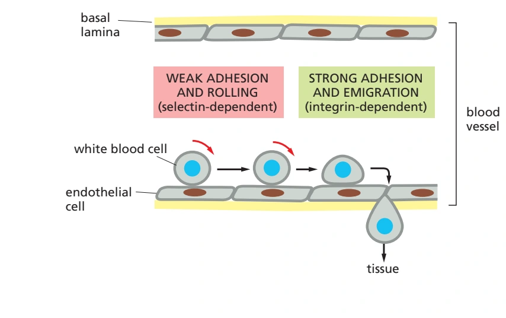{ width="660" height="414" loading="lazy" }
/// caption
从左到右依次为滚动、较稳定黏附和离开血管；图概括了分工，未画出趋化因子触发的活化步骤。[^fig-selectin-rolling]
///

IgSF 成员的识别通常不要求 Ca$^{2+}$，既可同类结合，也可异类结合。神经细胞黏附分子 NCAM、L1-CAM 参与神经组织的接触与生长。L1CAM 的某些致病变异会造成包含脑积水和神经发育异常的 L1 综合征，体现黏附分子在神经系统构建中的作用。[^l1cam-development]

血管表面的 ICAM、VCAM 则能与白细胞的整联蛋白结合。滚动的白细胞收到趋化因子信号后，整联蛋白的亲和力和聚集状态改变，才更容易牢固停靠。各类分子在组织归巢中的组合见[白细胞迁移的分子地址](../immunology/immune_cells_tissues.md#leukocyte-trafficking)。

整联蛋白的切换尤其适合连接胞内外事件。胞内信号促使 talin、kindlin 等作用于 $\beta$ 亚基尾部，改变两亚基的相互作用并提高胞外配体结合能力，这是**由内向外激活**。反过来，胞外配体结合、受体聚簇和受力又促使胞内黏附与信号复合物组装，形成**由外向内信号**。

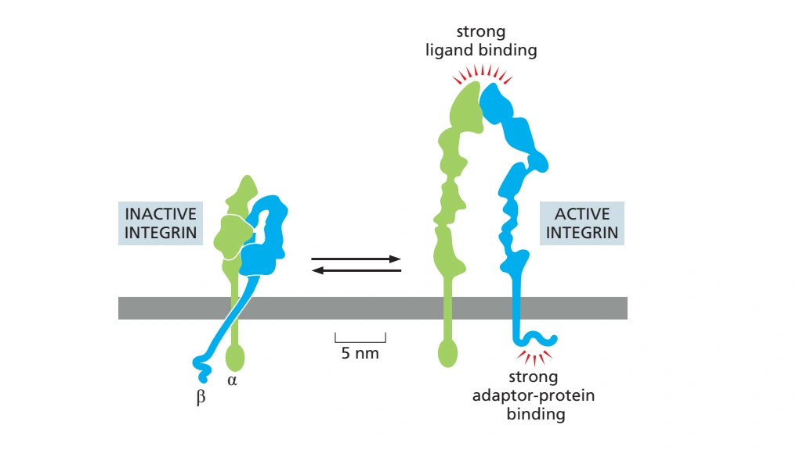{ width="590" height="340" loading="lazy" }
/// caption
胞外配体结合与胞内连接蛋白结合相互影响。图给出两种代表状态，实际还存在头部开闭等多个中间构象。[^fig-integrin-switch]
///

不同整联蛋白使用不同的识别界面。纤维连接蛋白中的精氨酸—甘氨酸—天冬氨酸（RGD）序列可参与某些整联蛋白的结合；胶原、层粘连蛋白与其他整联蛋白组合还使用不同基序。Mg$^{2+}$、Ca$^{2+}$ 等二价离子也影响结合，具体作用取决于亚型和结合位点。

黏附还能成为生存条件。许多上皮细胞脱离适当基质后，生存信号下降并触发**失巢凋亡**（anoikis）；某些肿瘤细胞能够绕过这项限制。血液中许多细胞本来就能在悬浮状态下正常存活，依靠的是适合其分化状态的生存程序；培养中的基质需求也随细胞类型和培养条件而变。

## 缝隙连接与直接胞质通讯 { #gap-junctions }

缝隙连接（gap junction）把两个细胞的胞质用蛋白质通道连起来。一个细胞膜内，六个**连接蛋白**（connexin）亚基组成一个**连接子**（connexon）；相邻细胞各提供一个连接子，在细胞外侧对接，形成贯穿两层膜的水相通道。

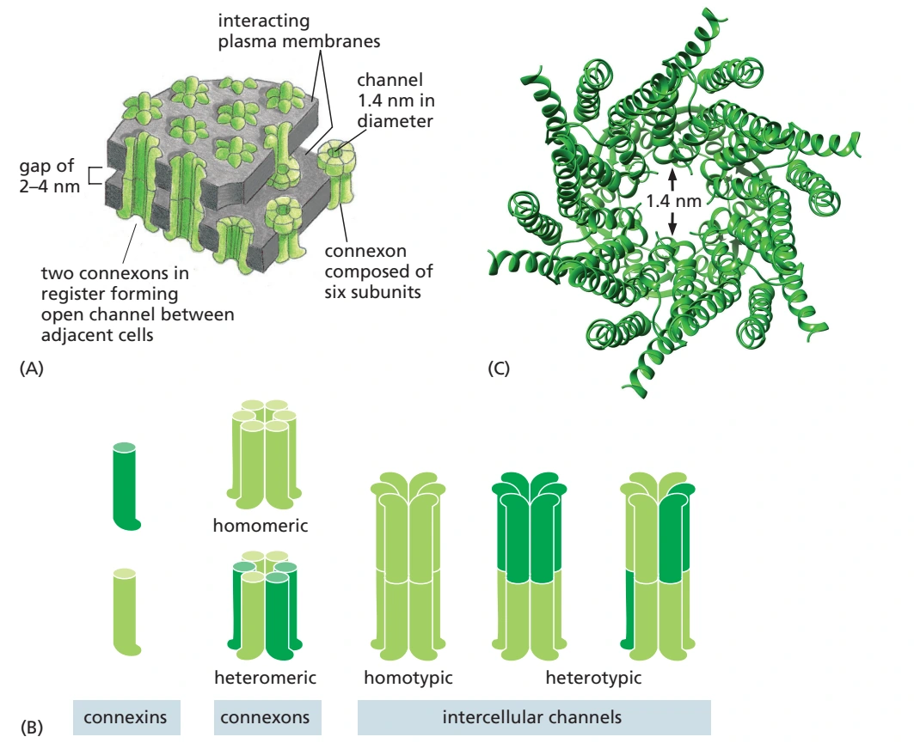{ width="700" height="570" loading="lazy" }
/// caption
A：两个连接子对接；B：单一或混合亚基构成半通道，再形成同型或异型配对；C：Cx26 通道的端面结构。[^fig-gap-channel]
///

一个连接子可以含同一种或多种 connexin，两个对接的连接子也可以相同或不同，因而产生不同的电导、选择性、门控与周转特征。图中 Cx26 晶体结构显示六个亚基如何围出孔道，N 端区参与形成较窄的入口。[^connexin-channel]

离子通过这些通道可以产生细胞间电耦联；部分小代谢物和第二信使，例如 cAMP、IP$_3$，也可直接交换。心肌、平滑肌、部分神经网络以及某些代谢耦联组织由此协调活动。通透性取决于分子的大小、形状、电荷和通道组成，“约 1 kDa 以下”只能作粗略尺度，不能当作所有通道共同的硬性筛孔标准。

胞内酸化、Ca$^{2+}$ 升高、跨连接电压和磷酸化等可改变通道开放概率。在某些通道中，损伤导致的酸化或钙升高会促使通道关闭，限制异常状态向邻细胞扩散；响应程度仍取决于 connexin 类型和细胞环境。双细胞电压钳测的是电耦联，染料注射后向邻细胞扩散测的是该染料的通透，两种读出互相补充。

化学突触则经历囊泡释放、递质在细胞外扩散和受体响应，两个细胞的胞质仍然分隔。电突触与化学突触的传递方向、释放和可塑性见[突触传递](../neuro/neuro_synapse.md#electrical-chemical-synapses)。

## 动物细胞外基质 { #animal-ecm }

结缔组织中的成纤维细胞持续分泌基质；软骨细胞、成骨细胞及各组织中的其他细胞，也制造适合当地功能的材料。同样几大类分子，换一种比例和排列方式，便能形成柔软的脂肪间质、坚韧的肌腱或透明的角膜。先分清抗拉、回弹和抵抗压缩的来源，再看这些材料怎样装配到细胞周围。[^ecm-textbook]

### 胶原与弹性蛋白 { #collagen-elastin }

**胶原蛋白**（collagen）是哺乳动物中最丰富的一类蛋白质，其基本结构是三条多肽链缠绕成的三股螺旋。每条链称为 $\alpha$ 链，但这里的“α”是命名，单链实际采用左手多聚脯氨酸 II 样构象；三条链再组成右手超螺旋。典型螺旋区反复出现 Gly-X-Y：每第三位的甘氨酸侧链只有一个氢，才能挤进三条链相聚的中心；X、Y 常分别为脯氨酸和羟脯氨酸。[^collagen-structure]

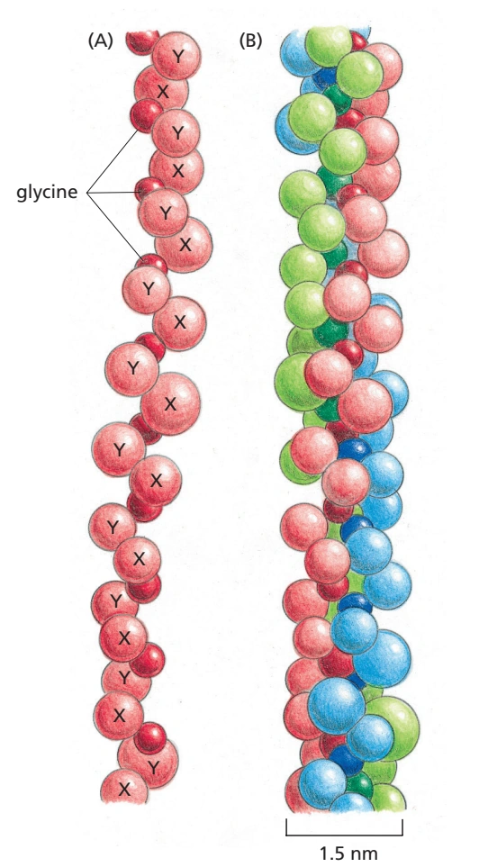{ width="290" height="525" loading="lazy" }
/// caption
左：Gly-X-Y 的单链排列；右：三条链组成的短段三股螺旋。完整原纤维胶原分子远长于此。[^fig-collagen-helix]
///

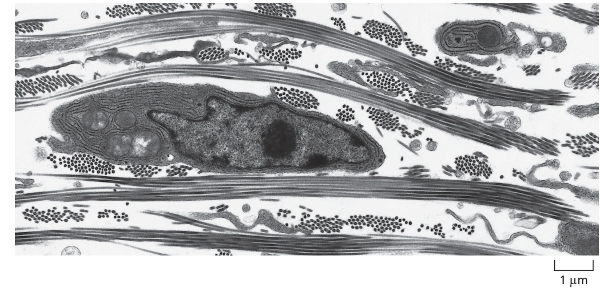{ width="470" height="223" loading="lazy" }
/// caption
不同方向的胶原束在切面上分别呈纵切与横切形态；中央为成纤维细胞。比例尺 1 μm。[^fig-collagen-fibrils]
///

胶原分子进一步排列为原纤维，原纤维又可聚成更粗的胶原纤维。肌腱中的纤维倾向沿主要受力方向排列，皮肤则形成更能抵抗多方向拉力的编织结构。强度既来自分子，也来自排列。

原纤维胶原的合成分为胞内加工与胞外装配。新生前体进入粗面内质网后，信号肽被去除，部分脯氨酸和赖氨酸残基被羟化，部分羟赖氨酸再连接糖基。三条链通过 C 端前肽等区域识别、对齐，三股螺旋从 C 端向 N 端逐步形成，得到两端仍带前肽的**前胶原**（procollagen）。前肽帮助装配，也抑制这些长分子过早在胞内聚成大原纤维。

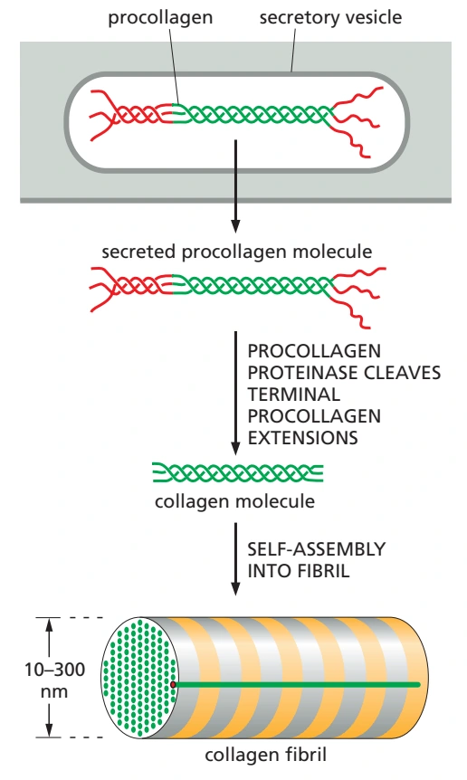{ width="320" height="535" loading="lazy" }
/// caption
红色末端为前肽；它们在分泌后的胞外加工中被切除，随后分子排列成原纤维。[^fig-collagen-secretion]
///

前胶原经高尔基体运输后分泌。胞外的特定蛋白酶切除 N、C 端前肽，得到常称为原胶原（tropocollagen）的分子，随后有序排列成原纤维。赖氨酰氧化酶将部分赖氨酸或羟赖氨酸侧链转为活泼醛基，后续反应在分子内、分子间形成共价交联，进一步提高抗拉强度。

维生素 C 参与维持相关羟化酶的活性。缺乏时新胶原的稳定形成受到影响，组织更新中便可能逐渐出现血管脆弱和伤口愈合不良。Ehlers–Danlos 综合征包含不同遗传类型，可影响胶原结构、加工或基质组织的不同环节，不能归为同一种加工酶缺陷。

胶原家族还有不同的装配方式。I、II、III 型主要形成原纤维，分别在皮肤／肌腱／骨、软骨及多种内脏支持组织中丰富；IV 型的螺旋区有中断，分子较易弯曲，组成基底膜中的网络；VII 型构成锚定纤维，帮助把某些上皮的基底膜接到下方结缔组织。XVII 型则是前面半桥粒中的跨膜胶原。结构不同，承担的连接尺度也不同。

**弹性蛋白**（elastin）为大动脉、肺和皮肤等组织提供回弹。原弹性蛋白分泌后，在原纤蛋白（fibrillin）等组成的微原纤维支架附近沉积；赖氨酰氧化酶参与生成赖氨酸衍生的交联，包括锁链素（desmosine）等特殊交联结构。弹性蛋白富含甘氨酸和脯氨酸，通常不糖基化，也没有胶原式的连续 Gly-X-Y 重复。其柔性疏水区可以伸展，交联点又使各条链不会拉开后各奔东西。

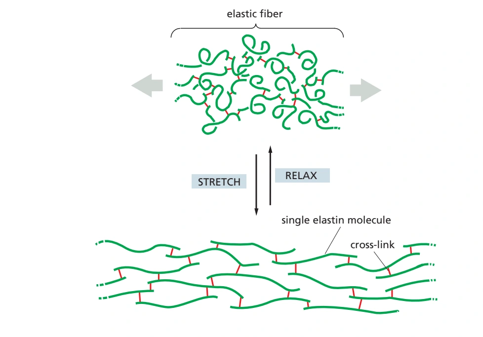{ width="590" height="412" loading="lazy" }
/// caption
红色为交联点。拉伸时链段较伸展，卸载后趋向恢复卷曲；胶原纤维则帮助限制组织过度伸长。[^fig-elastin-network]
///

弹性回缩与柔性链的构象变化及水合作用有关。弹性蛋白、原纤蛋白、胶原的比例、交联程度和空间排列一起塑造组织的力学性质；同是“有弹性”，血管壁和皮肤的响应曲线也不会相同。

### 糖胺聚糖与蛋白聚糖 { #gag-proteoglycan }

胶原抵抗拉伸，软骨抵抗压缩则还需要大量水。把水留在基质中的重要成分是**糖胺聚糖**（glycosaminoglycan，GAG）：由重复二糖单元组成的不分支长链多糖，通常含氨基糖和糖醛酸。羧基及许多 GAG 上的硫酸基带负电荷，吸引反离子，并通过渗透作用促进水分进入。被胶原网络约束的水合基质受到压缩时，会产生恢复体积的趋势。

| GAG 类型 | 结构或合成特点 | 常见关联 |
| --- | --- | --- |
| 透明质酸 | 不硫酸化，不与核心蛋白共价相连；由质膜合酶直接向外合成 | 水合空间、关节液、组织发育与修复 |
| 硫酸软骨素、硫酸皮肤素 | 含氨基糖和糖醛酸，硫酸化模式可变 | 软骨、皮肤及多类结缔组织蛋白聚糖 |
| 硫酸乙酰肝素、肝素 | 结构相关，肝素通常硫酸化程度更高 | 前者广见于细胞表面及基质；后者富集于肥大细胞颗粒等处 |
| 硫酸角质素 | 二糖中用半乳糖替代常见的糖醛酸；蛋白连接方式也不同 | 角膜、软骨等组织 |

除透明质酸外，GAG 通常共价连接在核心蛋白上，形成**蛋白聚糖**（proteoglycan）。核心多肽先进入内质网，糖链主要在高尔基体逐步装配并修饰。硫酸软骨素和硫酸乙酰肝素等常从核心蛋白的丝氨酸位点开始，以木糖—半乳糖—半乳糖—葡糖醛酸组成的连接区接上延长中的链；硫酸角质素另有连接方式。

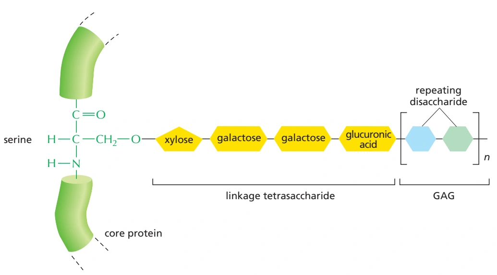{ width="690" height="382" loading="lazy" }
/// caption
从左到右为核心蛋白、木糖起始的四糖连接区和重复二糖链；图示适用于相应类型的蛋白聚糖。[^fig-gag-linkage]
///

一个蛋白聚糖可带多条 GAG，不同蛋白聚糖又能组成更大的聚集体。软骨中的**聚集蛋白聚糖**（aggrecan）带有大量硫酸软骨素和硫酸角质素链，许多 aggrecan 借核心蛋白上的结合区附着于一条透明质酸，连接蛋白帮助稳定结合。透明质酸在这里相当于一条长轴，aggrecan 是沿轴伸出的许多分支；它们之间是非共价结合，区别于 GAG 与各自核心蛋白的共价连接。

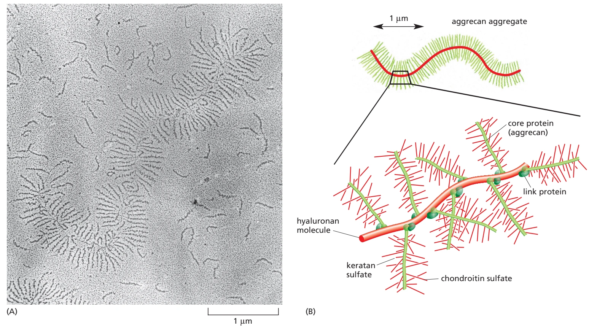{ width="750" height="419" loading="lazy" }
/// caption
左图可见大型聚集体和散在单体；右图中透明质酸连接多个 aggrecan，后者各自携带 GAG 链。[^fig-aggrecan]
///

蛋白聚糖还决定分子能否接近细胞。基底膜中的 perlecan 参与组织和过滤；跨膜蛋白聚糖 syndecan 在胞外结合基质与生长因子，胞内联系骨架和信号蛋白。硫酸乙酰肝素链能局部富集 FGF 等信号分子，并帮助受体形成有效的配体复合物。由此，水合、孔隙和特异结合可以发生在同一块基质中。

### 纤维连接蛋白与层粘连蛋白 { #fibronectin-laminin }

胶原、蛋白聚糖和细胞受体之间，还需要具有多个结合部位的蛋白组织联系。**纤维连接蛋白**（fibronectin，亦简称纤连蛋白）由两条大多肽在 C 端附近以二硫键相连；每条链包含多个重复结构域，分别提供胶原、整联蛋白及肝素／硫酸乙酰肝素等结合位点。

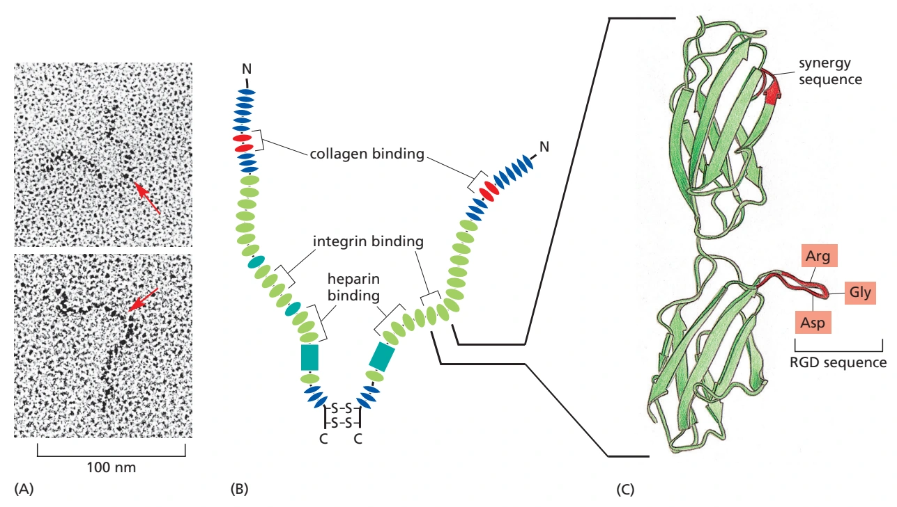{ width="720" height="408" loading="lazy" }
/// caption
A 的红箭头指向两链相连的 C 端；B 标出不同结合区；C 显示参与整联蛋白识别的 RGD 与协同位点。[^fig-fibronectin]
///

可溶性纤维连接蛋白结合细胞表面的整联蛋白后，若另一端也有所附着，细胞骨架产生的张力便能使它伸展，暴露原来不易接近的自结合位点，招募更多分子形成纤维。Rho 调节的肌动蛋白—肌球蛋白收缩参与这一过程。[^fibronectin-assembly] 细胞由此一边附着在基质上，一边改变基质的排列。血浆中的可溶性纤维连接蛋白还可结合纤维蛋白，参与凝块与伤口临时基质的组织，为后续细胞迁移和修复提供附着条件。[^fibronectin-fibrin]

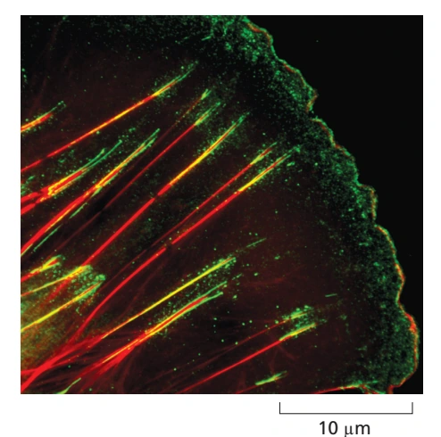{ width="410" height="407" loading="lazy" }
/// caption
红色为胞内肌动蛋白，绿色为胞外纤维连接蛋白；黄色为图像中两种信号的重叠。比例尺 10 μm。[^fig-fibronectin-actin]
///

图中胞内肌动蛋白束与胞外纤维连接蛋白沿相近方向延伸，中间的质膜由整联蛋白跨越，再经胞内连接蛋白衔接成传力路径。荧光图显示空间对应，具体的分子联系则来自定位、扰动与结合实验。

**层粘连蛋白**（laminin）由 $\alpha$、$\beta$、$\gamma$ 三条链组成异三聚体，不同链的组合产生不同亚型。图中的 laminin-111 含 $\alpha1$、$\beta1$、$\gamma1$；皮肤中的 laminin-332 则使用另一套链。不同亚型的臂长、受体结合和自组装能力有所差异。

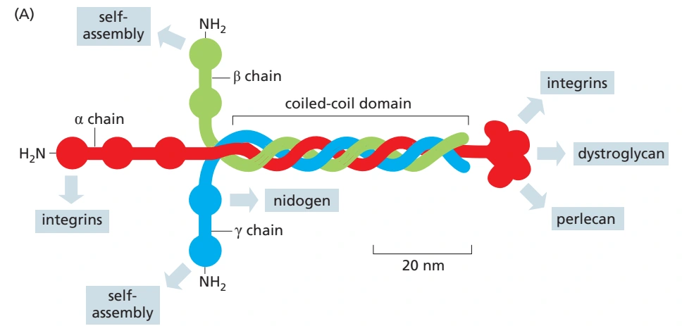{ width="700" height="335" loading="lazy" }
/// caption
三条链组成长臂和短臂，部分区域参与分子间组装，另一些结合整联蛋白、肌营养不良聚糖及基质成分。[^fig-laminin]
///

层粘连蛋白先通过整联蛋白、肌营养不良聚糖（dystroglycan）等受体定位于细胞表面；能聚合的亚型再形成网络，并与其他基质成分协同，组织出薄而连续的基底膜。

## 基底膜与细胞表面糖萼 { #basement-membrane-glycocalyx }

**基底膜**是特化的薄层 ECM，位于上皮和内皮的基底侧，也包围肌细胞、施万细胞、脂肪细胞等。层粘连蛋白和 IV 型胶原分别形成网络，巢蛋白（nidogen）及蛋白聚糖 perlecan 等参与连接和组织。这里沿用细胞生物学中较宽的 basement membrane 用法；组织学有时进一步区分基板（basal lamina）及其下方的网状层。

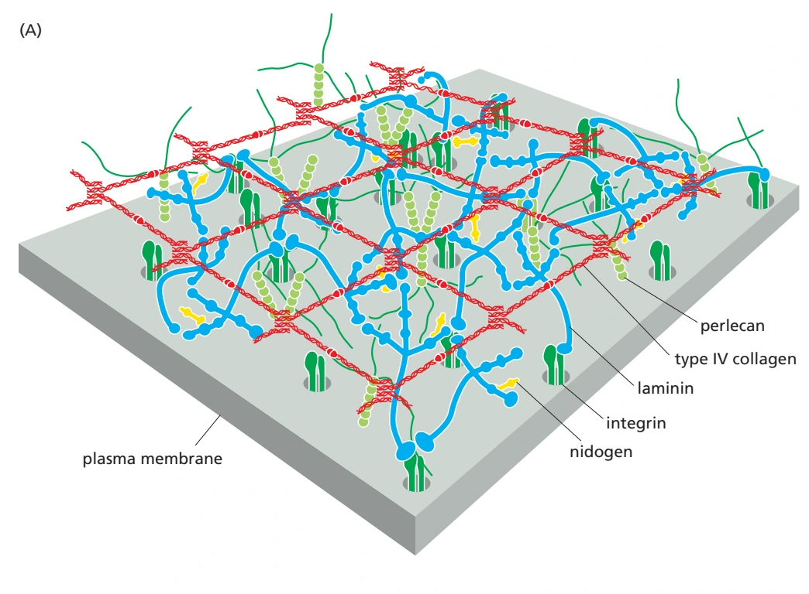{ width="720" height="530" loading="lazy" }
/// caption
细胞表面受体帮助定位层粘连蛋白，IV 型胶原提供另一套支撑网络；各组分按特定结合关系组织。[^fig-basement-network]
///

层粘连蛋白有助于最初的装配，IV 型胶原则对后续稳定性很关键。删除小鼠主要 IV 型胶原两条链的基因后，早期胚胎仍可在预期位置沉积并组织基底膜成分，但随着发育和机械需求增加，基底膜出现结构缺陷，胚胎随后死亡。[^collagen-iv-network] “先铺出一层”与“长期经得住拉扯”，确实是两件可以在实验中分开的事。

基底膜还提供极性和分化线索，参与肾小球过滤、干细胞微环境及组织修复。细胞受损后，残留的基底膜可为再生细胞或轴突提供原有路径；其局部成分也影响哪些细胞能够停留或穿越。

**糖萼**则直接位于质膜外侧，由膜糖蛋白、糖脂、蛋白聚糖的糖链及其结合的可溶成分构成。负电荷、空间排斥和水合作用影响分子接近膜表面，特定糖链又能被凝集素识别——前面选择素对糖链的识别就是一例。血管内皮糖萼还参与感受流体剪切。它会随分泌、脱落、酶切和流动环境改变，固定方法与成像尺度也会影响测到的厚度。

## 基质重塑与机械转导 { #ecm-remodelling-mechanotransduction }

细胞不断合成、装配、交联，也不断降解基质。成纤维细胞是许多结缔组织的重要来源，上皮、内皮、肌细胞、脂肪细胞和免疫细胞同样能改造局部环境。基质金属蛋白酶（MMP）可切割胶原等成分，ADAMTS 家族中的相应蛋白酶参与蛋白聚糖等底物的加工。酶原活化、细胞表面定位、组织抑制剂和底物可及性共同限制作用范围，让迁移或组织重排所需的降解集中在局部。

切割也可能释放被基质束缚的生长因子，或产生具有信号活性的片段。与此同时，细胞经整联蛋白—talin—肌动蛋白向外施力，基质抵抗变形的程度又影响连接上的张力与信号。这种把物理作用转为细胞响应的过程称为**机械转导**。

???+ abstract "同样的培养液，换一种软硬程度"

    Engler 等把骨髓来源的间充质干细胞种在包被 I 型胶原的聚丙烯酰胺凝胶上，在相同血清条件下改变凝胶的弹性模量 $E$。模量越大，材料在相近应变下抵抗变形的能力越强。约 0.1–1 kPa 的软凝胶、8–17 kPa 的中等凝胶和 25–40 kPa 的较硬凝胶上，细胞分别更倾向出现多分支、梭形和多角形的形态。[^matrix-elasticity]

    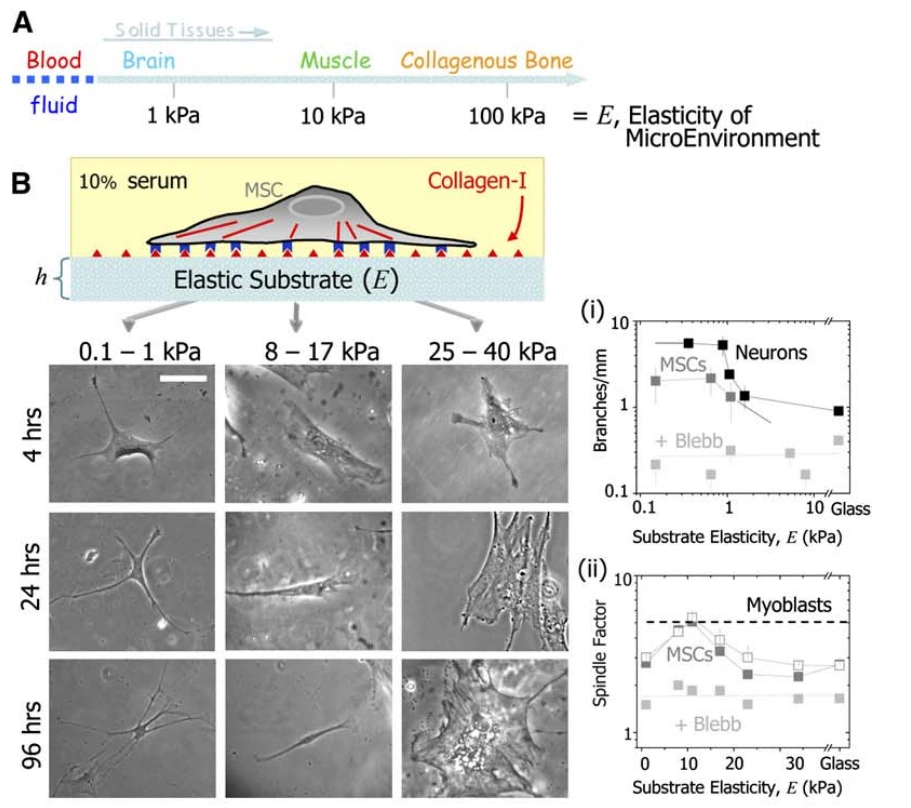{ width="740" height="656" loading="lazy" }
    /// caption
    横向比较基质软硬，纵向比较培养时间。A 为组织尺度的参照；B 为培养系统、显微图及形态定量，显微图比例尺 20 μm。[^matrix-elasticity]
    ///

    形状变化之后，研究者又测了谱系相关转录本。神经、肌肉、成骨相关的一组标记分别在较软、中等和较硬条件下更突出；抑制肌球蛋白活动的 blebbistatin 处理削弱了这些表达偏向。

    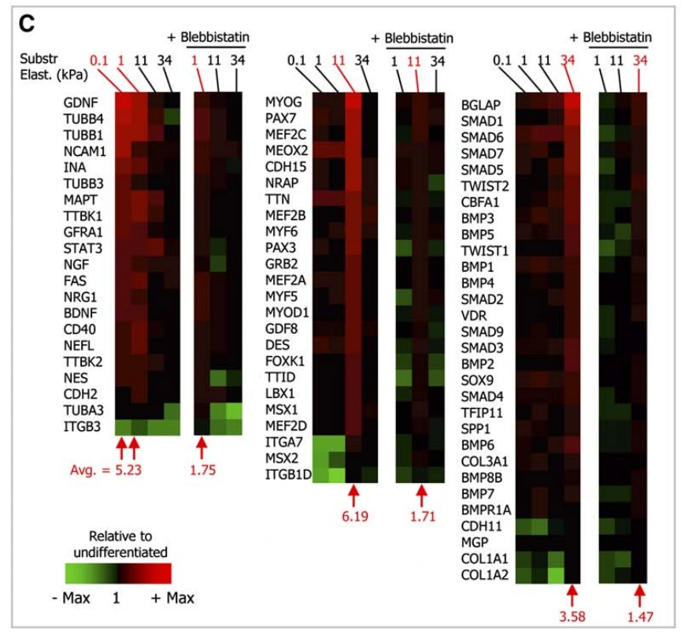{ width="740" height="693" loading="lazy" }
    /// caption
    三组分别为神经、肌肉和成骨相关标记。每组比较不同 kPa 条件及药物处理；红、绿表示相对未分化细胞上调、下调。[^matrix-elasticity]
    ///

    这些观察支持基质力学条件参与调节细胞状态，并且细胞自身的收缩活动参与其中。图中的标记表达和形态属于谱系偏向的证据，尚不能等同于获得功能完整的成熟神经元、肌细胞或骨细胞。凝胶的配体呈递、厚度、细胞来源和可溶信号，也都是解释这个培养系统时的条件。

真实组织里，细胞还面对黏弹性、纤维取向、孔隙和配体间距。相同的“刚度”可以来自不同组成或交联状态，并产生不同的局部受力。FAK／Src、Rho 等怎样把黏附接入生化网络，见[整联蛋白信号](cell_signaling.md#integrin-signaling)。

机械转导又会反过来改造材料：持续张力促进某些黏着斑成熟和纤维连接蛋白伸展，细胞随后改变基质分泌、交联或降解，新的基质再次影响细胞。纤维化中就可能形成这样的反馈。邻细胞连接、液体压力与组织几何也会分担应力，因此二维培养皿上的铺展面积不能直接当作体内受力的完整读数。

## 脂肪组织中的细胞—基质界面 { #adipose-tissue-interface }

白色脂肪细胞通常有一个占据大部分胞质的脂滴，薄层胞质和细胞核被推到周边；棕色脂肪细胞含多个较小脂滴和丰富线粒体，细胞核较常居中。米色脂肪细胞可在某些白色脂肪库中受刺激出现明显的产热特征，其静息与活化形态会改变。常规石蜡制片会溶去不少脂质，所以切片中白色脂肪细胞常留下很大的空泡样区域。

经典棕色脂肪与部分骨骼肌共享 Myf5 阳性前体谱系，PRDM16 可推动棕色脂肪与肌发生程序之间的转换；米色脂肪具有不同的前体和表达特征。产热脂肪因而包含多种发育来源，不能仅凭脂滴多少判断谱系。[^brown-beige-lineage] 棕色和活化米色脂肪的 UCP1 相关产热及全身调节，见[能量代谢与体温](../physiology/energy.md#thermal-effectors)。

脂肪细胞外围有基底膜，周围又分布毛细血管、神经、基质祖细胞、成纤维细胞与免疫细胞。脂滴增大时，外面的胶原、层粘连蛋白和蛋白聚糖也需要重塑。长期能量状态改变还可能影响脂肪细胞数目，膨大与增生的相对贡献随脂肪库和生理状态而变。

???+ abstract "脂肪切片里的红色纤维在哪里？"

    Divoux 等比较了人皮下与网膜白色脂肪组织，用天狼星红染色和偏振光观察胶原。图中空泡样区域是脂肪细胞所在的位置，红色纤维既可成束，也可围绕血管或细胞分布。[^adipose-fibrosis]

    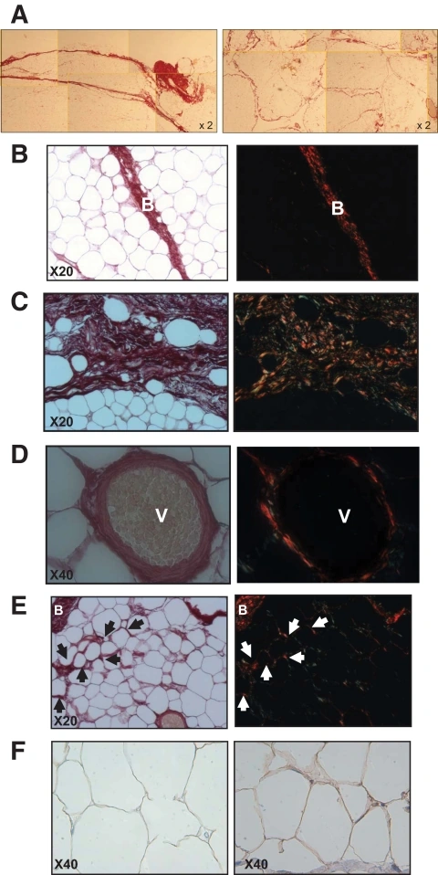{ width="480" height="958" loading="lazy" }
    /// caption
    A 比较肥胖者皮下脂肪（左）与网膜脂肪（右）；B–E 为网膜切片的普通光与偏振光配对。B 表示纤维束，V 表示血管，E 箭头指细胞周纤维化；F 比较瘦者与肥胖者网膜脂肪的 VI 型胶原染色。[^adipose-fibrosis]
    ///

    这组图很适合区分“组织里有胶原”与“胶原围在哪里”。细胞周围的积累和较粗纤维束的分布，并不提供完全相同的信息；论文也分别量化了总纤维化和细胞周纤维化。皮下、网膜两处的结果及其临床相关性并不一致，需要按脂肪库解释。

过度的纤维沉积可能限制细胞扩张，并与局部血流、氧供应和炎症改变相互影响；组织切片中的关联仍需结合功能实验判断因果。

## 植物细胞壁与共质体联系 { #plant-cell-wall }

### 初生壁的结构与生长 { #primary-cell-wall }

植物细胞外的主要承力材料是**细胞壁**。壁中含水的孔隙允许水、离子和许多小分子扩散；较大分子的通过则受大小、电荷以及与壁组分结合的影响。初生壁以纤维素微纤丝、半纤维素、果胶和多种蛋白构成复合网络。纤维素由 β-1,4 连接的葡萄糖链组成，多条链聚集成强韧的微纤丝；半纤维素与部分纤维素表面及接触区相互作用；果胶富含半乳糖醛酸，形成带负电、富水的网络。

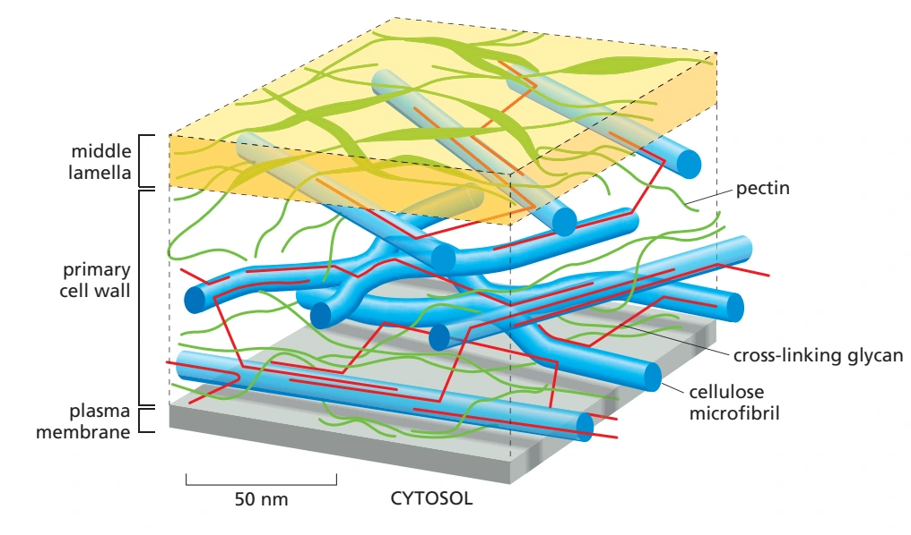{ width="620" height="365" loading="lazy" }
/// caption
蓝色为纤维素微纤丝，红色为交联多糖，绿色为果胶；上方标出富含果胶的中胶层。图显示空间层次，具体承力接触比规则网格更不均一。[^fig-primary-wall]
///

早期模型常把半纤维素画成均匀拴住每根纤维素的横线。遗传、酶学和固态核磁共振等结果使这个图景变得更细：多聚物相互穿插，少量关键接触可能对承力和松弛有很大贡献，果胶与纤维素的关系也比各自独立成网更密切。具体组织方式随植物、细胞类型和发育阶段变化。[^primary-wall-model]

纤维素的合成位置很特别。**纤维素合酶复合体**（CSC）位于质膜，以胞质中的 UDP-葡萄糖为底物合成并向外输出葡聚糖链；半纤维素和果胶则主要在高尔基体合成，经胞吐运到壁中。皮层微管位于膜的内侧，通过连接蛋白等帮助引导 CSC 的运动，因而影响新生微纤丝的方向。[^cellulose-microtubules]

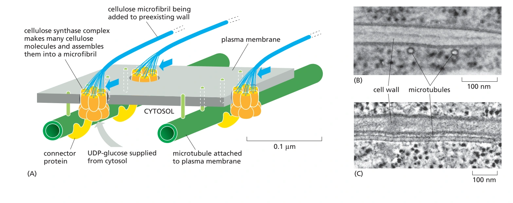{ width="740" height="294" loading="lazy" }
/// caption
蓝色为胞外纤维素，绿色为胞内微管。右侧电镜显示胞内微管与胞外微纤丝在质膜两侧的排列关系。[^fig-cellulose-guidance]
///

膨压对细胞壁施加张力，壁的受控松弛才允许细胞持续扩张。**扩张蛋白**（expansin）促进某些承力接触处的滑移；木葡聚糖内转糖基酶／水解酶（XTH）重排或水解相关多糖；果胶甲酯酶改变果胶酯化状态，进而影响钙交联和后续降解。这些作用的结果取决于处理位置、模式和组织环境，不能把所有壁修饰都等同于软化。

!!! info "extensin 与 expansin 是两类蛋白"

    常译为“伸展蛋白”的 **extensin** 属于富含羟脯氨酸的壁结构糖蛋白。典型成员含 Ser–(Hyp)₄ 等重复，Hyp 常携带短阿拉伯糖链，部分 Ser 带有 O-连接的半乳糖。某些成员可经酪氨酸交联组成网络，参与壁的装配与加固；名称很像的 **expansin** 则以促进细胞壁松弛著称。两者在壁中的工作不同。[^extensin-scaffold]

相邻细胞之间的**中胶层**富含果胶，其离子交联等作用帮助维系细胞间黏附。膨压、局部壁松弛和新材料沉积共同推动生长；微纤丝的方向又限制哪些方向更容易扩张，进而影响细胞的最终形状。

### 次生壁与胞间连丝 { #secondary-wall-plasmodesmata }

部分细胞停止或减慢扩张后，会在初生壁内侧沉积**次生壁**。次生壁通常含较高比例的纤维素和特定半纤维素，多层微纤丝取向不同；许多次生壁还沉积由苯丙烷类单体形成的木质素，提高抗弯、抗压和疏水性，支持木质部输水，并为植物体提供机械支撑。组成随细胞类型而变，不能把所有次生壁都视为完全相同的木质材料。

细胞壁把细胞隔开，**胞间连丝**（plasmodesma）则提供穿壁的联系。孔道外缘由相邻细胞连续的质膜包围，中央常有内质网来源的连丝微管（desmotubule）；它与质膜之间的胞质通路构成受调节的**共质体**联系。

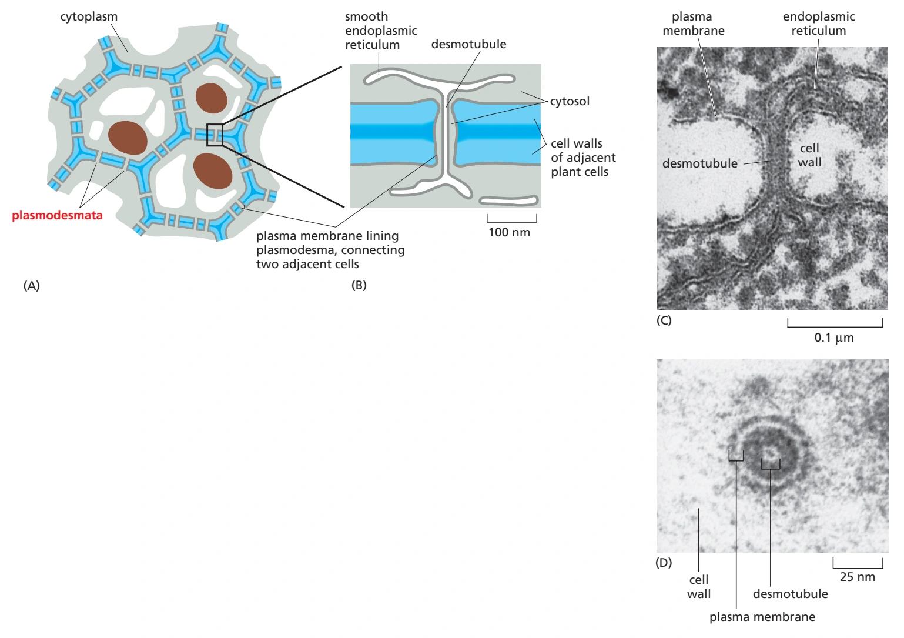{ width="760" height="536" loading="lazy" }
/// caption
A、B 为示意；C 为纵切，D 为横切。电镜中的中央管与内质网相联系，外缘质膜与相邻细胞质膜连续。[^fig-plasmodesmata]
///

部分胞间连丝在胞质分裂、细胞板形成时保留下来，也可在已有壁上新生；成熟孔道还会分支、成簇或改变通透性。颈部**胼胝质**（callose）的沉积和水解能够调节通路，拟南芥中的 CalS1、CalS8 等合酶对机械损伤或病原刺激有不同贡献。[^plasmodesmata-callose] 小分子可沿开放通路交换，一些蛋白和 RNA 则需要特定的运输与调节机制；可通过的范围由孔道状态和货物共同决定。

## 怎样测量连接和基质 { #interaction-methods }

观察到一条连接链、一块致密斑或一束胶原后，还要选择与功能相应的读出。前面的 claudin 重建实验定位了结构核心，talin 实验测了受力后的结合变化，基质弹性实验则把材料性质与细胞状态联系起来。它们回答的是不同尺度的问题。

| 方法 | 直接观察或测量 | 解释时需要配合的条件 |
| --- | --- | --- |
| 薄切片电镜、冷冻断裂、冷冻电子断层成像 | 连接链、胞质斑、膜间通道与胞间连丝的结构 | 固定、断裂面和取样会影响形态；结构存在尚不等于通道开放 |
| 免疫荧光、活细胞标记、荧光漂白恢复（FRAP） | 定位、周转和示踪物交换 | 共定位需再检验直接结合；恢复可混合扩散、结合与膜交通 |
| 跨上皮电阻（TEER）和示踪溶质通量 | 离子电导及特定分子的跨上皮速度 | 电阻需扣除空白并按有效面积校正，常以 Ω·cm² 报告；大分子通量需另测 |
| 牵引力显微镜、原子力显微镜和单分子拉伸 | 细胞牵引、局部力学性质、蛋白受力响应 | 结果依赖基底、探针形状、加载速率及采用的力学模型 |
| 基因扰动、急性降解与救援实验 | 某元件对屏障、黏附或装配的因果贡献 | 发育补偿、旁系同源蛋白、救援表达量和定位均会影响结果 |
| 去细胞化及 ECM 蛋白质组学 | 基质组成和保留支架的功能 | 处理可能丢失可溶组分、改变材料性质或留下细胞残余 |

例如，示踪物不再从相邻细胞间漏过，可以支持某种屏障功能恢复；若同时看到连接蛋白重新定位、特定扰动破坏功能、救援又恢复功能，对分子作用的判断便更扎实。把定位、动态、受力和组织功能放在一起，才能逐渐看清细胞怎样共同建成一块组织。

## 参考资料与延伸阅读 { #references }

- Alberts B, Heald R, Johnson A, et al. [*Molecular Biology of the Cell*](https://wwnorton.co.uk/books/9780393884852-molecular-biology-of-the-cell). 7th ed. W. W. Norton; 2022. Chapter 19, pp.1105–1162。本文机制主线与多数教材图据此。
- Alberts B, Hopkin K, Johnson A, et al. *Essential Cell Biology*. 5th ed. W. W. Norton; 2019. Chapter 20。胶原胞外装配图取自图20–10，p.697。

[^cell-interactions-overview]: 动物细胞连接、细胞黏附与 ECM 的总体框架见 Cooper 的[细胞—细胞相互作用](https://www.ncbi.nlm.nih.gov/books/NBK9851/)及[细胞壁与细胞外基质](https://www.ncbi.nlm.nih.gov/books/NBK9874/)章节。
[^osm-cell-junctions-ecm]: 组织结构实质性改编自 osm.bio 的[《第十九章 细胞连接和细胞外基质》固定版本](https://osm.bio/index.php?oldid=12390&title=第十九章_细胞连接和细胞外基质)，该版本由长河、Sofia 贡献，采用 [CC BY-SA 4.0](https://creativecommons.org/licenses/by-sa/4.0/)；相关内容经教材和所列研究交叉核验。
[^cell-junctions-textbook]: 各类连接的超微结构、跨膜黏附分子及骨架耦联见 Alberts 等的[细胞连接章节](https://www.ncbi.nlm.nih.gov/books/NBK26857/)。
[^claudin-strands]: Furuse M 等，*A Single Gene Product, Claudin-1 or -2, Reconstitutes Tight Junction Strands and Recruits Occludin in Fibroblasts*, J Cell Biol 143:391–401 (1998)，[全文与图3](https://pmc.ncbi.nlm.nih.gov/articles/PMC2132845/#F3)。图片取自图3，保留全部面板、断裂面标记和比例尺；免疫金定位见原文图4。
[^alpha-catenin-force]: $\alpha$-catenin 的力依赖 actin 结合及其对黏着连接动态的作用见 Arbore 等的[单分子与细胞研究](https://pubmed.ncbi.nlm.nih.gov/30504777/)。
[^talin-mechanosensing]: del Rio A 等，*Stretching Single Talin Rod Molecules Activates Vinculin Binding*, Science 323:638–641 (2009)，[作者公开稿](https://pmc.ncbi.nlm.nih.gov/articles/PMC9339221/)及 [PubMed](https://pubmed.ncbi.nlm.nih.gov/19179532/)。正文使用图2装置、图3A–C漂白轨迹与统计，保留原有条件和坐标；AFM 拉伸数据见原文图4。
[^cell-adhesion-textbook]: cadherin、selectin、IgSF 与 integrin 的结构、识别和组织功能见 Alberts 等的[细胞—细胞黏附章节](https://www.ncbi.nlm.nih.gov/books/NBK26937/)。
[^connexin-channel]: Maeda 等，*Structure of the connexin 26 gap junction channel at 3.5 Å resolution*, Nature 458:597–602 (2009)，[原始结构论文](https://pubmed.ncbi.nlm.nih.gov/19340074/)及 [PDB 2ZW3](https://www.rcsb.org/structure/2ZW3)。另有[结构解析程序论文](https://pubmed.ncbi.nlm.nih.gov/19622859/)，供方法细节参考。
[^collagen-structure]: collagen 模型肽三股螺旋的高分辨率结构与水合网络见 Berisio 等的[研究](https://pubmed.ncbi.nlm.nih.gov/11790836/)。
[^ecm-textbook]: collagen、elastin、GAG、proteoglycan、fibronectin 与 laminin 的合成和组织见 Cooper 的[细胞壁与细胞外基质章节](https://www.ncbi.nlm.nih.gov/books/NBK9874/)。
[^fibronectin-assembly]: actomyosin 收缩暴露 fibronectin 自组装位点并调节纤维形成的证据见 Zhong 等的[研究](https://pubmed.ncbi.nlm.nih.gov/9548730/)。
[^collagen-iv-network]: collagen IV 对 basement membrane 稳定而非最初装配的遗传证据见 Pöschl 等的[研究](https://pubmed.ncbi.nlm.nih.gov/14998921/)。
[^matrix-elasticity]: Engler AJ 等，*Matrix Elasticity Directs Stem Cell Lineage Specification*, Cell 126:677–689 (2006)，[原始论文](https://doi.org/10.1016/j.cell.2006.06.044)、[公开教学存档 PDF](https://biomechanics.stanford.edu/me339_08/engler06.pdf)。从 p.678 图1分别裁取 A–B 与 C，保留条件、坐标、色标及显微图比例尺。
[^brown-beige-lineage]: PRDM16 控制 Myf5$^+$ 前体在棕色脂肪与 skeletal muscle 程序间转换的证据见 Seale 等的[研究](https://pubmed.ncbi.nlm.nih.gov/18719582/)；beige adipocyte 的独立分子特征与诱导性见 Wu 等的[研究](https://pubmed.ncbi.nlm.nih.gov/22796012/)。
[^adipose-fibrosis]: Divoux A 等，*Fibrosis in Human Adipose Tissue: Composition, Distribution, and Link With Lipid Metabolism and Fat Mass Loss*, Diabetes 59:2817–2825 (2010)，[全文与图1](https://pmc.ncbi.nlm.nih.gov/articles/PMC2963540/#F1)。图1A–F完整取用；组织中的胶原染色、血管／束和细胞周分布需区分，定量比较见原文图4。
[^cellulose-microtubules]: 活细胞中 cellulose synthase complex 运动及其与 cortical microtubule 的功能联系见 Paredez 等的[研究](https://pubmed.ncbi.nlm.nih.gov/16627697/)。
[^primary-wall-model]: 初生壁中 cellulose、pectin、hemicellulose 的交织关系、承载接触及生长机制的现代综合见 Cosgrove 的[综述](https://pubmed.ncbi.nlm.nih.gov/38102449/)。
[^plasmodesmata-callose]: 机械损伤和病原刺激下 CalS1／CalS8 调节胞间连丝 callose 与通透性的遗传证据见 Cui 与 Lee 的[研究](https://pubmed.ncbi.nlm.nih.gov/27243643/)。

[^blood-testis-barrier]: Dym M, Fawcett DW. *The blood-testis barrier in the rat and the physiological compartmentation of the seminiferous epithelium*. Biol Reprod 3:308–326 (1970)，[原始研究](https://pubmed.ncbi.nlm.nih.gov/4108372/)。
[^claudin-tissues]: Simon 等，Science 285:103–106 (1999)，[CLDN16／paracellin-1 与肾镁重吸收](https://pubmed.ncbi.nlm.nih.gov/10390358/)；Wilcox 等，Cell 104:165–172 (2001)，[CLDN14 突变与 DFNB29 耳聋](https://pubmed.ncbi.nlm.nih.gov/11163249/)。
[^junction-blisters]: 桥粒自身抗体的致病作用见 Amagai 等，[J Clin Invest 90:919–926 (1992)](https://www.jci.org/articles/view/115968)。半桥粒及 laminin-332 相关的表皮—基底膜连接缺陷参见 MBoC 第7版第19章 pp.1143、1148–1149。
[^cadherin-genetics]: 小鼠原始研究：Larue 等 [E-cadherin 与滋养外胚层形成](https://pubmed.ncbi.nlm.nih.gov/8058792/)（1994）；Radice 等 [N-cadherin 缺失的发育表型](https://pubmed.ncbi.nlm.nih.gov/9015265/)（1997）、[P-cadherin 缺失与乳腺过早分化](https://pubmed.ncbi.nlm.nih.gov/9362520/)（1997）；Gory-Fauré 等 [VE-cadherin 与血管形态发生](https://pubmed.ncbi.nlm.nih.gov/10207135/)（1999）。这些是特定小鼠敲除模型的结果，不能直接套为所有物种或所有变异的表型。
[^l1cam-development]: Rosenthal A 等，*Aberrant splicing of neural cell adhesion molecule L1 mRNA in a family with X-linked hydrocephalus*, Nat Genet 2:107–112 (1992)，[原始研究](https://doi.org/10.1038/ng1092-107)。
[^extensin-scaffold]: Cannon MC 等，*Self-assembly of the plant cell wall requires an extensin scaffold*, PNAS 105:2226–2231 (2008)，[原始研究](https://pmc.ncbi.nlm.nih.gov/articles/PMC2538902/)。以拟南芥 AtEXT3 的遗传、糖基化和体外组装结果研究壁结构糖蛋白；丝氨酸糖基化参见 Saito F 等，*Identification of Novel Peptidyl Serine α-Galactosyltransferase Gene Family in Plants*, JBC 289:20405–20420 (2014)，[原始研究](https://pmc.ncbi.nlm.nih.gov/articles/PMC4110251/)。
[^fig-tissue-force]: Alberts 等，*Molecular Biology of the Cell* 第7版（2022），图19-1，p.1106；从本地教材 PDF 裁取图版。保留原图结构、标记与适用的尺度信息。
[^fig-junction-map]: Alberts 等，*Molecular Biology of the Cell* 第7版（2022），图19-2，p.1106；从本地教材 PDF 裁取图版。保留原图结构、标记与适用的尺度信息。
[^fig-tight-tracer]: Alberts 等，*Molecular Biology of the Cell* 第7版（2022），图19-19，p.1119；从本地教材 PDF 裁取图版。电镜由 Daniel Friend 提供，经 E. L. Bearer 转供教材；保留顶端／基底示踪对照及0.5 μm比例尺。
[^fig-tight-strands]: Alberts 等，*Molecular Biology of the Cell* 第7版（2022），图19-21，p.1120；从本地教材 PDF 裁取图版。保留原图结构、标记与适用的尺度信息。
[^fig-cadherin-calcium]: Alberts 等，*Molecular Biology of the Cell* 第7版（2022），图19-6 A,B，p.1110；从本地教材 PDF 裁取图版。裁取 A、B。C-cadherin 结构据 T. J. Boggon 等，Science 296:1308–1313 (2002)；构象对照据 J. R. Harrison 等，Structure 18:264–266 (2010)。
[^fig-catenin-force]: Alberts 等，*Molecular Biology of the Cell* 第7版（2022），图19-12，p.1114；从本地教材 PDF 裁取图版。保留原图结构、标记与适用的尺度信息。
[^fig-desmosome]: Alberts 等，*Molecular Biology of the Cell* 第7版（2022），图19-16，p.1117；从本地教材 PDF 裁取图版。C、D 原始电镜来自 W. He 等，Science 302:109–113 (2003)，幼鼠皮肤；保留0.5 μm与100 nm比例尺。
[^fig-hemidesmosome]: Alberts 等，*Molecular Biology of the Cell* 第7版（2022），图19-57，p.1148；从本地教材 PDF 裁取图版。保留原图结构、标记与适用的尺度信息。
[^fig-integrin-switch]: Alberts 等，*Molecular Biology of the Cell* 第7版（2022），图19-58，p.1150；从本地教材 PDF 裁取图版。保留原图结构、标记与适用的尺度信息。
[^fig-selectin-rolling]: Alberts 等，*Molecular Biology of the Cell* 第7版（2022），图19-28 B，p.1125；从本地教材 PDF 裁取图版。保留原图结构、标记与适用的尺度信息。
[^fig-gap-channel]: Alberts 等，*Molecular Biology of the Cell* 第7版（2022），图19-25，p.1122；从本地教材 PDF 裁取图版。C 为 [PDB 2ZW3](https://www.rcsb.org/structure/2ZW3)，对应 Maeda 等 Cx26 晶体结构；A、B 为教材整理的通道与亚基组合模型。
[^fig-collagen-helix]: Alberts 等，*Molecular Biology of the Cell* 第7版（2022），图19-38，p.1132；从本地教材 PDF 裁取图版。分子模型由 B. L. Trus 提供，显示短段而非完整胶原分子。
[^fig-collagen-fibrils]: Alberts 等，*Molecular Biology of the Cell* 第7版（2022），图19-39，p.1133；从本地教材 PDF 裁取图版。电镜来自 C. Ploetz 等，J Struct Biol 106:73–81 (1991)，材料为鸡胚皮肤；保留1 μm比例尺。
[^fig-elastin-network]: Alberts 等，*Molecular Biology of the Cell* 第7版（2022），图19-45，p.1137；从本地教材 PDF 裁取图版。保留原图结构、标记与适用的尺度信息。
[^fig-gag-linkage]: Alberts 等，*Molecular Biology of the Cell* 第7版（2022），图19-35，p.1130；从本地教材 PDF 裁取图版。保留原图结构、标记与适用的尺度信息。
[^fig-aggrecan]: Alberts 等，*Molecular Biology of the Cell* 第7版（2022），图19-36，p.1131；从本地教材 PDF 裁取图版。A 为 Lawrence Rosenberg 提供的胎牛软骨聚集体铂投影电镜，B 为对应结构图；保留两处1 μm比例尺。
[^fig-fibronectin]: Alberts 等，*Molecular Biology of the Cell* 第7版（2022），图19-48，p.1140；从本地教材 PDF 裁取图版。A 电镜据 J. Engel 等，J Mol Biol 150:97–120 (1981)；C 结构据 D. J. Leahy，Annu Rev Cell Dev Biol 13:363–393 (1997)。
[^fig-fibronectin-actin]: Alberts 等，*Molecular Biology of the Cell* 第7版（2022），图19-50，p.1141；从本地教材 PDF 裁取图版。小鼠成纤维细胞荧光图由 Roumen Pankov 与 Kenneth Yamada 提供；保留红／绿通道及10 μm比例尺。
[^fig-laminin]: Alberts 等，*Molecular Biology of the Cell* 第7版（2022），图19-53 A，p.1142；从本地教材 PDF 裁取图版。仅裁取 A，显示 laminin-111 的结构模型与结合部位。
[^fig-basement-network]: Alberts 等，*Molecular Biology of the Cell* 第7版（2022），图19-54 A，p.1143；从本地教材 PDF 裁取图版。仅裁取 A。模型依据 H. Colognato、P. D. Yurchenco，Dev Dyn 218:213–234 (2000)。
[^fig-primary-wall]: Alberts 等，*Molecular Biology of the Cell* 第7版（2022），图19-64，p.1156；从本地教材 PDF 裁取图版。保留原图结构、标记与适用的尺度信息。
[^fig-cellulose-guidance]: Alberts 等，*Molecular Biology of the Cell* 第7版（2022），图19-66，p.1159；从本地教材 PDF 裁取图版。保留原图结构、标记与适用的尺度信息。
[^fig-plasmodesmata]: Alberts 等，*Molecular Biology of the Cell* 第7版（2022），图19-27，p.1124；从本地教材 PDF 裁取图版。C、D 水生蕨类电镜据 R. Overall 等，Protoplasma 111:134–150 (1982)。裁取 A–D 图像并去除图间原书文字，保留面板、标记与全部比例尺。
[^fig-collagen-secretion]: Alberts 等，*Essential Cell Biology* 第5版（2019），图20-10，p.697；从本地教材 PDF 裁取图版。保留原图结构、标记与适用的尺度信息。

[^fibronectin-fibrin]: Makogonenko E 等，*Interaction of fibrin(ogen) with fibronectin: further characterization and localization of the fibronectin-binding site*, Biochemistry 41:7907–7913 (2002)，[原始研究](https://pubmed.ncbi.nlm.nih.gov/12069579/)；Knox P 等，*Role of fibronectin in the migration of fibroblasts into plasma clots*, J Cell Biol 102:2318–2323 (1986)，[原始研究](https://pubmed.ncbi.nlm.nih.gov/3711148/)。前者定位纤维蛋白上的结合区，后者用去除及补回血浆纤连蛋白检验成纤维细胞进入凝块的条件。
