# 细胞增殖、分化、死亡与衰老

小肠绒毛的形状可以维持很久，覆盖它的许多细胞却只停留几天。隐窝中的细胞不断分裂，后代逐渐取得吸收或分泌功能，沿上皮移动，最后脱落。看到一片形态稳定的组织，并不意味着里面的细胞也一直是原来那些。

这份稳定来自几种过程的配合：增殖补充细胞，分化建立功能差异，死亡移除不再需要或受损的细胞；静息保留重新增殖的余地，衰老则使部分细胞长期停滞，并改变周围的信号环境。本页沿着这些细胞命运展开，讨论它们怎样共同维持组织，又怎样在癌变和衰老中失去平衡。[^cell-number-control][^osm-cell-death]

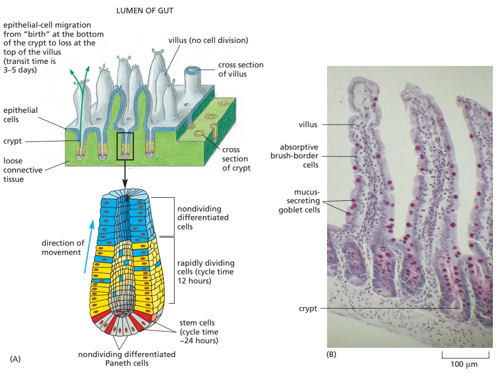{ width="720" height="546" }
/// caption
左图标出增殖区、向绒毛迁移的后代和留在隐窝底部的 Paneth 细胞；右侧切片可对照隐窝与绒毛的真实位置。图中周转时间是典型估计，各类细胞并不相同。[^fig-crypt-renewal]
///

## 生长、增殖与静息 { #cell-state-balance }

**细胞生长**增加生物量、体积和合成能力，**细胞增殖**则通过分裂增加细胞数。两者通常协同，但也可以分开：早期胚胎的卵裂把原有细胞质分给越来越小的卵裂球；骨骼肌纤维则能在不分裂的情况下增加体积和肌原纤维。

对许多动物细胞来说，营养充足只是条件之一。促分裂原（mitogen）推动细胞进入周期，生长因子促进物质合成，存活因子（survival factor）抑制死亡。同一种胞外信号可能兼有这些作用，具体输出取决于受体和下游网络。例如 Ras–ERK 可促进周期相关基因表达，PI3K–AKT–mTOR 调节合成代谢，AKT 还会抑制部分促凋亡蛋白。细胞把这些输入接到 [G$_1$/S 控制系统](cell_cycle.md#g1-s-commitment)，才决定是否开始下一轮复制。[^cell-number-control]

离开周期后，细胞也有不同去向。

| 状态 | 细胞在做什么 | 怎样理解“不再分裂” |
| --- | --- | --- |
| 静息（quiescence） | 维持代谢、感知信号，某些组织中的干细胞可长期如此 | 适当刺激下能重新进入周期；静息深度和再进入速度可以不同 |
| 终末分化 | 维持收缩、传导、吸收或分泌等专门功能 | 多数此类细胞退出周期；少数成熟细胞在损伤或特定干预下仍有增殖或命运改变能力 |
| 细胞衰老（cellular senescence） | 出现较持久的周期停滞及一组应激、代谢和分泌变化 | 通常不能被普通促分裂刺激解除，需要结合多项特征识别 |

G$_1$、静息、终末分化和衰老细胞都可能具有 2C DNA 含量。Ki-67 阴性也不能单独区分后三者：还要看细胞身份、停滞时间，以及再次给予刺激后发生什么。测量方法见[细胞周期的实验证据](cell_cycle.md#cell-cycle-evidence)。

细胞的位置同样参与调节。培养中的正常成纤维细胞铺满培养皿后，通常会明显减慢增殖；一些转化细胞却继续堆叠成团。这是接触抑制改变的一种直观表现。在组织中，钙黏蛋白连接、整联蛋白黏附、基质刚度和局部张力可以经 Rho、YAP/TAZ 等改变生长与周期信号。部分上皮细胞失去合适的基质接触后还会发生**失巢凋亡（anoikis）**。这些反应的阈值随组织和遗传背景而变。[^cell-number-control]

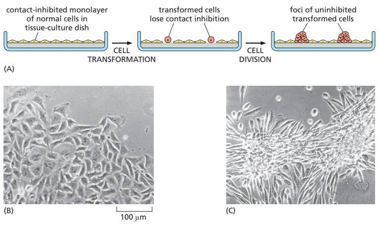{ width="720" height="432" loading=lazy }
/// caption
B 为正常细胞，C 为转化细胞。右侧密集交叠的细胞团说明增殖对接触条件的响应发生了改变；培养皿中的这一表型仍需与体内侵袭能力分别检验。[^fig-contact-inhibition]
///

连接怎样感受牵拉、整联蛋白怎样把外界支撑传给细胞内部，见[基质力学与机械转导](cell_interactions.md#ecm-remodelling-mechanotransduction)；同一信号怎样因持续时间和位置产生不同输出，见[信号的时空编码](cell_signaling.md#spatiotemporal-coding)。

## 分化与细胞记忆 { #differentiation }

肌细胞和表皮细胞的差别，大体上来自同一套基因组的不同用法。转录因子识别顺式调控元件，招募共激活或共抑制蛋白，并与染色质重塑、组蛋白修饰、DNA 甲基化和三维基因组组织相互作用，使不同基因在不同细胞中获得表达机会。B、T 淋巴细胞的抗原受体基因还会发生 V(D)J 重排，是部分体细胞 DNA 序列确有改变的特殊情形。分化中产生的蛋白质继续改变细胞的形状、代谢和功能，**分化**便逐渐成为可以看见、可以测量的过程。[^cellular-memory]

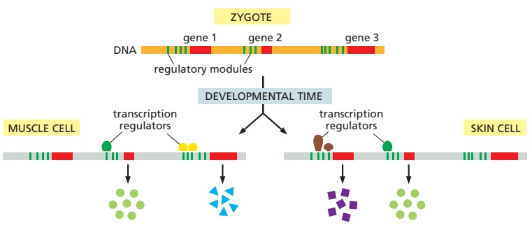{ width="700" height="324" loading=lazy }
/// caption
同一种转录因子可以参与多个调控组合；同一个基因也可由不同调控元件在不同细胞中开启。图中的颜色表示示意性的调控关系，并非具体基因的实测表达量。[^fig-gene-combinations]
///

有些转录因子在谱系建立中作用很强，例如 MyoD 家族能协调肌细胞分化程序。但它能否使一个细胞转向肌细胞命运，仍取决于合作因子和靶调控区是否能够被接近。管家基因（housekeeping gene）编码广泛需要的基础功能，其表达量也会随细胞和状态改变；组织特异基因则在某些谱系中富集表达。两者都受到调控。[^cellular-memory]

### 暂时的信号怎样留下长期差异

发育中的差异可以从细胞内部开始。卵中的某些 mRNA、蛋白质或生殖质分布不均，卵裂时被分给不同子细胞。差异也可以来自邻居：Notch 读取相邻细胞表面的配体，Wnt、Hedgehog、TGF-$\beta$ 家族等信号随位置与时间改变。响应细胞的受体、转录因子和染色质状态，又决定它能把这些输入解释成什么。[^cellular-memory]

下图把两种情况分开。左侧细胞先接受不同信号，后来即使遇到同一种 signal C，也作出不同反应；过去的经历保留在当前状态中。右侧则是同一信号 A 配上不同的同时输入，产生不同结果。

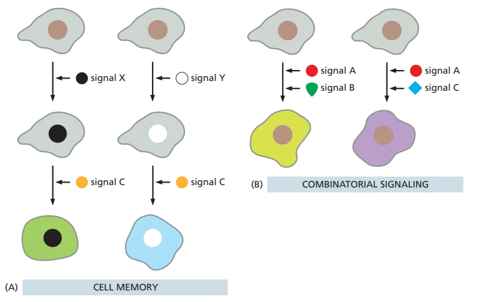{ width="700" height="431" loading=lazy }
/// caption
A 比较先前状态不同、后来信号相同的细胞；B 比较同时接收不同信号组合的细胞。细胞内颜色表示状态差异。[^fig-cell-memory]
///

**细胞记忆**可以由多种机制维持。一个转录因子启动自身或合作因子的表达，就能在最初刺激撤去后继续维持网络；两个命运程序之间的相互抑制，可使细胞偏向其中一个状态。复制后的 DNA 甲基化维护、染色质修饰与调控蛋白重新占位，则帮助子细胞恢复原有表达格局。不同机制的稳定度不同，损伤、再生或人为干预也可能使状态改变。[^cellular-memory]

果蝇成虫盘的连续移植提供过很直观的证据：盘组织可以在宿主体内增殖许多代，随后仍形成与来源相符的翅或足等结构。它还没有长成翅，却已经把相当稳定的身份传给了后代。少数组织在特定再生条件下又会发生转决定；实验及其边界见[命运的记忆与可塑性](../development/cell_fate_models.md#cell-memory)。

!!! info "从胞质差异到器官图式"

    细胞质决定因子、邻接信号和位置梯度常在同一胚胎中先后或同时起作用。果蝇早期的合胞体梯度、海鞘的部分自主谱系和脊椎动物的诱导过程，显示不同物种和阶段对胞质决定因子与细胞间信号的依赖不同。[命运指定方式](../development/cell_fate_models.md#specification-modes)比较这些实验逻辑；[生殖系建立与配子发生](../development/gametogenesis.md#preformation)进一步讲生殖质、PGC 迁移、配子成熟和卵内物质装载。

    器官形成还会重复使用这些调控方式。例如神经管以 Shh、BMP/Wnt 等输入建立背腹不同的祖细胞区，而哺乳动物性腺通过 SRY–SOX9 与 RSPO1–WNT4 等网络稳定不同的支持细胞命运。相应的[神经管图式](../development/axis_patterning.md#neural-tube-patterning)和[性腺分化](../development/environmental_evo_devo.md#sex-determination-levels)已有专节。

### 决定、分化与重编程 { #fate-reprogramming }

“已经决定”比“看起来开始分化”更需要实验说明。把尚未成熟的细胞放进中性环境，它仍按原方向发育，称这一命运已被**指定（specification）**；把它移到会推动另一种命运的位置，它仍保持原方向，则称已被**决定（determination）**。分化描述肌节、分泌颗粒、受体或代谢功能等特征真正建立的过程。移植操作与条件的细节见[命运承诺的实验判据](../development/cell_fate_models.md#commitment-assays)。

决定是在通常实验条件下稳定，重编程则主动改变维持身份的调控环境。体细胞核移植把分化细胞核放入去核卵细胞；Dolly 的出生说明，成年哺乳动物体细胞来源的细胞核仍能支持完整个体发育。信息没有随分化大批丢失，卵细胞质却必须重置许多调控状态，成功率低和异常发育也说明这个重置并不容易。[^nuclear-transfer]

另一个办法是直接改变转录因子组合。Takahashi 与 Yamanaka 在小鼠成纤维细胞中导入 Oct3/4、Sox2、Klf4、c-Myc，获得了诱导多能干细胞（induced pluripotent stem cell，iPSC）。早期筛选利用 *Fbx15* 调控区驱动抗药性，先从大量细胞中找出状态发生改变的少数克隆，再检验它们的基因表达和分化能力。[^ipsc-reprogramming]

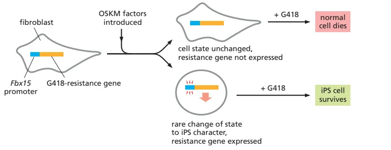{ width="720" height="277" loading=lazy }
/// caption
加入 OSKM 因子后，多数细胞仍不表达抗药基因；少数开启相应程序的细胞可在 G418 选择下存活。抗药性先帮助找到候选，多能性还需后续验证。[^fig-ipsc-selection]
///

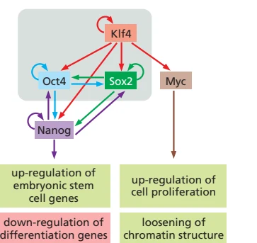{ width="350" height="331" loading=lazy }
/// caption
示意图中的自激活与相互促进有助于稳定多能状态；Myc 还促进早期增殖和染色质变化。[^fig-ipsc-network]
///

重编程过程中，外源因子先改变许多靶位点，细胞逐渐建立自身的多能性调控网络。稳定状态通常还涉及内源性 Oct4、Sox2、Nanog 等表达以及染色质重塑。各克隆发生这些变化的速度和程度可以不同。[^cellular-memory]

最初的 *Fbx15* 筛选产物与后来经过更严格选择、能够产生生殖系嵌合体的 iPSC 并不等同。一个漂亮的克隆形态，或者某个标记重新表达，都还不是全部证据。[^ipsc-reprogramming]

去分化、直接谱系转换和经过多能态的重编程是不同路线。蝾螈晶状体再生中，背侧虹膜的**色素上皮细胞**去色素、重新进入周期，再产生晶状体细胞；这一过程并不要求先成为胚胎干细胞。动物再生还可调用原有干细胞或保留谱系身份的成熟细胞，详见[再生的细胞来源](../development/stem_cells_regeneration.md#regeneration-routes)。

## 干细胞与组织更新 { #stem-cells }

干细胞需要同时做到两件事：长期维持自身，又产生分化后代。能迅速分裂的细胞未必是干细胞。许多**祖细胞**只在有限时间内扩增，随后整体走向分化；短暂扩增细胞（transit-amplifying cell）则能放大一次干细胞输出所产生的成熟细胞数。[^stem-cell-renewal]

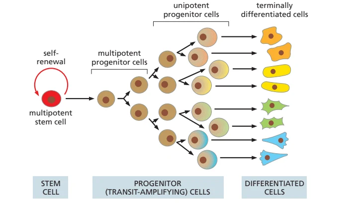{ width="650" height="385" loading=lazy }
/// caption
左侧的回环表示自我更新；中间多轮扩增增加产出，向右的分支逐步收窄分化范围。真实组织可以有可逆转换，图示只突出基本关系。[^fig-stem-hierarchy]
///

“能变成多少种细胞”与“能否长期维持自身”是两个维度。潜能广的培养细胞未必能在任意组织中正常工作，长期维持一个组织的干细胞也可能只产生一种成熟细胞。

| 潜能 | 可以产生的范围 | 典型理解 |
| --- | --- | --- |
| 全能性（totipotency） | 胚体及支持完整个体发育所需的胚外组织 | 受精卵和某些早期卵裂细胞；物种、时期和实验判据必须明确 |
| 多能性（pluripotency） | 胚体三个胚层的多种细胞类型 | 胚胎干细胞（ESC）与 iPSC；常规多能状态不等于能独立形成完整个体 |
| 多潜能性（multipotency） | 一个组织或相关谱系内的多种细胞 | 造血干细胞、小肠上皮干细胞等 |
| 单潜能性（unipotency） | 主要产生一种成熟细胞类型 | 若同时具有长期自我更新能力，仍可属于组织干细胞 |

哺乳动物胚胎干细胞通常由胚泡的内细胞团建立培养系，成体干细胞位于已形成的组织，iPSC 则由实验重编程产生；这是来源和状态的分类，不与上表逐项对应。培养时得到的多能性还要靠分化、嵌合或其他适合该物种的功能实验检验。[^stem-cell-renewal]

### 生态位与分裂后的命运

**干细胞生态位（stem-cell niche）**由邻近支持细胞、细胞外基质、血管、代谢条件和局部信号共同构成。分泌信号可被基质保留在局部，膜上配体又要求细胞保持接触。一个子细胞离开这个小环境后，接收的信号组合随之改变，便可能走向分化。[^stem-cell-niche]

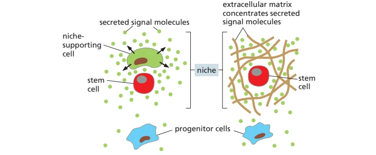{ width="650" height="268" loading=lazy }
/// caption
左侧强调支持细胞提供信号，右侧强调基质结合和浓集信号。血管、氧和代谢条件还可进一步改变生态位。[^fig-stem-niche]
///

一次分裂可以让两个子细胞继承不同数量的命运决定因子，也可以让它们获得不同的生态位接触。这样的**命运不对称**未必表现为细胞大小不同。另一些分裂产生两个仍可自我更新的子细胞，或两个都将分化的子细胞。组织稳态要求这些产出在群体和时间上平衡，不要求每次分裂都恰好“一干一分”。[^stem-cell-niche]

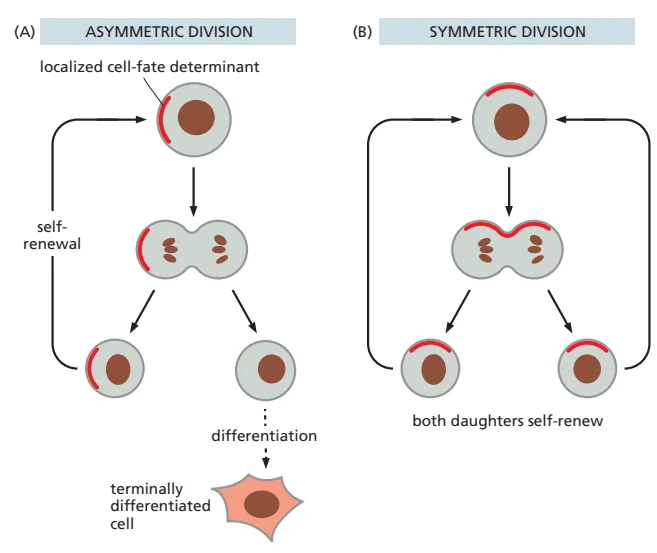{ width="360" height="303" loading=lazy }
/// caption
左：不均等继承决定因子，形成不同命运；右：两个子细胞都维持干性。[^fig-asymmetric-fate]
///

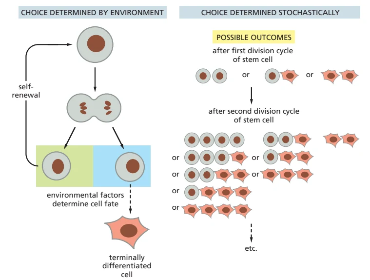{ width="360" height="272" loading=lazy }
/// caption
左：环境差异在分裂后决定命运；右：单次分裂有不同结果，群体平均保持更新。[^fig-population-fate]
///

### 跟踪后代，才能看出长期自我更新

一个细胞今天表达某个标记，不能告诉我们它两个月后留下了什么。**谱系追踪（lineage tracing）**把标记写成可以遗传给后代的变化：例如短时激活 CreERT2，使 Cre 重组酶切除报告基因前的阻断序列。此后即使最初用于限定细胞的基因不再表达，报告标记仍能留在该细胞及其后代中。

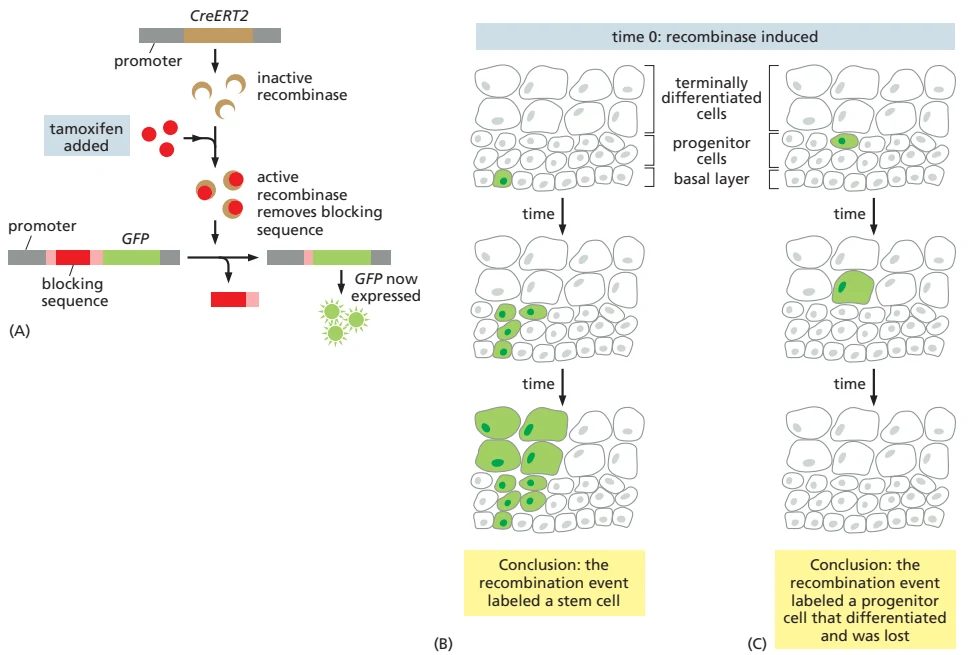{ width="720" height="487" loading=lazy }
/// caption
A 为可遗传标记的原理；B、C 是两种示意结局。长期持续贡献后代与短时扩增后消失，不能靠刚标记时的一张照片区分。[^fig-lineage-design]
///

???+ abstract "隐窝底部的细胞能补出整条上皮谱系"

    Barker 等在成年小鼠中让 *Lgr5* 调控的 CreERT2 与 Rosa26-*lacZ* 报告系统配合，短时用他莫昔芬诱导重组。最初，蓝色标记集中在隐窝底部少数细胞；5 天后可见向绒毛伸展的后代，60 天后仍有蓝色细胞从隐窝延续到绒毛。小肠多数成熟上皮细胞已更换多轮，标记仍持续出现，说明原先标记的群体包含长期自我更新的细胞。[^lgr5-tracing]

    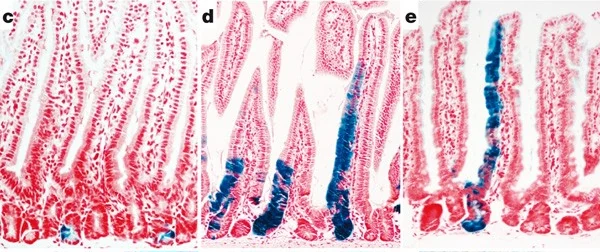{ width="720" height="302" loading=lazy }
    /// caption
    从左至右为原论文图 5c、d、e：1 天、5 天、60 天。蓝色是重组后持续表达的 LacZ 反应产物，不表示所有蓝色后代仍表达 Lgr5。[^lgr5-tracing]
    ///

    研究者又用 PAS 和突触素染色识别分化细胞。在蓝色克隆中可找到杯状细胞、Paneth 细胞和肠内分泌细胞，再结合吸收细胞的产出，支持这一群体具有多谱系贡献能力。

    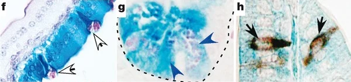{ width="650" height="153" loading=lazy }
    /// caption
    f、g 的 PAS 共染分别显示杯状细胞和 Paneth 细胞；h 的突触素染色标出肠内分泌细胞。箭头和面板字母保留原图。[^lgr5-tracing]
    ///

    对静息干细胞，短时间内看不到扩大的克隆可能只是尚未启动增殖。反过来，组织损伤也可能使原有祖细胞取得新的自我更新能力。起始标记范围、追踪时间和是否经过损伤，都是谱系结论的一部分。

移植、连续移植、克隆培养和类器官实验可从其他角度检验自我更新与重建能力。它们各自改变了原来的生态位；球体形成、某个表面标记或短期增殖，单独使用时都不足以证明体内干细胞功能。多能细胞进一步应用时，还需控制分化纯度和成熟度，否则残余未分化细胞可能形成畸胎瘤。核移植建立胚胎干细胞再定向分化的“治疗性克隆”思路、iPSC 与组织再生的关系，见[干细胞与再生](../development/stem_cells_regeneration.md#cellular-reprogramming)。

## 癌变与细胞状态失控 { #cancer-cell-states }

在正常上皮中，一个细胞能否扩增、分化、存活和越过组织边界，受到多重约束。癌变时，某些遗传或表观遗传改变使细胞在特定环境中更容易留下后代；后代再继续产生差异，并受到营养、缺氧、免疫和治疗等条件的选择。肿瘤因而是不断演化的细胞群，内部可以同时存在多个遗传亚克隆和多种可逆的转录、代谢、分化状态。[^cancer-hallmarks]

观察下图宫颈上皮的组织切片：正常上皮的细胞沿厚度方向逐渐成熟；上皮内病变中，深染、核质比较大的细胞占据更多层次；侵袭性癌进一步越过基底膜进入下面的结缔组织。**失去正常排列、分化改变和突破空间边界，是相互联系却可以分别观察的变化。**

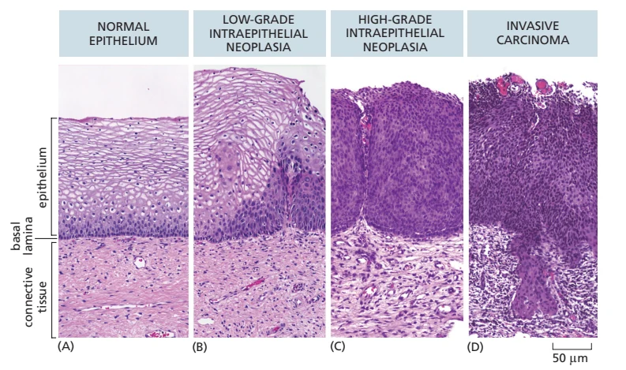{ width="760" height="449" loading=lazy }
/// caption
由左至右比较成熟层次、细胞核染色和基底膜边界。四幅切片代表不同状态，并非同一块组织的连续追踪。[^fig-cancer-invasion]
///

### 癌基因与抑癌基因

原癌基因的正常产物参与生长、存活或分化；获得性激活后，便可能成为促进癌变的癌基因。激活可以改变蛋白本身，例如使 RAS 更难关闭，也可以增加产物数量，例如基因扩增、调控区改变或染色体重排。某些致癌逆转录病毒携带的 **v-onc** 来源于捕获并改变的细胞基因；细胞中的正常对应基因常以历史名称 **c-onc** 与之区分。[^cancer-textbook]

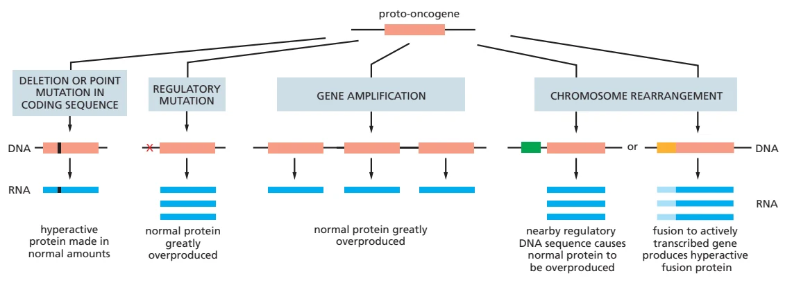{ width="760" height="273" loading=lazy }
/// caption
图中依次区分“单个蛋白活性更强”“正常蛋白更多”和“产生异常融合蛋白”。遗传改变不同，可能推高同一条信号通路的输出。[^fig-oncogene-activation]
///

抑癌基因的产物则限制增殖、维持基因组或帮助受损细胞退出群体。RB 约束 E2F 和周期进入，p53 协调损伤后的停滞、衰老或死亡，PTEN 去除 PIP$_3$ 的磷酸以抑制过强的 PI3K–AKT 信号，BRCA1/2 参与 DNA 双链断裂的同源重组修复。丢失这些功能可从不同方向增加细胞的扩增机会。[^cancer-textbook]

!!! info "“显性癌基因、隐性抑癌基因”在哪个层次成立"

    经典图景讨论的是**一个二倍体细胞中的基因功能**：一个异常活跃的等位基因就可能增强信号，而许多抑癌基因需要两份功能都受损才明显失效。遗传性肿瘤易感性却可以在家系中表现为显性，因为个体已经先天携带第一次改变。

    实际基因还可有剂量不足、显性负效应或情境依赖作用。两次失活也不限于两个点突变，染色体丢失、杂合性缺失和表观沉默都可能参与。[^cancer-textbook]

??? note "从旧基因名称认出它们控制的环节"

    一些历史名称来自病毒研究，对应不同的调控环节。*sis* 对应 PDGF-B 生长因子；*erbB*、*fms*、*trk* 的细胞对应物属于受体酪氨酸激酶，*src* 编码非受体酪氨酸激酶，*ras* 编码小 GTP 酶，*raf* 和 *mos* 编码丝氨酸／苏氨酸激酶。MYC、MYB、FOS、JUN 参与转录调节，*erbA* 的细胞对应物属于甲状腺激素受体。它们异常活跃时，可把外界短暂的生长输入变成持续的细胞内输出。[^oncogene-history]

    抑癌相关因子也有不同位置：p16、p21 抑制 CDK，WT1 参与转录调节；APC 是 $β$-catenin 降解复合物的重要组分，这里的 APC 基因与周期中的 APC/C 泛素连接酶复合物不是同一个对象。DCC 是 netrin 依赖性受体，其促存活与促死亡作用受配体条件影响，不能只归作“黏附分子”。[^cancer-textbook][^dcc-dependence]

### 从细胞能力到肿瘤异质性

持续增殖还不足以解释恶性肿瘤。细胞往往同时获得抵抗死亡、维持端粒和复制潜能、改变代谢、利用血管与基质、逃避免疫以及侵袭扩散等能力。一个抗凋亡改变即使没有加快每次分裂，也能使更多后代留下来；肿瘤细胞数取决于增殖和丢失的共同结果。[^cancer-hallmarks]

病理学中，**癌（carcinoma）**指上皮来源的恶性肿瘤，**肉瘤（sarcoma）**指间叶组织来源的恶性肿瘤，淋巴瘤和白血病涉及造血系统等谱系。鳞状细胞癌可保留角化和细胞间桥，腺癌可显示腺样结构或黏液分泌；小细胞肺癌则属于高级别神经内分泌癌，常见胞质少、核拥挤和核塑形。分化程度描述肿瘤保留了多少原组织特征，侵袭和转移描述它如何越过边界，几者需要分别判断。[^tumor-morphology]

在某些肿瘤中，少数细胞在限定的移植条件下具有较强的长期再建瘤能力，被称为癌干细胞或肿瘤起始细胞。这是**功能性定义**，并不证明它们必然起源于正常成体干细胞，也不保证它们永远很少、分裂很慢或只能不对称分裂。治疗压力、缺氧和生态位信号还可推动细胞在干性样与较分化状态间转换，使原先不显著的群体重新产生建瘤能力。[^cancer-stem-plasticity] 部分模型中的干性样细胞还能通过静息避开依赖细胞增殖的治疗，或通过 ABC 转运体排出相应底物药物；这些机制并非所有肿瘤干细胞共有。转运循环见[ABC 转运体](membrane_transport.md#_5)。[^tumor-efflux]

## 怎样描述细胞死亡 { #cell-death-framework }

细胞死亡意味着不可逆地失去维持自身完整性和功能的能力。极端物理或化学破坏可直接超过细胞的调节能力，造成**意外性细胞死亡（accidental cell death）**；由可干预的分子装置执行的过程称为**受调控细胞死亡（regulated cell death）**。其中发生在正常发育和组织稳态程序中的死亡，通常称为**程序性细胞死亡（programmed cell death）**。后一个术语说明生理情境，并不只对应一种分子机制。[^nccd-2018]

死亡时的形态与执行机制是两个观察层次。细胞收缩、染色质凝集和膜起泡常提示凋亡；肿胀、质膜破裂和内容物外泄则呈现坏死性形态。坏死形态既可来自极端破坏，也可由受调控通路形成。同一刺激还可能随剂量、能量状态和蛋白表达转向不同结局；清除不及时的凋亡细胞最终也会破裂。

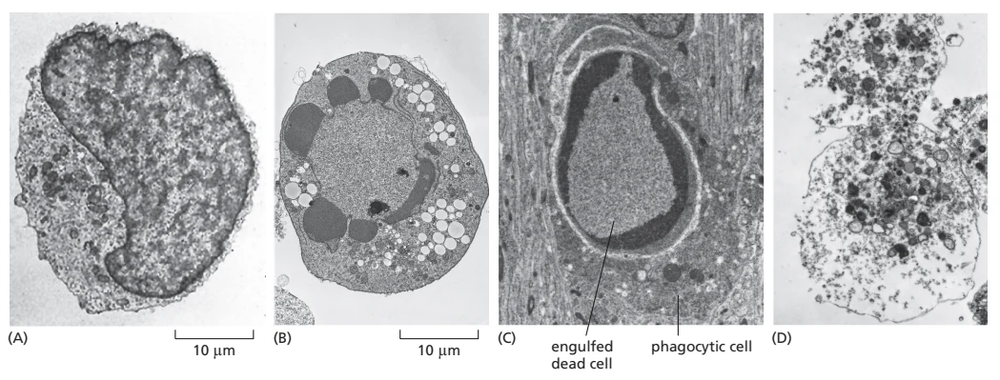{ width="760" height="289" loading=lazy }
/// caption
A 为正常细胞；B 为撤去存活因子后发生凋亡的细胞；C 显示被邻近细胞吞噬的尸体；D 为坏死形态。先比较细胞体积、染色质分布和膜的完整性。[^fig-death-morphology]
///

因此，实验先确认细胞已经死亡，再结合时间序列、膜完整性、执行分子和遗传或药理救援判断通路。膜破裂让 LDH 进入培养液，DNA 断裂使 TUNEL 染色增强，它们都只报告过程的一部分。

## 凋亡：拆解细胞并准备清除 { #apoptosis }

凋亡（apoptosis）常从单个细胞或不同步的小群细胞开始。细胞收缩，皮层骨架改变，表面出现泡状突起；染色质凝集，细胞核碎裂，某些细胞进一步分割成有膜包裹的凋亡小体。质膜在早期仍相对完整，邻近细胞或专业吞噬细胞因而有机会在内容物外泄前把它清除。[^osm-cell-death]

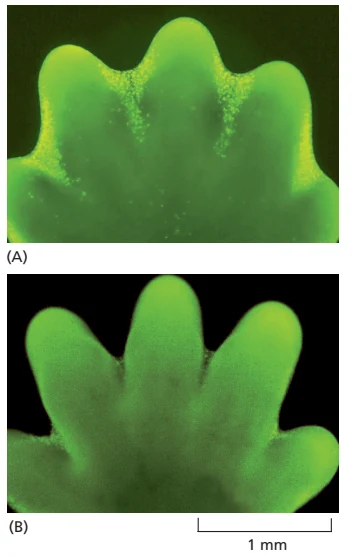{ width="310" height="486" loading=lazy }
/// caption
上：吖啶橙染色的亮点集中在指间；下：较后阶段的指间组织已经退去。染色显示死亡细胞分布，分子机制另需实验验证。[^fig-digit-sculpting]
///

这种清除在发育中可以塑造结构，例如移除指间组织。它也参与选择合适的淋巴细胞、结束一次免疫应答、去除危险的受损细胞，以及使细胞数适应组织需求。[^death-textbook]

凋亡不足可使本应被清除的细胞积累。例如 FAS 通路缺陷可参与自身免疫性淋巴增生综合征；凋亡过多则可能造成组织丢失。其后是否发生明显炎症，还取决于死亡细胞是否被及时清除以及组织的免疫环境。[^death-textbook]

### caspase 怎样把信号转成拆解

**半胱天冬酶（caspase）**的活性位点含半胱氨酸，并偏好切割底物中天冬氨酸之后的肽键。细胞平时合成的是低活性前体；凋亡信号让部分前体在特定复合物上聚集并激活，随后启动蛋白水解级联。哺乳动物常见的起始者是 caspase-8、-9，执行者包括 caspase-3、-6、-7；caspase-2 和人的 caspase-10 也在特定通路中承担起始相关作用。[^death-textbook]

起始者与执行者的激活方式有所不同。以 caspase-8 为例，长前结构域把它招募到接头蛋白组成的平台，局部浓度升高促进二聚，随后发生加工；执行者 caspase 则通常已经是无活性二聚体，主要靠上游 caspase 的切割重排活性位点。**蛋白被切割的顺序，构成了信号放大的顺序。**

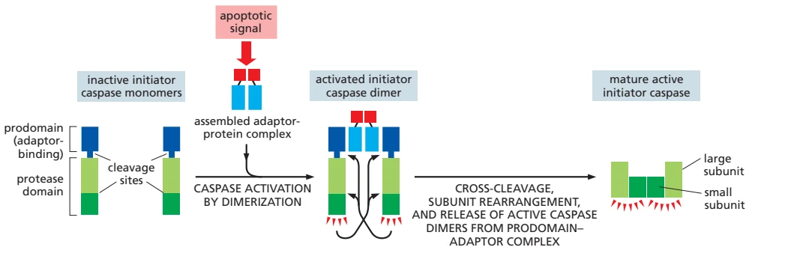{ width="760" height="247" loading=lazy }
/// caption
以二聚驱动激活的起始者为示意：前结构域先帮助聚集，随后加工稳定活性。不同起始者对加工和平台的依赖并不完全相同。[^fig-initiator-caspase]
///

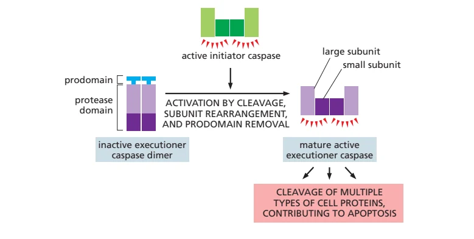{ width="530" height="268" loading=lazy }
/// caption
执行者的前结构域较短；上游切割使大、小亚基重排，随后切割大量细胞底物。[^fig-executioner-caspase]
///

底物的变化把分子级联接到形态上：核纤层蛋白被切割，核结构解体；黏附和骨架相关蛋白改变，细胞变圆、脱离邻居并起泡；caspase-3 切开 ICAD 后，原先被其约束的 CAD 核酸酶获得活性，能够切断核小体之间较易接近的 DNA。

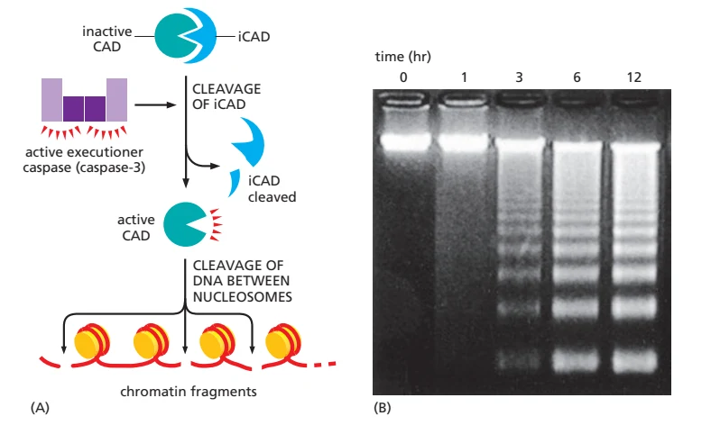{ width="700" height="419" loading=lazy }
/// caption
右侧为地塞米松处理的小鼠胸腺淋巴细胞，按图示小时数提取 DNA 后电泳。梯状条带反映核小体间切割形成不同倍数长度的片段；左侧是相应机制示意。[^fig-cad-ladder]
///

这类片段常以约 180–200 bp 为基本间隔。梯状条带很醒目，但有些凋亡细胞不出现清楚的梯带；阻断 DNA 断裂也不一定阻止细胞死亡。拆解所需的许多蛋白早已存在，是否还需要新转录或新蛋白合成，要看具体细胞与刺激。[^death-textbook]

线虫的死亡基因研究最早揭示了这类执行关系：CED-9 限制 CED-4，CED-4 促进 CED-3 激活；它们分别与哺乳动物 BCL-2、APAF1 和 caspase 系统具有演化联系。不过，线虫 CED-4 的激活并不采用哺乳动物细胞色素 c–APAF1 的同一套条件。[^death-textbook]

### 线粒体内源通路 { #intrinsic-apoptosis }

DNA 损伤、复制压力、存活因子撤除、内质网应激或过强的癌基因信号，都可以影响线粒体内源通路。关键变化是**线粒体外膜通透化（mitochondrial outer membrane permeabilization，MOMP）**：原来位于膜间隙的蛋白获得进入胞质的通道。

细胞色素 c 在正常线粒体中传递呼吸链电子。下图的对照细胞里，细胞色素 c–GFP 呈现与线粒体染色相符的细丝或点状分布；经紫外线处理 5 小时后，一部分细胞的绿色荧光弥散到胞质。分子的工作位置变了，接下来的作用也随之改变。[^death-textbook]

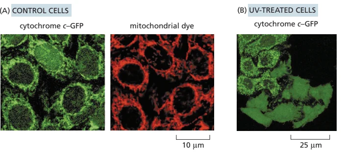{ width="740" height="327" loading=lazy }
/// caption
A 中绿色信号与红色线粒体染色的分布相符；B 为人癌细胞经紫外线处理 5 小时后，部分细胞的绿色信号弥散。两组比例尺不同，不能直接比较细胞大小。[^fig-cytochrome-c]
///

胞质中的细胞色素 c 结合凋亡蛋白酶激活因子 1（APAF1），在 ATP/dATP 参与下促进其构象变化和寡聚，形成**凋亡体（apoptosome）**。APAF1 的 CARD 结构域招募具有相应结构域的 procaspase-9，使其在复合物中激活，再切割并激活执行者 caspase。预先存在的组分由此聚到一起，把一次释放转成蛋白酶级联。[^bcl2-apoptosis]

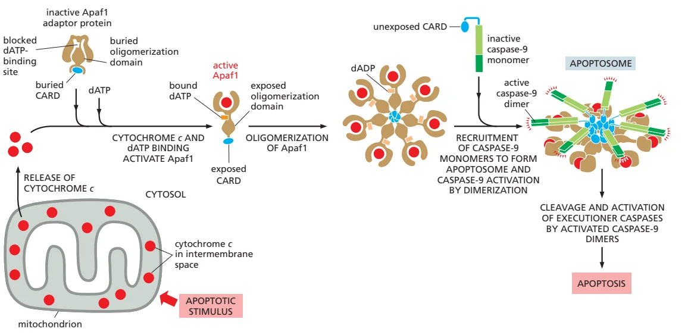{ width="760" height="370" loading=lazy }
/// caption
沿图从左至右看：外膜通透化释放细胞色素 c，APAF1 开放并寡聚，CARD 招募 caspase-9，最后激活执行者。[^fig-apoptosome]
///

外膜是否发生这种变化，受到 **BCL-2 家族**控制。它们通过 BH 同源区及其形成的结合表面相互作用，可以分成三类：BAX、BAK 是促凋亡效应蛋白；BCL-2、BCL-XL、MCL1 等是抗凋亡成员；BIM、BID、BAD、PUMA、NOXA 等只含 BH3 区的成员把不同应激接入这个系统。[^bcl2-apoptosis]

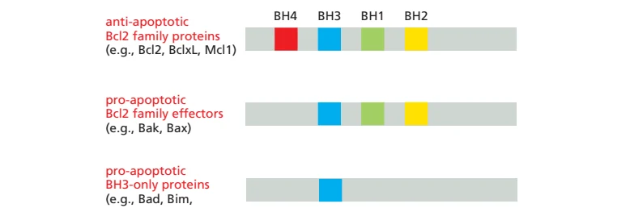{ width="650" height="216" loading=lazy }
/// caption
彩色区标出 BH 同源区；同属一家族的蛋白可以相互制约，家族名称本身不表示作用方向。[^fig-bcl2-domains]
///

看下面的 BAK 例子。激活的 BAK 改变构象并在外膜聚集，形成允许膜间隙蛋白释放的通路。BCL-XL 能结合促凋亡效应蛋白、阻止它们继续聚集；BAD 等 BH3-only 蛋白又可占据抗凋亡蛋白的结合槽，解除这一抑制。BIM、tBID 等在相应背景下还可直接促进 BAX/BAK 激活。各成员的结合选择性不同，细胞依赖的抗凋亡成员也不相同，由此共同设定 MOMP 的阈值。[^bcl2-apoptosis]

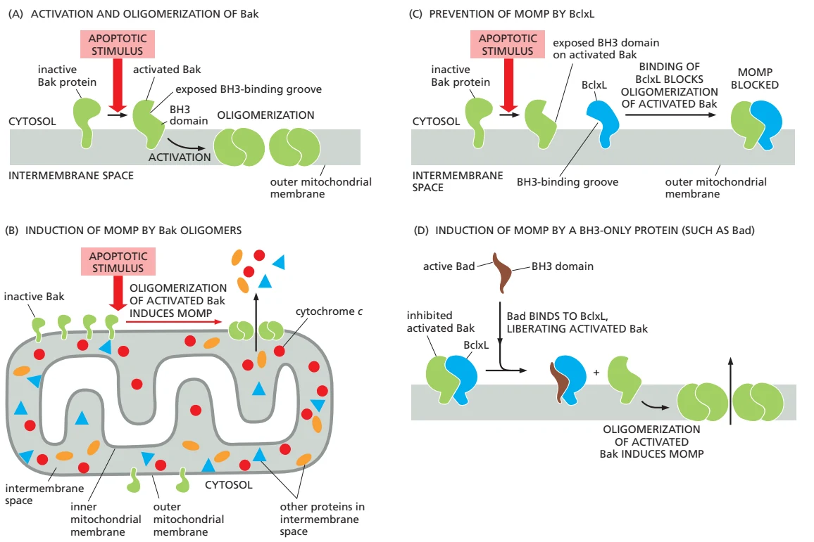{ width="760" height="507" loading=lazy }
/// caption
A、B 显示效应蛋白聚集及释放；C 为抗凋亡蛋白结合效应蛋白；D 为 BH3-only 蛋白占据抗凋亡蛋白。这个结合模型突出主要关系，BAX/BAK 膜孔的形成还涉及膜脂与构象变化。[^fig-bcl2-momp]
///

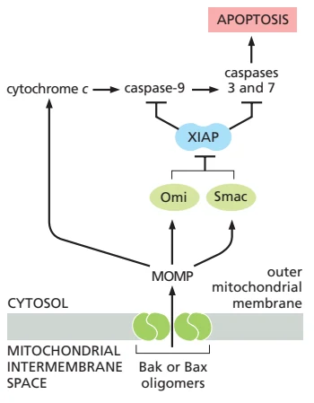{ width="300" height="385" loading=lazy }
/// caption
细胞色素 c 促进凋亡体通路，SMAC 等削弱 XIAP 对 caspase 的抑制。箭头和钝端分别表示促进与抑制。[^fig-xiap-smac]
///

胞质里还有另一层抑制：XIAP 可直接限制 caspase-9、-3、-7 的活性。MOMP 释放的 SMAC/DIABLO 等蛋白能够结合 IAP 家族成员，使这层抑制减弱；图中的 Omi/HtrA2 也可参与相关调节。[^death-textbook]

因此，外膜通透化的程度、剩余线粒体功能和 caspase 抑制状态，会共同影响细胞能否恢复。广泛 MOMP 通常很难逆转；少量线粒体发生通透化或亚致死 caspase 活化，则不应直接等同于整个细胞已死亡。[^nccd-2018]

AIF、EndoG 等线粒体蛋白还可在特定刺激下参与 caspase 非依赖的核损伤或染色质变化。p53 则把损伤反应接到多种结局：诱导 p21 可使周期停顿，调节 PUMA、NOXA、BAX 等又可增加凋亡倾向。损伤强度、持续时间和细胞身份共同决定最后进入哪条路线。[^nccd-2018][^bcl2-apoptosis]

### 死亡受体外源通路 { #extrinsic-apoptosis }

细胞也能从表面接到死亡信号。以 Fas/CD95 为例，Fas 配体使受体聚集，受体胞质侧的死亡结构域结合接头蛋白 FADD；FADD 再通过死亡效应结构域招募 procaspase-8，组成**死亡诱导信号复合物（DISC）**。相邻前体在平台上聚集并激活，继而切割执行者 caspase。人的 caspase-10 也可参与某些 DISC。[^caspase8-death]

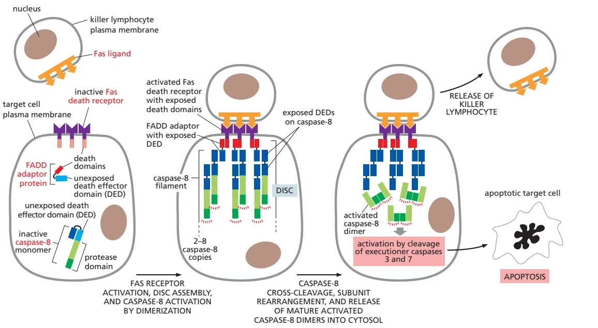{ width="760" height="417" loading=lazy }
/// caption
图中不同颜色表示相互匹配的死亡结构域和死亡效应结构域。膜上的受体聚集被接头蛋白转成胞质内的蛋白酶聚集。[^fig-death-receptor]
///

活化的 caspase-8 还可切割 BID，产生 tBID，后者接入 BAX/BAK 和 MOMP，使外源输入经线粒体放大。Fas、TNF 受体和 TRAIL 受体属于相关受体家族，却识别各自的配体、组装不同的复合物。尤其 TNF 受体 1，既可经 NF-$\kappa$B 促进存活，也可在复合物组成改变时转向凋亡或坏死性凋亡。c-FLIP 的不同形式、IAP 蛋白及泛素化状态都会影响这个分流。[^caspase8-death]

细胞毒性 T 细胞和 NK 细胞还有一条独立的上游路线：定向释放穿孔素和颗粒酶，穿孔素帮助颗粒酶到达靶细胞胞质，颗粒酶 B 再切割 caspase、BID 等底物。其他颗粒酶有不同底物；颗粒酶 A 的 caspase 非依赖损伤和炎症作用不能概括为所有靶细胞共享的固定凋亡程序。穿孔素基因 *PRF1* 的双等位基因致病变异可造成部分家族性噬血细胞性淋巴组织细胞增多症，提示靶细胞清除不足也会妨碍免疫激活的正常终止。定向释放与免疫突触见 [CD8 T 细胞杀伤](../immunology/t_cell_immunity.md#cd8-cytotoxicity)。[^granzyme-pathways]

### 存活信号持续影响凋亡阈值

死亡程序的另一面，是细胞为什么没有启动它。发育中的一些神经元竞争靶细胞提供的有限存活因子；获得足够信号的细胞保留，其余细胞更容易凋亡，神经元数目由此与靶组织相匹配。

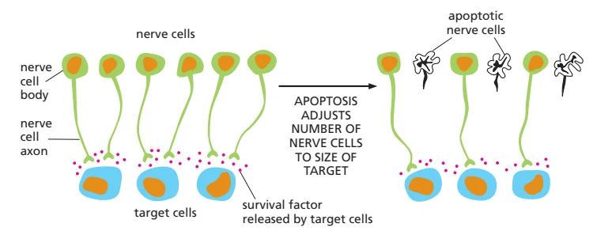{ width="700" height="271" loading=lazy }
/// caption
靶细胞释放的信号有限，联系和信号支持不足的神经元更容易死亡。这是特定发育系统中的数量调节模型。[^fig-survival-competition]
///

存活因子可以提高 BCL-2 等抗凋亡蛋白的表达，也可经 AKT 磷酸化 BAD 等促凋亡因子，使其与 14-3-3 结合而受到抑制。失去存活信号后，BCL-2 家族原有的平衡便会向 MOMP 移动。[^death-textbook]

### 凋亡细胞怎样被清除 { #efferocytosis }

凋亡细胞可释放 ATP、UTP 等招引吞噬细胞的“find-me”信号，还会把**磷脂酰丝氨酸（PS）**呈现在质膜外侧。健康细胞中，翻转酶把 PS 维持在胞质侧；凋亡执行者 caspase 一边使部分翻转酶失活，一边激活扰乱酶，让两侧磷脂重新混合。两种改变配合，PS 才会持续暴露在外。[^efferocytosis]

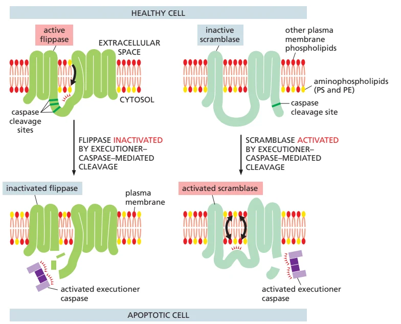{ width="600" height="484" loading=lazy }
/// caption
左侧停止把 PS 从外层搬回内层，右侧加快双向混合；下方显示 caspase 切割后的蛋白状态。[^fig-ps-exposure]
///

吞噬细胞可用受体直接识别 PS，或通过桥接分子与它连接，随后重排 actin，伸出膜包裹尸体，再由吞噬体—溶酶体系统降解。这个过程称为**凋亡细胞清除（efferocytosis）**。接收大量脂质和蛋白后，吞噬细胞还需调整代谢，并改变炎症输出。及时清除可以限制继发性膜破裂和内容物外泄。[^efferocytosis]

PS 外露也见于活化血小板和若干非凋亡性死亡。膜联蛋白 V（Annexin V）结合外露 PS，因此阳性结果要与膜通透性、caspase 活性和时间序列一起判断；PS 只是吞噬识别的一部分，活细胞表面的抑制性信号也会影响是否被吞噬。[^phosphatidylserine-boundary]

## 裂解性受调控死亡 { #lytic-cell-death }

不同分子装置都可以使质膜失去屏障作用，造成离子失衡、细胞肿胀和内容物释放。坏死性凋亡、焦亡和铁死亡便是其中三类。它们在抗感染、组织损伤和肿瘤反应中的作用各不相同，不能只凭最后一张“细胞破了”的照片区分。[^death-pathways]

### 坏死性凋亡：RIPK3 激活 MLKL

在部分死亡受体通路中，caspase-8 的作用不止是启动凋亡。它与 c-FLIP$_L$ 形成的复合物还可限制 RIPK3 依赖的坏死。当这项制约解除、细胞又具备相应执行装置时，信号便可能转入**坏死性凋亡（necroptosis）**。[^necroptosis-switch]

RIPK3 是蛋白激酶，它磷酸化 **MLKL**，促使这个假激酶改变构象、寡聚并向膜转移，最终破坏膜的离子屏障。TNF 受体引发的许多实验模型依赖 RIPK1 参与组装；其他上游输入则可绕过 RIPK1。这里需要观察的是 RIPK3–MLKL 是否真正被激活，以及阻断后能否阻止相应死亡，仅有 RIPK3 表达并不能给细胞命运下结论。[^mlkl-execution]

### 焦亡：蛋白酶切开 gasdermin 的抑制

**焦亡（pyroptosis）**由 gasdermin 家族蛋白形成的膜孔驱动。以 GSDMD 为例，完整蛋白的 C 端抑制 N 端；切开连接区域后，N 端获得结合膜脂并聚集成孔的能力。经典炎症小体可经 ASC 等接头激活 caspase-1，后者切割 GSDMD，并加工 pro-IL-1$\beta$、pro-IL-18。人 caspase-4／-5 和鼠 caspase-11 则可响应胞质 LPS、直接切割 GSDMD；它们对 IL-1$\beta$ 成熟的促进通常还要借助后续炎症小体与 caspase-1。[^gasdermin-pores]

???+ abstract "只有膜脂和纯化蛋白，也能形成孔"

    Liu 等把纯化的 GSDMD 及其片段加入人工脂质体，用包在脂质体内的 Tb$^{3+}$ 是否泄漏来检测屏障。完整 GSDMD 单独加入时泄漏很少；加入 caspase-11，或直接加入已经释放的 GSDMD N 端，泄漏明显增加。改变 N 端膜结合位点的 4A 突变体则失去大部分活性。这把“蛋白酶切割—N 端释放—膜通透化”接成了一条可以逐项检验的关系。[^gasdermin-pores]

    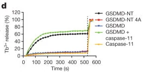{ width="420" height="203" loading=lazy }
    /// caption
    横轴是时间，纵轴是归一化的 Tb$^{3+}$ 释放。约 540 秒时加入去垢剂，使残余内容物释放；曲线最后共同上升是实验校准步骤。[^gasdermin-pores]
    ///

    负染电镜又给出了结构证据：完整蛋白经 caspase-11 处理后，脂质体膜上出现孔；提取的 GSDMD N 端复合物可以看见环状结构。膜脂组成影响结合，这套体系证明了蛋白本身的成孔能力，细胞里的最终裂解还受到其他因素影响。

    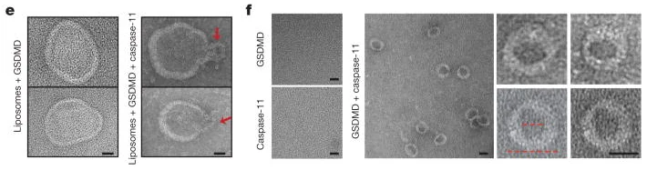{ width="720" height="190" loading=lazy }
    /// caption
    原图 3e、f。e 比较完整 GSDMD 有无 caspase-11 的处理；f 显示提取的 N 端环状复合物及示意尺寸。比例尺 20 nm。[^gasdermin-pores]
    ///

膜上已有 gasdermin 孔，与整张质膜最终大范围破裂，仍是不同事件。NINJ1 在若干裂解性死亡中参与最后的膜破裂；细胞可已失去生存能力、释放小分子，却尚未大量释放 LDH 等较大内容物。不同 gasdermin 也可由不同蛋白酶激活，因此“检测到某个炎症 caspase”与“证明焦亡”之间还需要执行层的证据。[^ninj1-rupture]

### 铁死亡：膜磷脂的过氧化失去控制

**铁死亡（ferroptosis）**与铁参与的脂质过氧化密切相关。含多不饱和脂肪酸的膜磷脂容易形成过氧化物；GPX4 利用还原型谷胱甘肽（GSH）把磷脂氢过氧化物还原，使氧化链反应受到限制。system x$_c^-$ 以胞内谷氨酸交换胞外胱氨酸，为半胱氨酸和 GSH 合成提供来源。胱氨酸供应减少、GSH 耗竭或 GPX4 受抑，都可能把易感细胞推向膜脂损伤。其他抗氧化途径、铁状态与膜脂组成还会改变阈值。[^ferroptosis-discovery][^gpx4-ferroptosis]

Dixon 等比较 erastin 处理与其他致死刺激时，发现它产生的形态和抑制剂响应并不相同。下面的 BJeLR 细胞电镜中，erastin 处理后的线粒体较小、膜密度较高；staurosporine 处理则显示明显的凋亡相关核改变。这是最初的表型线索，随后还需用干预判断差异来自哪里。

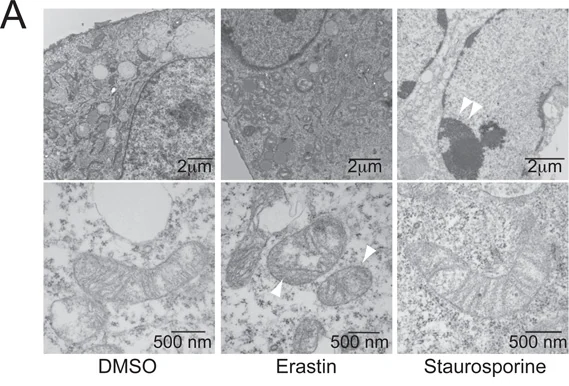{ width="720" height="488" loading=lazy }
/// caption
原图 2A 选取 DMSO 对照、37 μM erastin 处理 10 小时、0.75 μM staurosporine 处理 8 小时三列；下排放大线粒体。时间和剂量不同，图像用于比较所示条件下的形态。[^ferroptosis-discovery]
///

铁螯合剂 DFO 和抗氧化剂 Trolox 在多个细胞系中能减轻 erastin 的致死作用，而广谱 caspase 抑制剂 z-VAD-fmk 没有同样稳定的保护。下图把不同药物的调节效应放在一起，黄色表示较强的保护。再结合脂质氧化检测、GPX4 等关键因子的遗传或药理扰动，才逐渐确定铁死亡的机制。[^ferroptosis-discovery][^gpx4-ferroptosis]

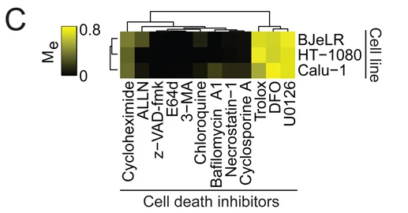{ width="590" height="308" loading=lazy }
/// caption
原图 2C：BJeLR、HT-1080、Calu-1 细胞经 10 μM erastin 处理 24 小时。颜色是归一化的调节效应，不是原始存活率；横轴列出处理药物，右侧标出三种细胞系。[^ferroptosis-discovery]
///

线粒体缩小不是所有铁死亡的必备形态，单个抑制剂也可能有多重作用。实验设计要同时回答细胞是否死亡、膜脂氧化是否增加，以及干预关键通路能否救援。缺血—再灌注中 ATP 耗竭、Ca$^{2+}$ 超载、活性氧和线粒体通透性转换的关系，另见[细胞损伤](../physiology/pathophysiology/cell_injury.md#irreversible-injury)。

## 自噬：把自身物质送入降解系统 { #autophagy }

细胞并不需要等到死亡才降解自身。饥饿时回收一部分胞质，可为关键代谢提供原料；平时移除受损线粒体或聚集蛋白，也有助于维持功能。**巨自噬（macroautophagy）**先用隔离膜围住货物，封闭为双层膜的自噬体，再与溶酶体融合。里面的膜和货物一起被降解，小分子返回胞质。[^autophagy-homeostasis]

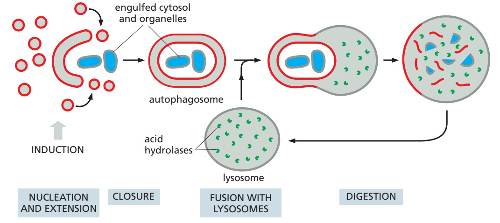{ width="700" height="312" loading=lazy }
/// caption
从隔离膜包围货物，依次看到封闭、融合和降解。外膜与溶酶体膜融合后，内膜及其包围的物质进入降解区室。[^fig-autophagy]
///

ULK1 复合物参与起始，III 类 PI3K 复合物 I 产生的 PI3P 有助于招募膜形成因子；ATG9 膜运输和 ATG12、LC3／ATG8 两套泛素样偶联系统参与膜的形成与延伸。LC3 前体先经 ATG4 加工，随后胞质型 LC3-I 的末端与膜脂偶联，成为膜结合的 LC3-II。**I 到 II 的关键改变是脂化。** 选择性自噬受体还可同时结合货物与膜上的 ATG8 家族蛋白，把泛素化蛋白、受损细胞器或微生物送入这条路线。[^autophagy-homeostasis]

另两条路线采用不同的入口。微自噬（microautophagy）由溶酶体、晚期内体或液泡膜直接摄取胞质成分；哺乳动物伴侣介导自噬（CMA）则由 HSC70 等识别带 KFERQ 样基序的可溶蛋白，经 LAMP2A 相关转位系统送入溶酶体，底物需展开才能通过。几种膜拓扑的比较见[内膜系统的自噬入口](endomembrane.md#autophagy-pathways)。

!!! info "自噬体变多，可能发生在哪一步"

    自噬体的数目同时取决于生成和清除。生成加快会让它变多，融合或溶酶体降解受阻也会。因而研究**自噬通量（autophagic flux）**时，常比较加入与不加入溶酶体抑制剂后的 LC3-II 周转，并结合 p62／SQSTM1 等货物受体的变化；p62 自身的合成变化也要纳入解释。[^autophagy-guidelines]

    串联 mRFP–GFP–LC3 报告器利用两种荧光对酸性的耐受差异：尚未进入酸性区室的斑点通常同时发红、绿光，进入溶酶体后 GFP 较易淬灭，红色仍可保留。因此可以追踪从自噬体到酸性降解区室的变化；若处理本身改变溶酶体 pH，这个判读也会受到影响。[^tandem-lc3]

自噬多数时候有助于细胞存活，在某些发育或损伤条件下也参与死亡和组织清除。果蝇变态时的唾液腺降解是经典例子：抑制自噬会妨碍组织按时消失，自噬与 caspase 途径均参与这一过程。要进一步称作**自噬依赖性细胞死亡**，还需证明自噬机器对死亡本身不可缺少，并区分“细胞未死”与“已死但尸体没有被降解”。[^salivary-autophagy][^autophagy-guidelines]

## 植物与真菌的死亡程序 { #non-animal-cell-death }

植物的木质部导管成熟时，细胞会加厚细胞壁，随后清除原生质，留下能输水的中空结构。胚胎胚柄、部分根冠细胞、衰老叶片及病原体诱发的超敏反应中，也会发生受调控死亡；这些过程使用的执行装置和时间顺序并不完全相同。[^plant-cell-death]

下图展示一种**液泡型细胞死亡（vacuolar cell death）**：液泡逐渐扩大，胞质成分被降解，液泡膜最终失去完整性，剩余原生质迅速清除。上排是挪威云杉胚柄细胞，下排是拟南芥管状分子。读到最右侧时，细胞内部已近乎清空，细胞壁却还保留原来的轮廓。

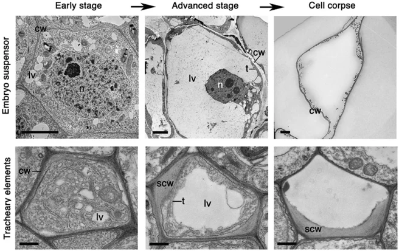{ width="720" height="453" loading=lazy }
/// caption
两排均由早期、晚期到细胞残留结构。cw 为细胞壁，lv 为裂解性液泡，n 为细胞核，scw 为次生壁，t 为液泡膜；上排比例尺 5 μm，下排 500 nm。[^plant-cell-death]
///

植物细胞壁使残留物保留在原位，不采用动物中常见的整细胞吞噬清除。另一些植物死亡较早丧失质膜完整性，呈坏死型形态；叶片衰老和超敏反应还可能结合多种变化。植物缺少动物式 caspase，见到染色质凝集、DNA 断裂或某些人工底物被切割，仍需依据植物自身的蛋白酶和遗传依赖关系解释。[^plant-cell-death]

酵母也会对过氧化氢、乙酸、渗透压变化或其他胁迫产生死亡反应。刺激过强时可直接破坏细胞，较温和条件下则可能出现可调节的执行过程。PS 外露、活性氧增加和 DNA 断裂可以作为表型，但是否已经不可逆地失去生存能力，要结合膜完整性与撤去刺激后的克隆形成能力；物种、培养阶段和诱因剂量都需要说明。[^yeast-death]

## 细胞衰老：停滞的细胞仍在影响组织 { #cellular-senescence }

正常人二倍体成纤维细胞在培养中不能无限扩增，这一现象构成了 **Hayflick 界限**的经典背景。应记录的是累计群体倍增数，不能把一次传代机械算作一次分裂。培养条件、供者与细胞类型会改变可扩增的时间，癌细胞也并非每一个都能建立无限传代的细胞系。[^hayflick-limit]

**复制性衰老**常与端粒缩短和端粒保护失效有关。持续 DNA 损伤信号可激活 p53–p21，使 CDK 活性下降、RB 维持对 E2F 的约束；p16–RB 轴也可稳定周期停滞。p21 还能结合 PCNA、影响 DNA 复制，但细胞内的具体结果取决于其水平和所在复合物。[^senescence-mechanism]

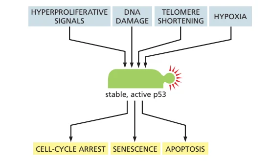{ width="370" height="221" loading=lazy }
/// caption
DNA 损伤、端粒异常、缺氧和异常增殖信号均可接入 p53。下游三个箭头代表可能结局，并不表示它们在每个细胞中同时发生。[^fig-p53-fates]
///

端粒尚未缩到临界程度，细胞也可因氧化应激、异常癌基因信号、辐射或 DNA 损伤药物进入衰老样状态，这类过程常称**应激诱导的早衰（SIPS）**。同一种损伤还可能造成暂时停顿或死亡，需要继续追踪结局。[^senescence-mechanism]

停滞稳定并不等于细胞已没有代谢。许多衰老细胞反而增大、溶酶体增多，并持续合成分泌蛋白。某些细胞在特定基因改变或强选择下还能逃逸停滞。

### 一种蓝色染色能告诉我们多少

1995 年，Dimri 等报告了一种方便的组织化学检测：在 **pH 6** 条件下检测 $\beta$-半乳糖苷酶。常规溶酶体 $\beta$-半乳糖苷酶在更酸的条件下即可检测，许多衰老细胞的溶酶体区室和酶量增加，使较不适合该酶的 pH 6 条件下也能出现明显信号，后来称为 **SA-$\beta$-gal**。[^sagal-original]

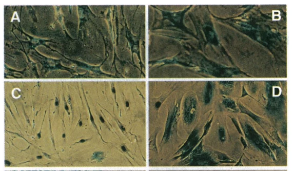{ width="650" height="378" loading=lazy }
/// caption
A、B 是 WI-38 细胞在 pH 4 下的早期与衰老培养，均可着色；C、D 是 HCA2 细胞在 pH 6 下的比较。C、D 中深色核为 $^{3}$H-胸腺嘧啶核苷掺入的放射自显影信号，用来识别 DNA 合成；蓝绿色胞质是酶反应产物。[^sagal-original]
///

图中早期培养的许多细胞仍合成 DNA，衰老培养中则出现更多蓝绿色胞质。不过，原研究也观察到高密度培养的部分未衰老细胞可以暂时阳性，成人黑素细胞的染色行为又与成纤维细胞不同。染色条件和细胞身份，从这个方法出现时就是解释的一部分。[^sagal-original]

识别组织中的衰老细胞，因此需要把几类证据放在**同一个细胞**上：例如与其身份相符的稳定增殖停滞，p16／p21、DNA 损伤焦点或染色质改变，溶酶体与脂褐素增加，以及分泌或代谢变化。lamin B1 下降、细胞增大、SA-$\beta$-gal 阳性等都不是普适必需条件。SenNet 建议在组织中组合至少三个衰老特征，并明确细胞类型、诱因和时间；对于原本就不分裂的终末分化细胞，更需依靠其他衰老相关变化，不能把“不分裂”本身当作新证据。[^sennet-markers]

### 分泌变化把单细胞状态传给周围

许多衰老细胞释放细胞因子、趋化因子、生长因子和基质重塑酶，合称**衰老相关分泌表型（SASP）**。这种分泌可以招来免疫细胞，也能改变邻近细胞的增殖、分化和基质环境；其成分随诱因、细胞身份和时间变化。

短暂出现的衰老有助于限制受损细胞扩增，也可参与伤口修复和胚胎组织塑形，随后被清除。若衰老细胞长期积累，持续的炎症与基质变化则可能损伤干细胞生态位、促进纤维化，或在某些环境中帮助肿瘤演化。它对组织的影响，要放回“何时出现、存留多久、周围有哪些细胞”来理解。[^sennet-markers][^aging-hallmarks]

??? note "酵母的衰老需要另选时间尺度"

    出芽酵母的**复制寿命**可按一个母细胞产生的子细胞数计量，**时序寿命**则衡量非分裂群体在时间中的存活。二者采用不同的操作定义，也不直接等同于哺乳动物的衰老停滞。

    经典研究发现，染色体外 rDNA 环可在母细胞中不对称积累并影响复制寿命。这提示 DNA 重组产物及其分配能够影响衰老；不同菌株和条件还有其他限制因素，不能把 rDNA 环概括为所有单细胞生物的共同老化原因。[^yeast-aging]

细胞衰老是机体衰老的一项机制。干细胞耗竭、细胞间通信、免疫与神经内分泌变化，以及器官储备减少，还发生在不同尺度，见[生长、发育与衰老](../physiology/growth_development.md#aging-resilience)。干细胞移植能否重建特定功能，需由具体细胞产品和实验支持，不能从“具有干性”直接推出普适抗衰老效果；相关功能判据见[再生的图式、尺度与功能](../development/stem_cells_regeneration.md#regeneration-pattern-function)。

## 命运转换的实验证据 { #fate-evidence }

同一时刻的照片可以显示状态，追踪才让我们看到它从哪里来、以后走向哪里。谱系标记记录祖先与后代，EdU 脉冲和周期报告器记录增殖，移植与长期重建检验功能；单细胞转录组可揭示异质状态，却不能自行证明一个表达簇就是另一个簇的祖先。

死亡实验尤其容易把不同层次的读数混在一起。常用方法测量的是以下具体变化：

| 检测 | 直接观察的变化 | 需要配合的判断 |
| --- | --- | --- |
| DAPI、Giemsa 与显微形态 | 核和染色质的分布、凝集、碎裂；细胞轮廓变化 | 分裂、损伤和不同死亡过程都可能改变形态，需时间序列和执行分子证据 |
| DNA 含量与流式散射 | 制样中小 DNA 片段丢失可形成 Sub-G$_1$ 群；前向散射（FSC）常降低，侧向散射（SSC）可因体系而异 | Sub-G$_1$ 受固定、提取和门控影响；FSC／SSC 变化也不能单独认定凋亡[^apoptosis-flow] |
| 吖啶橙（AO） | 核酸结合及酸性区室中富集所形成的荧光差异 | 颜色受核酸种类、浓度、pH 与处理影响，不能套用“绿活红死”的通则 |
| Annexin V 与 PI 等膜不透性染料 | PS 外露和膜通透性 | Annexin V 阳性、PI 阴性可提示早期凋亡，但也见于其他状态；双阳性不能独自区分晚期凋亡与裂解性死亡 |
| 台盼蓝、LDH 释放 | 染料能否进入、胞质酶是否外泄 | 主要反映膜完整性；死亡可以先于明显膜破裂，且单项读数不指定机制 |
| DNA 梯带、TUNEL、彗星实验 | 分别检测片段大小分布、可标记的 DNA 断端、DNA 迁移 | DNA 损伤、修复和多种死亡均可产生断端，三种方法也不能互相替代 |
| 罗丹明 123 等膜电位探针、GSH 检测 | 线粒体膜电位相关的染料积累、还原物质水平 | 代谢和转运变化也会影响结果，需适当对照，不能单独认定凋亡或铁死亡 |
| caspase 底物切割、MLKL 或 gasdermin 激活等 | 特定执行装置的状态 | 结合遗传扰动、药理救援及实际死亡，判断它是否承担因果作用 |

对本来能够增殖的细胞，撤去刺激后的克隆形成可检验长期存活；对神经元等终末分化细胞，则要选与其身份相符的活性和功能指标。自噬需看通量，衰老需看多项特征及其持续性，干细胞需看长期后代贡献。实验中的这些时间尺度不同，决定了一个状态名称究竟能得到多强的支持。[^nccd-2018][^autophagy-guidelines][^sennet-markers]

## 参考资料与延伸阅读 { #references }

机制与图解主要参照 *Molecular Biology of the Cell* 第 7 版的细胞死亡、癌症、发育和组织更新章节。

[^cell-number-control]: 动物细胞生长、分裂与存活的关系主要参考 Alberts、Heald 等，*Molecular Biology of the Cell*（MBoC），第 7 版（2022），第 17、18、22 章；公开旧版见[细胞增殖、生长和凋亡的胞外控制](https://www.ncbi.nlm.nih.gov/books/NBK26877/)。
[^osm-cell-death]: 组织细胞数平衡、凋亡形态、caspase 级联和吞噬清除的组织实质性改编自 osm.bio《[第十八章 细胞死亡](https://osm.bio/index.php?title=第十八章_细胞死亡&oldid=11578)》固定版本，贡献者为长河、Sofia，原文按 [CC BY-SA 4.0](https://creativecommons.org/licenses/by-sa/4.0/deed.zh-hans) 许可；相关内容经现代死亡命名、机制综述和检测指南交叉核验。
[^cellular-memory]: 分化的组合调控、信号历史与重编程参照 MBoC 第 7 版，第 21、22 章，尤其 pp.1221–1223、1303–1305；细胞记忆背景另见 NCBI Bookshelf 的[Cellular Memory](https://www.ncbi.nlm.nih.gov/books/NBK585716/)。
[^nuclear-transfer]: 成年哺乳动物体细胞核可支持克隆动物发育的经典证据见 Wilmut 等的[Dolly 研究](https://pubmed.ncbi.nlm.nih.gov/9039911/)。
[^ipsc-reprogramming]: Takahashi K、Yamanaka S（2006），[定义因子诱导小鼠成纤维细胞形成多能状态](https://pubmed.ncbi.nlm.nih.gov/16904174/)，Cell 126:663–676；Fbx15 筛选与后续 Nanog 筛选所得细胞的功能差异见 Okita K、Ichisaka T、Yamanaka S（2007），[具有生殖系贡献能力的 iPSC](https://pubmed.ncbi.nlm.nih.gov/17554338/)，Nature 448:313–317。
[^stem-cell-renewal]: 干细胞、祖细胞、更新层级及潜能参照 MBoC 第 7 版，第 22 章，pp.1279–1306；公开教材入口见[Stem Cells: Tissue Renewal](https://www.ncbi.nlm.nih.gov/books/NBK1566/)。
[^stem-cell-niche]: 生态位接触、细胞极性与对称／不对称分裂的框架见 StemBook 的[Mechanisms regulating stem cell polarity and the specification of asymmetric divisions](https://www.ncbi.nlm.nih.gov/books/NBK27028/)；组织尺度由随机命运达到平均自我更新平衡的模型见[Stem Cells: Tissue Renewal](https://www.ncbi.nlm.nih.gov/books/NBK1566/)。
[^cancer-hallmarks]: 癌细胞能力、表型可塑性、非突变性重编程和肿瘤微环境的更新框架见 Hanahan 的[Hallmarks of Cancer: New Dimensions](https://pubmed.ncbi.nlm.nih.gov/35022204/)。
[^cancer-stem-plasticity]: 肿瘤干性样状态的层级异质性与适应性可塑性实例见 Gimple 等的[脑癌干细胞综述](https://www.nature.com/articles/s41568-022-00486-x)。
[^nccd-2018]: accidental、regulated 与 programmed cell death 的层级，及按分子机制命名死亡方式的建议见 Nomenclature Committee on Cell Death 的[2018 年建议](https://pubmed.ncbi.nlm.nih.gov/29362479/)。
[^bcl2-apoptosis]: BCL-2 家族、BH3-only 蛋白、BAX／BAK、MOMP 与线粒体凋亡阈值见 Singh、Letai 与 Sarosiek 的[综述](https://pubmed.ncbi.nlm.nih.gov/30655609/)。
[^caspase8-death]: 死亡受体复合物、caspase-8 对凋亡与坏死性凋亡分流的调节见 Tummers 与 Green 的[综述](https://pmc.ncbi.nlm.nih.gov/articles/PMC5417704/)。
[^efferocytosis]: 尸体识别、吞噬与吞噬细胞代谢的背景见 Boada-Romero E、Martinez J、Heckmann BL、Green DR（2020），[The clearance of dead cells by efferocytosis](https://pubmed.ncbi.nlm.nih.gov/32251387/)。PS 跨膜分布的改变另见 MBoC 第 7 版，pp.1100–1101。
[^phosphatidylserine-boundary]: PS 外翻在凋亡以外死亡方式中的出现及其判读边界见 Shlomovitz 等的[综述](https://pubmed.ncbi.nlm.nih.gov/31665027/)。
[^death-pathways]: 凋亡、坏死性凋亡、焦亡和铁死亡的通路背景见 Ai Y、Meng Y、Yan B、Zhou Q、Wang X（2024），[The biochemical pathways of apoptotic, necroptotic, pyroptotic, and ferroptotic cell death](https://pubmed.ncbi.nlm.nih.gov/38181758/)。本页实验依据分别随各节列出。
[^autophagy-homeostasis]: 巨自噬、微自噬和 CMA 的膜拓扑见 MBoC 第 7 版，第 13 章，pp.804–806；ATG 装置的背景另见 Dikic I、Elazar Z（2018），[Mechanism and medical implications of mammalian autophagy](https://pubmed.ncbi.nlm.nih.gov/29618831/)。
[^autophagy-guidelines]: 自噬通量、LC3／p62 判读和 autophagy-dependent cell death 的实验标准见 Klionsky 等的[自噬检测指南第四版](https://pmc.ncbi.nlm.nih.gov/articles/PMC7996087/)。
[^plant-cell-death]: van Doorn WG 等（2011），[Morphological classification of plant cell deaths](https://pmc.ncbi.nlm.nih.gov/articles/PMC3172093/)，Cell Death & Differentiation 18:1241–1246。本页图取自图 1；原文注明云杉胚柄图由 Lada Filonova、Elena Minina 提供，拟南芥管状分子图由 Utku Avci 提供。
[^yeast-death]: 真菌死亡中克隆形成、膜完整性与机制命名的判据见 Carmona-Gutierrez 等的[酵母细胞死亡命名指南](https://pubmed.ncbi.nlm.nih.gov/29354647/)。
[^sennet-markers]: 衰老细胞异质性、无单一普适标志及按组织采用多参数组合的建议见 SenNet Consortium 的[检测建议](https://pubmed.ncbi.nlm.nih.gov/38831121/)。
[^aging-hallmarks]: 细胞衰老同其他机体衰老机制的关系见 López-Otín 等的[Hallmarks of Aging 扩展框架](https://europepmc.org/article/MED/36599349)。
[^tumor-efflux]: Bleau AM 等（2009），[PTEN/PI3K/Akt pathway regulates the side population phenotype and ABCG2 activity in glioma tumor stem-like cells](https://pmc.ncbi.nlm.nih.gov/articles/PMC3688060/)，Cell Stem Cell 4:226–235；在胶质瘤模型中检验 ABCG2 活性、染料外排与干性样群体。该文明确替莫唑胺不是 ABCG2 底物，不能把所有治疗耐受都归于直接外排。
[^apoptosis-flow]: Gong J、Traganos F、Darzynkiewicz Z（1994），[凋亡细胞小 DNA 片段的选择性提取](https://pubmed.ncbi.nlm.nih.gov/8074286/)，Analytical Biochemistry 218:314–319；散射的细胞类型差异见 Darzynkiewicz Z 等（1992），[Features of apoptotic cells measured by flow cytometry](https://pubmed.ncbi.nlm.nih.gov/1333943/)，Cytometry 13:795–808。
[^lgr5-tracing]: Barker N 等（2007），[Identification of stem cells in small intestine and colon by marker gene Lgr5](https://www.nature.com/articles/nature06196)，Nature 449:1003–1007；本页分别裁取图 5c–e 和 5f–h，保留时间、面板与标记。LacZ 为诱导重组后继承的报告标记；该研究另以共染检验主要分化谱系。
[^cancer-textbook]: 原癌基因、抑癌基因、克隆演化、细胞能力与肿瘤形态参照 MBoC 第 7 版，第 20 章，pp.1161–1213，尤其图 20–8、20–22 和 20–31。
[^oncogene-history]: 历史基因名与分子分类见 Cooper，*The Cell: A Molecular Approach* 第 2 版的[Oncogenes](https://www.ncbi.nlm.nih.gov/books/NBK9840/)，以及 Holland-Frei Cancer Medicine 第 6 版的[Discovery and identification of oncogenes](https://www.ncbi.nlm.nih.gov/books/NBK13714/)。旧称用于理解发现历史，不作为现代全部基因的命名规则。
[^dcc-dependence]: Castets M 等（2012），[DCC constrains tumour progression via its dependence receptor activity](https://pubmed.ncbi.nlm.nih.gov/22158121/)，Nature 482:534–537；小鼠遗传模型检验 DCC 促凋亡功能与肠肿瘤进展的关系。
[^tumor-morphology]: 癌与组织来源的教材定义见 MBoC 第 7 版，第 20 章；肺肿瘤的形态区分参照 Travis WD（2012），[Update on small cell carcinoma and its differentiation from squamous cell carcinoma and other non-small cell carcinomas](https://www.nature.com/articles/modpathol2011150)，Modern Pathology 25:S18–S30。
[^death-textbook]: 凋亡形态、caspase、线虫 CED 系统、线粒体及存活信号参照 MBoC 第 7 版，第 18 章，pp.1089–1102。图例分别注明教材图号与原始显微资料出处。
[^granzyme-pathways]: 穿孔素与颗粒酶 B 的杀伤途径见 MBoC 第 7 版，第 18、24 章；颗粒酶 A 在实验加载条件下引发 caspase 非依赖死亡的早期研究见 [Granzyme A Loading Induces Rapid Cytolysis and a Novel Form of DNA Damage Independently of Caspase Activation](https://www.sciencedirect.com/science/article/pii/S1074761300800588)；底物与生理作用随模型而异。 炎症效应的原研究见 Metkar SS 等（2008），[Human and mouse granzyme A induce a proinflammatory cytokine response](https://doi.org/10.1016/j.immuni.2008.08.014)。PRF1 相关家族性病例的遗传与细胞毒证据见 Stepp SE 等（1999），[Perforin gene defects in familial hemophagocytic lymphohistiocytosis](https://pubmed.ncbi.nlm.nih.gov/10583959/)，Science 286:1957–1959。
[^necroptosis-switch]: Oberst A 等（2011），[Catalytic activity of the caspase-8–FLIPL complex inhibits RIPK3-dependent necrosis](https://pubmed.ncbi.nlm.nih.gov/21368763/)，Nature 471:363–367。
[^mlkl-execution]: Sun L 等（2012），[Mixed lineage kinase domain-like protein mediates necrosis signaling downstream of RIP3 kinase](https://pubmed.ncbi.nlm.nih.gov/22265413/)，Cell 148:213–227；结合蛋白鉴定与功能干预确立 MLKL 在 RIPK3 下游的作用。
[^gasdermin-pores]: Liu X 等（2016），[Inflammasome-activated gasdermin D causes pyroptosis by forming membrane pores](https://pmc.ncbi.nlm.nih.gov/articles/PMC5539988/)，Nature 535:153–158。本页裁取图 3d 及 3e–f，分别显示脂质体泄漏与负染电镜；膜孔尺寸为该实验制备条件下的观测值。
[^ninj1-rupture]: Kayagaki N 等（2021），[NINJ1 mediates plasma membrane rupture during lytic cell death](https://pubmed.ncbi.nlm.nih.gov/33472215/)，Nature 591:131–136；研究区分小分子释放、死亡与最后的质膜破裂。
[^ferroptosis-discovery]: Dixon SJ 等（2012），[Ferroptosis: an iron-dependent form of nonapoptotic cell death](https://pmc.ncbi.nlm.nih.gov/articles/PMC3367386/)，Cell 149:1060–1072。本页裁取图 2A 的三组电镜和图 2C；处理条件与归一化调节效应的定义依原图注。
[^gpx4-ferroptosis]: Yang WS 等（2014），[Regulation of ferroptotic cancer cell death by GPX4](https://pubmed.ncbi.nlm.nih.gov/24439385/)，Cell 156:317–331；GPX4 活性与铁死亡敏感性的遗传及生化研究。
[^fig-autophagy]: Alberts、Heald 等，MBoC 第 7 版，图 13–71，p.805；复用本站内膜系统页面已核对的图版。
[^tandem-lc3]: Kimura S、Noda T、Yoshimori T（2007），[Dissection of the autophagosome maturation process by a novel reporter protein, tandem fluorescent-tagged LC3](https://doi.org/10.4161/auto.4451)，Autophagy 3:452–460；判读时亦应依自噬检测指南控制溶酶体酸化与报告蛋白行为。
[^salivary-autophagy]: Berry DL、Baehrecke EH（2007），[Growth arrest and autophagy are required for salivary gland cell degradation in Drosophila](https://pubmed.ncbi.nlm.nih.gov/18083103/)，Cell 131:1137–1148。此处保留其发育性组织降解背景，不把组织残留直接等同于细胞仍然存活。
[^hayflick-limit]: Hayflick L、Moorhead PS（1961），[The serial cultivation of human diploid cell strains](https://doi.org/10.1016/0014-4827(61)90192-6)，Experimental Cell Research 25:585–621。
[^senescence-mechanism]: 端粒、损伤信号及周期停滞见 MBoC 第 7 版，第 17、20 章和 SenNet 检测建议；p21 与 PCNA 的直接相互作用见 Waga S 等（1994），[The p21 inhibitor of cyclin-dependent kinases controls DNA replication by interaction with PCNA](https://pubmed.ncbi.nlm.nih.gov/7911228/)，Nature 369:574–578。
[^sagal-original]: Dimri GP 等（1995），[A biomarker that identifies senescent human cells in culture and in aging skin in vivo](https://pubmed.ncbi.nlm.nih.gov/7568133/)，PNAS 92:9363–9367；图 1A–D 从[大学机构保存的论文副本](https://pure.rug.nl/ws/files/3279918/1995ProcNatlAcadSciDimri.pdf)裁取。pH 4 与 pH 6 的面板使用不同细胞株，比较应在各自早期／衰老配对内进行。 该活性来自溶酶体 β-半乳糖苷酶的证据见 Lee BY 等（2006），[Senescence-associated beta-galactosidase is lysosomal beta-galactosidase](https://pubmed.ncbi.nlm.nih.gov/16626397/)。
[^yeast-aging]: Sinclair DA、Guarente L（1997），[Extrachromosomal rDNA circles—a cause of aging in yeast](https://pubmed.ncbi.nlm.nih.gov/9428525/)，Cell 91:1033–1042。母细胞的复制寿命与非分裂群体的时序寿命采用不同实验定义。
[^fig-crypt-renewal]: Alberts、Heald 等，*Molecular Biology of the Cell*，第 7 版（2022），图 22–4，p.1282。从原书裁取，保留原标注。
[^fig-gene-combinations]: Alberts、Heald 等，*Molecular Biology of the Cell*，第 7 版（2022），图 21–5，p.1221。从原书裁取，保留原标注。
[^fig-cell-memory]: Alberts、Heald 等，*Molecular Biology of the Cell*，第 7 版（2022），图 21–7，p.1222。从原书裁取，保留原标注。
[^fig-ipsc-network]: Alberts、Heald 等，*Molecular Biology of the Cell*，第 7 版（2022），图 22–26，p.1304。从原书裁取，保留原标注。
[^fig-ipsc-selection]: Alberts、Heald 等，*Molecular Biology of the Cell*，第 7 版（2022），图 22–27，p.1304。从原书裁取，保留原标注。
[^fig-stem-hierarchy]: Alberts、Heald 等，*Molecular Biology of the Cell*，第 7 版（2022），图 22–3，p.1281。从原书裁取，保留原标注。
[^fig-lineage-design]: Alberts、Heald 等，*Molecular Biology of the Cell*，第 7 版（2022），图 22–7，p.1284。从原书裁取，保留原标注。
[^fig-stem-niche]: Alberts、Heald 等，*Molecular Biology of the Cell*，第 7 版（2022），图 22–13，p.1291。从原书裁取，保留原标注。
[^fig-asymmetric-fate]: Alberts、Heald 等，*Molecular Biology of the Cell*，第 7 版（2022），图 22–16，p.1293。从原书裁取，保留原标注。
[^fig-population-fate]: Alberts、Heald 等，*Molecular Biology of the Cell*，第 7 版（2022），图 22–18，p.1295。从原书裁取，保留原标注。
[^fig-cancer-invasion]: Alberts、Heald 等，*Molecular Biology of the Cell*，第 7 版（2022），图 20–8，p.1168。从原书裁取，保留原标注。
[^fig-contact-inhibition]: Alberts、Heald 等，*Molecular Biology of the Cell*，第 7 版（2022），图 20–15，p.1173。从原书裁取，保留原标注。
[^fig-oncogene-activation]: Alberts、Heald 等，*Molecular Biology of the Cell*，第 7 版（2022），图 20–22，p.1181。从原书裁取，保留原标注。
[^fig-death-morphology]: Alberts、Heald 等，*Molecular Biology of the Cell*，第 7 版（2022），图 18–1，p.1090。从原书裁取，保留原标注。 原图由 Julia Burne、Martin Raff 提供，按原书图注。
[^fig-digit-sculpting]: Alberts、Heald 等，*Molecular Biology of the Cell*，第 7 版（2022），图 18–2，p.1090。从原书裁取，保留原标注。 原图来自 W. Wood 等（2000），Development 127:5245–5252，按原书图注。
[^fig-initiator-caspase]: Alberts、Heald 等，*Molecular Biology of the Cell*，第 7 版（2022），图 18–3，p.1091。从原书裁取，保留原标注。
[^fig-executioner-caspase]: Alberts、Heald 等，*Molecular Biology of the Cell*，第 7 版（2022），图 18–4，p.1092。从原书裁取，保留原标注。
[^fig-cad-ladder]: Alberts、Heald 等，*Molecular Biology of the Cell*，第 7 版（2022），图 18–5，p.1092。从原书裁取，保留原标注。 右侧原实验来自 McIlroy D 等（2000），[Genes & Development 14:549–558](https://doi.org/10.1101/gad.14.5.549)。
[^fig-cytochrome-c]: Alberts、Heald 等，*Molecular Biology of the Cell*，第 7 版（2022），图 18–7，p.1094。从原书裁取，保留原标注。 原显微资料来自 Goldstein JC 等（2000），Nature Cell Biology 2:156–162，原书注明。
[^fig-apoptosome]: Alberts、Heald 等，*Molecular Biology of the Cell*，第 7 版（2022），图 18–8，p.1095。从原书裁取，保留原标注。
[^fig-bcl2-domains]: Alberts、Heald 等，*Molecular Biology of the Cell*，第 7 版（2022），图 18–9，p.1096。从原书裁取，保留原标注。
[^fig-bcl2-momp]: Alberts、Heald 等，*Molecular Biology of the Cell*，第 7 版（2022），图 18–10，p.1097。从原书裁取，保留原标注。
[^fig-xiap-smac]: Alberts、Heald 等，*Molecular Biology of the Cell*，第 7 版（2022），图 18–11，p.1098。从原书裁取，保留原标注。
[^fig-death-receptor]: Alberts、Heald 等，*Molecular Biology of the Cell*，第 7 版（2022），图 18–6，p.1093。从原书裁取，保留原标注。
[^fig-survival-competition]: Alberts、Heald 等，*Molecular Biology of the Cell*，第 7 版（2022），图 18–12，p.1099。从原书裁取，保留原标注。
[^fig-ps-exposure]: Alberts、Heald 等，*Molecular Biology of the Cell*，第 7 版（2022），图 18–14，p.1101。从原书裁取，保留原标注。
[^fig-p53-fates]: Alberts、Heald 等，*Molecular Biology of the Cell*，第 7 版（2022），图 20–31，p.1190。从原书裁取，保留原标注。
