# 细胞信号转导 { #_1 }

乙酰胆碱到达心脏起搏细胞，可以让放电变慢；到达唾液腺细胞，可以促进分泌；到达骨骼肌终板，却引起去极化，继而触发收缩。同一个小分子，怎么像是说了三句话？

差别从受体就开始了。骨骼肌终板上的烟碱型乙酰胆碱受体本身是离子通道；心脏与腺细胞主要使用不同亚型的毒蕈碱型受体，再经 G 蛋白接到各自的通道或酶。细胞里原有的蛋白、代谢底物和基因表达状态，继续决定响应的去向。**信号分子的作用，要连同接收它的细胞一起理解。**[^signaling-overview]

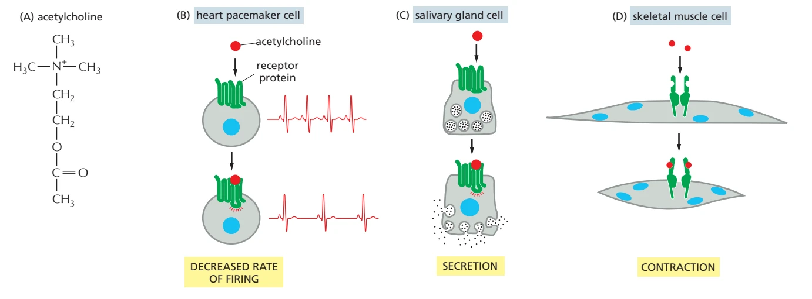{ width="800" height="296" }
/// caption
沿每一列往下看：同一配体分别改变放电、分泌与收缩；不同细胞使用的受体和胞内装置不同。[^fig-ach-responses]
///

本页先介绍受体之后反复出现的分子过程，再沿几条主要通路追踪信号怎样改变代谢、膜运输、骨架与转录。组织间的激素协调可接着读[内分泌生理](../physiology/endo/index.md#receptor-context)。[^osm-cell-signaling]

## 信号怎样到达细胞 { #communication-receptor-context }

细胞可以把信号分子释放到组织液，再由血液带往远处，这就是内分泌；也可以让它在附近扩散，作用于邻近细胞，形成旁分泌。释放出的分子返回分泌细胞自身，或作用于同类细胞，则构成自分泌调节。自分泌也参与发育和组织修复，使同类细胞能够协调活动。

神经元把两种距离接了起来：动作电位沿轴突传播，递质却在突触处跨过很短的细胞外间隙。接触依赖信号还要更近——一侧细胞膜上的配体，直接碰到另一侧细胞的受体。缝隙连接与植物胞间连丝另有一条路径，让离子或小分子在相邻胞质间交换；通道结构和通透性见[直接胞质通讯](cell_interactions.md#gap-junctions)与[胞间连丝](cell_interactions.md#secondary-wall-plasmodesmata)。这些名称描述信号的传播路径，同一种分子在不同组织中可以采用不同路径。[^signaling-overview]

到达靶细胞以后，信号通常先与受体结合。受体数量有限，结合具有选择性，许多配体—受体结合又是可逆的；浓度升高时，受体占有率逐渐趋向饱和。但占有多少受体，与最后产生多强的反应之间，还隔着放大、反馈和细胞已有状态。少量受体被激活就可能引出明显响应，持续暴露后相同浓度的配体也可能不再引起同样强的反应。

| 受体系统 | 受体激活后首先改变什么 | 常见输出 |
| --- | --- | --- |
| 配体门控离子通道 | 通道开放概率 | 离子通量与膜电位；随后可接入酶和转录调节 |
| G 蛋白偶联受体（GPCR） | 异三聚体 G 蛋白结合的核苷酸 | cAMP、磷脂信号、Ca$^{2+}$、离子通道 |
| 受体酪氨酸激酶（RTK） | 受体激酶活性与酪氨酸磷酸化 | Ras–ERK、PI3K–AKT、PLC$\gamma$ 等支路 |
| JAK 相关的细胞因子受体 | 与受体结合的 JAK 激酶 | STAT 转录因子及其他信号支路 |
| 受体 Ser／Thr 激酶 | I 型受体及其 Smad 底物的磷酸化 | TGF-$\beta$、BMP 等家族信号 |
| 核受体 | 受体与 DNA、辅调节因子的结合组合 | 基因表达 |
| Notch | 受体的依次切割 | 胞内片段入核，参与转录调节 |

这些受体并不各占据一个固定的时间尺度。离子通道能在毫秒尺度改变电活动，由它引起的钙信号又可以影响数小时的基因表达；同一个膜受体也可同时调节现成的酶和需要重新合成的蛋白。

## 通路中反复出现的分子过程 { #signaling-grammar }

### 磷酸化与核苷酸开关 { #molecular-switches }

蛋白激酶把 ATP 的末端磷酰基转移到底物蛋白的特定残基上，蛋白磷酸酶再将其水解除去。一个新增的磷酸基带来了电荷，也改变了局部的结合关系：酶可能更容易催化，某个结合位点可能露出来，蛋白也可能离开原来的位置，或更容易被降解。**磷酸化的结果由位点和蛋白决定**，有些底物因它活化，有些反而受到抑制。多个位点之间还可有先后依赖或相互竞争，使反应出现阈值。[^signaling-switches]

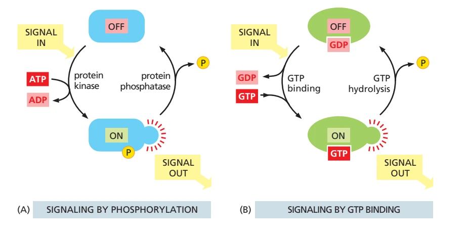{ width="760" height="384" loading=lazy }
/// caption
左：在蛋白上加、去磷酸基；右：更换结合的核苷酸，再将 GTP 水解。图中左侧画的是磷酸化后活化的一种情况。[^fig-switches]
///

GTP 酶使用另一套循环。GTP 结合后，蛋白的开关区改变构象，可以与一组效应蛋白结合；GTP 水解为 GDP 后，这些相互作用减弱。许多 GTP 酶自身交换核苷酸或水解 GTP 都很慢，需要调节蛋白控制节奏。

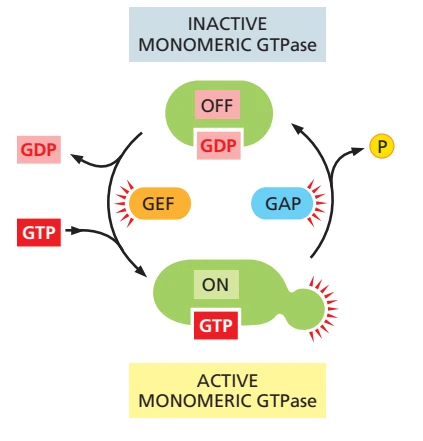{ width="350" height="365" loading=lazy }
/// caption
左侧 GDP 离开后，胞质中较丰富的 GTP 才能结合；右侧水解使开关复位。[^fig-gef-gap]
///

**鸟嘌呤核苷酸交换因子（GEF）**促进 GDP 释放，让空出的口袋重新结合核苷酸。这里换掉的是整个 GDP 分子，并没有把它原地磷酸化成 GTP。

**GTP 酶激活蛋白（GAP）**加快 GTP 水解。“激活”指提高 GTP 酶的水解活性，结果通常是结束它对下游的信号。这个名字若只看前两个字，确实容易会错意。

异三聚体 G 蛋白的某些 G$\alpha$ 亚基由 **RGS** 蛋白提供 GAP 活性。对部分小 GTP 酶，**GDP 解离抑制蛋白（GDI）**还帮助稳定 GDP 状态，并控制其在膜与胞质之间的分配。

同样的循环被用于许多位置：Ras 把生长因子受体接到激酶级联；Rho 家族参与肌动蛋白和黏附调节；Rab、Arf 组织膜交通；Ran 的空间分布赋予[核质运输方向](nucleus_chromatin.md#ran-directed-transport)；Rheb 调节细胞生长；Miro 则参与线粒体沿骨架的定位。它们的工作差别，来自不同的调节蛋白、结合伙伴和工作位置。

### 结合结构域与复合物组装 { #signaling-assemblies }

信号蛋白碰到合适的伙伴，才有机会继续反应。许多蛋白含有专门识别短序列或膜脂的结构域。一个蛋白可以带几个这样的结构域，将原本分散的分子连在一起；受体被磷酸化后，也会临时增加可供结合的位置。

| 结构域 | 常见识别对象 | 怎样参与信号 |
| --- | --- | --- |
| SH2 | 特定序列中的磷酸酪氨酸 | 把蛋白招募到已磷酸化的受体或对接蛋白 |
| PTB | 常为 NPXY 一类序列；是否要求磷酸化因成员而异 | 参与受体与适配蛋白的结合 |
| SH3 | 富含脯氨酸的短序列 | 连接适配蛋白、酶和骨架组分 |
| WW | 按亚类识别 PPXY、磷酸化 Ser／Thr-Pro 等基序[^ww-domain] | 将修饰或短序列接到特定伙伴 |
| PDZ | 常为蛋白 C 端的短基序 | 帮助受体、通道与支架在局部聚集 |
| PH | 配体多样，只有部分成员选择性识别某类磷酸肌醇脂 | 在合适膜面招募信号蛋白；有时还需同时识别膜蛋白 |

下图并列了三种组装方式。A 中，支架蛋白已经把反应伙伴放在受体附近；B 中，受体激活后才出现磷酸化结合位点；C 中，受体激活磷脂激酶，在膜脂上制造结合位点。前两种改变蛋白间的关系，第三种还改变了膜面可招募什么蛋白。[^signaling-assemblies-source]

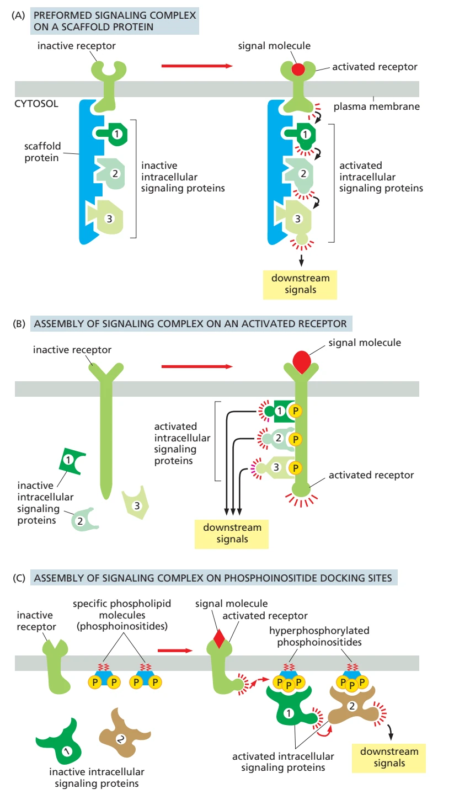{ width="520" height="922" loading=lazy }
/// caption
A：伙伴预先聚在支架上；B：激活后结合受体；C：由新生成的膜脂招募。[^fig-assembly]
///

支架提高了伙伴在局部相遇的机会，也能让共用某种激酶的通路较少互相干扰。不过，支架数量过多时，几种伙伴可能各自落在不同的支架上，完整复合物反而减少。增加一个“有帮助的成分”，并不保证输出一直增加。

膜域、内体、黏着斑和初级纤毛都有类似作用：把某些分子聚到一处，同时限制它们与别处组分相遇。后面会看到，AKT 要先到合适的膜面，Hedgehog 通路则要用到纤毛里的运输。

### 第二信使与放大 { #second-messengers }

受体激活后，可以调节一种酶，让它连续生成许多小分子；也可以打开通道，让大量离子进入胞质。这些随后作用于胞内靶点的分子或离子，称为**第二信使**。一个受体事件由此影响许多效应分子，酶级联还可以继续放大反应。[^gpcr-textbook]

第二信使不必都在胞质中自由扩散。cAMP、cGMP 和肌醇三磷酸（IP$_3$）可以在水相中移动；二酰甘油（DAG）和 PI(3,4,5)P$_3$ 留在膜内；Ca$^{2+}$ 在通道附近尤其容易形成局部高浓度。合成、降解、泵送、缓冲和扩散一起决定它们能影响多远、维持多久。

也有信号不经过这一步：某些脂溶性配体直接结合胞内受体，Notch 则把自己的胞内片段切下来。下面先从使用第二信使最丰富的一类受体开始。

## G 蛋白偶联受体 { #gpcr-signaling }

### 七跨膜受体怎样使 G 蛋白换核苷酸 { #gpcr-activation }

**G 蛋白偶联受体（GPCR）**的多肽链以七条 $\alpha$ 螺旋穿过膜，N 端朝向细胞外，C 端位于胞质。其胞质面可接触由 $\alpha$、$\beta$、$\gamma$ 三个亚基组成的 G 蛋白；G$\alpha$ 与 G$\gamma$ 的脂质修饰帮助它们停留在膜的胞质侧。

静息时，G$\alpha$ 结合 GDP，并与 G$\beta\gamma$ 组成异三聚体。激动剂结合使受体更常采取能结合 G 蛋白的构象；受体接触 G$\alpha$ 后，促使其核苷酸口袋松开，GDP 离去。GTP 随后结合，G$\alpha$ 与 G$\beta\gamma$ 的关系发生改变，两者都可接触下游效应器。下图把这一过程画成亚基分离；具体复合物也可能以亚基间重排的方式工作。

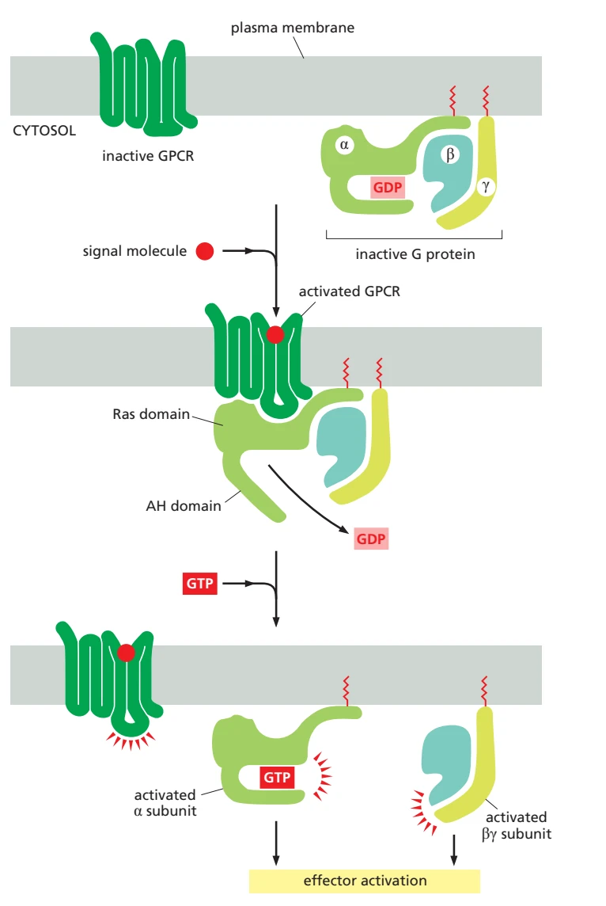{ width="520" height="777" loading=lazy }
/// caption
从上到下：GDP 结合态、受体促进 GDP 释放、GTP 结合后的效应器调节。[^fig-gpcr-cycle]
///

这里的受体本身充当 **GEF**。一个仍处于活性构象的受体可以继续促进其他 G 蛋白换核苷酸，形成放大。

响应也从一开始就受到时间限制。G$\alpha$ 自身能把 GTP 水解为 GDP；RGS 或某些效应蛋白能加快部分 G$\alpha$ 的水解。水解后，G$\alpha$ 与效应器的相互作用减弱，并重新与 G$\beta\gamma$ 结合，回到可接受下一次刺激的状态。

G$\beta\gamma$ 也有自己的靶点。例如心脏 M$_2$ 受体激活 G$_{i/o}$ 后，G$\beta\gamma$ 可以打开 GIRK 钾通道，使膜电位更接近钾平衡电位、减慢起搏；G$\alpha_i$ 对腺苷酸环化酶的抑制则是另一条支路。

???+ abstract "在结构上看见跨膜信号"

    Rasmussen 等解析的 $\beta_2$ 肾上腺素能受体–G$_s$ 复合物，将受体胞外侧的激动剂与胞质侧的 G 蛋白放进同一个结构中。绿色受体的胞质面包住了 G$\alpha_s$ 的 C 端螺旋；金色 G$\alpha_s$、青色 G$\beta$ 与紫色 G$\gamma$ 仍构成复合物。[^gpcr-structure]

    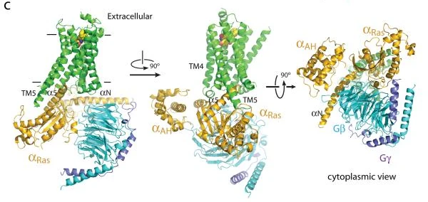{ width="650" height="308" loading=lazy }
    /// caption
    原文图 2c 的三个视角；此面板省略了辅助结晶的 T4 溶菌酶和 Nb35。该结构中的 G 蛋白不含核苷酸。[^gpcr-structure]
    ///

    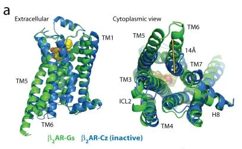{ width="430" height="266" loading=lazy }
    /// caption
    原文图 3a：绿色为 G$_s$ 结合的活性受体，蓝色为非活性受体；右侧从胞质面看 TM6 向外移动约 14 Å。[^gpcr-structure]
    ///

    TM6 的胞质端外移，给 G$\alpha$ 的末端腾出了结合空间。这个无核苷酸状态与 GDP 释放过程相联系；晶体结构提供的是被稳定下来的一个状态，不能单独显示 GDP 离开、GTP 进入的全部运动。

不同 G$\alpha$ 家族接到不同效应器，常见组合可以放在一起比较：

| G$\alpha$ 家族 | 常见连接 | 代表性受体 |
| --- | --- | --- |
| G$_s$ | 激活腺苷酸环化酶，提高 cAMP | $\beta$ 肾上腺素能受体、血管加压素 V$_2$ |
| G$_{i/o}$ | G$\alpha_i$ 抑制部分腺苷酸环化酶；G$\beta\gamma$ 调节通道等 | $\alpha_2$ 肾上腺素能受体、M$_2$ |
| G$_{q/11}$ | 激活 PLC$\beta$，生成 IP$_3$ 与 DAG | $\alpha_1$ 肾上腺素能受体、M$_3$、血管加压素 V$_1$ |
| G$_{12/13}$ | 激活某些 Rho GEF，调节 Rho 与骨架 | 多种与收缩、迁移相关的 GPCR |

这是常见的主要偶联关系；具体细胞中的 G 蛋白亚型和其他结合伙伴，仍会影响受体实际产生哪些输出。

### cAMP 与 PKA { #camp-pka }

腺苷酸环化酶（adenylyl cyclase，AC）把 ATP 转为**环腺苷酸（cAMP）**。核糖的 3′、5′ 位通过一个磷酸基相连，形成“环”；磷酸二酯酶（PDE）水解这个环，产物是 5′-AMP。cAMP 的升降取决于合成与降解的相对速率。

哺乳动物的膜型 AC 有两组各六条跨膜螺旋，胞质侧的 C1、C2 催化区共同形成活性位点；反应需要 Mg$^{2+}$ 等二价金属离子参与，体外测定也常使用 Mn$^{2+}$。可溶性 AC 属于另一种结构与调节方式，不能套用这一跨膜构型。[^ac-structure]

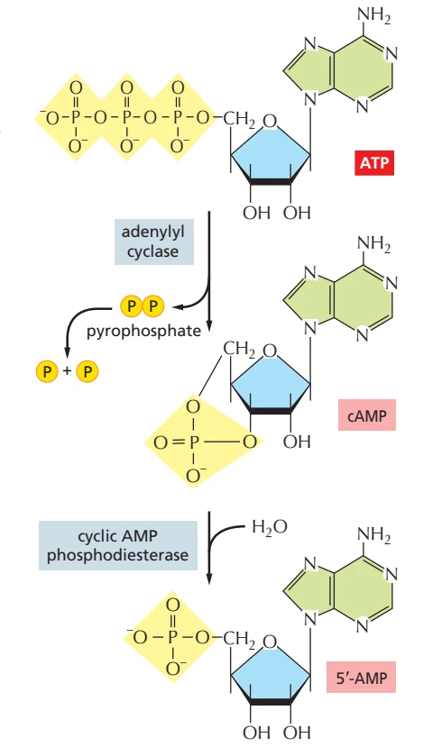{ width="310" height="555" loading=lazy }
/// caption
上：环化时释放焦磷酸；下：PDE 将环磷酸二酯键水解。[^fig-camp-turnover]
///

**蛋白激酶 A（PKA）**是一种 Ser／Thr 激酶，通常由两个调节亚基和两个催化亚基组成。调节亚基结合并抑制催化亚基，每个调节亚基又有两个 cAMP 结合位点。cAMP 结合后改变调节亚基构象，解除抑制，使催化亚基能够磷酸化底物。底物位点上游的 Arg 等碱性残基常有利于识别，但细胞中的作用还取决于底物能否接近酶。[^pka-substrate]

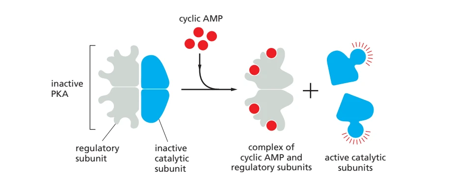{ width="600" height="240" loading=lazy }
/// caption
灰色为调节亚基，蓝色为催化亚基，红色为 cAMP；图示经典的亚基解离模型。[^fig-pka]
///

细胞中，**A 激酶锚定蛋白（AKAP）**还能把 PKA、PDE、磷酸酶等固定在某段膜或细胞器附近。于是 cAMP 不会只形成一个全细胞均匀升降的数值：生成位置和局部降解一起塑造了反应区域。

PKA 可以立刻改变已有蛋白。以糖原调节为例，它磷酸化并激活磷酸化酶激酶，后者再激活糖原磷酸化酶，使糖原分解加快；另一边，PKA 对糖原合酶的磷酸化倾向于抑制合成。PP1 等磷酸酶促进这些蛋白去磷酸化，帮助反应回转。在表达**抑制蛋白 1（inhibitor-1）**的细胞中，PKA 还可磷酸化它，使它抑制 PP1；增加磷酸化与减慢去磷酸化因此能同时发生。[^pka-inhibitor1]肝和肌的受体、酶同工型、变构调节不同，尤其不能把胰高血糖素的肝脏作用照搬到骨骼肌；具体反应与组织分工见[糖原代谢调节](../biochem/glycogen.md#covalent-regulation)。

较持久的响应可以接到细胞核。PKA 催化亚基进入核内后，能磷酸化 **cAMP 反应元件结合蛋白（CREB）**，促进它与 CBP／p300 等辅激活因子配合，调节相应基因。图中的 CRE 是 DNA 上的反应元件，CREB 则是结合它的蛋白。

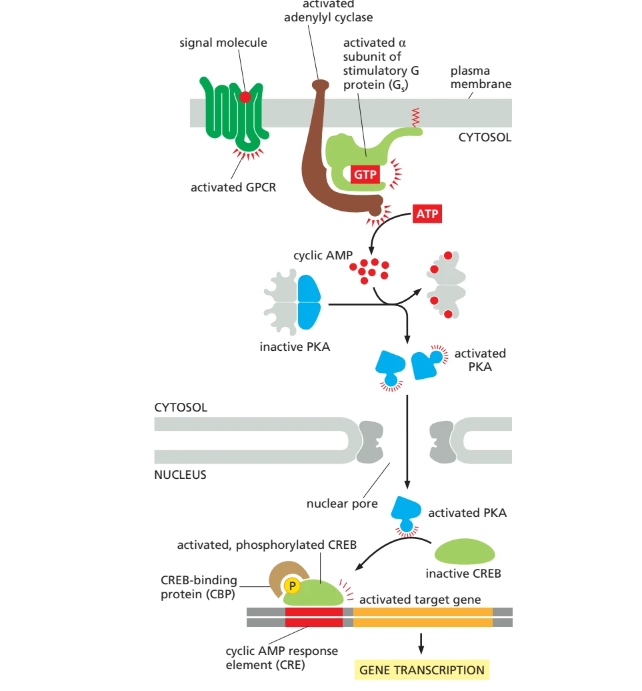{ width="500" height="538" loading=lazy }
/// caption
上部改变酶活性，下部接到核内转录；同一次受体激活可以产生不同时程的效应。[^fig-creb]
///

CREB 的 Ser133 磷酸化是一个关键步骤，但某个基因最终是否表达，还要看其他转录因子、辅调节因子与染色质状态。因此，测到 CREB 磷酸化，与测到特定靶基因转录增加，是两项需要分别检验的结果。

!!! note "两种毒素，改变 G 蛋白循环的不同位置"

    霍乱毒素对 G$\alpha_s$ 作 ADP-核糖基化，使它难以通过 GTP 水解复位。肠上皮中的 cAMP 因而持续升高，经 PKA 增强 CFTR 氯通道活动，促进氯离子和水向肠腔分泌。

    百日咳毒素则修饰 G$\alpha_{i/o}$，妨碍它与受体有效偶联，使其较多保留在 GDP 状态。两者分别延长 G$_s$ 的活化和阻断 G$_{i/o}$ 的正常激活，也被用作分析受体偶联的实验工具；百日咳本身的病理效应还涉及多种细胞和毒力因子。[^gpcr-textbook]

### PLC、钙信号与 PKC { #plc-calcium-pkc }

G$\alpha_{q/11}$ 常把受体接到**磷脂酶 C$\beta$（PLC$\beta$）**。PLC 切开质膜胞质侧的 PI(4,5)P$_2$：带磷酸的肌醇头部成为可溶的**肌醇-1,4,5-三磷酸（IP$_3$）**，带脂肪酸链的部分成为留在膜中的 **DAG**。一次切割，产生两个去向不同的信号。RTK 也能激活 PLC$\gamma$，接入相似的下游过程。[^gpcr-textbook]

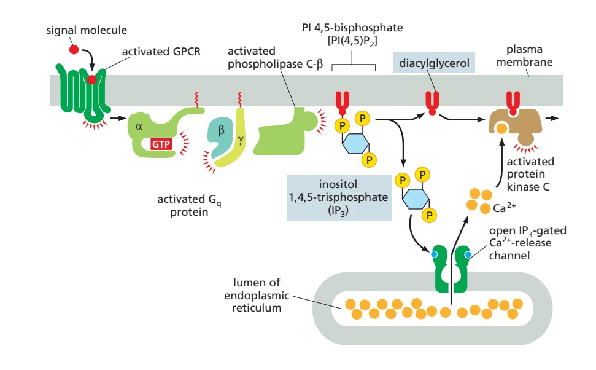{ width="800" height="496" loading=lazy }
/// caption
沿分叉追踪：IP$_3$ 到内质网释放 Ca$^{2+}$，DAG 留在质膜，与升高的 Ca$^{2+}$ 共同激活图中的经典型 PKC。[^fig-plc]
///

IP$_3$ 结合内质网膜上的 IP$_3$ 受体，使其钙通道开放。这种受体由四个亚基组成，每个亚基都有 IP$_3$ 结合位点，开放还受到胞质 Ca$^{2+}$ 的调节。[^ip3r-tetramer]静息胞质游离 Ca$^{2+}$ 常在约 $10^{-7}$ mol/L 的水平，内质网腔与细胞外则维持高得多的浓度；通道一开，Ca$^{2+}$ 就能迅速流向胞质。它随后结合通道、收缩装置和各种调节蛋白，改变分泌、运动、代谢或转录。

其中一个广泛使用的钙感受蛋白是**钙调蛋白（calmodulin，CaM）**。它有四个 EF-hand 钙结合位点，结合钙后暴露可接触靶蛋白的表面，中间的柔性连接区还能弯曲，使两端包住靶蛋白的一段螺旋。

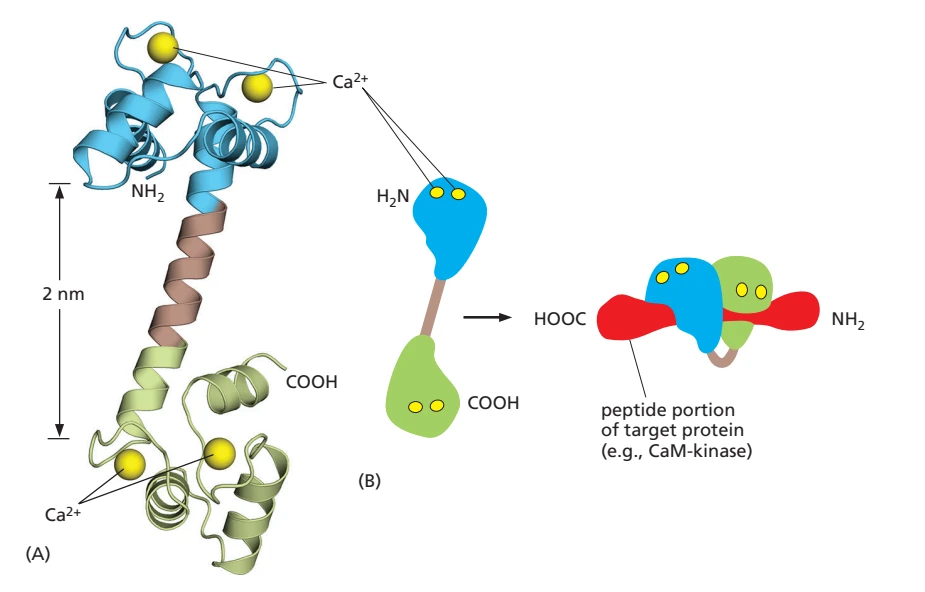{ width="680" height="435" loading=lazy }
/// caption
黄色球代表 Ca$^{2+}$；B 中红色为靶蛋白的一段肽链。钙调蛋白通过改变结合状态来调节靶蛋白。[^fig-calmodulin]
///

CaM 本身不是蛋白激酶。它可以激活 Ca$^{2+}$/CaM 依赖性蛋白激酶（CaMK），也能激活**钙调神经磷酸酶（calcineurin）**。后者使 NFAT 去磷酸化、暴露核输入所需的信号，促进 NFAT 入核。CaMKII 的相邻亚基还可发生自身磷酸化，使部分活性在一次钙升高结束后继续存在；钙脉冲的间隔因而会影响活性积累与消退。

胞质钙降低也需要具体装置。SERCA 把钙泵回肌质网或内质网，PMCA 与 Na$^+$/Ca$^{2+}$ 交换体把钙排到细胞外，线粒体摄取与胞质缓冲蛋白则改变局部游离钙浓度。在有 IP$_3$ 的条件下，一处释放的 Ca$^{2+}$ 可以促进附近 IP$_3$ 受体开放，推动释放向周围传播；较高钙水平下的抑制、缓冲与泵送，又会限制和终止释放。局部释放事件因而可以相接成钙波，反馈与回收的反复作用则能形成脉冲。由少量通道共同产生的短暂局部信号，还可按来源区分：IP$_3$ 受体簇常产生钙“喷发”（puff），肌细胞中雷诺定受体簇的局部释放常称钙“火花”（spark）。[^calcium-local-release]

!!! info "PKC 家族对 DAG 与钙的需求不同"

    **蛋白激酶 C（PKC）**是一组 Ser／Thr 激酶。经典型 PKC 需要 DAG、Ca$^{2+}$ 以及包括磷脂酰丝氨酸在内的合适膜脂环境；新型 PKC 仍受 DAG 调节，但不需要 Ca$^{2+}$；非典型 PKC 不使用 DAG 和 Ca$^{2+}$ 作为同样的直接激活组合，更多依赖其他脂质、蛋白相互作用和磷酸化。图中将两条支路汇到 PKC，画的是经典型成员。

???+ abstract "把钙振荡的节奏交给实验者"

    细胞自然产生的钙振荡，幅度、频率和上游受体往往一起变化。Dolmetsch、Xu 与 Lewis 用 Jurkat T 细胞设计了一个“钙钳制”系统：先用毒胡萝卜素抑制 SERCA、耗竭内质网钙库，使钙库耗竭激活的钙进入通道（储存操纵性钙通道）开放；再用阀门切换有钙和无钙的外液，主动控制钙升高与回落。[^calcium-oscillations]

    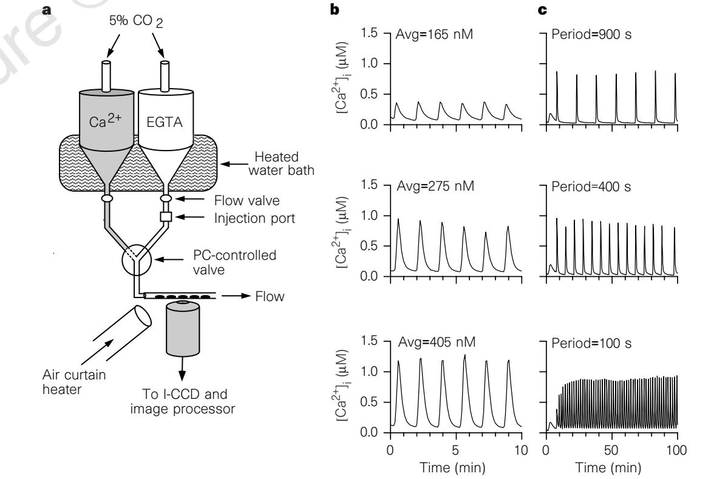{ width="780" height="526" loading=lazy }
    /// caption
    原文图 1。a 为装置；b 改变加钙持续时间；c 给予 30 秒钙输入，并改变脉冲周期。曲线为细胞群的钙记录。[^calcium-oscillations]
    ///

    研究者在同样的佛波酯 PdBU 协同刺激下，用报告基因比较转录响应。下面 b 图的横轴是**周期**：越往右，脉冲越稀。NFAT 与 Oct/OAP 响应在较长周期时明显下降，NF-$\kappa$B 在更稀的脉冲下仍保留响应；d 图中，IL-2 与 IL-8 启动子的响应也不同。

    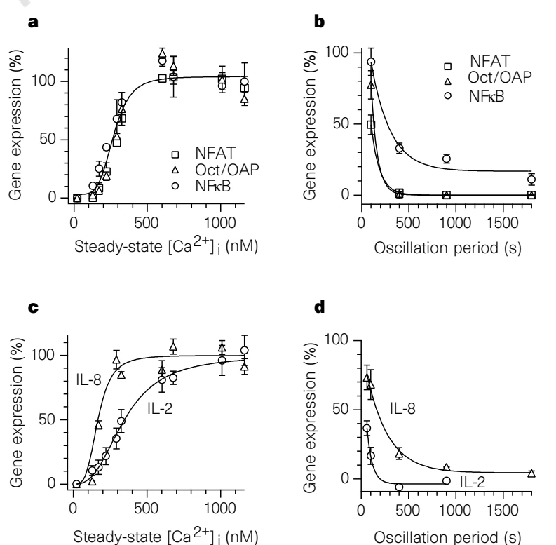{ width="760" height="745" loading=lazy }
    /// caption
    原文图 3。a、c 改变稳定钙浓度，b、d 改变振荡周期；纵轴为归一化报告基因表达。所有组都含 50 nM PdBU。[^calcium-oscillations]
    ///

    这个实验说明，在给定的协同输入下，钙的时间变化可以改变基因响应的组合。b、d 各组保持相近峰值，周期改变时平均钙浓度也会改变；它们不是“平均浓度相等”的比较。论文另用平均浓度匹配的处理比较振荡与持续升高，发现低平均钙水平时振荡能更有效地激活 NFAT。

    一种解释来自转录因子的退场速度：在该实验背景下，NF-$\kappa$B 的核内停留比 NFAT 更持久，稀疏脉冲留下的作用仍能相接。细胞接收到的于是既有“钙升高多少”，也有“两次升高相隔多久”。

### 同样接到通道，嗅觉与视觉的方向不同 { #sensory-gpcr }

嗅觉受体通过 G$_{olf}$ 激活腺苷酸环化酶，升高 cAMP，打开环核苷酸门控（CNG）阳离子通道，使嗅觉神经元去极化。视杆细胞则使用视紫红质、转导蛋白 G$_t$ 与磷酸二酯酶 PDE6：光激活视紫红质后，G$\alpha_t$–GTP 接触 PDE6 的抑制性 $\gamma$ 亚基及催化核心，改变其构象，解除催化抑制；PDE6 随后加快水解 cGMP。[^pde6-activation] 随着 cGMP 降低，外节膜上的 CNG 通道关闭，阳离子内流减少，细胞**超极化**，突触末端释放的谷氨酸也减少。[^gpcr-textbook]

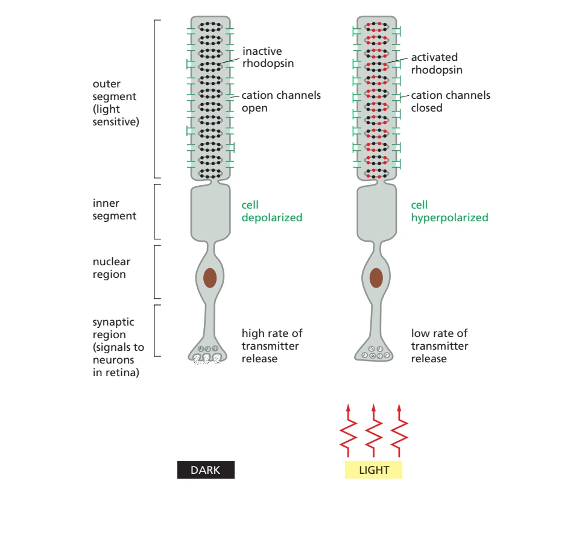{ width="480" height="459" loading=lazy }
/// caption
左：黑暗中 CNG 通道开放，递质持续释放；右：光照使通道关闭、细胞超极化，递质释放减少。[^fig-rod]
///

黑暗中的视杆细胞一直在释放递质，光到来后反而减少。这里的“感受到刺激”，并不等于膜电位一定向去极化方向变化。

在这两种感觉中，环核苷酸直接调节通道。GPCR 的输出因此既可以经过 PKA、PKC 等激酶，也可以迅速改变电活动；而嗅觉的 cAMP 升高与视杆的 cGMP 降低，又给出了相反的通道变化方向。

## 酶联受体与磷酸化网络 { #enzyme-linked-receptors }

### RTK、Ras 与 ERK { #rtk-ras-erk }

多数**受体酪氨酸激酶（RTK）**是单次跨膜蛋白，胞外结合配体，胞内带有激酶结构域。配体可以促成二聚化，也可以改变已经相连的受体之间的角度，使胞内激酶区能够相互激活和磷酸化。胰岛素受体在配体到来前就由二硫键连接，其激活主要依赖构象重排。[^enzyme-linked-textbook]

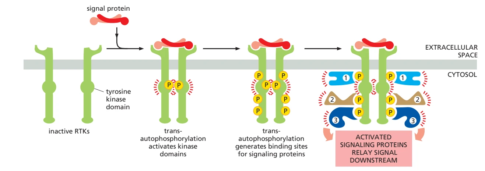{ width="800" height="282" loading=lazy }
/// caption
依次看受体靠近、激酶活化和对接位点形成；图示配体促二聚的一类 RTK。[^fig-rtk]
///

受体上的磷酸酪氨酸既能调节激酶自身，也能成为结合位点。以通往 Ras 的路线为例，适配蛋白 **GRB2** 用 SH2 结构域结合受体或对接蛋白上的磷酸酪氨酸，再用 SH3 结构域结合富脯氨酸的 **SOS**。SOS 是 Ras 的 GEF；被带到膜边以后，它更容易接触膜上的 Ras，促进 GDP 释放和 GTP 结合。GRB2 不必催化反应，仅仅改变 SOS 的位置，就已经改变了反应发生的机会。

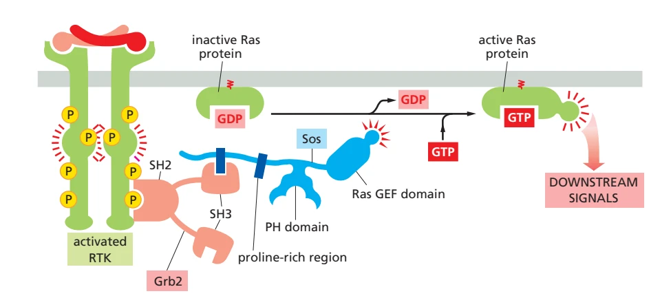{ width="780" height="346" loading=lazy }
/// caption
看 GRB2 的两类结构域：SH2 朝向磷酸化受体，SH3 连接 SOS；SOS 的 GEF 结构域接触 Ras。[^fig-sos-ras]
///

Ras–GTP 招募并促进 RAF 激活，RAF 磷酸化 MEK1/2，MEK 再磷酸化 ERK1/2。RAF、MEK、ERK 依次对应 MAP 激酶激酶激酶、MAP 激酶激酶和 MAP 激酶——名称像在层层加括号，反应倒很具体：上一层的激酶，以后一层激酶为底物。RAF 和 ERK 主要磷酸化 Ser／Thr，MEK 则是双特异性激酶，在 ERK 的激活环上磷酸化 Thr 和 Tyr。

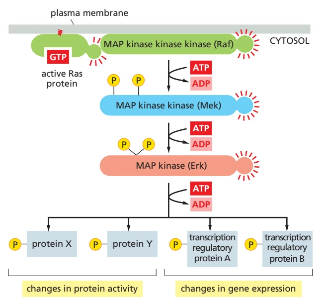{ width="500" height="465" loading=lazy }
/// caption
每一层都使用 ATP 磷酸化下一层；ERK 的底物既包括已有蛋白，也包括转录调节蛋白。[^fig-mapk]
///

ERK 可以改变胞质蛋白活动，也可入核调节转录。它的作用随活化强度、持续时间、脉冲和位置而变。PC12 细胞中的经典比较发现，EGF 常引起较短暂的 ERK 活化并促进增殖，NGF 常引起更持续的活化并伴随神经样分化；这是特定细胞系统中的关系，Marshall 的综述整理了相应证据。[^erk-duration]

Ras 也需要复位。某些致癌突变削弱 GAP 促进的 GTP 水解，使 Ras 更长时间处于 GTP 结合态，持续向下游提供输入。不同突变对交换、水解和效应器结合的影响不同，不能把所有突变归成完全相同的分子缺陷。

???+ abstract "培养液没有反复加 EGF，ERK 却一阵一阵地活动"

    Albeck、Mills 与 Brugge 在 MCF-10A 乳腺上皮细胞中表达快速响应的 ERK 活性传感器 EKAR-EV，在持续提供不同浓度 EGF 的条件下追踪单细胞。图中记录的是刺激后约 48—70 小时的活动，已经越过最初几分钟的急性响应。[^erk-pulses]

    { width="700" height="555" loading=lazy }
    /// caption
    原文图 3A，时间单位为小时。ERK 活化会降低 CFP/YFP 比值，因此作者将纵轴方向倒置；图中向上的峰表示活性升高。[^erk-pulses]
    ///

    低浓度 EGF 下，孤立的活性峰之间夹着较长的低活性期；随着 EGF 增加，峰间隔缩短、活动持续时间也增加。再看下面的图，每一横行是一个细胞：亮带没有排成整齐的竖列，说明不同细胞并不同时活化。

    

    

    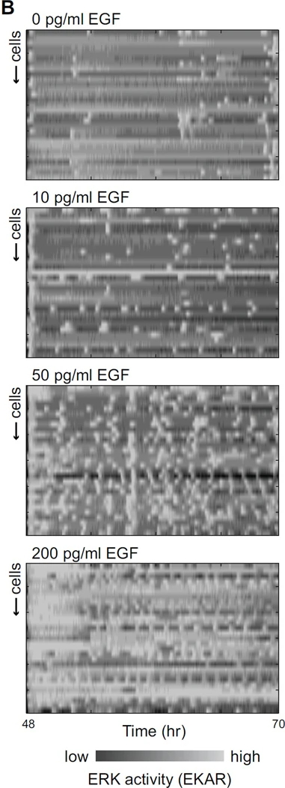{ width="350" height="965" loading=lazy }
    /// caption
    原文图 3B，浅色表示较高 ERK 活性；每组 29 行分别对应 29 个细胞，横轴为时间。[^erk-pulses]
    ///

    

    

    如果把群体平均值画成随时间变化的曲线，异步的峰就会被抹平，看来像是一个稳定的中等活性。这正好解释了为什么群体测量和单细胞录像可能给人不同印象。

    论文还将 ERK 轨迹与细胞周期报告蛋白相对照，并比较 EGFR 与 MEK 抑制的效果。脉冲和进入 S 期之间的联系，须结合这些额外测量判断；上面两幅图直接显示的是活性动态及细胞间差异。

    

    

### PI3K、AKT 与 mTOR { #pi3k-akt-mtor }

受体的另一类伙伴改变膜脂。**IA 类磷脂酰肌醇 3-激酶（PI3K）**通常含 p85 调节亚基与 p110 催化亚基，受体或对接蛋白通过磷酸酪氨酸招募 p85，使 p110 接近质膜底物。p110 在 PI(4,5)P$_2$ 的肌醇环 3 位加上磷酸，生成 **PI(3,4,5)P$_3$（PIP$_3$）**。

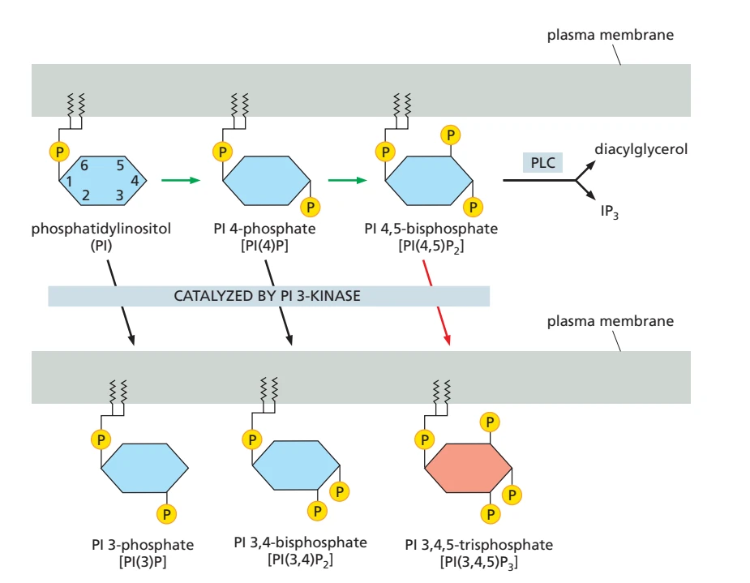{ width="760" height="591" loading=lazy }
/// caption
先看右侧红箭头：IA 类 PI3K 将 PIP$_2$ 转为 PIP$_3$。图中其他向下箭头代表 PI3K 家族的不同底物选择，不能全归给 IA 类。[^fig-pi3k-lipids]
///

PIP$_3$ 增多后，带有相应 PH 结构域的 **AKT（又称蛋白激酶 B，PKB）**与 **PDK1** 聚到同一膜面。PDK1 磷酸化 AKT 的 Thr308，mTOR 复合物 2（mTORC2）促进其 Ser473 磷酸化，二者配合支持充分活化。脂质磷酸酶 **PTEN** 则去掉 PIP$_3$ 的 3 位磷酸，使它回到 PIP$_2$，限制这一招募过程。[^pten-lipid-phosphatase][^mtorc2-akt]

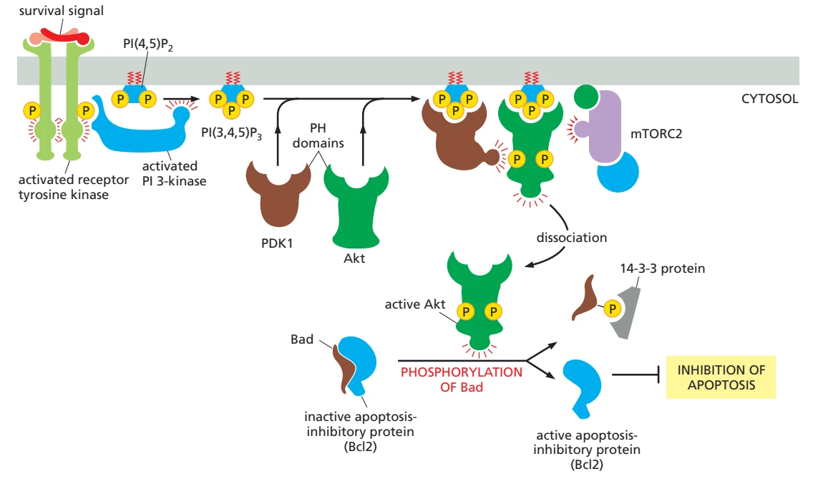{ width="800" height="476" loading=lazy }
/// caption
膜上先聚集 AKT 与 PDK1；下方展示一种存活支路：BAD 磷酸化后结合 14-3-3，解除对抗凋亡蛋白的抑制。[^fig-akt]
///

AKT 的底物把这个膜事件接到几种不同结果。它使 FOXO 转录因子较多离开细胞核，改变相应基因表达；抑制 GSK3，支持糖原合成；在某些细胞中还磷酸化促凋亡蛋白 BAD，使其被 14-3-3 结合，减弱 BAD 对抗凋亡蛋白的限制。骨骼肌和脂肪细胞中，AKT 调节 TBC1D4 等 Rab GAP，解除对特定 Rab 的抑制，促进 GLUT4 囊泡向表面转位。肝细胞主要使用 GLUT2，其胰岛素响应不能按 GLUT4 转位来解释，见[胰岛素的组织特异性作用](../physiology/endo/endo_islet.md#insulin-action)。

生长还需要营养条件。**mTOR 复合物 1（mTORC1）**在溶酶体附近汇合生长因子与氨基酸输入：AKT 抑制 TSC 复合物对 Rheb 的 GAP 作用，使 Rheb 更倾向于保持 GTP 状态；氨基酸则通过 Rag GTP 酶等装置帮助 mTORC1 到达溶酶体表面。到达合适位置并接触 Rheb–GTP 后，mTORC1 才能有效活化。

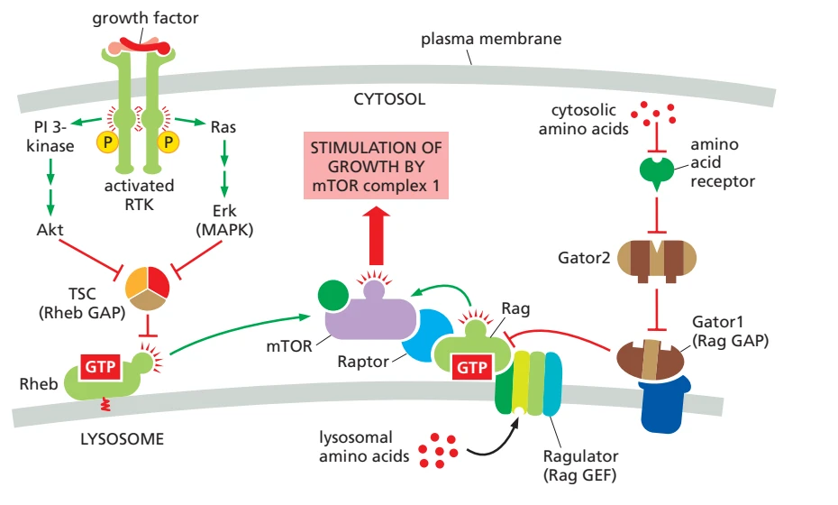{ width="760" height="458" loading=lazy }
/// caption
左支路经 AKT／ERK、TSC 接到 Rheb；右支路通过 Rag 等组分控制 mTORC1 的招募。图中将 Rag 异二聚体作了简化。[^fig-mtorc1]
///

活化的 mTORC1 调节 S6 激酶（S6K）和 4E-BP 等翻译控制器，推动蛋白质合成与细胞生长。mTORC1 与上面激活 AKT 的 mTORC2 含有不同伙伴，承担不同反应。实验中常检测核糖体蛋白 S6 磷酸化作为通路活动的读出；若要断言某一类 mRNA 被选择性翻译，仍需直接测量翻译本身。

### TGF-$\beta$ 与 Smad { #tgfb-smad }

TGF-$\beta$ 家族使用带 Ser／Thr 激酶活性的受体。对哺乳动物 TGF-$\beta$1–3，信号可先停留在细胞外：成熟配体被潜伏复合物限制，常与基质相联系，要经过整联蛋白牵拉、蛋白水解或其他局部活化过程，才更容易接触受体。BMP 等家族成员的成熟与释放方式有所不同。

配体促使 **II 型与 I 型受体**组成复合物。II 型受体具有组成型激酶活性，先磷酸化 I 型受体；I 型受体被激活后，再磷酸化受体调节型 Smad（R-Smad）C 端的 SSXS 基序。这里的 I、II 表示受体类别，反应顺序恰好是 II 在前、I 在后。III 型受体如 betaglycan，以及 endoglin 等共受体，主要调节配体呈递与受体组合，不提供同样的激酶活性。

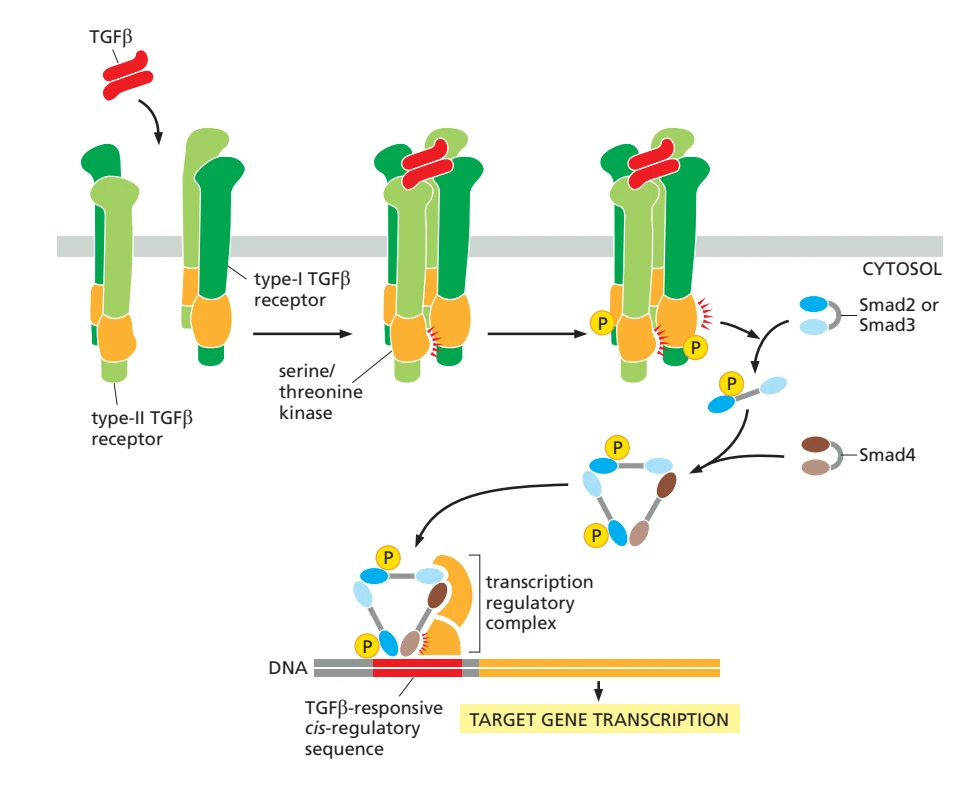{ width="680" height="550" loading=lazy }
/// caption
先追踪膜边的两次磷酸化，再看 R-Smad 与 Smad4 的结合和核内作用。[^fig-smad]
///

TGF-$\beta$／activin 支路主要使用 Smad2/3，BMP 支路主要使用 Smad1/5/8（Smad8 也称 Smad9）。磷酸化的 R-Smad 与 Smad4 组成复合物，促进其在核内积累，与细胞类型特异的 DNA 结合因子、共激活或共抑制因子共同调节基因。因此，同一个家族信号可以在不同细胞中影响增殖、分化或基质制造。

Smad 并非入核一次就一直留在那里。Smad2、Smad3、Smad4 在刺激期间仍持续往返核与胞质；去磷酸化、核输出和再次活化使核内响应能够随受体活动改变。Smad6/7 等抑制型成员又参与负反馈，限制受体或下游反应。[^smad-shuttling]

### 细胞因子受体、JAK 与 STAT { #jak-stat }

另一类受体自己不带激酶，却在胞质侧结合 **Janus 激酶（JAK）**。生长激素、催乳素、促红细胞生成素以及许多白细胞介素、干扰素，使用这类受体。配体促使受体亚基靠近或改变已有复合物的几何关系，使 JAK 相互磷酸化并活化，随后在受体尾部产生磷酸酪氨酸位点。[^enzyme-linked-textbook]

**信号转导及转录激活蛋白（STAT）**用 SH2 结构域结合这些位置，被 JAK 磷酸化。离开受体后，两个 STAT 可通过“一个的 SH2 结合另一个的磷酸酪氨酸”形成二聚体，再进入细胞核调节转录。家族包含同源或异源二聚体，图中展示了后者。

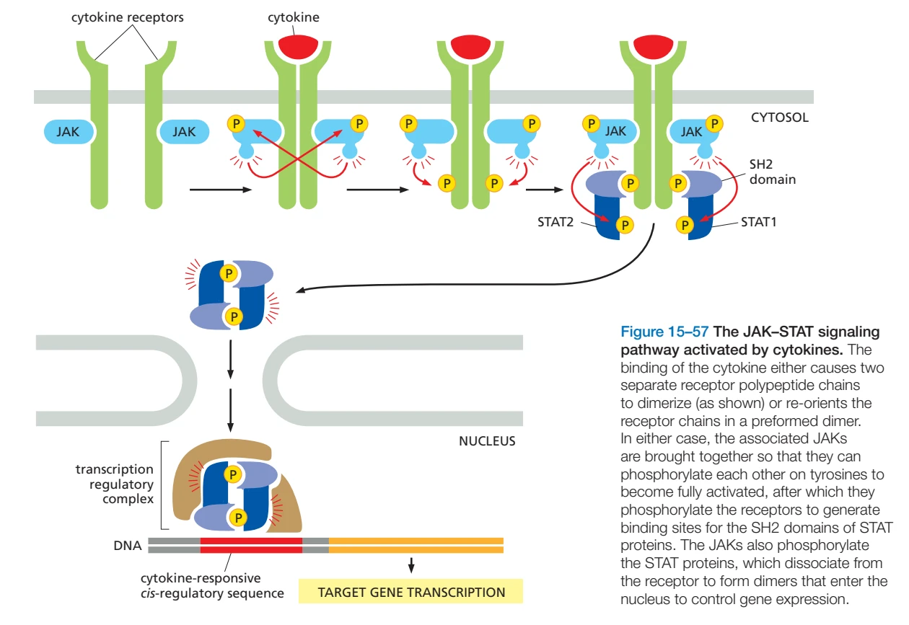{ width="780" height="537" loading=lazy }
/// caption
激酶是贴在受体胞质侧的 JAK；磷酸化的 STAT1 与 STAT2 在图中组成异源二聚体。[^fig-jak-stat]
///

JAK 家族包括 JAK1、JAK2、JAK3 和 TYK2，不同受体使用不同组合。STAT 还会诱导 **SOCS（细胞因子信号抑制因子）**，后者限制 JAK／受体活动或促进相关蛋白周转，构成延迟负反馈。磷酸酶、PIAS 蛋白和受体内吞也会限制输出。这条路线可以与 Ras–ERK、PI3K 支路相接；“细胞因子”是功能分类，并不意味着所有细胞因子都使用 JAK–STAT，例如 TNF 的经典响应可接到下面的 NF-$\kappa$B。

## 受控蛋白水解与发育信号 { #regulated-proteolysis-pathways }

信号还可以改变某个蛋白能否存活，或从较大的蛋白上释放活性片段。Wnt、Hedgehog 与 Notch 常参与发育和组织维持，它们都用到蛋白周转，却把切割和降解安排在不同位置。

### Wnt 与 $\beta$-连环蛋白 { #wnt-beta-catenin }

没有经典 Wnt 输入时，胞质中的游离 **$\beta$-连环蛋白（$\beta$-catenin）**持续被处理。AXIN 与 APC 提供组装位置，CK1 和 GSK3 依次磷酸化 $\beta$-连环蛋白；这些修饰使它被 $\beta$-TrCP 识别，随后泛素化并送往蛋白酶体。于是即使细胞不断合成它，胞质中也难以大量积累。[^beta-catenin-degradation]

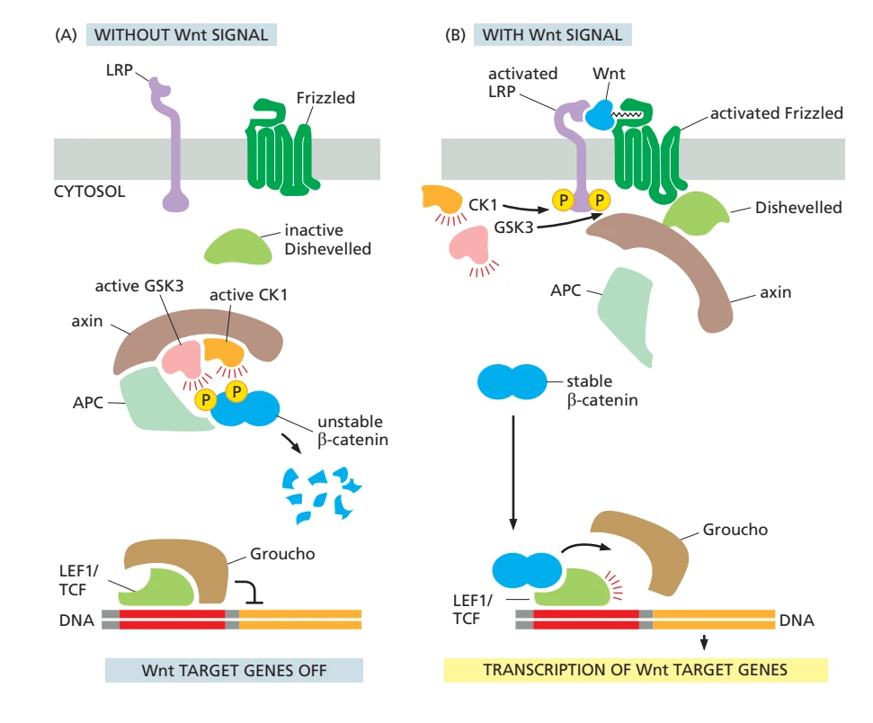{ width="750" height="621" loading=lazy }
/// caption
左：磷酸化后不断降解；右：受体改变降解复合物的活动，稳定的 $\beta$-连环蛋白与 TCF／LEF 配合调节转录。[^fig-wnt]
///

Wnt 结合 Frizzled 与 LRP5/6 后，通过 Dishevelled、受体尾部磷酸化及复合物重排，限制新生 $\beta$-连环蛋白被降解。它因而积累并进入细胞核，与 TCF／LEF 及辅激活因子共同改变转录。图中把降解复合物画成移到膜边的状态，实际包含多个组分在膜、胞质之间的动态分配。

$\beta$-连环蛋白还有一份在黏着连接中的工作，与钙黏蛋白和胞质连接装置相联系。这里讨论的是可被降解和招募的信号相关分子库，不能仅凭总量增加，就认定核内 Wnt 输出已经增强。

### Hedgehog 与初级纤毛 { #hedgehog-cilium }

Hedgehog（Hh）前体在信号产生细胞中经过自身切割，留下的 N 端信号片段在新形成的 C 端接上胆固醇，N 端再由 HHAT 酰基转移酶加上棕榈酰基。脂质修饰使分泌、载运和受体接触都需要相应装置，也影响它在组织中的传播范围。

在脊椎动物中，Hh 的接收要用到**初级纤毛**。没有配体时，Patched（PTCH）抑制 Smoothened（SMO）的活化和纤毛积累；SUFU 及纤毛内的调节、运输装置，使 GLI 蛋白偏向受抑制或加工状态。图左尤其画出了 GLI3 的部分蛋白水解，产生可入核的转录抑制形式。

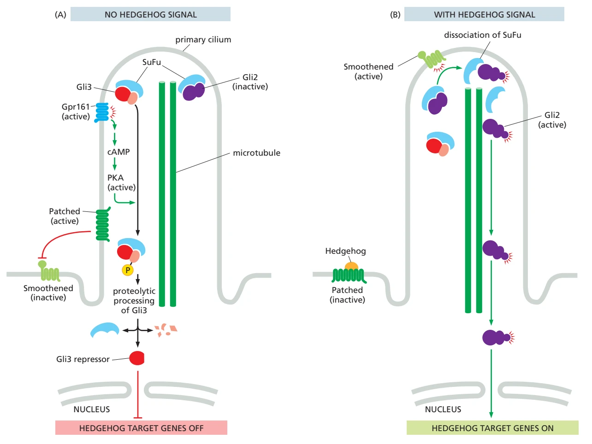{ width="800" height="601" loading=lazy }
/// caption
比较 PTCH、SMO 和 GLI 的位置与状态；左侧产生 GLI3 抑制形式，右侧保留并激活相应的转录激活形式。[^fig-hedgehog]
///

Hh 与 PTCH 结合后，SMO 所受的抑制解除，在纤毛中积累并改变 GLI 调节，促进 GLI 激活形式产生。小鼠中破坏 IFT172、IFT88 或 KIF3A 等运输装置，会损害正常 Hh 响应，说明纤毛里的运输本身就是通路的一部分。[^hedgehog-cilium] 纤毛的建造、选择性门控和往返运输见[纤毛内运输](cytoskeleton.md#ciliary-architecture)。

果蝇的对应过程使用 **Ci** 作为转录效应器。膜上的共受体 **Ihog** 含有胞外 Ig 和 FNIII 结构域，与 Ptc 共同参与 Hh 接收；胞内的 **Cos2** 是驱动蛋白相关支架，可招募 PKA、GSK3 和 CK1，促进 Ci 的磷酸化与部分蛋白水解，生成抑制形式。Hh 改变这些复合物的组装和活性，使 Ci 的加工受阻，并支持激活形式发挥作用。**Fu** 则是与 Cos2、Ci 复合物相联系的 Ser／Thr 激酶，也参与受刺激后的调节。[^hedgehog-fly]

两类动物都通过解除抑制来改变转录效应器状态，但脊椎动物把初级纤毛放在核心位置，不能直接把果蝇复合物的空间步骤套过去。

### Notch 的受力切割 { #notch-cleavage }

Notch 要求相邻细胞直接接触。以哺乳动物 Notch1 的经典加工过程为例，受体在高尔基体经 S1 切割，两个片段仍相互结合，以异二聚体到达表面。不同 Notch 成员对这一步加工的依赖程度并不完全相同。[^notch-s1]

邻细胞膜上的 Delta-like 或 Jagged 结合 Notch 胞外段后，配体细胞的内吞装置施加牵拉。Notch 的**负调控区（NRR）**因此更容易暴露原先受保护的 S2 位点，ADAM 蛋白酶在此切割。留下的跨膜片段再由 $\gamma$-分泌酶作 S3 膜内切割，释放 **Notch 胞内段（NICD）**。

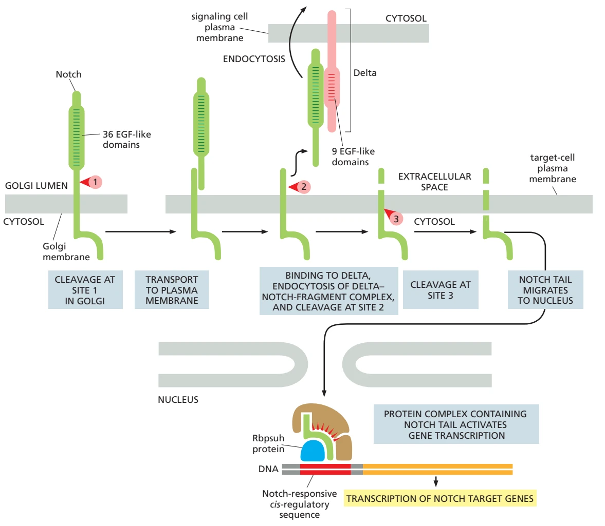{ width="760" height="662" loading=lazy }
/// caption
沿受体片段追踪：胞外部分随配体被内吞，胞内尾部在膜内切割后释放并入核。[^fig-notch]
///

NICD 入核后，与 CSL（哺乳动物中称 RBPJ）、MAML 等形成转录激活复合物。一个受体主要释放一个 NICD，因而这一步没有激酶级联那样的逐层催化放大；后面的转录当然仍能生成多个 RNA。连接邻细胞、施加拉力、暴露位点和片段周转，共同控制 Notch 输出。

???+ abstract "拉力怎样帮助蛋白酶切开 Notch"

    Gordon 等把纯化的 Notch1 负调控区一端固定在玻璃表面，另一端接到磁珠。磁场提供已校准的拉力；加入蛋白酶后，若连接被切断，磁珠就会离开表面。实验测量的是剩余磁珠的比例。[^notch-force]

    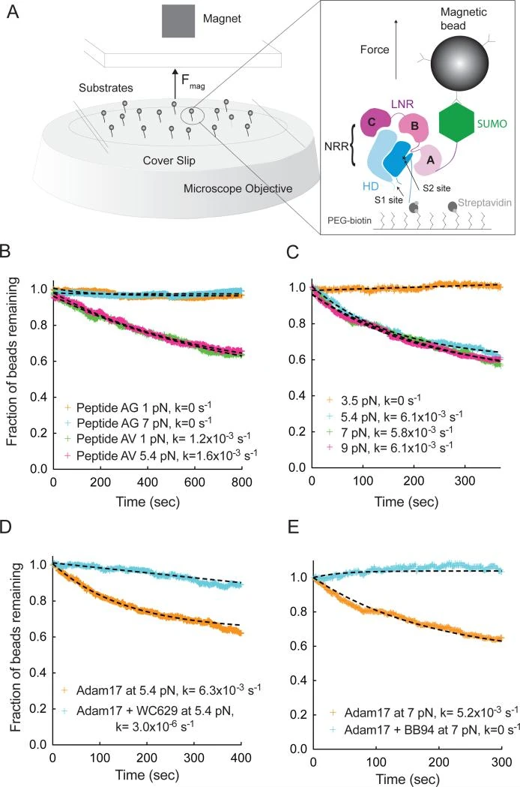{ width="700" height="1058" loading=lazy }
    /// caption
    原文图 1。A 为装置；B 比较暴露的切割短肽；C 比较完整负调控区在不同拉力下的切割；D、E 加入阻断抗体或蛋白酶抑制剂。[^notch-force]
    ///

    先看 B：已经暴露的正常切割短肽 AV 在很小拉力下就能被切开，而改变位点的 AG 短肽抵抗切割。再看 C：完整负调控区在 3.5 pN 下较稳定，到 5.4 pN 及更高拉力时，剩余磁珠数随时间下降。阻断 NRR 的抗体 WC629 或蛋白酶抑制剂 BB94 可抑制这一过程。

    这些对照支持拉力提高了受保护位点的可切割性，而非单纯把连接拉断。实验使用的蛋白酶是 **ADAM17**；生理性配体触发的 Notch S2 切割常主要依赖 **ADAM10**。纯化片段所需的力，也不能直接当成所有细胞表面 Notch 的统一阈值。

## NF-$\kappa$B 与抑制蛋白的周转 { #nfkb-signaling }

**核因子 $\kappa$B（NF-$\kappa$B）**家族可以组成多种二聚体。经典通路中，I$\kappa$B 与 NF-$\kappa$B 结合，限制它在细胞核内积累。TNF 等输入激活 IKK 复合体后，I$\kappa$B$\alpha$ 被磷酸化，再被 SCF$^{\beta\text{-TrCP}}$ 泛素连接酶复合体识别，送往蛋白酶体。原来受抑制的 NF-$\kappa$B 因而更容易进入核内，调节炎症、免疫与存活相关基因。

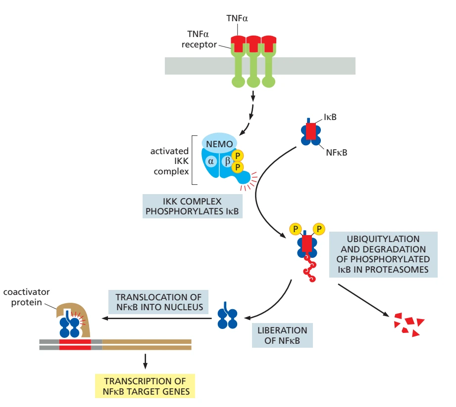{ width="640" height="573" loading=lazy }
/// caption
图中先被磷酸化并降解的是抑制蛋白 I$\kappa$B；释放的 NF-$\kappa$B 随后入核。[^fig-nfkb]
///

被激活的基因中，又包括 **I$\kappa$B$\alpha$ 自己**。新生 I$\kappa$B$\alpha$ 结合 NF-$\kappa$B，促进其离开核内，形成负反馈。如果上游刺激仍在，I$\kappa$B$\alpha$ 又可能被降解，NF-$\kappa$B 再次入核；合成、降解和穿梭的时间差于是可以产生振荡。I$\kappa$B 家族成员的反馈强度和时程不同，也会改变响应形状。[^nfkb-dynamics]

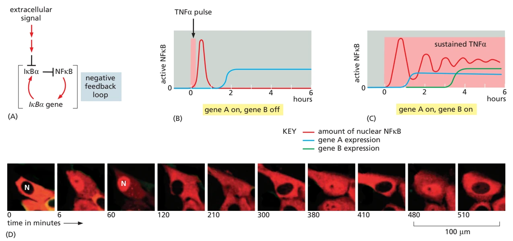{ width="800" height="376" loading=lazy }
/// caption
A—C 是依据研究整理的反馈与时间示意；D 是另一研究的荧光显微时间序列，红色 NF-$\kappa$B 融合蛋白在核与胞质间改变分布。时间单位为分钟，比例尺 100 μm。[^fig-nfkb-dynamics]
///

沿 D 的同一个细胞看，核区 N 在 6、60 分钟明显变亮，120 分钟又转暗，随后还会反复变化。它提供的是定位随时间变化的观察；上方 B、C 的两类基因曲线是整理后的机制图，并非从这排显微照片直接计算出的转录量。刺激的持续方式、细胞类型和反馈组合不同，可以产生短暂、持续或振荡的响应。

**非经典 NF-$\kappa$B 通路**则主要经 NIK、IKK$\alpha$，促进 p100 部分加工为 p52，形成 p52–RelB 等转录复合物。这里加工的是前体兼抑制组分 p100，与经典通路中 I$\kappa$B$\alpha$ 的降解有所不同。

## 细胞内受体与气体信号 { #intracellular-receptors-gases }

类固醇、甲状腺激素、维生素 D 衍生物和视黄酸，可以在跨膜扩散或转运后接触胞内受体。其中的**核受体**兼有识别配体和调节转录的能力：通常含变化较大的 N 端激活区、保守的 C4 锌指 DNA 结合区、铰链区和 C 端配体结合区。配体改变受体构象，也改变它与辅调节因子的结合。

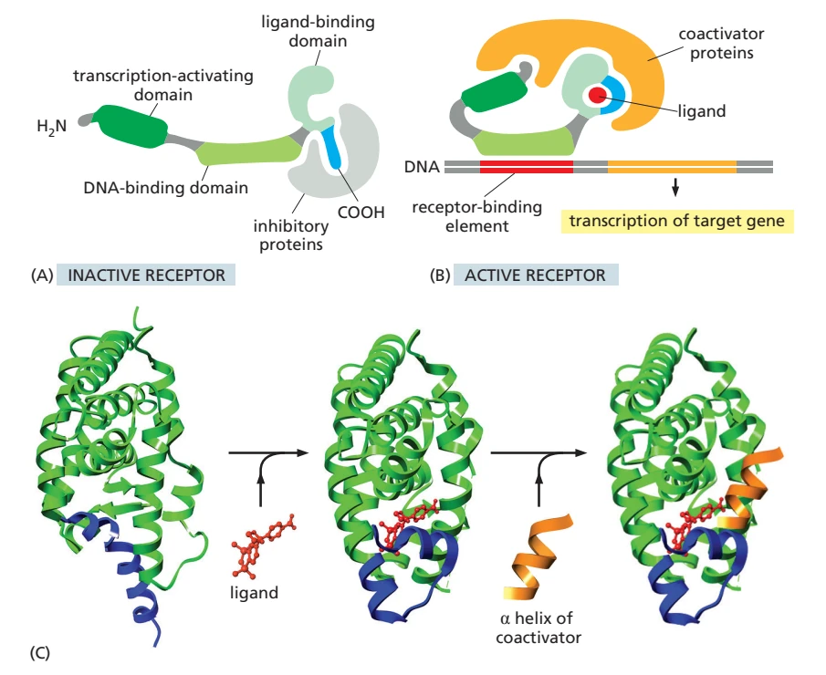{ width="700" height="572" loading=lazy }
/// caption
A、B 为一种受体活化方式；C 是视黄酸受体配体结合区的结构比较，配体结合后的螺旋重排形成辅激活因子可结合的表面。[^fig-nuclear-receptor]
///

不同核受体的起始位置并不相同。糖皮质激素受体等可以在无配体时与 Hsp90 等组成复合物，结合配体后重排并入核；甲状腺激素受体和视黄酸受体则常在配体到来前已与 DNA、共抑制因子结合，配体改变的是核内复合物的组成。直接受调的基因又可能编码新的转录调节蛋白，继续引出较晚的第二轮基因表达变化。

气体信号走得更直接。**一氧化氮（NO）**由一氧化氮合酶（NOS）利用 NADPH 提供的电子，将精氨酸氧化为瓜氨酸和 NO；电子传递与辅因子见[一氧化氮合成](../biochem/aa_synthesis.md#nitric-oxide-polyamines)。NO 不需要先装进分泌囊泡，生成后即可跨膜扩散。在邻近血管平滑肌中，NO 结合**可溶性鸟苷酸环化酶（sGC）**的血红素铁，促进它把 GTP 转成 cGMP，再经 cGMP 依赖性蛋白激酶（PKG）等调节收缩装置。[^no-sgc]

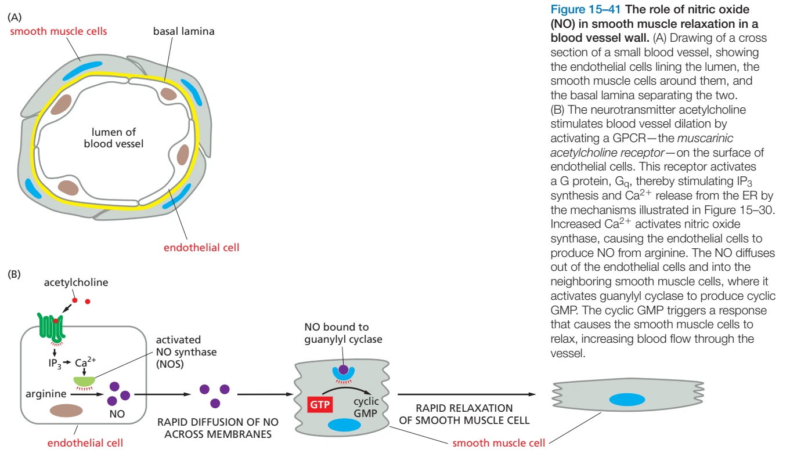{ width="800" height="463" loading=lazy }
/// caption
A 定位两类细胞；B 展示乙酰胆碱经内皮 Ca$^{2+}$／CaM、NOS 接到平滑肌 sGC 的路径。[^fig-no-vessel]
///

图中的乙酰胆碱先作用于内皮受体，经 PLC 与 Ca$^{2+}$/CaM 促进内皮 NOS 活性；真正穿到平滑肌里的是 NO。NO 在组织中又会迅速被反应消耗，其有效范围受生成、扩散和清除共同限制。cGMP 可以调节 PKG、CNG 通道和某些 PDE，具体靶点随细胞而变。sGC 位于胞内，与利钠肽激活的单跨膜受体鸟苷酸环化酶属于不同装置，虽然二者都能生成 cGMP。

硝酸甘油也能接入这条路线：经 ALDH2 等参与的生物活化，产生可激活 sGC 的 NO 相关活性，再经 cGMP 促进血管舒张。[^nitroglycerin] 在神经系统中，某些海马长时程增强（LTP）研究支持 NO 参与从突触后到突触前的逆行作用，调节递质释放；它的贡献需要按突触类型和诱导条件判断。[^no-ltp]

另一种内源性气体 **CO** 来自血红素加氧酶对血红素的分解，也能结合含血红素的靶点。对纯化 sGC，CO 的活化作用比 NO 弱得多；其作为局部信号的作用，还取决于生成位置、浓度和具体靶点。[^co-signaling]

## 整联蛋白把黏附接到信号 { #integrin-signaling }

细胞还需要知道自己附着在哪里、受了多大拉力。**整联蛋白（integrin）**一侧结合基质，另一侧通过 talin、kindlin、paxillin 等与胞内装置相联系。胞内调节使受体更容易结合配体，称为由内向外信号；配体结合、受体聚集和受力后，再改变胞内蛋白的活动，则是由外向内信号。

在黏着斑中，FAK 的自身磷酸化可以产生 Src 的结合位点；Src 随后与 FAK 及其他底物相互作用和磷酸化，招募更多信号蛋白。Rho 家族调节肌动蛋白，Ras–ERK 与 PI3K–AKT 则把黏附条件接到生长、存活和代谢。它们构成带有反馈的复合过程，不能仅按一条固定先后次序理解。承力链及 talin 受力暴露结合位点的实验见[黏着斑](cell_interactions.md#focal-adhesions)。[^enzyme-linked-textbook]

可溶性生长因子与基质输入常要一起起作用。相同配体下，基质刚度、骨架张力和受体运输不同，细胞的迁移或生长反应也会不同。某些依赖黏附的细胞离开合适基质后会发生**失巢凋亡（anoikis）**；正常悬浮细胞则具有适合自身生活方式的存活程序。

## 信号在哪里、持续多久 { #spatiotemporal-coding }

到这里，可以把通路图重新放回一个有空间的细胞。PIP$_2$、PIP$_3$ 和 DAG 局限于膜叶；Ca$^{2+}$ 在开放通道附近形成高浓度；AKAP 使 cAMP 的生成、效应与清除较集中地发生；初级纤毛则限制了 Hedgehog 组分可以相遇的位置。同样几种蛋白，换一个位置，反应机会就可能改变。

内吞也不总是信号的终点。部分受体—效应器复合物在早期内体仍可继续活动，产生与质膜位置不同的输出；随后，受体才在回收与溶酶体降解之间分流。不同货物的选择过程见[内体回收与降解](endomembrane.md#endosomal-sorting)。

时间上的差异同样具体。NFAT 较快离开核内时，间隔过长的钙脉冲难以维持转录；ERK 脉冲异步出现时，群体平均值会掩盖单细胞的变化；NF-$\kappa$B 自己诱导抑制蛋白，又把过去的活化变成未来的抑制。短促高峰、低水平持续信号和等总面积的间歇脉冲，因此可能产生不同结果。更长尺度上的激素脉冲与昼夜节律，见[激素分泌的脉冲与节律](../physiology/endo/index.md#temporal-coding)。

## 衰减、终止与适应 { #signal-attenuation }

许多终止装置在信号刚启动时就已工作：磷酸酶不断去除磷酸基，GAP 加快 GTP 水解，PDE 降解环核苷酸，钙泵恢复浓度梯度，PTEN 消耗 PIP$_3$。持续的高活性需要上游不断补充；输入停止后，中间产物便随各自的周转速度下降。

受体自身也会减敏。GPCR 激活后，可以被 **G 蛋白偶联受体激酶（GRK）**磷酸化，随后结合 **$\beta$-抑制蛋白（$\beta$-arrestin）**。后者限制受体继续偶联 G 蛋白，又能连接网格蛋白与 AP-2 等内吞装置，促使受体进入细胞。[^arrestin-endocytosis]

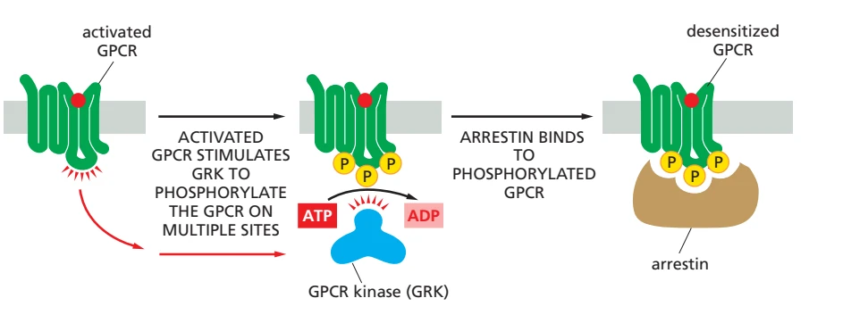{ width="760" height="283" loading=lazy }
/// caption
先看受体胞质侧增加的磷酸基，再看 arrestin 占据的位置；结合配体的受体仍可进入减敏状态。[^fig-arrestin]
///

内吞后的受体可以去磷酸化并回收，使细胞恢复敏感性；也可以进入降解路线，较长时间减少表面受体。RTK 的输出同样受到受体内吞、磷酸酶、Ras GAP 与诱导型抑制因子的限制。内吞形成囊泡的步骤见[受体介导内吞](membrane_transport.md#receptor-mediated-endocytosis)。

在持续刺激中，如果受体数量、偶联效率或下游反应增益下降，输出可能回到接近原来的水平，而对新的变化仍保留响应，这称为适应。负反馈在不同延迟和强度下，也可能产生振荡。正反馈、稳定的蛋白网络或染色质改变则可能让短暂刺激留下较长的影响；信号消失和细胞忘记这次刺激，可以是两件相隔很久的事。

## 怎样把通路图变成因果证据 { #signaling-evidence }

一张磷酸化免疫印迹可以显示某个位点增加，一次 RNA 测序可以显示某些基因表达改变。若要把两者用箭头连接起来，还要知道中间发生了什么、先后如何，以及阻断某一步会不会改变结果。

| 方法 | 直接观察或操纵什么 | 解释时要留下的边界 |
| --- | --- | --- |
| 磷酸化特异性抗体、靶向蛋白质组学 | 特定位点在不同时间的变化 | 磷酸化与酶活性并非总能等同；群体混样会丢失异质性 |
| 钙荧光探针，如 Fura-2、Fluo-3 | 游离 Ca$^{2+}$ 随时间和位置的变化 | 需要校准；探针本身也会结合钙，影响缓冲和动力学 |
| 活细胞 FRET 或转位传感器 | 单细胞中的活性、位置和脉冲 | 传感器有动态范围，也可能因表达或结合而扰动系统 |
| 急性抑制、定向降解、光遗传输入 | 特定节点在特定时刻的必要性，或人为输入的效应 | 需要检查脱靶、补偿与刺激的空间分布 |
| 共沉淀、邻近标记、结构测定 | 分子关联、接近关系与结合界面 | 同处一个复合物不必直接接触；一个稳定结构不能覆盖全部瞬态 |
| 单细胞报告、转录组与谱系追踪 | 不同状态与长期命运的联系 | 单时间点的相关性需要真实轨迹和扰动补充 |
| 纯化重构、定量模型 | 最少哪些组分能产生某种反应或动态 | 缺失组分、细胞几何与不能唯一确定的参数会限制外推 |

ERK 的例子尤其清楚：先用活细胞传感器看见异步脉冲，才能解释为什么平均磷酸化水平看来平稳；要判断脉冲是否推动某种命运，还需要受控输入、急性扰动和下游读出。Notch 的磁珠实验则把拉力、蛋白酶与保护位点拆开检验。通路图上的每一根箭头，都可以继续追问到这样具体的操作与观察。

## 参考资料与延伸阅读 { #references }

[^ac-structure]: 膜型 AC 的两组跨膜螺旋与催化区见[腺苷酸环化酶结构比较研究](https://pmc.ncbi.nlm.nih.gov/articles/PMC9433096/)图 1；活性与二价离子条件见[AC9 活化的结构与生化研究](https://pmc.ncbi.nlm.nih.gov/articles/PMC8873477/)。
[^pka-substrate]: Kemp BE、Benjamini E、Krebs EG（1976），[合成短肽揭示 cAMP 依赖蛋白激酶的底物偏好](https://pubmed.ncbi.nlm.nih.gov/177970/)，PNAS 73:1038–1042；替换 Arg 显著改变底物磷酸化效率。
[^pka-inhibitor1]: Huang FL、Glinsmann WH（1976），[从兔骨骼肌分离并鉴定两种磷酸酶抑制蛋白](https://pubmed.ncbi.nlm.nih.gov/188646/)，European Journal of Biochemistry 70:419–426；inhibitor-1 的抑制活性依赖 cAMP 依赖蛋白激酶促成的磷酸化。
[^ip3r-tetramer]: Alzayady KR 等（2016），[用串联亚基检验 IP$_3$ 受体开放所需的配体结合数](https://pubmed.ncbi.nlm.nih.gov/27048566/)，Science Signaling；四聚体各亚基都有配体结合位点。
[^pde6-activation]: Gao Y 等（2020），[转导蛋白–PDE6 视觉信号复合物结构](https://pubmed.ncbi.nlm.nih.gov/33007200/)，Molecular Cell；G$\alpha_t$ 接触 PDE6 的催化核心和抑制性 $\gamma$ 亚基，重排解除抑制。
[^hedgehog-fly]: Ihog 的结构域与相互作用见[2019 年原研究](https://pmc.ncbi.nlm.nih.gov/articles/PMC6699836/)；Cos2 招募激酶、Ci 加工与 Hh 调节见 Zhang 等（2005）的[Cos2–激酶复合物研究](https://doi.org/10.1016/j.devcel.2005.01.001)；Fu 的 Ser／Thr 激酶身份及其对 Cos2 的作用见[原始磷酸化研究](https://pubmed.ncbi.nlm.nih.gov/11934882/)。
[^calcium-local-release]: IP$_3$ 受体的钙反馈见 MBoC 第 7 版，pp.899–901；局部 IP$_3$ 受体释放与钙波见 Sun、Callamaras、Marchant、Parker 的[非洲爪蟾卵母细胞局部钙释放成像研究](https://pmc.ncbi.nlm.nih.gov/articles/PMC2230949/)，RyR 钙火花见 Cheng、Lederer、Cannell 的[心肌钙火花研究](https://pubmed.ncbi.nlm.nih.gov/8235594/)。
[^nitroglycerin]: Chen Z、Zhang J、Stamler JS（2002），[硝酸甘油生物活化的酶机制](https://pubmed.ncbi.nlm.nih.gov/12048254/)，PNAS 99:8306–8311；检验线粒体醛脱氢酶、cGMP 生成及平滑肌舒张的联系。
[^no-ltp]: Schuman EM、Madison DV（1991），[NO 参与长时程增强的证据](https://pubmed.ncbi.nlm.nih.gov/1720572/)，Science 254:1503–1506；O'Dell 等的[海马 CA1 早期逆行信使研究](https://pubmed.ncbi.nlm.nih.gov/1684863/)进一步检验这一可能性。
[^co-signaling]: Verma A 等（1993），[CO 作为候选神经信使的研究](https://pubmed.ncbi.nlm.nih.gov/7678352/)；Stone、Marletta（1995），[CO 与纯化 sGC 血红素的结合及较弱活化](https://pubmed.ncbi.nlm.nih.gov/8845366/)。
[^ww-domain]: Otte L 等（2003），[42 种 WW 结构域的配体识别特征](https://pmc.ncbi.nlm.nih.gov/articles/PMC2312455/)，Protein Science 12:491–500；用 NMR 和肽库筛选比较不同亚类。
[^notch-s1]: Gordon WR 等（2009），[S1 切割对人 Notch1 与 Notch2 的结构、表面表达及信号活性的影响](https://pmc.ncbi.nlm.nih.gov/articles/PMC2726630/)，PLoS ONE 4:e6613。
[^signaling-overview]: Alberts、Heald 等，*Molecular Biology of the Cell*，第 7 版，2022，第 15 章，pp.873–948；通信、受体与反馈的公开教材章节见[细胞通信一般原理](https://www.ncbi.nlm.nih.gov/books/NBK26813/)。
[^osm-cell-signaling]: 组织结构实质性改编自 osm.bio《[第十五章 细胞信号转导](https://osm.bio/index.php?oldid=11867&title=第十五章_细胞信号转导)》固定版本，贡献者包括 Tsusha、长河、Astelle、Sofia，原文按 [CC BY-SA 4.0](https://creativecommons.org/licenses/by-sa/4.0/deed.zh-hans) 许可；相关内容经教材和所列研究交叉核验。
[^signaling-switches]: 磷酸化、GTP 酶、GEF、GAP 与 GDI 的循环见 MBoC 第 7 版，第 15 章，pp.879–884；另见[细胞通信一般原理](https://www.ncbi.nlm.nih.gov/books/NBK26813/)。
[^signaling-assemblies-source]: MBoC 第 7 版，第 15 章，pp.882–885，图 15-10、15-11，讨论结构域、支架与信号复合物的局部组装。
[^gpcr-textbook]: MBoC 第 7 版，第 15 章，pp.892–911，GPCR、环核苷酸、PLC、CaM／CaMKII、PKC、毒素及感觉转导；公开旧版对应[G 蛋白偶联受体信号章节](https://www.ncbi.nlm.nih.gov/books/NBK26912/)。
[^gpcr-structure]: Rasmussen SGF 等（2011），*Crystal structure of the β2 adrenergic receptor–Gs protein complex*，Nature 477:549–555，[全文与图 2c、3a](https://pmc.ncbi.nlm.nih.gov/articles/PMC3184188/)，[DOI](https://doi.org/10.1038/nature10361)。本页从原图裁出相应面板，未改变结构标记；PDB 3SN6。
[^calcium-oscillations]: Dolmetsch RE、Xu K、Lewis RS（1998），*Calcium oscillations increase the efficiency and specificity of gene expression*，Nature 392:933–936，[DOI](https://doi.org/10.1038/31960)，[作者论文的教学用公开副本](https://science.umd.edu/classroom/mocb639/J5-Dolmetsch98Nat-Ca-oscil-gene-exp.pdf)。本页裁取图 1 和图 3；Jurkat 细胞，报告基因实验均含 50 nM PdBU，图 2 另比较平均浓度匹配的处理。
[^enzyme-linked-textbook]: MBoC 第 7 版，第 15 章，pp.911–927，RTK、Ras–MAPK、PI3K–AKT、Smad、JAK–STAT；整联蛋白与信号也见[酶联细胞表面受体章节](https://www.ncbi.nlm.nih.gov/books/NBK26822/)。
[^erk-duration]: Marshall CJ（1995），*Specificity of receptor tyrosine kinase signaling: transient versus sustained extracellular signal-regulated kinase activation*，[综述及引文](https://pubmed.ncbi.nlm.nih.gov/7834738/)，Cell 80:179–185。该文整理 PC12 等系统的时间响应与分化证据。
[^erk-pulses]: Albeck JG、Mills GB、Brugge JS（2013；2012 年在线发表），*Frequency-modulated pulses of ERK activity transmit quantitative proliferation signals*，Molecular Cell 49:249–261，[全文](https://pmc.ncbi.nlm.nih.gov/articles/PMC4151532/)，[DOI](https://doi.org/10.1016/j.molcel.2012.11.002)。本页分别裁取图 3A、3B，保留时间轴、浓度、倒置纵轴及灰度图例；细胞周期比较与抑制实验见原文图 4、5。
[^pten-lipid-phosphatase]: Myers MP 等，[PTEN 底物与脂质磷酸酶研究](https://pubmed.ncbi.nlm.nih.gov/9811831/)，检验 PTEN 对 PIP$_3$、AKT 与细胞存活的作用。
[^mtorc2-akt]: Sarbassov DD 等（2005），[rictor–mTOR 复合物调节 AKT 磷酸化](https://pubmed.ncbi.nlm.nih.gov/15718470/)，Science；包含 AKT Ser473 的细胞与体外证据。
[^smad-shuttling]: Inman GJ 等（2002），[Smad2、Smad3 和 Smad4 的持续核质穿梭](https://pubmed.ncbi.nlm.nih.gov/12191474/)，Molecular Cell；讨论持续穿梭怎样使核内响应随受体活性变化。
[^beta-catenin-degradation]: Aberle H 等，[$\beta$-连环蛋白的泛素化与蛋白酶体降解](https://pmc.ncbi.nlm.nih.gov/articles/PMC1170003/)；Wnt、Hedgehog、Notch 的教材比较见[受控蛋白水解信号章节](https://www.ncbi.nlm.nih.gov/books/NBK26918/)及 MBoC 第 7 版，pp.927–934。
[^hedgehog-cilium]: Huangfu D 等（2003），[小鼠 Hedgehog 信号需要纤毛内运输蛋白](https://pubmed.ncbi.nlm.nih.gov/14603322/)，Nature；比较 IFT172、IFT88 与 KIF3A 相关遗传扰动。
[^notch-force]: Gordon WR 等（2015），*Mechanical Allostery: Evidence for a Force Requirement in the Proteolytic Activation of Notch*，[全文及图 1](https://pmc.ncbi.nlm.nih.gov/articles/PMC4481192/)。本页保留图 1 全部面板；纯化 NRR 磁珠试验使用 ADAM17，另有细胞报告实验检验受力与蛋白酶依赖。
[^nfkb-dynamics]: Hoffmann A 等（2002），[IκB–NFκB 模块的时间控制与选择性基因活化](https://pubmed.ncbi.nlm.nih.gov/12424381/)，Science 298:1241–1245，[DOI](https://doi.org/10.1126/science.1071914)。不同 IκB 家族成员构成的反馈共同改变响应轨迹。
[^no-sgc]: NO 与 sGC、cGMP 的关系见 MBoC 第 7 版，pp.908–909，以及 NCBI Bookshelf 的[cGMP 生物化学章节](https://www.ncbi.nlm.nih.gov/books/NBK542234/)。sGC 与跨膜受体鸟苷酸环化酶的定位和结构不同。
[^arrestin-endocytosis]: Goodman OB Jr 等（1996），[β-arrestin 作为受体内吞适配蛋白的研究](https://pubmed.ncbi.nlm.nih.gov/8837779/)，检验其与活化 β2 受体、网格蛋白结合及促进内吞的作用。
[^fig-ach-responses]: Alberts、Heald 等，*Molecular Biology of the Cell*，第 7 版（2022），图 15-5，p.877。从原书裁取，保留原标注。
[^fig-switches]: Alberts、Heald 等，*Molecular Biology of the Cell*，第 7 版（2022），图 15-7，p.880。从原书裁取，保留原标注。
[^fig-gef-gap]: Alberts、Heald 等，*Molecular Biology of the Cell*，第 7 版（2022），图 15-8，p.880。从原书裁取，保留原标注。
[^fig-assembly]: Alberts、Heald 等，*Molecular Biology of the Cell*，第 7 版（2022），图 15-10，p.882。从原书裁取，保留原标注。
[^fig-gpcr-cycle]: Alberts、Heald 等，*Molecular Biology of the Cell*，第 7 版（2022），图 15-24，p.894。从原书裁取，保留原标注。
[^fig-camp-turnover]: Alberts、Heald 等，*Molecular Biology of the Cell*，第 7 版（2022），图 15-26，p.895。从原书裁取，保留原标注。
[^fig-pka]: Alberts、Heald 等，*Molecular Biology of the Cell*，第 7 版（2022），图 15-27，p.896。从原书裁取，保留原标注。
[^fig-creb]: Alberts、Heald 等，*Molecular Biology of the Cell*，第 7 版（2022），图 15-28，p.897。从原书裁取，保留原标注。
[^fig-plc]: Alberts、Heald 等，*Molecular Biology of the Cell*，第 7 版（2022），图 15-30，p.899。从原书裁取，保留原标注。
[^fig-calmodulin]: Alberts、Heald 等，*Molecular Biology of the Cell*，第 7 版（2022），图 15-34，p.902。从原书裁取，保留原标注。
[^fig-rod]: Alberts、Heald 等，*Molecular Biology of the Cell*，第 7 版（2022），图 15-40，p.907。从原书裁取，保留原标注。
[^fig-rtk]: Alberts、Heald 等，*Molecular Biology of the Cell*，第 7 版（2022），图 15-45，p.912。从原书裁取，保留原标注。
[^fig-sos-ras]: Alberts、Heald 等，*Molecular Biology of the Cell*，第 7 版（2022），图 15-48，p.916。从原书裁取，保留原标注。
[^fig-mapk]: Alberts、Heald 等，*Molecular Biology of the Cell*，第 7 版（2022），图 15-50，p.917。从原书裁取，保留原标注。
[^fig-pi3k-lipids]: Alberts、Heald 等，*Molecular Biology of the Cell*，第 7 版（2022），图 15-53，p.920。从原书裁取，保留原标注。
[^fig-akt]: Alberts、Heald 等，*Molecular Biology of the Cell*，第 7 版（2022），图 15-54，p.921。从原书裁取，保留原标注。
[^fig-mtorc1]: Alberts、Heald 等，*Molecular Biology of the Cell*，第 7 版（2022），图 15-55，p.922。从原书裁取，保留原标注。
[^fig-smad]: Alberts、Heald 等，*Molecular Biology of the Cell*，第 7 版（2022），图 15-58，p.927。从原书裁取，保留原标注。
[^fig-jak-stat]: Alberts、Heald 等，*Molecular Biology of the Cell*，第 7 版（2022），图 15-57，p.925。从原书裁取，保留原标注。 保留原英文图注。
[^fig-wnt]: Alberts、Heald 等，*Molecular Biology of the Cell*，第 7 版（2022），图 15-61，p.931。从原书裁取，保留原标注。
[^fig-hedgehog]: Alberts、Heald 等，*Molecular Biology of the Cell*，第 7 版（2022），图 15-62，p.933。从原书裁取，保留原标注。
[^fig-notch]: Alberts、Heald 等，*Molecular Biology of the Cell*，第 7 版（2022），图 15-60，p.929。从原书裁取，保留原标注。
[^fig-nfkb]: Alberts、Heald 等，*Molecular Biology of the Cell*，第 7 版（2022），图 15-63，p.934。从原书裁取，保留原标注。
[^fig-nfkb-dynamics]: Alberts、Heald 等，*Molecular Biology of the Cell*，第 7 版（2022），图 15-64，p.935。从原书裁取，保留原标注。 A—C 根据 Hoffmann 等（2002）研究及 Ting、Endy 的解读整理，D 为 Nelson 等（2004），Science 306:704–708 的显微图，[原研究 DOI](https://doi.org/10.1126/science.1099962)；两类面板来自不同研究。
[^fig-nuclear-receptor]: Alberts、Heald 等，*Molecular Biology of the Cell*，第 7 版（2022），图 15-66，p.937。从原书裁取，保留原标注。
[^fig-no-vessel]: Alberts、Heald 等，*Molecular Biology of the Cell*，第 7 版（2022），图 15-41，p.908。从原书裁取，保留原标注。 保留 A、B 与原英文图注。
[^fig-arrestin]: Alberts、Heald 等，*Molecular Biology of the Cell*，第 7 版（2022），图 15-43，p.910。从原书裁取，保留原标注。
