# 细胞骨架与细胞运动

一个铺展的细胞，可以在几分钟内收回突起、变圆，再把染色体分向两端。膜里的水和蛋白质并不会自动排成这些形状：贴近膜的丝状网络牵拉细胞表面，贯穿胞质的微管安排细胞器与运输路线，另一些纤维则把局部拉力分散到细胞连接和细胞核。它们合在一起，就是细胞骨架。[^cytoskeleton-overview]

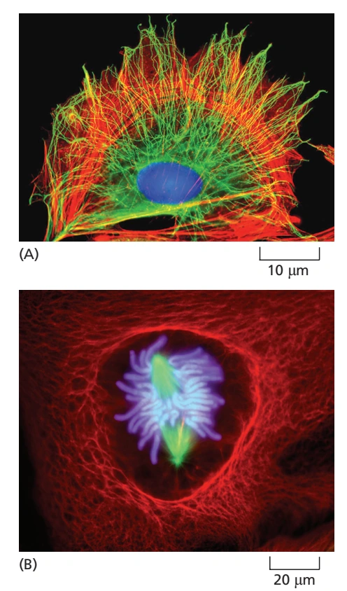{ width="496" height="844" }

/// caption
两幅固定细胞的荧光图。A：微管绿、肌动蛋白红；B：纺锤体微管绿、中间丝红。DNA 均为蓝色；比例尺分别为 10 μm、20 μm。[^fig-cell-networks]
///

先看上图 A：绿色微管从核附近伸向外围，红色肌动蛋白在细胞边缘及横贯胞质的束中很密集。到了下图 B，绿色微管集中组织成纺锤体，红色标记显示周围的中间丝网络。这是两个不同的细胞、两种标记组合，并非同一细胞的前后照片。

“骨架”这个名字很稳重，实际工作却常常要靠拆了再搭。长丝由许多蛋白质亚基非共价装配而成；细胞可以让某处加快成核、某个末端停止延长，也可以直接切断一段丝。维持形态与改变形态，用的是同一批材料。

## 三类骨架聚合物 { #cytoskeletal-filaments }

真核细胞最常见的三类骨架是肌动蛋白丝、微管和中间丝。肌动蛋白丝与微管由不对称的球状亚基按一致方向排列，因此两个末端的结构不同，称为**结构极性**。细胞既能利用两端不同的组装行为，也能让分子马达辨认方向，沿丝运输货物。中间丝的亚基反向配对，抵消了这种整体极性，更擅长组成耐拉伸的网络。[^filament-assembly]

| 聚合物 | 基本亚基与常见尺度 | 极性与核苷酸 | 常见组织方式与任务 |
| --- | --- | --- | --- |
| 肌动蛋白丝（微丝） | actin 单体；直径约 7–8 nm | 有正、负端；结合 ATP，入丝后水解 | 皮层网、分支网及丝束；参与膜形变、吞噬、迁移、收缩与局部运输 |
| 微管 | $\alpha/\beta$-tubulin 异二聚体；外径约 25 nm 的中空管 | 有正、负端；$\beta$ 亚基的 GTP 在组装后水解 | 弯曲刚度大，可跨越较长胞质距离；组织细胞器、长程运输、纺锤体和纤毛轴丝 |
| 中间丝（intermediate filament，IF） | 多种细胞类型特异蛋白；胞质中间丝常约 10 nm | 反向平行装配，无整体极性；自组装不要求 ATP／GTP 水解 | 柔韧、耐拉伸的网络；连接细胞、基底膜与核周结构，分散机械负荷 |

直径有助于在电镜中辨认，功能还要看丝怎样交联、接在哪里、周转多快。单根肌动蛋白丝容易弯曲，紧密成束后可以支撑细长突起；微管较难弯曲，却可能在数秒内从末端快速拆掉；中间丝可以承受大幅形变，网络的磷酸化与连接状态又决定它何时重排。细胞的力学性质来自这些结构的协作。[^filament-assembly]

## 肌动蛋白丝的极性与周转 { #actin-dynamics }

### 成核、延长与核苷酸状态 { #actin-assembly }

球状肌动蛋白（globular actin，G-actin）的中央裂隙结合一个 ATP 或 ADP，并结合二价阳离子；生理条件下通常以 Mg$^{2+}$ 为主。亚基头尾相接，组成两股相互缠绕的原丝，形成丝状肌动蛋白（filamentous actin，F-actin）。沿下图的红色亚基看，每一个都朝向同一边，整条丝因而有可区分的两端。脊椎动物的胞质 $\beta$／$\gamma$-actin 与肌细胞中的多种 $\alpha$-actin 是相关异构体，不能仅凭一条丝的外观辨认其组成。

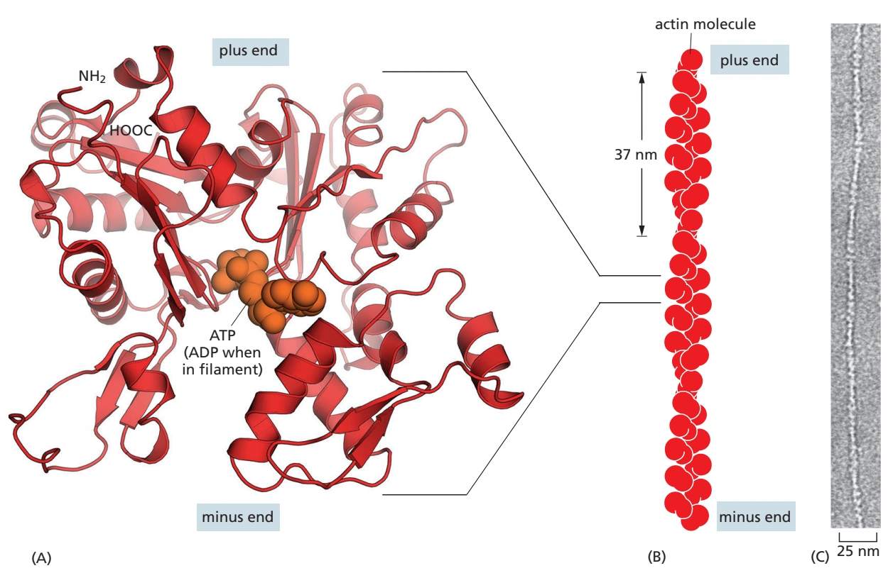{ width="1257" height="815" loading=lazy }

/// caption
A：结合核苷酸的 actin 单体；B：同向排列的亚基；C：负染电镜。B 中 37 nm 表示螺旋重复尺度，C 的比例尺为 25 nm。[^fig-actin-structure]
///

肌球蛋白的头部片段 S1 能结合 F-actin，在电镜下形成一串箭头样花纹。箭头指向的末端叫尖端（pointed end，负端），另一端叫有倒刺端（barbed end，正端）。用这样的短丝作种子，再加入未被装饰的 actin，就能把方向和生长速度一起测出来：下图 A 中，粗糙的装饰段两侧长出了光滑的新丝，正端长得明显更多。这里的“正、负”是结构和动力学记号，与电荷正负无关。

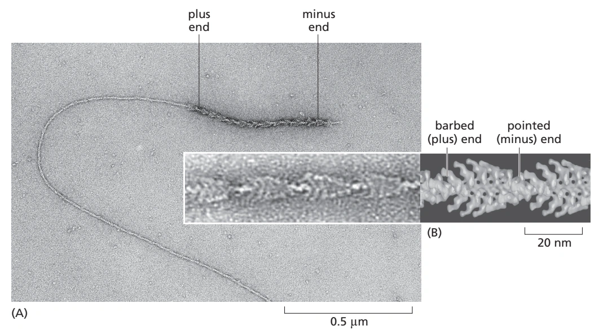{ width="1062" height="586" loading=lazy }

/// caption
A：带装饰的种子两端生长不对称；B：放大的箭头花纹及结构模型。箭头指向负端；比例尺分别为 0.5 μm、20 nm。[^fig-actin-polarity]
///

纯化 actin 自发聚合时，最初几个亚基组成的小团块容易散开，要等到足够稳定的核形成，长丝才会迅速延长。这使总体聚合曲线先慢、后快，最后进入平台。若一开始就加入已有短丝，成核的等待被绕过，延长可以立即开始。平台表示聚合物总量不再净增加，末端仍在交换亚基。实验中可以用沉降区分可溶与聚合部分，也常用荧光标记读出聚合进程；例如 pyrene-actin 入丝后荧光增强。[^actin-dynamics-source]

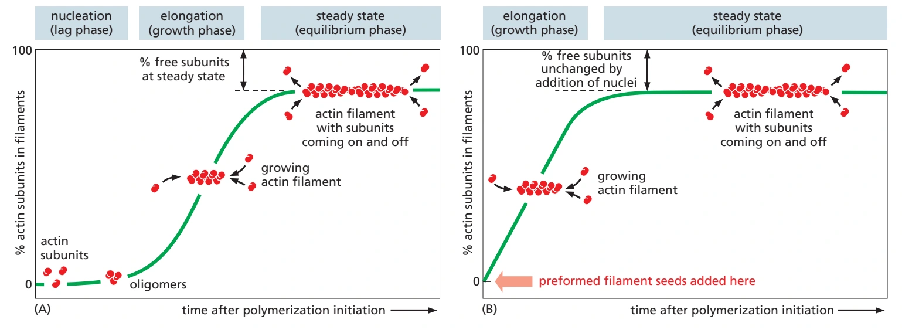{ width="1539" height="568" loading=lazy }

/// caption
教材整理的聚合曲线示意：A 有成核滞后期；B 预先加入短丝种子后，滞后期缩短。纵轴为入丝亚基的百分比，图中的平台不是“所有单体都用完”。[^fig-actin-nucleation]
///

随着 ATP-actin 加入，ATP 水解为 ADP 和无机磷酸（P$_i$），P$_i$ 随后释放。较新的区域常富含 ATP／ADP-P$_i$ 状态，较老区域逐渐富含 ADP-actin；这种差别影响末端稳定性，也改变结合蛋白对丝的亲和力。水解与加入并非同一个动作：ADP-actin 也可以聚合，ATP 周期则使持续的组装与拆解能够偏离平衡。

在不断水解和交换核苷酸的条件下，两端可表现出不同的**临界浓度**：高于某端的临界浓度，该端净延长；低于它，该端净缩短。当可利用的单体浓度处在合适范围时，正端持续加入、负端持续丢失，这就是**踏车（treadmilling）**。只有两端净通量大小相等，丝长才保持不变。亚基并没有沿着丝向后“走”，而是在一端进入、另一端退出。[^actin-dynamics-source]

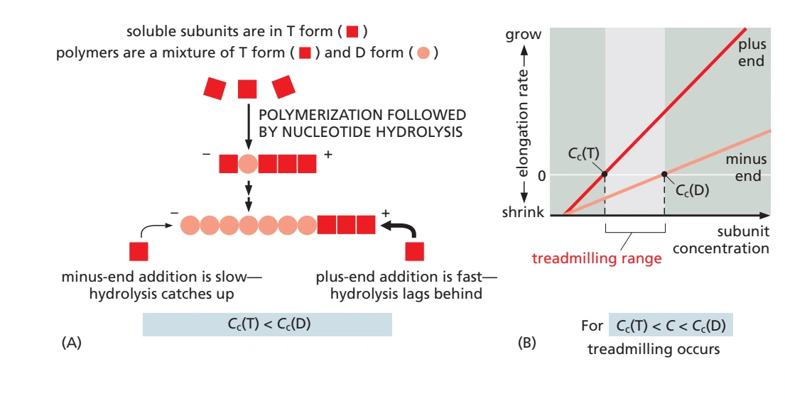{ width="1105" height="568" loading=lazy }

/// caption
简化模型以 T 表示 ATP 状态、D 表示 ADP 状态。B 中阴影区对应一端净延长、另一端净缩短；尚需通量相等，才得到长度不变的稳态。[^fig-actin-treadmilling]
///

??? example "临界浓度与丝长变化"

    对一个指定末端，先用简化动力学写出净亚基通量：

    $$v=k_{\mathrm{on}}c-k_{\mathrm{off}},\qquad C_c=\frac{k_{\mathrm{off}}}{k_{\mathrm{on}}}.$$

    $c$ 是可供该末端加入的游离单体浓度，$k_{\mathrm{on}}$ 与 $k_{\mathrm{off}}$ 分别描述加入和脱离；$v$ 的单位是亚基数／时间，乘以每个亚基贡献的轴向长度才是伸长速度。$c=C_c$ 时，该端的平均加入与脱离相抵。

    若 $v_+>0$、$v_-<0$，两端发生相反方向的净交换；还要满足 $v_++v_-=0$，整条丝的平均长度才不变。这里各速率要对应实际核苷酸与末端状态。活细胞还有加帽、切割和单体结合蛋白，总 actin 浓度不能直接代入 $c$。[^actin-dynamics-source]

### 成核器与结合蛋白 { #actin-regulators }

细胞利用成核的门槛，把新丝限制在需要它的位置。Arp2/3 复合物中的 Arp2、Arp3 与 actin 结构相近；成核促进因子（nucleation-promoting factor，NPF）激活复合物后，它在已有丝的侧面建立一个新起点。新丝与母丝常呈约 70°，其负端留在分支连接处，正端向外延伸。下图从 B 的激活，到 C 的分支网络，再到 D、E 的分支局部，展示了同一机制的几个尺度。片状伪足和吞噬杯可以借此在膜下迅速产生许多生长端。

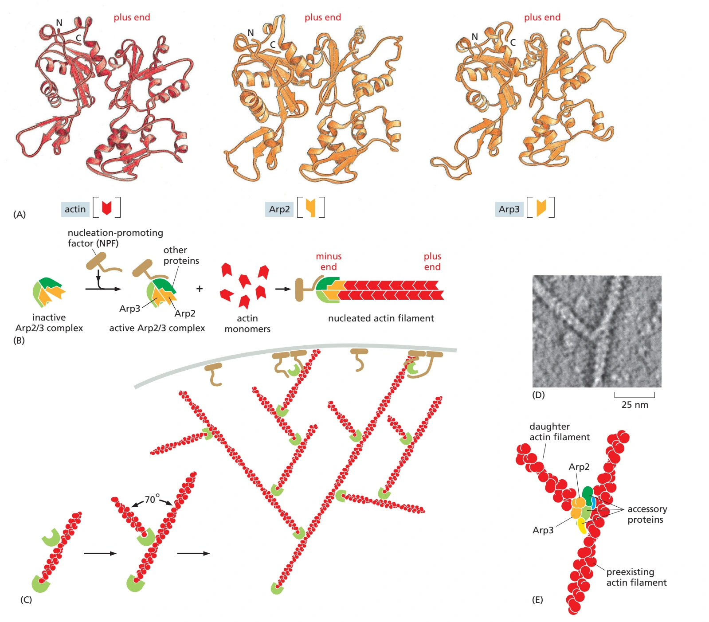{ width="1599" height="1403" loading=lazy }

/// caption
A 比较 actin、Arp2、Arp3；B、C 为成核与网络示意；D 为体外组装分支接头的电镜，比例尺 25 nm；E 为接头模型。[^fig-arp-branching]
///

formin 采用另一种办法。它的二聚体参与建立未分支的新丝，并留在正在延长的正端，一边保持连接，一边允许新 actin 插入。formin 的 FH2 区域与丝端相接，富含脯氨酸的 FH1 区域可招募 profilin-actin，提高局部供料效率。某些 formin 平时处于自抑制构象，Rho-GTP 的结合使它打开，将局部信号接到新丝的形成。这条路线常参与应力纤维、收缩环和细胞突起的形成；其他成核器及 Ena/VASP 等延长因子进一步丰富了网络的组织方式。[^actin-dynamics-source][^cytoskeleton-textbook]

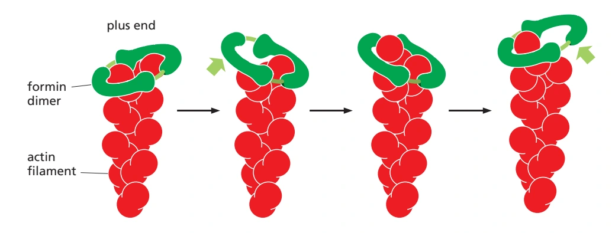{ width="1034" height="395" loading=lazy }

/// caption
绿色为 formin 的部分二聚体结构，红色为 actin。它跟随正端延长；图中未画出完整 FH1 供料区域。[^fig-formin-elongation]
///

调节并不止于起点。细胞内保留很大的可溶 actin 库，其中 thymosin-$\beta$4 结合并暂时封存单体，profilin 则促进 ADP—ATP 交换，并把适于聚合的单体提供给正端，尤其是 formin 或 Ena/VASP 所在的位置。因而 profilin 虽曾被译作“抑制蛋白”，在细胞里也能明显促进丝的延长。

已经形成的丝同样有许多可调之处。CapZ 一类加帽蛋白封住正端，tropomodulin 可稳定原肌球蛋白覆盖的丝的负端；cofilin 偏好较老的 ADP-actin 区域，改变局部扭转并促进切割和周转。gelsolin 在 Ca$^{2+}$ 等信号调节下切断丝，并封住新产生的正端；膜脂 PI(4,5)P$_2$ 与它结合，可抑制切割并促进解帽。切割增加了末端数目，新端随后是长还是缩，要看单体供给与加帽状态。沿丝侧结合的原肌球蛋白（tropomyosin）又能改变肌球蛋白和其他结合蛋白接近这段丝的机会。[^actin-dynamics-source][^gelsolin-pip2]

### 交联几何与细胞皮层 { #actin-architecture }

一根丝的性质，不等于整束丝的性质。fascin 把同向 actin 紧密束在一起，支撑丝状伪足；fimbrin／plastin 和 villin 参与微绒毛的核心束。$\alpha$-actinin 的连接间距较大，可让 myosin II 进入反向排列的丝之间，形成能够收缩的束。filamin 则把丝以较大夹角交联成网，适于从多个方向承受变形。

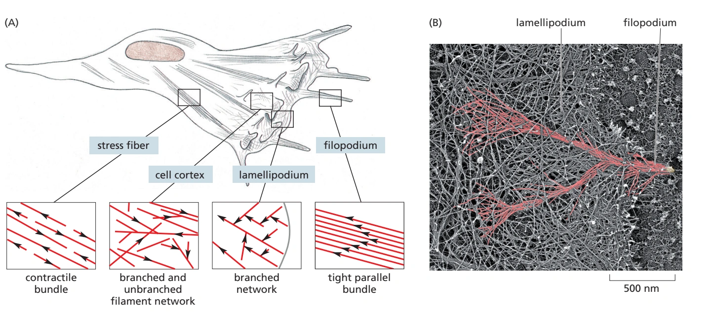{ width="1444" height="639" loading=lazy }

/// caption
A：成纤维细胞的不同 actin 阵列；B：迁移细胞前缘的铂金属复型电镜，部分形成丝束的 actin 被伪彩标红，比例尺 500 nm。[^fig-actin-arrays]
///

上图 B 中，片状伪足（lamellipodium）是铺开的密网，丝状伪足（filopodium）则由会聚的丝束支撑。这些丝持续更新，细胞边缘也随之伸缩。微绒毛的 actin 正端朝向顶部，这样的突起通常维持得更久，亚基和结合蛋白仍会交换；形态持久并不要求每个分子原地不动。

紧贴质膜的 actin 网络构成**细胞皮层**。ERM 蛋白把膜蛋白接到 actin；红细胞等细胞还利用 spectrin 网络、短 actin 丝和 ankyrin 等连接装置，维持膜的形态与韧性。皮层张力影响细胞变圆、突起和膜面积储备，膜下网络还会限制某些膜组分的侧向运动。相关观察见[受限的侧向运动](membrane_transport.md#membrane-mobility)；内吞和吞噬怎样动用局部骨架，见[大宗运输的入口](membrane_transport.md#endocytosis-entry)。

## 肌球蛋白与肌动蛋白产力 { #myosin-actin-force }

肌动蛋白聚合可以推膜，已经形成的丝还可以被**肌球蛋白（myosin）**牵拉。肌球蛋白头部含 actin 结合面与 ATP 酶马达结构域，连接头部的颈区结合轻链，可作为杠杆臂放大构象变化；尾部决定它怎样二聚、装成粗丝或连接货物。多数肌球蛋白向 actin 正端运动，myosin VI 是常见的反向成员。[^motor-proteins]

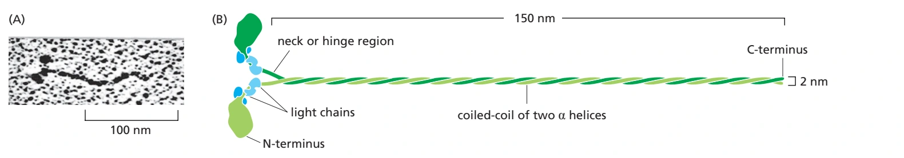{ width="1581" height="277" loading=lazy }

/// caption
肌球蛋白 II 由两条重链与四条轻链组成。A 为铂投影电镜，比例尺 100 nm；B 显示重链尾部形成的长卷曲螺旋。[^fig-myosin-ii]
///

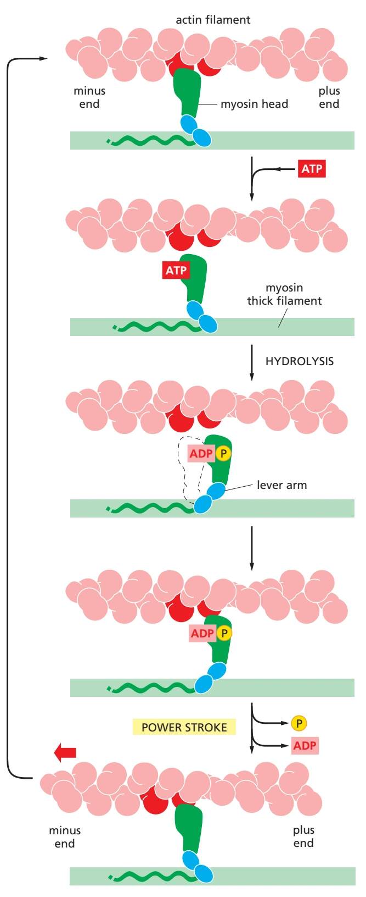{ width="667" height="1631" loading=lazy }

/// caption
图中把粗丝固定在下方；肌球蛋白相对 actin 向正端作用，使上方 actin 向左滑。[^fig-myosin-cycle]
///

从一个牢牢结合 actin 的头开始看。**ATP 结合**会降低它对 actin 的亲和力，头部先松开。ATP 水解后，ADP 与 P$_i$ 仍留在头部，杠杆臂进入预备构象。

头部再与前方 actin 结合，强结合、P$_i$ 释放与杠杆臂摆动相互耦联，完成动力冲程；ADP 随后释放，又回到强结合状态，等待下一分子 ATP。能量来自整个 ATP 水解循环，各步把结合状态和构象变化接起来。

同一段相对滑动，可以表现为马达带着货物沿丝走，也可以表现为固定的马达把丝拉过来。图中的绿色尾部固定，因此看到的是粉红色 actin 的移动。更细的反应耦联见[肌球蛋白的力化学循环](../biochem/protein_function.md#myosin-mechanochemical-cycle)。

myosin II 的长尾彼此聚集，形成两端头部朝向相反的**双极粗丝**。当它跨接反向平行的 actin，两侧的头都朝各自轨道正端作用，便可把两根丝拉过彼此，在应力纤维、皮层和胞质分裂环中产生收缩。下图中央的裸区主要是尾部，头集中在两侧；横纹肌把这种阵列进一步规则化为肌节。

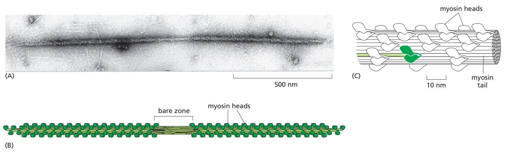{ width="1581" height="478" loading=lazy }

/// caption
A：蛙肌肉粗丝，比例尺 500 nm；B：双极排列示意；C：粗丝局部，比例尺 10 nm。非肌细胞也可形成较小的双极 myosin II 丝。[^fig-myosin-thick-filament]
///

许多骨骼肌 myosin II 头在一个 ATP 循环中只用较短时间强结合 actin，这段时间占整个循环的比例称为占空比。许多头异步接力，可以连续产力，又不至于长时间互相拖住。运输型 myosin V 则具有较高的占空比，两个头协调交替，使一次结合后能够走出许多步；这种连续行走能力称为**过程性**。步距、速度、占空比和过程性描述不同性质，不能拿一个家族的数值代表所有马达。

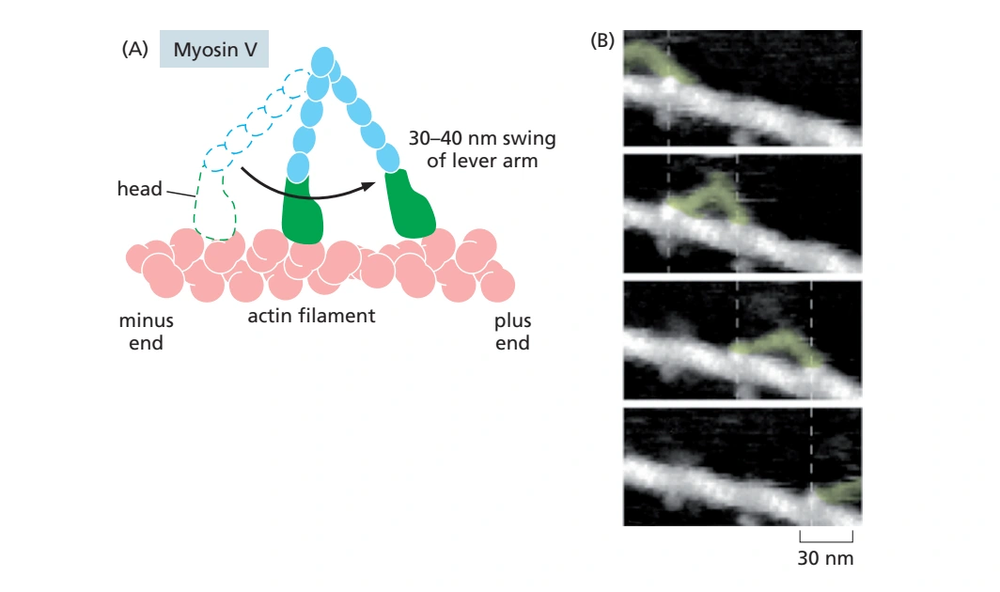{ width="1064" height="630" loading=lazy }

/// caption
A：较长的杠杆臂；B：沿 actin 行走的 myosin V，马达被伪彩标绿，比例尺 30 nm。[^fig-myosin-v]
///

myosin V 可携带囊泡、细胞器或 RNA；myosin I 常把膜与皮层联系起来，植物 myosin XI 则参与高速胞内运输。它们尾部的差异，使相似的头部循环被用在不同位置。[^motor-proteins]

??? info "从肌球蛋白片段到肌节"

    经典蛋白酶处理把肌球蛋白 II 分成重酶解肌球蛋白（HMM）与轻酶解肌球蛋白（LMM）。HMM 再分出的 S1 包含头部及轻链结合区，能够结合 actin，也是前面箭头装饰实验的材料；S2 是连接头部与长尾的部分。[^cytoskeleton-textbook]

    横纹肌中，肌钙蛋白 T 将复合物接到原肌球蛋白，肌钙蛋白 I 参与抑制 actin—myosin 作用，Ca$^{2+}$ 结合肌钙蛋白 C 后改变这一调节状态。肌联蛋白 titin 帮助粗丝居中并贡献被动力；nebulin 与细丝长度和稳定性有关，dystrophin 则把皮层 actin 接入跨膜连接，帮助把收缩力传给细胞外基质。各结构共同使肌丝滑动成为整条肌纤维的力和位移。[^muscle-accessories]

    肌节区带、薄丝激活和横桥循环见[肌节的位移与力传递](../physiology/muscle.md#sarcomere)，横管与肌质网怎样传递兴奋见[兴奋—收缩耦联](../physiology/muscle.md#skeletal-ecc)。平滑肌与许多非肌细胞主要通过调节 myosin II 轻链磷酸化来控制收缩，不能把横纹肌的肌钙蛋白开关照搬过去。

## 细胞迁移中的前后协同 { #cell-migration }

### 突出、黏附、牵引与后缘回收 { #migration-cycle }

在二维基质上爬行的许多动物细胞，前缘把 actin 正端朝向质膜。丝端与膜的热涨落会短暂腾出空间，新亚基插入后使膜难以退回原位，许多丝一起延长便能推动片状伪足。Arp2/3 提供分支网，formin、Ena/VASP 和 fascin 等则参与组织细长的丝状伪足。单靠前缘伸出去，细胞体还未必跟得上。[^actin-motility]

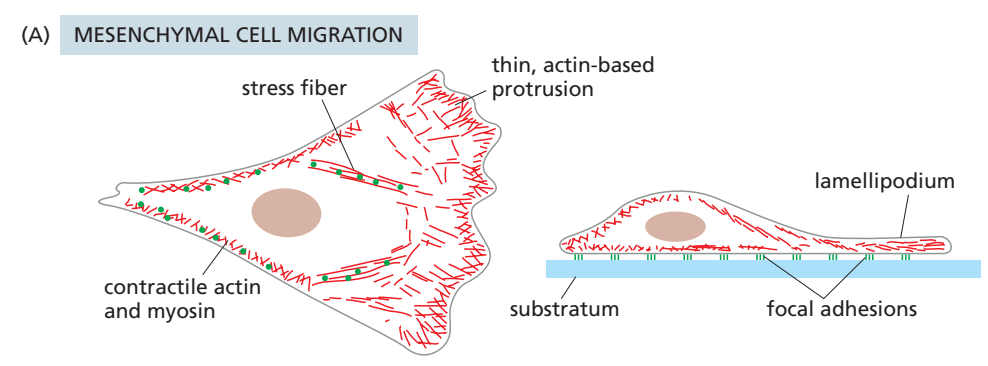{ width="988" height="366" loading=lazy }
/// caption
细胞向右移动。左侧俯视图和右侧侧视图对应同一套空间关系：前缘的 actin 网推动膜，较后方的 actin–myosin II 束产生张力，右图底部的绿色黏附点把骨架接到基质。[^fig-migrating-cell]
///

前缘的丝一面延长，已有的 actin 网络又可相对基质向后移动，称为**后向流（retrograde flow）**。其中既有聚合推膜的反作用，也有 myosin II 收缩的贡献。下图 a 先画出正端加亚基；b 中的黄色 myosin 与聚合作用共同使网络向左流动。若骨架与基质之间传力很弱，聚合时网络更多向后退，前缘向前突出的幅度就较小。[^actin-adhesion-flow]

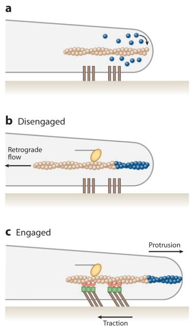{ width="400" height="684" loading=lazy }
/// caption
a：前缘正端聚合；b：actin 后向流；c：骨架与基质耦联后，细胞向右突出，向基质施加的牵引力朝左。红、绿块泛指黏附连接中的组分，并非 talin 的结构图；三幅比较机械关系，不是时间序列照片。[^actin-adhesion-flow]
///

新突起接触基质后，整合素（integrin）的胞外部分结合基质，胞内尾部与 talin 等蛋白相连，talin 又接触 actin；kindlin、vinculin 等进一步参与连接和调节。这样，向后的骨架运动可以牵拉基质，基质对细胞的反作用力则朝前。图 c 中后向流减慢，聚合便更有效地推动前缘前伸；这种耦联可以持续滑移，并不要求 actin 完全固定。talin 如何受力展开并招募 vinculin，见[黏着斑的承力实验](cell_interactions.md#focal-adhesions)。

中后部 myosin II 使相互连接的 actin 丝滑动，提高皮层与应力纤维的张力，帮助细胞体向前移动。随后，后缘旧黏附必须拆卸，部分整合素随膜内吞并循环利用，细胞尾部才能脱离原来的位置。下图把这一步放回完整周期：先突出、再建立前部黏附，细胞体前移后释放后部连接。黏附过弱容易滑移，过强则可能妨碍后缘脱离，合适的平衡随细胞与环境改变。

??? info "把后缘拆卸接回迁移周期"

    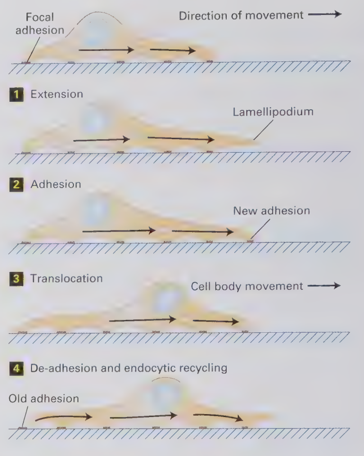{ loading=lazy }
    /// caption
    从上到下为二维迁移的四个环节；末幅标出后缘脱附、内吞和受体循环。图中细胞体向右的箭头表示整体前移，actin 的后向流方向见上一图。[^fig-migration-cycle]
    ///

三维组织中的路线更丰富。有的细胞保持较强黏附，有的利用皮层收缩、局部压力和膜泡状突起（bleb），在狭窄空间中以较低黏附前进；集体迁移还要经细胞连接协调邻细胞的拉力。这里所讲的二维“突出—黏附—牵引—回收”是一个具体方案。黏附的分子结构及基质力学见[细胞外基质、黏附与连接](cell_interactions.md)。

### 微管对方向持续性的支持 { #migration-microtubules }

前缘决定往哪里伸，细胞内部还要把材料持续送到那里。动态微管不断探索边缘，部分正端在皮层被捕获；沿微管运动的马达把膜、黏附受体和信号复合物送向特定区域，并把待回收成分接入内体路线。某些迁移细胞的中心体和高尔基体朝前缘重排，分泌因此具有方向偏好，但不同细胞的空间排列并不完全相同。

actin 与微管也通过信号和交联蛋白相互影响。Rho 家族小 GTP 酶调节局部 actin 聚合与收缩；微管正端追踪蛋白（+TIP）帮助末端联系皮层，spectraplakin 等大蛋白可以同时连接不同骨架。黏附处受力的变化又反馈到这些调节过程，让前缘突出与内部运输维持在相近的方向。[^cytoskeletal-crosstalk]

## 微管的组装与动态不稳定性 { #microtubule-dynamics }

### 晶格、GTP 帽与灾变—救援 { #microtubule-assembly }

微管的基本单位是 $\alpha$ 与 $\beta$ 微管蛋白（tubulin）组成的异二聚体。二聚体头尾相接成为原丝（protofilament），典型微管由 13 条原丝围成中空圆筒；每条原丝内的二聚体朝向一致，正端暴露 $\beta$ 亚基一侧，负端暴露 $\alpha$ 亚基一侧。相邻原丝主要通过同类亚基横向相接，常有一条“接缝”改为 $\alpha$—$\beta$ 接触。13 是常见数目，特定物种和体外组装条件下可有其他原丝数。

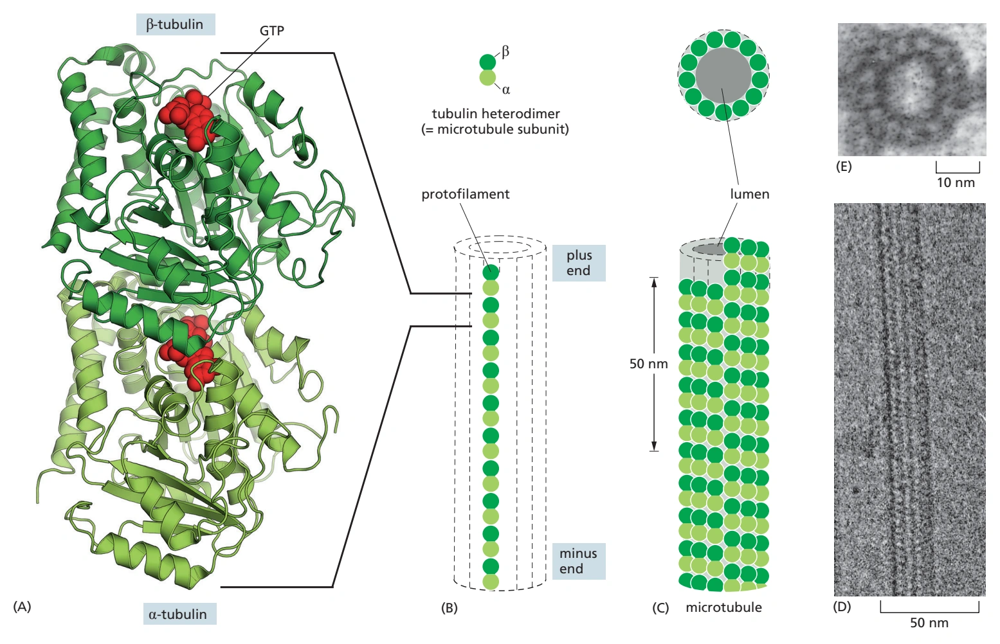{ width="1555" height="1002" loading=lazy }

/// caption
A：两种亚基各结合一个 GTP；B、C：原丝与微管；D：纵向电镜，比例尺 50 nm；E：横截面，比例尺 10 nm。[^fig-microtubule-structure]
///

两个 GTP 的处境不同。$\alpha$ 亚基上的 GTP 被包在二聚体内部界面，通常不交换、不水解；$\beta$ 亚基上的 GTP 可以交换，二聚体加入微管后，其水解受到促进。正在生长的末端不断获得新亚基，保留一段有利于稳定端部的 GTP／GDP-P$_i$ 状态，通常概称 **GTP 帽**。

当端部失去足够的稳定性，原先被晶格横向接触约束的原丝向外弯曲、剥离，微管便可能从生长突然转为快速缩短，称为**灾变（catastrophe）**。缩短中的微管重新稳定并恢复生长，称为**救援（rescue）**。在同一溶液或同一细胞中，一条微管正在长，邻近的另一条却可能正在缩；单条微管也会在两种状态间转换，这就是**动态不稳定性**。[^microtubule-dynamics-source]

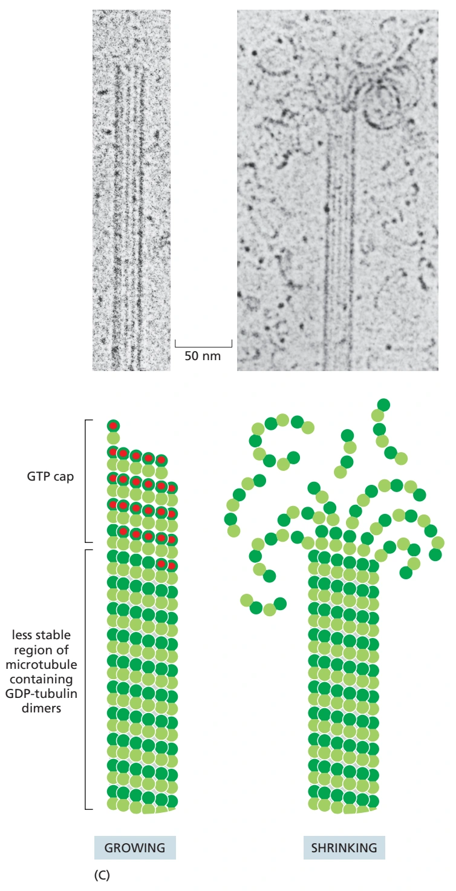{ width="754" height="1472" loading=lazy }

/// caption
上方为电镜，比例尺 50 nm；下方为简化模型。右侧缩短端的原丝向外卷曲。原图模型把帽画得整齐，实际末端具有多样构象。[^fig-microtubule-end]
///

沿右侧微管看，管壁末端已经散开成弯曲的原丝。这里有两个不同尺度的变化：一个是二聚体上的 GTP 水解，另一个是许多亚基之间的接触失稳，最终使整条微管迅速缩短。

GTP 帽不是套在管口的另一种蛋白质，也不是永远边界分明的一圈亚基。生长端也可能有弯曲、长度不齐的原丝；亚基核苷酸状态、横向接触和末端构象共同影响灾变概率。救援也可受晶格中较稳定的区域和末端调节蛋白帮助。[^microtubule-dynamics-source]

下图给出了活细胞中的直接观察。向蝾螈肺上皮细胞注入少量荧光 tubulin 后，研究者追踪细胞边缘的微管；彩线只为辨认同一根微管，四个时间点并非等间隔。沿编号 2 的蓝线看，307 秒时它明显缩短，669 秒时又向外延伸。固定图上的一条“长线”，在活细胞里可能几分钟就换了样子。

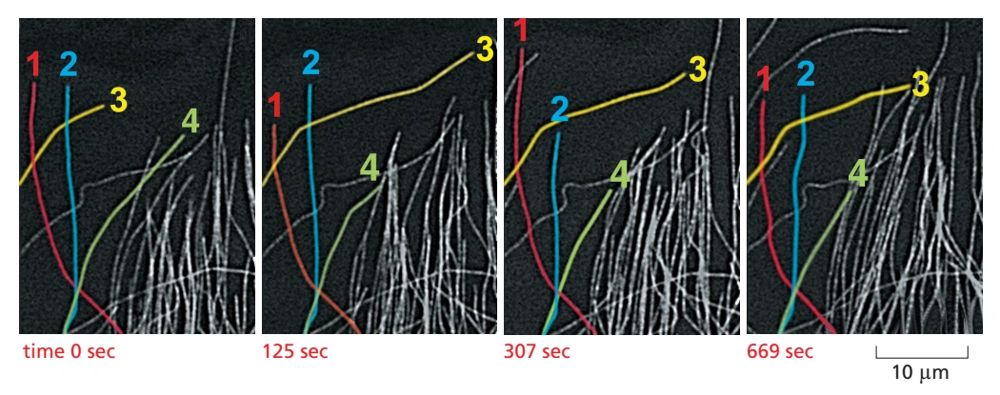{ width="1050" height="415" loading=lazy }

/// caption
0、125、307、669 秒的活细胞成像；四根微管被辅助着色，比例尺 10 μm。来自蝾螈肺上皮细胞，不是体外纯化微管。[^fig-microtubule-live]
///

!!! tip "动态不稳定性与踏车"

    动态不稳定性关注一个末端随时间在生长、缩短之间切换；踏车关注一端净加入、另一端净丢失。两种行为可以在特定条件下并存，但不是同一现象。Mitchison 与 Kirschner 在 1984 年的体外研究建立了微管动态不稳定性的概念；活细胞成像又让人们看到，微管在细胞环境中同样会在延长与缩短之间切换。[^microtubule-dynamics-source]

细胞通过许多蛋白质改变这些转换。EB 蛋白识别生长端特定的晶格状态，形成荧光成像中常见的“彗星”，并招募其他 +TIP；XMAP215 家族促进聚合，CLASP 可提高救援，kinesin-13 则促进末端解聚。katanin、spastin、fidgetin 等 ATP 酶可以从晶格内部切断微管；新生末端随后可能缩短，也可能被稳定下来，使网络分支或扩增。stathmin 结合可溶 tubulin、限制其聚合，磷酸化可以减弱这种作用。[^microtubule-dynamics-source][^cytoskeleton-textbook]

### 微管组织中心与非中心体阵列 { #microtubule-organizing-centers }

微管成核也需要克服最初装配的困难。$\gamma$-tubulin 与辅助蛋白组成的环复合物（$\gamma$-TuRC）可作为成核模板，微管从这里长出，负端留在模板一侧。能够集中成核和组织微管的部位，称为微管组织中心（microtubule-organizing center，MTOC）。

许多动物细胞以**中心体**作为主要 MTOC。中心体包含一对中心粒和外围的中心粒周物质（pericentriolar material，PCM）；中心粒通常由九组三联微管组成，成核所需的 $\gamma$-TuRC 则大量募集在 PCM 中。看下图 A，微管从中心粒周围的物质中发出，不能把整片放射阵列理解为两根中心粒直接向外伸长。母中心粒还可以在纤毛形成时成为基体。

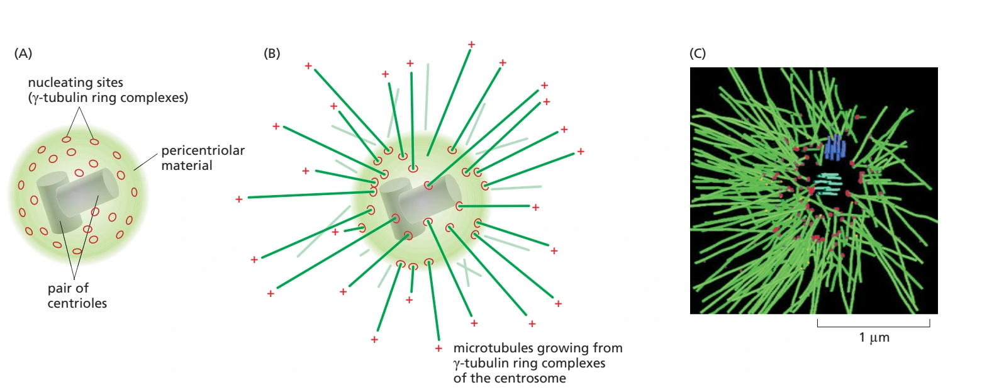{ width="1588" height="623" loading=lazy }

/// caption
A、B：中心体成核示意；C：秀丽隐杆线虫细胞中心体及微管的三维重建，比例尺 1 μm。[^fig-centrosome]
///

中心体并非所有细胞唯一的起点。Golgi、核膜、细胞皮层及已有微管旁都可组织成核或锚定；真菌常用嵌在核被膜处的纺锤极体，许多植物细胞没有典型中心体，也能建立完整微管阵列。分化细胞还会释放、转运和重新锚定微管，使其方向符合自身形状。

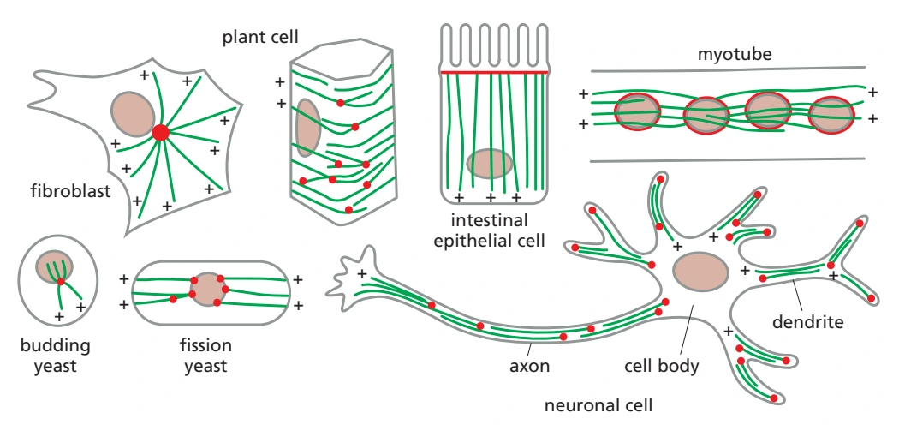{ width="1050" height="503" loading=lazy }

/// caption
绿色为微管，红色为成核、锚定或稳定位置。成纤维细胞的放射阵列、上皮细胞的顶—底排列与神经元轴突的纵向排列不同。[^fig-microtubule-arrays]
///

在上图的轴突中，多数微管正端朝向远端；树突可含混合极性，比例随物种、细胞类型和区段变化。同一个向正端的马达，放到不同阵列上，未必都把货物送“离开细胞核”。MAP2 常富集于胞体与树突，tau 常富集于轴突，它们侧向结合微管并影响稳定性和组织；tau 的异常修饰、脱离与聚集还涉及神经退行性病变。[^cytoskeleton-textbook]

$\alpha$、$\beta$-tubulin 的 C 端尾伸出微管表面，富含酸性残基，提供了带负电的结合区域。许多微管相关蛋白（MAP）通过静电作用接近这些尾部，其伸向外侧的结构域又影响微管之间的间距或与其他组分的连接。[^cytoskeleton-textbook]

微管蛋白还有多种异构体及乙酰化、去酪氨酸化、聚谷氨酰化等翻译后修饰，合称讨论中的“微管蛋白密码”（tubulin code）。这些差别会影响 MAP 和马达如何结合、切割酶怎样作用。某些标记富集于长寿命微管，却不能只凭标记就判定它直接造成了稳定；需要结合修饰位置、酶、异构体和细胞环境判断。植物皮层中，微管还可通过碰撞后的交联、改向、灾变及切割，自组织成取向相近的阵列。[^microtubule-dynamics-source][^plant-cytoskeleton]

## 微管马达与细胞内运输 { #microtubule-motors }

### kinesin 的方向与功能分化 { #kinesin-motors }

驱动蛋白（kinesin）把 ATP 循环与微管的结合、解离及构象变化耦联。经典 kinesin-1 的两条重链形成两个马达头、颈连接区（neck linker）和参与二聚的长尾，轻链及其他适配体参与货物连接。一个头留在微管上，另一个头跨到前方；核苷酸状态与两个头之间的张力帮助它们协调，避免一起脱离。整台马达通常按约 8 nm 的微管二聚体重复距离前进，一个完整前进步大致消耗一个 ATP。[^motor-proteins][^cytoskeleton-textbook]

???+ abstract "标记一个头，看它跨过多远"

    马达整体每次前进约 8 nm，并不能单独判定两个头怎样配合。下图左侧的交替步行（hand-over-hand）模型中，一个头先原地等待，再从后方跨到前方；右侧尺蠖式（inchworm）模型中，同一个头始终领先，两头各自前移。若只给一个头加荧光标记，两种模型预言的位移不同。[^kinesin-single-head]

    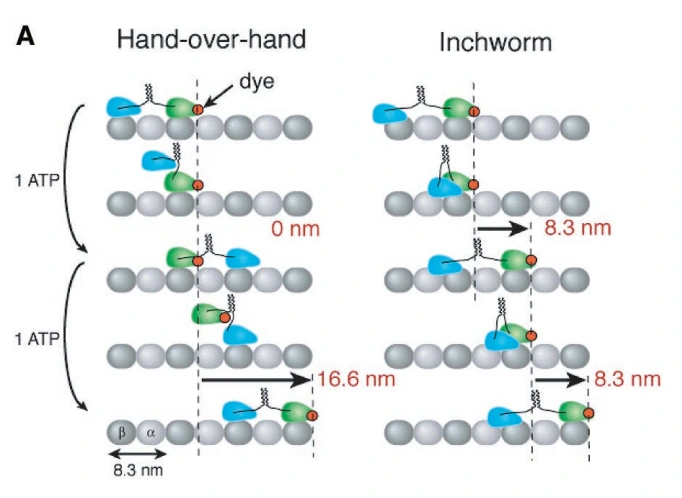{ width="682" height="498" loading=lazy }

    /// caption
    橙色小点为染料。左侧预言标记交替发生 0 与 16.6 nm 位移，右侧预言每次 8.3 nm。原论文图 1A。[^kinesin-single-head]
    ///

    Yildiz 等在 2004 年用 Cy3 标记一个 kinesin 头，把微管固定在玻片上，在低 ATP 条件下逐帧定位荧光点。下图纵轴是标记的位置，横轴是时间，阶梯来自位置记录的分析。步距统计得到平均约 17.3 nm，支持一个头越过另一个头的模型。荧光斑本身比这个距离宽得多，但收集足够光子后，可以更精确地定位斑点中心。

    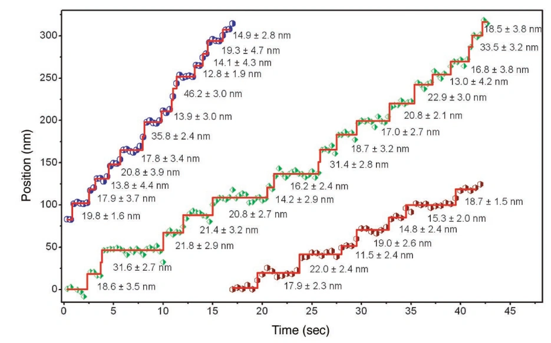{ width="935" height="583" loading=lazy }

    /// caption
    340 nM ATP 条件下的三条记录。蓝、绿来自 E215C 标记构建体，棕红来自 S43C–T324C 构建体；阶梯叠线表示分析得到的平台与跳变。原论文图 2。[^kinesin-single-head]
    ///

    标记不动的阶段并不能直接看见另一个头迈步；原研究还用停留时间分布检验中间是否包含未被位置曲线显示的步骤。这个实验把“货物走多远”和“一个头走多远”区分开来，结果支持的也正是所用构建体与实验条件下的步行方式。

kinesin 是一个超家族，不能都画成同一台运输机器。许多 N 端马达型成员朝微管正端运动；kinesin-2、-3 常参与货物运输，kinesin-4 等参与染色体与微管阵列组织，双极的 kinesin-5 可交联并滑动反向平行微管。C 端马达型 kinesin-14 多向负端运动，kinesin-13 则主要促进末端解聚。马达结构域的位置提供线索，具体功能仍要看家族分支和结构。[^motor-proteins]

### dynein、dynactin 与货物适配体 { #dynein-motors }

动力蛋白（dynein）的构造与 kinesin 差别很大。一个重链的马达部分由六个 AAA 结构域围成环，其中主要 ATP 酶位点驱动构象循环；细长的 stalk 末端结合微管，跨在环上的 linker 在循环中改变位置，把化学变化转为力。胞质 dynein-1 通常由两个这样的重链与多种中间链、轻链组成，沿微管向负端运输。[^dynein-transport]

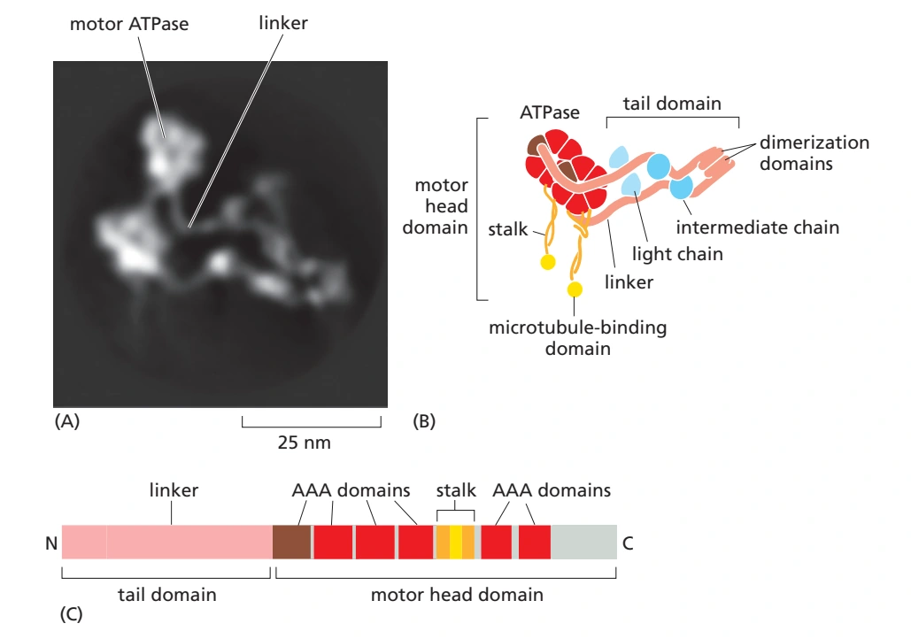{ width="1029" height="722" loading=lazy }

/// caption
A：冷冻电镜重建，比例尺 25 nm；B：结构示意；C：一条重链上的尾部、linker、AAA 环与微管结合 stalk。[^fig-dynein-structure]
///

在哺乳动物等研究体系中，游离 dynein-1 可以处于自抑制或低过程性状态。**dynactin** 提供连接平台，**激活适配体**将马达尾部组织到平台上，并联系特定货物；三者组装后，dynein 才更适于持续行走。dynactin 内含一段以 Arp1 为主的短 actin 样丝，不能把它与前面成核分支网的 Arp2/3 混同。Rab、膜脂、货物受体和适配体的组合，调节马达与货物的结合及马达的活化。[^dynein-transport]

同一囊泡可携带正端和负端马达。它的实际运动取决于马达数目与激活状态、承受多大负荷、轨道怎样布置及货物怎样连接；轨道修饰和局部 Ca$^{2+}$ 信号还可改变特定运输装置的活动。长程微管运输抵达皮层后，货物还常交给 actin—myosin 作短程定位、捕获或胞吐；包被、Rab 身份与 SNARE 融合见[载体出芽、识别与膜融合](endomembrane.md#vesicle-machinery)。[^motor-proteins]

另一个胞质动力蛋白分支 dynein-2 主要承担纤毛内逆向运输，所用运输装置不同于 dynein-1—dynactin。轴丝 dynein 又组成专门的马达阵列，使相邻微管滑动，从而驱动下面的纤毛拍动。

## 纤毛、鞭毛与轴丝运动 { #cilia-flagella }

### 基体、轴丝与纤毛内运输 { #ciliary-architecture }

真核纤毛和鞭毛都是被膜包围的细胞突起，内部有微管组成的**轴丝（axoneme）**。基部的基体通常由九组三联微管构成：A 管完整，B、C 管与相邻管共享部分壁。进入典型轴丝后，C 管终止，A、B 管延续为外周九组二联微管，微管正端朝顶端。多数运动纤毛和精子鞭毛另有中央一对单微管，即常说的 **9+2**。

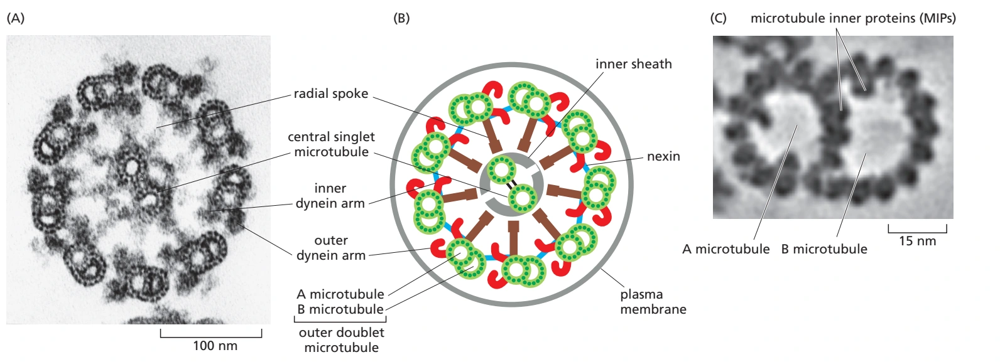{ width="1592" height="577" loading=lazy }

/// caption
A：衣藻鞭毛横截面，比例尺 100 nm；B：轴丝连接示意；C：二联微管的电子断层图，显示管内蛋白（MIP），比例尺 15 nm。[^fig-axoneme]
///

许多细胞还长有主要承担信号感受的**初级纤毛**，常见轴丝排列为 **9+0**，缺少中央对，也缺少典型运动装置。它为 Hedgehog 等信号提供特殊膜区室。微管排列与是否运动并非严格一一对应，例如胚胎结节的运动纤毛可为 9+0；判断功能还需看马达和调节结构。许多增殖细胞在分裂前重吸收初级纤毛，母中心粒重新参与中心体活动，但具体时序随细胞类型而变。[^cilia-ift]

在部分哺乳动物细胞中，初级纤毛先在胞内开始组装。小囊泡停靠到母中心粒的远端附属结构上，经 EHD1／EHD3 及 SNARE 等装置重塑、融合成**纤毛囊泡（ciliary vesicle，CV）**。这段膜组装过程与母中心粒顶端 CP110 的移除、过渡区和 IFT 组分的募集相配合。随后轴丝向前延伸，周围膜也扩大成包裹轴丝的鞘，并与质膜衔接，让纤毛露到细胞表面。轴丝和膜要一起长，单独伸长一束微管还不够。[^ciliogenesis-vesicle]

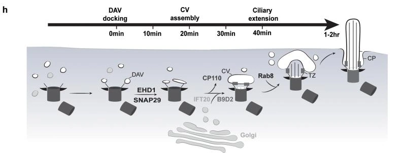{ width="800" height="302" loading=lazy }

/// caption
沿箭头看，小囊泡 DAV 先停靠，融合成 CV 后膜与轴丝共同延伸；最后与质膜连通。原研究提出的胞内成纤毛模型，图中分钟至小时的时间轴来自其观察体系，不能作为所有细胞的统一时程。[^ciliogenesis-vesicle]
///

纤毛不是一根装好后便不再维修的杆。过渡区位于基体与轴丝交界附近，在膜与轴丝之间形成选择性门控；持续的**纤毛内运输（intraflagellar transport，IFT）**把 tubulin、膜蛋白等货物送往顶端，也将待回收成分带回基部。IFT-A 与 IFT-B 都参与运输列车的组织；通常由 kinesin-2 驱动顺向运输，列车在顶端重构后，由 dynein-2 驱动逆向运输。BBSome 等适配装置参与特定膜货物的选择。[^cilia-ift]

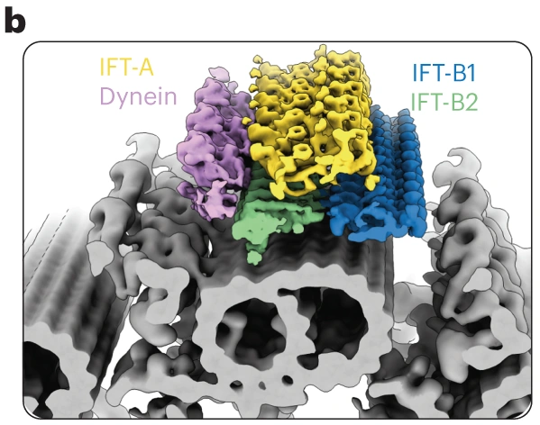{ width="599" height="472" loading=lazy }

/// caption
衣藻顺向 IFT 列车各复合物的冷冻断层平均密度与微管二联体平均结构组合。黄为 IFT-A，蓝、绿为 IFT-B 两部分，紫为 dynein；原论文图 1b。[^ift-train-structure]
///

这张图是沿微管方向看列车的截面。IFT-A 与 IFT-B 同时出现在同一顺向列车上，不能把 A、B 当成只在相反方向工作的两组装置。

紫色 dynein 在这里也随列车向顶端去，但尚未执行逆向驱动。它先以受抑制状态被运到顶端，之后才参与返程；否则同一列车会在出发时就面对相反方向的马达作用。图像来自冷冻电镜结构分析，并不直接记录运动速度。[^ift-train-structure]

### 轴丝 dynein 与弯曲波 { #ciliary-beating }

在运动轴丝中，一组二联管的 A 管固定着轴丝 dynein 的尾部，马达的微管结合部位伸向相邻二联管的 B 管。ATP 循环使马达朝 B 管负端作用，两组二联管便发生相对滑动。如果它们可以自由滑开，结果只是轴丝被拉散；完整轴丝内还有 nexin—dynein 调节复合物等连接，加上基部约束，滑动受到限制，于是转为弯曲。

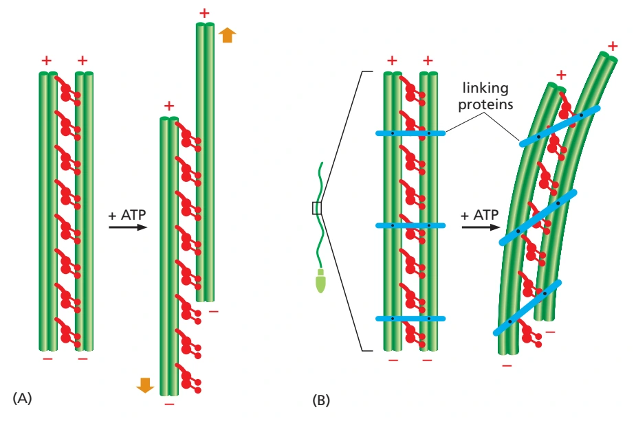{ width="925" height="616" loading=lazy }

/// caption
A：蛋白酶处理使部分连接解除后，加 ATP 可使二联管相对滑开；B：保留连接与基部约束时，马达力使轴丝弯曲。这里是机制示意图。[^fig-axoneme-sliding]
///

中央对、放射辐和其他调节网络帮助安排不同位置 dynein 的活动。轴丝一侧和另一侧在不同时刻产力，形成可传播的弯曲波；实际波形还受流体负荷、基部固定方式与细胞类型影响。呼吸道纤毛推动黏液，输卵管纤毛帮助腔内运输，精子鞭毛则推进整个细胞。

!!! info "同叫鞭毛，驱动方式不同"

    真核鞭毛依靠轴丝微管滑动产生弯曲。细菌鞭毛由 flagellin 等组成，基部马达通常利用离子电化学梯度驱动长丝旋转；古菌的 archaellum 又有不同来源与 ATP 驱动装置。名字相同或外形相近，并不意味着里面是同一套结构。详见[原核细胞的表面结构](../micro/prokaryotes.md#surface-motility)。

## 中间丝的装配与组织韧性 { #intermediate-filaments }

### 从卷曲螺旋二聚体到成熟丝 { #intermediate-filament-assembly }

中间丝的亚基不是 actin 那样的球状单体，而是具有长 $\alpha$ 螺旋杆状区、两端头尾区较多变的蛋白。两个单体平行缠成卷曲螺旋二聚体，两个二聚体再反向平行、错位排列成四聚体。沿下图 C 的 N、C 端看，两边各有朝相反方向的分子，整体极性在这一步被抵消。[^intermediate-filaments-source]

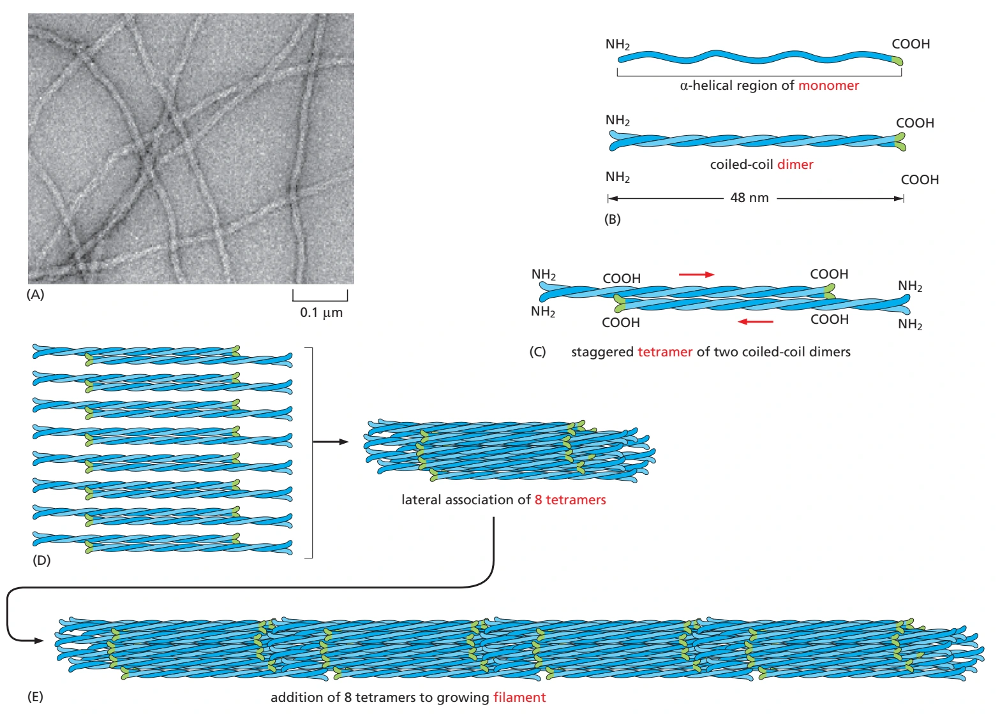{ width="1567" height="1120" loading=lazy }

/// caption
A：中间丝电镜，比例尺 0.1 μm；B—E：层级装配模型。图中横截面 32 条链是经典胞质中间丝模型，不能作为所有中间丝蛋白的固定计量。[^fig-intermediate-assembly]
///

对 vimentin 等典型胞质中间丝，四聚体先横向结合成单位长度丝，再端对端连接、径向压实，形成绳索状成熟纤维。装配不要求 ATP 或 GTP 水解，仍受蛋白浓度、离子环境、磷酸化及辅助蛋白影响。不同成员的装配细节和横截面计量可变；核 lamin 虽属同一家族，构成的纤维也不同于这里的典型 10 nm 胞质中间丝。

中间丝容易弯曲，却很耐拉伸。较大变形时，蛋白构象变化和分子间相对位移有助于吸收机械负荷。由于没有一致的轨道极性，没有已知马达像沿 actin 或微管那样沿中间丝统一定向步进；中间丝自身却可以被微管马达搬运，也会在短前体、成熟丝和可溶组分间周转。磷酸化能促进部分网络拆解或重排，例如许多动物细胞分裂时的核纤层解体。[^intermediate-filaments-source]

### 细胞类型特异网络与连接界面 { #intermediate-filament-networks }

不同组织使用不同成员。上皮细胞的角蛋白丝通常由 I 型酸性与 II 型中性／碱性角蛋白配对形成；它们接到桥粒和半桥粒，把负荷传给邻细胞或基底膜。下图的蓝色网络围绕细胞核并伸向边界，跨细胞的机械连续性则由连接复合物建立，而非一根角蛋白直接穿过两层质膜。

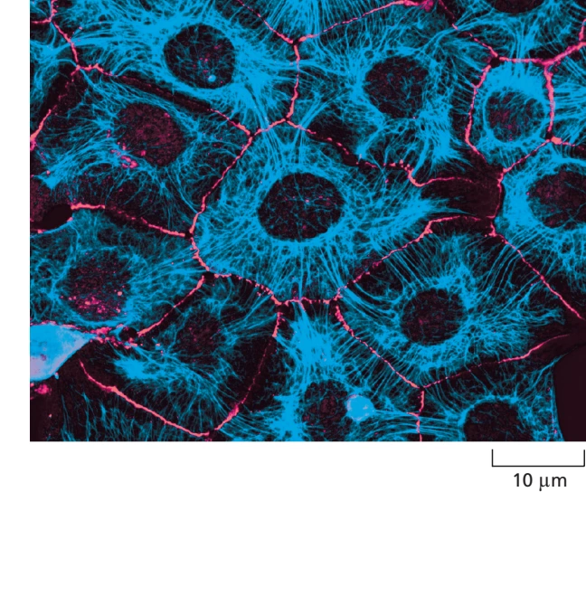{ width="648" height="680" loading=lazy }

/// caption
培养上皮细胞中，角蛋白标蓝，另一种蛋白的红色标记勾出细胞边界；比例尺 10 μm。[^fig-keratin-network]
///

桥粒把一个细胞的中间丝经胞内斑块、跨膜黏附蛋白接到邻细胞；半桥粒则把上皮细胞基底面的角蛋白网络接到基底膜。两类接口的组成见[承载负荷的细胞连接](cell_interactions.md#load-bearing-adhesions)。

这也解释了为什么某些角蛋白突变会使表皮在轻微摩擦后起疱：细胞仍可以形成表皮，但在负荷下更容易破裂。具体裂隙位于细胞内还是细胞与基底膜之间，要看哪一层结构出了问题。

| 代表性成员 | 常见表达位置与作用 |
| --- | --- |
| vimentin（波形蛋白） | 多种间充质细胞，参与力学适应与细胞器定位 |
| desmin（结蛋白） | 肌细胞，联系相邻肌原纤维和其他结构，帮助收缩装置对齐 |
| GFAP（胶质纤维酸性蛋白） | 星形胶质细胞及部分其他胶质细胞的网络组分 |
| neurofilament（神经丝） | 神经元，尤其轴突；侧臂及交联有助于维持间距和轴突口径 |
| peripherin、$\alpha$-internexin | 部分神经元中的中间丝成员 |
| nestin（巢蛋白） | 多种前体细胞及特定状态细胞中的组分，常与其他成员共装配 |
| lamin（核纤层蛋白） | 内核膜下的核纤层，联系核膜、染色质与细胞骨架 |

这些分布可帮助辨认细胞状态，但不是绝对的细胞谱系标签。许多细胞共表达不止一种中间丝，具体组成还随分化和生理状态而变。植物和真菌缺少典型的动物胞质中间丝体系。[^intermediate-filaments-source]

plectin 等 plakin 家族蛋白又把中间丝与 actin、微管、黏附复合物和核周结构连接起来。角蛋白、desmin 或 lamin 的缺陷可分别造成表皮脆弱、肌病或多系统核纤层病，表型取决于表达位置、受力方式和连接对象。核 lamin 的装配、LINC 跨核膜连接及分裂期重构，见[核被膜与核纤层](nucleus_chromatin.md#nuclear-envelope)。[^cytoskeletal-crosstalk]

## 分裂期骨架的重构 { #division-cytoskeleton }

有丝分裂开始时，间期微管阵列转向纺锤体的组织。动粒微管连接染色体动粒，极间微管在中央反向重叠，星体微管伸向皮层，帮助定位纺锤体。中心体成核、染色质附近成核及已有微管上的分支扩增，可以按细胞类型共同参与组装；微管正负端的生长与缩短、动粒耦联和 kinesin／dynein 的活动一起产生染色体位移。

进入后期，动物细胞在赤道附近组织 actin—myosin II 收缩环，环的收缩与皮层流动、膜添加及最后的中体切断配合，完成胞质分裂。植物细胞则在中央建立成膜体，以微管和 actin 引导 Golgi 来源囊泡聚集、融合成细胞板，逐步向外扩展。纺锤体检查点、姐妹染色单体分离与动植物胞质分裂的详细过程，见[细胞周期与细胞分裂](cell_cycle.md)。

## 植物细胞的骨架组织 { #plant-cytoskeleton }

有细胞壁的植物细胞通常不能像成纤维细胞那样整体爬行，却仍能通过定向生长改变形状。贴近质膜内侧的皮层微管，能经连接因子引导膜内纤维素合酶复合体（cellulose synthase complex，CSC）的插入和运动；合酶把新生葡聚糖链输出到膜外，组成纤维素微纤丝。因而膜内的微管方向，可以影响膜外新沉积材料的方向。[^plant-cytoskeleton]

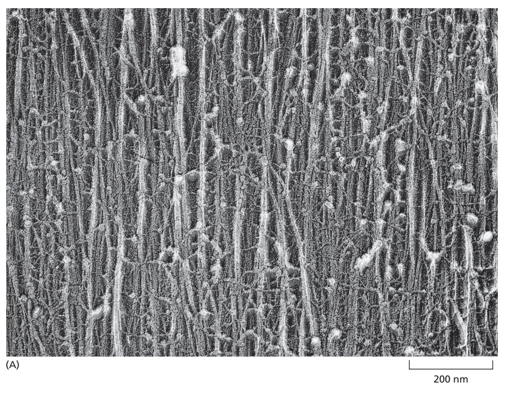{ width="1053" height="824" loading=lazy }

/// caption
快速冷冻、深度蚀刻后的细胞壁复型电镜，比例尺 200 nm。较粗的近似平行纤维为纤维素微纤丝，图中并非微管本身。[^fig-cellulose-orientation]
///

在许多伸长区，新沉积微纤丝大致横向排列，对沿纤维方向的拉伸阻力较大；配合受控的壁松弛，膨压便可使细胞更容易沿另一方向伸长。微管重排可改变后续沉积方向，细胞壁中的既有材料与组织应力又会反馈到微管。纤维素的合成由 CSC 催化，实际生长还要同时考虑壁的可屈服性、膨压和邻细胞约束。细胞壁组成和生长机制见[生长中的细胞壁材料系统](../botany/morphology/plant_cells_tissues.md#cell-wall-material-system)。

植物 actin 丝束与 myosin XI 驱动细胞器运输，并带动周围胞质形成环流。大型液泡挤占中央后，薄薄的胞质层仍能维持远距离交换；花粉管、根毛等顶端生长细胞，则在后方保留运输束，在尖端及其邻近区域维持更细致的 actin 动态，以协调囊泡输送和膜添加。这里的成膜体、皮层微管与 actin—myosin XI，各有自己的空间安排。[^plant-cytoskeleton]

## 原核细胞的动态支架 { #prokaryotic-cytoskeleton }

细菌和古菌也有组织细胞内部空间的聚合蛋白。许多细菌在分裂处用 tubulin 同源蛋白 **FtsZ** 形成动态 Z 环；FtsZ 的 GTP 依赖踏车帮助安排隔膜细胞壁合成机器。actin 同源蛋白 **MreB** 与许多杆状细胞的侧壁延伸机器相联系；它与 actin 的结构亲缘，并不意味着会组成动物细胞那样的应力纤维。[^bacterial-cytoskeleton]

有些质粒还为自己的分配编码 actin 家族蛋白 **ParM**。下图中，ParR 与质粒上的特定位点结合，把质粒接到 ParM 丝束末端；当两份质粒稳定了丝束两端，继续聚合的 ParM 便把它们推向相反方向。这提供了一个很直接的例子：蛋白聚合本身也能产生位移，不一定另需一台沿轨道行走的马达。

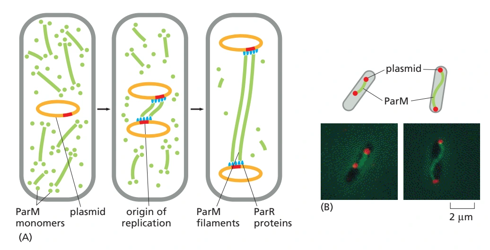{ width="1036" height="529" loading=lazy }

/// caption
A：质粒—ParR—ParM 的分配模型；B：质粒标红、ParM 标绿，分别显示较短与延长后的连接束，比例尺 2 μm。[^fig-parm-segregation]
///

弯曲的柄杆菌还使用富含卷曲螺旋的 crescentin，在细胞凹侧影响壁生长和形状；bactofilin、其他中间丝样蛋白以及 MinD／ParA 类 ATP 酶，继续扩展了极性定位、形态与 DNA 分配的办法。并非每种原核细胞都拥有这些系统：球菌、无壁细菌和不同古菌的组合各异，古菌还可使用 ESCRT-III 等分裂装置。相关多样性见[原核细胞的生长与分裂](../micro/prokaryotes.md#division-dormancy)。[^bacterial-cytoskeleton]

## 从结构到力学机制的证据 { #cytoskeleton-evidence }

这一页的图片用了不同观察方法。负染、金属复型和冷冻电镜显示丝、接头或轴丝的结构；免疫荧光显示某种蛋白在细胞中的分布；活细胞标记则把静态纤维变成了随时间延长、缩短或移动的对象。固定和去垢剂抽提会改变、丢失某些结构，尤其是可溶亚基，所以“抽提后留下的纤维”并不等于细胞中全部骨架蛋白。

研究周转时，可以用光漂白恢复、光激活或荧光散斑追踪局部蛋白，也可用 EB 彗星跟踪微管生长端。研究产力时，则常把纯化亚基、成核器、马达和膜放进已知条件：全内反射荧光（TIRF）显微镜追踪单丝与单分子，光镊测量位移、负荷和失速，检测何种组分足以产生观察到的运动。荧光标签比例、表面固定方式、拥挤程度和几何约束都可能改变行为；体外结果需要再与细胞内观察对照。[^cytoskeleton-evidence]

!!! tip "稳定骨架也可能阻断功能"

    干扰骨架，不一定表现为把丝全部拆散。cytochalasin 常通过结合 actin 正端限制延长，latrunculin 结合单体，phalloidin 则结合并稳定 F-actin，也是常用的固定细胞染色探针。三者影响的位置不同，不能仅凭“细胞不动了”判断是哪一步受阻。

    colchicine、nocodazole 和长春花碱类通常抑制微管组装或改变其动态，paclitaxel（紫杉醇）则稳定微管；低剂量下，某些药物已能明显抑制动态，而未使总微管量大幅改变。运输、信号与分裂都依赖周转，因此药物结果要结合剂量、时间、直接动力学测量及遗传扰动／救援实验解释。[^cytoskeleton-evidence]

## 参考资料与延伸阅读 { #references }

- Alberts B, Heald R, Johnson A, et al. *Molecular Biology of the Cell*. 7th ed. W. W. Norton; 2022. 第 16 章，植物细胞壁另见第 19 章。
- Yildiz A, Tomishige M, Vale RD, Selvin PR. [Kinesin walks hand-over-hand](https://doi.org/10.1126/science.1093753). *Science*. 2004;303:676–678.
- Lacey SE, Foster HE, Pigino G. [The molecular structure of IFT-A and IFT-B in anterograde intraflagellar transport trains](https://doi.org/10.1038/s41594-022-00905-5). *Nature Structural & Molecular Biology*. 2023;30:584–593.
- Bisson-Filho AW, Hsu YP, Squyres GR, et al. [Treadmilling by FtsZ filaments drives peptidoglycan synthesis and bacterial cell division](https://pubmed.ncbi.nlm.nih.gov/28209898/). *Science*. 2017;355:739–743.

- Cooper GM. [The Cytoskeleton and Cell Movement](https://www.ncbi.nlm.nih.gov/books/NBK9893/). In: *The Cell: A Molecular Approach*. 2nd ed. Sinauer Associates; 2000.
- Alberts B, Johnson A, Lewis J, et al. [The Self-Assembly and Dynamic Structure of Cytoskeletal Filaments](https://www.ncbi.nlm.nih.gov/books/NBK26862/). In: *Molecular Biology of the Cell*. 4th ed. Garland Science; 2002.
- Alberts B, Johnson A, Lewis J, et al. [Molecular Motors](https://www.ncbi.nlm.nih.gov/books/NBK26888/). In: *Molecular Biology of the Cell*. 4th ed. Garland Science; 2002.
- Pollard TD. [Actin and Actin-Binding Proteins](https://pubmed.ncbi.nlm.nih.gov/26988969/). *Cold Spring Harbor Perspectives in Biology*. 2016;8:a018226.
- Blanchoin L, Boujemaa-Paterski R, Sykes C, Plastino J. [Actin dynamics, architecture, and mechanics in cell motility](https://pubmed.ncbi.nlm.nih.gov/24382887/). *Physiological Reviews*. 2014;94:235–263.
- Gudimchuk NB, McIntosh JR. [Regulation of microtubule dynamics, mechanics and function through the growing tip](https://pubmed.ncbi.nlm.nih.gov/34408299/). *Nature Reviews Molecular Cell Biology*. 2021;22:777–795.
- Mitchison T, Kirschner M. [Dynamic instability of microtubule growth](https://pubmed.ncbi.nlm.nih.gov/6504138/). *Nature*. 1984;312:237–242.
- Sweeney HL, Holzbaur ELF. [Motor Proteins](https://pubmed.ncbi.nlm.nih.gov/29716949/). *Cold Spring Harbor Perspectives in Biology*. 2018;10:a021931.
- Reck-Peterson SL, Redwine WB, Vale RD, Carter AP. [The cytoplasmic dynein transport machinery and its many cargoes](https://pubmed.ncbi.nlm.nih.gov/29662141/). *Nature Reviews Molecular Cell Biology*. 2018;19:382–398.
- Lacey SE, Pigino G. [The intraflagellar transport cycle](https://pubmed.ncbi.nlm.nih.gov/39537792/). *Nature Reviews Molecular Cell Biology*. 2025;26:175–192.
- Herrmann H, Aebi U. [Intermediate Filaments: Structure and Assembly](https://pubmed.ncbi.nlm.nih.gov/27803112/). *Cold Spring Harbor Perspectives in Biology*. 2016;8:a018242.
- Pradeau-Phélut L, Etienne-Manneville S. [Cytoskeletal crosstalk: A focus on intermediate filaments](https://pubmed.ncbi.nlm.nih.gov/38359728/). *Current Opinion in Cell Biology*. 2024;87:102325.
- Fletcher DA, Mullins RD. [Cell mechanics and the cytoskeleton](https://pubmed.ncbi.nlm.nih.gov/20110992/). *Nature*. 2010;463:485–492.
- Garcin C, Straube A. [Microtubules in cell migration](https://pubmed.ncbi.nlm.nih.gov/31358621/). *Essays in Biochemistry*. 2019;63:509–520.
- Elliott A, Shaw SL. [Update: Plant Cortical Microtubule Arrays](https://pubmed.ncbi.nlm.nih.gov/29184029/). *Plant Physiology*. 2018;176:94–105.
- Duan Z, Tominaga M. [Actin-myosin XI: an intracellular control network in plants](https://pubmed.ncbi.nlm.nih.gov/29307817/). *Biochemical and Biophysical Research Communications*. 2018;506:403–408.
- Celler K, Koning RI, Koster AJ, van Wezel GP. [Multidimensional view of the bacterial cytoskeleton](https://pubmed.ncbi.nlm.nih.gov/23417493/). *Journal of Bacteriology*. 2013;195:1627–1636.

[^cytoskeleton-overview]: 主线依据 Alberts 等 *Molecular Biology of the Cell* 第 7 版（2022）第 16 章；开放入门阅读见 Cooper 的[细胞骨架与细胞运动章节](https://www.ncbi.nlm.nih.gov/books/NBK9893/)。
[^filament-assembly]: 三类聚合物的亚基形态、非共价自组装、极性和材料差异见 Alberts 等的[骨架丝自组装章节](https://www.ncbi.nlm.nih.gov/books/NBK26862/)；细胞尺度的结构—力学联系参见 Fletcher 与 Mullins 的[细胞力学综述](https://pubmed.ncbi.nlm.nih.gov/20110992/)。
[^actin-dynamics-source]: actin 的端动力学、临界浓度、ATP 水解以及 monomer-binding、formin、Arp2/3、加帽与切割蛋白体系，见 Pollard 的[肌动蛋白与结合蛋白综述](https://pubmed.ncbi.nlm.nih.gov/26988969/)。
[^motor-proteins]: myosin、kinesin 与 dynein 的 ATP 耦联、方向、过程性及家族分化，见 Sweeney 与 Holzbaur 的[马达蛋白综述](https://pubmed.ncbi.nlm.nih.gov/29716949/)及 Alberts 等的[分子马达章节](https://www.ncbi.nlm.nih.gov/books/NBK26888/)。
[^actin-motility]: actin 网络的生化—力学反馈、突出、黏附与收缩协同，见 Blanchoin 等的[细胞运动中的 actin 动力学综述](https://pubmed.ncbi.nlm.nih.gov/24382887/)。
[^cytoskeletal-crosstalk]: 三类骨架通过连接蛋白、马达、黏附和信号形成相互穿插网络的现代框架，见 Pradeau-Phélut 与 Etienne-Manneville 的[骨架串扰综述](https://pubmed.ncbi.nlm.nih.gov/38359728/)；迁移中微管对极性物流的作用参见[微管与细胞迁移综述](https://pubmed.ncbi.nlm.nih.gov/31358621/)。
[^microtubule-dynamics-source]: GTP 帽、末端结构、灾变、救援及药物／力学调节见 Gudimchuk 与 McIntosh 的[微管生长端综述](https://pubmed.ncbi.nlm.nih.gov/34408299/)；动态不稳定性概念源自 Mitchison 与 Kirschner 的[经典体外研究](https://pubmed.ncbi.nlm.nih.gov/6504138/)。
[^dynein-transport]: dynein-1、dynactin、激活适配体与不同膜性／非膜性货物的连接机制，见 Reck-Peterson 等的[胞质 dynein 运输综述](https://pubmed.ncbi.nlm.nih.gov/29662141/)。
[^cilia-ift]: IFT 列车的基部装载、向顶端组装、货物选择和顶端重构，见 Lacey 与 Pigino 的[纤毛内运输周期综述](https://pubmed.ncbi.nlm.nih.gov/39537792/)。
[^intermediate-filaments-source]: 中间丝卷曲螺旋、反向平行四聚体、单位长度丝、径向压实及材料性质，见 Herrmann 与 Aebi 的[中间丝结构与装配综述](https://pubmed.ncbi.nlm.nih.gov/27803112/)。
[^plant-cytoskeleton]: 植物皮层微管的成核、自组织与 cellulose synthase 引导见 Elliott 与 Shaw 的[植物皮层微管综述](https://pubmed.ncbi.nlm.nih.gov/29184029/)；actin—myosin XI 运输与胞质环流见 Duan 与 Tominaga 的[植物马达综述](https://pubmed.ncbi.nlm.nih.gov/29307817/)。
[^bacterial-cytoskeleton]: FtsZ、MreB、crescentin 样蛋白、Par 系统及其他细菌动态支架的结构与功能多样性，见 Celler 等的[细菌细胞骨架综述](https://pubmed.ncbi.nlm.nih.gov/23417493/)；FtsZ 踏车与隔膜合成的直接观察另见 Bisson-Filho 等的[原始研究](https://pubmed.ncbi.nlm.nih.gov/28209898/)，实验对象为枯草芽孢杆菌。
[^cytoskeleton-evidence]: 微管动态不稳定性的群体与单丝证据见 Mitchison 与 Kirschner 的[原始研究](https://pubmed.ncbi.nlm.nih.gov/6504138/)；马达步进、负荷和过程性的单分子证据框架见 Sweeney 与 Holzbaur 的[综述](https://pubmed.ncbi.nlm.nih.gov/29716949/)。

[^cytoskeleton-textbook]: Alberts 等，*Molecular Biology of the Cell* 第 7 版（2022），第 16 章，pp.949–1026；微管相关蛋白、stathmin 和微管蛋白修饰见 pp.994–997。肌球蛋白 HMM、LMM、S1、S2 片段另核对 [Suggs 等，2007](https://pmc.ncbi.nlm.nih.gov/articles/PMC1965590/)。
[^muscle-accessories]: 肌节、肌钙蛋白及辅助蛋白见 Alberts 等，第 7 版，pp.979–984；dystrophin 与肌细胞膜外连接的作用见 [Ervasti 与 Campbell，1993](https://doi.org/10.1083/jcb.122.4.809)。nebulin 的作用并非所有肌肉都适用的固定长度尺，正文只概括其对细丝长度与稳定性的贡献。
[^kinesin-single-head]: Yildiz A, Tomishige M, Vale RD, Selvin PR. [Kinesin walks hand-over-hand](https://doi.org/10.1126/science.1093753). *Science* 303:676–678 (2004)，图 1A、图 2，p.677；从[作者公开 PDF](https://people.physics.illinois.edu/Selvin/PRS/PSCV/PTP/2004/kinesin%20Science%202004.pdf)裁取。平均 17.3 ± 3.3 nm 为图 3A 中 143 次步进的均值与标准差；正文近似值用于解释标记头与整体位移的区别。实验为改造、截短的常规 kinesin 构建体，340 nM ATP，不据此统一其他马达或其他负荷条件。
[^ift-train-structure]: Lacey SE, Foster HE, Pigino G. [The molecular structure of IFT-A and IFT-B in anterograde intraflagellar transport trains](https://doi.org/10.1038/s41594-022-00905-5). *Nat Struct Mol Biol* 30:584–593 (2023)，图 1b。裁取原图 b，保留颜色与标签；来源 [PMC 全文](https://pmc.ncbi.nlm.nih.gov/articles/PMC10191852/)，CC BY 4.0。图为衣藻顺向列车结构，紫色 dynein-1b 为该物种的 IFT dynein，即本文所称 dynein-2 分支；运输周期和顶端重构另见上列 Lacey 与 Pigino（2025）。

[^fig-cell-networks]: Alberts 等，*Molecular Biology of the Cell* 第 7 版（2022），图 16–1，p.949；从教材 PDF 裁取。A 由 Albert Tousson 提供，B 由 Conly Rieder 提供；裁取两幅图及各自比例尺。两幅图红色标记的对象不同。

[^fig-actin-structure]: Alberts 等，*Molecular Biology of the Cell* 第 7 版（2022），图 16–8，p.958；从教材 PDF 裁取。C 电镜由 Roger Craig 提供；保留 A—C、方向与比例尺。

[^fig-actin-polarity]: Alberts 等，*Molecular Biology of the Cell* 第 7 版（2022），图 16–9，p.959；从教材 PDF 裁取。A 由 Tom Pollard 提供；B 改自 Whittaker 等，Ultramicroscopy 58:245–259 (1995)。保留两幅图与比例尺。

[^fig-actin-nucleation]: Alberts 等，*Molecular Biology of the Cell* 第 7 版（2022），图 16–10，p.959；从教材 PDF 裁取。曲线为教材整理的聚合动力学示意，保留坐标、阶段与加入种子的箭头，不称作某篇论文原始数据。

[^fig-actin-treadmilling]: Alberts 等，*Molecular Biology of the Cell* 第 7 版（2022），图 16–11，p.963；从教材 PDF 裁取。保留 A、B；T/D 两状态为简化模型，没有单独表示 ADP-Pi 中间状态。

[^fig-arp-branching]: Alberts 等，*Molecular Biology of the Cell* 第 7 版（2022），图 16–12，p.966；从教材 PDF 裁取。D 来自 Rouiller 等，J Cell Biol 180:887–895 (2008)，[doi:10.1083/jcb.200709092](https://doi.org/10.1083/jcb.200709092)；E 为结构模型。保留 A—E 与 25 nm 比例尺。

[^fig-formin-elongation]: Alberts 等，*Molecular Biology of the Cell* 第 7 版（2022），图 16–13，p.967；从教材 PDF 裁取。裁取上方机制图，不含完整 formin 分子。

[^fig-actin-arrays]: Alberts 等，*Molecular Biology of the Cell* 第 7 版（2022），图 16–18，p.972；从教材 PDF 裁取。B 由 Tatyana Svitkina 提供；迁移细胞固定后作铂复型电镜，部分 actin 伪彩标红。

[^gelsolin-pip2]: Janmey PA, Iida K, Yin HL, Stossel TP. [Polyphosphoinositide micelles and polyphosphoinositide-containing vesicles dissociate endogenous gelsolin-actin complexes and promote actin assembly from the fast-growing end of actin filaments blocked by gelsolin](https://pubmed.ncbi.nlm.nih.gov/3040735/). *J Biol Chem* 262:12228–12236 (1987)。体外抑制、解帽效应还受磷脂呈现方式及 Ca$^{2+}$ 条件影响。

[^ciliogenesis-vesicle]: Lu Q 等. [Early steps in primary cilium assembly require EHD1- and EHD3-dependent ciliary vesicle formation](https://pmc.ncbi.nlm.nih.gov/articles/PMC4344897/). *Nat Cell Biol* 17:228–240 (2015)，doi:10.1038/ncb3109；裁取图 8h，完整保留模型、标签与时间轴。依据人 RPE 细胞等体系中膜接入、CP110 移除与 IFT 招募的成像和干预实验；此处介绍胞内成纤毛途径，不能把全部纤毛膜概括为直接来自 Golgi，也不为各类细胞指定统一的形成或重吸收时相。

[^fig-myosin-ii]: Alberts 等，*Molecular Biology of the Cell* 第 7 版（2022），图 16–21，p.976；从教材 PDF 裁取。A 由 David Shotton 提供；保留结构示意与 100 nm 比例尺。

[^fig-myosin-thick-filament]: Alberts 等，*Molecular Biology of the Cell* 第 7 版（2022），图 16–22，p.976；从教材 PDF 裁取。A 来自 Stewart 与 Kensler，J Mol Biol 192:831–851 (1986)；C 基于 Crowther 等，J Mol Biol 184:429–439 (1985)。图 B 未按比例绘制。

[^fig-myosin-cycle]: Alberts 等，*Molecular Biology of the Cell* 第 7 版（2022），图 16–24，p.978；从教材 PDF 裁取。基于 Rayment 等，Science 261:58–65 (1993)；裁取左侧完整反应示意，中文相邻说明其循环与相对运动。

[^fig-myosin-v]: Alberts 等，*Molecular Biology of the Cell* 第 7 版（2022），图 16–36，p.986；从教材 PDF 裁取。B 改自 Kodera 与 Ando，Biophys Rev 6:237–260 (2014)，高速原子力显微镜观察。

[^fig-microtubule-structure]: Alberts 等，*Molecular Biology of the Cell* 第 7 版（2022），图 16–37，p.987；从教材 PDF 裁取。A 结构 PDB 1JFF；D 由 Richard Wade、E 由 Richard Linck 提供，保留 A—E。

[^fig-microtubule-live]: Alberts 等，*Molecular Biology of the Cell* 第 7 版（2022），图 16–39，p.989；从教材 PDF 裁取。由 Wendy C. Salmon 与 Clare Waterman 提供；活蝾螈肺上皮细胞注入少量荧光 tubulin，原图的辅助彩线、时间和 10 μm 比例尺均保留。

[^fig-microtubule-end]: Alberts 等，*Molecular Biology of the Cell* 第 7 版（2022），图 16–40C，p.990；从教材 PDF 裁取。仅裁取 C，电镜来自 Mandelkow、Mandelkow 与 Milligan，J Cell Biol 114:977–991 (1991)，[doi:10.1083/jcb.114.5.977](https://doi.org/10.1083/jcb.114.5.977)。下方为教材简化模型；未采用把游离 GTP-tubulin 一律画为直构象的 B 面板。

[^fig-centrosome]: Alberts 等，*Molecular Biology of the Cell* 第 7 版（2022），图 16–42，p.992；从教材 PDF 裁取。C 来自 O’Toole 等，J Cell Biol 163:451–456 (2003)，[doi:10.1083/jcb.200304035](https://doi.org/10.1083/jcb.200304035)；保留 A—C。

[^fig-microtubule-arrays]: Alberts 等，*Molecular Biology of the Cell* 第 7 版（2022），图 16–44，p.993；从教材 PDF 裁取。裁取不同细胞的完整阵列示意，红色位置包含成核、锚定和稳定作用，不只代表中心体。

[^fig-dynein-structure]: Alberts 等，*Molecular Biology of the Cell* 第 7 版（2022），图 16–54，p.1001；从教材 PDF 裁取。A 由 Andrew Carter 提供；B、C 为示意，保留 25 nm 比例尺与结构域标签。

[^fig-axoneme]: Alberts 等，*Molecular Biology of the Cell* 第 7 版（2022），图 16–58，p.1004；从教材 PDF 裁取。A 衣藻电镜由 Lewis Tilney 提供；C 二联微管断层图由 Daniela Nicastro 提供。

[^fig-axoneme-sliding]: Alberts 等，*Molecular Biology of the Cell* 第 7 版（2022），图 16–60，p.1005；从教材 PDF 裁取。裁取 A、B 机制示意，保留 ATP、极性和连接标记；此图不是早期蛋白酶滑动实验的原始记录。

[^fig-intermediate-assembly]: Alberts 等，*Molecular Biology of the Cell* 第 7 版（2022），图 16–62，p.1008；从教材 PDF 裁取。A 来自 Norlén 等，Exp Cell Res 313:2217–2227 (2007)。B—E 为经典装配模型；实际装配路径及计量差异另核对 Herrmann 与 Aebi（2016）。

[^fig-keratin-network]: Alberts 等，*Molecular Biology of the Cell* 第 7 版（2022），图 16–63，p.1009；从教材 PDF 裁取。改自 Green 与 Gaudry，Nat Rev Mol Cell Biol 1:208–216 (2000)；裁取免疫荧光图和 10 μm 比例尺。

[^fig-parm-segregation]: Alberts 等，*Molecular Biology of the Cell* 第 7 版（2022），图 16–73，p.1015；从教材 PDF 裁取。A 改自 Garner 等，Science 306:1021–1025 (2004)；B 来自 Møller-Jensen 等，Mol Cell 12:1477–1487 (2003)。图是带特定耐药质粒的细菌体系，不代表全部细菌染色体的分配方式。

[^fig-cellulose-orientation]: Alberts 等，*Molecular Biology of the Cell* 第 7 版（2022），图 19–65A，p.1158；从教材 PDF 裁取。仅 A，图由 Brian Wells 与 Keith Roberts 提供；胡萝卜伸长细胞初生壁的快速冷冻、深蚀刻复型，保留 200 nm 比例尺。

[^fig-migrating-cell]: Alberts 等，*Molecular Biology of the Cell* 第 7 版（2022），图 16–19A，p.973；裁取完整俯视及侧视示意。

[^actin-adhesion-flow]: Gardel ML 等. [Mechanical Integration of Actin and Adhesion Dynamics in Cell Migration](https://pmc.ncbi.nlm.nih.gov/articles/PMC4437624/). *Annu Rev Cell Dev Biol* 26:315–333 (2010)，doi:10.1146/annurev.cellbio.011209.122036，图 3，保留 a–c 和全部方向箭头。

[^fig-migration-cycle]: Lodish 等，*Molecular Cell Biology* 第 8 版（2016），图 17–39，p.812；完整保留四阶段及整合素回收路径。
