# 内膜系统、蛋白质分选与囊泡运输

胰腺腺泡细胞合成的消化酶，最后会出现在消化道里。从核糖体上延伸出来的一条多肽，到能够分泌的蛋白质，中间还有一段很长的路：它要进入内质网，折叠、装配和接受修饰，经过高尔基体，再被浓缩进分泌颗粒。与此同时，细胞还在制造留在内质网的伴侣蛋白、送往溶酶体的水解酶和嵌在质膜上的受体。同一个起点，要通向好几个终点。

**内膜系统**把这些过程连接起来。内质网、高尔基体、内体、溶酶体和分泌囊泡之间不断交换膜与货物，并与质膜发生联系。各区室仍保持不同的酶、脂质和腔内环境；顺向运输送出新成分，回收运输则把受体、运输装置和误带出的驻留蛋白送回。沿着一条新生蛋白往前走，可以看到这套系统怎样同时完成加工、分选和质量控制。[^endomembrane-overview]

## 区室拓扑与双向物流 { #endomembrane-topology }

内质网与核膜外膜连续，内质网腔也与两层核膜之间的空间相通。其他区室之间主要通过膜泡和小管交换。不同教材对“内膜系统”是否包括核膜、质膜的术语划分略有差别，但这些结构在膜发生和运输上的联系是明确的。[^osm-endomembrane]

先看一次最简单的出芽与融合。下图中，红色小点随供体区室的腔内容物进入小泡；小泡从膜上断开后，它们仍被膜包在里面。小泡再与受体膜融合，内容物进入受体的腔。整个过程中，货物没有穿过脂质双层，膜也没有翻面。

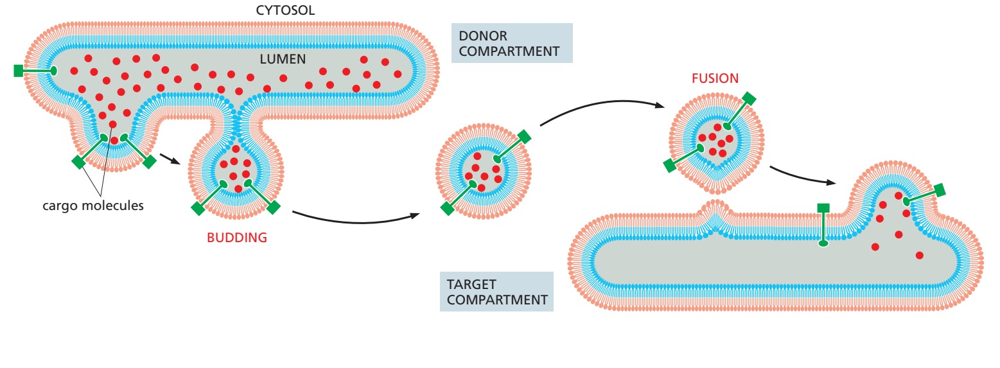{ width="760" height="280" }
/// caption
沿绿色膜蛋白看：方形的一端始终朝向胞质，圆形的一端始终朝向腔内。红色小点是随腔内容物一起运输的可溶性货物。[^fig-vesicle-topology]
///

这就是运输中的**拓扑保持**。内质网腔、高尔基体腔、内体和溶酶体腔都位于非胞质侧；分泌囊泡与质膜融合后，这一侧朝向细胞外。因此，在内质网或高尔基体腔内加上的糖链，最终可以出现在细胞表面。膜蛋白的胞质尾则留在胞质侧，供包被、适配蛋白和信号分子识别。[^secretory-topology]

| 区室 | 货物在这里经历什么 | 常见去向 |
| --- | --- | --- |
| 内质网 | 跨膜转位、膜蛋白朝向建立、N-糖基化、二硫键形成与折叠检查 | ERGIC／高尔基体；内质网驻留或降解 |
| 顺面至反面高尔基体 | 糖链修剪与延伸、糖脂及蛋白聚糖合成、硫酸化等加工 | TGN 分往质膜、分泌颗粒或内体 |
| 早期与回收内体 | 分离受体与配体，分选回收、转胞吞和降解货物 | 质膜、TGN 或晚期内体 |
| 晚期内体／多泡体 | 形成腔内小泡，继续酸化，获得溶酶体组分 | 与溶酶体融合，形成降解活跃的内溶酶体 |
| 溶酶体 | 水解大分子，输出分解产物，感知营养状态 | 小分子回到胞质；特定情况下发生胞吐 |

表中的箭头有许多回程。没有回收，内质网会不断丢失折叠酶，高尔基体会丢失分选受体，质膜也会被持续的内吞消耗。一个区室能维持自己的组成，靠的是选择性保留、送出和取回不断配合。

## 蛋白质进入内质网 { #er-protein-entry }

电镜下，**糙面内质网**（rough ER，也称粗面内质网）的胞质面附有核糖体，常形成扁平膜囊；**光面内质网**（smooth ER）缺少这种密集附着，常呈细小的管状网络。两者属于相连的内质网，可以随细胞需求改变比例。胰腺腺泡细胞、分泌抗体的浆细胞有发达的糙面内质网；分泌类固醇激素的细胞和承担大量代谢、解毒反应的肝细胞，则有较丰富的光面区域。

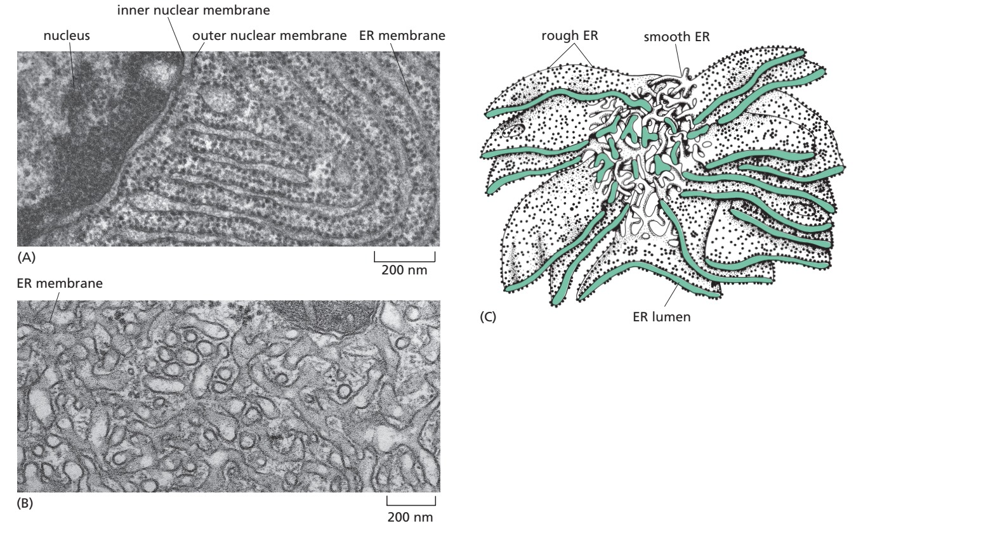{ width="760" height="406" loading=lazy }
/// caption
A 是胰腺外分泌细胞的糙面内质网，左上可见与之连续的核膜；B 是人睾丸 Leydig 细胞的光面内质网。C 重建肝细胞中两者的连接，绿色表示内质网腔。A、B 比例尺均为 200 nm。[^fig-er-architecture]
///

### 信号识别与 Sec61 转位 { #srp-sec61-translocation }

游离核糖体与内质网结合核糖体是同一类核糖体，去向由它正在合成的多肽及相应靶向装置决定。以一条可溶性分泌蛋白为例：新生链的 N 端先露出一段疏水信号肽，**信号识别颗粒**（signal recognition particle，SRP）随即结合它和核糖体。SRP 由 RNA 与蛋白质组成；它使翻译延伸暂时减慢，给这条尚未合成完的链留下到达内质网膜的时间。

内质网膜上的 SRP 受体接住复合物，再把核糖体和新生链交给 **Sec61 转位通道**。SRP 与受体的 GTP 结合、水解循环使交接具有方向性；交接完成后，两者分离并被重新利用。核糖体继续延伸多肽，新生链便一边合成，一边通过 Sec61 进入内质网腔，这称为**共翻译转位**。[^er-entry]

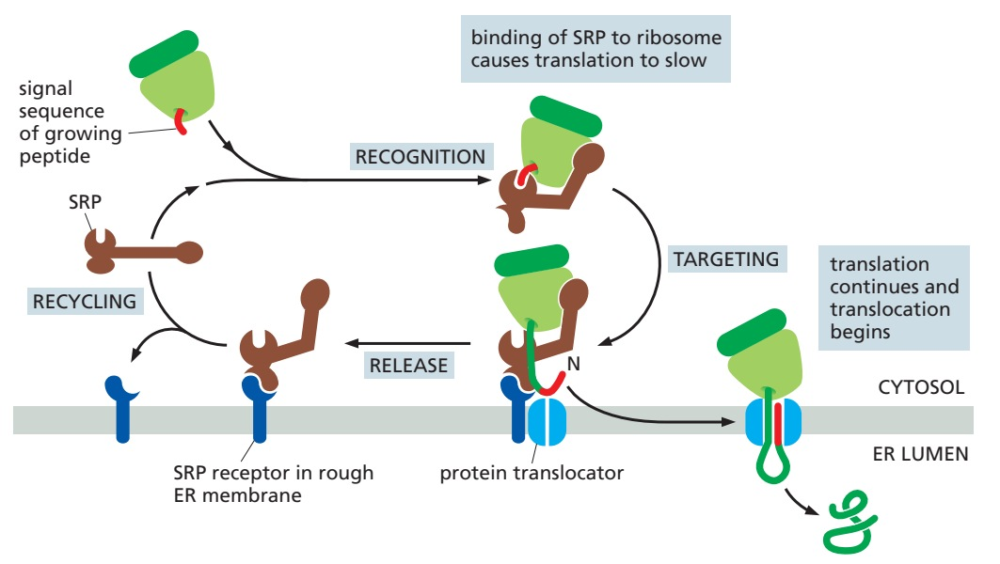{ width="660" height="373" loading=lazy }
/// caption
从左上沿箭头追踪：棕色 SRP 结合核糖体及红色信号序列，随后在膜上完成交接。最右侧的绿色多肽继续伸入腔内；SRP 和受体已离开这一轮转位，返回循环。[^fig-srp-sec61]
///

可切除的 N 端信号肽随后由腔侧的信号肽酶切掉。如果后面没有把蛋白留在膜中的疏水段，整条链便进入腔内。核糖体完成翻译后可以解离；同一条 mRNA 上若还有其他正在转位的核糖体，mRNA 也可以继续留在内质网附近。

膜蛋白的情况多了一步。下图中的 N 端先进入腔内，后来出现的一段疏水螺旋进入 Sec61 时，使后续链段停止穿膜。这段螺旋从通道的侧向开口进入脂质双层，成为跨膜段；核糖体继续合成的 C 端则留在胞质侧。于是，一条多肽同时拥有腔内段、跨膜段和胞质段。

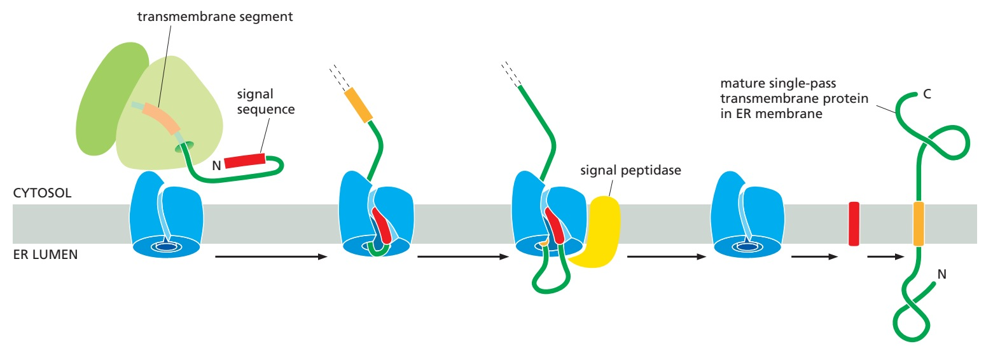{ width="760" height="273" loading=lazy }
/// caption
前面的信号肽负责把新生链引入通道，后面的橙色跨膜段把蛋白留在膜中。右侧成品的 N 端在腔内、C 端在胞质；这是一种单跨膜蛋白的插入方式。[^fig-membrane-insertion]
///

另一些蛋白用内部的**信号锚定序列**同时完成靶向和膜锚定，不需要切掉 N 端信号肽。疏水段两侧的电荷分布、链段性质和转位装置共同影响朝向；多跨膜蛋白则通过连续的疏水段插入建立更复杂的拓扑。GPI 锚定蛋白也先进入内质网，其 C 端信号被切除并换接到糖基磷脂酰肌醇锚上，运到质膜后，蛋白位于细胞外侧。

共翻译转位是哺乳动物分泌通路的主线。一些短分泌蛋白也可在翻译完成后，由伴侣维持适合转位的状态再进入内质网；尾锚定蛋白的跨膜段靠近 C 端，要等翻译结束才完全露出，因此由专门装置插入膜。进入内质网只解决了第一道分选，之后能否离开、去往哪里，还要继续接受检查。

???+ abstract "微粒体实验：进入腔内以后，蛋白发生了什么？"

    细胞匀浆时，内质网碎片可重新封闭成小囊泡，称为**微粒体**（microsome）。保留核糖体的糙面微粒体可以在试管中继续参与蛋白转位；微粒体是制备过程产生的实验材料，并不是活细胞内另一种独立细胞器。

    用编码分泌蛋白的 mRNA 做无细胞翻译，不加微粒体时，产物保留 N 端信号肽；翻译时加入糙面微粒体，得到的成熟产物反而稍小，因为信号肽被切除了。进一步的定位实验表明，成熟蛋白已进入微粒体腔。信号肽引导转位并在腔侧切除，便能把这两项观察联系起来。

    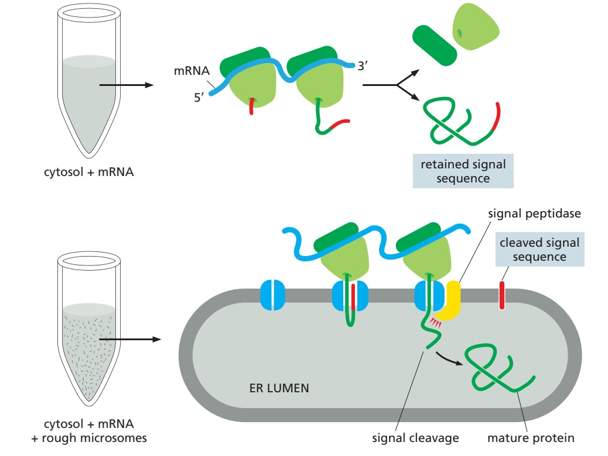{ width="550" height="413" loading=lazy }
    /// caption
    上方产物保留红色信号肽；下方微粒体膜上的转位通道和信号肽酶，使成熟链进入腔内。图为信号假说的实验逻辑示意。[^fig-microsome-signal]
    ///

    **蛋白酶保护实验**还能检查膜的哪一侧容纳了蛋白。若微粒体保持完整，外加蛋白酶不能轻易接触腔内产物；破坏膜后，同一产物才变得可被消化。对膜蛋白而言，不同片段的保护情况可以帮助推断跨膜朝向。解释结果时也要检查膜是否完整、蛋白本身是否容易被所用蛋白酶切割。

### 膜拓扑与代谢接口 { #er-topology-metabolism }

内质网还承担膜脂合成、Ca$^{2+}$ 储存和多种代谢反应。许多磷脂先在膜的胞质侧生成，脂质扰乱酶（scramblase）帮助它们在两层叶片之间重新分布。膜泡、脂质转移蛋白和膜接触位点再把脂质送到其他膜。接触位点使两种细胞器靠近，却不让各自的腔直接相通；局部脂质交换和 Ca$^{2+}$ 传递因此可以在较短距离内完成。肌细胞中专门储存、释放 Ca$^{2+}$ 的肌质网，就是内质网的特化形式。

肝细胞光面内质网中，细胞色素 P450 等酶参与多种药物及疏水化合物的氧化。其中典型的微粒体电子传递路线由 NADPH—细胞色素 P450 还原酶的 FAD、FMN 依次接受和传递电子，再交给 P450 的血红素中心。[^p450-reductase]

典型单加氧反应由 NADPH 提供还原力，把 O$_2$ 的一个氧原子加到底物上，另一个还原为水；这常使底物更容易进入后续代谢，但氧化也可能形成更活泼的产物。磷脂、鞘脂和胆固醇的合成分工见[脂质合成代谢](../biochem/lipid_synthesis.md)。

反应位于“内质网”，还需要问清具体在哪一侧。肝、肾的葡萄糖-6-磷酸酶催化位点朝向腔内，G6P 必须先由 SLC37A4 输入，才能被水解，产物再离开内质网。这个跨膜接力是糖原分解和糖异生共享的末端步骤，见[G6P 水解与游离葡萄糖输出](../biochem/gng.md#g6pase-bypass)。

## 折叠、修饰与内质网质量控制 { #er-proteostasis }

### 腔内折叠与糖蛋白检查 { #er-folding-glycosylation }

刚进入腔内的多肽还没有完成折叠。**BiP／GRP78** 是内质网中的 Hsp70 家族伴侣，能结合暴露的疏水片段，减少不合适的聚集，并协助转位、折叠和亚基装配。腔内适宜的氧化环境也有利于形成二硫键；**蛋白二硫键异构酶**（protein disulfide isomerase，PDI）则帮助形成和重排这些键，使错误配对有机会重新调整。分泌型胶原还在内质网中完成部分脯氨酸、赖氨酸羟化及三股螺旋装配，见[胶原的合成与成熟](cell_interactions.md#collagen-elastin)。[^er-quality-control]

许多分泌蛋白和膜蛋白在这里接受 **N-连接糖基化**。膜上的多萜醇焦磷酸载体先承载一条由 3 个葡萄糖、9 个甘露糖和 2 个 N-乙酰葡糖胺组成的寡糖，即 Glc$_3$Man$_9$GlcNAc$_2$。寡糖转移酶把它整体转到多肽的天冬酰胺（Asn）侧链上。常见识别序列是 Asn-X-Ser/Thr，X 不能是 Pro；是否真正修饰，还受局部结构和位点可达性影响。

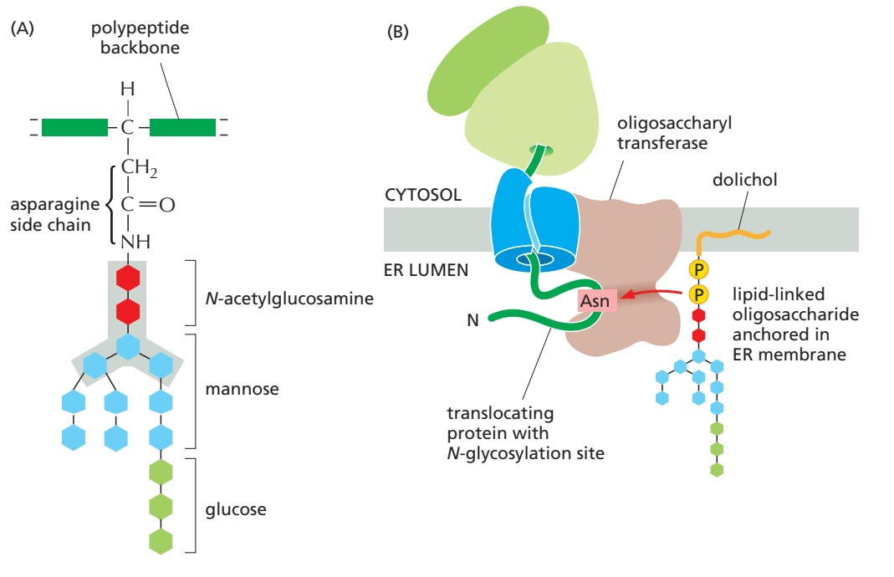{ width="690" height="445" loading=lazy }
/// caption
A 从上到下画出与 Asn 相连的 N-乙酰葡糖胺、甘露糖和末端葡萄糖；B 显示糖链在腔侧从膜脂载体整体转到多肽上。N-糖基化在此处开始，但糖链还会继续加工。[^fig-n-glycan]
///

这条糖链很快成为折叠检查的一部分。末端葡萄糖先被剪去两个，余下的一个使糖蛋白能够结合**钙联蛋白**（calnexin）或**钙网蛋白**（calreticulin）。前者结合在膜上，后者可溶于腔内；两者都帮助未成熟的糖蛋白停留在内质网，并与 ERp57 等折叠因子协作。

最后一个葡萄糖被切除后，糖蛋白离开伴侣。如果仍未正确折叠，葡萄糖基转移酶 UGGT 会识别异常构象，重新加上一个葡萄糖，使它再进入伴侣循环。下图右下方的黄色说明框标出了正确折叠蛋白离开内质网的位置；沿其他箭头绕行的蛋白，还在继续尝试折叠。[^er-quality-control]

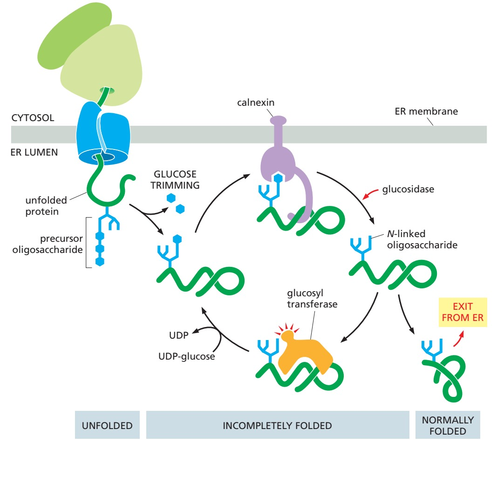{ width="600" height="576" loading=lazy }
/// caption
糖链上的葡萄糖控制蛋白能否结合钙联蛋白，UGGT 则把构象检查接回加糖反应。图中未画出的甘露糖修剪，可使久留而未成熟的底物逐渐转向降解。[^fig-calnexin]
///

### ERAD 与泛素—蛋白酶体 { #erad-proteasome }

有些蛋白反复折叠仍不成功，或因为缺少其他亚基而无法装配。持续暴露的异常结构、经过修剪的糖链等信息，使它们被送入**内质网相关降解**（endoplasmic-reticulum-associated degradation，ERAD）路线。识别可以发生在腔内、膜内或胞质侧，之后由包含 E3 泛素连接酶和膜转位因子的复合物将底物移向胞质。

对许多底物，p97／VCP 这类 AAA$^+$ ATPase 利用 ATP 把蛋白从膜及其结合复合物中抽提出来。被多聚泛素化的底物随后交给 26S 蛋白酶体，展开并降解。这样，内质网腔内发现的折叠问题，最终可以由胞质中的蛋白水解装置处理。[^erad]

泛素—蛋白酶体系统也清除许多胞质、核内的短寿命调节蛋白。E1 激活泛素，E2 传递泛素，E3 把底物识别与泛素连接联系起来；K48 连接链常导向蛋白酶体，但泛素还参与膜分选、自噬和信号，并非一出现就表示蛋白必定降解。26S 的 19S 调节颗粒负责识别、去泛素和展开，20S 核心提供蛋白水解腔，详见[泛素—蛋白酶体依赖的蛋白质降解](../biochem/pr_aa_catabolism.md#ubiquitin-proteasome)。

磷酸化、乙酰化、甲基化、脂化和糖基化等翻译后修饰，还会改变活性、定位与相互作用；特定修饰组合才可能构成降解信号。蛋白的 N 端性质也可被某些降解途径识别，其作用取决于具体降解信号及暴露状态。脂化如何改变膜定位，见[脂锚的连接位置与朝向](membrane_transport.md#membrane-protein-topology)。

### 未折叠蛋白反应 { #unfolded-protein-response }

当新生蛋白进入得太快，或氧化还原、Ca$^{2+}$ 等条件使折叠变得困难，仅靠逐个返工和清除可能不够。**未折叠蛋白反应**（unfolded protein response，UPR）会同时调整新生蛋白负荷、折叠能力与降解能力。哺乳动物有三条经典感受支路：

- **IRE1** 的核酸内切酶切割 *XBP1* mRNA，再由 RNA 连接酶接合，完成非常规剪接。剪接后的 mRNA 能产生具有活性的 XBP1 转录因子，提高折叠、分泌与质量控制相关基因的表达。
- **PERK** 磷酸化翻译起始因子 eIF2$\alpha$，使多数蛋白的翻译起始减少，先降低进入内质网的新生链负荷；与此同时，ATF4 等特定 mRNA 的翻译可以增加，启动应激适应程序。
- **ATF6** 从内质网转移到高尔基体，经蛋白酶切割释放朝向胞质的转录因子部分，再进入细胞核。[^upr]

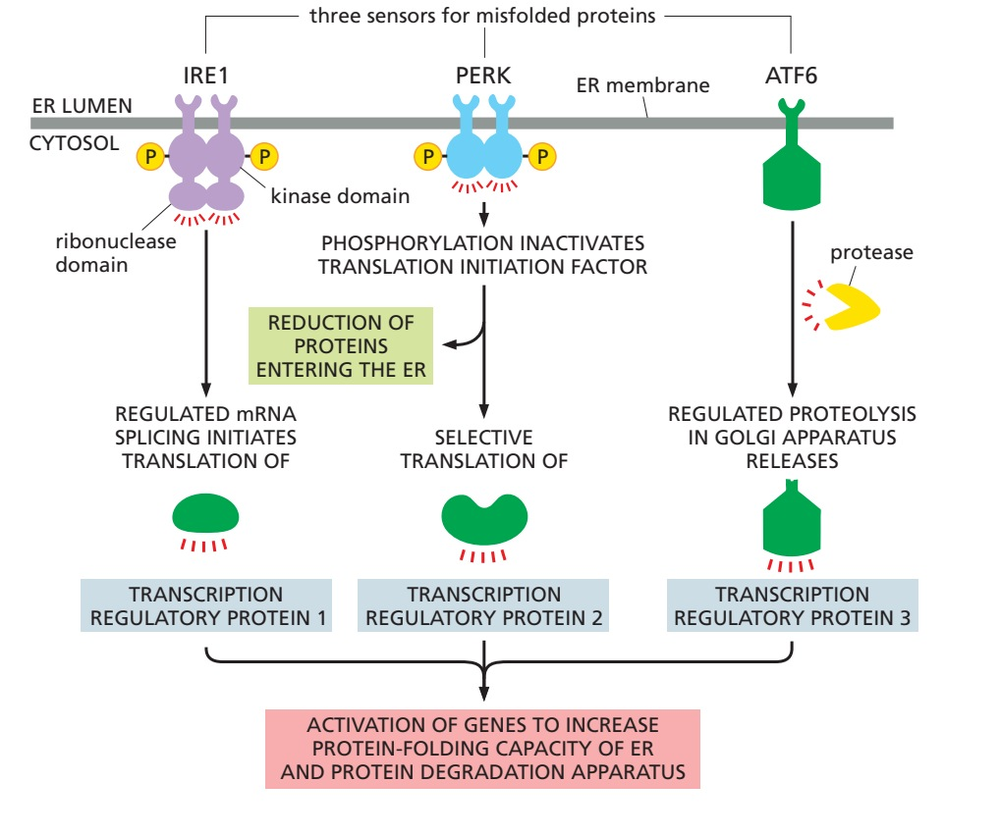{ width="690" height="577" loading=lazy }
/// caption
三条支路分别通过 RNA 加工、翻译调节和蛋白水解形成转录反应。图中右侧的切割实际发生在高尔基体，ATF6 需要先从内质网运过去；三条支路也并非完全彼此独立。[^fig-upr]
///

BiP 与这些感受器的结合和重新分配是一层调节；感受器寡聚化、直接感知异常蛋白以及膜脂双层压力，也可能参与启动。实验中常用衣霉素抑制内质网糖链前体合成的起始酶 DPAGT1，使新生蛋白的 N-糖基化受阻，增加折叠负荷并诱发内质网应激；它并非直接抑制所有类型的糖基化。[^tunicamycin]

UPR 首先帮助细胞恢复稳态，增加伴侣、ERAD 和膜合成等能力。负荷长期无法解除时，持续的翻译抑制、氧化还原改变、炎症和细胞死亡信号可能逐渐占优势，见[细胞应激的负荷控制与修复](../physiology/pathophysiology/fever_inflammation_stress.md#cellular-stress)。

!!! note "到高尔基体切开，才能进入细胞核"

    ATF6 的路线把膜运输与基因调控直接连在一起。胆固醇感知中的 SREBP 也使用类似的受控蛋白水解：固醇不足时，SCAP 带着 SREBP 从内质网到高尔基体，经 S1P、S2P 两步切割释放转录因子；固醇充足时，SCAP 与 INSIG 的结合使它留在内质网。两者使用相似的加工位置，却响应不同条件，详见[胆固醇稳态](../biochem/lipid_synthesis.md#cholesterol-homeostasis)。

## 内质网出口与高尔基体成熟 { #er-golgi-traffic }

### COPII 出口与 COPI 回收 { #copii-copi-traffic }

通过折叠检查的货物在**内质网出口位点**聚集。这里的膜开始向胞质侧弯曲，外侧装配**包被蛋白复合体 II**（COPII）。膜上的交换因子使 Sar1 释放 GDP、结合 GTP；Sar1 随之露出两亲性螺旋，将它插入胞质侧膜叶，募集 Sec23／Sec24 内层包被。Sec24 能识别许多货物或货物受体的胞质尾，包括某些货物的 DxE 出口信号（x 表示任意残基），Sec13／Sec31 外层包被则进一步组织和弯曲膜。

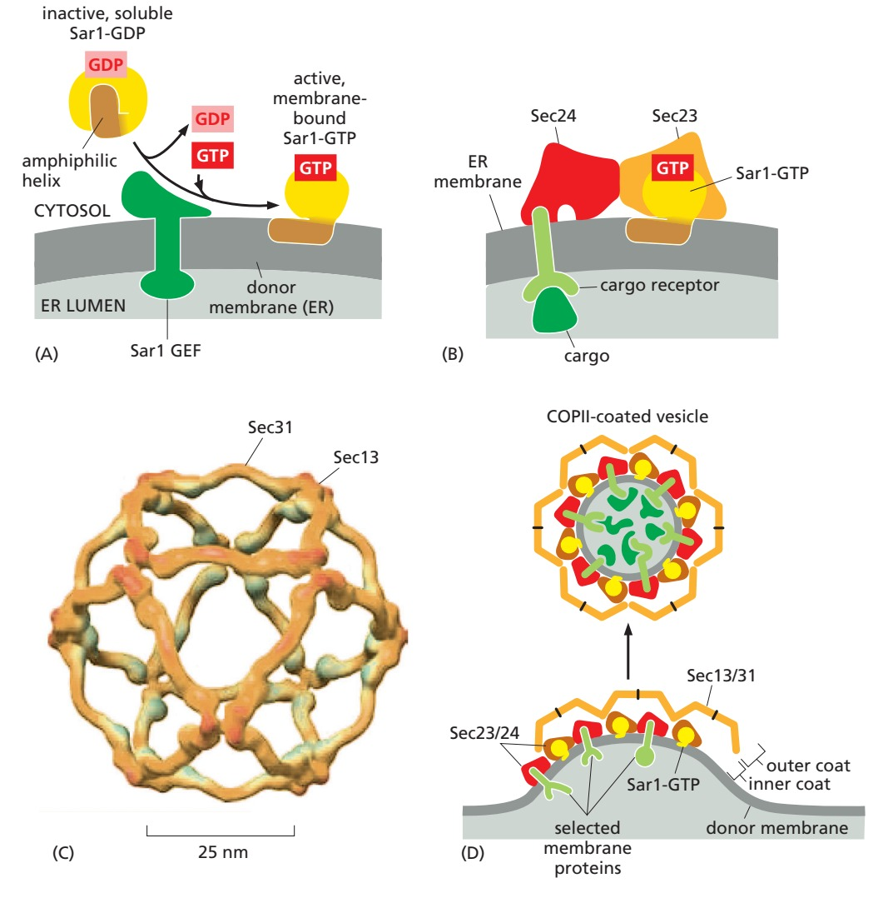{ width="660" height="674" loading=lazy }
/// caption
A、B 把膜上的起始步骤拆开，D 显示带货物的芽体；C 是外层包被形成的笼状结构。包被位于胞质侧，可通过跨膜受体间接选择腔内货物。[^fig-copii]
///

可溶性货物因此也能被浓缩装载：腔内部分结合货物，受体的胞质尾再结合包被。有些蛋白则随腔内容积进入载体，称为体相流。COPII 同时容纳选择性捕获与体相流；胶原前体等大件货物还需要出口位点和载体形态作相应调整。[^er-golgi-sorting]

在哺乳动物细胞中，COPII 载体脱被、相互融合，形成囊泡—小管簇和**内质网—高尔基体中间区**（ER–Golgi intermediate compartment，ERGIC），随后向顺面高尔基体输送货物。此时已经开始回收：一些 BiP、PDI 等内质网驻留蛋白也会随货物漏出来，但它们 C 端的 **KDEL** 信号能被 KDEL 受体识别，再装入 COPI 回程载体。

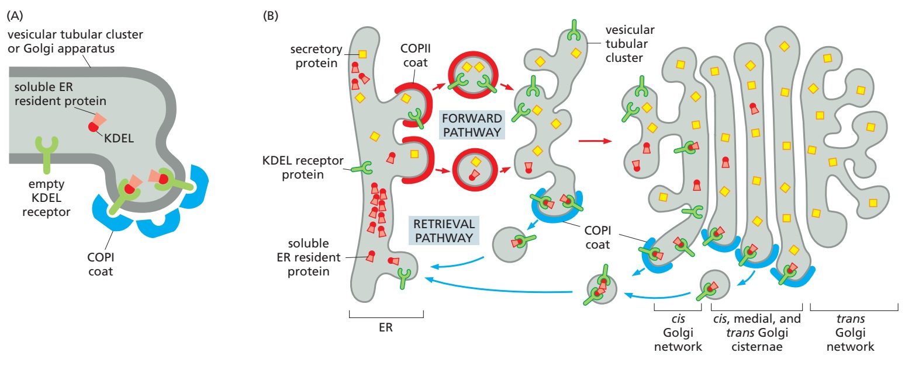{ width="760" height="317" loading=lazy }
/// caption
A 放大受体与带 KDEL 蛋白的结合；B 中红色路线向前，蓝色路线返回内质网。KDEL 受体随货物返回后释放它，再进入下一轮循环。[^fig-kdel]
///

KDEL 受体在较酸的 ERGIC／高尔基体环境中更容易结合货物，回到内质网后则释放它。许多内质网膜蛋白使用胞质尾的双赖氨酸等回收信号，如 C 端 KKXX（X 表示任意残基），由 COPI 相关装置识别。这里既有货物选择，也有环境差异带来的结合—释放循环。COPI 还参与高尔基体内部的逆向运输，持续取回加工酶和运输机器。

### 高尔基体极性与膜囊成熟 { #golgi-polarity-maturation }

高尔基体常由一叠扁平膜囊和两端的管泡网络组成。靠近内质网输入端的是**顺面**（cis），经过中间膜囊到达**反面**（trans），再进入**反式高尔基网络**（trans-Golgi network，TGN）。动物细胞的膜囊堆常在核旁聚集，植物细胞中则常见多个分散的堆叠；出芽酵母的膜囊甚至不必排成整齐的一摞。

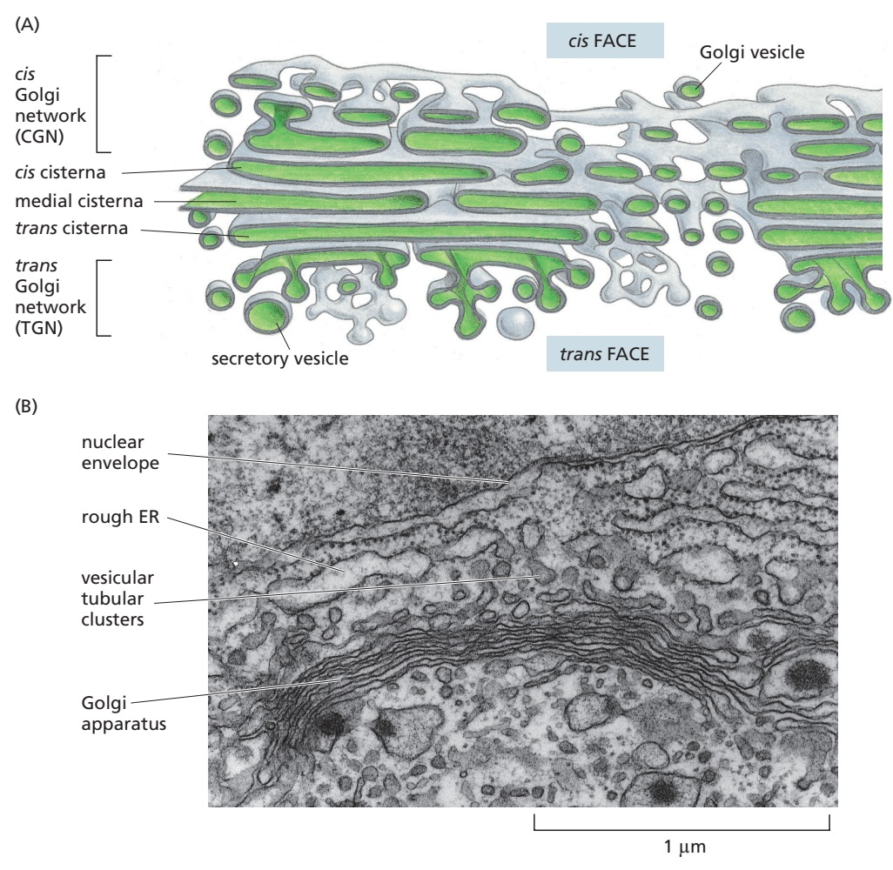{ width="590" height="575" loading=lazy }
/// caption
A 为根据电镜重建绘制的结构，顺面在上、反面在下；B 可见靠近糙面内质网的高尔基膜囊和周围小管、囊泡。膜囊的形状并不能单独告诉我们货物怎样通过它。[^fig-golgi]
///

不同膜囊富集不同加工酶。来自内质网的 N-聚糖继续被修剪，高甘露糖型保留较多甘露糖，以 Man 和 GlcNAc 为主要组成；复杂型在共同核心外添加 GlcNAc、半乳糖、唾液酸等，可有岩藻糖修饰；杂合型则兼有富含甘露糖与进一步延伸的分支。

黏蛋白型 O-糖基化通常从在 Ser／Thr 羟基上添加 N-乙酰半乳糖胺（GalNAc）开始，再逐步延伸；糖胺聚糖链、糖脂以及蛋白质酪氨酸的硫酸化，也在高尔基体相应区域完成。硫酸基常由 PAPS 供给，核苷酸糖则由转运体送入腔内。糖链产物因底物、酶的分布和通过时间而异，不是每个蛋白都走过完全相同的加工路线。蛋白聚糖中常见的木糖—Ser 起始连接及糖胺聚糖种类，见[糖胺聚糖与蛋白聚糖](cell_interactions.md#gag-proteoglycan)。[^golgi-glycosylation]

!!! note "N-连接与 O-连接，指的是糖接在哪里"

    N-糖链连接到 Asn 侧链的氮，分泌通路中的常见形式从内质网开始；O-连接则指糖接在羟基氧上。高尔基体中的黏蛋白型 O-GalNAc 糖链，与胞质、细胞核中常见的单个 O-GlcNAc 修饰，位置和加工方式均不同。这两类修饰分别参与分泌通路糖蛋白的成熟与核内、胞质蛋白的调节。[^glycan-types]

ABO 抗原就是末端糖修饰的例子。A 或 B 糖基转移酶在 H 前体上添加不同末端糖，O 型通常不添加这两类决定簇，保留 H 结构。相近的糖链，仅在末端发生差别，就可以成为不同的细胞表面标记，见[H 前体的 ABO 末端糖修饰](../physiology/blood/blood_types.md#abo-biosynthesis)。

货物怎样依次遇见这些酶？**膜囊成熟模型**认为，新形成的顺面膜囊带着货物逐渐转为中间、反面膜囊；驻留加工酶则通过 COPI 载体和小管向前面的区室回收。这样，货物可以留在膜囊中，而膜囊里的酶组合持续变化。小货物也可能通过膜泡、小管或膜内分区更快前行；不同细胞和货物中，各种运输方式的贡献不同。[^golgi-models]

???+ abstract "一个高尔基膜囊，从绿色变成红色"

    若膜囊是长期稳定的区室，早期膜囊应当一直保留早期标记；若它会成熟，同一个膜囊就应先失去早期标记，再获得晚期标记。Losev 等选择膜囊不堆叠的出芽酵母，用 GFP–Vrg4 标记早期高尔基体、Sec7–DsRed 标记晚期高尔基体，并连续采集覆盖全细胞的三维图像，以追踪单个膜囊。[^golgi-live-maturation]

    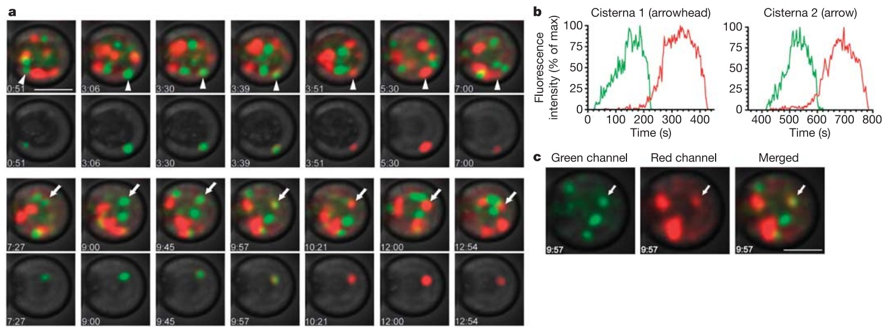{ width="780" height="289" loading=lazy }
    /// caption
    原文图 3：a 的箭头／三角箭头各跟踪一个膜囊，相邻的下排去掉了其他膜囊的信号；a、c 的时间戳为分:秒，比例尺 2 μm。b 的横轴以秒计，绿色信号先升后降，红色随后出现；c 展示过渡阶段两个通道的信号。[^golgi-live-maturation]
    ///

    单个膜囊先以绿色为主，短暂同时含有两种标记，随后以红色为主，最后失去可检测信号。两种标记通常各停留约 2—3 分钟。作者还用其他标记组合检查动态，并用分泌货物的脉冲—追踪实验比较运输时间。这些结果支持酵母膜囊会改变组成并成熟；图中的颜色直接报告的是驻留标记的变化，不是对每一个货物分子的连续追踪，也不足以排除其他运输途径。

## TGN 分选与分泌 { #tgn-secretion }

到达 TGN 后，货物开始分往不同终点。多数细胞持续向细胞表面补充膜脂、质膜蛋白并释放可溶性货物，这称为**组成型分泌**。极性上皮还需要把成分分别送到顶端和基底外侧膜，胞质尾信号、糖链、脂质环境和适配因子都可能参与辨认。另一些货物从这里进入内体，高尔基体驻留成分则被保留或回收。

胰腺腺泡细胞等分泌细胞还会把特定货物浓缩进分泌颗粒。颗粒在成熟时酸化，按货物种类进行前体蛋白水解，并回收多余膜和误入成分；等到 Ca$^{2+}$ 或其他受调信号到来，才与质膜融合，这属于**调节型分泌**。组成型分泌也受细胞状态和运输能力调控，区别在于货物通常持续输出，不长期储存在等待触发的颗粒中。

前体加工也能产生不同的活性肽。胰岛素原在成熟颗粒中被切去 C 肽，留下二硫键相连的 A、B 链，见[胰岛素的合成与颗粒成熟](../physiology/endo/endo_islet.md#insulin-biosynthesis)。同一个阿片黑素皮质素原（POMC）则可以按细胞内加工酶的组合，产生促肾上腺皮质激素（ACTH）、黑素细胞刺激素或 β-内啡肽等不同产物；细胞的加工能力因此也是决定分泌物组成的一部分。[^prohormone-processing]

送往溶酶体的可溶性水解酶需要另一类分选。它们同样在内质网接受 N-糖基化，却在高尔基体获得**甘露糖-6-磷酸**（mannose-6-phosphate，M6P）标记。N-乙酰葡糖胺-1-磷酸转移酶先识别水解酶表面的构象特征，把 N-乙酰葡糖胺-1-磷酸基团转到糖链甘露糖上；另一种酶随后移走外面的 GlcNAc，“露出”M6P。识别对象是折叠后形成的蛋白表面信号，标记则写在它携带的糖链上。[^lysosomal-sorting]

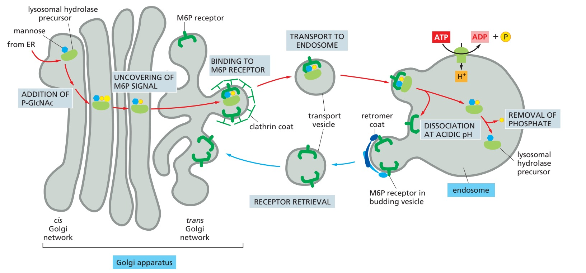{ width="800" height="373" loading=lazy }
/// caption
从左向右看：水解酶获得并露出 M6P，TGN 中的受体在腔侧结合它，胞质侧包被装配运输载体。进入更酸的内体后，酶与受体分离，受体沿下方回程返回高尔基体。[^fig-m6p]
///

M6P 受体的胞质尾通过适配蛋白与网格蛋白（clathrin）包被连接，载体脱被后把酶送入内体。内体酸化使受体与水解酶分离，受体再回到 TGN，也可在质膜与内体之间循环，取回部分细胞外酶。[^m6p-receptors]水解酶则继续沿内体—溶酶体路线成熟和发挥作用。溶酶体膜蛋白常依靠胞质尾信号分选，一些水解酶也有 M6P 非依赖入口，例如葡糖脑苷脂酶可借助 LIMP-2。[^lysosomal-alternative]

!!! example "酶做出来了，却没有送到应去的地方"

    I-cell 病（黏脂贮积症 II）可由 M6P 标记所需的磷酸转移酶缺陷引起。许多水解酶没有获得正常分选标记，便被错误地分泌到细胞外；溶酶体缺少相应酶，底物逐渐积累。它与“某一种水解酶失活”不同：分选的一步出错，会同时影响多类酶的送达。[^lysosomal-sorting]

## 内体网络中的回收与降解分流 { #endosomal-sorting }

### 早期内体与回收路线 { #early-recycling-endosomes }

内体接收来自细胞表面的内吞货物，也与 TGN 交换成分。**早期内体**常有较大的腔体和伸出的细长小管，Rab5、磷脂酰肌醇-3-磷酸（PI3P）及其效应蛋白 EEA1 等共同参与组织这一膜区室。V 型 H$^+$-ATPase 逐渐降低腔内 pH，许多受体与配体因而分离。

小管提供了分流的空间条件：它的膜表面积相对较大，所携腔体积却小，适合带走膜蛋白而把多数可溶性货物留在较大的腔体里。选择性分选装置再决定哪些膜蛋白能进入回收路线。货物可以较快返回质膜，也可经过 Rab11 等参与的**回收内体**暂存后再返回。[^endosome-maturation]

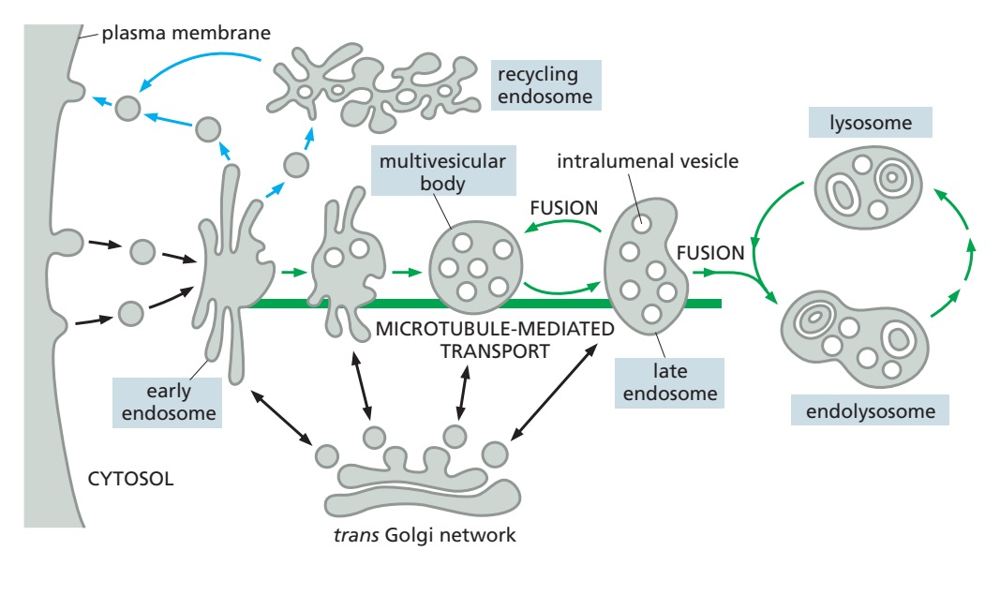{ width="730" height="445" loading=lazy }
/// caption
先沿左侧早期内体向上看，细管引出回收路线；沿中间向右看，内体失去部分回收小管、形成腔内小泡，并与溶酶体融合。下方箭头表示它与 TGN 之间仍有物质交换。[^fig-endosome-maturation]
///

LDL 及其受体是一组清楚的例子：两者在酸性内体中解离，受体返回质膜，LDL 留在降解路线，随后释放可供细胞使用的胆固醇。GLUT4 则可以储存在受调的胞内区室中，胰岛素信号促使更多 GLUT4 到达质膜。极性上皮还可把一侧内吞的货物送到另一侧外排，称为**转胞吞**。这些分流之前的内吞入口、吞噬和大胞饮见[内吞形成的大宗运输入口](membrane_transport.md#endocytosis-entry)。

### 多泡体与晚期内体成熟 { #late-endosome-maturation }

需要降解的膜蛋白面临一个拓扑问题：如果一直留在内体外层膜上，它朝向胞质的结构域仍接触不到腔内水解酶。内体膜可以向腔内凹入，再把这一小片膜切离，形成**腔内小泡**。受体原来的胞质结构域随之被包进小泡内部，之后整片膜都能在溶酶体中降解。一个内体含有许多这样的小泡，便呈现**多泡体**的形态。

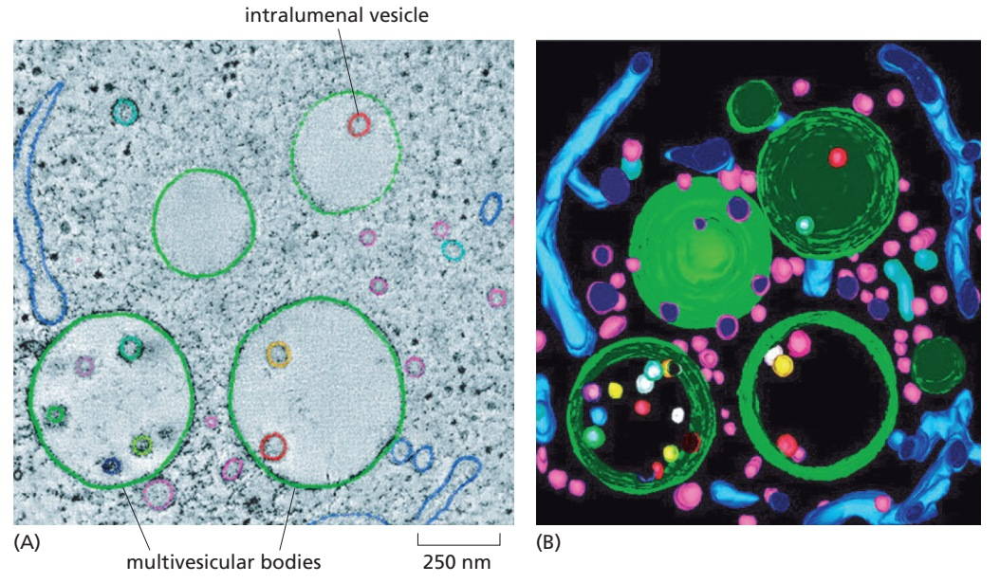{ width="670" height="391" loading=lazy }
/// caption
A 在断层切片上勾出膜，B 根据这些切片重建空间关系。绿色大膜面围住多泡体，内部可见许多小泡；比例尺 250 nm。B 的颜色来自分割与重建。[^fig-mvb]
///

许多待降解膜蛋白的胞质侧带有泛素标记。**运输所需的内体分选复合体**（endosomal sorting complexes required for transport，ESCRT）及相关因子识别、集中这些货物，并帮助膜向腔内出芽及切断膜颈。泛素可以在小泡闭合前被移除、回收。与向胞质侧形成运输囊泡相比，这里的芽体方向相反。

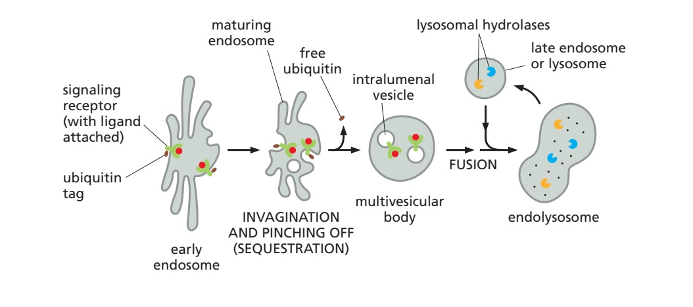{ width="690" height="306" loading=lazy }
/// caption
受体进入腔内小泡后，它的胞质尾也与胞质隔开。图中蓝、橙色缺口圆形表示水解酶，绿色表示受体；等小泡膜被降解，原先朝向胞质的部分也能被消化。[^fig-intralumenal-sorting]
///

活化的 EGF 受体可沿这条路线下调；封入腔内小泡也能阻断它继续在胞质侧传递信号。是否回收或降解，仍取决于受体种类、泛素化及其他修饰、适配因子和配体状态，不能仅由“发生了内吞”判断。

早期内体逐渐转为晚期内体时，Rab5 为主的膜身份转向 Rab7，腔内继续酸化，部分回收小管脱离，区室也常沿微管向细胞内部移动。晚期内体与溶酶体融合后形成降解活跃的**内溶酶体**，之后还会通过膜重塑和内容物浓缩再形成溶酶体。因此，早期内体、晚期内体、内溶酶体与溶酶体处于连续的成熟、融合和再生过程中；传统“初级／次级溶酶体”的形态分类只反映其中一些状态。

## 溶酶体降解、回收与信号 { #lysosome-autophagy }

### 酸性腔室与底物输出 { #lysosomal-degradation }

溶酶体内的多类**酸性水解酶**共同处理蛋白质、核酸、脂质和多糖。V 型 H$^+$-ATPase 消耗 ATP，把 H$^+$ 泵入腔内，通常维持约 pH 4.5—5；离子通道及转运体协助电荷补偿和渗透平衡。许多水解酶在这个环境下更适合工作，但酶的活性仍各有自己的 pH 范围。

实验中，氨、氯喹等可跨膜弱碱进入酸性区室后被质子化并富集，可使腔内 pH 升高，从而影响酸性水解和运输；作用程度取决于处理条件，不能据此推定所有溶酶体反应同时停止。[^lysosomal-alkalinization]

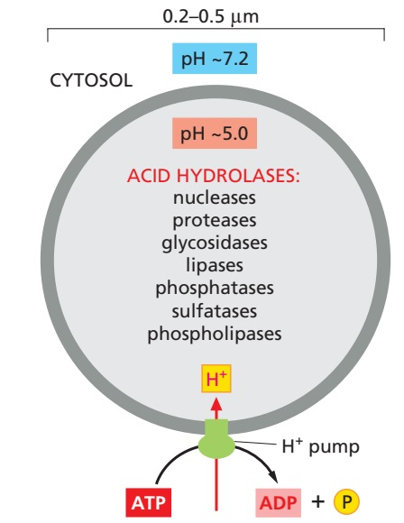{ width="270" height="350" loading=lazy }
/// caption
H$^+$ 泵把胞质与腔内的 pH 分开。图中的尺寸与 pH 是典型示意值，实际溶酶体会随细胞类型、融合和消化状态改变。[^fig-lysosomal-ph]
///

膜还要让消化产物出来。氨基酸、单糖、核苷、脂肪酸和无机离子经相应转运系统回到胞质，重新进入合成与能量代谢。只有把大分子拆开而不能输出，回收过程仍不完整。

溶酶体自己的膜也暴露在这些酶面前。LAMP 等膜蛋白的腔侧高度糖基化，与其他糖萼成分、膜脂、修复和质量控制机制共同维持膜的稳定。[^lysosome-homeostasis]

糖鞘脂降解尤其依赖逐步配合：水解酶依次移除末端基团，皂苷蛋白（saposin）等辅助因子帮助酶接近膜中的疏水底物，产物再被转运出去。水解酶、辅助蛋白或转运体任一环节出现缺陷，都可能造成特定物质积累。例如泰—萨病中，β-氨基己糖苷酶 A 活性受损，使 GM2 神经节苷脂积累，详见[HEXA 缺陷与神经细胞负荷](../neuro/neuro_disease.md#genetic-organelle)。其他相应细胞后果见[细胞器降解障碍与物质积累](../physiology/pathophysiology/metabolic_disorders.md#organelle-storage-disorders)；糖原的这一路水解见[溶酶体糖原周转](../biochem/glycogen.md#lysosomal-turnover)。

溶酶体的形态随所消化的材料改变。酸性磷酸酶活性曾被广泛用于显示这一类细胞器；难以彻底降解的物质可形成残余小体，并在某些长寿命细胞中逐渐积累。植物的裂解型液泡承担相似的降解任务，同时还有储存、离子调节和维持膨压等作用。在一些动物细胞中，溶酶体及相关细胞器还可受调胞吐，参与膜修复或分泌；细胞毒性淋巴细胞的杀伤颗粒就是兼具溶酶体和分泌特征的例子。[^lysosome-diversity]

### 自噬与细胞器更新 { #autophagy-pathways }

胞外和质膜货物可由内吞进入溶酶体，胞质里的整块材料则可由**自噬**送来。宏自噬开始时，一片隔离膜逐渐延伸，包围部分胞质、蛋白聚集体或细胞器；开口封闭后，形成双层膜的**自噬体**。外膜与晚期内体或溶酶体融合，内膜连同所包货物被送入腔内降解。

{ width="760" height="339" loading=lazy }
/// caption
由左向右追踪两层膜：闭合前围住胞质，闭合后形成自噬体；融合时外膜接入溶酶体膜，内膜和里面的材料则一起被消化。图为宏自噬的简化过程。[^fig-autophagy]
///

ATG8／LC3 家族与膜脂结合，参与隔离膜生长及货物受体的连接。营养不足时，自噬可加强较广泛的物质回收；选择性自噬则借助专门受体，把受损线粒体、过氧化物酶体、内质网片段、聚集蛋白或病原体送入隔离膜。**微自噬**通过内体／溶酶体膜的内陷或其他重塑直接摄入货物；**伴侣介导自噬**则识别特定可溶蛋白，经展开后逐个转运过溶酶体膜。[^autophagy]

溶酶体膜也是营养感知的平台。氨基酸信号通过 Rag GTPase、Ragulator 等装置调节 **雷帕霉素机制靶复合体 1**（mTORC1）在膜上的募集，生长因子、能量状态及其他调节进一步影响它的活性。营养条件适合时，mTORC1 促进合成并抑制部分自噬程序；营养不足等条件使这一抑制解除，TFEB／TFE3 等转录因子也可促进溶酶体和自噬相关基因表达。物质分解与细胞是否继续生长，由此相互联系。

蛋白酶体与自噬—溶酶体因此有不同的处理尺度。前者适合能展开并穿过狭窄通道的单个蛋白，后者能容纳聚集体、大复合物和完整细胞器。两套系统共享部分泛素信号，也能相互补偿，降解产物都回到[蛋白质周转与代谢](../biochem/pr_aa_catabolism.md#protein-turnover)。

## 载体出芽、识别与膜融合 { #vesicle-machinery }

### 包被与货物选择 { #vesicle-coats }

前面的路线反复遇见三个动作：选择货物、形成载体、在正确的膜上融合。包被把前两个动作连接起来。小 GTPase、膜脂和适配因子把包被募集到特定位置，包被亚基或适配蛋白读取货物胞质尾信号，跨膜受体再把腔内货物与胞质侧装置连接。

| 包被 | 主要出芽位置与方向 | 怎样选择货物 |
| --- | --- | --- |
| COPII | 内质网出口至 ERGIC／高尔基体 | Sar1 启动；Sec24 识别多类货物及受体尾部信号，也允许部分体相流 |
| COPI | ERGIC／高尔基体回到内质网；高尔基体内部逆向运输 | ARF 家族调节装配，回收 KDEL 受体、带双赖氨酸信号的膜蛋白及驻留机器 |
| 网格蛋白（clathrin）＋适配蛋白 | 质膜至内体；TGN 与内体之间 | AP、GGA 等适配因子连接货物、磷酸肌醇和外层网格，识别 YxxΦ 等酪氨酸型信号或双亮氨酸信号（Φ 为大疏水残基） |

形成载体还需要膜颈切断、包被解除等步骤。dynamin 在许多网格蛋白介导的内吞事件中参与膜颈切割，但不同载体也可使用其他机械或脂质重塑方式。载体通常在融合前脱被，让系链和融合装置能够接近。[^vesicle-budding-fusion]

运输载体也可以是小管或不规则结构。内体使用 retromer、retriever、ESCPE-1 等装置组织选择性回收，分别参与向质膜或 TGN 的不同路线；这些机制以及部分非经典载体，使细胞运输远比三种包被的分类表更丰富。

### Rab、系链因子与 SNARE { #rab-snare-fusion }

**Rab 小 GTP 酶**及其效应蛋白帮助区室保持身份，并把载体交给合适的靶膜。GEF 促进 GDP 释放和 GTP 结合，活化的 Rab 招募运动、系链或脂质调节因子；GAP 促进 GTP 水解，GDI 则可在胞质中携带部分 GDP 状态的 Rab。长杆状系链蛋白或多亚基系链复合体先捕获靠近的载体，随后膜上的 **SNARE** 蛋白配对，把两层膜拉得更近。

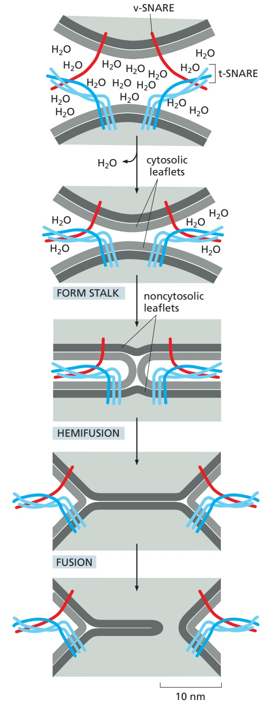{ width="235" height="627" loading=lazy }
/// caption
从上向下，红、蓝 SNARE 装配，促使两膜靠近，先形成局部膜连接，再打开融合孔。这是简化的脂质中间态模型。[^fig-snare]
///

两层膜近距离接触时，表面水化层仍阻碍它们贴合。分处两膜的 SNARE 从远离膜的一端开始，像拉链一样逐步装配成稳定束状复合体，把膜锚所在的两层膜拉近。释放的自由能与膜脂重排耦联，帮助克服融合能垒。

传统的 v-SNARE／t-SNARE 名称强调它们位于载体还是靶膜。按复合体核心残基分类，更一般的融合束由一条 R-SNARE 与三条 Q-SNARE 螺旋组成；这些螺旋不一定来自四条不同蛋白。

SNARE 配对提供选择性，但融合还依赖 Rab、系链因子、磷酸肌醇、SM 蛋白和细胞信号共同调节。在受调分泌中，载体可以先停靠并准备好，等触发信号到来再迅速融合。

融合之后，原本分处两张膜的 SNARE 留在同一张膜上，形成顺式复合体。$\alpha$-SNAP 招募 **NSF**，NSF 利用 ATP 将稳定复合体拆开，各组分才能进入下一轮运输。SNARE 是 soluble NSF attachment protein receptor 的缩写，名称来自这组生化相互作用。

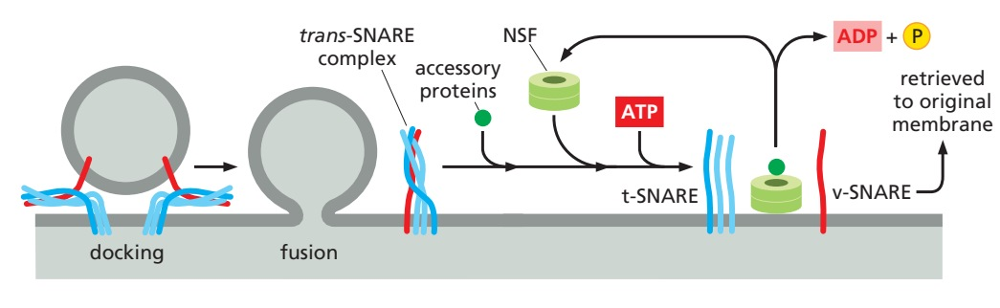{ width="720" height="222" loading=lazy }
/// caption
右侧 ATP 消耗用于拆开同一膜上的 SNARE 复合体。原图把融合后的复合体仍标作 trans-SNARE；按膜拓扑，这时已属于 cis-SNARE。[^fig-snare-recycling]
///

NSF 的 ATP 水解主要用于复合体重置，直接拉近膜面的能量则来自跨两膜的 SNARE 复合体装配。载体长距离移动则常依靠微管或肌动蛋白马达，皮层骨架也参与限制、捕获和开放分泌位点，见[微管马达与细胞内物流](cytoskeleton.md#microtubule-motors)。

## 内膜系统以外的蛋白质分选 { #nonvesicular-targeting }

并非所有蛋白都先进入内质网。核定位信号可由输入蛋白（importin）识别，折叠蛋白通过核孔的选择性屏障，Ran-GTP 的区室差异赋予运输方向。线粒体与叶绿体前体多数由胞质伴侣维持适合输入的状态，再经 TOM／TIM 或 TOC／TIC 等装置跨膜；过氧化物酶体的 PEX5／PEX7 路线还能输入已经折叠、甚至已经装配的货物。各路线见[线粒体蛋白输入与装配](organelles.md#mitochondrial-protein-import)、[叶绿体蛋白输入](organelles.md#chloroplast-biogenesis)和[过氧化物酶体蛋白输入](organelles.md#peroxisome-biogenesis)。

过氧化物酶体的部分膜蛋白或前体膜可以由内质网贡献，但成熟过氧化物酶体的基质蛋白主要使用 PTS—PEX 输入装置。线粒体、叶绿体和过氧化物酶体所需的某些脂质，也能在膜接触位点由脂质转移蛋白直接交换。门控运输、跨膜转位、膜泡运输和非膜泡脂质转移，分别解决了不同类型的物质怎样跨越区室边界的问题。

## 从静态形态到动态机制的证据 { #endomembrane-evidence }

电镜能显示糙面内质网、高尔基膜囊、分泌颗粒和多泡体的结构，却不能仅凭一张切片确定运输方向。开头那条从胰腺细胞走向细胞外的路线，需要把形态放到时间轴上，才能建立起来。

???+ abstract "脉冲—追踪：给同一批新生蛋白标上时间"

    Jamieson 与 Palade 用豚鼠胰腺切片，让细胞短时间摄取放射性亮氨酸，再换入大量非放射性亮氨酸。短暂的“脉冲”标记一批新生蛋白，后面的“追踪”则减少新标记继续进入，观察这批蛋白随后出现在哪里。下图是 1967 年论文中 3 分钟 $^3$H-亮氨酸脉冲后的电镜放射自显影。[^palade-pulse]

    

    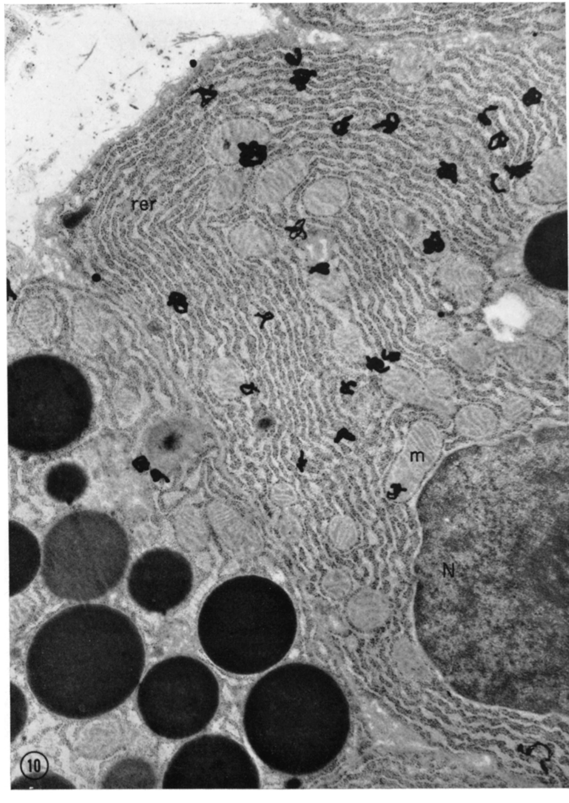{ width="350" height="493" loading=lazy }
    /// caption
    图 10：脉冲结束。细小、弯曲的黑色银颗粒主要位于糙面内质网（rer）附近；大的圆形暗颗粒是酶原颗粒，不能当成放射性标记。[^palade-pulse]
    ///

    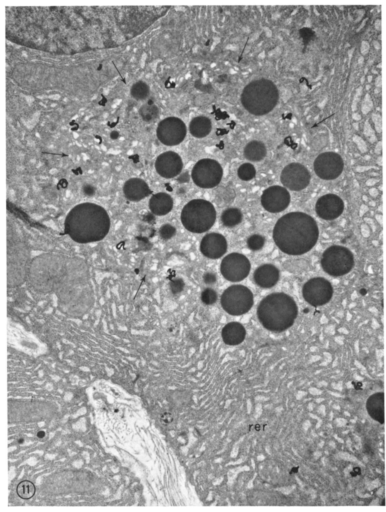{ width="350" height="464" loading=lazy }
    /// caption
    图 11：再追踪 7 分钟。银颗粒多见于箭头指示的高尔基体周边，糙面内质网中的标记减少。[^palade-pulse]
    ///

    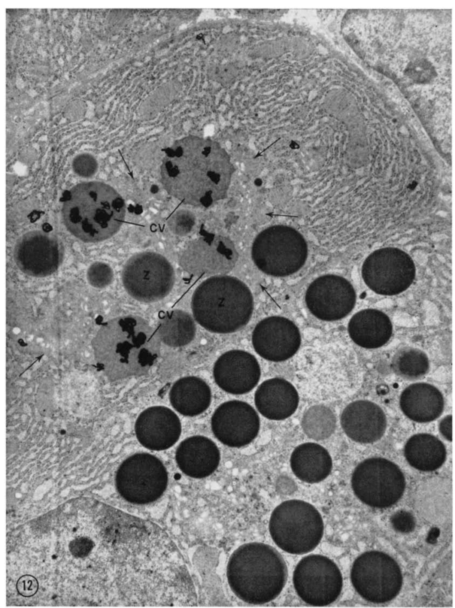{ width="350" height="468" loading=lazy }
    /// caption
    图 12：再追踪 37 分钟。银颗粒集中在浓缩泡（cv），图中许多成熟酶原颗粒（z）仍未明显标记。[^palade-pulse]
    ///

    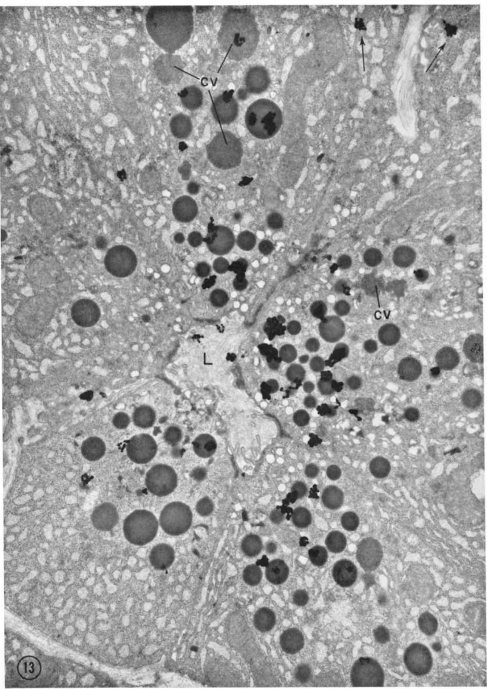{ width="350" height="495" loading=lazy }
    /// caption
    图 13：再追踪 117 分钟。标记主要到达顶端酶原颗粒，腺泡腔（L）内也可见与分泌物相关的标记。各图是不同时间固定的样品。[^palade-pulse]
    ///

    按时间排列，标记从糙面内质网到高尔基体周边，再到浓缩泡和酶原颗粒。它支持新生分泌蛋白依次经过这些区室；它没有直接拍下某一颗运输小泡的连续运动。

    同文还展示了细胞分级的一个陷阱：分离出的“酶原颗粒组分”很早就检测到放射性，但电镜发现，其中混有更早获得标记的浓缩泡。组分有标记，并不等于其中每一种结构都已经有标记。把分级结果与原位电镜放在一起，才解释了表面上的时间差。[^secretory-evidence]

对分子步骤，还需要不同方法补充。蛋白酶保护实验检查膜的哪一侧容纳了某段蛋白；Endo H 抗性可提示某些 N-聚糖已经过高尔基体加工，但保留高甘露糖型糖链的成熟蛋白也可能仍敏感。PNGase F 可去除多数 N-聚糖，用于判断修饰造成的迁移变化；特定核心修饰可能影响其作用，糖链质谱则能进一步分辨组成和结构。

酵母温度敏感 *sec* 突变在限制条件下阻断不同步骤，积累内质网、高尔基体或运输小泡，由此帮助拆出运输所需的基因模块。动物细胞无细胞重构又从生化上分离出 NSF、SNAP、SNARE 等装置，检验哪些组分能支持融合。GFP 标记、光漂白恢复、同步释放系统和活细胞超分辨成像，则让我们继续观察区室内外的交换和重塑。形态、到达时间、分子必要性与体外充分性彼此补充，才能把图上的箭头落实为可检验的运输过程。[^vesicle-history]

## 参考资料与延伸阅读 { #references }

- Alberts B, Heald R, Johnson A, et al. *Molecular Biology of the Cell*. 7th ed. W. W. Norton; 2022. 第 12、13 章。
- Jamieson JD, Palade GE. [Intracellular transport of secretory proteins in the pancreatic exocrine cell. II. Transport to condensing vacuoles and zymogen granules](https://doi.org/10.1083/jcb.34.2.597). *Journal of Cell Biology*. 1967;34:597–615.
- Losev E, Reinke CA, Jellen J, et al. [Golgi maturation visualized in living yeast](https://doi.org/10.1038/nature04717). *Nature*. 2006;441:1002–1006.

- Alberts B, Johnson A, Lewis J, et al. [The Endoplasmic Reticulum](https://www.ncbi.nlm.nih.gov/books/NBK26841/). In: *Molecular Biology of the Cell*. 4th ed. Garland Science; 2002.
- Alberts B, Johnson A, Lewis J, et al. [Transport from the ER through the Golgi Apparatus](https://www.ncbi.nlm.nih.gov/books/NBK26941/). In: *Molecular Biology of the Cell*. 4th ed. Garland Science; 2002.
- Alberts B, Johnson A, Lewis J, et al. [Transport from the Trans Golgi Network to Lysosomes](https://www.ncbi.nlm.nih.gov/books/NBK26844/). In: *Molecular Biology of the Cell*. 4th ed. Garland Science; 2002.
- Alberts B, Johnson A, Lewis J, et al. [Transport into the Cell from the Plasma Membrane: Endocytosis](https://www.ncbi.nlm.nih.gov/books/NBK26870/). In: *Molecular Biology of the Cell*. 4th ed. Garland Science; 2002.
- Cooper GM. [Protein Sorting and Transport: The Endoplasmic Reticulum, Golgi Apparatus, and Lysosomes](https://www.ncbi.nlm.nih.gov/books/NBK9897/). In: *The Cell: A Molecular Approach*. 2nd ed. Sinauer Associates; 2000.
- Bonifacino JS, Glick BS. [The mechanisms of vesicle budding and fusion](https://pubmed.ncbi.nlm.nih.gov/14744428/). *Cell*. 2004;116:153–166.
- Gomez-Navarro N, Miller E. [Protein sorting at the ER–Golgi interface](https://pmc.ncbi.nlm.nih.gov/articles/PMC5166505/). *Journal of Cell Biology*. 2016;215:769–778.
- Ellgaard L, Helenius A. [Quality control in the endoplasmic reticulum](https://pubmed.ncbi.nlm.nih.gov/12612637/). *Nature Reviews Molecular Cell Biology*. 2003;4:181–191.
- Walter P, Ron D. [The unfolded protein response: from stress pathway to homeostatic regulation](https://pubmed.ncbi.nlm.nih.gov/22116877/). *Science*. 2011;334:1081–1086.
- Glick BS, Luini A. [Models for Golgi traffic: a critical assessment](https://pubmed.ncbi.nlm.nih.gov/21875986/). *Cold Spring Harbor Perspectives in Biology*. 2011;3:a005215.
- Huotari J, Helenius A. [Endosome maturation](https://pubmed.ncbi.nlm.nih.gov/21878991/). *The EMBO Journal*. 2011;30:3481–3500.
- Mizushima N, Komatsu M. [Autophagy: renovation of cells and tissues](https://pubmed.ncbi.nlm.nih.gov/22078875/). *Cell*. 2011;147:728–741.
- Settembre C, Perera RM. [Lysosomes as coordinators of cellular catabolism, metabolic signalling and organ physiology](https://pubmed.ncbi.nlm.nih.gov/38001393/). *Nature Reviews Molecular Cell Biology*. 2024;25:223–245.
- Nobel Assembly at Karolinska Institutet. [Machinery Regulating Vesicle Traffic: Scientific Background](https://www.nobelprize.org/prizes/medicine/2013/advanced-information/). 2013.

[^endomembrane-overview]: 内质网、高尔基体、溶酶体与蛋白质分选的教材总框架见 Cooper 的[蛋白质分选与运输章节](https://www.ncbi.nlm.nih.gov/books/NBK9897/)。
[^secretory-topology]: 内质网腔与细胞外侧的拓扑等价、膜蛋白朝向在膜泡运输中的保持，见 Cooper 的[内质网章节](https://www.ncbi.nlm.nih.gov/books/NBK9889/)。
[^osm-endomembrane]: 双向膜流、货物选择、内体—溶酶体和自噬的组织实质性改编自 osm.bio [《第十三章 内膜系统运输》固定版本](https://osm.bio/index.php?title=%E7%AC%AC%E5%8D%81%E4%B8%89%E7%AB%A0_%E5%86%85%E8%86%9C%E7%B3%BB%E7%BB%9F%E8%BF%90%E8%BE%93&oldid=2369)，固定版本贡献者为长河，原文按 [CC BY-SA 4.0](https://creativecommons.org/licenses/by-sa/4.0/deed.zh-hans) 许可；相关内容经重组，并用 Alberts、Cooper 教材及所列论文交叉核验。
[^er-entry]: SRP、Sec61、可溶蛋白转位与膜蛋白插入的经典框架见 Alberts 等的[内质网章节](https://www.ncbi.nlm.nih.gov/books/NBK26841/)；翻译后转位与质量控制接口见 Fewell 与 Brodsky 的[内质网进入综述](https://www.ncbi.nlm.nih.gov/books/NBK6210/)。
[^er-quality-control]: BiP、PDI、糖蛋白折叠检查及异常构象保留的证据框架见 Ellgaard 与 Helenius 的[内质网质量控制综述](https://pubmed.ncbi.nlm.nih.gov/12612637/)。
[^erad]: ERAD 的识别、逆向移位/抽提和胞质蛋白酶体降解机制，见 Lemberg 与 Strisovsky 的[细胞器蛋白稳态综述](https://pubmed.ncbi.nlm.nih.gov/34107306/)。
[^upr]: IRE1、PERK、ATF6 三支路及 UPR 从稳态适应转向慢性损伤的边界，见 Walter 与 Ron 的[UPR 综述](https://pubmed.ncbi.nlm.nih.gov/22116877/)。
[^er-golgi-sorting]: COPII 选择性捕获、体相流和货物受体的并存，见 Gomez-Navarro 与 Miller 的[ER—Golgi 分选综述](https://pmc.ncbi.nlm.nih.gov/articles/PMC5166505/)及 Alberts 等的[ER—Golgi 运输章节](https://www.ncbi.nlm.nih.gov/books/NBK26941/)。
[^golgi-glycosylation]: 高尔基体内糖基转移酶定位、膜囊成熟与糖链加工的关系，见 Varki 等编著的[糖基化细胞组织章节](https://www.ncbi.nlm.nih.gov/books/NBK453052/)。
[^golgi-models]: 稳定区室、膜囊成熟、管状运输和快速分区等模型的证据与限制，见 Glick 与 Luini 的[高尔基体运输模型评述](https://pubmed.ncbi.nlm.nih.gov/21875986/)。
[^lysosomal-sorting]: M6P 形成、M6P 受体循环及膜蛋白的替代分选路线，见 Alberts 等的[TGN 至溶酶体运输章节](https://www.ncbi.nlm.nih.gov/books/NBK26844/)。
[^endosome-maturation]: 早期内体的回收分流、Rab 转换、多泡体形成和内溶酶体循环，见 Huotari 与 Helenius 的[内体成熟综述](https://pubmed.ncbi.nlm.nih.gov/21878991/)及 Alberts 等的[内吞章节](https://www.ncbi.nlm.nih.gov/books/NBK26870/)。
[^lysosome-homeostasis]: 溶酶体水解、膜转运、营养感知和器官生理的整合，见 Settembre 与 Perera 的[溶酶体综述](https://pubmed.ncbi.nlm.nih.gov/38001393/)。
[^autophagy]: 宏自噬的双层膜路线、选择性货物和代谢回收意义，见 Mizushima 与 Komatsu 的[自噬综述](https://pubmed.ncbi.nlm.nih.gov/22078875/)。
[^vesicle-budding-fusion]: COPI、COPII、clathrin 包被及 Rab—SNARE 融合装置的共同机制，见 Bonifacino 与 Glick 的[膜泡出芽与融合综述](https://pubmed.ncbi.nlm.nih.gov/14744428/)。
[^secretory-evidence]: 脉冲—追踪、细胞分级和电镜如何共同建立 ER—Golgi—分泌颗粒时序，见 [The secretory pathway at 50](https://pmc.ncbi.nlm.nih.gov/articles/PMC5231891/)。
[^vesicle-history]: 酵母 *sec* 遗传筛选、VSV-G 无细胞重构及 NSF／SNAP／SNARE 发现史，见 Nobel Assembly 的[2013 年科学背景](https://www.nobelprize.org/prizes/medicine/2013/advanced-information/)。

[^fig-vesicle-topology]: Alberts 等，*Molecular Biology of the Cell* 第 7 版（2022），图 13–2，p.750；从本地教材 PDF 裁取完整示意图，未改动箭头和标记。
[^fig-er-architecture]: MBoC 第 7 版图 12–15，p.699。A：Lelio Orci；B：Daniel S. Friend，经 E. L. Bearer 许可；C 根据 R. V. Krstić，*Ultrastructure of the Mammalian Cell*（1979）绘制。裁取图版，保留 A—C 及比例尺；三幅为不同材料。
[^fig-srp-sec61]: MBoC 第 7 版图 12–20，p.704；裁取信号识别与交接示意，保留原箭头和英文标签。
[^fig-membrane-insertion]: MBoC 第 7 版图 12–27，p.710；沿图版边缘裁取可切除信号肽与跨膜段的连续插入示意，去除邻接英文图注，保留完整链端。
[^fig-microsome-signal]: MBoC 第 7 版图 12–18，p.702；裁取无细胞翻译实验的示意图，非原始电泳或显微数据。微粒体制备背景见同书图 12–17，p.701。
[^fig-n-glycan]: MBoC 第 7 版图 12–32，p.714；裁取 A、B，保留糖残基标记及多萜醇转移过程。
[^fig-calnexin]: MBoC 第 7 版图 12–34，p.716；裁取糖蛋白折叠循环，正文补充可溶性 calreticulin、ERp57 及甘露糖修剪的关系。
[^fig-upr]: MBoC 第 7 版图 12–36，p.718；裁取三支路概览，图中简化的转录调节蛋白 1、2、3 在正文分别对应 XBP1、ATF4 和 ATF6 的活性片段。
[^fig-copii]: MBoC 第 7 版图 13–15，p.758；裁取 A—D，C 的包被笼结构改自 Stagg 等，*Nature* 439:234–238（2006），保留 25 nm 比例尺。
[^fig-kdel]: MBoC 第 7 版图 13–26，p.768；裁取 A、B，保留顺向与回收箭头。
[^fig-golgi]: MBoC 第 7 版图 13–27，p.769。A 根据 Rambourg 与 Clermont，*European Journal of Cell Biology* 51:189–200（1990）重绘；B 由 Brij J. Gupta 提供。裁取两幅，B 比例尺 1 μm。
[^glycan-types]: N-聚糖与分泌通路 O-糖链见 MBoC 第 7 版 pp.770–773；O-GalNAc 与胞质／核内 O-GlcNAc 的区分，参见 *Essentials of Glycobiology* 第 4 版的 [O-GalNAc Glycans](https://www.ncbi.nlm.nih.gov/books/NBK579921/) 和 [Nucleocytoplasmic Glycosylation](https://www.ncbi.nlm.nih.gov/books/NBK579979/)。
[^golgi-live-maturation]: Losev 等（2006），[Golgi maturation visualized in living yeast](https://doi.org/10.1038/nature04717)，图 3，p.1004；从[学术机构保存的论文 PDF](https://biophys.w3.kanazawa-u.ac.jp/References/Cell/Golgi-maturation-visualized-Nature-2006.pdf)裁取 a—c。酿酒酵母，23°C，每 1—3 秒采集一个全细胞 z-stack；原文选择在各时间点均能明确辨认的膜囊做定量，二维展示中去除其他膜囊的图像为作者处理。
[^fig-m6p]: MBoC 第 7 版图 13–40，p.778；裁取水解酶分选及受体回收示意，保留原图标记。正文将受体循环与 M6P 非依赖路线分别说明。
[^lysosomal-alternative]: Reczek 等（2007），[LIMP-2 is a receptor for lysosomal mannose-6-phosphate-independent targeting of beta-glucocerebrosidase](https://doi.org/10.1016/j.cell.2007.10.018)，*Cell* 131:770–783；通过结合、定位及缺失表型研究提出 LIMP-2 的运输受体作用。
[^fig-endosome-maturation]: MBoC 第 7 版图 13–50，p.788；裁取下方内体回收与成熟示意，未纳入同页右上方简略路线图。
[^fig-mvb]: MBoC 第 7 版图 13–58，p.796，原始来源为 Murk 等（2003），[Endosomal compartmentalization in three dimensions: Implications for membrane fusion](https://doi.org/10.1073/pnas.2232379100)，*PNAS* 100:13332–13337；培养的人淋巴细胞，裁取 A、B，保留 250 nm 比例尺。
[^fig-intralumenal-sorting]: MBoC 第 7 版图 13–59，p.796；裁取受体向内出芽及降解示意。ESCRT 与膜颈方向另见同书图 13–60、13–61。
[^fig-lysosomal-ph]: MBoC 第 7 版图 13–62，p.799；裁取质子泵与酸性水解酶示意。
[^lysosome-diversity]: 溶酶体形态与酸性磷酸酶显示见 MBoC 第 7 版图 13–63，p.799；植物液泡见 pp.800–801。分泌性溶酶体、膜修复与分解产物转运的整合见本页所列 Settembre 与 Perera 的溶酶体综述。
[^fig-autophagy]: MBoC 第 7 版图 13–71，p.805；裁取宏自噬的双层膜、融合与消化过程示意。
[^fig-snare]: MBoC 第 7 版图 13–20，p.763；裁取从膜靠近到融合孔形成的连续模型，保留 10 nm 示意比例尺；并非逐帧实测图像。
[^fig-snare-recycling]: MBoC 第 7 版图 13–21，p.763；裁取融合后 NSF 利用 ATP 拆解 SNARE 的示意图。
[^palade-pulse]: Jamieson 与 Palade（1967），[Intracellular transport of secretory proteins in the pancreatic exocrine cell. II. Transport to condensing vacuoles and zymogen granules](https://doi.org/10.1083/jcb.34.2.597)，图 10—13，pp.604–608；从[斯坦福课程保存的论文 PDF](https://web.stanford.edu/~mariamo/articles/Time/Jamieson%26Palade.1967.pdf)分别裁取显微图，保留原图号码和结构标签。本文此组电镜放射自显影使用 $^3$H-亮氨酸，区别于同文另一些分级计数实验的 $^{14}$C 标记；图 10、11 原标放大率为 17,000 倍，图 12、13 为 13,000 倍，网页缩放后不能直接沿用这些放大率测量。

[^p450-reductase]: Wang 等（1997），[Three-dimensional structure of NADPH–cytochrome P450 reductase: Prototype for FMN- and FAD-containing enzymes](https://pmc.ncbi.nlm.nih.gov/articles/PMC22938/)，*PNAS* 94:8411–8416；结构显示 NADPH、FAD、FMN 结合区域与微粒体电子传递路线。
[^tunicamycin]: Yoo 等（2018），[GlcNAc-1-P-transferase–tunicamycin complex structure reveals basis for inhibition of N-glycosylation](https://www.nature.com/articles/s41594-018-0031-y)，*Nature Structural & Molecular Biology* 25:217–224；DPAGT1 催化糖链前体形成的第一步，研究解析其衣霉素复合物。
[^lysosomal-alkalinization]: Ohkuma 与 Poole（1978），[Fluorescence probe measurement of the intralysosomal pH in living cells and the perturbation of pH by various agents](https://pubmed.ncbi.nlm.nih.gov/28524/)，*PNAS* 75:3327–3331；用内吞进入溶酶体的荧光探针测量 pH，并研究弱碱等处理的影响。

[^prohormone-processing]: 分泌前体的选择性加工见 MBoC 第 7 版 pp.781–782、图 13–44。不同细胞、物种的加工酶和产物组合存在差异；POMC 在垂体中的内分泌关系见本站[下丘脑与垂体](../physiology/endo/endo_hp.md)。
[^m6p-receptors]: 哺乳动物有阳离子依赖型与非依赖型两类 M6P 受体；能结合 IGF-II 的是后者（CI-MPR／IGF2R），两类受体的配体范围因此有所区别。参见 [M6PR 基因与 CD-MPR](https://www.ncbi.nlm.nih.gov/gene/4074/)及 [CI-MPR 结合 IGF-II 的原始研究](https://pubmed.ncbi.nlm.nih.gov/2963812/)。
