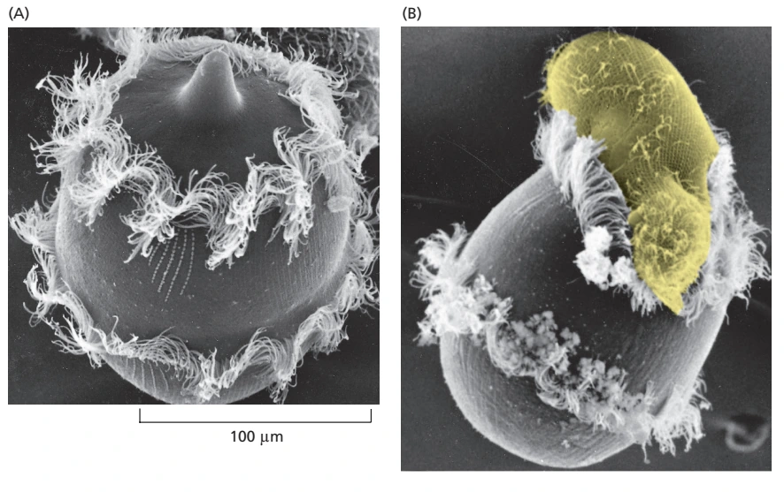
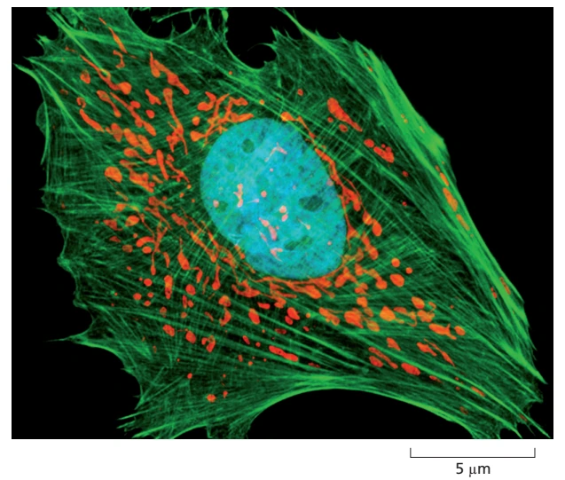
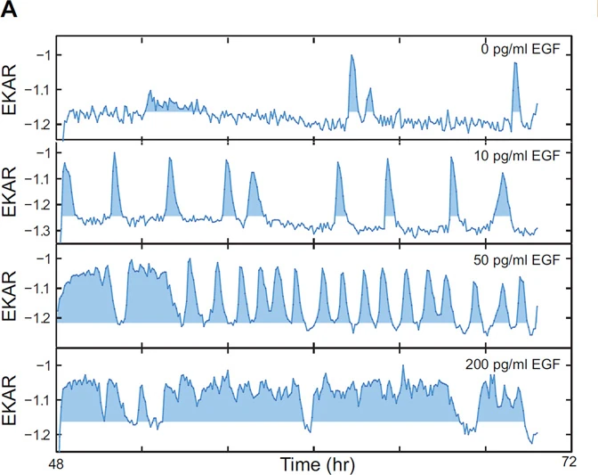
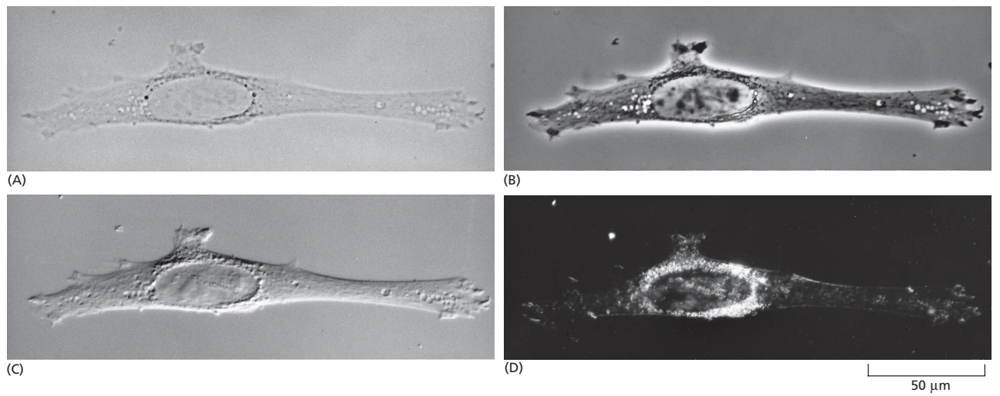
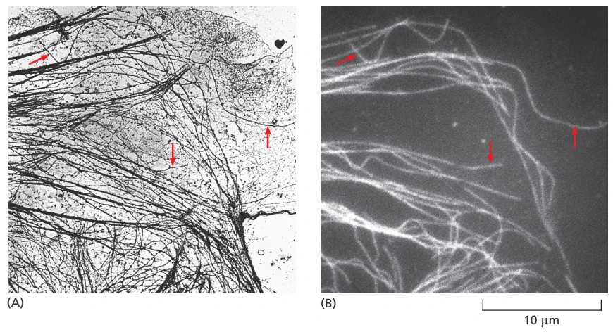

# 细胞生物学

一个细胞可以完成多少事？水中的纤毛虫 *Didinium* 会游动、捕食，再把吞入的猎物消化。它的身体只有一个细胞：纤毛需要协调摆动，细胞表面需要变形，食物进入后还要被分解，所得物质又用于维持和更新自身。我们在多细胞生物中熟悉的运动、营养、感受和繁殖，在这里由同一个细胞承担。

{ width="680" height="428" }
/// caption
A 显示身体周围的两圈纤毛；B 显示吞食状态，猎物被人工着成黄色。两幅为不同状态的电镜照片，不是同一细胞的连续录像。[^fig-didinium]
///

**细胞是现存生物组织生命活动的基本单位。** 它以膜划定内外，却始终同环境交换物质和能量；遗传信息经表达产生分子机器，分子机器又复制、读取和维护遗传物质。细胞生物学关心这些过程怎样在有限空间内配合：一个蛋白质怎样到达工作地点，一股力怎样改变细胞形状，一次外界刺激又怎样影响细胞接下来的行为。[^cell-biology-scope]

## 四条阅读主线 { #reading-map }

细胞的结构常按细胞器逐一介绍，但一个过程往往会跨过几个章节。受体内吞涉及膜变形、内体分选、骨架运输，也会改变信号持续时间；细胞分裂则需要染色体、纺锤体、膜系统和黏附结构同步重组。以下四组入口分别从这些联系的一端展开。

- **边界与区室**

    膜怎样选择进出物质？不同反应怎样在各自的区室中进行，能量与货物又怎样流动？

    [细胞膜与跨膜运输](membrane_transport.md) → [细胞器与能量转换](organelles.md) → [内膜系统、蛋白质分选与囊泡运输](endomembrane.md)

- **空间组织**

    细胞怎样维持形状、产生运动，并把运输轨道和遗传物质组织到适当位置？

    [细胞骨架与细胞运动](cytoskeleton.md) → [细胞核、染色质与核糖体](nucleus_chromatin.md)

- **细胞之间的联系**

    细胞怎样连接邻居、承受组织中的力，又怎样接收和整合环境信息？

    [细胞外基质、黏附与连接](cell_interactions.md) → [细胞信号转导](cell_signaling.md)

- **生命历程**

    细胞怎样复制和分配自身？增殖、分化、死亡与衰老又怎样共同塑造组织？

    [细胞周期与细胞分裂](cell_cycle.md) → [细胞增殖、分化、死亡与衰老](cell_life_cycle.md)

## 细胞学说与学科范围 { #cell-theory-scope }

显微镜使人们第一次看见了肉眼无法分辨的生命世界。1665 年，Hooke 在软木薄片中看到一格格由细胞壁围成的空腔，用 cell 为它们命名；Leeuwenhoek 随后观察到多类活细胞。十九世纪，Schleiden 与 Schwann 对植物、动物组织的研究推动了细胞学说的建立，细胞分裂的观察又逐渐确立了“新的细胞来自既有细胞”的认识。生物体由细胞构成，生长、繁殖和组织更新都与细胞的活动相连。[^cell-theory-tools]

??? note "生命起源与病毒放在哪里？"

    细胞学说概括的是现存细胞生命的组织和延续。最早的细胞怎样从非细胞的化学系统中出现，属于生命起源的问题。病毒则依赖宿主提供代谢和蛋白质合成等装置，不能独立完成整套增殖过程；研究病毒恰好也能揭示它所借用的细胞机制。

现代细胞生物学既要观察纳米尺度的分子装置，也要解释细胞与组织的行为；时间尺度从分子构象变化的微秒，延伸到长期存活细胞中持续数十年的维护。离子通道、核糖体、运输囊泡与整个细胞相差很大，却都受到能量、分子识别、空间和时间的约束。[^cell-biology-scope]

这也使细胞生物学同其他学科紧密相接。生物化学解释脂质、ATP 等分子的性质和反应，分子生物学追踪 DNA 的复制、表达与调控；细胞生物学进一步考察这些反应发生的位置、顺序和条件，以及它们怎样形成可观察的细胞行为。继续追踪许多细胞共同产生的器官功能和全身调节，就进入了生理学的问题。

## 开放系统的边界、通量与稳态 { #open-cell-system }

活细胞中的许多浓度可以相对稳定，物质却一直在流动。细胞摄取水、离子和营养物，排出代谢产物，也向外释放分泌物和热。质膜限制自由交换，通道、载体、泵和膜泡提供选择性通路；当某种物质的输入与生成大致抵消输出与消耗时，它的含量就能维持在一定范围内。这样的**稳态需要持续的通量**，也需要反馈随环境变化调节通量。[膜运输中的能量关系](membrane_transport.md#transport-energetics)进一步说明，物质沿电化学梯度运动和逆梯度运输分别需要什么条件。

细胞维持内外差异、合成大分子和产生运动，都要消耗自由能。有的细胞从营养物氧化获得能量，有的能利用光能；底物水平磷酸化或跨膜离子梯度可把其中一部分能量转入 ATP，还原力与其他活化中间物则参与不同的合成反应。膜、酶和调控网络使这些反应彼此耦联，维持一个不断更新的非平衡系统。[^cell-chemistry] 线粒体、叶绿体和过氧化物酶体怎样组织各自的反应，见[细胞器与能量转换](organelles.md#organelle-overview)。

边界、代谢、遗传信息的保存与表达、组分更新和后代产生，是细胞生命延续的共同基础。在多细胞生物中，一些高度分化的细胞只承担其中部分任务，例如成熟的哺乳动物红细胞失去细胞核，也不再分裂。细菌和古菌没有核膜包被的细胞核，但具有膜域、动态骨架及其他内部组织；真核细胞则把更多反应安排在膜性细胞器中。线粒体与质体源自不同的内共生事件，使这些细胞的代谢和遗传系统具有嵌套的历史。[^cell-biology-scope]

## 空间组织与反应定位 { #spatial-organization }

下面的培养上皮细胞只标出了三类组分，已经能看出丰富的空间关系。绿色肌动蛋白丝形成延伸的网络，红色线粒体分布在胞质中，DNA 染料则突出中央的细胞核。这种图像使我们能够把分子名称同位置对应起来；没有被标记的内质网、其他蛋白质和代谢物，仍然占据着图中的空间。

{ width="510" height="433" loading=lazy }
/// caption
绿色标记肌动蛋白丝，红色染料在线粒体中积累，蓝色染料结合 DNA；颜色来自荧光标记及图像显示。比例尺为 5 µm。[^fig-cell-fluorescence]
///

位置会改变反应发生的机会。扩散能让分子在局部相遇，马达和运输囊泡则有助于完成较远距离的定向运输；核孔和跨膜转位装置选择可通过的货物，膜接触位点让相邻细胞器直接交换某些物质。膜包围的腔室还可以维持不同的 pH、离子组成和氧化还原条件，让各自的酶在合适的环境中工作。一个蛋白质即使具有正常的催化能力，送错位置也可能无法发挥预期作用。

[内膜系统](endomembrane.md#endomembrane-topology)沿内质网、高尔基体、内体、溶酶体和质膜追踪双向物流；[细胞骨架](cytoskeleton.md#cytoskeletal-filaments)说明有方向的运输轨道和承力网络怎样形成；[细胞核](nucleus_chromatin.md#nuclear-envelope)则连接核质运输、染色质折叠、核体与核糖体发生。三者共同参与反应位置的建立，也在分裂后重新组织。

细胞结构的形成既依赖局部分子间的相互作用，也利用已有结构提供的起点。脂双层可以自发封闭，骨架蛋白可以聚合，部分分子还能形成相分离凝聚体；细胞同时控制组分供给、成核、融合、分裂和降解。中心体、既有膜系统和细胞器的继承，又使新细胞不必从完全均匀的混合物开始。结构的大小、数量、形状与位置，就在这些装配、周转和物理约束中形成。[^cell-architecture]

## 界面、通信与多细胞协作 { #interfaces-communication }

一个组织中的细胞承受着邻居和环境施加的力。动物细胞通过钙黏蛋白、整联蛋白等黏附系统，把内部的肌动蛋白丝或中间丝接到邻细胞、细胞外基质上；植物细胞的细胞壁承载膨压，胞间连丝则提供相邻细胞之间的通路。[细胞外基质、黏附与连接](cell_interactions.md#junction-systems)由这些结构展开，解释屏障、极性、承力和机械转导怎样共同维持组织。

力学联系之外，细胞还通过分泌因子、膜结合配体、离子、电信号、气体和直接连接交换信息。受体收到输入后，可以调节 GTP 酶在 GTP 与 GDP 结合态之间转换，启动可逆磷酸化、第二信使生成、蛋白水解或转录反馈，进而调节代谢、运输、形态和命运。[细胞信号转导](cell_signaling.md#signaling-grammar)讨论这些反复出现的分子过程，以及受体组成、细胞既有状态和信号持续时间怎样影响输出。

同一套基因组可以支持神经元、上皮细胞和肌细胞等多种身份，因为不同细胞使用的调控程序、染色质状态和蛋白质组合不同。邻居组成、基质刚度、营养与炎症环境又会持续改变这些程序。把细胞从组织移入培养皿，也同时改变了它受到的多种约束，培养中的行为因此需要结合新的环境理解。

## 细胞状态的时间维度 { #cell-state-time }

细胞内部的组分持续周转，细胞本身也在经历变化。增殖细胞依次完成生长、DNA 复制、染色体分离和胞质分裂；如果发生 DNA 损伤、复制受阻或动粒附着异常，检查点会延缓相关转换，为修复或重新组织争取时间。[细胞周期与细胞分裂](cell_cycle.md#cycle-states)从周期蛋白与 CDK、受控蛋白水解和复制许可展开，再解释有丝分裂、减数分裂及不同谱系的胞质分裂装置。

细胞也可能进入静息、建立分化身份、发生衰老或死亡。分化与退出周期并不总是同时发生，已有身份也能在再生、重编程和癌变中改变。凋亡、坏死性凋亡、焦亡和铁死亡使用不同的执行装置；自噬通常承担物质回收与质量控制，在特定情境下才是死亡发生所必需的过程。[细胞增殖、分化、死亡与衰老](cell_life_cycle.md#cell-state-balance)将这些变化放回组织更新和生态位中比较。

时间尺度还会改变我们对信号的理解。短暂的 Ca$^{2+}$ 脉冲、数小时的转录反馈、跨越多个周期的染色质记忆，以及多年积累的损伤，具有不同的形成和消退速度。固定样本保留某一时刻的空间分布；活细胞追踪、脉冲—追踪和谱系记录则能进一步揭示变化的先后、持续时间和继承关系。

## 细胞类型、状态与异质性 { #cell-type-state }

**细胞类型**通常指在发育来源、较稳定的调控程序、形态和功能上具有连续性的类别；**细胞状态**则描述周期、激活、营养或应激等条件下的变化。一个细胞从静息进入增殖，不一定改变类型；同一类型的两个细胞，也可能处于完全不同的信号状态。实际区分需要结合多个标志物、谱系和功能，而不能只凭某一个时刻的表达相似性。[^single-cell-heterogeneity]

???+ abstract "持续的刺激，起伏的单细胞响应"

    在持续提供表皮生长因子 EGF 的条件下，MCF-10A 乳腺上皮细胞中的 ERK 激酶仍会一阵一阵地活化。研究者使用快速响应的荧光传感器 EKAR-EV，记录了刺激后约 48—70 小时的单细胞活动。

    { width="650" height="515" loading=lazy }
    /// caption
    每条轨迹来自一个细胞，四组分别对应不同 EGF 浓度。横轴单位为小时；原图倒置了 CFP/YFP 比值的纵轴，因此向上的峰表示 ERK 活性升高。[^erk-pulses]
    ///

    随着 EGF 浓度上升，峰间隔缩短，活跃时间增加。同一条件下，不同细胞的峰也并不同步；把它们平均后，短暂的起伏会被削弱。信号页中的[单细胞热图与群体比较](cell_signaling.md#rtk-ras-erk)进一步展示了这种差别。

群体测量适合估计总体通量和平均差异，却可能掩盖稀有亚群、异步振荡或方向相反的响应。流式、单细胞测序和成像把测量分配到单个细胞，空间方法还保留它们在组织中的位置。描绘不同谱系的细胞图谱需要覆盖足够多的类别；研究同一谱系内部的调控状态，往往还需要更深的测量和时间追踪。祖先是谁、分子是否直接相互作用、细胞未来将走向何种命运，也各自需要相应的证据。[^single-cell-heterogeneity]

这些测量本身也会引入差异：组织消化可能丢失空间关系并诱发应激，荧光标记和报告器可能扰动目标，低丰度转录本容易随机漏检，培养条件则会选择更适应培养基和基质的亚群。单细胞数据中的变异，既包含生物学差异，也包含取样与技术过程的影响。

## 从结构观察到因果机制 { #cell-biology-evidence }

细胞生物学的许多问题从“看见”开始，而图像中的亮暗首先取决于观察方法。下面四幅图拍的是**同一个培养成纤维细胞**：明场中几乎透明的轮廓，换成相差、微分干涉或暗场以后，就呈现出很不一样的细节。[^cell-biology-tools]

{ width="760" height="302" loading=lazy }
/// caption
A 明场；B 相差；C 微分干涉对比（DIC）；D 暗场。暗场收集被样品散射的光，背景因此较暗；DIC 的浮雕感来自光程梯度，不是细胞表面的真实起伏图。[^fig-light-modes]
///

荧光标记还允许我们在复杂背景中挑出特定分子。用抗微管蛋白抗体标记细胞骨架，再把同一区域的荧光图与透射电镜图对应，就能检验那些发亮的细丝是否确实对应单根微管。这类对应观察也展示了**检测与分辨的区别**：一根直径约 25 nm 的微管能产生可检测的荧光，但常规光镜把它显示为约 200 nm 宽的线，不能据此量出它的真实直径。[^microtubule-correlative]

{ width="700" height="380" loading=lazy }
/// caption
A 透射电镜；B 抗微管蛋白免疫荧光。红箭头指向两图中可相互对应的微管；样品经过抽提、固定和抗体标记，图中不是活细胞。[^microtubule-correlative]
///

分辨率表示相邻细节能否被区分，继续放大图像并不必然增加细节。常规光学成像受波长、数值孔径等条件限制；共焦显微镜通过抑制离焦光进行光学切片，电子显微镜则能显示更小尺度的结构，但通常需要真空及固定、切片、染色或冷冻等制样。[显微观察与标本制备](../exptech/foundations/microscopy_specimens.md#magnification-resolution)说明放大与分辨的关系，[组织学、组织化学与成像](../exptech/cell/histology_imaging.md#electron-microscopy)进一步介绍电镜制样和相关光—电镜观察。

在结构和定位之外，研究者还要问某个组分怎样参与过程。遗传或急性扰动可以检验必要性，恢复相应组分的救援实验帮助判断表型是否与该改变有关；纯化组分重构则检验一个简化系统能否产生相应行为。不同方法逐步把“这些分子在这里”推进到“它们怎样完成这件事”。[^cell-biology-tools]

| 要回答的问题 | 代表性证据 | 解释时需要考虑的条件 |
| --- | --- | --- |
| 结构在哪里、怎样变化 | 光镜、电镜、荧光定位、原位杂交、活细胞成像 | 分辨率、固定与标记决定可见信息；共定位还不足以建立直接相互作用 |
| 细胞或分子有多少 | 流式、定量成像、生化测定、群体与单细胞组学 | 回收率、抗体、扩增、归一化和取样会影响读数；丰度与活性需分别测量 |
| 某组分是否必要 | 突变、敲除、RNA 干扰、药理抑制、急性降解 | 慢性代偿、脱靶、剂量和细胞背景可能改变表型，独立扰动与救援能增加判断依据 |
| 哪些组分足以产生过程 | 亚细胞分级与纯化后，用蛋白脂质体或无细胞体系重构 | 结论适用于所用浓度、几何与反应条件，完整细胞还存在其他竞争和调控过程 |
| 过程怎样随时间改变 | FRAP、脉冲—追踪、单分子／活细胞报告器、谱系追踪 | 各方法分别追踪分子交换、货物去向、活动或后代；时间分辨率、光毒性与观察窗口限制可见轨迹 |

其中，荧光漂白后恢复（FRAP）通过观察漂白区域的信号恢复，估计分子的移动与交换；它与追踪细胞后代的谱系记录处于不同层次。报告器响应速度和细胞运动等因素怎样影响这些测量，见[活细胞与互作成像](../exptech/cell/histology_imaging.md#live-fluorescence-interactions)。

模式系统的选择同样围绕问题展开。细菌便于研究快速生长、膜与复制的基本装置，酵母能把真核遗传操作同细胞器和周期联系起来；线虫、果蝇、拟南芥、斑马鱼和小鼠则为谱系、发育、植物、活体成像和哺乳动物组织研究提供不同窗口。培养细胞便于控制环境、扰动和连续观察，原代细胞、细胞系、类器官与完整动物又各自保留不同层次的组织条件。长期培养可能选择出遗传与表型改变，因此模型中的机制外推到其他细胞或人体时，需要结合其保守性和具体环境。[^culture-models] 培养材料的来源、身份与漂移控制见[细胞培养、计数与活性检测](../exptech/cell/culture_fractionation.md#culture-objective)。

## 参考资料与延伸阅读 { #references }

[^cell-biology-scope]: Alberts B、Heald R、Johnson A 等，*Molecular Biology of the Cell*，第 7 版（2022），第 1 章及第 9—19 章；公开阅读可参见[第 4 版](https://www.ncbi.nlm.nih.gov/books/NBK20684/)与 Cooper GM，[*The Cell: A Molecular Approach*，第 2 版](https://www.ncbi.nlm.nih.gov/books/NBK9839/)。
[^fig-didinium]: *Molecular Biology of the Cell*，第 7 版，图 1–34，印刷页 31；原图署名 D. Barlow。保留两幅图及比例尺，黄色为原图对猎物的人工着色。
[^cell-theory-tools]: Cooper GM，[Tools of Cell Biology](https://www.ncbi.nlm.nih.gov/books/NBK9941/)；Alberts 等，*Molecular Biology of the Cell*，第 7 版，第 9 章。细胞学说的形成与显微观察史参见前者，显微成像方法参见后者。
[^cell-chemistry]: Cooper GM，[The Chemistry of Cells](https://www.ncbi.nlm.nih.gov/books/NBK9884/)；Alberts 等，*Molecular Biology of the Cell*，第 7 版，第 2、11、14 章，分别讨论化学与能量、跨膜运输及能量转换。
[^fig-cell-fluorescence]: *Molecular Biology of the Cell*，第 7 版，图 9–13，印刷页 572；原图由 Carl Zeiss Microscopy GmbH 提供。
[^cell-architecture]: Rafelski SM、Marshall WF（2008），[Building the cell: design principles of cellular architecture](https://www.nature.com/articles/nrm2460)，*Nature Reviews Molecular Cell Biology* 9:593–602；关于膜区室、骨架和核内组织的具体机制，另参见 Alberts 等第 7 版第 12、16、4 章。
[^single-cell-heterogeneity]: Janes KA（2016），[Single-cell states versus single-cell atlases—two classes of heterogeneity that differ in meaning and method](https://pubmed.ncbi.nlm.nih.gov/27042975/)，*Current Opinion in Biotechnology* 39:120–125。该文比较谱系异质性和调控状态异质性所需的取样与测量方式。
[^erk-pulses]: Albeck JG、Mills GB、Brugge JS（2013；2012 年在线发表），[Frequency-modulated pulses of ERK activity transmit quantitative proliferation signals](https://pmc.ncbi.nlm.nih.gov/articles/PMC4151532/)，*Molecular Cell* 49:249–261。图取自原文图 3A，复用本站信号转导页图版；保留浓度、时间轴和倒置纵轴。
[^cell-biology-tools]: Cooper GM，[Tools of Cell Biology](https://www.ncbi.nlm.nih.gov/books/NBK9941/)；Alberts 等，*Molecular Biology of the Cell*，第 7 版，第 8、9 章，讨论细胞研究工具与成像。
[^fig-light-modes]: *Molecular Biology of the Cell*，第 7 版，图 9–7，印刷页 568；同一培养成纤维细胞的四种光学成像，保留 A—D 标号及比例尺。
[^microtubule-correlative]: Osborn M、Webster RE、Weber K（1978），[Individual microtubules viewed by immunofluorescence and electron microscopy in the same PtK2 cell](https://doi.org/10.1083/jcb.77.3.R27)，*Journal of Cell Biology* 77:R27–R34。图版取自 *Molecular Biology of the Cell* 第 7 版图 9–14（印刷页 572），该书注明原图来自上述研究。实验先抽提、固定并用抗体标记，再比较同一区域的两类图像；原研究电镜所测约 55 nm 包含微管外的抗体层，教材所述 25 nm 则为微管本体直径。
[^culture-models]: Alberts B、Johnson A、Lewis J 等，[Isolating Cells and Growing Them in Culture](https://www.ncbi.nlm.nih.gov/books/NBK26851/)；*Molecular Biology of the Cell* 第 7 版第 1、8 章，讨论模式生物与培养体系。
