# 细胞核、染色质与核糖体 { #_1 }

细胞核里的 DNA 要同时应付几件事：足够紧凑，才能装进细胞；又要能局部打开，供复制、转录和修复使用。它的工作伙伴大多在胞质中合成，必须不断进入细胞核；核内产生的 RNA 则要经过加工，再送往胞质。这一来一往，使核被膜上的通道和膜内的组织方式都有了具体用途。

沿着核被膜向内看，可以依次遇到核纤层、染色质，以及常常十分醒目的核仁。核仁把 rRNA 的合成、加工和核糖体亚基装配集中在一起，随后将前体亚基送出细胞核，接入胞质中的蛋白质合成。下面就从这层边界开始。[^nuclear-compartment]

## 核被膜与核纤层 { #nuclear-envelope }

核被膜由内、外两层膜组成，两层之间是核周隙。外核膜与内质网膜连续，核周隙也通向内质网腔；外膜朝向胞质的一面可以结合核糖体。内核膜则富集核纤层和染色质的连接蛋白。两层膜在核孔边缘相接，围出贯通核质与胞质的水相通道。注意图中核周隙的位置：进入核周隙相当于进入内质网腔，和穿过核孔进入核质是两条不同的路线。[^nuclear-envelope-source]

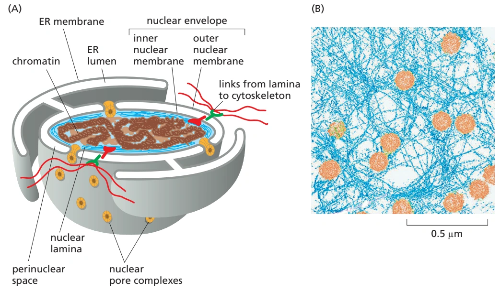{ width="680" height="397" }
/// caption
左图沿双层膜追踪核周隙；右图为核纤层的结构成像，蓝色网架之间分布着棕色核孔。右图比例尺 0.5 μm。[^fig-envelope-lamina]
///

动物细胞内核膜下的核纤层（nuclear lamina）由 lamin 聚合成网，为细胞核提供机械支撑，也参与染色质定位、复制和损伤应答。lamin 属于中间丝蛋白；A 型包括 lamin A、C，二者由同一 *LMNA* 基因选择性剪接产生，B 型则包括 lamin B1、B2。细胞分化时，这些蛋白的组成和相对含量可以改变。

细胞核还同胞质骨架相连。内核膜上的 SUN 蛋白把一端伸向核内，另一端伸进核周隙；外核膜上的 KASH 蛋白从对面伸入核周隙，同 SUN 结合。KASH 蛋白的胞质侧再接上肌动蛋白、中间丝或微管马达。这组跨越两层膜的连接称为 LINC 复合体。细胞牵拉、迁移时，力便能沿这条路线传到核表面；同一套连接也可帮助定位、转动和移动细胞核。[^lamina-linc]

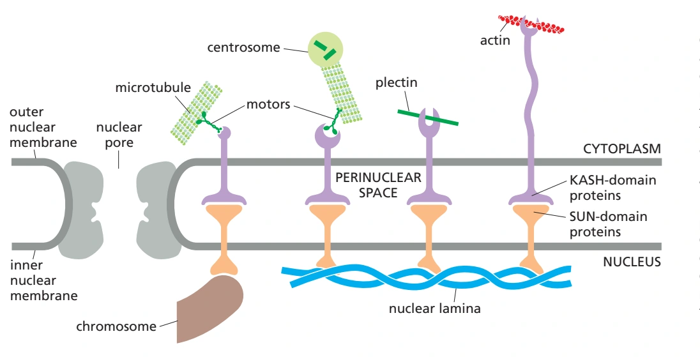{ width="680" height="347" loading=lazy }
/// caption
从下向上看：核内连接—SUN—核周隙中的结合界面—KASH—胞质骨架。不同连接蛋白分别接入微管马达、plectin 或肌动蛋白。[^fig-linc]
///

??? note "核形态背后的蛋白差别"

    核纤层或其连接蛋白发生改变，可以同时影响核的形状和功能。Hutchinson–Gilford 早老综合征的经典 *LMNA* 突变会异常激活一个剪接位点，产生截短的 lamin A 前体 progerin；某些非典型 Werner 综合征病例也与 *LMNA* 变异有关。遗传性 Pelger–Huët 异常则常涉及内核膜蛋白 lamin B receptor（LBR），粒细胞核的分叶减少。LBR 与 lamin B 的名字相近，却是两个不同的蛋白。[^nuclear-envelope-disease]

    核数也有正常的细胞类型差异：骨骼肌纤维和破骨细胞可含多个核，部分肝细胞有两个核；哺乳动物成熟红细胞、被子植物成熟筛管分子则失去细胞核。红细胞同时清除了核糖体，而筛管分子的代谢维护与伴胞密切相连。

在动物细胞的开放式有丝分裂中，核被膜会暂时解体。CDK1 等激酶磷酸化 lamin、核孔蛋白及部分内核膜蛋白，使核纤层和核孔复合体拆散；许多核膜成分进入连续的内质网膜系统。染色体分离后，去磷酸化、膜与染色质重新结合、核孔装配和膜封闭共同恢复子核。图中的膜片段概括了重组过程，不能据此把全部核被膜理解为一袋游离小泡。许多真菌采用保留核被膜的封闭式分裂，具体过程见[细胞周期与细胞分裂](cell_cycle.md)。

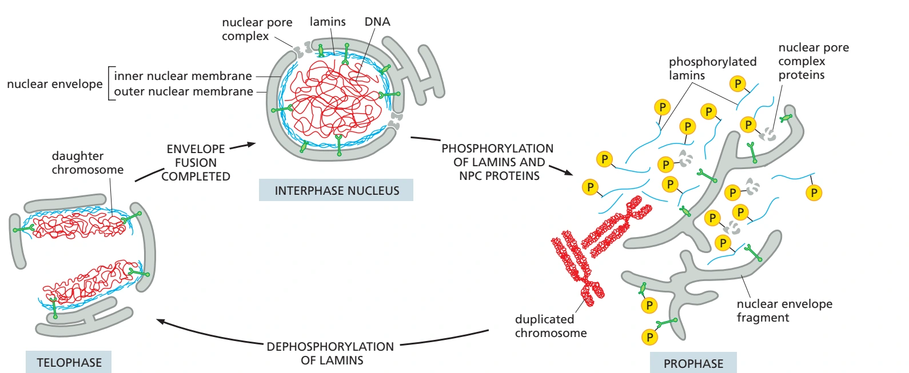{ width="680" height="279" loading=lazy }
/// caption
顺时针追踪间期核、前期拆解和末期重建；核纤层及核孔组分去磷酸化后重新装配。示意图没有展开连续 ER 膜的全部形态。[^fig-envelope-reassembly]
///

## 核孔与核质运输 { #nuclear-pore-transport }

### 核孔中的选择性屏障 { #nuclear-pore-architecture }

核孔复合体（nuclear pore complex，NPC）比膜上的孔洞大得多。它由约三十种核孔蛋白（nucleoporin，Nup）以多份拷贝装配而成，支架大体呈八重旋转对称。面向胞质的一侧伸出短纤维，面向核质的一侧有核篮；跨膜核孔蛋白将整套结构固定在孔膜区。Nup210（gp210）、POM121 是脊椎动物中的代表，不同物种和细胞的具体配置有所差异。[^npc-architecture]

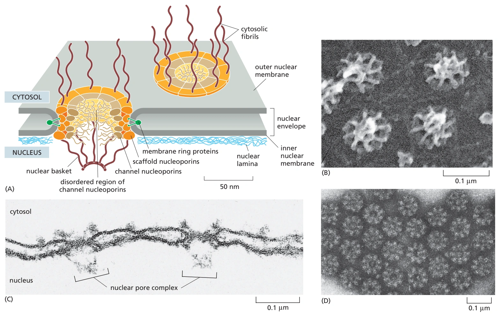{ width="680" height="433" loading=lazy }
/// caption
A 为结构模型；B 从核内侧观察卵母细胞核孔的核篮；C 为切面；D 为去膜后核孔的俯视图。中央颗粒可能包含正在通过的货物。[^fig-nuclear-pore]
///

支架围出了通道，但通道里面并不空旷。许多核孔蛋白带有富含苯丙氨酸—甘氨酸重复序列的无序区，简称 FG 重复区；Nup62（旧称 p62）的 FXFG 重复是其中一例。Nup62 等核孔蛋白还带有 O-GlcNAc 修饰，即在部分 Ser／Thr 上连接单个 N-乙酰葡糖胺。[^nup-glycosylation]这些柔性链在孔中形成动态的选择性屏障。离子和小分子容易扩散，大分子的通过速度则随尺寸、形状及表面性质降低。运输受体能够同 FG 重复区反复发生短暂结合，从而携带货物穿过屏障。

这个过程不要求把每个蛋白都拉成一条直链。折叠好的蛋白和部分大型复合物也可以过核孔，与[线粒体](organelles.md#mitochondrial-protein-import)、[内质网的蛋白转位](endomembrane.md#er-protein-entry)很不一样。孔的通透性又不是在某个分子量上突然从“能过”变成“绝对不能过”：常见的 40–60 kDa 说法只是帮助估计被动通过难易的经验范围，还必须考虑测量时间。

经典电镜把核孔画成“环、辐、中央栓”，为认识整体形态提供了起点。如今的整合结构研究把冷冻电镜断层、蛋白互作和结构预测接在一起，逐一定位支架中的亚复合体，并比较孔径不同的状态。2022 年的人 NPC 研究就是这样的例子：预测帮助补齐结构，模型仍要受实验数据约束；电镜中央的一团密度也不必是一枚永久堵住孔道的“栓”。[^npc-architecture]

### 定位信号与 Ran 循环 { #ran-directed-transport }

蛋白进入细胞核，通常先要被核输入受体 importin 识别。经典核定位信号（nuclear localization signal，NLS）富含 Lys、Arg，可以是一段连续序列，也可以分成两段。它只要在蛋白表面可被识别，就能发挥作用，并不限于多肽内部；通常入核后也不被切掉，蛋白以后还可能再用到它。

SV40 大 T 抗原给出了一个很直观的实验。正常蛋白主要积累在核内；把 NLS 中的一个赖氨酸改成苏氨酸后，荧光转而主要留在胞质。序列只改了一处，整个细胞里的分布就变了。这个结果把“核蛋白总在核里”的描述推进了一步：蛋白携带了可被识别的定位信息。[^fig-nls-mutation]

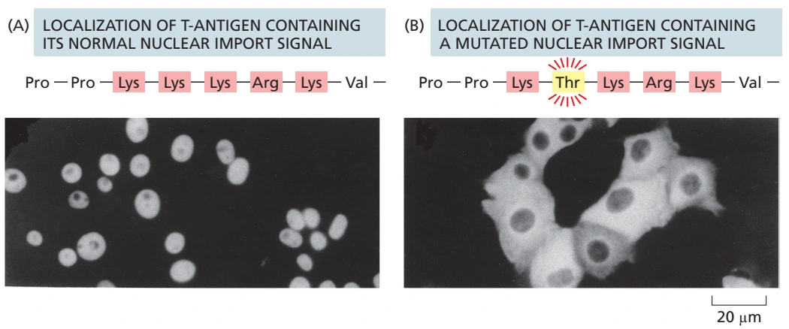{ width="680" height="284" loading=lazy }
/// caption
左为正常信号，右为一个 Lys 被 Thr 替换；荧光标记的是 T 抗原。比例尺 20 μm。[^fig-nls-mutation]
///

经典通路中，importin-α 识别 NLS，再同 importin-β 结合；β 亚基与 FG 重复区相互作用，使整个复合物过孔。也有货物由其他 importin 直接识别。没有自身 NLS 的蛋白可以跟随有 NLS 的伙伴入核；反过来，NLS 被结合蛋白遮住时，即使序列完好，也可能暂时不能有效入核。

过了孔，货物怎样在核内卸下？这里需要小 GTP 酶 **Ran**。与染色质结合的 Ran-GEF（RCC1）促进 Ran 释放 GDP、结合 GTP；胞质侧的 Ran-GAP 促进 Ran 水解 GTP。两种调节蛋白分居两侧，使核内较富集 Ran-GTP，胞质中则以 Ran-GDP 为主。Ran-GDP 经 NTF2 带回核内，才能继续这一循环。[^nuclear-transport]

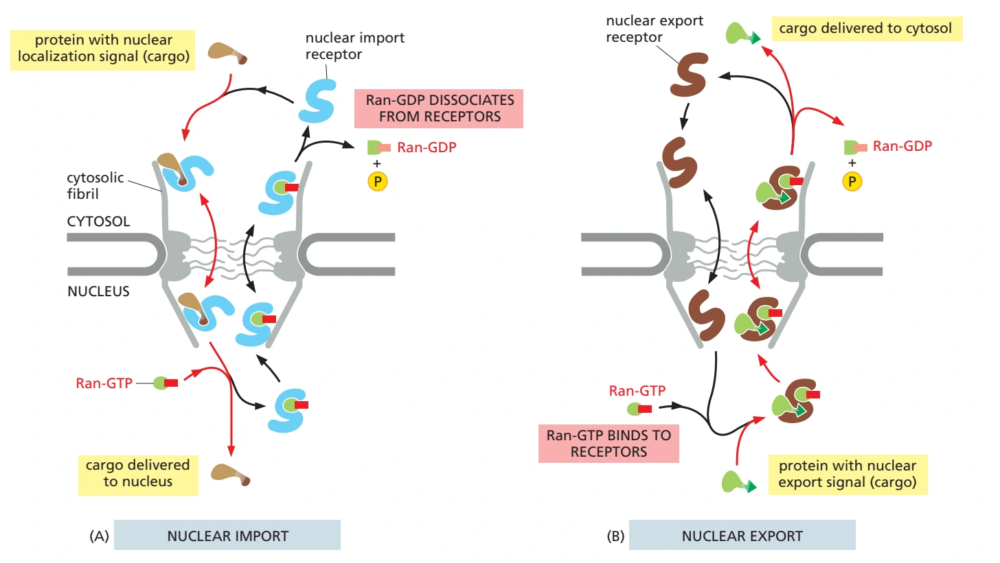{ width="680" height="383" loading=lazy }
/// caption
左为输入，右为输出。两侧使用同一个 Ran 循环，区别在于 Ran-GTP 对货物—受体结合的作用相反。[^fig-ran-cycle]
///

沿左图走一圈：importin 在胞质结合货物，穿过核孔；核内的 Ran-GTP 结合 importin-β，促使输入复合物解离。经典 α/β 通路中，适配蛋白 α 还需其他因子帮助卸货，并经专门的输出通路回收。β 与 Ran-GTP 返回胞质后，GTP 水解，Ran 与受体分开，受体便可以再接一批货物。

右图的核输出受体 exportin 则在核内同时结合货物和 Ran-GTP。三者形成复合物后穿孔，到胞质侧因 GTP 水解而解离。许多输出货物带有富含疏水残基的核输出信号（nuclear export signal，NES），或借助适配蛋白被受体识别。**输入在核内卸货，输出在胞质卸货**，方向由两侧的装配、拆卸条件维持。货物在孔道中的运动包含扩散，持续的定向积累则消耗 Ran 循环中的 GTP，不能把每次穿孔想成 ATP 马达拉一步。

!!! info "mRNA 以核糖核蛋白颗粒出核"

    mRNA 在转录时就不断结合蛋白，随加帽、剪接和 3′ 端加工逐渐换上适于输出的组分。大部分成熟 mRNA 主要通过 NXF1–NXT1 通路输出，胞质侧的 DDX19／酵母 Dbp5 等 ATP 依赖因子重塑 mRNP、移走部分核内蛋白，帮助防止颗粒倒退。它与上面的 Ran 依赖蛋白运输不是同一条能量路线；tRNA、前核糖体亚基等则可利用 Ran 依赖输出受体。[^mrna-export-route]

    下图来自摇蚊 Balbiani ring 大型转录本的研究：新生 RNA 被包装成颗粒，出核时又展开、重排。这个体系中可观察到 5′ 端先进入核孔，但不能据此给所有 RNA 规定统一朝向。5′ 帽参与招募蛋白与加工协调，也不是单独一顶帽子就足以决定一条 RNA 能否出核。

    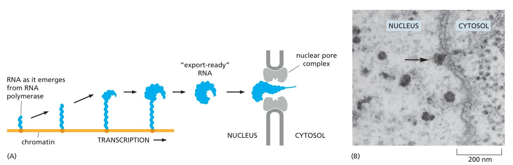{ width="680" height="220" loading=lazy }
    /// caption
    左为依据电镜整理的过程图，右为固定样本中的核孔输出颗粒；箭头标出颗粒，比例尺 200 nm。[^fig-mrna-export]
    ///

## 核小体与染色质组装 { #nucleosome-chromatin }

染色质是 DNA、组蛋白、其他结合蛋白及相关 RNA 共同组成的材料。它在间期伸展、折叠，在分裂期进一步浓缩成容易辨认的染色体。

把分离的染色质适度解凝聚，电镜下会出现“串珠”：较细的 DNA 连接着一个个核小体核心颗粒。再用核酸酶处理，暴露的连接 DNA 更易被切开，核心周围受到保护的 DNA 则可随颗粒分离。结构分析显示，典型核心含约 146–147 bp DNA，在组蛋白八聚体表面绕行约 1.65–1.7 圈。[^nucleosome-structure]

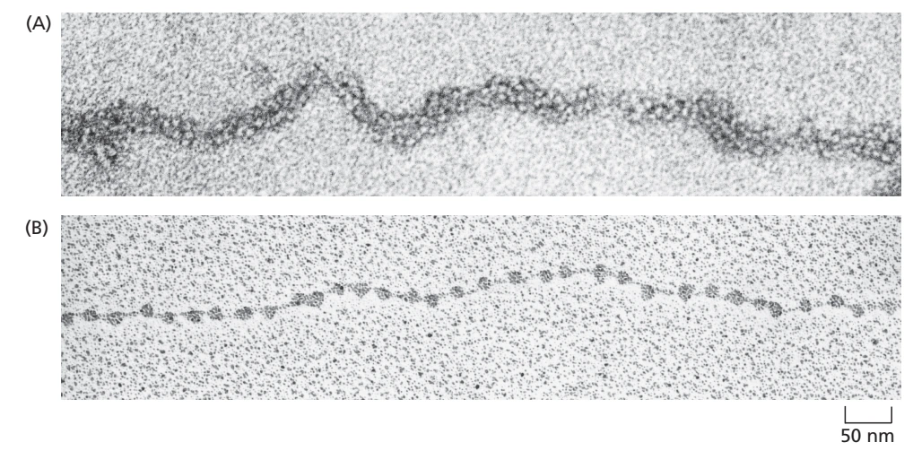{ width="680" height="336" loading=lazy }
/// caption
A 为分离后的染色质，B 经实验处理进一步解凝聚；“串珠”是这种制样条件下的观察，不能直接当作活细胞核的完整外观。比例尺 50 nm。[^fig-nucleosome-em]
///

组蛋白八聚体由一个 (H3–H4)₂ 四聚体和两个 H2A–H2B 二聚体构成。四类核心组蛋白都含 histone fold，通过这一折叠相互配对；富含 Lys、Arg 的表面同带负电的 DNA 骨架形成大量接触。DNA 必须弯曲才能绕上去，因而序列的可弯曲性也会影响核小体偏好的位置，但核心组蛋白并不像序列特异转录因子那样只认一个固定基序。

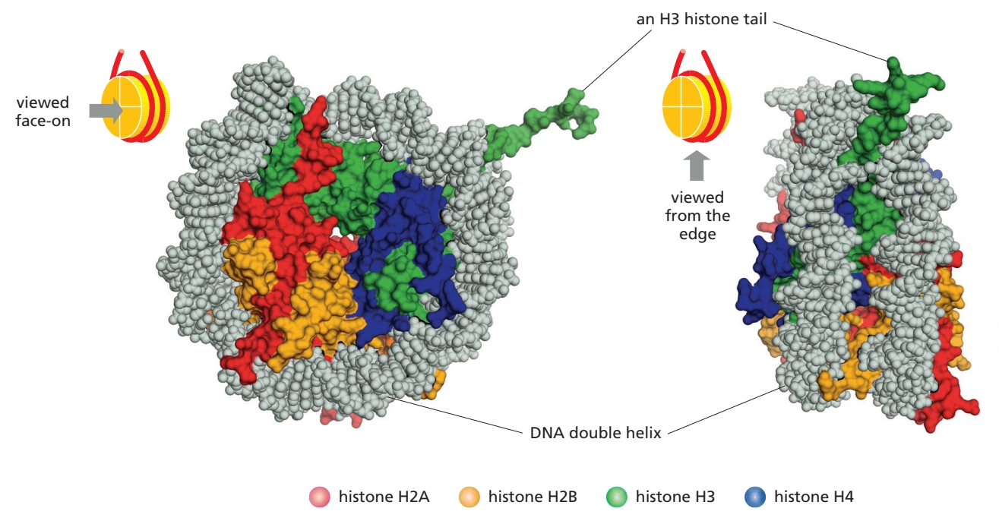{ width="680" height="355" loading=lazy }
/// caption
浅灰色为 DNA，四种颜色对应四类组蛋白；伸出的绿色部分是一条 H3 尾。其他柔性尾在这项晶体结构中未能全部定位。[^fig-nucleosome-core]
///

核心颗粒之间的连接 DNA 长短可变，所以“每个核小体约 200 bp”通常指核心加一段连接 DNA 的平均重复长度。连接组蛋白 H1 在 DNA 进出核心的位置附近结合，帮助稳定进出 DNA 的几何与局部压缩；它不属于八聚体。经典核酸酶实验中，含 H1 的染色质小体（chromatosome）可保护约 166 bp DNA，这个数值也不同于整段核小体重复长度。

??? note "核心组蛋白、H1 和非组蛋白"

    H3、H4 整体上高度保守，H1 家族的变异和组织差异较大。鸟类红细胞中的 H5 属于连接组蛋白，在鸡红细胞中可与 H1 共存；芽殖酵母也有连接组蛋白同源物 Hho1。[^linker-histones]

    “非组蛋白”是一个很大的集合：有识别特定序列的转录因子，也有重塑、拓扑调节和结构蛋白。螺旋—转角—螺旋、锌指、亮氨酸拉链及螺旋—环—螺旋等结构帮助不同转录因子结合 DNA 或形成二聚体。HMG 家族中，HMGB 类常识别 DNA 的形状并促进弯曲；SRY、LEF／TCF 等 HMG-box 蛋白则有较强的序列选择性。

### 装配、交换与重塑 { #chromatin-assembly }

新合成的组蛋白很容易同核酸发生不合时宜的结合，组蛋白伴侣先接住它们，再把它们递送到合适位置。ASF1、CAF-1 参与 H3–H4 的处理和沉积，NAP 家族可参与 H2A–H2B 的递送与交换。复制叉经过时，亲代组蛋白也会被回收、分配到子 DNA，新组蛋白填补空缺；这一过程与复制、修复和转录所需的重新包装相接。[^chromatin-mboc] 新生组蛋白也带着装配相关修饰：例如果蝇和 HeLa 细胞中新生 H4 的 K5、K12 乙酰化，与沉积过程相伴。[^histone-deposition]

组装好的核小体仍然可以移动。ATP 依赖染色质重塑复合体的马达亚基牵引 DNA，逐步改变 DNA 与核心的接触，使核小体滑到相邻位置；不同复合体还可移除组蛋白或交换二聚体。下图左侧画滑动，右侧则是催化组蛋白交换的酵母 SWR1 复合体。两者都使用 ATP，最终改变的结构却不同。

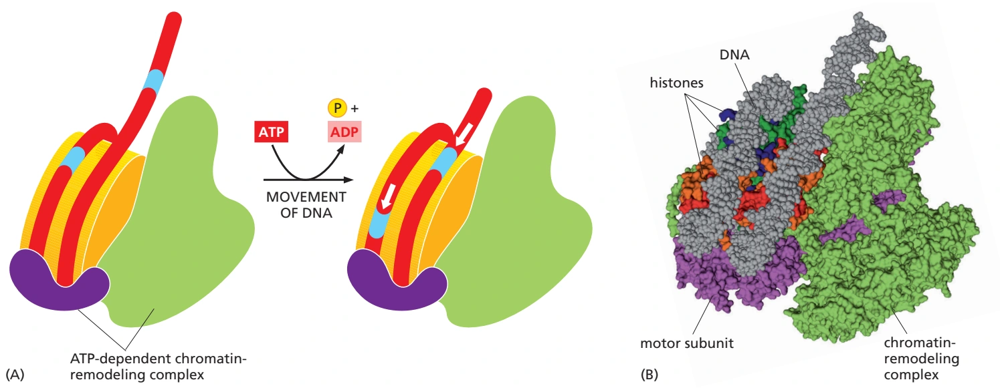{ width="680" height="266" loading=lazy }
/// caption
A 为核小体滑动模型；B 为 SWR1 与核小体的结构，紫色为马达亚基。SWR1 的主要任务是组蛋白二聚体交换，不能只按 A 的滑动箭头理解它。[^fig-remodeling]
///

被换入的组蛋白变体能带来不同的结合界面：CENP-A 参与建立许多真核生物的着丝粒身份；H3.3 常在高周转区沉积，也出现于端粒等环境；H2A.Z、macroH2A 等又有各自的沉积与调控背景。核小体位置、组蛋白变体和尾部修饰合在一起，才决定某段 DNA 对结合蛋白有多容易接近。

复制后如何重新建立区域状态，见[DNA 复制后的染色质记忆](../genetics/genomics_epigenetics.md#mitotic-memory)；复制、修复与转录的具体步骤分别见[DNA 复制](../molecular/dna_replication/index.md)、[DNA 损伤与修复](../molecular/dna_repair.md)和[转录](../molecular/transcription.md)。DNA—蛋白相互作用的化学基础见[核酸与核苷酸](../biochem/nucleic_acid.md#nucleic-acid-protein-complexes)。

## 染色质在三维空间中的组织 { #three-dimensional-genome }

核小体以上的层级，就不像一本折纸说明书那么整齐了。经典模型把 10 nm 串珠纤维进一步卷成 30 nm 纤维，再逐层压缩。规则纤维确实能在一些体外条件及特定细胞材料中形成；但许多原位观察显示，间期和分裂期染色质更接近粗细、弯曲程度与局部密度均不一致的核小体链。[^chromatin-fiber]

???+ abstract "ChromEMT：压得更密，不一定换一根更粗的纤维"

    Ou 等用 DNA 染料引发局部光氧化，使 DNA 附近形成可增强电镜对比的沉积，再做多倾角断层重建。研究在固定的人细胞中追踪染色质链，测得的直径主要落在约 5–24 nm；间期与分裂期都能见到这类不规则链。下图上排的分裂期链在较短距离内反复回折，下排的间期链相对伸展。分裂期的紧密组织，可以通过链的路径和空间占有率改变来实现。[^chromemt-original]

    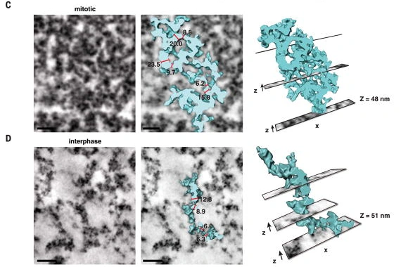{ width="570" height="380" loading=lazy }
    /// caption
    C 为分裂期，D 为间期；每排依次为断层切片、追踪叠加和重建表面，比例尺均为 40 nm。数字为局部直径（nm）。[^fig-chromemt-chains]
    ///

    这是特定固定、染色与重建条件下的原位结构证据，不是活细胞实时录像。它削弱了“所有染色质必经同一套规则螺线管”的解释，却不要求否认特定材料中形成较规则纤维的可能。

更大的尺度上，一条间期染色体通常占据偏好的空间，称为**染色体疆域**。用不同荧光探针给不同染色体染色后，可以在核内分辨出许多相邻的色块。同源染色体一般也各有自己的位置，并不因此自动贴在一起；部分染色质还可伸出主要疆域，与其他区域接触。

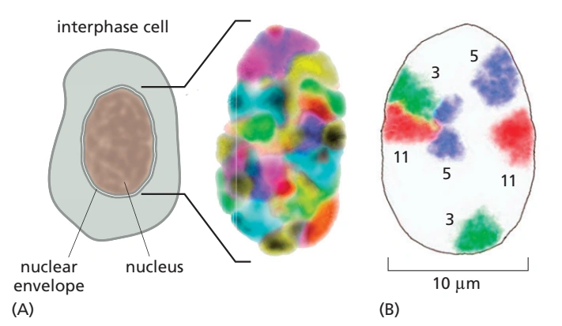{ width="680" height="395" loading=lazy }
/// caption
右侧单独显示 3、5、11 号染色体的两份拷贝；同一编号可位于核内不同位置。图为染色体涂染后的三维重建，比例尺 10 μm。[^fig-territories]
///

### 从连接产物读出接触频率 { #hic-contact-map }

怎样知道两段相隔很远的 DNA 是否常在空间上相遇？Hi-C 的思路是先把细胞中相邻的染色质交联固定，再切开 DNA，让被保留在近邻位置的片段连接，最后测序读取连接产物两端来自哪里。下图是最初 Hi-C 实验的流程：生物素标记连接区域，使这些产物可以富集出来。把大量连接事件放回基因组坐标，就得到一张接触矩阵。[^genome-folding]

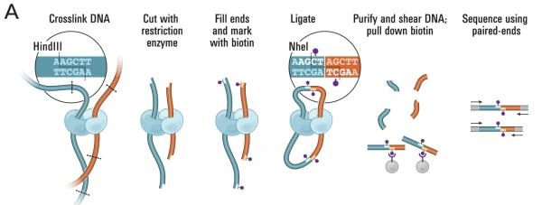{ width="600" height="227" loading=lazy }
/// caption
图中的紫点为生物素标记；连接产物把原先空间接近的两段序列保存在同一个 DNA 分子中。[^fig-hic-method]
///

矩阵的横、纵轴都是同一条染色体的位置。对角线很深，是因为线性序列上本来相邻的片段也容易在空间上靠近。要看更远的组织关系，可以把观测频率除以相同基因组距离下的期望值，再比较各区域的整套接触偏好。下面从 A 到 C，原始接触、距离校正和相关性分析逐步显出棋盘状图案：有些区域偏爱彼此接触，另一批区域则更常同彼此相遇。

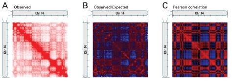{ width="474" height="172" loading=lazy }
/// caption
A 为接触次数，B 红／蓝表示高于／低于距离期望，C 红／蓝表示接触谱正／负相关。每格代表 1 Mb；C 的颜色不直接表示转录量。[^fig-hic-compartments]
///

由此定义的 A／B 区室，分别通常富集较活跃、较不活跃的染色质。这是接触偏好的统计分类，并不是核内有一堵墙把 DNA 分成两个封闭房间。更精细的接触图还可显示拓扑相关结构域（TAD）：某个连续区段内部的片段，比跨越边界的片段更常接触，于是在对角线旁形成方块。局部亮点或深点则提示某两处接触格外富集。

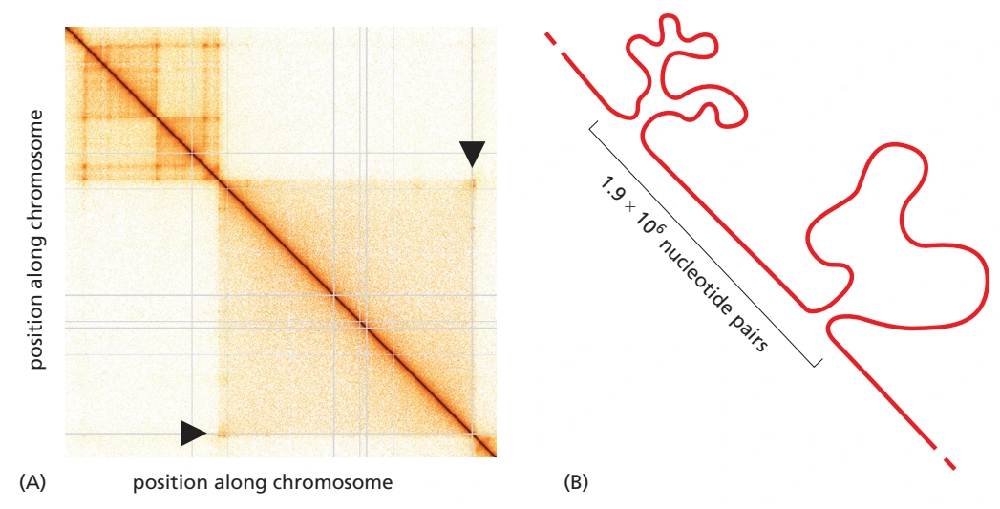{ width="680" height="346" loading=lazy }
/// caption
左为高分辨率染色体捕获数据，方块内部接触较多；箭头指接触富集点。右为模型，不能把每个细胞的瞬时构象都还原成这条固定曲线。[^fig-tad-map]
///

黏连蛋白复合体（cohesin）可利用 ATP 驱动环挤出，使一段被环住的染色质逐渐扩大。在脊椎动物中，DNA 上结合的 CTCF 可阻挡或限制这一过程，许多稳定富集的环锚点具有相向的 CTCF 基序。cohesin 的装载、脱离以及边界占据都在变化，所以群体图中清晰的环，并不要求每个细胞在每一刻都有同一条环。区室、TAD 和局部环也不是同义词，它们描述的是不同尺度、部分不同机制产生的组织。[^tad-loop-source]

核周同样会影响位置。核纤层相关结构域（LAD）是实验中较常接触核纤层的大片段；在许多哺乳动物细胞中，它们富含较低表达、基因较少的区域，且可随细胞分化重新分配。核仁周边、核斑附近等环境也会偏置染色质的位置。DNA 序列、核小体状态、环挤出、转录活动与核内边界共同作用，产生了成像和接触实验所见的构象。[^lamina-domains]

## 染色质状态与基因表达 { #chromatin-states }

“常染色质”和“异染色质”最初来自显微镜下的染色与压缩差异。常染色质通常较疏松，较多区域复制较早、富集活跃基因；异染色质通常更致密，许多区域复制较晚。组成型异染色质常见于着丝粒周边等重复序列富集处；兼性异染色质则可随发育和细胞状态建立，例如失活 X 染色体的大部分区域。

深浅是一条形态线索，具体是否转录还要看调控因子、核小体占位和局部状态。异染色质中也有必要的转录活动，部分 RNA 参与其建立与维持；较开放的区域则可以处于待激活状态。DNase I、ATAC 等方法测到的是 DNA 的可及性，不能仅凭切得开、插得进，就认定该基因正在表达。

??? note "异固缩描述的是凝缩时序的差别"

    某条染色体或某个片段与其余部分不同步凝缩，称为异固缩（heteropycnosis）。在同一阶段显得更致密、染色更深，称为正异固缩；相对疏松、染色更浅，则称为负异固缩。同一条染色体可随分裂阶段改变表现，例如一些昆虫的 X 染色体在减数前期 I 早期正异固缩，到中期 I 转为负异固缩。因此，这些名称要连同细胞阶段和比较对象来读。[^heteropycnosis]

### 修饰怎样改变结合关系 { #histone-state-regulation }

组蛋白尾部伸出核心，提供了大量可被修饰和识别的位置。赖氨酸乙酰化中和其侧链的正电荷，也为含 bromodomain 的蛋白提供结合位点；组蛋白乙酰转移酶 HAT 加上乙酰基，去乙酰化酶 HDAC 则去除它。赖氨酸甲基化保留正电荷，但一、二、三甲基化可被不同蛋白识别。决定作用的是残基位置、修饰程度和周围的结合伙伴。[^chromatin-mboc]

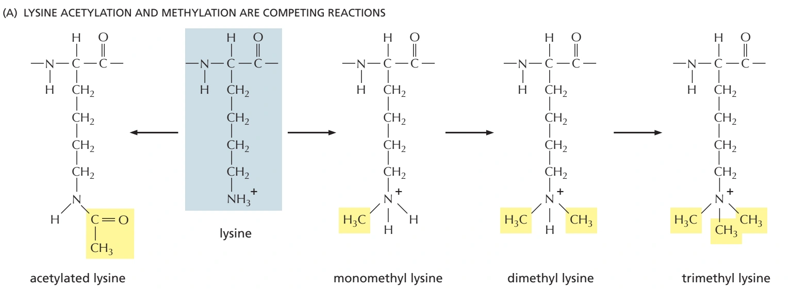{ width="680" height="249" loading=lazy }
/// caption
乙酰化去掉 Lys 侧链的正电荷；右侧三种甲基化仍保留正电荷。同一个 Lys 上的乙酰化与甲基化互相排斥。[^fig-lysine-modification]
///

例如，H3K4me3 常富集于活跃启动子；H3K9me3 能招募 HP1 等蛋白，参与许多异染色质区域的维持；Polycomb 相关 H3K27me3 则参与另一类抑制环境。磷酸化、泛素化等修饰又可参与分裂、转录或损伤应答。同一类化学反应可以用于不同任务，不能把“甲基化”或“磷酸化”直接翻译成开、关。

读出蛋白还可以招募修饰酶，在相邻核小体上补写同类标记。这样，一个局部变化便可能沿染色质扩展。去修饰酶、竞争性结合因子和边界元件又会限制或逆转扩展。DNA 复制后，残留的亲代组蛋白、序列特异因子和这些反馈共同帮助恢复区域状态。

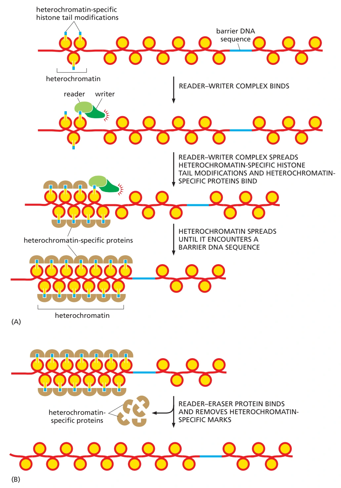{ width="420" height="600" loading=lazy }
/// caption
A 中 reader 识别已有标记，writer 修饰邻近核小体，直到受到边界限制；B 概括去除标记后的逆转。图示一种反馈逻辑，不同沉默域使用的调节蛋白可以不同。[^fig-reader-writer]
///

???+ example "果蝇眼睛为什么红一块、白一块？"

    果蝇 *white* 基因正常工作时支持红色色素形成；这个名字来自失活突变的白眼表型。在某些倒位染色体中，一个功能正常的 *white* 被移到异染色质附近。异染色质在胚胎不同细胞中扩展的范围不同，有的细胞把 *white* 一并沉默，有的没有；这两种表达状态又能在后续细胞分裂中维持，最后眼睛上便出现红白相间的细胞斑块。这称为位置效应花斑。[^fig-position-effect]

    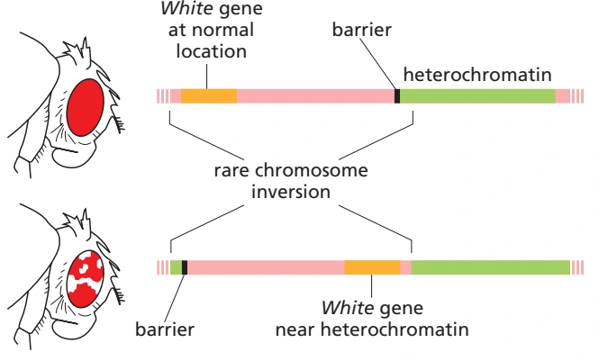{ width="665" height="401" loading=lazy }
    /// caption
    图中染色体倒位改变了基因邻域；眼部为表型示意。红白斑块记录的是不同细胞谱系的表达状态，不要求每块组织再发生一次基因突变。[^fig-position-effect]
    ///

    有趣的地方就在这里：基因仍在，改变的是它所处的染色质环境。边界元件可限制沉默扩展；某些绝缘子还影响增强子与启动子的接触。两种功能可能重叠，但也不能把所有边界都想成同一种永久路障。

X 染色体失活把这种状态调节扩展到染色体尺度：*XIST*／*Xist* RNA 及其招募的蛋白帮助建立抑制环境，部分基因仍可逃逸。小鼠早期胚胎存在父源 X 的印记性失活、内细胞团中的再激活及其后随机失活的转换，胚外谱系则另有维持规律；人类的时序与谱系关系不能照搬。[^x-reactivation]具体机制见[剂量补偿](../genetics/sex_cytoplasmic.md#dosage-compensation)，DNA 甲基化、基因组印记及跨代边界见[基因组学与表观遗传学](../genetics/genomics_epigenetics.md#dna-methylation)。

## 染色体的形态与功能元件 { #chromosome-architecture }

一条线性染色体若要稳定传下去，至少要解决复制、分离和末端保护三件事。复制起点让 DNA 得以复制；着丝粒上组装的动粒把它接到分裂装置；端粒保护天然末端。真核染色体通常有多个复制起点。芽殖酵母中可通过自主复制序列（ARS）实验定位一类复制元件，但“ARS”不能直接当作所有真核复制起点的共同序列名称。[^centromere-kinetochore]

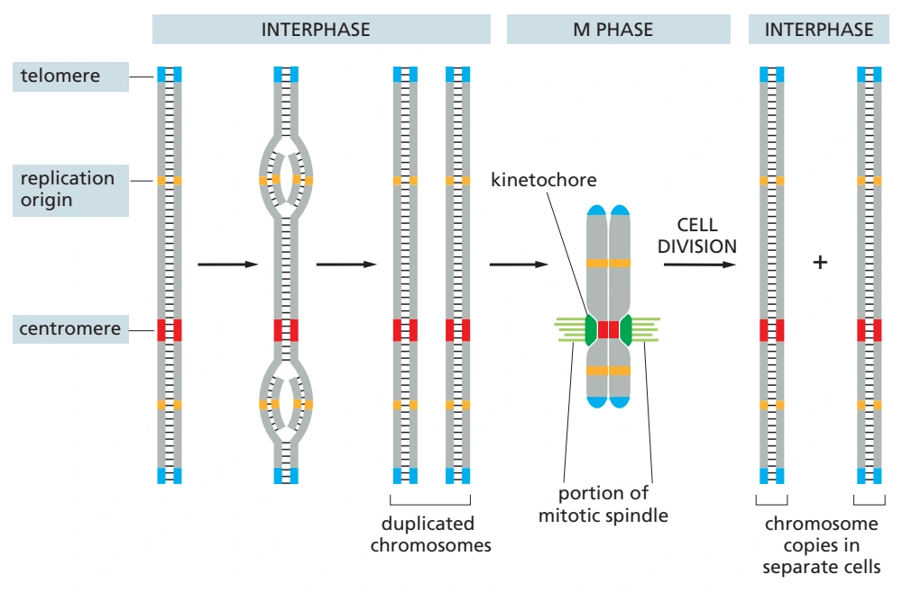{ width="680" height="443" loading=lazy }
/// caption
橙色为复制起点，红色为着丝粒，蓝色为端粒；绿色动粒在着丝粒区域装配，再连接纺锤体。[^fig-chromosome-elements]
///

进入分裂期后，凝缩蛋白复合体（condensin）促进染色体形成有组织的环与轴向压缩，拓扑异构酶 II 处理 DNA 链间缠结；cohesin 维持复制后姐妹染色单体的联系，并在分离前受到调控。染色体于是缩短、增粗，姐妹染色单体也变得容易分辨。着丝粒区域常形成主缢痕，根据两臂相对长度，可描述为中着丝粒、亚中着丝粒、近端着丝粒和端着丝粒染色体；p、q 分别表示短臂和长臂。

**着丝粒是染色质区域，动粒是其上装配的蛋白复合体。** 在许多真核生物中，含 CENP-A 的核小体为动粒装配提供基础；外侧的 Ndc80 等组分连接微管，并与检查点及纠错系统配合。芽殖酵母的点着丝粒具有较强的序列规定，哺乳动物常为较大的区域着丝粒，还有一些生物沿染色体较广范围形成动粒，称为全着丝粒或弥散着丝粒类型。姐妹分离的完整过程见[细胞分裂](cell_cycle.md)。

端粒通常由重复 DNA、富 G 的单链末端及结合蛋白组成。哺乳动物端粒含 TTAGGG 重复，shelterin 等蛋白帮助避免天然末端被当作断裂；端粒酶利用自身 RNA 模板延长 DNA 的 3′ 端，随后还需补齐另一条链。生殖系、部分干细胞和许多癌细胞可维持较高端粒酶活性，另一些细胞使用替代性端粒延长（ALT）途径。复制损失、维护活性与复制压力共同决定长度变化，每轮复制后的长度变化因细胞与状态而异。

核仁组织区（NOR）含串联 rDNA，活跃 NOR 可参与组织核仁，常与某些染色体的次缢痕相联系。次缢痕外侧的小段染色体称为随体；并非每条次缢痕都属于 NOR。“随体”这一形态名称和“卫星 DNA”这一重复序列名称，也不是同一个概念。

??? note "核型、带型与额外的染色体"

    核型描述一组染色体的数目和形态；带型进一步提供沿染色体定位的标记。G 带经适当处理后用 Giemsa 染色，深带通常较富 AT、基因较少；Q 带的荧光亮带与许多 G 深带对应，R 带大体呈相反模式。C 带突出部分组成型异染色质，T 带突出染色体末端的一部分 R 带区域，Ag-NOR 银染则主要显示活跃 NOR 相关的嗜银蛋白。各种带型的分辨率和可见范围不同。[^chromosome-banding]

    无着丝粒片段或分离滞后的染色体可能未进入主核而形成微核，随后发生丢失或进一步损伤。结构重排也可产生可辨认的标记染色体，例如费城染色体所涉及的易位，具体见[染色体结构变异](../genetics/chromosome_variation.md#structural-variant-formation)。

    有些物种还存在基本 A 染色体组之外的 B 染色体。它们在个体间的有无、数目、基因含量和传递方式可以不同；某些 B 染色体通过偏向性的分配提高传递率。黑麦 B 染色体就含有可转录基因，不能统一称为“没有活性的多余碎片”。它对生长和育性的影响需要连同物种、剂量和遗传背景讨论。[^b-chromosome]

### 被放大的染色体组织 { #giant-chromosomes }

果蝇幼虫唾腺等细胞反复复制 DNA，却不把复制产物分开。许多副本准确并列，加上同源染色体的体细胞配对，形成粗大的多线染色体。深色带和浅色间带沿其排列，局部强转录区可以膨出成 puff；近着丝粒异染色质聚集为染色中心。下图左上角的小框画了相同比例下普通中期染色体的大小——平时难看清的细节，这次确实被放大了。

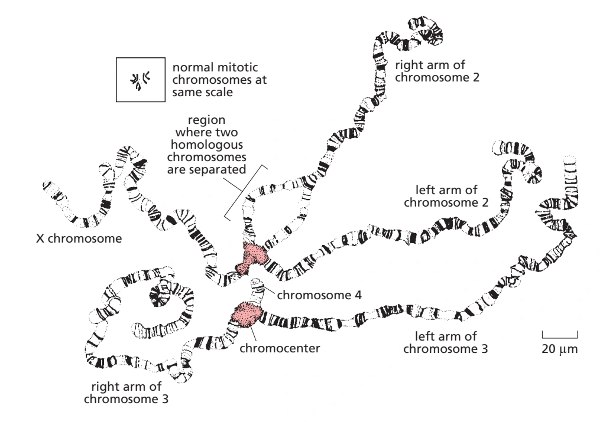{ width="680" height="477" loading=lazy }
/// caption
这是依据压片显微图绘制的图解；同源染色体与多轮复制的副本相互对齐。粉色染色中心在压片时被分成两部分，比例尺 20 μm。[^fig-polytene]
///

两栖类生长期卵母细胞常停留在减数第一次分裂前期的双线期，此时可见典型的灯刷染色体。染色体轴附近保留较致密的染色质，活跃转录区伸成大量侧环，新生 RNA 与结合蛋白沿环分布。它突出的是转录使局部染色质伸展的状态，与通过多轮复制形成多线染色体的方式不同。

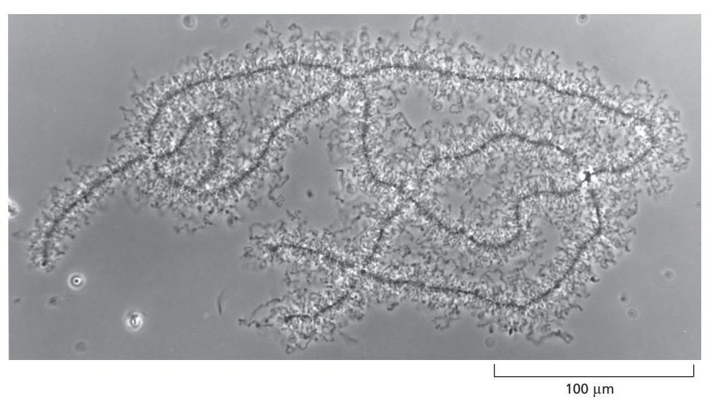{ width="680" height="385" loading=lazy }
/// caption
侧环从染色体轴向外伸出，参与卵母细胞生长期的大量 RNA 合成；比例尺 100 μm。[^fig-lampbrush]
///

基因组大小、编码和非编码序列、串联重复及 LINE／SINE 等散布重复另见[遗传物质、基因与基因组](../molecular/genetic_material.md#repetitive-dna)。其中的[C 值讨论](../molecular/genetic_material.md#genome-size-complexity)解释了为何 DNA 总量不能直接给生物复杂性排队；它也不等于显微镜下数出的染色体条数。

## 核仁与核体 { #nucleolus-nuclear-bodies }

### 核仁中的 rRNA 加工与装配 { #nucleolus-organization }

在下面的人纤维细胞切片中，核仁是一团深染结构，却没有自己的包膜。放大后，其中还有深浅和质地不同的区域：较浅的纤维中心（FC）、周围较深的致密纤维组分（DFC），以及外围的颗粒组分（GC）。这些名字来自电镜下的外观，随后才逐渐同分子的分工对应起来。[^ribosome-biogenesis]

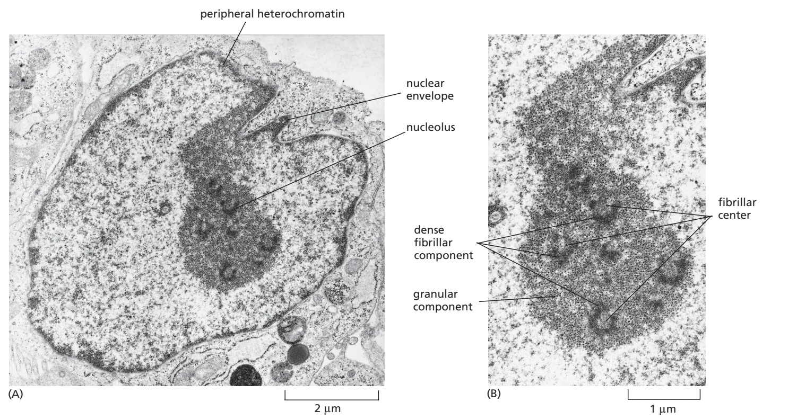{ width="680" height="359" loading=lazy }
/// caption
右图可分辨较浅的 FC、围绕其周围的 DFC 和外侧 GC；左、右比例尺分别为 2 μm、1 μm。[^fig-nucleolus-em]
///

活跃的 rDNA 转录区域通常位于 FC／DFC 界面附近。RNA 聚合酶 I 沿 rDNA 前进，产生长的前体 rRNA；转录本边延伸，边接受修饰、切割和蛋白结合。把正在转录的 rDNA 铺展开，常可看到一棵棵“圣诞树”：DNA 是主轴，不同聚合酶正在延伸的 RNA 是逐渐变长的侧枝。相邻转录单位之间还能见到没有侧枝的间隔。

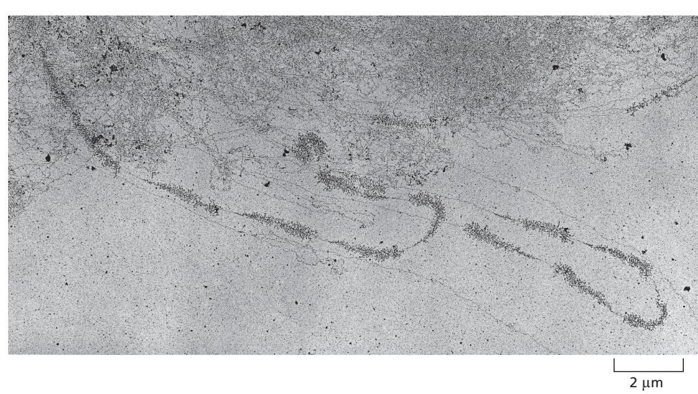{ width="680" height="384" loading=lazy }
/// caption
沿一个转录单位，新生 RNA 侧枝由短变长；多个转录单位沿同一段 DNA 接续排列，比例尺 2 μm。[^fig-rrna-transcription]
///

哺乳动物的初始前体称为 **47S pre-rRNA**，经过早期切割可形成 45S 中间体，其中包含未来的 18S、5.8S 和 28S rRNA，以及要去除的外部和内部间隔序列。18S 最终进入小亚基，5.8S 和 28S 进入大亚基。大亚基还需要 5S rRNA，它由 RNA 聚合酶 III 在核仁外转录后进入装配。不同物种的前体名称和加工中间体有所不同，例如芽殖酵母常称 35S 前体，并产生 25S 而非哺乳动物的 28S rRNA。[^rrna-precursor]

小核仁 RNA（snoRNA）与蛋白形成 snoRNP，一段向导序列同前体 rRNA 互补配对，把修饰酶准确放到目标核苷酸附近。常见修饰包括核糖的 2′-O-甲基化和尿苷转变为假尿苷。这里“认位置”主要依靠 RNA 配对，“做化学反应”则由相应 snoRNP 中的酶执行；部分 snoRNP 还参与加工位点和整体折叠的组织。

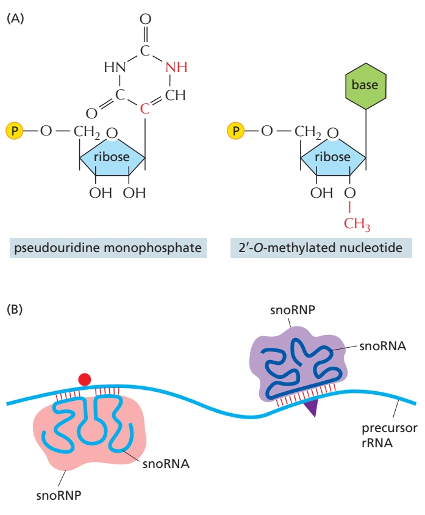{ width="420" height="509" loading=lazy }
/// caption
上方显示假尿苷和 2′-O-甲基化核苷酸，下方显示 snoRNA 对前体 rRNA 的定位；红色标出化学差异或待修饰位置。[^fig-snorna-guide]
///

新合成的核糖体蛋白从胞质输入，和加工中的 rRNA 一同装配。早期修饰与加工较多位于 DFC，后续装配颗粒较多出现在 GC；这是相互衔接、部分重叠的过程。前 40S、前 60S 颗粒随后分别经核孔输出，还要在胞质完成末端加工、装配因子释放和功能检查，才能投入翻译。核仁体积常随核糖体生产需求变化；不同细胞、物种和生长状态下，亚区的数量与排列也会不同。[^ribosome-biogenesis]

开放式有丝分裂时，Pol I 转录受到抑制，核仁组分重新分布。退出分裂后，部分加工因子先聚成前核仁体（PNB），再同活跃 NOR 汇合，恢复核仁。经典 PtK2 细胞抗体微注射实验中，干扰 Pol I 没有阻止细胞完成分裂和形成 PNB，却阻碍了 PNB 在末期汇入 NOR 并建立新核仁；这把早期聚集与后续重建区分开来。[^nucleolus-reassembly]

### 没有膜，亚区如何保持不同？ { #nucleolar-phases }

用不同荧光蛋白标记核仁组分，可以看到亚区之间有选择性分配。Feric 等在非洲爪蟾卵母细胞核中，用 NPM1 标记 GC，FIB1／fibrillarin 标记 DFC，POLR1E 标记 FC。红、绿、蓝并没有均匀混在一起；绿色区又被较大的红色区包围。[^nucleolus-condensate]

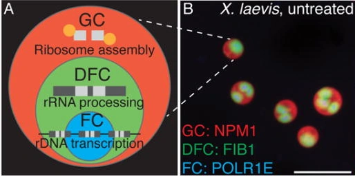{ width="514" height="256" loading=lazy }
/// caption
左为模型，右为荧光观察：GC 红色、DFC 绿色、FC 蓝色。右图比例尺 20 μm；这张图的物种与上方人细胞电镜不同。[^fig-nucleolus-colors]
///

这些区域又并非完全静止。用 latrunculin A 破坏核内肌动蛋白网络后，核仁更容易相遇和融合；下面的序列中，原先分开的红色区域逐渐合拢、变圆，内部绿色区域也继续重排。组分交换、融合后的形状松弛，加上体外重构，支持核仁中存在性质不同的凝聚相。

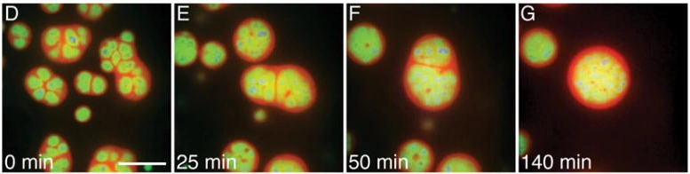{ width="680" height="172" loading=lazy }
/// caption
这是破坏肌动蛋白后的时间序列，不是未经处理核仁的普遍融合速度；颜色沿用上图，比例尺 20 μm。[^fig-nucleolus-fusion]
///

???+ abstract "把两类核仁蛋白放到体外"

    Feric 等还在含 rRNA 的体外体系中混合纯化的 NPM1 和 FIB1。在下图 A 的浓度条件下，绿色富 FIB1 液滴与红色富 NPM1 液滴共存，红色相部分包围绿色相；改变两种蛋白的浓度，可以分别只看到一种明显的凝聚相。右侧相图把这些浓度条件和观察结果对应起来。[^feric-reconstitution]

    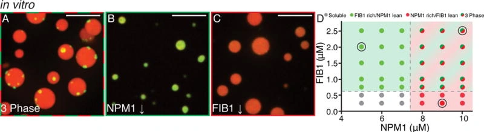{ width="680" height="185" loading=lazy }
    /// caption
    A：FIB1 2.5 μM、NPM1 10 μM；B：2 μM、5 μM；C：0.25 μM、9 μM。D 汇总浓度与相态；各显微图比例尺 10 μm。[^fig-nucleolus-in-vitro]
    ///

    这些实验帮助解释了没有脂膜时，亚区仍可分开又相互接触。细胞内的核仁还在持续转录、消耗能量、装配和输出颗粒，因此不能仅凭“看起来像液滴”就解释全部功能。人核仁中关于新生 pre-rRNA 分选和 DFC 装配的研究，又把凝聚行为与 RNA 的加工过程联系起来。[^nucleolus-condensate]

### 其他核体与核内支架 { #nuclear-bodies }

核仁之外也有许多组分富集区。下图中，核仁主要呈红色，核斑呈绿色；箭头指的小粉色点是同时含 fibrillarin 和 coilin 的 Cajal 体。它们都没有脂质包膜，却招募了不同的蛋白与 RNA。

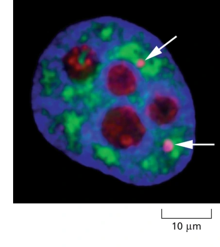{ width="420" height="473" loading=lazy }
/// caption
fibrillarin 为红色，剪接相关颗粒为绿色，DNA 为蓝色；Cajal 体因 coilin 信号叠加而呈粉色，箭头标出，比例尺 10 μm。[^fig-nuclear-bodies]
///

Cajal 体参与 snRNP、snoRNP 等颗粒的成熟与装配；SMN 蛋白可富集于 Cajal 体，也可形成与它分开的 gems 核体。核斑富含剪接相关因子，随转录状态改变形态，并与邻近活跃基因交换组分；很多剪接反应同时发生在正在转录的 RNA 上。PML 核体则与蛋白修饰、应激及基因组维护相连。某种蛋白在核体中富集，提供了局部反应环境的线索，具体哪一步在哪里发生，还要结合标记、动力学和功能干预。[^nuclear-bodies-source]

“核基质”这个历史术语来自抽提实验：用去垢剂、高盐和核酸酶去除大量核内成分后，剩下网架状结构。它推动了核内支架的研究，但抽提本身也会改变聚集状态、移走动态组分。如今讨论机械支撑和反应组织时，更适合分别指明核纤层、染色质、核体以及 RNA—蛋白网络，再问它们在完整细胞中如何连接、交换和响应扰动。

## 核糖体的结构与 RNA 催化核心 { #ribosome-architecture }

核仁的产物最终进入胞质，成为核糖体的一部分。细菌核糖体通常为 70S，由 30S 小亚基和 50S 大亚基组成；真核细胞质核糖体通常为 80S，由 40S 和 60S 组成。S 是斯维德伯格单位，描述沉降行为，受到质量、形状及水合状态共同影响。50S 加 30S 得到 70S，名字里这道“算术题”并没有算错，只是数值本来就不相加。[^ribosome-structures]

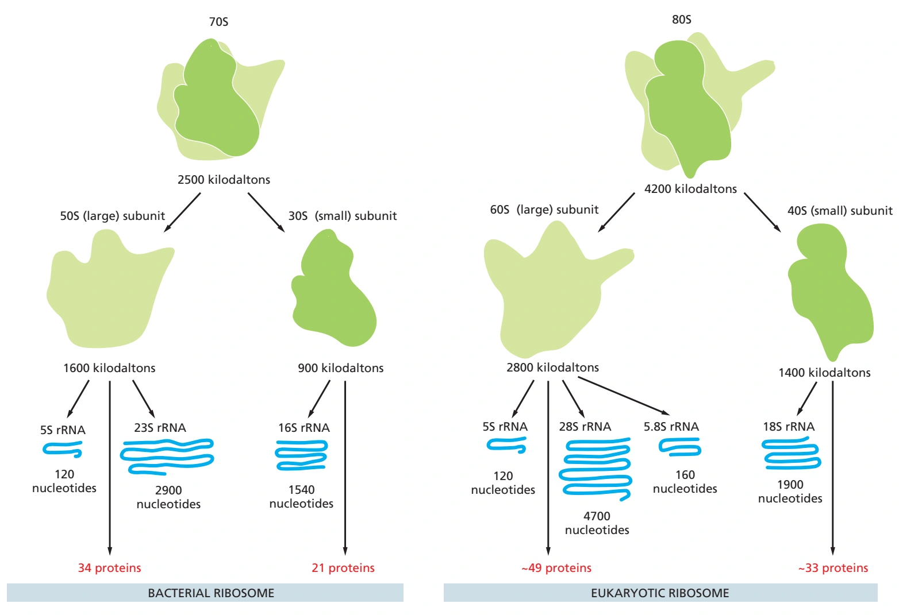{ width="680" height="466" loading=lazy }
/// caption
顺箭头从整体追到亚基、rRNA 和蛋白。图中质量、核苷酸长度与蛋白数为教材代表值，不能推广为各谱系的固定常数。[^fig-ribosome-subunits]
///

| 系统 | 小亚基的主要 rRNA | 大亚基的主要 rRNA | 典型整体沉降值 |
| --- | --- | --- | --- |
| 细菌细胞质 | 16S | 23S、5S | 70S |
| 古菌细胞质 | 16S | 23S、5S | 70S |
| 真核细胞质 | 18S | 25S／28S 等大 rRNA、5.8S、5S | 80S |
| 线粒体与质体 | 随谱系而变 | 随谱系而变 | 随谱系而变 |

古菌在沉降分类上同为 70S，许多蛋白和发生因子却与真核同源物更接近。真核大亚基的大 rRNA 也有命名差异，例如芽殖酵母 25S 与哺乳动物 28S。细胞器核糖体经历了 RNA、蛋白组成的不同变化，尤其不能把全部线粒体核糖体统一填成 70S。

小亚基承载 mRNA，并在解码中心检查密码子—反密码子的配对；大亚基容纳肽酰转移酶中心和新生肽出口通道。tRNA 的反密码子端位于小亚基，携带氨基酸或肽链的 3′-CCA 端伸向大亚基。因此，A、P、E 位点横跨亚基界面，并不是大亚基内部的三个独立小孔。

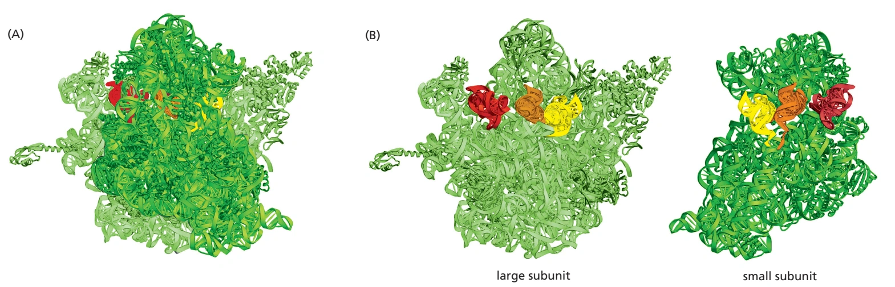{ width="680" height="219" loading=lazy }
/// caption
深、浅绿色分别为小、大亚基；A 位黄色，P 位橙色，E 位红色。右侧把亚基像书页一样打开，以显示 tRNA 两端所处的位置。[^fig-ribosome-sites]
///

延伸时，新的氨酰-tRNA 进入 A 位，P 位 tRNA 上的肽链转移给它携带的氨基酸。随后核糖体转位，原 A 位的肽酰-tRNA 移向 P 位，已经卸下肽链的 tRNA 经 E 位退出。起始 tRNA 则直接进入 P 位；A、P、E 的占据状态随循环变化，图上同时画出三条 tRNA 是为了标示位置。

核糖体的名字没有说“酶”，它却有一个 RNA 催化核心。rRNA 折成紧密的三维结构，将两条 tRNA 的反应端准确安排在肽酰转移酶中心；高分辨率结构显示，这个核心由 rRNA 构成，因而核糖体属于核酶。核糖体蛋白沿表面分布，也把延伸臂伸入内部，稳定 RNA 折叠并参与装配和构象调节。[^ribosomal-rna-catalysis] 这种由 RNA 承担催化核心的结构，也是[RNA 世界假说](../evolution/origin_history.md#rna-code)的一条线索；从现代遗存到早期生命的推断，还需要其他证据。

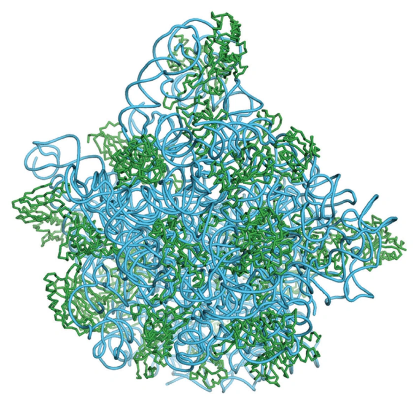{ width="420" height="410" loading=lazy }
/// caption
蓝色为 rRNA，绿色为蛋白；这是从背面看向大亚基的结构图，小亚基结合面朝向纸内。结构条目为 PDB 1FFK。[^fig-ribosome-rna]
///

多个核糖体可以同时翻译一条 mRNA，形成多核糖体。它们的间距随起始频率、延伸速度、停顿和碰撞质量控制而变。细菌中，翻译还可在 RNA 尚未完成转录时开始；真核核基因的 RNA 则要先跨过核质边界。

游离核糖体和粗面内质网结合核糖体来自同一可交换池。新生链露出合适的 ER 定位信号后，SRP 将核糖体—新生链复合物导向 ER；翻译结束后，亚基可被回收再用。Mg²⁺ 和其他离子有助于稳定 RNA 结构及亚基结合，但完整细胞中的装配、休眠和解离还受专门因子控制，不能只按培养液中 Mg²⁺ 高低来划分核糖体状态。

密码子如何被读取、tRNA 如何充氨，以及起始、延伸、终止和回收的步骤，见[翻译与蛋白质生物合成](../molecular/translation.md)。其中[tRNA 充氨](../molecular/translation.md#trna-aminoacylation)说明肽键形成所需的能量如何先储存在氨酰-tRNA 中；[细菌起始](../molecular/translation.md#bacterial-initiation)与[真核起始](../molecular/translation.md#eukaryotic-initiation)分别展开 SD 配对和 5′ 帽依赖招募。

## 怎样研究核内结构 { #nuclear-evidence }

这一页已经见过几种很不一样的图：电镜切片显示局部结构，荧光标记追踪特定组分，Hi-C 把大量细胞中的接触转成矩阵。它们各有长处，放在一起才能区分位置、动态和功能。

| 方法 | 主要读出 | 解释时需要保留的条件 |
| --- | --- | --- |
| 电镜、冷冻电镜与断层成像 | 核孔、核小体、核糖体及染色质结构 | 固定、纯化和平均可能改变或筛选构象；结构模型对应具体制样条件 |
| FISH、染色体涂染与活细胞标记 | 疆域、位点距离及组分运动 | 空间接近不等于直接结合；探针、标签和时间分辨率影响可见对象 |
| MNase、DNase、ATAC | 核小体保护或 DNA 可及性 | 酶偏好与细胞组成影响信号；开放区域未必正在转录 |
| 有机汞亲和层析（早期染色质分离方法） | 借助暴露的 H3 巯基等反应位点，保留部分核小体，再以 DTT 等洗脱 | 在一些哺乳动物材料中可富集转录活跃序列；H3 序列、非组蛋白和制样条件都会影响保留，不能作跨物种的通用“活性标签”[^thiol-chromatin] |
| ChIP 类方法 | 蛋白或修饰在基因组上的富集 | 抗体、交联和群体平均影响定位；富集本身不证明因果 |
| 3C、Hi-C 等 | 位点间连接频率 | 群体中的高频接触不等于每个细胞都有固定环 |
| FRAP、单粒子追踪与急性扰动 | 交换、停留时间及功能响应 | 荧光恢复需要合适的动力学模型；交换快慢本身不足以证明相分离 |

ATAC-seq 用 Tn5 在较可及的 DNA 上进行转座插入，Hi-C 则富集近邻连接产物：前者侧重“能否接近”，后者侧重“是否常在近处”。若要继续判断某个因子是否维持这些状态，还需改变该因子、跟踪先后顺序，并用恢复实验检验作用。观察与干预接上以后，图中的一团密度或一块颜色，才逐渐获得机制上的解释。[^chromatin-methods]

## 参考资料与延伸阅读 { #references }

- Alberts B, Heald R, Johnson A, et al. [*Molecular Biology of the Cell*](https://wwnorton.co.uk/books/9780393884852-molecular-biology-of-the-cell). 7th ed. W. W. Norton; 2022. Chapters 4, 6, 12, 16。机制主线与教材图版以第 7 版为准；下列公开旧版章节供补充阅读。

- Cooper GM. [The Nuclear Envelope and Traffic between the Nucleus and Cytoplasm](https://www.ncbi.nlm.nih.gov/books/NBK9927/). In: *The Cell: A Molecular Approach*. 2nd ed. Sinauer Associates; 2000.
- Alberts B, Johnson A, Lewis J, et al. [The Transport of Molecules between the Nucleus and the Cytosol](https://www.ncbi.nlm.nih.gov/books/NBK26932/). In: *Molecular Biology of the Cell*. 4th ed. Garland Science; 2002.
- Alberts B, Johnson A, Lewis J, et al. [Chromosomal DNA and Its Packaging in the Chromatin Fiber](https://www.ncbi.nlm.nih.gov/books/NBK26834/). In: *Molecular Biology of the Cell*. 4th ed. Garland Science; 2002.
- Cooper GM. [Chromosomes and Chromatin](https://www.ncbi.nlm.nih.gov/books/NBK9863/). In: *The Cell: A Molecular Approach*. 2nd ed. Sinauer Associates; 2000.
- Cooper GM. [Internal Organization of the Nucleus](https://www.ncbi.nlm.nih.gov/books/NBK9915/). In: *The Cell: A Molecular Approach*. 2nd ed. Sinauer Associates; 2000.
- Alberts B, Johnson A, Lewis J, et al. [From DNA to RNA](https://www.ncbi.nlm.nih.gov/books/NBK26887/). In: *Molecular Biology of the Cell*. 4th ed. Garland Science; 2002.
- Crisp M, Liu Q, Roux K, et al. [Coupling of the nucleus and cytoplasm: role of the LINC complex](https://pubmed.ncbi.nlm.nih.gov/16380439/). *Journal of Cell Biology*. 2006;172:41–53.
- Luger K, Mäder AW, Richmond RK, Sargent DF, Richmond TJ. [Crystal structure of the nucleosome core particle at 2.8 Å resolution](https://pubmed.ncbi.nlm.nih.gov/9305837/). *Nature*. 1997;389:251–260.
- Mosalaganti S, Obarska-Kosinska A, Siggel M, et al. [AI-based structure prediction empowers integrative structural analysis of human nuclear pores](https://pubmed.ncbi.nlm.nih.gov/35679397/). *Science*. 2022;376:eabm9506.
- Ou HD, Phan S, Deerinck TJ, Thor A, Ellisman MH, O'Shea CC. [ChromEMT: Visualizing 3D chromatin structure and compaction in interphase and mitotic cells](https://pubmed.ncbi.nlm.nih.gov/28751582/). *Science*. 2017;357:eaag0025.
- Lieberman-Aiden E, van Berkum NL, Williams L, et al. [Comprehensive mapping of long-range interactions reveals folding principles of the human genome](https://pubmed.ncbi.nlm.nih.gov/19815776/). *Science*. 2009;326:289–293.
- Guelen L, Pagie L, Brasset E, et al. [Domain organization of human chromosomes revealed by mapping of nuclear lamina interactions](https://pubmed.ncbi.nlm.nih.gov/18463634/). *Nature*. 2008;453:948–951.
- Feric M, Vaidya N, Harmon TS, et al. [Coexisting Liquid Phases Underlie Nucleolar Subcompartments](https://pmc.ncbi.nlm.nih.gov/articles/PMC5127388/). *Cell*. 2016;165:1686–1697.
- Yao RW, Xu G, Wang Y, et al. [Nascent Pre-rRNA Sorting via Phase Separation Drives the Assembly of Dense Fibrillar Components in the Human Nucleolus](https://pubmed.ncbi.nlm.nih.gov/31540874/). *Molecular Cell*. 2019;76:767–783.e11.
- Nissen P, Hansen J, Ban N, Moore PB, Steitz TA. [The structural basis of ribosome activity in peptide bond synthesis](https://pubmed.ncbi.nlm.nih.gov/10937990/). *Science*. 2000;289:920–930.
- Khatter H, Myasnikov AG, Natchiar SK, Klaholz BP. [Structure of the human 80S ribosome](https://pubmed.ncbi.nlm.nih.gov/25901680/). *Nature*. 2015;520:640–645.
- Buenrostro JD, Giresi PG, Zaba LC, Chang HY, Greenleaf WJ. [Transposition of native chromatin for fast and sensitive epigenomic profiling](https://pubmed.ncbi.nlm.nih.gov/24097267/). *Nature Methods*. 2013;10:1213–1218.

[^nuclear-compartment]: 细胞核作为基因组区室、核被膜及核仁的一般结构见 Cooper 的[核被膜与核质交通](https://www.ncbi.nlm.nih.gov/books/NBK9927/)和[核内组织](https://www.ncbi.nlm.nih.gov/books/NBK9915/)章节。
[^nuclear-envelope-source]: 双层核被膜、外膜与内质网连续、核孔处膜融合以及分裂期重构见 Cooper 的[核被膜章节](https://www.ncbi.nlm.nih.gov/books/NBK9927/)。
[^lamina-linc]: SUN—KASH 蛋白跨越核周隙连接核与胞质的直接证据及 LINC 命名见 Crisp 等的[研究](https://pubmed.ncbi.nlm.nih.gov/16380439/)；lamina-associated domain 的基因组尺度证据见 Guelen 等的[核纤层互作图谱](https://pubmed.ncbi.nlm.nih.gov/18463634/)。
[^npc-architecture]: 人 NPC 的重复亚复合体、近八重对称与原位整合结构见 Mosalaganti 等的[人核孔结构研究](https://pubmed.ncbi.nlm.nih.gov/35679397/)；经典结构与 FG-nucleoporin 屏障见 Cooper 的[核质交通章节](https://www.ncbi.nlm.nih.gov/books/NBK9927/)。
[^nuclear-transport]: importin／exportin、NLS／NES 与 Ran-GTP 梯度赋予运输方向的机制见 Alberts 等的[核质运输章节](https://www.ncbi.nlm.nih.gov/books/NBK26932/)。
[^nucleosome-structure]: 146 bp DNA 围绕组蛋白八聚体的高分辨率结构见 Luger 等的[核小体核心晶体结构](https://pubmed.ncbi.nlm.nih.gov/9305837/)；核小体、连接 DNA 和更高层组织的一般框架见 Alberts 等的[染色质包装章节](https://www.ncbi.nlm.nih.gov/books/NBK26834/)。
[^chromatin-fiber]: ChromEMT 对间期和分裂期染色质不规则链与局部密度的原位观察见 Ou 等的[三维染色质研究](https://pubmed.ncbi.nlm.nih.gov/28751582/)，经典核小体纤维模型的来源和适用条件见 Alberts 等的[染色质包装章节](https://www.ncbi.nlm.nih.gov/books/NBK26834/)。
[^genome-folding]: 染色体疆域、A／B 区室和全基因组接触概率的 Hi-C 证据见 Lieberman-Aiden 等的[长程相互作用图谱](https://pubmed.ncbi.nlm.nih.gov/19815776/)。
[^lamina-domains]: 人成纤维细胞中大尺度核纤层互作域及其与较低表达的关系见 Guelen 等的[LAD 图谱](https://pubmed.ncbi.nlm.nih.gov/18463634/)。
[^centromere-kinetochore]: 着丝粒、动粒、端粒、核仁组织区和特殊染色体的一般结构与实验观察见 Cooper 的[染色体与染色质章节](https://www.ncbi.nlm.nih.gov/books/NBK9863/)。
[^nucleolus-condensate]: 核仁亚区分配、融合及 NPM1／FIB1 两类凝聚相的材料证据见 Feric 等的[核仁亚区研究](https://pmc.ncbi.nlm.nih.gov/articles/PMC5127388/)；新生 pre-rRNA 分选与 DFC 装配的联系见 Yao 等的[人核仁研究](https://pubmed.ncbi.nlm.nih.gov/31540874/)。
[^ribosome-biogenesis]: rDNA 转录、pre-rRNA 加工及核仁内核糖体亚基装配的经典框架见 Alberts 等的[从 DNA 到 RNA](https://www.ncbi.nlm.nih.gov/books/NBK26887/)和 Cooper 的[核内组织](https://www.ncbi.nlm.nih.gov/books/NBK9915/)章节；核仁多相组织的现代补充见 Yao 等的[研究](https://pubmed.ncbi.nlm.nih.gov/31540874/)。
[^ribosome-structures]: 细菌 70S、真核 80S、rRNA／蛋白组成及沉降单位的基本比较见 Cooper 的[核内组织章节](https://www.ncbi.nlm.nih.gov/books/NBK9915/)；人 80S 的近原子分辨率结构见 Khatter 等的[结构研究](https://pubmed.ncbi.nlm.nih.gov/25901680/)。
[^ribosomal-rna-catalysis]: 肽酰转移酶中心以 rRNA 构成催化核心的结构证据见 Nissen 等的[核糖体催化研究](https://pubmed.ncbi.nlm.nih.gov/10937990/)；人 80S 亚基、位点与出口通道的整体结构见 Khatter 等的[研究](https://pubmed.ncbi.nlm.nih.gov/25901680/)。
[^chromatin-methods]: ATAC-seq 以 Tn5 转座反应读取天然染色质可及性的原始方法见 Buenrostro 等的[研究](https://pubmed.ncbi.nlm.nih.gov/24097267/)；Hi-C 的全基因组接触概率框架见 Lieberman-Aiden 等的[研究](https://pubmed.ncbi.nlm.nih.gov/19815776/)。

[^nuclear-envelope-disease]: Eriksson 等（2003）关于 [LMNA 剪接与 HGPS](https://www.nature.com/articles/nature01629)的原始研究；Chen 等关于[非典型 Werner 综合征中的 LMNA 变异](https://doi.org/10.1016/S0140-6736(03)14069-X)；Hoffmann 等（2002）关于 [LBR 与遗传性 Pelger–Huët 核形态异常](https://www.nature.com/articles/ng925)的研究。这里只比较分子身份与核形态，不作诊断判据。

[^chromatin-mboc]: Alberts 等，[*Molecular Biology of the Cell* 第 7 版](https://wwnorton.co.uk/books/9780393884852-molecular-biology-of-the-cell)，第 4 章，尤其 pp.197–217；核小体结构、组蛋白伴侣、ATP 依赖重塑、组蛋白修饰和变体。染色质小体约 166 bp 的核酸酶保护定义另见 Bharath 等的[结构建模研究](https://academic.oup.com/nar/article/31/14/4264/2904444)，该大小是实验性保护片段而非统一重复长度。

[^linker-histones]: 芽殖酵母 Hho1 的识别与功能研究见[原始论文](https://pubmed.ncbi.nlm.nih.gov/9393443/)；鸡红细胞中 H1、H5 的共存与不同重排行为见 Lasters 等，[Differences in rearrangements of H1 and H5 in chicken erythrocyte chromatin](https://pubmed.ncbi.nlm.nih.gov/7225320/)，Biochemistry 20:1104–1110 (1981)。

[^mrna-export-route]: NXF1–NXT1 的结构与输出作用见[结构及突变研究](https://pmc.ncbi.nlm.nih.gov/articles/PMC4330390/)；Dbp5 的 ATP 循环与 mRNP 重塑见 Montpetit 等的[结构与生化研究](https://pmc.ncbi.nlm.nih.gov/articles/PMC3078754/)和 Noble 等的[核苷酸循环研究](https://pmc.ncbi.nlm.nih.gov/articles/PMC3093122/)。哺乳动物同源蛋白常记为 DDX19。

[^chromemt-original]: Ou 等，[ChromEMT: Visualizing 3D chromatin structure and compaction in interphase and mitotic cells](https://pmc.ncbi.nlm.nih.gov/articles/PMC5646685/)，Science 357:eaag0025 (2017)，图 4、8。文中的染色质直径范围为 5–24 nm；样本为固定、染色后的细胞，不能写成活细胞录像。

[^tad-loop-source]: Rao 等，[A three-dimensional map of the human genome at kilobase resolution reveals principles of chromatin looping](https://pmc.ncbi.nlm.nih.gov/articles/PMC5635824/)，Cell 159:1665–1680 (2014)，提供局部环及相向 CTCF 基序的图谱证据；环挤出与染色体组织参见 MBoC 第 7 版 pp.223–226。局部图版所用 Micro-C 数据另见图源脚注。

[^chromosome-banding]: G、Q、R、C 带及其应用可对照 Cooper 的[染色体章节](https://www.ncbi.nlm.nih.gov/books/NBK9863/)；T 带为 Dutrillaux 的 [Nouveau système de marquage chromosomique: les bandes T](https://doi.org/10.1007/BF00396497)，Chromosoma 41:395–402 (1973)。带型描述的是特定处理下的染色差异；Ag-NOR 的嗜银对象为 NOR 相关蛋白，参见 Goodpasture 与 Bloom 的[原始方法](https://pubmed.ncbi.nlm.nih.gov/53131/)。

[^b-chromosome]: 黑麦 B 染色体的序列组成、表达及偏向传递见 [The genetic mechanism of B chromosome drive in rye illuminated by chromosome-scale assembly](https://pmc.ncbi.nlm.nih.gov/articles/PMC11549084/)（2024）。此处只据此说明 B 染色体可含表达基因及传递偏倚，不将其具体机制推广到所有物种。

[^rrna-precursor]: 哺乳动物 47S／45S 前体与加工位点见 Tafforeau 等，[The complexity of human ribosome biogenesis revealed by systematic nucleolar screening of pre-rRNA processing factors](https://pubmed.ncbi.nlm.nih.gov/23973377/)，Molecular Cell 51:539–551 (2013)。47S 至 45S 的早期切割还见[人细胞前体加工研究图 1](https://pmc.ncbi.nlm.nih.gov/articles/PMC6239190/)；核内外加工衔接亦可参照本站 [rRNA 加工](../molecular/rna_processing.md#rrna-processing)。

[^nucleolus-reassembly]: Benavente 等，[Inhibition of nucleolar reformation after microinjection of antibodies to RNA polymerase I into mitotic cells](https://pubmed.ncbi.nlm.nih.gov/3312231/)，J Cell Biol 105:1483–1491 (1987)。实验对象为分裂中的 PtK2 培养细胞；抗体没有阻止正常分裂进程与前核仁体形成，主要阻碍后续与 NOR 的汇合。

[^feric-reconstitution]: Feric 等（2016），[公开全文](https://pmc.ncbi.nlm.nih.gov/articles/PMC5127388/)，图 4A–D 及体外相分离方法；体系含 rRNA，蛋白浓度见图注。体外重构支持多相分配的物理机制，不能单凭融合图推断核仁的全部功能。

[^nuclear-bodies-source]: 核仁、Cajal 体、核斑和核基质的一般组织见 Cooper 的[核内组织章节](https://www.ncbi.nlm.nih.gov/books/NBK9915/)及 MBoC 第 7 版 pp.355–357；SMN、gems 与 Cajal 体的细胞类型相关分布见 Carvalho 等的[原始研究](https://pmc.ncbi.nlm.nih.gov/articles/PMC2156166/)（1999）。

[^nup-glycosylation]: Nup62 等核孔蛋白的 O-GlcNAc 修饰及其稳定性、通透性作用见 [Post-translational O-GlcNAcylation is essential for nuclear pore integrity and maintenance of the pore selectivity filter](https://academic.oup.com/jmcb/article/8/1/2/2459541)，Journal of Molecular Cell Biology 8:2–16 (2016)。这里的糖修饰位于核／胞质侧蛋白，不是内质网腔内的分泌途径糖基化。

[^histone-deposition]: Sobel 等，[Conservation of deposition-related acetylation sites in newly synthesized histones H3 and H4](https://pubmed.ncbi.nlm.nih.gov/7862667/)，PNAS 92:1237–1241 (1995)。果蝇与 HeLa 的 H4 位点为 K5、K12；四膜虫同源位置的编号不同。

[^x-reactivation]: 小鼠内细胞团中父源 X 的再激活见 Williams 等，[Transcription precedes loss of Xist coating and depletion of H3K27me3 during X-chromosome reprogramming in the mouse inner cell mass](https://pmc.ncbi.nlm.nih.gov/articles/PMC3082307/)，Development 138:2049–2057 (2011)。本文比较基因重新转录与 Xist／染色质标记消失的先后，不把所有标记消失当成再激活的必要前提；小鼠与人发育背景另见 MBoC 第 7 版的表观遗传调控讨论。

[^heteropycnosis]: 不同分裂阶段的实例见 [Cytotaxonomic Characterization of the Genera Scleratoscopia and Tetanorhynchus (Orthoptera-Proscopiidae)](https://www.jstage.jst.go.jp/article/cytologia1929/61/2/61_2_169/_article)，Cytologia 61:169–178 (1996)，图 3。这里保留相对凝缩与染色差别的历史术语，不把正、负分别固定为某一种染色质成分。

[^thiol-chromatin]: Allegra 等，[Affinity chromatographic purification of nucleosomes containing transcriptionally active DNA sequences](https://pubmed.ncbi.nlm.nih.gov/3656449/)，J Mol Biol 196:379–388 (1987)；不同结合方式、DTT 洗脱及酵母 H3 缺少相应半胱氨酸的限制见后续 [J Biol Chem 265:5736–5746 (1990) 研究](https://doi.org/10.1016/S0021-9258(19)39425-6)。此处仅保留分离方法的依据与适用条件。

[^fig-envelope-lamina]: Alberts 等，*Molecular Biology of the Cell* 第 7 版（2022），图 12–54，p.735；从教材 PDF 裁取。保留 A、B；B 改自 Turgay 等，Nature 543:261–264 (2017)，[doi:10.1038/nature21382](https://doi.org/10.1038/nature21382)。核纤层图为结构成像的伪彩表示。

[^fig-linc]: Alberts 等，*Molecular Biology of the Cell* 第 7 版（2022），图 16–67，p.1012；从教材 PDF 裁取。裁取 SUN–KASH 连接模型，保留膜拓扑、核周隙及三类胞质连接标签。

[^fig-nuclear-pore]: Alberts 等，*Molecular Biology of the Cell* 第 7 版（2022），图 12–55，p.737；从教材 PDF 裁取。保留 A–D。B 为 Goldberg 与 Allen 的卵母细胞核篮扫描电镜，[doi:10.1083/jcb.119.6.1429](https://doi.org/10.1083/jcb.119.6.1429)；C 由 Werner Franke、Ulrich Scheer 提供，D 由 Ron Milligan 提供。A 为模型。

[^fig-nls-mutation]: Alberts 等，*Molecular Biology of the Cell* 第 7 版（2022），图 12–56，p.738；从教材 PDF 裁取。A、B 来自 Kalderon 等，Cell 39:499–509 (1984)，[doi:10.1016/0092-8674(84)90457-4](https://doi.org/10.1016/0092-8674(84)90457-4)。保留序列、替换位点及 20 μm 比例尺。

[^fig-ran-cycle]: Alberts 等，*Molecular Biology of the Cell* 第 7 版（2022），图 12–61，p.741；从教材 PDF 裁取。保留输入、输出两条完整循环；这是受体与 Ran 结合状态的简化模型。

[^fig-envelope-reassembly]: Alberts 等，*Molecular Biology of the Cell* 第 7 版（2022），图 12–65，p.744；从教材 PDF 裁取。保留细胞周期、磷酸化与膜重建箭头；正文补充核膜与 ER 的连续关系。

[^fig-mrna-export]: Alberts 等，*Molecular Biology of the Cell* 第 7 版（2022），图 6–39，p.350；从教材 PDF 裁取。A 改自 Daneholt，Cell 88:585–588 (1997)；B 来自 Stevens 与 Swift，J Cell Biol 31:55–77 (1966)，[doi:10.1083/jcb.31.1.55](https://doi.org/10.1083/jcb.31.1.55)。保留核／胞质方向、箭头和比例尺。

[^fig-nucleosome-em]: Alberts 等，*Molecular Biology of the Cell* 第 7 版（2022），图 4–21，p.198；从教材 PDF 裁取。A 由 Barbara Hamkalo 提供，B 由 Victoria Foe 提供。保留 A、B 与 50 nm 比例尺；均为分离染色质，其中 B 另经解凝聚处理。

[^fig-nucleosome-core]: Alberts 等，*Molecular Biology of the Cell* 第 7 版（2022），图 4–23，p.199；从教材 PDF 裁取。改自 Luger 等，Nature 389:251–260 (1997)，[doi:10.1038/38444](https://doi.org/10.1038/38444)；保留两个视角、组蛋白图例与 H3 尾标记。

[^fig-remodeling]: Alberts 等，*Molecular Biology of the Cell* 第 7 版（2022），图 4–26，p.201；从教材 PDF 裁取。A 为滑动示意，B 为 SWR1–核小体结构，条目 [PDB 6GEJ](https://www.rcsb.org/structure/6GEJ)。

[^fig-territories]: Alberts 等，*Molecular Biology of the Cell* 第 7 版（2022），图 4–50，p.221；从教材 PDF 裁取。改自 Hübner 与 Spector，Annu Rev Biophys 39:471–489 (2010)，[doi:10.1146/annurev.biophys.093008.131348](https://doi.org/10.1146/annurev.biophys.093008.131348)。原教材为涂染后的三维重建，保留 3、5、11 号与比例尺。

[^fig-tad-map]: Alberts 等，*Molecular Biology of the Cell* 第 7 版（2022），图 4–54，p.223；从教材 PDF 裁取。图 A 由 Oliver Rando 提供，数据来自 Krietenstein 等，Mol Cell 78:554–565 (2020)，[doi:10.1016/j.molcel.2020.03.003](https://doi.org/10.1016/j.molcel.2020.03.003)。所示为人纤维细胞 chr8:125,034,652–126,909,657 的 Micro-C 数据，B 为教材整理的模型；不是 2009 年 Hi-C 论文中的图。

[^fig-lysine-modification]: Alberts 等，*Molecular Biology of the Cell* 第 7 版（2022），图 4–34A，p.206；从教材 PDF 裁取。仅裁取 A 的赖氨酸乙酰化与甲基化结构，保留电荷和各级甲基化标记。

[^fig-position-effect]: Alberts 等，*Molecular Biology of the Cell* 第 7 版（2022），图 4–33，p.205；从教材 PDF 裁取。裁取染色体倒位与红白眼表型示意；这是一幅教材图解，不是原始果蝇照片。

[^fig-reader-writer]: Alberts 等，*Molecular Biology of the Cell* 第 7 版（2022），图 4–39，p.211；从教材 PDF 裁取。保留 A、B 两部分，分别为读—写扩展和去修饰逆转的概括模型。

[^fig-chromosome-elements]: Alberts 等，*Molecular Biology of the Cell* 第 7 版（2022），图 4–19，p.196；从教材 PDF 裁取。裁取复制、动粒连接和分离的完整示意，保留复制起点、着丝粒与端粒颜色。

[^fig-lampbrush]: Alberts 等，*Molecular Biology of the Cell* 第 7 版（2022），图 4–45，p.218；从教材 PDF 裁取。光镜图由 Joseph G. Gall 提供；两栖类卵母细胞，保留 100 μm 比例尺。双线期背景可参见 [Gall 与 Murphy 的原始研究](https://pmc.ncbi.nlm.nih.gov/articles/PMC25301/)。

[^fig-polytene]: Alberts 等，*Molecular Biology of the Cell* 第 7 版（2022），图 4–47，p.219；从教材 PDF 裁取。依据 Painter，J Hered 25:465–476 (1934) 的显微材料绘制；为教材整理的压片图解，保留染色体编号、同源分离处、分裂染色体大小对照与 20 μm 比例尺。

[^fig-nucleolus-em]: Alberts 等，*Molecular Biology of the Cell* 第 7 版（2022），图 6–44，p.353；从教材 PDF 裁取。人纤维细胞薄切片电镜由 E. G. Jordan 与 J. McGovern 提供，保留核全景、核仁放大图及各自比例尺。

[^fig-rrna-transcription]: Alberts 等，*Molecular Biology of the Cell* 第 7 版（2022），图 6–41，p.352；从教材 PDF 裁取。来自 V. E. Foe 对 Oncopeltus fasciatus 的研究，Cold Spring Harb Symp Quant Biol 42:723–740 (1978)，[doi:10.1101/SQB.1978.042.01.074](https://doi.org/10.1101/SQB.1978.042.01.074)。保留转录单位、间隔区及 2 μm 比例尺。

[^fig-snorna-guide]: Alberts 等，*Molecular Biology of the Cell* 第 7 版（2022），图 6–43，p.353；从教材 PDF 裁取。保留 A 的两类化学修饰和 B 的 snoRNA 配对定位模型。

[^fig-nuclear-bodies]: Alberts 等，*Molecular Biology of the Cell* 第 7 版（2022），图 6–50，p.356；从教材 PDF 裁取。引自 Swedlow 与 Lamond，Genome Biol 2:reviews0002 (2001)，[doi:10.1186/gb-2001-2-3-reviews0002](https://doi.org/10.1186/gb-2001-2-3-reviews0002)；显微图由 Judith Sleeman 提供。裁取图像、箭头与 10 μm 比例尺。

[^fig-ribosome-subunits]: Alberts 等，*Molecular Biology of the Cell* 第 7 版（2022），图 6–65，p.366；从教材 PDF 裁取。裁取整体—亚基—组分对照；核苷酸数、蛋白数与质量为教材的代表值。

[^fig-ribosome-sites]: Alberts 等，*Molecular Biology of the Cell* 第 7 版（2022），图 6–66A–B，p.367；从教材 PDF 裁取。仅裁取 A、B；结构依据 Yusupov 等，Science 292:883–896 (2001)，[doi:10.1126/science.1060089](https://doi.org/10.1126/science.1060089)。图用于显示三个位点的空间关系。

[^fig-ribosome-rna]: Alberts 等，*Molecular Biology of the Cell* 第 7 版（2022），图 6–72，p.372；从教材 PDF 裁取。原图指定 [PDB 1FFK](https://www.rcsb.org/structure/1FFK)，核对数据库后按古菌 Haloarcula marismortui 标注，未沿用教材图注中的“bacterial”。原结构为 Ban 等，Science 289:905–920 (2000)，[doi:10.1126/science.289.5481.905](https://doi.org/10.1126/science.289.5481.905)。

[^fig-chromemt-chains]: Ou 等，Science 357:eaag0025 (2017)，[原文](<https://pmc.ncbi.nlm.nih.gov/articles/PMC5646685/>), 图 8C–D。裁取 C、D，保留局部直径、方向和各排 40 nm 比例尺。

[^fig-hic-method]: Lieberman-Aiden 等，Science 326:289–293 (2009)，[原文](<https://pmc.ncbi.nlm.nih.gov/articles/PMC2858594/>), 图 1A。裁取 A，保留完整实验流程。

[^fig-hic-compartments]: Lieberman-Aiden 等，Science 326:289–293 (2009)，[原文](<https://pmc.ncbi.nlm.nih.gov/articles/PMC2858594/>), 图 3A–C。裁取 A–C。A 接触计数 0–200；B 观测／期望比值 0.2–5；C Pearson 相关系数 −1 至 1；刻度间距 10 Mb，分箱 1 Mb。

[^fig-nucleolus-colors]: Feric 等，Cell 165:1686–1697 (2016)，[原文](<https://pmc.ncbi.nlm.nih.gov/articles/PMC5127388/>), 图 1A–B。裁取 A、B；B 为未经 Lat-A 处理的爪蟾卵母细胞核，保留原颜色图例及 20 μm 比例尺。

[^fig-nucleolus-fusion]: Feric 等，Cell 165:1686–1697 (2016)，[原文](<https://pmc.ncbi.nlm.nih.gov/articles/PMC5127388/>), 图 1D–G。裁取 D–G；Lat-A 处理后的融合时间序列，保留全部时刻与 20 μm 比例尺。

[^fig-nucleolus-in-vitro]: Feric 等，Cell 165:1686–1697 (2016)，[原文](<https://pmc.ncbi.nlm.nih.gov/articles/PMC5127388/>), 图 4A–D。裁取 A–D；保留三个浓度条件下的显微图和相图坐标、图例，各显微图比例尺 10 μm。
