# 细胞器与能量转换

线粒体最常以一只椭圆形的囊出现在课本上，里面整齐地画着几道褶皱。这个画法便于认结构，却把它画得太安静了：活细胞中的线粒体会延伸、分支、融合和断开，内部的膜也有自己的组织方式。叶绿体和过氧化物酶体同样随细胞的发育与代谢状态改变；在植物叶肉细胞里，三者甚至常常挨在一起工作。

它们共同面对的问题是，怎样把反应安排在合适的位置，又让反应物和产物及时流通。线粒体和叶绿体把电子传递与跨膜 H$^+$ 梯度连接起来，再用梯度驱动 ATP 合成。过氧化物酶体则集中进行一组会产生过氧化氢的氧化反应，并在附近安排清除过氧化氢的酶。膜在这里既划分空间，也直接参与反应。

## 三类细胞器的分工 { #organelle-overview }

| 细胞器 | 膜怎样围成区室 | 主要的能量关系 | 自身遗传装置 |
| --- | --- | --- | --- |
| 线粒体 | 外膜包围整个细胞器；内膜形成嵴，并围出基质 | 氧化底物提供电子，呼吸链建立质子动力势，ATP 合酶利用它合成 ATP | 有 DNA 和核糖体，编码能力因谱系而异 |
| 叶绿体 | 外、内两层包膜围出基质；基质内另有类囊体膜 | 光驱动电子传递，产生还原力并建立质子动力势，供碳同化等过程使用 | 有 DNA 和核糖体，保留部分光合与表达装置基因 |
| 过氧化物酶体 | 单层膜围出基质 | 多种氧化反应产生 H$_2$O$_2$，没有与 ATP 合成偶联的呼吸链 | 无 DNA 和核糖体 |

这些分工有不少交叉。线粒体除呼吸外还参与氨基酸碳骨架、铁硫簇、血红素和一碳代谢；叶绿体也合成脂肪酸、氨基酸等物质；植物过氧化物酶体则与前两者共同完成光呼吸中的代谢转换。底物可以由载体运输，脂质等物质也可在**膜接触位点**交换：两个细胞器的膜靠得很近，但各自包围的腔仍然分开。

线粒体和质体保留了内共生祖先的一小部分基因组，其余绝大多数蛋白质由核基因编码，在胞质中合成后输入。所谓“半自主性”，说的就是它们能复制自身 DNA、表达少量基因，却必须依赖细胞核和胞质提供大量组分。过氧化物酶体也会增长、分裂，但没有这套自身遗传装置。[^bioenergetic-organelles]

## 线粒体的双膜区室与嵴 { #mitochondrial-architecture }

### 外膜、膜间隙、内膜与基质 { #mitochondrial-compartments }

先看下图最右边的模型。灰色外膜包围线粒体；黄色内膜贴近外膜的部分称**内界膜**，向内伸出的部分构成**嵴**（cristae）。内膜以内、图中橙黄色的空间是**基质**（matrix）。嵴折进去时，膜间隙也随之延伸，形成嵴腔。因此，嵴腔属于内膜外侧的空间，并不与基质相通。

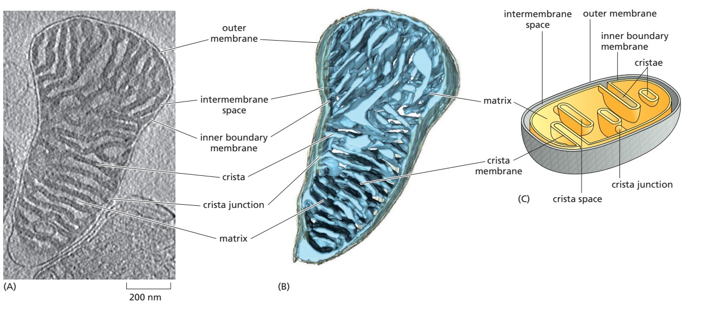{ width="800" height="353" }
/// caption
A 为小鼠心脏线粒体的电镜图，B 显示内外膜的三维关系，C 是区室模型。嵴通过狭窄的连接部与内界膜相接；模型中的膜面颜色不代表显微照片的天然颜色。[^fig-mito-architecture]
///

外膜中有**电压依赖性阴离子通道**（voltage-dependent anion channel，VDAC），可让多种小分子和离子通过。内膜则对离子和多数极性代谢物高度不通透，需要专门的载体交换 ADP、ATP、磷酸、丙酮酸和二羧酸等物质。这样，膜间隙的小分子组成较容易与胞质联系起来，基质却能维持自己的代谢环境。呼吸链建立的电化学梯度，也主要保存在这道内膜的两侧。

基质含有三羧酸循环的大多数酶、脂肪酸氧化酶系，以及线粒体 DNA、核糖体和表达装置。呼吸链复合体和 ATP 合酶嵌在内膜中，尤其富集于嵴膜。把代谢酶与膜上的电子传递装置靠近安排，有利于把底物氧化与 ATP 合成连接起来。

### 嵴与膜蛋白的组织 { #cristae-organization }

嵴增加了可容纳呼吸复合体的膜面积，但它的组织方式比“向内折叠”丰富得多。狭窄的**嵴连接部**限制嵴腔与周围膜间隙之间的扩散，也影响细胞色素 *c* 的分布。MICOS 蛋白复合体主要参与维持这些连接部；OPA1 参与内膜融合及嵴结构调节；ATP 合酶二聚体则常沿嵴的高曲率边缘排列。心磷脂等膜脂也参与稳定和组织膜蛋白。不同细胞的嵴可以呈板层、管状或其他形态，不能按动物、植物简单二分。[^mitochondrial-membranes]

呼吸链中的一些复合体还会彼此结合，形成不同组成的**超复合体**，影响装配、稳定性和局部电子传递。电子载体仍有移动的空间：泛醌在膜内扩散，细胞色素 *c* 沿内膜的膜间隙侧传递电子。呼吸链因此既有相对稳定的结构组织，也有不断运动的组分。

???+ abstract "ATP 合酶怎样把膜变弯？"

    在 *Polytomella* 属藻类的线粒体中，电子断层成像显示，ATP 合酶二聚体沿嵴边缘成行分布。下图 A 是断层切片，B 将膜与蛋白标出，C 则用平均后的二聚体结构替换各处信号，显示它们的排列。[^atp-membrane-curvature]

    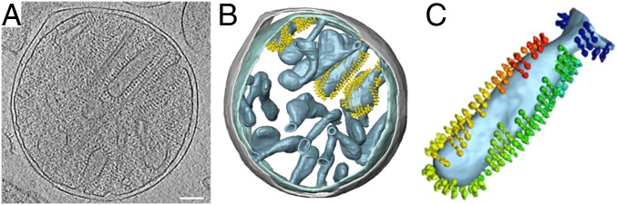{ width="680" height="227" loading=lazy }
    /// caption
    黄、橙色结构位于弯曲的嵴边缘。A 是观察图像，B、C 含有分割和结构拟合；比例尺为 100 nm。[^atp-membrane-curvature]
    ///

    不过，看见蛋白集中在弯处，还无法判断是蛋白使膜弯曲，还是蛋白偏爱已经弯曲的膜。Blum 等把纯化的二聚体装进人工脂质膜，发现它们仍能自行排成行，并在行列处形成明显弯曲。这里没有完整的线粒体，也没有其他嵴组织装置，二聚体本身就足以产生局部膜曲率。

    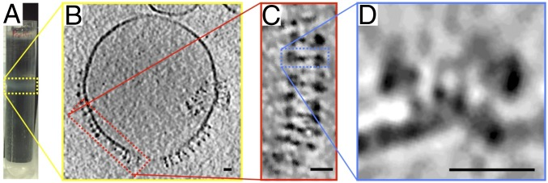{ width="680" height="228" loading=lazy }
    /// caption
    低蛋白密度重构样品中，B 红框处放大为 C；C 蓝框对应 D 的横断面，能看见蛋白行列下方弯曲的膜。C、D 比例尺为 20 nm。[^atp-membrane-curvature]
    ///

    这解释了嵴边缘的一种成形机制；完整嵴的连接位置和形态，还需要 MICOS、OPA1 等组分共同维持。

## 质子动力势与 ATP 合成 { #mitochondrial-bioenergetics }

基质中的 NADH 把电子交给呼吸链复合体 I。琥珀酸脱氢酶也就是复合体 II，它通过自身结合的 FAD 接受底物的电子，再交给泛醌。其他泛醌还原酶也可从不同代谢反应引入电子。泛醌把电子送到复合体 III，经细胞色素 *c* 转给复合体 IV，最后交给 O$_2$，生成水。

电子沿这条链传递所释放的能量，推动 H$^+$ 从基质移向膜间隙。主要参与这一过程的是复合体 I、III 和 IV；复合体 II 不泵出 H$^+$，但从它进入的电子仍会经过后面的 III 和 IV，因此也能支持 ATP 合成。具体电子载体和反应计量见[呼吸链](../biochem/oxp.md#electron-transport-chain)。

H$^+$ 积累在内膜外侧，使内膜两侧既有浓度差，也有电位差：通常基质侧更负、pH 更高。二者共同形成**质子动力势**。只要内膜仍能有效阻止 H$^+$ 自由穿过，H$^+$ 回到基质就有可供利用的自由能。

### ATP 合酶的旋转与催化 { #atp-synthase-rotation }

ATP 合酶有两部分：嵌在膜内的 F$_\mathrm{o}$ 负责质子转运与旋转，伸向基质的 F$_1$ 催化 ATP 合成。下图 A、B 中，膜下方、伸向基质的球状部分就是 F$_1$；中央轴和外围支架把催化头与膜内部分连在一起。

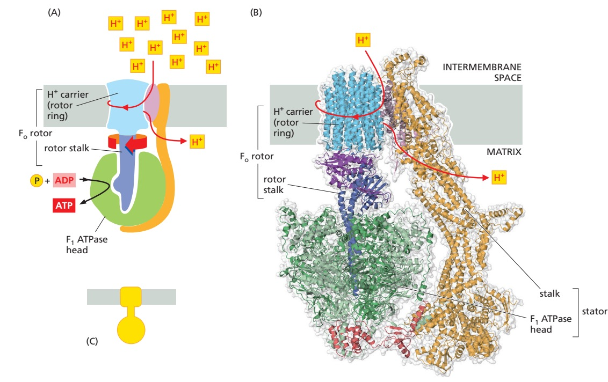{ width="760" height="478" loading=lazy }
/// caption
A 显示转子、催化头与外围支架的关系，B 是牛线粒体 ATP 合酶的结构示意，C 为简化画法。不同来源的 ATP 合酶在亚基组成和命名上有所差别，图中的共同关系是中央转子能相对催化头转动。[^fig-atp-synthase]
///

可以沿 H$^+$ 的去向追一次这台酶的运动。F$_\mathrm{o}$ 中的 *a* 亚基提供两个向膜两侧分别开放的半通道，H$^+$ 从膜间隙侧进入，结合 *c* 环上的位点；*c* 环转动后，该位点到达通向基质的半通道，释放 H$^+$。两条半通道没有直接贯通，质子转运必须与环的旋转配合。

*c* 环带动以 $\gamma$ 亚基为核心的中央轴旋转，轴穿过由三个 $\alpha$ 和三个 $\beta$ 亚基交替组成的催化头。偏心的中央轴在不同角度对三个 $\beta$ 亚基产生不同作用，使它们依次处于结合 ADP 和磷酸、紧密结合并形成 ATP、开放并释放 ATP 的状态。外围支架把催化头固定住，才不至于让整套装置一起跟着空转。中央轴转一圈，三个催化位点各完成一轮，合计产生三个 ATP。[^energy-conversion]

!!! tip "每合成一个 ATP，要经过多少个 H⁺？"

    若 *c* 环含 $n$ 个亚基，完整转一圈通常转运 $n$ 个 H$^+$、生成三个 ATP，因此 ATP 合酶本身的比值为 $n/3$。*c* 环大小随物种和细胞器而变，不能统一写成“两个质子一个 ATP”。

    细胞实际取得可用 ATP 时，还要支付磷酸输入、ADP／ATP 交换等能量成本，并承受质子泄漏。呼吸底物与电子进入位置也会改变最终产量。ATP 合酶本身具有可逆性；驱动力改变时可以水解 ATP、反向泵出质子，细胞则通过调控限制不合需要的 ATP 消耗。更完整的催化循环见[ATP 合酶](../biochem/oxp.md#atp-synthase)。

氧化磷酸化与基质代谢一直相互牵动。[三羧酸循环](../biochem/tca_cycle.md)和[脂肪酸分解](../biochem/lipid_catabolism.md#fatty-acid-mobilization-entry)提供还原当量，呼吸链将它们重新氧化，才使前面的脱氢反应继续进行。ADP 不足、氧供应受限、底物不足或载体通量改变，都可能让呼吸慢下来。仅看线粒体“多不多”，还不足以判断一个细胞此刻能合成多少 ATP。

## 线粒体动态、输入与质量控制 { #mitochondrial-biogenesis }

### 融合、分裂与细胞内定位 { #mitochondrial-dynamics }

用绿色荧光蛋白标记酵母的线粒体，能看见沿细胞周边延伸的分支网络。再连续拍摄同一个细胞，图中的“几条线粒体”会不断换一种连法。

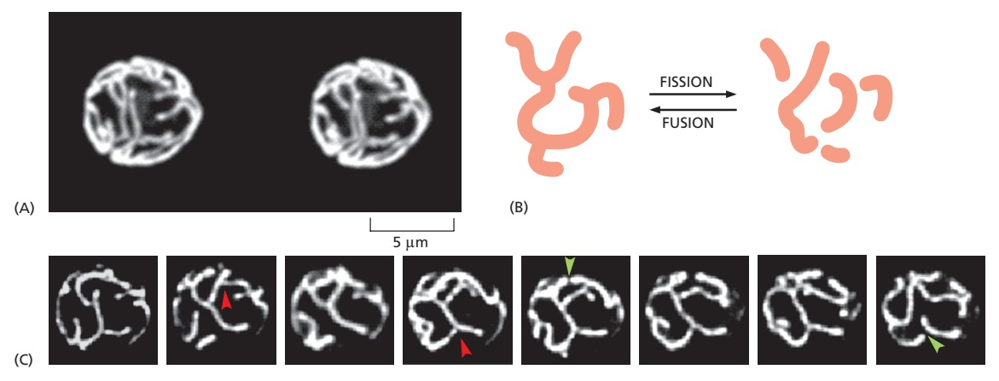{ width="760" height="290" loading=lazy }
/// caption
A 是荧光成像，B 是网络示意；C 以 3 分钟为间隔记录分裂（绿箭头）和融合（红箭头）。短管、小点和长网可以是同一动态系统的不同时刻。[^fig-mito-network]
///

融合需要两层膜依次合并。在哺乳动物中，外膜融合主要由 MFN1／MFN2 驱动，内膜融合需要 OPA1；这些蛋白都是 GTPase，完成两层膜的融合后，基质内容物便能混合。分裂时，胞质中的动力蛋白相关 GTPase——DRP1 被募集到外膜附近，通过装配及 GTP 水解参与收缩。MFF、MID49／MID51 等受体调节募集，内质网接触和肌动蛋白参与分裂位置的确定与预收缩，膜张力和脂质重塑也影响最终切断。酵母中 Fis1 对分裂很重要，哺乳动物的招募关系则更多样。[^mitochondrial-dynamics]

融合让不同部分的内容物有机会互补；分裂便于分配、运输，也能帮助分离受损片段。二者都参与正常生理过程，不能简单地把融合归为健康、分裂归为损伤。线粒体还会借助细胞骨架运输和锚定，在局部耗能旺盛的位置富集。

内质网接触位点也与 Ca$^{2+}$ 转移有关。局部释放的 Ca$^{2+}$ 经外膜 VDAC 及内膜的**线粒体钙单向转运体复合物**（mitochondrial calcium uniporter，MCU）进入基质，内膜电位提供驱动力；NCLX 等系统参与外排。适量 Ca$^{2+}$ 可调节基质代谢酶，使能量供应跟上细胞活动。过量摄取则可能促进氧化应激和通透性转换。线粒体由此参与 Ca$^{2+}$ 信号的缓冲和整形，但它的缓冲容量有边界。

### 核编码蛋白的输入与装配 { #mitochondrial-protein-import }

线粒体所需的大多数蛋白质在胞质中合成，接下来要找到正确的膜，甚至跨过两层膜。以进入基质的可溶性蛋白为例，其 N 端通常有一段富含带正电残基、可形成两亲性螺旋的**前导序列**。胞质 Hsp70 等伴侣蛋白帮助前体保持可输入的状态，避免过早形成难以穿过通道的稳定结构。

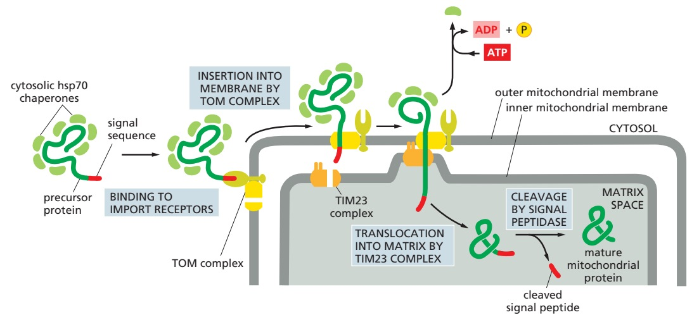{ width="760" height="351" loading=lazy }
/// caption
红色前导序列先被外膜受体识别；同一条多肽可以同时跨越 TOM 与 TIM23。进入基质后，前导序列被切除，蛋白再折叠为成熟结构。[^fig-mito-import]
///

外膜上的 **TOM 复合体**（translocase of the outer mitochondrial membrane）先识别前体并使其穿过外膜。随后，内膜上的 **TIM23 复合体**（translocase of the inner mitochondrial membrane 23）接过前导序列。基质侧为负的膜电位有利于带正电的前导序列进入，基质侧 Hsp70 通过 ATP 驱动的结合循环帮助其余多肽继续转入。前导序列被基质中的加工肽酶切除，许多输入后的蛋白再交给 Hsp60 等伴侣蛋白帮助折叠。跨膜方向、膜电位和 ATP 消耗在这一过程中都有具体分工。[^mitochondrial-import]

终点若是内膜，路径会分叉。下图 A 中，多肽的一段疏水序列在 TIM23 处停止继续转位，随后从侧面进入脂双层；D 中的前体先完整进入基质，再由 OXA 装置插入内膜。OXA 还接收线粒体自身核糖体合成的部分蛋白，如 C 所示。多跨膜载体则常走 B 路：膜间隙中的小 TIM 伴侣保护其疏水区，再把它交给 TIM22 插入内膜。

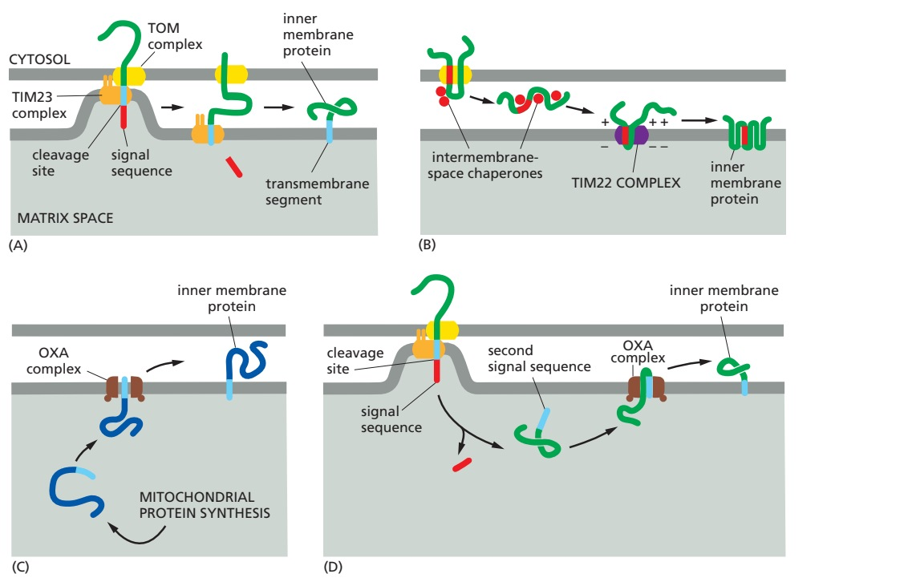{ width="700" height="451" loading=lazy }
/// caption
A 为 TIM23 侧向释放；B 为小 TIM 伴侣与 TIM22 路线；C 是线粒体内合成后经 OXA 插入；D 是先输入基质再由 OXA 插入。箭头概括了跨膜或装配步骤，不表示这几类蛋白采用相同信号。[^fig-inner-membrane-import]
///

另外两个去向也各有装置。外膜的 $\beta$ 桶蛋白经 TOM 进入后，由 **SAM 复合体**帮助折叠并嵌入外膜；膜间隙中的一批富含半胱氨酸的蛋白，则通过 **MIA 氧化折叠路线**形成二硫键，折叠后的结构有利于它们保留在膜间隙。信号序列、蛋白构型和终点共同决定路线，TOM 后面并不是统一的一条通道。

### 损伤处理与遗传阈值 { #mitochondrial-quality-control }

输入和装配都可能出错。伴侣蛋白帮助折叠，AAA 蛋白酶等清除异常或未能装配的亚基；融合与分裂改变网络的连通性，严重失能的部分还可经**线粒体自噬**移除。膜电位丧失时，PINK1—Parkin 路线可通过标记与泛素化促进清除，是研究得很充分的一种应激反应；不同细胞的基础线粒体自噬还使用其他受体和信号。

遗传缺陷也会影响这套系统。一个细胞内可以共存不同的线粒体基因组，称为**异质性**（heteroplasmy）。即使携带同一种致病变异，突变基因组所占比例、组织能量需求、核基因背景和年龄也会影响功能何时越过阈值，出现明显异常。

在人类及多数动物中，mtDNA 通常经母系传递；同一家系成员仍可有不同的突变比例和严重程度。线粒体病也可能来自核基因，此时遗传方式取决于相应核基因，不能一概按母系解释。线粒体在细胞损伤和死亡中的作用另见[Ca²⁺ 超载与通透性转换](../physiology/pathophysiology/cell_injury.md#calcium-mptp)。

## 叶绿体与质体分化 { #plastid-architecture }

### 质体家族与类囊体区室 { #plastid-compartments }

植物细胞里的质体不总是绿色。分生组织中的**前质体**可以随细胞类型和环境，分化为叶绿体、富含类胡萝卜素的有色体、储存淀粉的淀粉体等。黑暗中形成的黄化质体，在光照后可重建光合膜系统。这些名称描述它们较突出的结构与功能，质体之间的转变则伴随内部膜、色素、酶和储存物的重新安排。

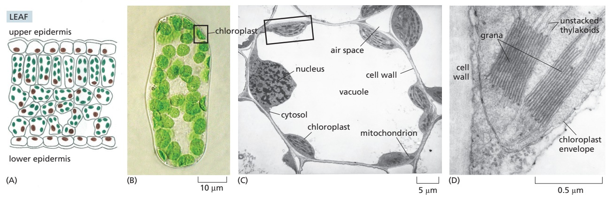{ width="820" height="268" loading=lazy }
/// caption
从叶片组织示意到细胞和叶绿体内部。B 是百日菊叶肉细胞，C、D 是小麦叶细胞及其叶绿体电镜图；它们用于比较尺度，并非同一个样品的连续放大。D 中深色堆叠为基粒。[^fig-chloroplast-structure]
///

叶绿体的外、内两层**包膜**围住基质（stroma），里面另有一套**类囊体膜**。类囊体包围的空间称类囊体腔，高等植物中许多类囊体堆叠成**基粒**（grana），再由未堆叠的基质片层连接。看图 D 时，沿着一组深色条纹移到旁边的连接片层，就能看出堆叠与未堆叠部分属于同一套内部膜系统。类囊体腔与两层包膜之间的间隙彼此分隔。

基质含有 Calvin—Benson 循环所需的酶。**核酮糖-1,5-二磷酸羧化酶／加氧酶**（RuBisCO）将 CO$_2$ 加到**核酮糖-1,5-二磷酸**（RuBP）上，开始碳固定中的关键反应。类囊体膜则容纳光反应的色素与电子传递复合体，将光能转成基质可使用的 ATP 和 NADPH。

叶绿体中还能看到淀粉粒和**质体小球**（plastoglobules）。后者是与类囊体相连的脂蛋白颗粒，外面为脂质单层，参与脂溶性成分的储存和代谢；例如其中含有维生素 E 合成相关酶。一些植物的内包膜可向内延伸，形成**外周网状结构**（peripheral reticulum），其发育程度随植物种类和细胞类型变化，不是所有叶绿体的固定配置。[^plastid-substructures]

包膜还控制基质与胞质之间的代谢物交换。外包膜有多类通道，内包膜的选择性更强，需要载体转运许多带电或极性的底物。例如，二羧酸转运体可用苹果酸交换输入 2-氧戊二酸，并由相关载体交换输出谷氨酸，把叶绿体内的氮同化与胞质代谢连接起来。[^plastid-dicarboxylate] 包膜参与多种脂质的合成，类囊体则富含单半乳糖基二酰甘油（MGDG）、双半乳糖基二酰甘油（DGDG）等半乳糖脂；膜的组成和功能也随所属部位而有差别。[^chloroplast-biogenesis]

### 光合电子传递与两类磷酸化 { #chloroplast-bioenergetics }

线粒体从底物氧化取得电子传递所需的能量；叶绿体的光系统则吸收光，将电子提升到能继续传递的状态。在线性电子流中，电子最初来自水，最终用于还原 NADP$^+$。这条路需要先后经过**光系统 II**（PSII）和**光系统 I**（PSI）两次光激发。编号恰好与电子先后通过的次序相反，读图时顺着箭头走就好。

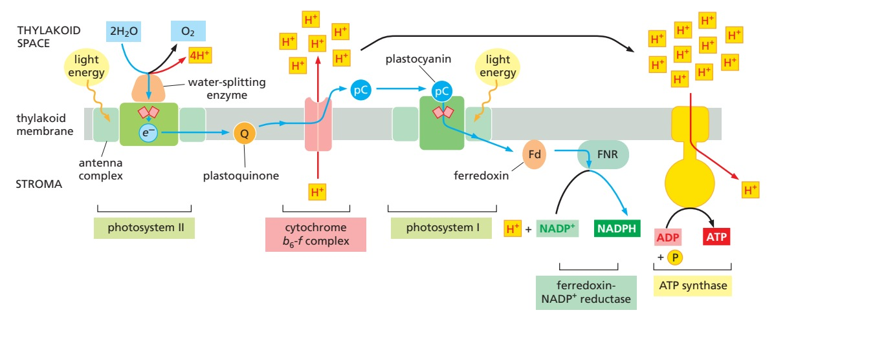{ width="820" height="323" loading=lazy }
/// caption
图中上方为类囊体腔，下方为基质。蓝色箭头连接电子传递路线，红色箭头显示 H$^+$ 的转移；ATP 与 NADPH 都在基质侧形成。[^fig-photosynthetic-chain]
///

PSII 从水取得电子，水氧化同时释放 O$_2$，并将 H$^+$ 留在类囊体腔。电子从 PSII 经质体醌，到达细胞色素 *b*$_6$f 复合体，再由可溶性的**质体蓝素**（plastocyanin）送至 PSI。质体醌的还原与氧化及 *b*$_6$f 的 Q 循环促进 H$^+$ 从基质转入类囊体腔。PSI 再次吸光，使电子经**铁氧还蛋白**（ferredoxin）到达铁氧还蛋白—NADP$^+$ 还原酶（FNR），生成 NADPH。

类囊体腔中积累的 H$^+$ 经 ATP 合酶回到基质，驱动 ATP 合成。这里可以对照线粒体：ATP 合酶的催化头都朝向要生成 ATP 的一侧；叶绿体中是基质，线粒体中也是基质，但 H$^+$ 暂时积累的空间分别是类囊体腔和膜间隙。

!!! info "线性与循环电子流供给的产物不同"

    **线性电子流**从水取得电子，净生成 O$_2$、NADPH，并通过质子动力势支持 ATP 合成。

    **围绕 PSI 的循环电子流**让电子从铁氧还蛋白一侧回到质体醌／*b*$_6$f 通路，增加质子动力势，却不净生成 NADPH 或 O$_2$。这让细胞能够调整 ATP 与 NADPH 的供给比例。两种电子流的比例受光照、碳同化需求和氧化还原状态等影响；旁路、质子泄漏和 ATP 合酶 *c* 环大小也影响实际能量产额。

光反应、Calvin—Benson 循环和光呼吸的具体计量见[光合作用](../botany/physiology/photosynthesis_respiration.md)。C$_4$ 和景天酸代谢（CAM）植物同样使用 Calvin—Benson 循环；它们先由磷酸烯醇式丙酮酸羧化酶固定 HCO$_3^-$，随后在空间或时间上集中释放 CO$_2$，提高 RuBisCO 周围的 CO$_2$ 浓度。

### 蛋白输入与细胞器分裂 { #chloroplast-biogenesis }

多数叶绿体蛋白在胞质中合成，N 端的**转运肽**帮助它们被外包膜的 **TOC**（translocon at the outer chloroplast membrane）识别，再经内包膜的 **TIC**（translocon at the inner chloroplast membrane）进入基质。跨包膜输入需要核苷酸水解及伴侣蛋白参与；与线粒体内膜输入不同，不依赖包膜两侧的质子动力势。TIC 的具体组成及输入马达模型仍有研究争议。[^chloroplast-import]

如果蛋白最终要到类囊体，穿过两层包膜只完成了前半程。下图 A 中，前端的叶绿体转运肽被切除后，后面的类囊体分选信号显露出来，决定下一步的去向。

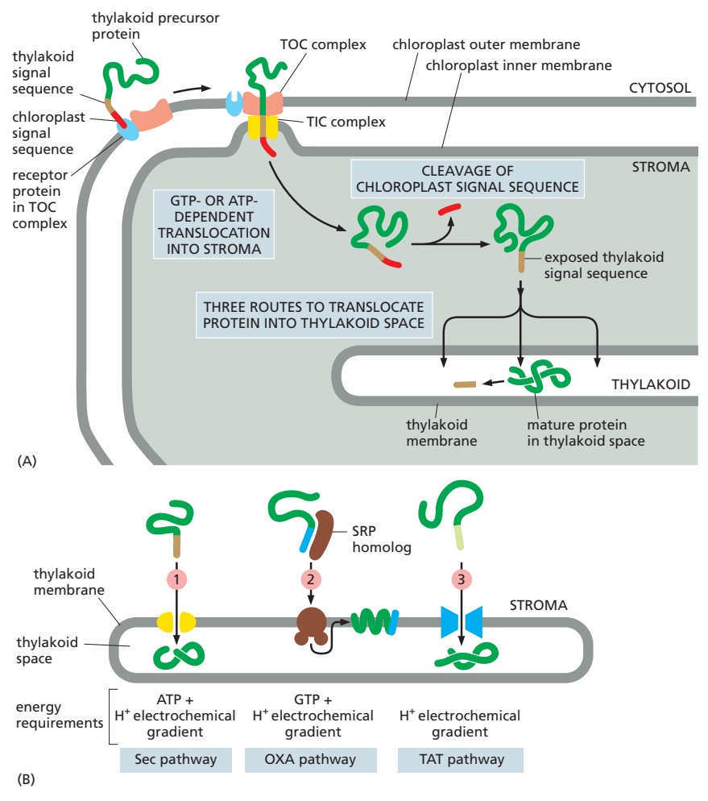{ width="560" height="633" loading=lazy }
/// caption
A 以进入类囊体腔的前体示意两步分选；B 比较 Sec、与 cpSRP 配合的 OXA 同源插入装置，以及 Tat 路线。B 中间一路的蛋白留在膜中，另外两路的示例进入腔内。[^fig-chloroplast-import]
///

**Sec 路线**通常运输未折叠蛋白，例如类囊体腔中的质体蓝素；**Tat 路线**识别含双精氨酸的信号，可以运输已经折叠的蛋白，主要依赖跨类囊体膜的质子动力势。**叶绿体信号识别颗粒**（chloroplast signal recognition particle，cpSRP）则把一部分疏水膜蛋白，如捕光叶绿素蛋白，送至 Alb3 等插入装置，嵌入类囊体膜。图中把后一类装置标为 OXA pathway，是因为它与线粒体 OXA、细菌 YidC 具有同源关系。[^chloroplast-import]

光合复合体的装配还需协调核编码与质体编码亚基的供应。伴侣帮助折叠，蛋白酶清除异常组分，核—质体之间的顺行与逆行信号则把表达、输入及光合状态联系起来。

叶绿体自身也要分裂。来自细菌祖先的 FtsZ 在质体内部形成环状结构，ARC5／DRP5B 等动力蛋白样因子在外侧参与收缩。在拟南芥中，内包膜的 ARC6 与外包膜的 PDV2 在膜间隙相互作用，把内部 FtsZ 环的位置与外侧 ARC5 的募集衔接起来。[^plastid-division-bridge] 分裂与细胞周期、叶片发育和细胞类型配合，细胞中的叶绿体数目因物种和组织而异。质体还可伸出**基质小管**（stromule），接近内质网、线粒体或细胞核；看到近邻或接触，尚不能单凭影像认定两者内容物已经连通。[^chloroplast-biogenesis]

### 叶绿体的光定位 { #chloroplast-photorelocation }

叶绿体并不总停在同一处。弱光下，聚集反应有助于增加受光面积；强光下，回避反应有助于减少光损伤。蓝光受体**向光素**（phototropin）、叶绿体外膜蛋白，以及叶绿体与质膜之间的短寿命肌动蛋白丝，参与这种位置调节。不同植物和藻类的运动装置有所差别，主动定位与胞质流动也可共同影响最终位置。[^chloroplast-movement]

???+ abstract "照亮一小块区域，看叶绿体怎样离开"

    Kong 等在拟南芥细胞中，用强蓝光反复扫描直径 20 μm 的圆形区域，并连续观察叶绿体和附近的肌动蛋白。图中叶绿体的红色来自叶绿素自发荧光，绿色来自标记肌动蛋白的 GFP 探针。[^chloroplast-movement-experiment]

    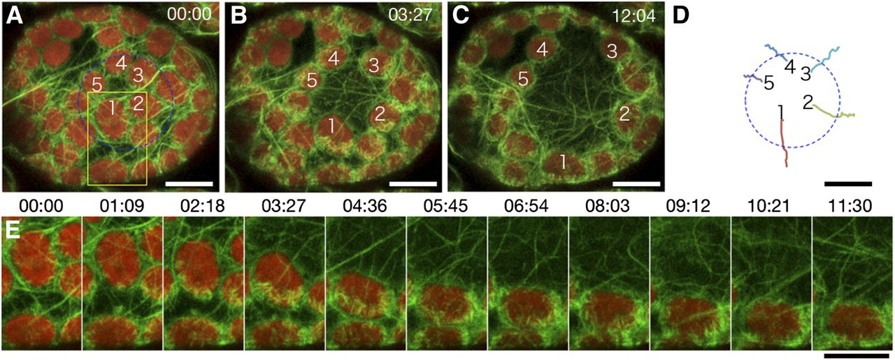{ width="700" height="282" loading=lazy }
    /// caption
    A—C 为照射前、照射中及照射后的图像，D 追踪编号 1—5 的叶绿体位置；E 放大展示 1 号叶绿体的连续变化。时间为分∶秒，比例尺均为 10 μm。[^chloroplast-movement-experiment]
    ///

    随着照射进行，圆形区域内逐渐空出来，原来的叶绿体向外移动。E 中，叶绿体边缘的短肌动蛋白丝分布也随运动改变。位置轨迹直接显示回避运动，肌动蛋白影像则使我们能把位移与局部骨架重排放在同一时间序列里观察。

## 过氧化物酶体的氧化分工 { #peroxisome-metabolism }

### 脂质代谢与活性氧控制 { #peroxisomal-metabolism }

过氧化物酶体由单层膜包围，没有自身 DNA、核糖体，也没有用于合成 ATP 的电子传递链。它内部的多种氧化酶把底物的电子直接交给 O$_2$，生成 H$_2$O$_2$。附近的**过氧化氢酶**（catalase）可将 H$_2$O$_2$ 分解为水和氧，也可利用它氧化其他底物。容易造成氧化损伤的产物，因而在生成处就有相应的处理途径。

H$_2$O$_2$ 仍可跨区室参与信号，生成与清除失衡时也会造成损伤。过氧化物酶体的膜及酶系限制和调节这股氧化作用，并没有把活性氧完全封死在里面。[^peroxisome-overview]

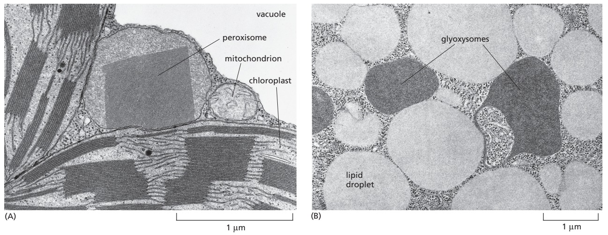{ width="780" height="302" loading=lazy }
/// caption
A 为烟草叶肉细胞，过氧化物酶体靠近叶绿体与线粒体；B 为萌发番茄子叶中的乙醛酸循环体，周围有脂滴。两图比例尺均为 1 μm，不同的近邻关系与它们处理的代谢物相呼应。[^fig-peroxisomes]
///

哺乳动物过氧化物酶体参与**极长链脂肪酸的链缩短**、部分支链脂肪酸的 $\alpha$ 氧化，以及醚磷脂／缩醛磷脂和胆汁酸合成。它的 $\beta$ 氧化与线粒体有一个关键差异：第一步由酰基辅酶 A 氧化酶把电子交给 O$_2$，形成 H$_2$O$_2$；这部分能量没有送入呼吸链用于 ATP 合成。缩短后的酰基及反应产生的其他代谢物，随后还需与线粒体、胞质等区室衔接。脂肪酸活化和区室分工见[脂肪酸分解代谢](../biochem/lipid_catabolism.md#fatty-acid-mobilization-entry)。

植物过氧化物酶体参与脂肪酸 $\beta$ 氧化、茉莉酸合成及光呼吸。萌发油料种子中的特化形式常称**乙醛酸循环体**（glyoxysome）：脂肪酸分解产生乙酰辅酶 A，乙醛酸循环中的异柠檬酸裂合酶和苹果酸合酶帮助绕过两次脱羧，使碳保留在四碳产物中，再经其他区室的反应用于糖的合成。具体反应和分工见[植物乙醛酸循环](../biochem/other_glc_pathway.md#plant-compartments)。图 B 中紧邻的脂滴提供储存脂质；图 A 中的叶绿体、线粒体和过氧化物酶体，则能交换光呼吸中产生的代谢物。

某些过氧化物酶体内部可见致密、近似结晶的核心，但不能只凭这一形态确定其中是哪种酶。部分动物的核心含尿酸氧化酶，人及其他类人猿则缺乏功能性尿酸氧化酶。细胞器的酶组成、形态及内部理化环境，会随物种、组织和发育阶段改变。

### 蛋白输入、发生与更新 { #peroxisome-biogenesis }

过氧化物酶体的蛋白输入有一个很特别的地方：货物可以已经折叠，甚至已经形成寡聚体。相比线粒体和叶绿体常见的未折叠前体输入，这里的装置必须容纳体积和形状更多样的货物。[^peroxisome-import]

许多基质蛋白的 C 端带有**过氧化物酶体靶向信号 1**（peroxisomal targeting signal 1，PTS1），经典序列是 Ser–Lys–Leu，即 SKL。胞质受体 **PEX5** 识别这段末端信号，带着货物到膜上的 PEX13／PEX14 等对接因子处。货物释放到基质后，PEX5 被单泛素化；PEX1／PEX6 ATPase 水解 ATP，将受体从膜上回收，使下一轮输入得以继续。

另一部分蛋白带 N 端的 **PTS2**，由 **PEX7** 与物种特异的共受体识别。PTS1 有多种序列变体，其识别还取决于末端是否可及；PTS2 在一些植物和动物蛋白输入后会被加工蛋白酶切除，而典型 C 端 PTS1 通常保留。两种信号不能简单归为同一种可剪除的前导肽。[^pts2-processing]

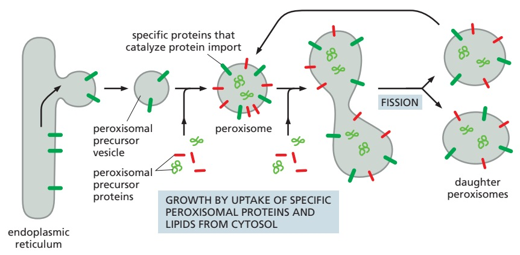{ width="540" height="265" loading=lazy }
/// caption
教材模型概括两类来源：内质网相关的从头发生，以及已有过氧化物酶体的增长、分裂。两条路都需要持续输入膜与基质蛋白。[^fig-peroxisome-biogenesis]
///

膜的装配与基质蛋白输入有所不同。PEX19 等伴侣帮助运输膜蛋白，PEX3／PEX16 等参与其定位和装配；具体组合因物种而异。新过氧化物酶体既可由已有细胞器增长后分裂，也可通过内质网来源的前体膜结构形成。在部分哺乳动物实验系统中，线粒体来源囊泡也对从头发生作出贡献。[^peroxisome-biogenesis]

过氧化物酶体还通过接触位点与内质网、线粒体、脂滴和溶酶体交换脂质或代谢物，受损者可由选择性自噬，即 **pexophagy**，清除。糖鞘脂的逐步降解则主要属于溶酶体的酸性水解系统，需要相应水解酶、辅助蛋白和膜转运装置。其机制见[内膜系统](endomembrane.md)，相关底物积累的影响见[细胞器周转与贮积病](../physiology/pathophysiology/metabolic_disorders.md#organelle-storage-disorders)。

## 核—细胞器基因组协作 { #organelle-genome-cooperation }

人类线粒体 DNA 提供了一个很紧凑的例子：下图所示的环状基因组约 16.6 kb，编码 13 个氧化磷酸化相关蛋白、22 个 tRNA 和两个 rRNA。其中两个 rRNA 分别为 12S 和 16S rRNA。线粒体实际需要的蛋白质远多于这个数目，绝大多数要由细胞核编码，再经前面介绍的输入装置送进来。

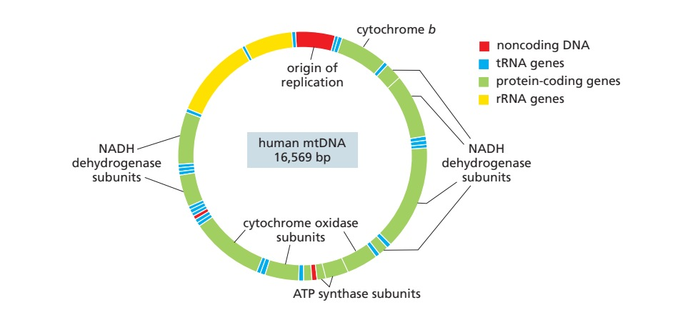{ width="620" height="297" loading=lazy }
/// caption
人类 mtDNA 参考序列长度为 16,569 bp。图中绿色表示蛋白质编码基因，蓝色表示 tRNA 基因，黄色表示 rRNA 基因；这个紧凑的环状例子不能代表所有生物的线粒体基因组。[^fig-mito-genome]
///

线粒体 DNA 与蛋白质组成**核样体**，其复制、转录和分布与膜、嵴组织等相联系。同一个细胞中有多个基因组拷贝；不同谱系的线粒体基因组还可以是线状或分段结构，大小和基因组成也相差很大。质体基因组同样保留祖先基因组的一小部分，其余大量基因已经丢失或转移到细胞核。核基因又补充了输入、装配和调控等功能。[^bioenergetic-organelles]

在陆生植物中，质体基因组还编码部分光系统、细胞色素 *b*$_6$f、ATP 合酶亚基，以及 16S、23S、4.5S 和 5S rRNA 等表达装置组分。RuBisCO 就是两个遗传系统合作的直观例子：大亚基由质体的 *rbcL* 编码，小亚基由核基因 *rbcS* 编码，后者在胞质中合成后输入叶绿体，才与大亚基组装成酶。[^plastid-gene-products]

这使一个呼吸或光合复合体的亚基可能来自两个遗传系统。核编码亚基必须与细胞器内合成的亚基按需装配，未装配的多余组分则需要伴侣与蛋白酶处理。**顺行调控**由细胞核影响细胞器的复制、表达和装配；**逆行信号**把细胞器的氧化还原状态、代谢物、蛋白质稳态或损伤信息传回细胞核，以调整供应。

细胞器的核糖体保留细菌来源的同源关系，但在不同真核谱系中经历了明显分化，不能统一看作一套相同的“70S 核糖体”，其抗生素敏感性也不完全一致。某些线粒体和质体还广泛进行 RNA 编辑，改变转录本；另一些谱系则很少或缺乏这些编辑。细胞器 DNA 可在核 S 期之外复制，分配中也兼有随机性和主动锚定等过程，不能直接套用核染色体的复制与分离时间表。

## 内共生起源与证据 { #endosymbiotic-origin }

线粒体和质体的基因为什么有细菌的痕迹？内共生理论认为，早期真核祖先纳入了一种细菌，这一共生体逐步演化为线粒体；其起源与 $\alpha$-变形菌相关。初级质体则来自蓝细菌。系统发育研究不断缩小祖先的可能位置，但要从今天仍存活的细菌中指定一个无争议的“最近亲”，仍有取样与模型上的困难。[^mitochondrial-origin] [^plastid-origin]

双层包膜、类似细菌的尺度和分裂外观，都与这个模型相容。更有辨别力的证据来自分子层面：细胞器基因在系统树上与相应细菌基因聚在一起，核基因组中保留内共生基因转移的痕迹，细胞器的核糖体、膜复合体和部分分裂装置也有可追溯的细菌同源物。这些来源不同的证据共同支持一次长期的整合过程。

后来，携带初级质体的真核藻类又可能被另一真核细胞纳入，形成次级或更复杂的内共生。具有三层或四层包膜的复杂质体常与这些历史有关，核编码蛋白要跨越的膜更多，靶向路线也随之改变。

另一些真核生物则把线粒体改造成了适应特殊环境的形式，例如**氢化酶体**和 **mitosome**（线粒体衍生细胞器）。它们可以失去经典呼吸链乃至自身基因组，却保留铁硫簇装配等部分祖传功能及相应输入装置。认出这段历史，需要比较这些分子特征，不能只看细胞中有没有一只“带嵴的小椭圆”。[^mitochondria-related-organelles] 过氧化物酶体没有自己的基因组，其发生与输入装置的证据则支持它由真核内膜系统演化而来。

## 怎样检验区室与功能 { #organelle-evidence }

显微图首先告诉我们结构在哪里。透射电镜、冷冻电子断层成像可以显示双膜、嵴连接、基粒和膜接触位点；切片厚度、观察方向、固定及重建处理，也会影响我们看到的连续性。活细胞成像则能把静态结构接成过程，前面的线粒体网络与叶绿体运动就是例子。荧光探针还须考虑它是否依赖膜电位、pH 或表达水平。

!!! tip "红色信号来自哪里？"

    叶绿素在适当激发下有显著的红色自发荧光，可用于观察叶绿体。线粒体的 NAD(P)H 和黄素内源荧光主要位于其他波段，常见的红色线粒体图像多使用外加染料或荧光蛋白。读荧光图时，先查清标记对象与激发、检测条件；颜色本身不是细胞器的身份证。

要确认一种蛋白在哪个区室，可以分离细胞器，再借助渗透胀破、膜分离、蛋白酶保护实验和免疫标记等方法进一步定位。例如，完整膜能保护内部蛋白不被外加蛋白酶消化；破膜后保护消失，才支持它位于相应膜的内侧。离体输入实验还能分别改变 ATP、膜电位或受体状态，判断哪一步需要这些条件。

分离组分的纯度需要用多种标记交叉核对。经典线粒体分级实验常以外膜单胺氧化酶、内膜细胞色素 *c* 氧化酶、膜间隙腺苷酸激酶，以及基质苹果酸脱氢酶等活性作参照。具体分析时还要区分同工酶：例如人类 MDH2 位于线粒体基质，不能把总苹果酸脱氢酶活性全部算作线粒体来源；膜间隙的腺苷酸激酶也应与胞质同工酶区分。[^mitochondrial-markers]

呼吸链和 ATP 合酶的方向性，还可借助人为制备的反向内膜囊泡来研究：原来面向基质的一面朝外，实验者就能从外部接近相应催化部位。这样的制备物用于机制重构，不能拿来当作细胞内正常线粒体的形态。耗氧、膜电位、pH 差、ATP 生成量和代谢通量分别反映不同环节；测到耗氧，并不自动说明全部氧化能量都保存成了 ATP。

分离叶绿体时，包膜是否完整也会改变实验结果。包膜破裂、基质酶流失后，CO$_2$ 固定往往下降；若类囊体仍完整，并在体系中补充所需辅因子和底物，仍可测定电子传递与光合磷酸化。实际能测到哪些反应，取决于膜的完整性、基质组分的保留程度和反应体系的补充条件。[^broken-chloroplasts]

发生与进化则需要另外的证据。敲除输入受体后，前体积累可提示运输步骤受阻；光漂白恢复或光激活追踪可以检验不同部分是否交换内容物；基因树、基因组结构和同源装置则帮助重建祖先关系。结构、动态、功能和遗传各自回答一部分问题，合起来才使这几类细胞器逐渐清楚起来。

## 参考资料与延伸阅读 { #references }

- Alberts B, Heald R, Johnson A, et al. [*Molecular Biology of the Cell*](https://wwnorton.co.uk/books/9780393884852-molecular-biology-of-the-cell). 7th ed. W. W. Norton; 2022. Chapters 12, 14. 本页机制主线与教材图版以此版为准；下列公开旧版章节用于补充阅读。

- Cooper GM. [Bioenergetics and Metabolism: Mitochondria, Chloroplasts, and Peroxisomes](https://www.ncbi.nlm.nih.gov/books/NBK9911/). In: *The Cell: A Molecular Approach*. 2nd ed. Sinauer Associates; 2000.
- Alberts B, Johnson A, Lewis J, et al. [The Genetic Systems of Mitochondria and Plastids](https://www.ncbi.nlm.nih.gov/books/NBK26924/). In: *Molecular Biology of the Cell*. 4th ed. Garland Science; 2002.
- Alberts B, Johnson A, Lewis J, et al. [The Transport of Proteins into Mitochondria and Chloroplasts](https://www.ncbi.nlm.nih.gov/books/NBK26828/). In: *Molecular Biology of the Cell*. 4th ed. Garland Science; 2002.
- Kühlbrandt W. [Structure and function of mitochondrial membrane protein complexes](https://pubmed.ncbi.nlm.nih.gov/26515107/). *BMC Biology*. 2015;13:89.
- Youle RJ, van der Bliek AM. [Mitochondrial fission, fusion, and stress](https://pubmed.ncbi.nlm.nih.gov/22936770/). *Science*. 2012;337:1062–1065.
- Pfanner N, Warscheid B, Wiedemann N. [Mitochondrial proteins: from biogenesis to functional networks](https://pubmed.ncbi.nlm.nih.gov/30626975/). *Nature Reviews Molecular Cell Biology*. 2019;20:267–284.
- Sakamoto W, Miyagishima S-Y, Jarvis P. [Chloroplast biogenesis: control of plastid development, protein import, division and inheritance](https://pubmed.ncbi.nlm.nih.gov/22303235/). *The Arabidopsis Book*. 2008;6:e0110.
- Rochaix J-D. [Chloroplast protein import machinery and quality control](https://pubmed.ncbi.nlm.nih.gov/35472255/). *The FEBS Journal*. 2022;289:6908–6918.
- Kong S-G, Wada M. [Recent advances in understanding the molecular mechanism of chloroplast photorelocation movement](https://pubmed.ncbi.nlm.nih.gov/24333784/). *Biochimica et Biophysica Acta*. 2014;1837:522–530.
- Baker A, Lanyon-Hogg T, Warriner SL. [Peroxisome protein import: a complex journey](https://pubmed.ncbi.nlm.nih.gov/27284042/). *Biochemical Society Transactions*. 2016;44:783–789.
- Farré J-C, Mahalingam SS, Proietto M, Subramani S. [Peroxisome biogenesis, membrane contact sites, and quality control](https://pubmed.ncbi.nlm.nih.gov/30530632/). *EMBO Reports*. 2019;20:e46864.
- Martijn J, Vosseberg J, Guy L, Offre P, Ettema TJG. [Deep mitochondrial origin outside the sampled alphaproteobacteria](https://pubmed.ncbi.nlm.nih.gov/29695865/). *Nature*. 2018;557:101–105.
- Criscuolo A, Gribaldo S. [Large-scale phylogenomic analyses indicate a deep origin of primary plastids within cyanobacteria](https://pubmed.ncbi.nlm.nih.gov/21652613/). *Molecular Biology and Evolution*. 2011;28:3019–3032.

[^bioenergetic-organelles]: 三类细胞器的代谢分工、线粒体／质体遗传系统与核编码蛋白输入的教材框架，见 Cooper 的[细胞器能量代谢章节](https://www.ncbi.nlm.nih.gov/books/NBK9911/)和 Alberts 等的[细胞器遗传系统章节](https://www.ncbi.nlm.nih.gov/books/NBK26924/)。
[^mitochondrial-membranes]: 嵴、呼吸复合体、ATP 合酶和膜曲率的结构关系，见 Kühlbrandt 的[线粒体膜蛋白复合体综述](https://pubmed.ncbi.nlm.nih.gov/26515107/)。
[^energy-conversion]: 呼吸链、光合电子传递和 ATP 合酶共享的化学渗透偶联原理，见 Alberts 等的[线粒体与叶绿体能量转换章节](https://www.ncbi.nlm.nih.gov/books/NBK21063/)。
[^mitochondrial-dynamics]: 线粒体融合、分裂装置及其与应激和质量控制的关系，见 Youle 与 van der Bliek 的[综述](https://pubmed.ncbi.nlm.nih.gov/22936770/)。
[^mitochondrial-import]: TOM、TIM、SAM、MIA 和 OXA 等输入及装配路线，见 Alberts 等的[蛋白输入教材章节](https://www.ncbi.nlm.nih.gov/books/NBK26828/)及 Pfanner 等的[线粒体蛋白质组综述](https://pubmed.ncbi.nlm.nih.gov/30626975/)。
[^chloroplast-import]: TOC／TIC 输入、蛋白质稳态及仍有争议的内包膜装置模型，见 Rochaix 的[叶绿体蛋白输入综述](https://pubmed.ncbi.nlm.nih.gov/35472255/)。
[^chloroplast-biogenesis]: 质体分化、蛋白输入、分裂和遗传的整合框架，见 Sakamoto 等的[叶绿体发生综述](https://pubmed.ncbi.nlm.nih.gov/22303235/)。
[^chloroplast-movement]: phototropin、肌动蛋白与叶绿体聚集／回避反应，见 Kong 与 Wada 的[叶绿体光定位综述](https://pubmed.ncbi.nlm.nih.gov/24333784/)。
[^peroxisome-overview]: 过氧化物酶体的脂质氧化、活性氧代谢及动植物功能差异，见 Cooper 的[细胞器能量代谢章节](https://www.ncbi.nlm.nih.gov/books/NBK9911/)。
[^peroxisome-import]: PTS1／PTS2、PEX5／PEX7 识别及折叠货物输入的证据，见 Baker 等的[过氧化物酶体蛋白输入综述](https://pubmed.ncbi.nlm.nih.gov/27284042/)。
[^peroxisome-biogenesis]: 已有细胞器增长分裂、从头发生、膜接触和质量控制的并存模型，见 Farré 等的[过氧化物酶体发生综述](https://pubmed.ncbi.nlm.nih.gov/30530632/)。
[^mitochondrial-origin]: 线粒体在现有 $\alpha$-变形菌取样之外的深分支位置及最近祖先的不确定性，见 Martijn 等的[系统基因组研究](https://pubmed.ncbi.nlm.nih.gov/29695865/)。
[^plastid-origin]: 初级质体在蓝细菌中的深分支起源，见 Criscuolo 与 Gribaldo 的[系统基因组研究](https://pubmed.ncbi.nlm.nih.gov/21652613/)。
[^mitochondria-related-organelles]: 线粒体、氢化酶体和 mitosome 的输入装置同源性与功能简化，见 Dolezal 等的[线粒体相关细胞器综述](https://pubmed.ncbi.nlm.nih.gov/20124346/)。
[^fig-mito-architecture]: Alberts 等，*Molecular Biology of the Cell*，第 7 版（2022），图 14–6，p. 815；A、B 由 Tobias Brandt 提供。此处从教材页裁取图版，保留面板标记与比例尺。[出版信息](https://wwnorton.co.uk/books/9780393884852-molecular-biology-of-the-cell)。
[^atp-membrane-curvature]: Blum TB, Hahn A, Meier T, Davies KM, Kühlbrandt W. [Dimers of mitochondrial ATP synthase induce membrane curvature and self-assemble into rows](https://pmc.ncbi.nlm.nih.gov/articles/PMC6410833/). *PNAS*. 2019;116:4250–4255. doi:10.1073/pnas.1816556116。依次取原文图 1、图 3，均为 *Polytomella* ATP 合酶相关实验。
[^fig-atp-synthase]: Alberts 等，*Molecular Biology of the Cell*，第 7 版，图 14–31，p. 838。从教材页裁取完整图版；B 为牛线粒体 ATP 合酶结构。[出版信息](https://wwnorton.co.uk/books/9780393884852-molecular-biology-of-the-cell)。
[^fig-mito-network]: Alberts 等，*Molecular Biology of the Cell*，第 7 版，图 14–7，p. 816。A、C 原出 Nunnari J, Marshall WF, Straight A, et al. [Mitochondrial transmission during mating in Saccharomyces cerevisiae is determined by mitochondrial fusion and fission and the intramitochondrial segregation of mitochondrial DNA](https://doi.org/10.1091/mbc.8.7.1233). *Molecular Biology of the Cell*. 1997;8:1233–1242。此处取教材编排的 A—C 图版；连续图像间隔为 3 分钟。
[^fig-mito-import]: Alberts 等，*Molecular Biology of the Cell*，第 7 版，图 12–49，p. 729。裁取机制图，表示典型的 N 端前导序列介导的基质输入。[出版信息](https://wwnorton.co.uk/books/9780393884852-molecular-biology-of-the-cell)。
[^fig-inner-membrane-import]: Alberts 等，*Molecular Biology of the Cell*，第 7 版，图 12–51，p. 732。裁取 A—D 四种内膜装配路线。[出版信息](https://wwnorton.co.uk/books/9780393884852-molecular-biology-of-the-cell)。
[^fig-chloroplast-structure]: Alberts 等，*Molecular Biology of the Cell*，第 7 版，图 14–37，p. 843。B 由 Preeti Dahiya 提供，C、D 由 K. Plaskitt 提供；裁取 A—D，保留各自比例尺。[出版信息](https://wwnorton.co.uk/books/9780393884852-molecular-biology-of-the-cell)。
[^plastid-substructures]: 质体小球的连接结构和生物合成酶定位，见 Austin JR II, Frost E, Vidi P-A, et al. [Plastoglobules are lipoprotein subcompartments of the chloroplast that are permanently coupled to thylakoid membranes and contain biosynthetic enzymes](https://pmc.ncbi.nlm.nih.gov/articles/PMC1488921/). *The Plant Cell*. 2006;18:1693–1703。外周网状结构的物种差异，见 [Peripheral reticulum in chloroplasts of plants differing in CO₂ fixation pathways and photorespiration](https://pubmed.ncbi.nlm.nih.gov/24477438/). 1972。
[^fig-photosynthetic-chain]: Alberts 等，*Molecular Biology of the Cell*，第 7 版，图 14–52，p. 856。裁取电子与质子传递示意，保持原图的腔侧／基质侧方向。[出版信息](https://wwnorton.co.uk/books/9780393884852-molecular-biology-of-the-cell)。
[^fig-chloroplast-import]: Alberts 等，*Molecular Biology of the Cell*，第 7 版，图 12–53，p. 734。裁取 A、B；B 中的 OXA 指插入装置的同源家族，叶绿体相应装置包括 Alb3。[出版信息](https://wwnorton.co.uk/books/9780393884852-molecular-biology-of-the-cell)。
[^chloroplast-movement-experiment]: Kong S-G, Arai Y, Suetsugu N, Yanagida T, Wada M. [Rapid severing and motility of chloroplast-actin filaments are required for the chloroplast avoidance response in Arabidopsis](https://doi.org/10.1105/tpc.113.109694). *The Plant Cell*. 2013;25:572–590，原图 3。用 458 nm 激光扫描直径 20 μm 区域，GFP-talin 标记肌动蛋白；成像间隔 34.5 秒，E 为其中选取的时间点。图片取自期刊图版。
[^fig-peroxisomes]: Alberts 等，*Molecular Biology of the Cell*，第 7 版，图 12–45，p. 725。A 原出 Frederick SE, Newcomb EH. [Cytochemical localization of catalase in leaf microbodies (peroxisomes)](https://doi.org/10.1083/jcb.43.2.343). *J Cell Biol*. 1969;43:343–353；B 原出 Wergin WP 等，*J Ultrastruct Res*. 1970;30:533–557，为萌发 4 天后的番茄子叶。此处取教材中的 A、B 编排，保留标记和比例尺。
[^pts2-processing]: Dolze E, Chigri F, Höwing T, et al. [Calmodulin-like protein AtCML3 mediates dimerization of peroxisomal processing protease AtDEG15 and contributes to normal peroxisome metabolism](https://pmc.ncbi.nlm.nih.gov/articles/PMC3830196/). *Plant Molecular Biology*. 2013;83:607–624。PTS2 常见九肽共识写作 (R/K)-(L/V/I)-X₅-(H/Q)-(L/A)，X 表示任意氨基酸；识别仍受序列上下文和物种影响，参见前引蛋白输入综述。该研究及其背景材料讨论植物 DEG15 与哺乳动物 TYSND1 对 PTS2 前体的加工；对 PTS1 蛋白的其他蛋白水解加工不等于普遍切除 C 端靶向信号。
[^fig-peroxisome-biogenesis]: Alberts 等，*Molecular Biology of the Cell*，第 7 版，图 12–46，p. 725。裁取模型示意；图中 ER 前体来源不概括所有物种和状态下的膜来源。[出版信息](https://wwnorton.co.uk/books/9780393884852-molecular-biology-of-the-cell)。
[^fig-mito-genome]: Alberts 等，*Molecular Biology of the Cell*，第 7 版，图 14–59，p. 863。裁取人类线粒体基因组图及颜色图例。[出版信息](https://wwnorton.co.uk/books/9780393884852-molecular-biology-of-the-cell)。
[^mitochondrial-markers]: 外膜与内膜酶定位的经典分级实验见 Schnaitman C, Erwin VG, Greenawalt JW. [The submitochondrial localization of monoamine oxidase](https://pmc.ncbi.nlm.nih.gov/articles/PMC2107278/). *J Cell Biol*. 1967;32:719–735。具体同工酶定位可参照 UniProt 的 [MDH2（人）](https://www.uniprot.org/uniprotkb/P40926/entry)和 [AK2（大鼠）](https://www.uniprot.org/uniprotkb/P29410/entry)条目。

[^plastid-division-bridge]: Glynn JM, Froehlich JE, Osteryoung KW. [Arabidopsis ARC6 coordinates the division machineries of the inner and outer chloroplast membranes through interaction with PDV2 in the intermembrane space](https://pmc.ncbi.nlm.nih.gov/articles/PMC2570736/). *The Plant Cell*. 2008;20:2460–2470。
[^plastid-dicarboxylate]: Renné P, Dressen U, Hebbeker U, et al. [The Arabidopsis mutant dct is deficient in the plastidic glutamate/malate translocator DiT2](https://doi.org/10.1046/j.1365-313X.2003.01806.x). *The Plant Journal*. 2003;35:316–331。该研究检验叶绿体二羧酸载体与碳、氮代谢的联系。
[^plastid-gene-products]: 陆生植物质体的基因产物及 RuBisCO 两类亚基的来源，见 Alberts 等[线粒体与质体遗传系统](https://www.ncbi.nlm.nih.gov/books/NBK26924/)。rRNA 基因例子可参照[烟草叶绿体 rRNA 基因的克隆研究](https://pubmed.ncbi.nlm.nih.gov/6248424/)。基因组成随谱系变化，本段以陆生植物为例。

[^broken-chloroplasts]: Arnon DI, et al. [Photosynthesis by isolated chloroplasts V. Phosphorylation and carbon dioxide fixation by broken chloroplasts](https://doi.org/10.1016/0006-3002(56)90340-7). *Biochimica et Biophysica Acta*. 1956;20:462–468。该研究利用分离与重新组合的叶绿体组分研究光合磷酸化及碳固定，说明破膜后能保留或恢复哪些反应取决于实验体系。
