# DNA重组与转座 { #dna }

一条DNA断了，可以借另一份相似序列把缺失的信息补回来；一段DNA翻了个面，原来朝向某个基因的启动子就可能转向别处；还有一些序列，能把自己的新副本留在基因组的另一个位置。**DNA重组与转座**改变了序列之间的连接关系，也把修复、遗传交换和基因组演化联系在一起。

这些反应都要处理DNA接头，寻找接头的办法却不同。同源重组依靠较长序列间的配对；位点特异性重组酶识别相配的短位点；转座酶则先认出元件自己的末端，再选择新的靶DNA。后面看每张图时，可以先找两件事：**哪一条链提供可反应的末端，另一端又接到哪里。**[^gene-book]

## 同源重组：借模板恢复信息 { #homologous-recombination }

### 从3′单链端到链侵入 { #strand-invasion }

以一条双链断裂为起点。末端加工会优先去除5′端一侧的链，留下伸出的3′单链尾。它既带着可用于寻找相似序列的信息，也有能被DNA聚合酶延长的3′-OH。细胞通常优先利用姐妹染色单体等合适模板；模板选择和细胞周期对修复的影响见[断裂修复](dna_repair.md#break-crosslink-repair)。

裸露的单链不会仅凭“长得相似”就自动钻进另一条双螺旋。细菌的**RecA**，以及真核的**RAD51**等链交换蛋白，会沿单链装配成**核蛋白丝**。核蛋白丝结合来访的双链DNA，测试它与所携单链的序列是否相配。在匹配区，单链与供体双链中的互补链形成新的碱基对，供体原来的另一条链被排开，出现**置换环（displacement loop，D-loop）**。侵入链的3′端随后以供体链为模板延长，断裂处缺失的信息由此重新获得。来自两份DNA的单链配成的区域称为**异源双链（heteroduplex）**；两份序列若有差异，其中就可能出现错配。[^recombination-overview]

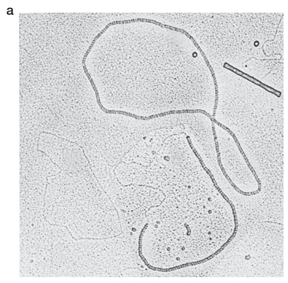{ width="330" height="324" loading="lazy" }
/// caption
较粗的丝为RecA–DNA复合物，图中还可见较细的未包被DNA。原始电镜照片经Watson等图11–9a转载。[^fig-reca-em]
///

RecA结合后，DNA沿核蛋白丝伸展，整体比普通B型双螺旋更长。蛋白内部一处结合位点容纳原来的单链，另一处允许双链DNA进入，序列比较发生在这个复合物中。

典型体外链交换反应需要相似序列、一段可装配RecA的单链区，以及使新配对链能够缠绕的链端。一个底物可以是带缺口的环状DNA；“需要链端”并不要求两份DNA都是线形分子。[^gene-book]

ATP结合有助于RecA维持活性核蛋白丝。某些体外体系用难水解的ATP类似物，仍能发生配对和有限范围的链交换；ATP水解则参与核蛋白丝周转、较长距离交换和跨越某些异源区段。因此，初始配对与反应全过程的能量要求要分别看。[^reca-atp] RecA在单链DNA上的聚集还参与[大肠杆菌SOS响应](dna_repair.md#bacterial-sos-response)，把暴露的单链与修复基因表达联系起来。

???+ abstract "让DNA松下来，再看RecA能否找到同源位点"

    Forget与Kowalczykowski把λ双链DNA与带荧光标记的RecA–单链DNA核蛋白丝放到体外体系中。图A标出不同单链底物在λ DNA中的同源位置；B中的配对比较使用430 nt单链。绿色显示双链DNA，红色显示核蛋白丝携带的标记。

    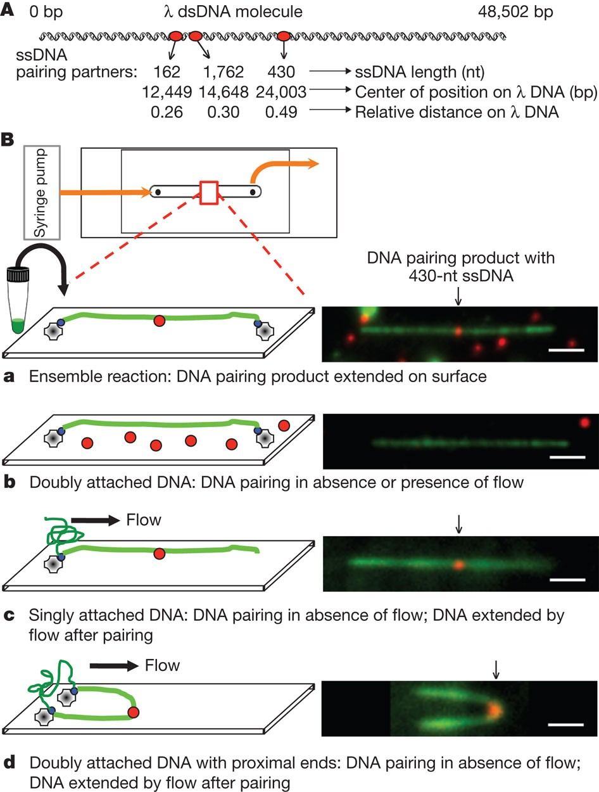{ width="610" height="806" loading="lazy" }
    /// caption
    B中a先在溶液配对；b固定远距两端；c只固定一端；d把两端固定在邻近位置。白尺2.4 μm。原论文图1。[^reca-single-molecule]
    ///

    把双链两端远远固定、使它维持伸展时，配对很少；只固定一端，或让两个固定点靠近，DNA能够松弛，配对便恢复。c、d都是先停流让DNA搜索，再加流拉开观察；照片上的伸展形状不能代表搜索当时的形状。

    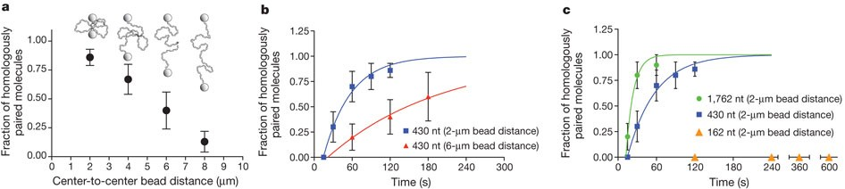{ width="740" height="166" loading="lazy" }
    /// caption
    a比较微珠间距；b比较2 μm与6 μm间距；c比较三种单链长度。误差棒为SEM，原论文图3。[^reca-single-molecule]
    ///

    图3a中，微珠间距增大，2 min内配对的比例降低；b中，2 μm条件下的配对比6 μm快。这说明DNA在三维空间的接触机会会影响同源搜索。实验使用纯化大肠杆菌RecA和ATPγS稳定的核蛋白丝，结果不等于直接看到了活细胞中的全部搜索过程，也不排除其他局部搜索运动。c中不同长度底物的同源位置也有差异，不能从这组结果规定一个通用的“最短重组长度”。

### 双Holliday连接与交换结局 { #holliday-outcomes }

侵入链已经延长以后，断裂的另一端也可以与D-loop中被排开的链退火。继续合成并封闭缺口，两份DNA就可能由两个四臂连接连在一起，形成**双Holliday连接（double Holliday junction，dHJ）**。下面沿灰色受体的两个3′端往下看；红色标出了新合成的DNA，蓝色供体提供了相应模板。

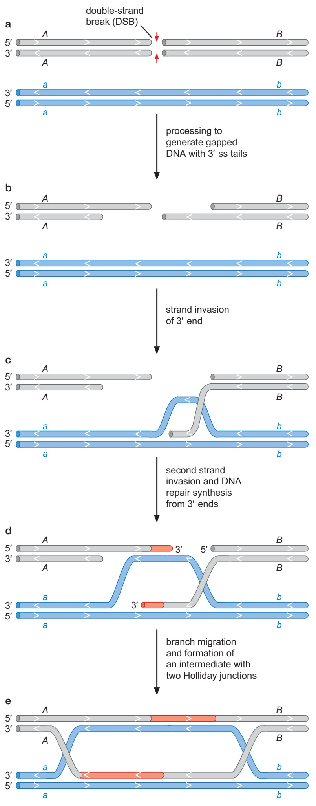{ width="430" height="1096" loading="lazy" }
/// caption
a–c为断裂、切除与链侵入；d、e加入第二端捕获、合成和连接，形成dHJ。Watson等，图11–4。[^gene-book]
///

四臂连接可以移动：原有碱基对逐步解开，换成另一对链之间的碱基对，连接点便沿同源区前进，称为**分支迁移（branch migration）**。迁移改变了两份DNA交换配对的范围，而DNA骨架仍连续。

要把两份DNA彻底分开，细胞还得处理连接。结构特异性核酸酶可以切开连接中的一对链，再由连接酶封口，称为**切割拆分（resolution）**。对dHJ而言，要同时追踪两个连接，才能知道两侧染色体标记是否交换。图中的A、B与a、b尤其有用：左侧产物仍是AB和ab，右侧则成了Ab和aB。

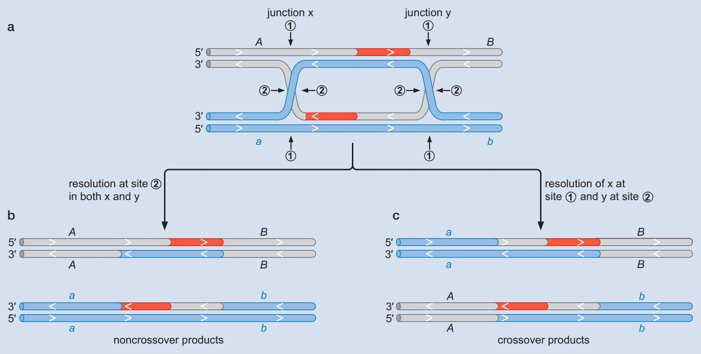{ width="730" height="369" loading="lazy" }
/// caption
图中两个连接都按②方向切开，得到非交换；一个按①、另一个按②切开，得到交换。红色为修复合成片段。Watson等，Box 11–1图1。[^gene-book]
///

**交换（crossover，CO）**描述两侧标记的互换；**非交换（noncrossover，NCO）**保留两侧原有组合。这个区别并不告诉我们中间那一小段序列有没有改变。

另一种处理dHJ的办法不依赖上述成对切口：人BLM–TOP3A–RMI复合体、酵母Sgs1–Top3–Rmi1等可使两个连接相向迁移，再解除剩余的DNA缠绕，称为**溶解（dissolution）**，产生非交换结果。这里的解旋酶与拓扑异构酶相互配合，工作与核酸酶切开连接不同。[^hr-outcomes]

??? info "Holliday模型怎样走到双链断裂模型"

    Holliday在1964年从遗传学结果出发，设想两份同源DNA在相应位置各产生一个同极性的单链切口，再交换、连接和分支迁移。这个模型把异源双链、四臂连接和交换结果放进了同一幅图。图中B与b可以有少数序列差异；交换配对后，这些差异就成为异源双链中的错配。

    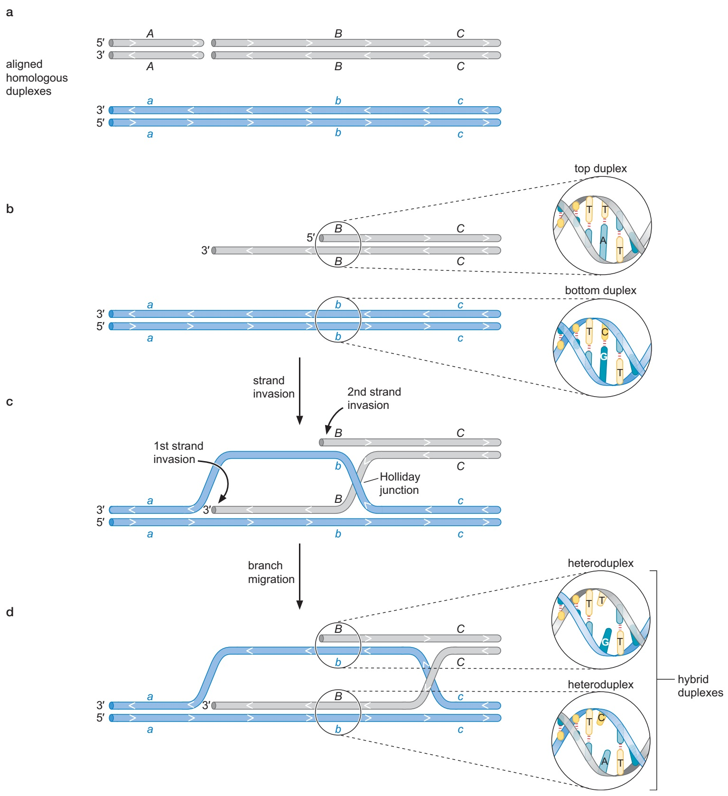{ width="670" height="733" loading="lazy" }
    /// caption
    这是教材重绘的历史模型。灰、蓝两份DNA交换配对；放大图显示异源双链可含错配。Watson等，图11–2。[^gene-book]
    ///

    Meselson–Radding模型在1975年引入不对称起始：一份DNA先出现单链切口，合成置换出的链再侵入另一份DNA。1983年的双链断裂修复模型进一步把断裂、末端切除和修复合成接入重组过程。它们回答的是不同证据逐渐提出的问题；今天已知的同源重组还包括单链缺口、复制叉相关底物和不保留稳定Holliday连接的路线。[^historical-models]

### SDSA与基因转换 { #sdsa-gene-conversion }

侵入链延长后，也可以先从供体上退出，再与原来断裂的另一端退火。填补剩余缺口，便能把新复制的信息留在受体上，而供体保持完整。这条路线称为**合成依赖的链退火（synthesis-dependent strand annealing，SDSA）**，通常得到非交换产物。

酿酒酵母的交配型转换是一个很具体的例子。染色体上的 *MAT* 位点表达交配型信息，*HML* 和 *HMR* 保存着沉默的供体序列。HO内切酶在 *MAT* 处制造断裂；加工后的链端找到供体，复制其交配型信息，再回到 *MAT* 完成修复。图中绿色的a信息由 *HMRa* 复制到原来的 *MATα*，供体却没有被挖走。[^gene-book]

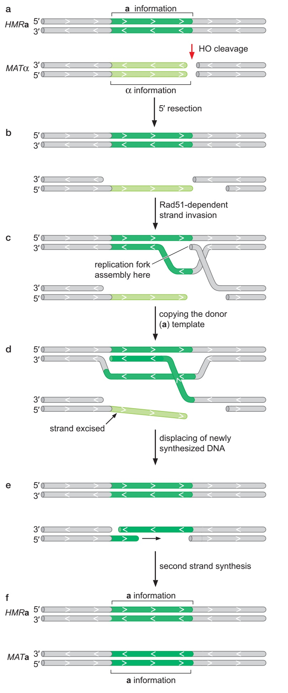{ width="440" height="1060" loading="lazy" }
/// caption
沿新生的绿色DNA追踪：它先在供体上合成，再退出并与受体另一端退火，最终改变MAT的信息。Watson等，图11–26。[^gene-book]
///

这种**局部序列信息的非互惠转移**称为**基因转换（gene conversion）**。它可以由缺口修复时复制供体信息产生，也可以由异源双链中的错配修复产生。后者如图：原来各有两份的A和a，经重组配对、错配修复后，四个减数分裂产物可能呈3∶1或1∶3，而非通常的2∶2。

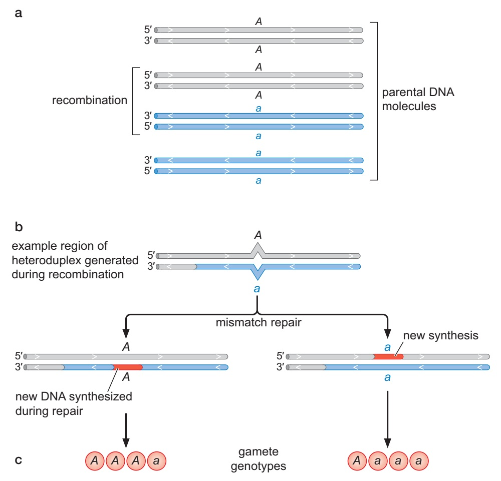{ width="580" height="557" loading="lazy" }
/// caption
从中间的A/a错配向两边追踪，不同链被修复，会留下不同的局部信息。图示转换结局；修复也可能恢复原有分离比例。Watson等，图11–28。[^gene-book]
///

!!! note "两侧是否交换，局部是否转换"

    这两个问题可以分别回答。一次事件可以是“交换并伴随基因转换”，也可以是“非交换但发生基因转换”。如果异源双链中的错配未被修复，它在后续复制时可分到不同后代中，造成**减数后分离（postmeiotic segregation）**；复制本身不会自动把两种信息统一成一种。[^gene-conversion]

若断裂只留下一个可用末端，**断裂诱导复制（break-induced replication，BIR）**还可在同源供体上启动长距离复制。它有助于恢复某些断裂染色体或复制叉，但可能伴随模板切换、拷贝数改变与杂合性丢失。供体的选择、可用末端数和中间体处理方式，都会改变最终产物。[^hr-outcomes]

### 不同生物怎样完成这些步骤 { #hr-across-domains }

大肠杆菌的**RecBCD**从近乎平齐的双链断端进入。RecB与RecD沿相反极性的链运动，解开双链；RecB还提供核酸酶活性。两个马达的速度不同，一条单链可暂时形成环。图中复合体由右向左前进，遇到方向合适的**Chi位点**后暂停、调整运动与切割，并促进RecA在保留下来的3′单链尾上装载。[^bacterial-recombination]

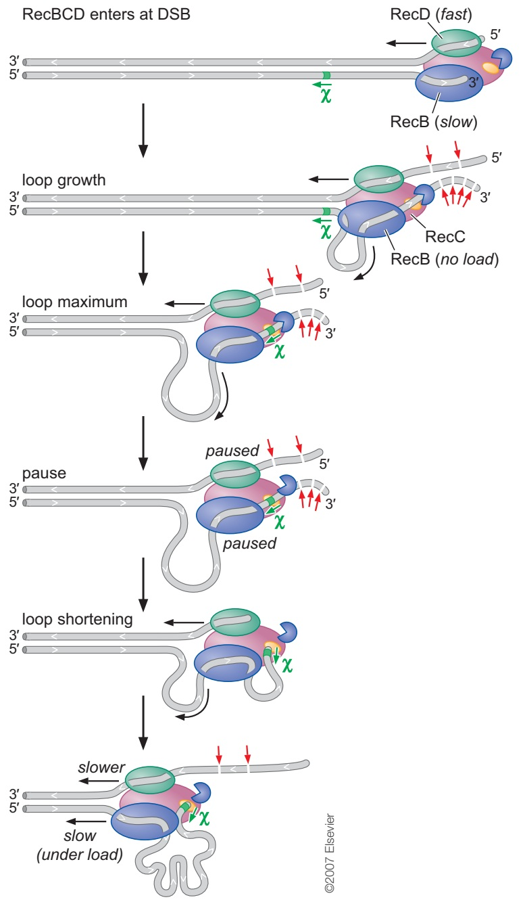{ width="360" height="622" loading="lazy" }
/// caption
绿色为RecD、紫色为RecB；χ表示Chi。先看运动方向，再比较单链环的增长与缩短。Watson等图11–5，改编自Spies等2007年研究。[^fig-recbcd]
///

大肠杆菌典型Chi序列为5′-GCTGGTGG-3′，由RecC参与识别。它不是任意方向都有效：只有序列以适当极性进入复合体，才会触发相应变化。

Chi后的加工有利于保留可重组的3′尾，并把RecA装载到这条链上。核酸酶切割的具体模式受ATP与Mg²⁺等条件影响；图表现的是双马达和Chi控制的一个机制模型。

所以，RecBCD既能降解DNA，也能把断端加工成重组底物。大肠杆菌的Chi分布有利于自身DNA进入后一条路线，但这一识别体系不能直接套给所有细菌。[^bacterial-recombination]

链交换之后，**RuvA**识别四臂连接的形状，招募环状ATP酶**RuvB**。RuvB驱动DNA穿过复合体，推动分支迁移；**RuvC**则是切开连接的核酸酶。

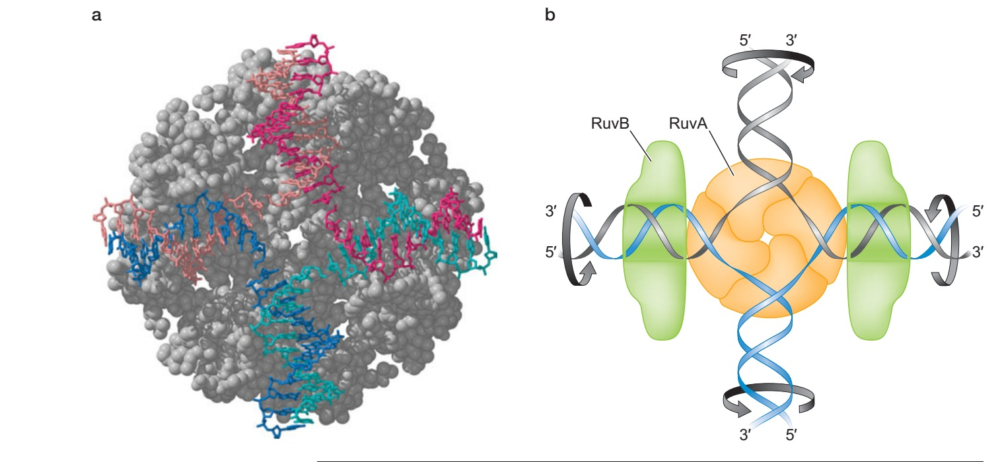{ width="680" height="314" loading="lazy" }
/// caption
左为RuvA结构，右为RuvAB–DNA示意；RuvB位于连接两侧的DNA臂上。Watson等，图11–17。[^fig-ruvab]
///

单链缺口还有另一种入口。RecJ、RecQ可参与加工，**RecFOR**帮助RecA装配到已经被SSB包被的单链区及其邻近连接处。Rac前噬菌体编码的**RecE–RecT**则提供另一组工具：RecE从双链末端作5′→3′切除，RecT促进互补单链退火，在相应表达与底物条件下支持重组。这种退火途径并不等同于RecA核蛋白丝侵入完整双链的反应。[^recet-recf]

| 系统 | 断端加工与单链保护 | 链交换及后续处理 |
| --- | --- | --- |
| 大肠杆菌范式 | RecBCD加工断端；RecFOR协助处理SSB包被的缺口底物 | RecA配对与链交换；RuvAB迁移、RuvC切割 |
| 其他细菌 | 可使用AddAB、AdnAB等装置，Chi序列及识别方式有谱系差异 | 末端装载及连接处理因子不同，如部分细菌使用RecU |
| 许多古菌 | Mre11–Rad50参与断端识别；HerA解旋酶与NurA核酸酶参与切除 | RadA完成同源配对；辅助因子随类群而异 |
| 真核细胞 | MRN–CtIP启动加工，EXO1或DNA2–BLM等延长切除，RPA保护单链 | BRCA2等促进RAD51装载；连接切割、溶解或SDSA分别完成后续过程 |

这张表按反应分工排列；同一列的蛋白不一定彼此同源，也并非在每个物种中成套出现。[^archaea-eukaryote-hr]

### 减数分裂中的受控交换 { #meiotic-recombination }

许多有性生殖真核生物会在减数分裂前期主动制造一批双链断裂。**Spo11**借活性位点酪氨酸切开DNA，并共价留在5′断端；随后加工系统把Spo11连同短寡核苷酸移除，再形成3′单链尾。RAD51与减数分裂特异的**DMC1**参与同源配对，染色体轴与相关因子使同源染色体优先于姐妹染色单体成为某些重组事件的模板。[^meiotic-crossovers]

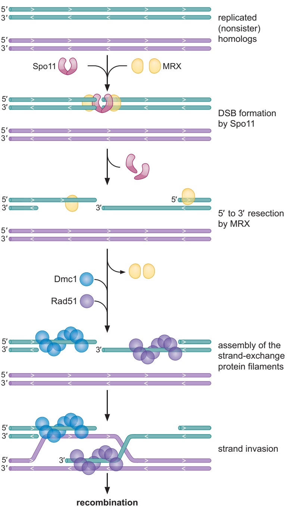{ width="440" height="768" loading="lazy" }
/// caption
图以MRX命名酵母断端加工复合体，省略了多种协作因子；3′尾形成后再装配链交换蛋白。Watson等，图11–23。[^gene-book]
///

这些蛋白的聚集可以用免疫荧光观察。下图来自减数分裂诱导后3 h的酿酒酵母野生型铺展细胞核：Rad51为绿色，Dmc1为红色，合并后有许多黄色焦点。

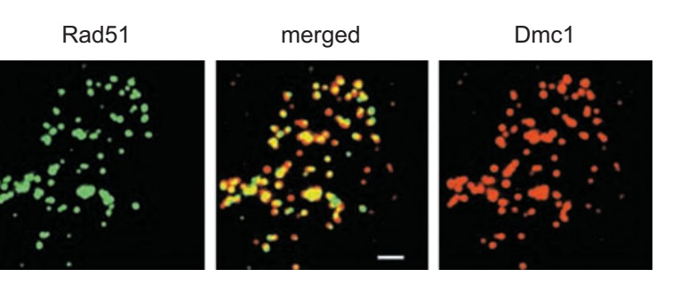{ width="650" height="273" loading="lazy" }
/// caption
SK1背景野生型，白尺2 μm；中列为合并图。Shinohara等2000年图1A，经Watson等图11–24转载。[^meiotic-foci]
///

焦点重叠说明两者在光学分辨率下聚集于相近区域；要证明直接接触、具体丝状结构或每个焦点最终都形成交换，还需要其他实验。原研究进一步用突变体比较，考察Tid1/Rdh54对共定位的影响。

Hop2–Mnd1等辅助因子参与这一过程。在酿酒酵母 *hop2* 突变体中，可以形成接近正常数量的联会复合体，却有许多发生在非同源染色体之间，断裂也难以正常修复。反过来，某些缺少完整联会复合体的酵母突变体仍能发生一定的交换。这些结果让“染色体靠在一起”“找到正确同源模板”和“形成交换”成为可以分别研究的步骤。[^hop2-synapsis]

大量起始事件最终只有一部分形成交换。交换与姐妹染色单体臂上的黏连共同维持**交叉（chiasma）**，帮助同源染色体在减数第一次分裂建立正确取向。许多物种具有**交换保证**，使一对同源染色体获得至少一次交换；还具有**交换干扰**，使相邻交换不会简单地独立发生。热点分布、保证与干扰的实现依物种而异，也存在无典型交叉的分离系统。染色体层面的联会、黏连和分离见[减数分裂](../cell/cell_cycle.md#meiosis)，后代重组比例与图距见[连锁、交换与遗传作图](../genetics/linkage_mapping.md#recombination-distance)。[^meiotic-crossovers]

同源配对也可能找错位置。若相似序列分布在不同座位，**非等位同源重组（non-allelic homologous recombination，NAHR）**可在同向重复间产生缺失或重复，在同一分子的反向重复间产生倒位，不同染色体间则可能形成易位。配对遵守了序列相似性，基因组的整体排列仍可能因此改变，具体染色体后果见[突变与染色体变异](../genetics/chromosome_variation.md#structural-variant-formation)。

## 位点特异性重组 { #site-specific-recombination }

### 位点方向决定DNA怎样重排 { #site-orientation }

同源重组搜索一段相似序列；**保守型位点特异性重组**则由重组酶识别一对相配的短位点，把它们组装到同一复合物中，切开并重新连接。交换前后通常没有核苷酸的净增减，也不靠DNA聚合酶把两边缺口补齐。[^site-specific-recombination]

位点本身有方向。把两个同向位点拉到一起，它们之间的DNA形成环，重组可以将环切出；两个反向位点重组，中间片段则翻转；两个位点位于不同DNA分子上，又可以使分子整合或交换。

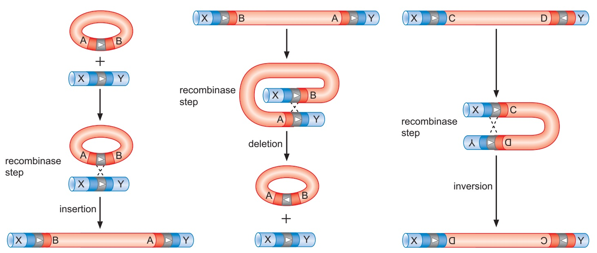{ width="740" height="314" loading="lazy" }
/// caption
从左到右为分子间整合、同向位点间切除、反向位点间倒位；红色DNA段随反应改变位置或方向。Watson等，图12–3。[^gene-book]
///

P1噬菌体的**Cre–loxP**是常用例子。一个loxP位点长34 bp，两侧各有13 bp反向重复的Cre结合臂，中间是8 bp不对称区。中间区使位点具有方向，也影响两位点的交换相容性；保持8 bp长度并不足以保证任意替换后的序列仍能高效重组。

Cre在简化体系中所需辅助因子较少，因此便于构建条件性删除、倒位和谱系报告系统。实验中仍要分别验证报告位点与目标等位基因，具体构建设计见[条件遗传系统](../exptech/biochem_molecular/molecular_cloning.md#expression-conditional-genetics)，嵌合及等位基因检测见[编辑结果验证](../exptech/biochem_molecular/genome_editing.md#editing-outcomes-validation)。

### 两类重组酶的切开与重连 { #recombinase-chemistry }

位点特异性重组酶可以暂时把自己与DNA末端共价连接。活性位点的羟基攻击磷酸二酯键，DNA被切开的同时形成蛋白质—DNA键；随后另一DNA羟基再攻击这个中间体，完成重连。磷酸二酯键的能量在可逆转酯过程中保留下来，因而能够直接完成链交换。[^site-specific-recombination]

**酪氨酸重组酶：先换一对链**

Tyr形成3′-磷酸酪氨酸键，留下5′-OH。四个亚基先交换一对链，生成Holliday连接，再交换另一对链。Cre–loxP、Flp–FRT、λ整合酶和XerC/XerD系统使用这一家族的重组酶。

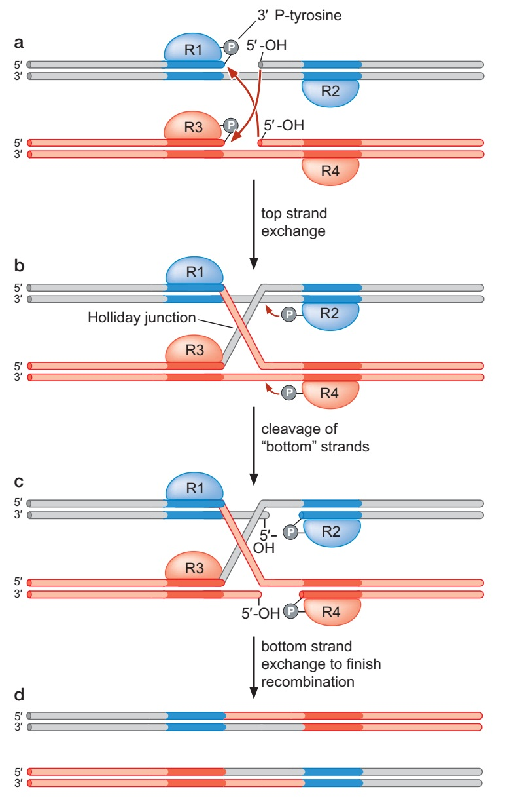{ width="330" height="524" loading="lazy" }
/// caption
图中先由R1/R3切割，另一对亚基随后作用。Watson等，图12–8。[^gene-book]
///

**丝氨酸重组酶：四条链先切开**

Ser形成5′-磷酸丝氨酸键，留下3′-OH。四条链协调切开后，两个亚基组合相对旋转，交换被蛋白握住的末端，再重连。Hin、Tn3解离酶及φC31、Bxb1等大型整合酶属于这一家族。

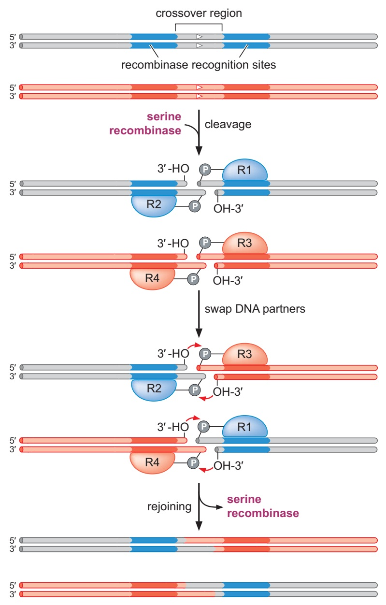{ width="330" height="517" loading="lazy" }
/// caption
交换期间，被切开的5′端保持与重组酶共价相连；图以swap表示交换步骤。Watson等，图12–6。[^gene-book]
///

两类酶都能利用短识别位点，却具有不同的催化折叠与反应中间体。酪氨酸重组中的Holliday连接主要在短交换区内重排，也不等于同源重组中可沿长同源区推进的分支迁移。

### λ整合与启动子倒位 { #natural-site-specific-systems }

λ噬菌体整合时，噬菌体的 **attP** 与细菌染色体的 **attB** 重组，产生夹在前噬菌体两侧的 **attL** 和 **attR**。attP带有多种辅助蛋白结合位点；整合宿主因子IHF使DNA弯曲，帮助整合酶同时接触核心和臂位点。解整合时，Xis等因子改变复合物的组装方式，让attL与attR重新配合。[^site-specific-recombination]

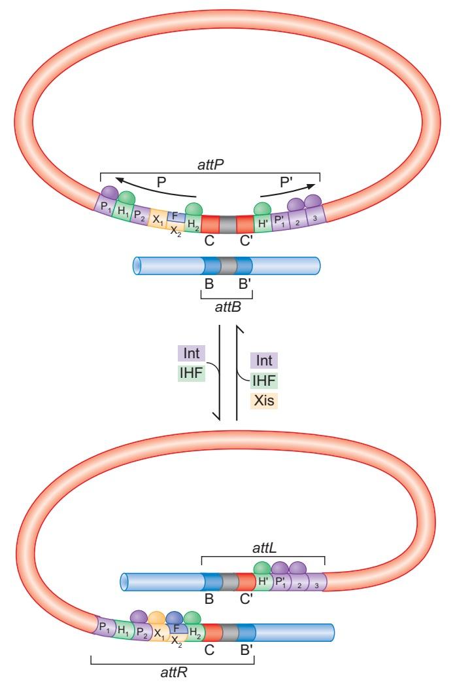{ width="450" height="683" loading="lazy" }
/// caption
箭头两侧列出整合与解整合所需的主要因子；attP的两侧臂在整合后分到不同接头。Watson等，图12–10。[^gene-book]
///

沙门氏菌的**Hin系统**则把方向变化用于基因表达。两个hix位点之间含有启动子；Hin使这段DNA倒位，启动子就会朝向或背离 *fljB–fljA*。朝向时表达H2型鞭毛蛋白FljB和抑制另一种鞭毛蛋白表达的FljA；翻转后，这一组表达关闭，另一型鞭毛蛋白的抑制解除。Fis和重组增强子帮助组装活跃的倒位复合体。

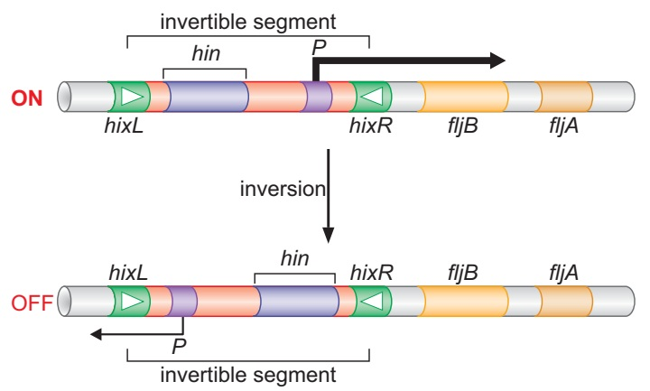{ width="620" height="373" loading="lazy" }
/// caption
上方启动子朝向fljB–fljA，下方背离这两个基因。两个hix位点夹住的是被翻转的DNA段。Watson等，图12–13。[^gene-book]
///

位点特异性重组还有维持染色体的工作：环状染色体复制后若经同源重组连成二聚体，Xer系统可在特定位点拆开它，使两个子代各自获得一份可分离的染色体。它改变的是分子的连接数目，通常不承担大段序列信息的修复。

## DNA转座 { #dna-transposition }

### 元件末端与靶位点重复 { #transposon-ends-tsd }

**转座元件（transposable element，TE）**带着被移动装置识别的顺式序列。自主元件还能编码相应的酶；非自主元件保留末端等必要信号，却需借用相容元件提供的蛋白。它们都依赖宿主的若干功能，“自主”描述的是移动装置的编码能力。[^dna-transposition]

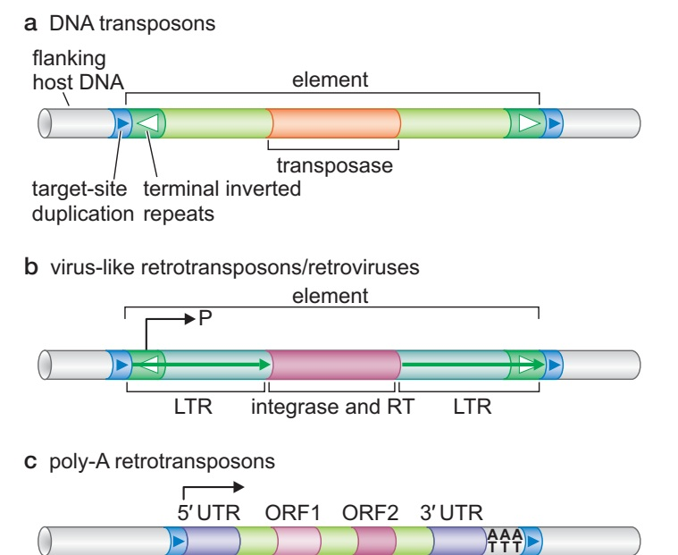{ width="570" height="466" loading="lazy" }
/// caption
a为DNA转座子，b为LTR类，c为LINE型。注意元件边界与两侧宿主来源的短重复位置不同。Watson等，图12–18。[^gene-book]
///

典型DNA转座子的两端含有**末端反向重复（terminal inverted repeat，TIR）**，由转座酶识别。最常见的DDE/D类转座酶利用保守酸性残基配位金属离子；在剪切—粘贴路线中，两个末端先配对成转座复合体，再从供体DNA切出。元件两端释放的3′-OH，分别攻击靶DNA两条链上错开的磷酸二酯键，将元件接入新位置。

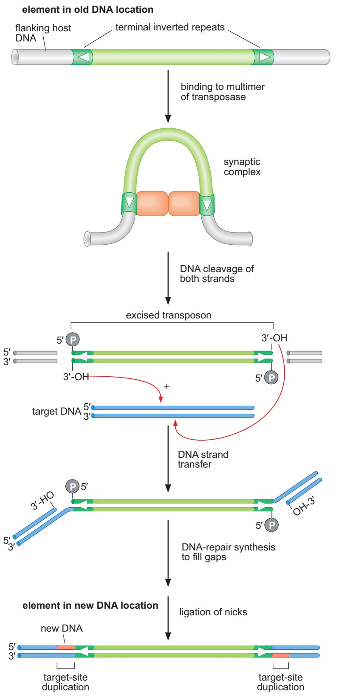{ width="470" height="920" loading="lazy" }
/// caption
绿色元件切出后，3′端接入蓝色靶DNA；宿主补齐两侧缺口、连接，留下短直接重复。Watson等，图12–19。[^gene-book]
///

靶DNA两处受攻击的位置错开一小段距离，插入后两侧因此留下单链缺口。宿主按对链填补，再封闭切口，原来的一段靶序列就分别出现在元件两侧，形成**靶位点重复（target-site duplication，TSD）**。重复长度反映错列间距，随转座家族而变；TIR属于元件自身，TSD则来自靶DNA。[^dna-transposition]

供体也留下需要处理的断裂。修复可能带来小型插入或缺失，形成切出**足迹（footprint）**；若利用姐妹染色单体，也可能恢复原有序列。靶位点选择则受短序列、DNA形状和染色质影响。没有长同源模板的要求，并不等于每个基因组位置都有同样的插入机会。

### 复制型与单链转座 { #replicative-single-strand-transposition }

复制型转座保留了元件与供体之间的一部分连接。转座酶在两个末端各切开一条链，产生可进攻靶DNA的3′-OH；链转移把供体和靶分子连在一起，DNA复制随后沿中间体进行，得到含两个元件拷贝的**共整合体（cointegrate）**。Tn3家族再由专一解离酶在两个 *res* 位点间重组，将共整合体拆成两个分子，各带一个转座子拷贝。[^dna-transposition-mechanisms]

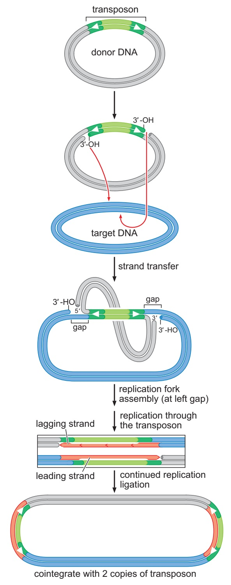{ width="390" height="987" loading="lazy" }
/// caption
灰、蓝分别为原供体与靶分子；底部大环含二者及两个绿色元件。图止于共整合体，未画后续位点特异性拆分。Watson等，图12–22。[^gene-book]
///

噬菌体Mu在裂解性增殖时也利用复制型转座扩增DNA。MuA识别末端，MuB等因子参与靶DNA选择；已有Mu末端附近还可出现靶免疫，降低重复插入邻近区域的机会。其整合分布有偏好，不能由“转座”推成完全随机。

还有一些元件主要处理单链DNA，采用**HUH核酸酶**。这里的HUH表示催化基序，活性酪氨酸可形成蛋白质—DNA共价中间体；它们的末端和TSD规律不同于上面的典型DDE路线。[^huh-transposition]

| 代表 | 催化与移动方式 | 需要区分的特征 |
| --- | --- | --- |
| IS200/IS605家族 | HUH–Y1转座酶，处理单链底物，常称peel-and-paste | 识别包含发卡的末端结构及短靶序列，不沿用典型TIR/TSD模式 |
| IS91家族 | HUH–Y2，滚环相关的复制型转座 | 起止端不对称，可在终止识别改变时携带邻近序列 |
| Helitron | RepHel兼有HUH–Y2核酸酶与解旋酶功能，复制与转移相联系 | 经典成员以5′-TC开始、以CTRR-3′结束（R为嘌呤），3′端附近有发卡，通常不形成TSD |

在重建的**Helraiser**实验系统中，研究者用环状中间体和催化突变等证据检验了Helitron的复制、切出与再插入；其中两个催化Tyr和解旋酶功能都重要。3′端附近的发卡参与终止；转座酶若越过正常3′终止端，就可能把下游侧翼DNA一并携带到新位置。[^helitron]

部分移动系统使用丝氨酸或酪氨酸重组酶；整合接合元件（ICE）又能切出成环、经细胞间接合转移并重新整合。这些机制使转座与位点特异性重组、水平转移相互连接，但不宜仅按“移动”二字把它们当成同一种反应。

### 细菌转座元件怎样携带基因 { #bacterial-transposon-organization }

细菌的**插入序列（insertion sequence，IS）**通常主要编码移动所需蛋白。两个IS若夹住一段抗性或代谢基因，外侧末端可把整段DNA界定为一个**复合转座子（composite transposon）**。**单元型转座子（unit transposon）**则在一套自身末端内携带转座酶、其他移动相关基因及附带基因；具体组合依家族而异。

Tn10把这种组织方式表现得很直观：中间是四环素抗性相关基因，两侧是IS10。图中的右侧IS10提供有活性的转座酶，左侧相应基因已经失活；两个IS并不一定都能独立移动。

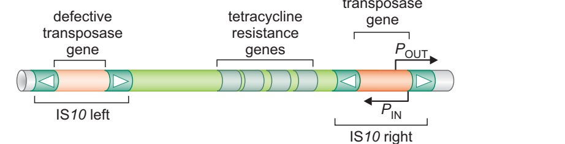{ width="680" height="174" loading="lazy" }
/// caption
右端IS10的转座酶基因有效，左端标出defective；外侧末端可共同界定整个复合转座子。Watson等，图12–27。[^gene-book]
///

这些模块可以进入质粒、噬菌体和ICE，随水平基因转移传播。插入编码区会中断基因；若插在操纵子的前部，还可能通过转录终止或干扰，使下游基因表达降低，形成**极性效应（polar effect）**。同一次插入，因位置不同，表型可以涉及一个基因，也可以波及整个转录单位。

### 玉米与果蝇中的DNA转座 { #eukaryotic-dna-transposons }

McClintock从玉米染色体断裂、基因定位和籽粒斑驳的遗传行为中，逐步提出了可移动的**控制元件（controlling elements）**。**Ac**是hAT家族的自主元件；许多**Ds**由Ac缺失衍生，仍保留可被识别的末端，却需要Ac提供转座酶。[^mcclintock]

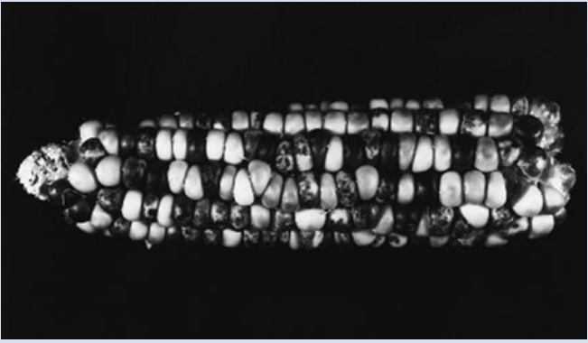{ width="640" height="374" loading="lazy" }
/// caption
籽粒中的色块记录细胞谱系中基因表达状态的变化。McClintock摄，CSHL Archives提供；经Watson等Box 12–3图2转载。[^gene-book]
///

若Ds插入使色素基因失活，籽粒相应组织就失去颜色；发育中某个细胞发生切出并恢复功能，其后代细胞可形成有色斑块。较早发生的事件通常留下较大克隆，较晚发生的留下较小斑点，实际还受组织谱系和元件剂量等影响。一粒玉米于是能保留许多细胞各自的变化记录。单凭颜色照片还不能确定插入位点；McClintock的结论来自细胞遗传学和杂交证据的相互配合。

果蝇**P元件**的经典杂交不育现象又显示了母源信息的影响：带活性P元件的雄蝇与缺少相应抑制信息的雌蝇杂交，子代生殖系可发生高转座、染色体损伤和不育；反交则常受到保护。P元件转座酶的剪接调控有助于其生殖系表达，而卵细胞传来的piRNA提供另一层限制，后文将结合原实验看这种不对称。

**Tc1/mariner**家族也采用剪切—粘贴路线，许多成员偏好TA靶位点。不同物种中某些mariner序列的近似程度远高于宿主分化所预期的程度，为水平传播提供了证据。**微型反向重复转座元件（MITE）**则通常不编码转座酶，借相容自主元件的装置移动。自主、非自主与当前是否活跃，是不同的描述。[^mariner]

## 逆转座：先生成RNA副本 { #retrotransposition }

### LTR元件与插入偏好 { #ltr-retrotransposons }

**逆转座元件（retrotransposon）**先从原位DNA转录出RNA，再逆转录生成能进入新位置的DNA。典型结果是供体仍在，新位点增加一个拷贝。LTR类两端具有**长末端重复（long terminal repeat，LTR）**，常编码Gag和Pol；RNA与蛋白可在病毒样颗粒中完成逆转录，生成带有完整LTR的线性DNA，再由整合酶插入。酵母Ty、果蝇copia和许多植物LTR元件都采用这一基本逻辑。[^retrotransposons]

逆转座并不等于随机插入。酵母不同Ty家族有不同偏好：Ty1、Ty2、Ty3、Ty4的许多插入靠近RNA聚合酶III转录的基因，Ty5则偏好沉默染色质。整合酶与宿主蛋白的相互作用、局部染色质状态，可以把插入引向特定环境。

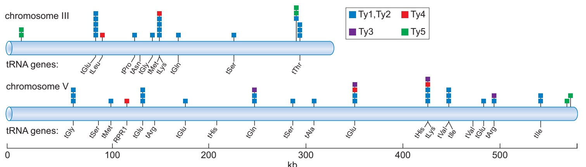{ width="740" height="212" loading="lazy" }
/// caption
彩色标记表示不同家族的已知插入，下方箭头标出tRNA基因；Ty5还与HML等沉默区域相关。Watson等，图12–31。[^gene-book]
///

Ty1颗粒的[电镜照片](dna_replication/reverse_transcription.md#rna_1)，以及以逆转录病毒为例的[tRNA引发与链转移](dna_replication/reverse_transcription.md#trna)，在逆转录一节中展开。本页继续追踪RNA怎样把序列带到新的基因组位置。

### LINE、SINE与SVA { #line-sine-sva }

非LTR逆转座有一种很巧的起步方式：新插入位点本身提供引物。以哺乳动物**LINE-1（L1）**为例，ORF1p结合RNA，ORF2p兼有内切酶和逆转录酶活性。内切酶在靶DNA上切出3′-OH，RNA的3′端与附近序列配对，逆转录就从这里开始，称为**靶位点引发逆转录（target-primed reverse transcription，TPRT）**。[^retrotransposons]

{ width="450" loading="lazy" }
/// caption
先找靶DNA上的3′-OH，再沿它观察新DNA合成。图中后半程概括了第二链合成与修复，实际可形成不完整或重排的插入。Watson等，图12–26。[^gene-book]
///

这种路线通常不先生成游离的完整双链cDNA。新插入常见3′ poly(A)、可变长度TSD和5′端截短；后续第二链处理也可能产生更复杂的接头。L1蛋白偏向动员产生它们的那条RNA，但也能动员其他RNA。

**Alu等SINE**不编码完整移动装置，可利用L1提供的功能。**SVA**是灵长类的复合非自主元件，名称来自SINE-R、VNTR和Alu来源区域；它也依赖L1相关装置。细胞mRNA偶尔被动员，则可能形成失去内含子的加工型假基因。供体是否编码蛋白、RNA能否被识别、逆转录能否完成，都影响最终效率。

携带邻近序列也是重要后果。L1转录若越过自身的终止区域，下游序列可进入RNA并随之发生**3′转导（3′ transduction）**。SVA也有5′、3′甚至两端侧翼序列被携带的实例：上游转录起始或外显子捕获可将5′侧序列接到元件RNA上，读穿则可加入3′侧序列。移动的边界由实际RNA组成决定，不总与注释中标出的元件边界重合。[^sva-transduction]

部分细菌和细胞器的**第二类内含子（group II intron）**走另一条路线：内含子RNA先反向剪接进入靶DNA，相关蛋白再提供或利用引发末端进行逆转录。这类**逆归巢（retrohoming）**的RNA同时参与催化与信息传递；具体链端和宿主修复步骤见[第二类内含子的移动](dna_replication/reverse_transcription.md#group-ii-intron)。端粒酶和retron虽也利用逆转录，产物与功能则不同。

### 逆转录病毒怎样整合 { #retroviral-integration }

逆转录病毒在进入细胞后，先生成两端带LTR的线性双链DNA。**整合酶（integrase）**结合两个病毒DNA末端，完成3′端加工，使参与反应的羟基暴露；两个末端再协调攻击宿主DNA的错列位置。宿主修复补齐并连接接头，形成两侧带短TSD的前病毒。[^retroviral-integration]

这一步与DDE转座酶的链转移化学相近。它把病毒DNA末端接入靶位点，随后需要宿主处理缺口；与Cre那种两对短位点之间的保守交换不同。HIV-1、MLV等的整合位置也不相同：局部DNA形状与序列，加上LEDGF/p75、BET等不同染色质引导因子，会改变各类病毒的整合分布。

LTR逆转座元件与逆转录病毒共享部分反应，但颗粒是否能离开细胞、是否具有包膜和传播能力，属于生活史的其他环节。相关感染与表达过程见[病毒与亚病毒因子](../micro/viruses.md)。

## 转座怎样受到限制 { #transposon-control }

### 元件自身的表达反馈 { #transposon-self-control }

转座酶并非越多越好。末端要按适当方式配对、蛋白要组装成活跃复合体；一些系统中酶过量反而产生无效装配，出现**过量抑制（overproduction inhibition）**。弱启动子、转录终止、短抑制蛋白、选择性剪接以及蛋白不稳定性，也能限制有效酶量。

Tn10用反义RNA把拷贝数接到翻译控制上。IS10右端两个相反方向的启动子产生转座酶mRNA与反义RNA；二者5′端有互补区。拷贝较多时，反义RNA更容易与mRNA结合，遮挡翻译起始所需区域，减少转座酶产生。[^gene-book]

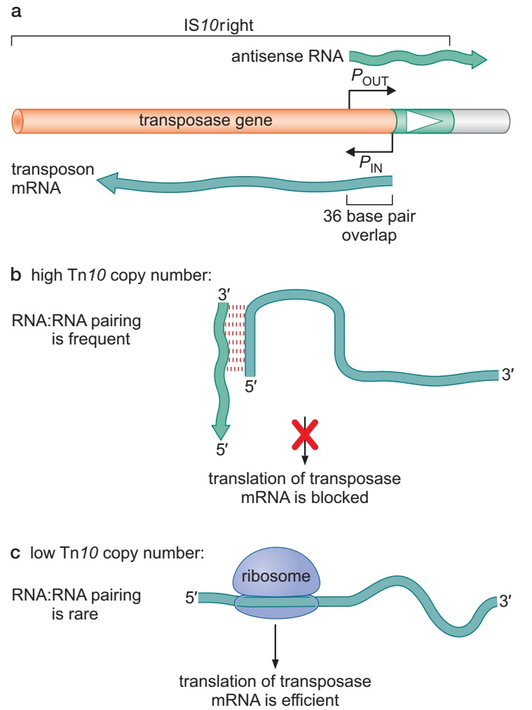{ width="470" height="627" loading="lazy" }
/// caption
a显示相反方向的转录，b、c比较不同拷贝数下配对与核糖体结合。Watson等，图12–28。[^gene-book]
///

元件对末端与靶DNA的选择，以及不同元件间的排斥，也会改变移动频率。细菌的限制修饰、核酸酶、CRISPR–Cas等防御还可阻止部分外来元件建立，作用范围取决于具体宿主和元件。

### 染色质沉默 { #chromatin-silencing }

真核宿主常把转座元件所在区域变成较难转录的染色质。哺乳动物的**KRAB锌指蛋白**识别特定元件序列，招募TRIM28/KAP1以及SETDB1等，促进H3K9甲基化和抑制性染色质形成。不同锌指蛋白识别的家族不同，宿主与新出现元件之间也会持续演化。[^chromatin-transposon-control]

植物的一条主要路线是**RNA指导的DNA甲基化（RNA-directed DNA methylation，RdDM）**。Pol IV、RDR2和DCL3参与产生24-nt siRNA；AGO携带siRNA，借与Pol V支架转录本等相互作用定位相应区域，进而招募DNA甲基化装置。小RNA把序列对应关系转成染色质上的抑制状态。沉默也可能影响邻近宿主基因，因此边界与去甲基化同样重要。

### piRNA与母源保护 { #pirna-maternal-protection }

动物的**PIWI相互作用RNA（PIWI-interacting RNA，piRNA）**通常长约21–35 nt，3′末端核糖常有2′-O-甲基化。piRNA与PIWI蛋白结合，通过序列互补找到目标RNA；一些核内PIWI还可引导转录沉默。piRNA簇中保存的转座元件片段，为这套系统提供了部分识别信息。[^pirna-control]

果蝇生殖系的**乒乓循环（ping-pong amplification）**把靶RNA切割与小RNA扩增接在一起。Aub携带的反义piRNA引导切割转座子正义RNA，形成可进入Ago3的正义piRNA前体；Ago3再切割相应反义前体，补充Aub所需的piRNA。切割位置使两组piRNA的5′端常具有10 nt重叠，反义1U和正义10A也可形成序列偏好。片段还需修剪和末端成熟，不能把任何一次RNA切割都等同于立即生成完整piRNA。不同动物与细胞的路线并不相同，核内Piwi的作用也不能直接并入Aub–Ago3循环。[^ping-pong]

???+ abstract "同一个父本，不同母本带来的小RNA"

    Brennecke等在2008年比较了几种果蝇母本。图A左侧黑条是亲代卵巢，橙条是0–2 h胚胎；下方P元件一组中，Lk、NA母本可向胚胎提供相应piRNA，w¹¹¹⁸则缺少这一类小RNA。F、I元件的小RNA作为不同类群的比较。

    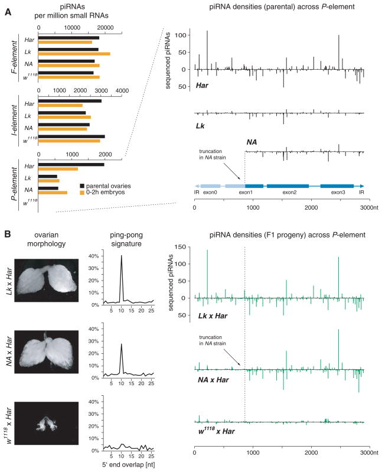{ width="640" height="790" loading="lazy" }
    /// caption
    A为亲代与早期胚胎；B三组父本均为Harwich，左侧品系名是母本。中列横轴为piRNA的5′端重叠长度，峰出现在10 nt。原论文图4。[^maternal-pirna-experiment]
    ///

    图B让三个母本分别与同一个Harwich父本杂交。Lk、NA的子代卵巢较正常，并有明显的10 nt乒乓峰；w¹¹¹⁸母本的子代卵巢萎缩，相应P piRNA也很少。这组比较支持母源piRNA参与建立子代沉默。

    右侧还保留了一个序列线索：NA携带的P片段在5′端截短，母源及子代piRNA的分布与这个缺失边界有关。图把小RNA来源、后代小RNA状态和生殖组织表型接在一起；卵巢照片本身并不是新转座接头的直接检测，也不是“单独补入piRNA就足够”的实验。

piRNA并非只针对逆转座子，DNA转座子也是重要目标；部分piRNA还调节宿主RNA。因此，P元件杂交中母源保护说明的是特定小RNA信息怎样先到达胚胎，而不是一个适用于所有转座元件的单一遗传开关。

## 移动元件留下什么 { #transposon-consequences }

一次新插入可以破坏编码区、剪接位点或调控序列，也可能带来新的启动子、增强子、绝缘子、加尾信号和转录因子结合位点。同家族的多个拷贝，又为非等位同源重组提供了分散在基因组各处的底物。断裂、侧翼转导、加工型假基因和附带基因的水平传播，使影响延伸到插入位点之外。[^transposon-evolution]

古老拷贝大多已经失去移动能力，仍可作为重组底物或调控序列保留。宿主也会**驯化（domestication）**元件的蛋白或顺式序列，把DNA结合、核酸酶、膜融合或调控功能接入自身网络。某段序列来自转座元件，并不意味着它今天仍在移动，也不意味着它已经没有作用。

!!! tip "怎样判断发生了新插入"

    元件RNA和染色质可接近性提供表达与调控状态的线索。确认新插入还需寻找原来没有的DNA接头，结合末端结构、TSD或其他家族特征，并在亲子、克隆或转座报告系统中验证新增拷贝。短读长容易被重复比对限制；长读长、接头PCR、家系分离与功能实验提供互补证据。报告构建的表达量和底物条件也应单独交代，其测得的频率未必代表内源元件的活动。

末端反向重复、LTR、poly(A)、靶位点重复和供体足迹，各自记录了一部分反应历史。把它们与元件编码能力、实际产物及宿主背景合起来看，才能从一个新接头追到它的形成过程。

## 参考资料与延伸阅读 { #references }

- Watson JD, Baker TA, Bell SP, et al. *Molecular Biology of the Gene*. 7th ed. Pearson/CSHL Press; 2014. 第11、12章。
- Kowalczykowski SC. [An Overview of the Molecular Mechanisms of Recombinational DNA Repair](https://pmc.ncbi.nlm.nih.gov/articles/PMC4632670/). *Cold Spring Harbor Perspectives in Biology*. 2015;7:a016410.
- Dillingham MS, Kowalczykowski SC. [RecBCD Enzyme and the Repair of Double-Stranded DNA Breaks](https://pmc.ncbi.nlm.nih.gov/articles/PMC2593567/). *Microbiology and Molecular Biology Reviews*. 2008;72:642–671.
- Grindley NDF, Whiteson KL, Rice PA. [Mechanisms of Site-Specific Recombination](https://doi.org/10.1146/annurev.biochem.73.011303.073908). *Annual Review of Biochemistry*. 2006;75:567–605.
- Hickman AB, Dyda F. [Mechanisms of DNA Transposition](https://pmc.ncbi.nlm.nih.gov/articles/PMC7422641/). *Microbiology Spectrum*. 2015;3:MDNA3-0034-2014.
- Wells JN, Feschotte C. [A Field Guide to Eukaryotic Transposable Elements](https://doi.org/10.1146/annurev-genet-040620-022145). *Annual Review of Genetics*. 2020;54:539–561.

[^recombination-overview]: 同源重组的末端加工、RecA／RAD51 同源搜索、链交换、分支迁移与中间体拆解见 Kowalczykowski 的[综述](https://pmc.ncbi.nlm.nih.gov/articles/PMC4632670/)及 Alberts 等的[教材章节](https://www.ncbi.nlm.nih.gov/books/NBK26898/)。
[^hr-outcomes]: SDSA、double Holliday junction、核酸酶 resolution、解旋酶—拓扑异构酶 dissolution 与 BIR 的并行结局见 Kowalczykowski 的[综述](https://pmc.ncbi.nlm.nih.gov/articles/PMC4632670/)；修复通路选择边界见 [DNA损伤、修复与突变](dna_repair.md#break-crosslink-repair)。
[^bacterial-recombination]: 大肠杆菌 RecBCD–Chi、RecFOR、RecA、RuvABC 及其他细菌 AddAB／RecU 差异见 Dillingham 与 Kowalczykowski 的[综述](https://pmc.ncbi.nlm.nih.gov/articles/PMC2593567/)及 Rocha 等的[比较研究](https://pmc.ncbi.nlm.nih.gov/articles/PMC1193525/)。
[^archaea-eukaryote-hr]: 古菌 Mre11–Rad50–HerA–NurA–RadA 与真核切除／RAD51 装载的共同功能和谱系差异见 Schiller 等的[结构综述](https://pmc.ncbi.nlm.nih.gov/articles/PMC4176011/)及 Kowalczykowski 的[机制综述](https://pmc.ncbi.nlm.nih.gov/articles/PMC4632670/)。
[^meiotic-crossovers]: Spo11 起始、RAD51／DMC1、crossover／noncrossover 分流、交换保证与干扰见 Gray 与 Cohen 的[综述](https://pmc.ncbi.nlm.nih.gov/articles/PMC5319444/)；染色体层面接口见[细胞周期与细胞分裂](../cell/cell_cycle.md#meiosis)。
[^site-specific-recombination]: tyrosine／serine recombinase 的共价中间体、Holliday junction 或亚基旋转机制及位点拓扑结果见 Grindley 等的[综述](https://www.annualreviews.org/content/journals/10.1146/annurev.biochem.73.011303.073908)和 Yang 的[结构比较](https://pmc.ncbi.nlm.nih.gov/articles/PMC6290911/)。
[^dna-transposition]: 自主／非自主元件、末端识别、靶位点偏好、错列 strand transfer 与 TSD 形成见 Hickman 与 Dyda 的[综述](https://pmc.ncbi.nlm.nih.gov/articles/PMC7422641/)及 Wells 与 Feschotte 的[真核元件综述](https://www.annualreviews.org/content/journals/10.1146/annurev-genet-040620-022145)。
[^dna-transposition-mechanisms]: DDE、HUH、serine 和 tyrosine transposase，以及剪切—粘贴、复制型和单链转座路线见 Hickman 与 Dyda 的[综述](https://pmc.ncbi.nlm.nih.gov/articles/PMC7422641/)。
[^mcclintock]: 玉米 controlling elements、Ac／Ds 与基因表达及染色体不稳定性的实验解释见 McClintock 的[诺贝尔演讲](https://www.nobelprize.org/prizes/medicine/1983/mcclintock/lecture/)及诺贝尔委员会的[科学说明](https://www.nobelprize.org/prizes/medicine/1983/press-release/)。
[^retrotransposons]: LTR、LINE、SINE、SVA、group II intron 与 TPRT／extrachromosomal priming 的差异见 Beauregard 等的[综述](https://pmc.ncbi.nlm.nih.gov/articles/PMC2665727/)及 Wells 与 Feschotte 的[分类综述](https://www.annualreviews.org/content/journals/10.1146/annurev-genet-040620-022145)。
[^retroviral-integration]: integrase 3′ processing、协同 strand transfer、宿主缺口修复、TSD 与染色质靶向见 Lesbats 等的[综述](https://pmc.ncbi.nlm.nih.gov/articles/PMC5084067/)；不同病毒整合位点分布的原始比较见 Mitchell 等的[研究](https://journals.plos.org/plosbiology/article?id=10.1371%2Fjournal.pbio.0020234)。
[^chromatin-transposon-control]: 哺乳动物 KRAB-ZFP–TRIM28–SETDB1 抑制见 Yang 等的[综述](https://pmc.ncbi.nlm.nih.gov/articles/PMC5659910/)；植物 Pol IV／Pol V、24-nt siRNA 与 RdDM 见 Sigman 与 Slotkin 的[综述](https://pmc.ncbi.nlm.nih.gov/articles/PMC4790875/)。
[^pirna-control]: piRNA 长度、3′ 末端修饰、PIWI 介导的转录与转录后沉默及 ping-pong 路线见 Ozata 等的[综述](https://pubmed.ncbi.nlm.nih.gov/30446728/)；P-element 杂交不育中的母源 piRNA 证据见 Brennecke 等研究的[评述](https://pmc.ncbi.nlm.nih.gov/articles/PMC2688286/)。
[^transposon-evolution]: 转座元件对插入、重排、调控网络和宿主 domestication 的多层影响及其家族差异见 Wells 与 Feschotte 的[综述](https://www.annualreviews.org/content/journals/10.1146/annurev-genet-040620-022145/)和 Goodier 的[宿主限制综述](https://pmc.ncbi.nlm.nih.gov/articles/PMC4982230/)。

[^gene-book]: Watson JD, Baker TA, Bell SP, et al. *Molecular Biology of the Gene*. 7th ed. Pearson/Cold Spring Harbor Laboratory Press; 2014. 第11、12章。本页裁取图11–2（印刷345页）、11–4（348页）、Box 11–1图1（350页）、11–23（365页）、11–26（372页）、11–28（374页）、12–3（379页）、12–6（382页）、12–8（385页）、12–10（388页）、12–13（390页）、12–18（395页）、12–19（398页）、12–22（402页）、Box 12–3图2（408页）、12–27（409页）、12–28（410页）、12–31（415页）；图12–26（407页）复用本站逆转录页原图。保留原标记，未改绘数据。玉米照片由Barbara McClintock拍摄，Cold Spring Harbor Laboratory Archives提供；Ty插入分布图署Dan Voytas。原始实验与结构另列专门脚注。
[^fig-reca-em]: Watson等，图11–9a，印刷356页；转载自Stasiak A, Egelman EH. 1988. In: Kucherlapati R, Smith GR, eds. *Genetic Recombination*. ASM Press, pp.265–307，图3。图为环状DNA被RecA完全或部分包被的电镜照片，同时有未包被DNA作比较。
[^reca-atp]: Menetski JP, Bear DG, Kowalczykowski SC. [Stable DNA heteroduplex formation catalyzed by the Escherichia coli RecA protein in the absence of ATP hydrolysis](https://pmc.ncbi.nlm.nih.gov/articles/PMC53191/). *PNAS*. 1990;87:21–25。该体系在ATPγS下形成稳定异源双链；有限链交换的方向性与ATP水解依赖的较长距离交换另见[2019年原研究](https://pmc.ncbi.nlm.nih.gov/articles/PMC6547424/)。
[^reca-single-molecule]: Forget AL, Kowalczykowski SC. [Single-molecule imaging of DNA pairing by RecA reveals a three-dimensional homology search](https://doi.org/10.1038/nature10782). *Nature*. 2012;482:423–427；[公开全文](https://pmc.ncbi.nlm.nih.gov/articles/PMC3288143/)。采用出版社图1及图3完整图版（图1以A/B、B下a–d标记，与作者稿编号不同）。图1配对比较用430-nt底物；图3a为430 nt、2 min，3b比较2/6 μm微珠中心间距，3c比较162/430/1762 nt；37 °C无流动反应池、ATPγS条件，误差棒SEM。
[^historical-models]: Holliday R. [A mechanism for gene conversion in fungi](https://doi.org/10.1017/S0016672300001233). *Genetical Research*. 1964;5:282–304。Meselson MS, Radding CM. [A general model for genetic recombination](https://pmc.ncbi.nlm.nih.gov/articles/PMC432304/). *PNAS*. 1975;72:358–361。Szostak JW, Orr-Weaver TL, Rothstein RJ, Stahl FW. [The double-strand-break repair model for recombination](https://doi.org/10.1016/0092-8674(83)90331-8). *Cell*. 1983;33:25–35。
[^gene-conversion]: 基因转换、恢复及未修复异源双链造成的减数后分离见[Genome-wide survey of post-meiotic segregation during yeast recombination](https://pmc.ncbi.nlm.nih.gov/articles/PMC3218862/)。转换与两侧交换是不同分类轴；参见Alberts等[教材图5–66](https://www.ncbi.nlm.nih.gov/books/NBK26898/)。
[^fig-recbcd]: Watson等，图11–5，印刷352页，改编自Spies M, Amitani I, Baskin RJ, Kowalczykowski SC. [RecBCD enzyme switches lead motor subunits in response to χ recognition](https://doi.org/10.1016/j.cell.2007.09.023). *Cell*. 2007;131:694–705，图5。图示为机制模型；Chi后具体切割模式的条件依赖见Dillingham与Kowalczykowski2008综述。
[^fig-ruvab]: Watson等，图11–17，印刷360页。左侧RuvA–DNA结构据Ariyoshi等2000年[原研究](https://doi.org/10.1073/pnas.140212997)，*PNAS* 97:8257–8262；右侧为RuvAB结合连接的示意，不是相同分辨率的结构观察。
[^recet-recf]: Morimatsu K, Kowalczykowski SC. [RecFOR proteins load RecA protein onto gapped DNA to accelerate DNA strand exchange](https://pubmed.ncbi.nlm.nih.gov/12769856/). *Molecular Cell*. 2003;11:1337–1347。RecE–RecT的切除、单链退火及相应重组底物见[2016年原研究](https://pmc.ncbi.nlm.nih.gov/articles/PMC5021808/)。
[^meiotic-foci]: Shinohara M, Gasior SL, Bishop DK, Shinohara A. [Tid1/Rdh54 promotes colocalization of Rad51 and Dmc1 during meiotic recombination](https://pmc.ncbi.nlm.nih.gov/articles/PMC27106/). *PNAS*. 2000;97:10814–10819，图1A；DOI 10.1073/pnas.97.20.10814。经Watson等图11–24（印刷366页）转载。酿酒酵母SK1背景WT，同步减数分裂诱导后3 h，铺展细胞核间接免疫荧光；白尺2 μm。
[^hop2-synapsis]: Leu JY, Chua PR, Roeder GS. [The meiosis-specific Hop2 protein of S. cerevisiae ensures synapsis between homologous chromosomes](https://pubmed.ncbi.nlm.nih.gov/9708739/). *Cell*. 1998。Hop2–Mnd1促进Dmc1相关配对的生化证据见[2004年原研究](https://pmc.ncbi.nlm.nih.gov/articles/PMC490024/)；缺失完整联会复合体但仍可发生交换的酵母zip1条件见Sym与Roeder1994年[研究](https://doi.org/10.1016/0092-8674(94)90197-X)。
[^huh-transposition]: Chandler M, de la Cruz F, Dyda F, Hickman AB, Moncalian G, Ton-Hoang B. [Breaking and joining single-stranded DNA: the HUH endonuclease superfamily](https://pmc.ncbi.nlm.nih.gov/articles/PMC6493337/). *Nature Reviews Microbiology*. 2013;11:525–538。HUH与Y1/Y2分别描述催化基序和活性Tyr组织，IS200/IS605与IS91不应都归为Y1；Helraiser的Y2结构见[Kosek等原研究](https://pmc.ncbi.nlm.nih.gov/articles/PMC9364955/)。
[^helitron]: Helitron/Helraiser的末端、RepHel与复制相关中间体见[2016年Helraiser重建研究](https://pmc.ncbi.nlm.nih.gov/articles/PMC4778049/)及[2018年转座中间体研究](https://pmc.ncbi.nlm.nih.gov/articles/PMC5876387/)。序列规则用于经典成员，不将其作为所有Helitron相关元件的无例外定义。
[^mariner]: Tc1/mariner结构与靶偏好见Watson等第12章及Wells、Feschotte2020综述。Drosophila与Zaprionus中mariner的水平传播推断见[1991年比较研究](https://pubmed.ncbi.nlm.nih.gov/1664000/)，依据序列与宿主系统发育的不一致，不是天然转移事件的直接影像。
[^sva-transduction]: Damert A, Raiz J, Horn AV, et al. [5′-Transducing SVA retrotransposon groups spread efficiently throughout the human genome](https://pmc.ncbi.nlm.nih.gov/articles/PMC2775593/). *Genome Research*. 2009;19:1992–2008。文中区分5′转导、3′转导及两端携带，并讨论转录起始与剪接捕获的贡献。
[^ping-pong]: Gunawardane LS, Saito K, Nishida KM, et al. [A slicer-mediated mechanism for repeat-associated siRNA 5′ end formation in Drosophila](https://pubmed.ncbi.nlm.nih.gov/17322028/). *Science*. 2007;315:1587–1590。Aub/Ago3切割与5′端10-nt重叠的证据需结合piRNA成熟步骤理解；跨动物差异见Ozata等2019综述。
[^maternal-pirna-experiment]: Brennecke J, Malone CD, Aravin AA, Sachidanandam R, Stark A, Hannon GJ. [An epigenetic role for maternally inherited piRNAs in transposon silencing](https://pmc.ncbi.nlm.nih.gov/articles/PMC2805124/). *Science*. 2008;322:1387–1392；DOI 10.1126/science.1165171，图4。A的黑/橙条分别是亲代卵巢/0–2 h胚胎；B均以Harwich为父本，分别比较Lk、NA、w¹¹¹⁸母本。保留全部面板、坐标和NA的截短边界。
