# DNA损伤、修复与突变 { #_1 }

DNA 要在水、氧和活泼的代谢物中保存信息，本来就不是一件轻松的事。一个碱基可能脱落，另一个可能丢掉氨基；复制聚合酶偶尔也会放错核苷酸，或在一串相似序列间滑错位置。细胞每天都在处理这些变化。我们所说的基因组稳定性，是这些化学反应与维护过程共同产生的结果。[^endogenous-damage]

**损伤、错配与突变，发生在不同的层次。** 损伤是 DNA 化学结构的异常，例如氧化碱基、嘧啶二聚体或骨架断裂；错配则是两条链提供的信息不一致，其中的碱基本身可以完全正常。它们仍有机会被纠正。下图从一次 A:G 错配开始：若复制前改正新生链，原来的 A:T 信息就能保留；若让两条链各自再复制一次，其中一个子代双链会成为配对正常的 C:G。这种能够在后续复制中保留的序列变化，就是突变。到了这一步，仅凭这一小段 DNA 的结构，已经看不出它原来是 A:T 了。

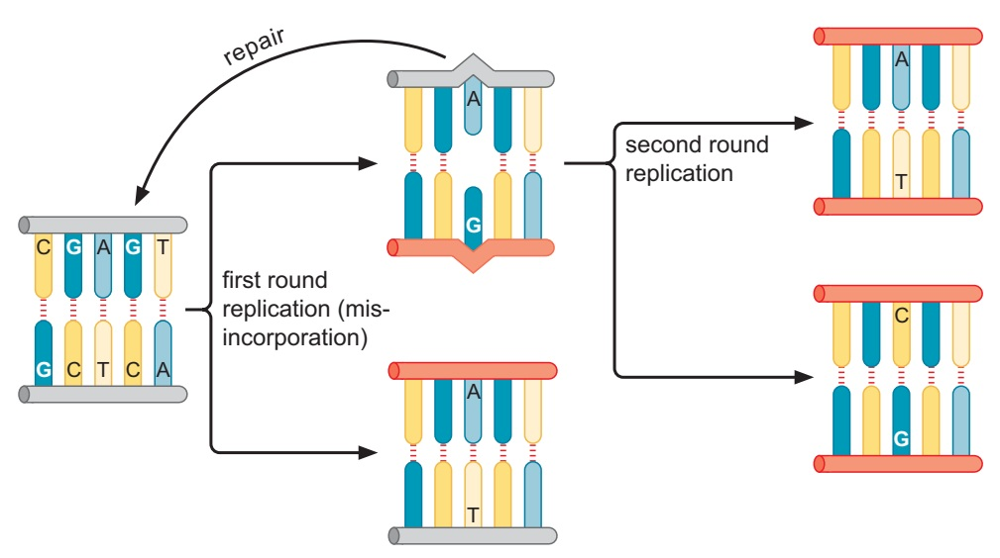{ width="620" }
/// caption
错配尚有链间差异可供辨认；突变固定后，新碱基对也可以拥有正常的双螺旋结构。Watson等，图10–2。[^watson-repair]
///

本页沿着损伤的产生、识别、修复和复制结果展开。直接逆转把异常化学基团改回来；切除修复借互补链补回序列；双链断裂常需另找同源模板，或直接连接末端。还有一些办法容许复制暂时越过损伤——DNA 没有立即修好，但细胞先完成了这段合成。

## DNA损伤的来源 { #dna-damage-sources }

### 水解与氧化 { #hydrolysis-oxidation }

水解可以切断碱基与脱氧核糖之间的 N-糖苷键。升温或酸化会加快脱嘌呤。嘌呤脱落后留下一个仍在骨架中的糖，形成**无碱基位点（AP位点）**；其中的 A、P 来自 apurinic／apyrimidinic，也包括缺失嘧啶的情况。聚合酶走到这里时，骨架虽然还在，却没有一个碱基可供正常配对。

脱氨带来的困难又不同。胞嘧啶 C 脱氨成为 U，U 倾向于与 A 配对，未经修复可把 C:G 改为 T:A。5-甲基胞嘧啶脱氨却直接成为 T：这次产物本来就是 DNA 的正常碱基，只是与原来的 G 对不上。特定修复酶仍能处理这种 T:G 错配，但识别比遇到 U 少了一条明确线索。这也是甲基化 CpG 位点容易发生 C→T 转换的原因之一。[^endogenous-damage]

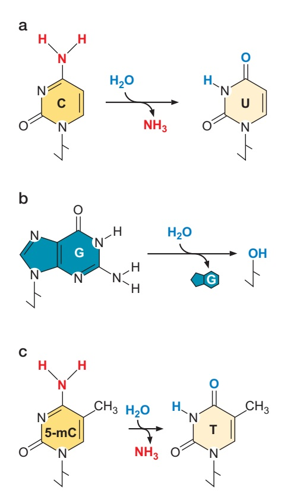{ width="290" loading=lazy }
/// caption
从上到下分别为 C→U、脱嘌呤和5mC→T；只有中间一项直接留下 AP 位点。Watson等，图10–7。[^watson-repair]
///

氧化可以改变碱基的配对方式，也能破坏脱氧核糖。典型产物是 **8-氧代鸟嘌呤（8-oxoG）**：它可采用不同的糖苷键构象，与 C 或 A 配对。若模板中的8-oxoG诱导掺入 A，而这个 A 又被下一轮复制保留下来，最终就可能出现 G:C→T:A 颠换。

另一些产物更擅长阻挡合成。例如胸腺嘧啶二醇改变了原有的平面结构，会妨碍聚合酶前进。同属氧化损伤，后果可以很不一样；把“损伤多”直接换算成“点突变多”，通常会漏掉复制停顿和细胞死亡。[^damage-chemistry]

### 烷基化、碱基类似物与嵌入剂 { #chemical-mutagens }

烷化剂把甲基或乙基转移到碱基或磷酸骨架上。S-腺苷甲硫氨酸等内源甲基供体也能造成一定的自发烷基化。反应落在哪个原子上很关键：有的加合物容易脱落，有的阻碍复制，有的改变氢键供受体，使碱基开始偏爱另一位配对对象。

下图显示甲磺酸乙酯（EMS）造成的一个典型结果：鸟嘌呤 O$^6$ 位乙基化后可与 T 配对，后续复制便可能把 G:C 变成 A:T。其他烷化剂如 MNNG 也可产生 O$^6$-烷基鸟嘌呤；O$^4$-烷基胸腺嘧啶则可与 G 错配，使 A:T→G:C。一个试剂通常产生多种加合物，各自产生损伤、阻断复制和诱发错配的能力也有差别。[^watson-repair][^weaver-repair]

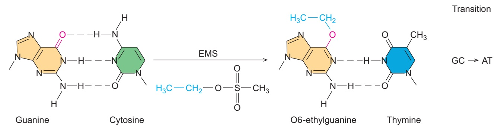{ width="740" loading=lazy }
/// caption
左侧是正常 G:C，右侧是 O$^6$-乙基G:T。末端箭头表示错误配对经后续复制固定为新碱基对。Weaver，图20.25。[^weaver-repair]
///

**碱基类似物**先以核苷酸的形式被掺入 DNA，再因配对性质不同造成错误。5-溴尿嘧啶（5-BU）与 T 相似，通常可与 A 配对，也能形成与 G 相容的配对状态；2-氨基嘌呤（2-AP）与 A 相似，除与 T 配对外也能与 C 错配。这类变化可以导致转换。图中用教材的酮式—烯醇式模型解释5-BU:G；实际错配还受到质子化状态和聚合酶环境影响。

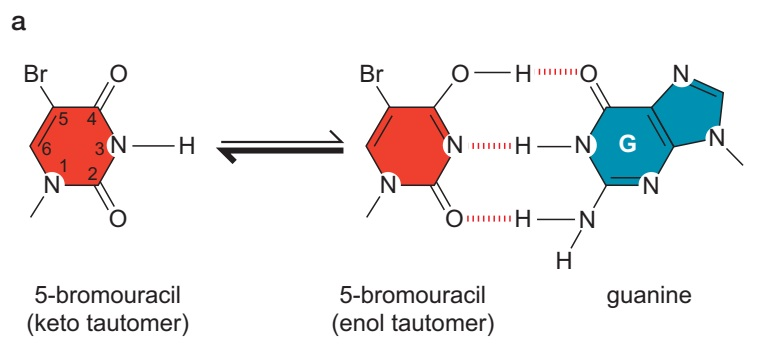{ width="570" loading=lazy }
/// caption
改变的是碱基用于配对的化学表面。Watson等，图10–10a，保留原图的互变异构模型。[^watson-repair]
///

还有一些试剂直接修饰已经存在的碱基，或影响碱基堆积。把它们与上面的两类放在一起看，较容易顺着“化学变化→复制结果”理解诱变。

| 作用方式 | 例子及直接变化 | 可能的复制结果 |
| --- | --- | --- |
| 脱氨 | 亚硝酸使 C→U、A→次黄嘌呤；也可使 G→黄嘌呤 | U 可引导 A，次黄嘌呤可引导 C，分别有利于 C:G→T:A、A:T→G:C；黄嘌呤的影响另取决于其稳定性与复制处理 |
| 修饰胞嘧啶 | 羟胺处理 DNA 后改变 C 的配对倾向 | 经典体外实验中主要为 C:G→T:A 转换 |
| 加成与脱氨 | 亚硫酸氢盐处理后，C 经加成、脱氨和脱磺酸成为 U | 未经修复可形成 C:G→T:A；5mC反应较慢，这种差异也是甲基化分析的基础之一 |
| 插入碱基堆积间隙 | 吖啶类、溴化乙锭等平面分子嵌入双螺旋 | 扰乱局部结构并增加某些插入／缺失；落在编码区时可造成移码 |

表中的碱基配对方向是常见机制实例，实际产物比例仍取决于处理条件、序列和修复背景。[^chemical-mutagens]

### 紫外线、辐射与交联 { #radiation-crosslinks }

紫外线容易让同一条链上的相邻嘧啶形成异常共价连接，主要包括**环丁烷嘧啶二聚体（CPD）**和 **6–4光产物**。下图中的两个 T 由新形成的四元环连在一起；它们仍留在原来的链上，却难以像两个独立碱基那样适应聚合酶的活性位点。

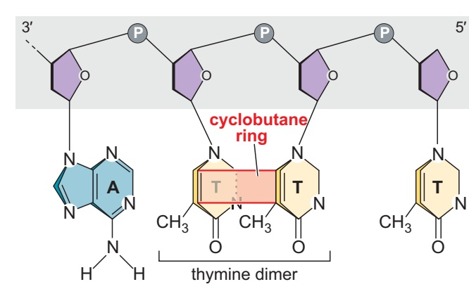{ width="480" loading=lazy }
/// caption
TT-CPD 的化学结构；CPD 也可涉及其他相邻嘧啶组合。Watson等，图10–9。[^watson-repair]
///

X射线、γ射线等电离辐射既可直接电离 DNA，也可通过水辐解产生自由基，造成碱基损伤、单链断裂以及空间上相邻的复杂损伤。博来霉素等试剂也能引起DNA断裂。两条链若在附近同时断裂，剩余的一小段互补链就不足以像普通切除修复那样提供完整模板。

多环芳烃代谢物、黄曲霉毒素B$_1$的活化产物可形成体积较大的碱基加合物；黄曲霉毒素的鸟嘌呤加合物还可发生脱嘌呤或进一步转化。顺铂、丝裂霉素C、双功能烷化剂和一些内源醛可造成不同类型的交联。**链间交联**把两条链锁在一起，连正常解链都无法进行。蛋白质也会成为障碍：DNA—蛋白质交联可由化学反应产生，拓扑异构酶的共价中间体若未能正常解除，也会使蛋白或其残片留在 DNA 上。[^damage-chemistry]

dNTP比例失衡、碱基互变异构及聚合酶偶发的选择错误，也会增加复制错配。复制本身还会留下短重复区的插入／缺失环，以及误掺入的核糖核苷酸。后者在糖上多出的2′-OH使骨架更易断裂，通常需要核糖核苷酸切除修复等途径处理。化学损伤与复制错误在来源上不同，却可能在同一个复制叉相遇。

## 损伤响应与细胞状态 { #dna-damage-response }

### ATM、ATR与检查点 { #atm-atr-response }

细胞如何知道 DNA 出了问题？它通常识别断裂末端、暴露的单链 DNA、停滞的聚合酶及周围染色质变化。哺乳动物的**DNA损伤响应（DNA damage response，DDR）**把这些结构信号转成蛋白磷酸化、基因表达和细胞周期变化。[^eukaryotic-ddr]

-   **双链断裂附近：MRN—ATM**

    MRN复合物结合断裂末端，并参与招募和激活ATM。ATM磷酸化周围的染色质及检查点、修复因子，帮助组织局部修复，也把信号传向CHK2、p53等下游。

-   **单链DNA增多：RPA—ATR**

    解旋与合成脱节、修复切除等过程会暴露单链DNA，RPA随即包被这些区域。ATRIP帮助ATR定位；单链—双链接头处的9–1–1等因子参与激活，ATR–CHK1由此调节复制叉和周期进程。

这两路信号有交叠：一个双链断裂被切除后就会暴露单链 DNA，同一处损伤也可能先后调动不同通路。下游对CDC25、Wee1等因子的调节可降低细胞周期蛋白依赖性激酶活性；p53诱导p21也能抑制周期推进。细胞由此延迟进入下一阶段、改变复制起点的使用并稳定复制叉。损伤持续、程度过重或环境不同，结果还可能转向衰老或受调控死亡。周期控制的具体关系见[DNA损伤与复制检查点](../cell/cell_cycle.md#dna-damage-replication-checkpoints)。

### 大肠杆菌的SOS反应 { #bacterial-sos-response }

大肠杆菌采用另一套清楚的转录控制回路。损伤加工或复制停顿产生的单链 DNA 上，RecA聚合成核蛋白丝。处于这一状态的RecA促进阻遏蛋白LexA**自切**，LexA对一批启动子的抑制因而减弱，切除修复、重组和损伤跨越相关基因得以表达。[^bacterial-sos]

SOS还通过SulA抑制分裂蛋白FtsZ的装配，使细胞暂缓分隔；细胞继续生长时便可呈丝状。不同启动子的响应阈值和蛋白加工速度不同，损伤持续时，较晚参与的Pol V等聚合酶会增加损伤跨越能力，也可能增加突变。损伤减少、单链DNA信号消退后，LexA重新积累，响应便可关闭。

???+ abstract "用两个读出区分SOS表达与诱变"

    Bagg、Kenyon和Walker在1981年的实验中，一方面把报告基因置于*umuDC*启动子的控制下，测量UV处理后的β-半乳糖苷酶活性；另一方面用*his*缺陷菌株，计数能够重新合成组氨酸的回复突变体。前者看启动子是否被诱导，后者看细胞最终留下了多少可检测的突变。[^umu-experiments]

    

    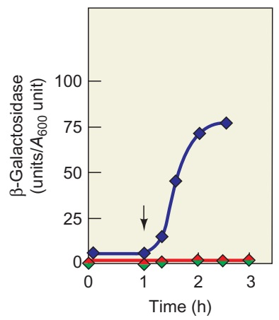{ width="280" loading=lazy }
    /// caption
    箭头处（1h）照射10J/m² UV。蓝线为可诱导背景；红、绿线分别为*recA*缺陷和不可切割LexA背景。Weaver图20.39据原研究整理。[^umu-experiments]
    ///

    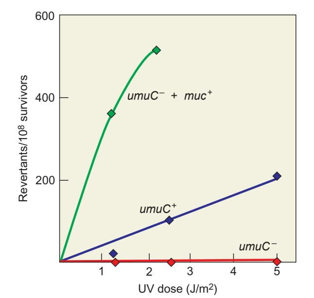{ width="360" loading=lazy }
    /// caption
    纵轴按每10⁸个存活细胞归一化。*umuC*缺陷使这一实验中的UV诱变明显降低；携带*muc*相关功能的质粒可恢复并增强诱变。Weaver图20.38。[^umu-experiments]
    ///

    报告基因实验把诱导与RecA、LexA联系起来；回复突变实验则说明，DNA受到同样一类外界处理后，是否形成可检测突变还取决于后续的损伤跨越功能。红线接近零，并不表示这些细胞没有受到UV损伤。

RecA–LexA回路在细菌中分布很广，各谱系的靶基因和其他损伤响应仍有差异。真核的ATM／ATR网络采用不同的组织方式，通常不称为SOS反应。

## 直接逆转损伤 { #direct-reversal }

### 光复活 { #photoreactivation }

光裂解酶（photolyase）能结合特定的UV光产物，利用光能恢复原来的嘧啶结构。CPD光裂解酶与6–4光裂解酶各有底物偏好；许多细菌、古菌、植物及动物具有相应酶，人类和其他胎盘哺乳动物则缺乏这条DNA光复活途径。[^direct-repair]

下图中的大肠杆菌光裂解酶把CPD置于催化辅基附近。**全还原态FADH⁻**吸收能量后，向损伤转移电子，促使二聚体异常的共价键断裂；电子随后回到辅基，酶可进入下一轮反应。图中的MTHF是集光辅基，把吸收的能量传给FADH⁻。不同光裂解酶可以使用不同的集光辅基，也不必都具有图中的这一种。[^sancar-photolyase]

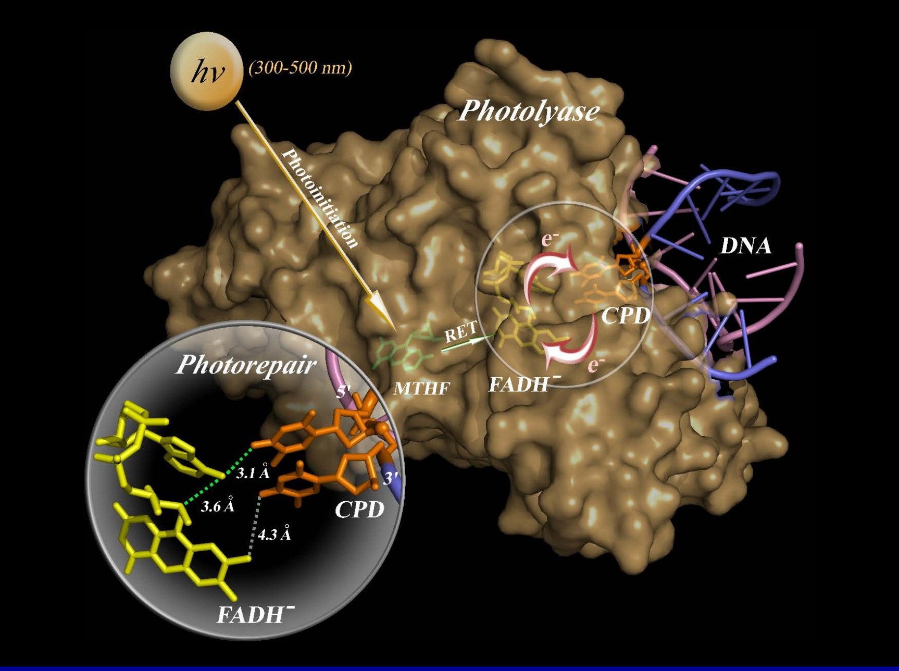{ width="690" loading=lazy }
/// caption
Sancar诺贝尔讲座中的结构与反应示意。左下放大CPD与FADH⁻；上方光子和箭头表示能量与电子转移。[^sancar-photolyase]
///

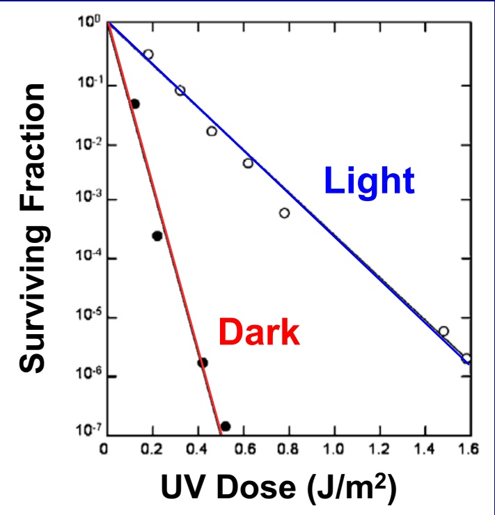{ width="350" loading=lazy }
/// caption
同一UV剂量下，随后有光照的样本存活比例较高。纵轴为对数尺度。Sancar讲座第4页，图源为Sancar与Rupert1978年的研究。[^sancar-photolyase]
///

**光既能造成损伤，也能为修复供能。** UV先产生光产物，后续适当波段的光照再驱动光裂解酶完成反应。左图比较的就是UV处理之后的光照与暗处理条件。

在人类等胎盘哺乳动物中，光裂解酶的同源蛋白隐花色素（cryptochrome）参与昼夜节律等功能，未保留相同的DNA光复活活性。

### 烷基转移与氧化脱烷基 { #dealkylation }

O$^6$-烷基鸟嘌呤-DNA烷基转移酶把碱基上的烷基转移到自身半胱氨酸残基。人类的代表是MGMT，它从DNA小沟一侧结合，并把受损碱基翻入活性口袋。转移后原来的 G 可以重新正常配对，但蛋白质上的受体位点已被耗用：**一个MGMT分子完成一次转移后，就不能继续处理下一个同类底物。**[^direct-repair]

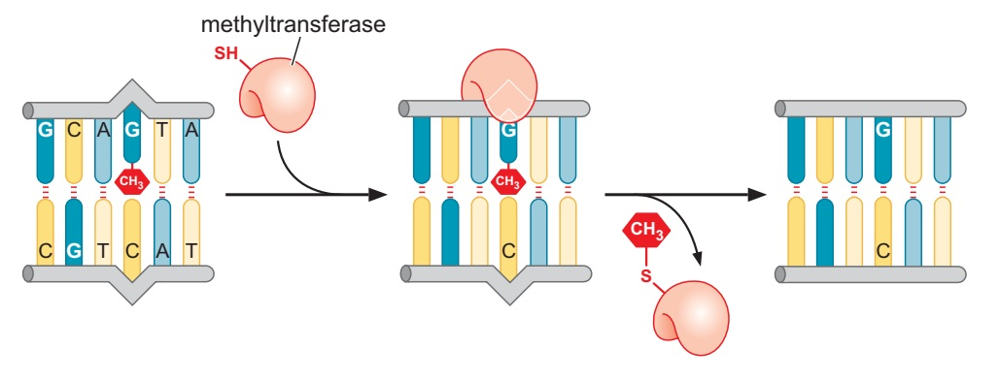{ width="650" loading=lazy }
/// caption
甲基从DNA转移到了蛋白质上，DNA骨架始终保留。Watson等，图10–12。[^watson-repair]
///

大肠杆菌Ada把修复与转录响应结合得更紧。它的C端受体位点处理O$^6$-甲基G、O$^4$-甲基T；N端另一个受体位点接受DNA甲基磷酸三酯上的甲基。N端甲基化后的Ada又能激活包括*ada*、*alkA*等在内的适应性响应基因。这两个受体位点分别在转移后被耗用，N端甲基化却同时开启了转录激活功能。[^ada-response]

AlkB家族走的是另一条化学路线：以Fe(II)和2-氧代戊二酸依赖的氧化反应处理某些N-烷基化碱基，再释放小分子产物，恢复碱基。直接逆转的共同特点是保留原有核苷酸骨架；不同酶能处理的化学修饰通常较为专一。

## 切除修复 { #excision-repair }

### 碱基切除修复 { #base-excision-repair }

**碱基切除修复（base excision repair，BER）**通常从一个DNA糖基化酶开始。它辨认受损碱基，把碱基翻出双螺旋、放进催化口袋，再切断碱基与糖之间的N-糖苷键。异常碱基被移走后，原处暂时成为AP位点；自发脱碱基造成的AP位点则可直接进入后续步骤。[^base-excision-repair]

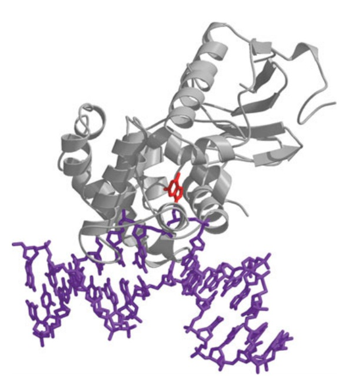{ width="330" loading=lazy }
/// caption
紫色为DNA，灰色为酶，红色为翻出的8-oxoG。依据晶体结构绘制，取自Watson等图10–14；原研究为Bruner等2000年。[^glycosylase-structure]
///

“翻出”解决了一个空间问题：碱基原先夹在双螺旋里面，糖基化酶需要把它放进适合反应的位置。这个结构展示的是已经结合底物的状态，并不意味着酶沿DNA移动时一定把每一个碱基都完整翻出来检查。

尿嘧啶-DNA糖基化酶可去除DNA中的U；另一些酶处理氧化碱基或特定T:G错配。底物识别分工之后，许多路线汇合到AP位点及断口的加工。

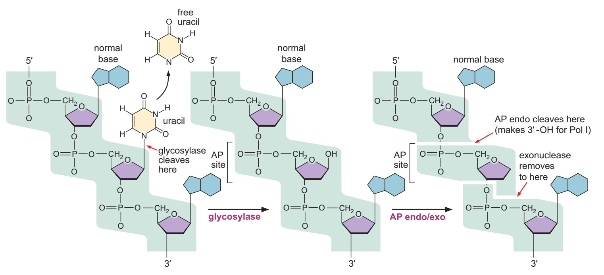{ width="760" loading=lazy }
/// caption
先去掉碱基，再处理仍留在骨架上的糖磷酸。图示为细菌BER的简化化学步骤；填补还需聚合酶与连接酶。Watson等，图10–13。[^watson-repair]
///

**去掉碱基以后，聚合酶还不能直接上场。** AP内切酶在AP位点5′侧切开骨架，通常得到可延伸的3′-OH，以及带残余脱氧核糖磷酸的5′端。哺乳动物核内常见的短片段BER由Pol β移除5′-脱氧核糖磷酸（5′-dRP）并填补一个核苷酸，最后由连接酶封口。双功能糖基化酶还带有AP裂解酶活性，会以另一种化学方式切断骨架，往往留下需要继续清理的3′端；先恢复合适的链端，合成和连接才能顺利进行。

若5′端残基不适合直接去除，可以通过链置换合成补入数个核苷酸，形成一个翘起的单链瓣，再由FEN1切走；这就是长片段BER的基本思路，常涉及PCNA及相关聚合酶。细菌的填补多由Pol I承担，哺乳动物线粒体则由Pol γ参与修复合成，也具有长片段BER。两条路线的选择与残余端基、可用酶及局部DNA状态有关。

**8-oxoG修复尤其能体现链选择的重要性。** 当8-oxoG仍与C配对时，OGG1类糖基化酶可去除氧化的G；若复制已经在它对面放入A，MUTYH类糖基化酶会先去掉这个化学上正常、信息上却放错了的A。补回C后，OGG1才又有机会处理8-oxoG。核苷酸池中的清理酶还会水解氧化dNTP，降低它们被重新掺入的机会。大肠杆菌的GO防护系统中，MutM、MutY与MutT分别承担去氧化碱基、去错配A和清理核苷酸池的功能。

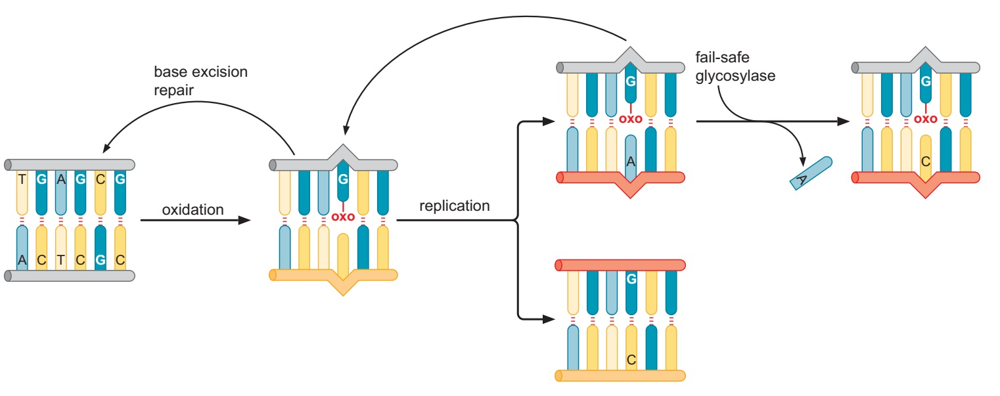{ width="730" loading=lazy }
/// caption
沿上方路径看，第二次机会先移走的是A，而不是氧化的G。Watson等，图10–15。[^watson-repair]
///

??? note "G-四链体多出一条G轨，会怎样影响损伤暴露？"

    连续G序列可以折成G-四链体（G4），但位于四联体核心的损伤未必容易被糖基化酶接近。Fleming等研究含五条G轨的VEGF启动子序列时，提出多出的第五条轨可替换含损伤的一条，使受损碱基暴露在外侧。[^g4-spare-track]

    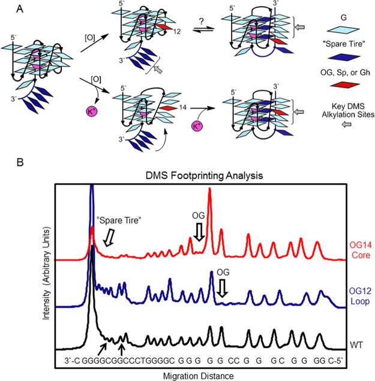{ width="625" loading=lazy }
    /// caption
    A为结构模型，B为DMS足迹；WT、环位置OG12和核心位置OG14来自不同体外寡核苷酸。第五轨的保护及损伤附近的变化支持重新折叠。原研究图4。[^g4-spare-track]
    ///

    图中的“spare tire”确实是作者所说的“备胎”，但证据的范围很具体：这些是体外序列的折叠和酶反应。论文还观察到外露的部分进一步氧化产物可被NEIL糖基化酶切除，支持BER启动；它没有证明所有G4都靠第五条轨完成修复，也没有直接证明这一结构在细胞中普遍防止突变。

### 核苷酸切除修复 { #nucleotide-excision-repair }

体积较大的加合物或光产物，常需要连同附近的一小段链一起切走。**核苷酸切除修复（nucleotide excision repair，NER）**利用局部双链不稳、畸变或聚合酶受阻等线索寻找损伤，经进一步验证后，在受损链两侧切开。另一条链保留下来，成为重新合成的模板。[^nucleotide-excision-repair]

某些生物还能用糖基化酶启动嘧啶二聚体修复：噬菌体T4的内切酶V、黄色微球菌的UV内切酶都兼有二聚体糖基化酶与AP裂解酶活性。它们先切断二聚体一侧碱基与糖的连接，再加工骨架，这是由糖基化酶启动的BER特殊例子。[^dimer-glycosylases]

在大肠杆菌中，UvrA与UvrB参与寻找和验证损伤，UvrC完成两侧切割，UvrD等帮助移走约12—13个核苷酸长的受损片段，随后由Pol I及连接酶补缺。识别的对象虽多，后续使用的是共同的切除和重合成步骤。

真核NER的两个入口可以放在一起理解：

| 入口 | 最先出现的识别线索 | 怎样进入共同修复步骤 |
| --- | --- | --- |
| 全基因组NER（GG-NER） | XPC–RAD23B识别局部不稳定DNA；UV-DDB可帮助发现部分UV损伤 | 招募TFIIH等，使损伤周围打开并接受验证 |
| 转录偶联NER（TC-NER） | RNA聚合酶II在模板链损伤处停滞 | CSA、CSB等因子组织响应，随后接入NER共同核心 |

TFIIH中的XPB、XPD参与打开和检查DNA，XPA、RPA等帮助验证并稳定修复中间体。XPF–ERCC1在损伤5′侧切开，XPG在3′侧切开，释放约24—32个核苷酸的受损片段，再由DNA合成与连接恢复连续性。下图把这一过程画成展开的气泡；“两侧”始终是指**同一条受损链的两侧**。

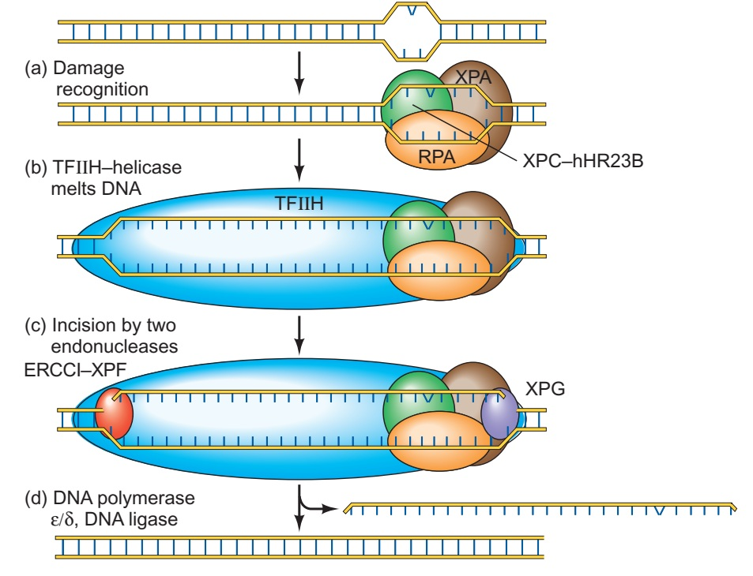{ width="610" loading=lazy }
/// caption
真核全基因组NER的简化示意。图中hHR23B即RAD23B；双切口后，未受损链仍作为模板。Weaver，图20.33。[^weaver-repair]
///

转录偶联修复能优先恢复受阻模板链的转录，但其速度与贡献会随损伤种类、基因表达和测量时段变化。着色性干皮病与Cockayne综合征提供了不同的遗传线索：前者涉及多种全基因组或共同NER因子，后者突出转录偶联响应及转录恢复；具体基因的其他功能还会影响发育和神经表型。

### 错配修复与新生链识别 { #mismatch-repair }

**错配修复（mismatch repair，MMR）**处理逃过复制校对的碱基错配和短插入／缺失环，也能抑制差异过大的序列之间发生同源重组。这里有一个切除修复中尤其突出的问题：G:T两边都是正常碱基，究竟该去掉哪一个？若目标是纠正复制错误，就需要找到新合成的一条链。[^mismatch-repair]

大肠杆菌的Dam甲基化酶在GATC序列的A上加甲基。复制后，亲代链已带有甲基，新生链尚未完成甲基化；这个短暂的**半甲基化窗口**提供了链身份。MutS识别错配，MutL组织后续反应，MutH在半甲基化GATC的未甲基化链上切开。

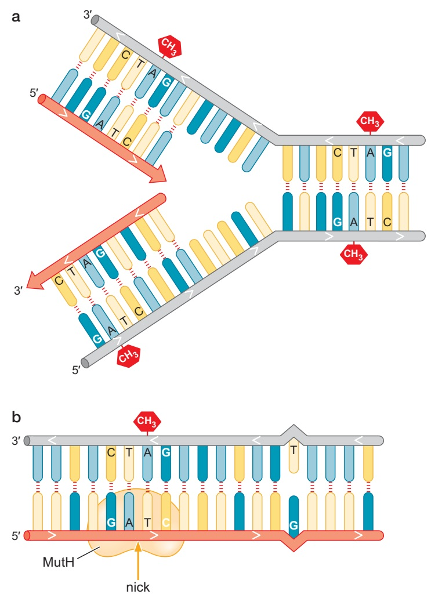{ width="330" loading=lazy }
/// caption
上图为复制后出现的半甲基化；下图的切口落在没有甲基的新生链。Watson等，图10–5。[^watson-repair]
///

GATC切口可以与错配相隔相当一段距离。切口确定从哪条链开始加工，UvrD和外切酶再沿这条链去除DNA，直到越过错配位置。根据切口位于错配的5′侧还是3′侧，可使用方向不同的外切酶；最后由Pol III重新合成、连接酶封口。

因此，去掉的常常不只是那个错误碱基。两条链发生冲突的位置负责触发修复，远处的链标记则决定改哪条链，两种信息需要在DNA上联系起来。

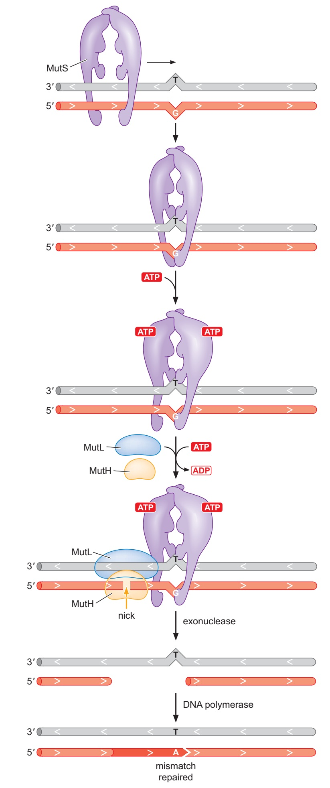{ width="350" loading=lazy }
/// caption
大肠杆菌MMR的简化过程；切口与错配在图上靠近，实际可以相隔一段距离。Watson等，图10–3。[^watson-repair]
///

???+ abstract "重构实验：把甲基换到另一条链，修复就改变方向"

    Lahue、Au和Modrich用MutS、MutL、MutH、UvrD、Exo I、SSB、Pol III全酶与连接酶等纯化组分，重构了大肠杆菌的甲基化指导错配修复。下图底物有一个G:T错配，置于重叠的HindIII和XhoI识别序列中。修成A:T会恢复一个酶切位点，修成G:C则恢复另一个；修复方向于是可以通过酶切后的条带读出。[^modrich-reconstitution]

    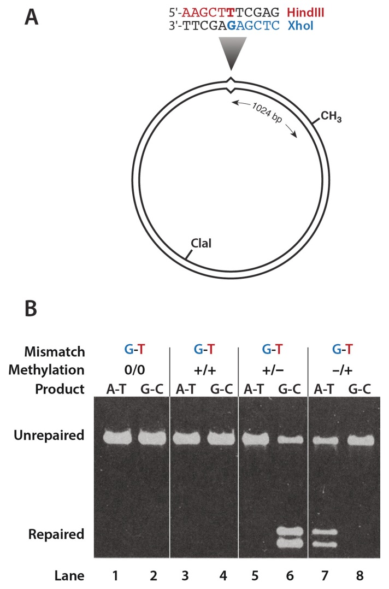{ width="460" loading=lazy }
    /// caption
    甲基化标记按G所在链／T所在链列出；0/0表示没有GATC位点。下方两条小片段为修复后恢复酶切产生的产物。Modrich讲座图5，转载自Lahue等1989年原研究。[^modrich-reconstitution]
    ///

    没有GATC（泳道1、2）或两条链都甲基化（3、4）时，图中不出现相应修复条带。只给G所在链加甲基时，修复保留G、把T改成C（5、6）；交换甲基化链后，则保留T、把G改成A（7、8）。这个设计很漂亮：同一个G:T并没有先天的“正确答案”，实验者只换链标记，就能改变最终碱基对。

若DNA具有GATC、但两条链都未甲基化，MutH也可切割，只是失去了由甲基化指定亲代链的方向性。这与上图完全没有GATC的底物是两种情况。[^mismatch-repair]

Dam–MutH这套链标记系统见于部分γ-变形菌；许多其他细菌使用滑动钳、既有链缺口和具有内切活性的MutL建立方向。真核细胞也没有这套MutH机制，而是利用与复制相关的链不连续性及PCNA装载方向等线索。

真核MutSα（MSH2–MSH6）偏向识别碱基错配和很小的环，MutSβ（MSH2–MSH3）更适合较大的插入／缺失环。MutLα（MLH1–PMS2）受PCNA等调控，在目标链上切开；EXO1参与切除，或通过DNA合成驱动的链置换去除错配，再由Pol δ和连接酶完成恢复。RFC在引物—模板接头上装载PCNA时具有方向性，这种方向可传给MutLα，使切口偏向新生链。[^mismatch-repair]

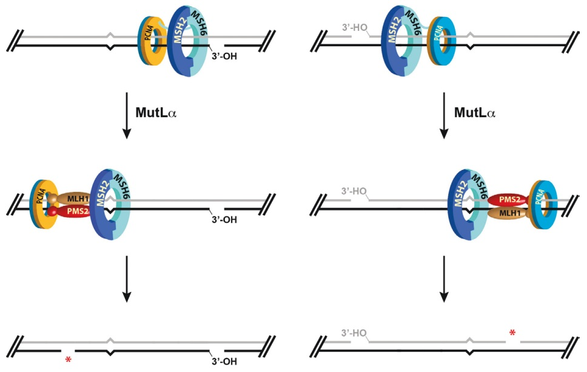{ width="680" loading=lazy }
/// caption
图中PCNA两面用不同颜色表示；比较左右两组，装载朝向随链端方向改变，最终的红色切口也落在不同链。Modrich讲座图15，为机制模型。[^modrich-reconstitution]
///

一些古菌和放线菌缺少经典MutS／MutL，使用与复制滑动钳相联系的EndoMS／NucS系统；其底物偏好及插入／缺失纠正能力也与经典MMR不同。MMR缺陷可使复制错误和微卫星长度变化积累，这种**微卫星不稳定性（MSI）**是检测通路失效的一种读出，与Lynch综合征相关肿瘤等情境有关。[^nucs-mismatch-repair]

!!! note "T:G错配还可能来自脱氨"

    大肠杆菌Dcm甲基化序列中的5mC脱氨后，可由Vsr内切酶启动极短片段修复（VSP）：在特定序列背景下切开错配T所在链，再由Pol I等替换局部片段。它借助序列和损伤来源选择目标，与依赖半甲基化GATC纠正复制错误的MutH型MMR应分别理解。8-oxoG:A中的MutY／MUTYH则属于前面介绍的BER。[^vsp-repair]

## 断裂与交联修复 { #break-crosslink-repair }

### 先恢复可合成、可连接的末端 { #strand-break-ends }

单链断裂可由骨架损伤直接产生，也可能是BER、核糖核苷酸切除或拓扑异构酶反应留下的中间体。若相邻两端已经是3′-OH和5′-磷酸，连接酶便可封闭切口；若中间缺了核苷酸，还需先合成填补。更麻烦的断口会带磷酸、糖残基或蛋白质加合物，必须先清理。[^strand-break-cleanup]

| 因子 | 处理的末端问题 |
| --- | --- |
| PNKP | 去掉3′-磷酸，并把5′-OH磷酸化，恢复连接所需的端基 |
| APTX | 去掉失败连接反应遗留的5′-AMP，恢复5′-磷酸 |
| TDP1 | 水解3′端与Top1残基之间的磷酸酪氨酰键；留下的3′-磷酸仍需继续处理 |
| TDP2 | 水解5′端与Top2残基之间的连接，恢复5′-磷酸；典型情境也包括Top2相关双链断裂 |

哺乳动物PARP1感知多种断口，XRCC1等支架蛋白组织相关酶，使末端处理、补缺和连接在局部衔接。单链断口若迟迟未修好，复制叉到达时就可能形成双链断裂；两条链上相近的单链断裂也有类似危险。

### 双链断裂：连接末端或借用同源模板 { #double-strand-break-repair }

双链都断开后，局部不再有一条连续互补链可直接照着补写。哺乳动物细胞常在**经典非同源末端连接（c-NHEJ）**与**同源重组（HR）**等路线间选择。[^double-strand-break-choice]

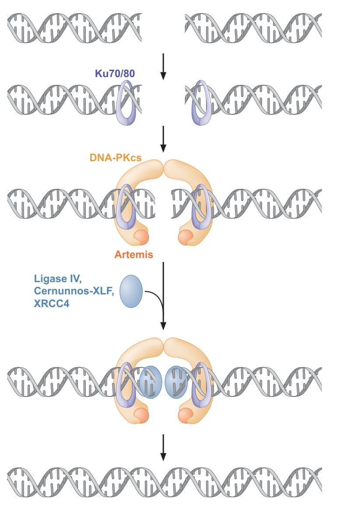{ width="340" loading=lazy }
/// caption
哺乳动物c-NHEJ示意。末端是否需要图中的加工，取决于断口结构。Watson等，图10–18。[^watson-repair]
///

**c-NHEJ先把末端组织到一起。** Ku结合断口，DNA-PKcs等参与保护与协调处理，XRCC4–XLF–连接酶IV复合体完成连接。末端原本兼容时，可以不改变序列；受损或不兼容的末端若经过切除、填补，则可能留下小型插入或缺失。

**HR先产生可以寻找模板的单链尾。** MRN–CtIP等启动5′端切除，留下3′单链；BRCA1、PALB2、BRCA2等帮助组织反应，RAD51在单链上组丝并寻找同源DNA。3′端侵入同源双链后，聚合酶便能以供体链为模板，从侵入链的3′端延长，恢复缺失信息。复制后的S／G$_2$期已有姐妹染色单体，因而为这种修复提供了合适模板。

HR若使用其他相似序列作为模板，可能复制进不同的信息；重组中间体处理不当也可导致重排。链侵入、D环、修复合成以及中间体的去向，见[同源重组](dna_recombination.md#homologous-recombination)。

末端切除还会开放其他选择。**单链退火（SSA）**让断口两侧的重复序列互相配对，通常会删除两个重复之间的DNA及其中一份重复；**Pol θ介导的末端连接（TMEJ）**利用较短的微同源序列组织连接，也常留下插入或缺失。哪条路线占优势，取决于断口结构、切除程度、细胞周期、染色质与可用模板。

细菌多借助RecBCD／AddAB–RecA类系统进行同源重组修复，一些物种也具有Ku–LigD型末端连接。古菌与真核的因子组合也随谱系变化。

### 链间交联与蛋白质交联 { #interstrand-protein-crosslinks }

链间交联（interstrand crosslink，ICL）把两条模板连在一起，单纯切去一条链上的损伤片段还不够。复制耦联的Fanconi贫血（FA）通路会协调切除、损伤跨越与重组：FANCD2–FANCI的单泛素化帮助组织局部反应，结构特异性核酸酶解除交联对两条链的束缚；一条链上残留的加合物需由TLS等处理，断裂或缺失的复制中间体再通过HR等恢复。[^crosslink-repair]

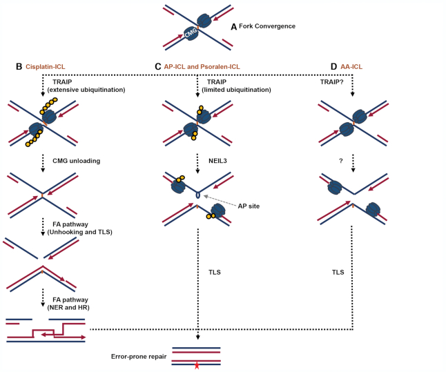{ width="646" loading=lazy }
/// caption
复制耦联ICL处理的三种情境。B强调顺铂交联的FA通路；C为NEIL3参与的AP／补骨脂素交联处理；D为乙醛交联。综述原图保留了当时尚不清楚环节的问号。[^crosslink-figure]
///

读B列时，可以先追踪两个复制叉会合后的解旋酶CMG：TRAIP相关泛素化促进其卸载，随后才能充分处理堵在交联附近的DNA。图中的“FA pathway”概括了前面介绍的识别、切割和后续配合步骤。C列则显示另一种化学解决方式：NEIL3可处理某些交联中的糖苷键，避免照搬B列的切开骨架路线。交联的化学结构不同，细胞实际动用的步骤也会改变。

DNA—蛋白质交联常先由SPRTN蛋白酶或蛋白酶体等缩小蛋白部分，再由磷酸二酯酶、NER或复制耦联机制清除残基。Fanconi贫血细胞对交联剂敏感，体现了这些处理步骤失去协调的后果。

## 复制压力与损伤耐受 { #replication-stress-tolerance }

### 停顿、反转与重新引发 { #fork-recovery }

复制型聚合酶在损伤前停下时，解旋酶未必同步停止。两者暂时解偶联，就会暴露RPA／SSB包被的单链DNA。细胞可以让复制叉减速或反转，也可以在损伤下游重新引发，把一个待补缺口留在后面。以下C—F是不同策略，不是一套必须依次完成的步骤。[^fork-recovery]

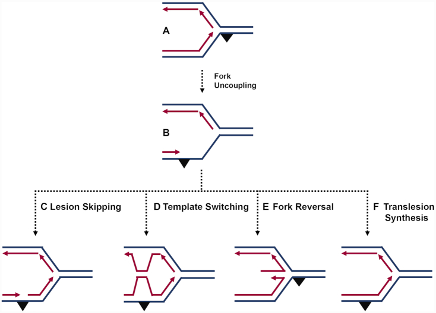{ width="734" loading=lazy }
/// caption
蓝色为亲代链，红色为新生链，黑三角为损伤。C留下缺口；D借用姐妹新生链；E形成反转叉；F直接跨越损伤。Ashour与Mosammaparast，图1。[^fork-options-figure]
///

**模板转换**让受阻的新生链暂时利用姐妹新生链获得信息；**复制叉反转**则使两条新生链彼此退火，同时亲代链重新配对，形成四臂结构。反转叉可以等待修复或接受进一步加工，但暴露的新生链端也容易受到核酸酶攻击。BRCA1／BRCA2、RAD51等参与保护，避免可逆停顿被过度降解放大成断裂。

邻近复制叉的到达、同源重组依赖的重启，以及核酸酶受控切割后的重建，也能在相应条件下帮助完成复制。这里的“完成”首先指DNA合成得以继续：图中的黑三角若仍在，化学损伤就还需要后续修复。

### 损伤跨越聚合酶 { #translesion-polymerases }

**损伤跨越合成（translesion synthesis，TLS）**让专门的聚合酶暂时接替复制型聚合酶。这些酶通常缺少3′→5′校对活性，部分家族的活性位点较开放，能够容纳畸变模板。代价是复制正常DNA时往往不够准确；收益是某些本来难以通过的损伤，现在可以被读过去。[^translesion-synthesis]

准确与否取决于损伤和酶的组合。人Pol η可以较准确地跨越TT-CPD，在两个T对面放入A；*POLH*缺陷导致着色性干皮病变异型（XP-V）。Pol κ更适合某些N$^2$-G加合物，REV1兼有插入dCMP及组织其他TLS蛋白的作用，Pol ζ则常负责从已经畸变的引物末端继续延伸。不同酶可以前后接力，而非每次由一个酶从头做到尾。

???+ abstract "从延伸条带看Pol η的底物差异"

    Masutani等把放射性标记引物放在损伤上游，比较Pol α和Pol η能否把它延伸到模板末端。四组模板分别没有损伤、含CPD、含6–4光产物或含AP位点；每组中的酶量逐渐增加。[^polymerase-eta-experiment]

    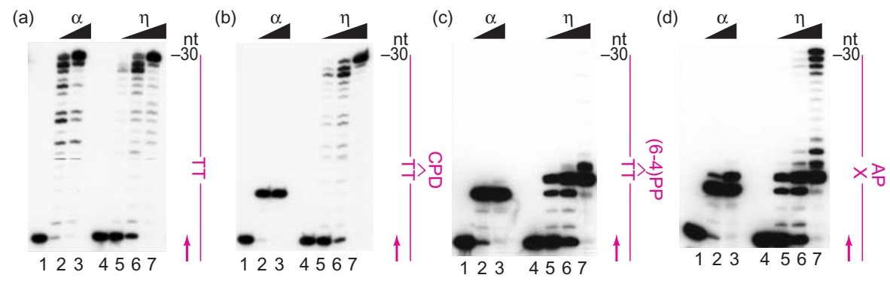{ width="760" loading=lazy }
    /// caption
    a为正常模板，b为CPD，c为6–4光产物，d为AP位点。越靠上的条带代表较长产物，30nt为全长。Weaver图20.40，转载Masutani等2000年的结果。[^polymerase-eta-experiment]
    ///

    两种酶都能延伸正常模板；在这组条件下，Pol η能越过CPD和部分AP位点，而在6–4光产物前明显受阻。条带证明的是“能否延伸到这里”；若要判断插入了哪个碱基、是否准确，还需要核苷酸选择或产物序列分析。把TLS统称为随机插入，会丢掉这类底物特异性。

PCNA单泛素化有助于真核TLS蛋白的招募与聚合酶切换。TLS既可发生在复制叉处，也可较晚填补重新引发后留下的缺口。下图两列都保留了损伤标记：跨越解决的是合成障碍，损伤本身并未因此消失。

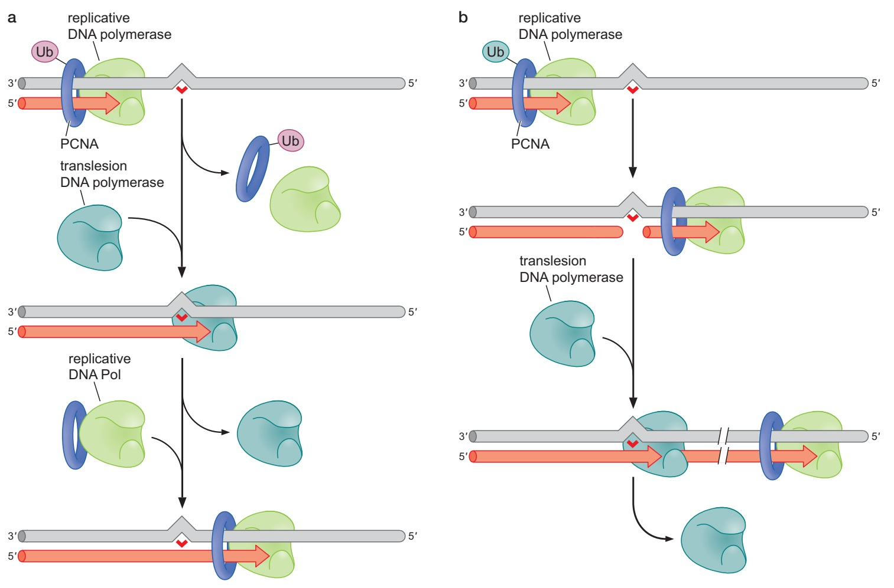{ width="760" loading=lazy }
/// caption
左列在受阻位置切换聚合酶；右列先在下游继续复制，再处理后方缺口。Ub表示泛素。Watson等，图10–23。[^watson-repair]
///

TLS有时会增加局部碱基置换，却也能减少持续停顿、复制叉崩溃和更大范围的DNA丢失。评价一条损伤耐受路线，需要同时看存活、突变类型及发生的情境。

## 从序列变化到功能变化 { #mutation-formation }

### 置换、插入与缺失 { #mutation-types }

单碱基置换中，嘌呤之间（A↔G）或嘧啶之间（C↔T）的替换称为**转换（transition）**，嘌呤与嘧啶之间的替换称为**颠换（transversion）**。相邻碱基也可能在同一次事件中共同改变。插入／缺失（indel）则直接改变序列长度，可来自复制滑移、末端加工或移动元件插入等过程。[^watson-repair][^lewin-mutations]

落在编码区时，置换的直接结果可以这样区分：

| 类别 | 对相应转录本的直接影响 | 理解时保留的条件 |
| --- | --- | --- |
| 同义突变 | 密码子改变，编码氨基酸不变 | 仍可能影响剪接、mRNA结构、翻译速度或调控 |
| 错义突变 | 编码另一种氨基酸 | 效应取决于残基位置、结构与细胞环境，保守替换也未必完全中性 |
| 无义突变 | 编码氨基酸的密码子变成终止密码子 | 可导致提前终止，也可触发mRNA降解；UAG、UAA、UGA分别有amber、ochre、opal的历史名称 |
| 终止丢失 | 原终止密码子变成可编码的密码子 | 可延长翻译至下一个有效终止位置 |

例如，镰状细胞血红蛋白的β链经典变异中，编码链GAG变成GTG，使成熟β链第6位Glu变为Val。这是一个错义颠换；它使脱氧血红蛋白更易聚集，进一步影响红细胞形态。单个残基变化的后果，就这样从蛋白质表面延伸到了整个细胞。[^globin-mutation]

编码区中非3整数倍的插入／缺失会改变下游阅读框。较大的缺失、重复、倒位、易位和拷贝数变化，还会改变基因剂量、位置或配对行为，其染色体层面的后果见[突变与染色体变异](../genetics/chromosome_variation.md)。启动子、增强子、剪接信号和非编码RNA中的变异也可改变表达；另一些非编码位点的变化则可能没有可测表型。

### 功能缺失、显性负效与剂量 { #mutation-functional-effects }

序列类别与等位基因的功能关系需要分开观察。**完全失功能（null）**等位基因失去所考察的功能；**部分失功能／渗漏型（leaky）**仍保留一定活性。若一个正常等位基因提供的产物已足够，失功能表型可以是隐性的；若这一剂量不足以维持正常状态，便出现**单倍剂量不足（haploinsufficiency）**。

**显性负效（dominant negative）**则需要另一层作用：突变产物不仅自己工作不好，还妨碍正常产物。例如多亚基复合体中的异常亚基仍能参与装配，却让整个复合体失活，杂合子就可能受影响。**功能获得（gain of function）**可以是活性增强、新功能或异常时空表达。显性、隐性描述的是特定遗传背景下等位基因的表型关系，不能只从“蛋白有没有活性”直接判定。[^mutation-effects]

### 重复序列的不稳定性 { #repeat-instability }

短串联重复让复制链很容易错位重新配对。若新生链鼓出一个环，多复制的重复单元可能被保留下来；若模板链鼓起，则可能少复制一段。MMR通常会纠正这样的小环，通路失效时，重复长度的变化便更容易积累。

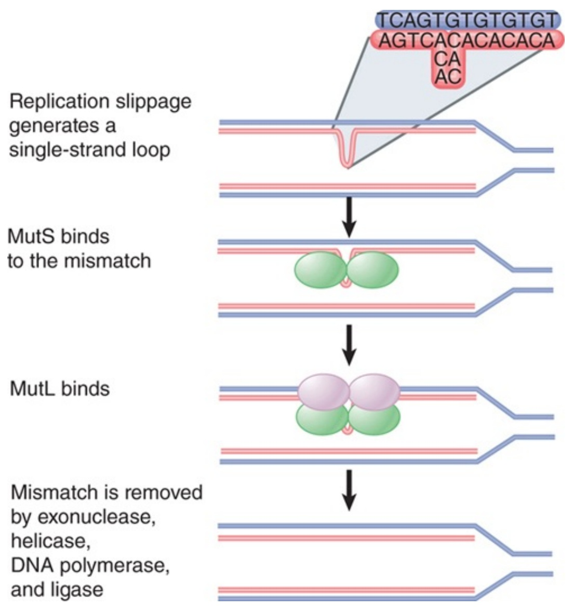{ width="510" loading=lazy }
/// caption
滑移形成的插入／缺失环及其MMR处理。图中的MutS／MutL表示识别和组织功能；链选择方式需结合前面的物种差异理解。Lewin's GENES XII，图14.20。[^lewin-mutations]
///

有些位点的重复达到一定范围后，可以在生殖系传递和体细胞中继续变化，形成所谓**动态突变**。这包括扩增和收缩，变化方向与幅度都可能随细胞环境而改变。不同位置的重复又会通过不同机制改变细胞：

| 重复扩增例子 | 所在位置与主要机制 |
| --- | --- |
| Huntington病的*HTT* CAG、脊髓延髓肌萎缩症的*AR* CAG | 编码区CAG使蛋白质多聚谷氨酰胺（polyQ）延长，影响蛋白质行为与细胞功能 |
| 脆性X综合征的*FMR1* CGG全突变 | 位于5′UTR，通常伴随DNA甲基化和表达沉默 |
| 其他部分重复扩增 | 重复RNA可异常结合RNA结合蛋白，造成RNA毒性；部分重复还可发生不依赖经典AUG起始的RAN翻译，产生异常重复蛋白 |

上述机制还受重复长度、序列中断、组织及遗传背景影响；同一位点不同范围的扩增也未必造成同一种效应。[^repeat-expansion]

!!! info "MMR也可能参与病理性重复扩增"

    与纠正普通复制滑移不同，在某些疾病相关长重复中，MutSβ及下游修复因子反而参与进一步扩增。Huntington病模型小鼠中，去除Mlh1或Mlh3可消除所观察到的体细胞CAG扩增；脆性X前突变小鼠研究也显示MSH3参与扩增，并参与部分收缩。结果与重复形成的异常结构及其加工方式有关。[^mmr-repeat-expansion]

### 回复突变与第二位点抑制 { #reversion-suppression }

从原有表型变为新表型的变化称为正向突变。**真正的回复突变**在原位恢复原序列；**第二位点抑制**则在同一基因的别处或另一个基因中补偿原来的影响。表型恢复，并不自动证明原突变消失。下图的插入与缺失组合就能看出区别：两个位置之间仍翻译出改变的氨基酸，第二处变化之后才回到原阅读框。

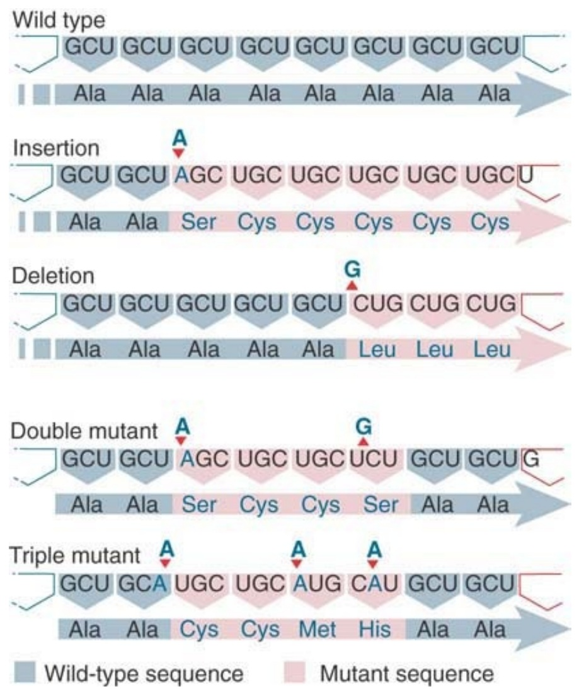{ width="510" loading=lazy }
/// caption
图以RNA密码子展示移码后果。双突变恢复下游读框，三次单碱基插入也可使净变化为3；两者都不等于恢复整段原序列。Lewin's GENES XII，图1.40。[^lewin-mutations]
///

基因内还可通过第二处氨基酸替换补偿结构变化。基因间抑制可以改变tRNA的反密码子，使其识别某些原本导致缺陷的无义或错义密码子；也可以增强旁路代谢、改变基因剂量等。大型缺失通常无法靠一次相反的点突变恢复原序列，但其表型仍可能受到这些补偿过程影响。转座引起的插入及其去向见[DNA重组与转座](dna_recombination.md)。

### 突变特征 { #mutational-signatures }

如果把许多突变按类型和序列环境统计，就能得到**突变特征（mutational signature）**。例如同为C→T，还可以按两侧碱基分别归类；相邻双碱基置换、小插入／缺失、结构变异，以及转录链偏向，也各自提供过程线索。UV相关光产物、烟草相关加合物、APOBEC脱氨及MMR、HR或复制校对缺陷，都可能留下可重复的模式。[^mutational-signatures]

一个样本通常叠加了多个过程。损伤能否被修好、由哪种聚合酶跨越、哪些细胞存活并扩增，都会影响最后的突变目录。同一种损伤在不同修复背景下也可留下不同谱，因此识别特征是一种有条件的过程推断；暴露时间、剂量、测序误差与克隆选择都需要纳入解释。

## 遗传缺陷与诱变试验 { #repair-evidence }

人类修复相关遗传病帮助研究者辨认通路的不同环节。具体基因、等位变体和组织环境共同决定表型，下面着重看它们提供的机制线索：[^nucleotide-excision-repair][^double-strand-break-choice][^repair-disorders]

| 遗传线索 | 揭示的机制关系 |
| --- | --- |
| 着色性干皮病（XP）与XP-V | 多种XP互补群涉及NER；XP-V涉及Pol η，说明损伤清除与复制时的损伤耐受是不同环节 |
| Cockayne综合征 | 突出转录偶联损伤响应、转录恢复及相关细胞功能 |
| 部分光敏型毛发硫营养不良（TTD） | 某些TFIIH相关变体同时影响修复与转录，揭示两种过程使用共同因子的联系 |
| Lynch综合征相关肿瘤 | MMR失效可导致复制错误积累与微卫星不稳定 |
| Fanconi贫血 | 交联处理、重组和复制维护需要多步骤协作 |
| Bloom综合征 | BLM参与重组中间体和复制结构处理；其缺陷细胞的姐妹染色单体交换增多，体现重组调控失常 |

**Ames试验**把另一类问题变成可计数的结果：一个化合物能否增加细菌的回复突变？试验使用组氨酸营养缺陷型鼠伤寒沙门菌或相应的大肠杆菌试验株；发生适当回复或抑制突变的细胞，可以在选择条件下形成菌落。不同菌株分别敏感于某些碱基置换或移码，少量必需氨基酸支持早期有限分裂，之后由能恢复合成功能的细胞继续生长。[^ames-test]

一些前体化合物需要代谢活化，因此常比较加入与不加入肝S9活化体系的条件。S9是肝匀浆离心后的后线粒体上清，含微粒体和可溶性成分，并配合相应辅因子使用。解释结果时要同时看剂量、自发回复背景、阳性及溶剂对照和细胞毒性；把大量细胞杀死，同样可能让菌落减少。试验阳性说明该条件下存在致突变活性，不能直接换算成哺乳动物体内的剂量或组织效应。培养与判读细节见[Ames试验与代谢活化](../exptech/microbiology/culture_identification.md#ames-test)。

## 参考资料与延伸阅读 { #references }

- Watson JD, Baker TA, Bell SP, et al. *Molecular Biology of the Gene*. 7th ed. 第10章“DNA的可变性与修复”，本页机制主线的首选教材。
- Weaver RF. *Molecular Biology*. 5th ed. 第20章，尤其DNA损伤、修复与聚合酶实验部分。
- Krebs JE, Goldstein ES, Kilpatrick ST. *Lewin's GENES XII*. 第1、14章，突变类型、阅读框与DNA修复。
- Yi C, He C. [DNA Repair by Reversal of DNA Damage](https://pmc.ncbi.nlm.nih.gov/articles/PMC3579392/). 2013. 直接逆转的反应化学。
- Bauer NC, Corbett AH, Doetsch PW. [The Current State of Eukaryotic DNA Base Damage and Repair](https://pmc.ncbi.nlm.nih.gov/articles/PMC4666366/). 2015. BER及其底物。
- Schärer OD. [Nucleotide Excision Repair in Eukaryotes](https://pmc.ncbi.nlm.nih.gov/articles/PMC3783044/). 2013. 真核NER的识别、切割与遗传线索。
- Putnam CD. [Strand Discrimination in DNA Mismatch Repair](https://pmc.ncbi.nlm.nih.gov/articles/PMC8785607/). 2021. 不同生物中的MMR链判别。
- Scully R, Panday A, Elango R, Willis NA. [DNA Double-Strand Break Repair-Pathway Choice in Somatic Mammalian Cells](https://pmc.ncbi.nlm.nih.gov/articles/PMC7315405/). 2019. 断裂修复选择及其条件。
- Ashour ME, Mosammaparast N. [Mechanisms of Damage Tolerance and Repair during DNA Replication](https://doi.org/10.1093/nar/gkab101). 2021. 复制叉、TLS、交联及蛋白质加合物。
- Alexandrov LB, Kim J, Haradhvala NJ, et al. [The Repertoire of Mutational Signatures in Human Cancer](https://www.nature.com/articles/s41586-020-1943-3). 2020. 碱基置换、双碱基置换与indel特征。
- Volkova NV, Meier B, González-Huici V, et al. [Mutational Signatures Are Jointly Shaped by DNA Damage and Repair](https://www.nature.com/articles/s41467-020-15912-7). 2020. 损伤与修复背景共同塑造突变谱。

[^watson-repair]: Watson JD等，*Molecular Biology of the Gene*，第7版，第10章，印刷页314—338。本页裁取图10–2（315页）、10–3（317页）、10–5（319页）、10–7（320页）、10–9（322页）、10–10a（324页）、10–12（326页）、10–13／14（327页）、10–15（328页）、10–18（333页）、10–23（337页）的原图区域，未改绘。原始结构或实验另见相邻专门脚注。
[^weaver-repair]: Weaver RF，*Molecular Biology*，第5版，第20章，印刷页656—672。化学与机制图取自图20.25（657页）、20.33（663页），仅裁去周围正文。实验图的原始出处见各图脚注。
[^lewin-mutations]: Krebs JE、Goldstein ES、Kilpatrick ST，*Lewin's GENES XII*，第1、14章。图1.40位于本地电子版PDF第158页，图14.20位于第1335页；这里使用电子文件页序，非印刷页码。均裁取原图区域。
[^endogenous-damage]: Tubbs A, Nussenzweig A. [Endogenous DNA Damage as a Source of Genomic Instability in Cancer](https://pmc.ncbi.nlm.nih.gov/articles/PMC6591730/). *Cell*. 2017;168:644–656；损伤与修复基础另见Cooper的[教材章节](https://www.ncbi.nlm.nih.gov/books/NBK9900/)。
[^damage-chemistry]: 氧化碱基、内源醛及交联见Tubbs与Nussenzweig2017年[综述](https://pmc.ncbi.nlm.nih.gov/articles/PMC6591730/)；复制相关损伤化学及处理见Ashour与Mosammaparast2021年[综述](https://doi.org/10.1093/nar/gkab101)。
[^chemical-mutagens]: 碱基类似物与嵌入剂见Watson等第10章，印刷页323—324；化学脱氨另见[OpenStax Microbiology，11.5](https://openstax.org/books/microbiology/pages/11-5-mutations)。羟胺经典实验见Freese等1961年[研究](https://pubmed.ncbi.nlm.nih.gov/13701658/)；亚硫酸氢盐反应见Shapiro等1970年[研究](https://doi.org/10.1021/ja00705a626)。
[^eukaryotic-ddr]: Reinhardt HC, Yaffe MB. [Kinases That Control the Cell Cycle in Response to DNA Damage](https://pmc.ncbi.nlm.nih.gov/articles/PMC2699687/). 2009；本页只展开损伤识别到周期输出的主要联系。
[^bacterial-sos]: Kreuzer KN. [DNA Damage Responses in Prokaryotes: Regulating Gene Expression, Modulating Growth Patterns, and Manipulating Replication Forks](https://pmc.ncbi.nlm.nih.gov/articles/PMC3809575/). 2013；Simmons LA等，[The SOS Regulatory Network](https://pmc.ncbi.nlm.nih.gov/articles/PMC4196698/)。
[^umu-experiments]: Bagg A, Kenyon CJ, Walker GC. [Inducibility of a Gene Product Required for UV and Chemical Mutagenesis in Escherichia coli](https://doi.org/10.1073/pnas.78.9.5749). *PNAS*. 1981;78:5749–5753。本页取Weaver第5版图20.38（670页）与图20.39（671页）据该文整理的曲线；保留坐标和各实验组，未改绘。*lexA*实验组为不可诱导、编码不能正常自切LexA的背景，不是缺失阻遏蛋白。
[^direct-repair]: Yi C, He C. [DNA Repair by Reversal of DNA Damage](https://pmc.ncbi.nlm.nih.gov/articles/PMC3579392/). *Cold Spring Harbor Perspectives in Biology*. 2013;5:a012575。AGT小沟结合与碱基翻出另见[结构机制综述](https://pubmed.ncbi.nlm.nih.gov/17485252/)。
[^sancar-photolyase]: Sancar A，[2015年诺贝尔讲座幻灯片](https://www.nobelprize.org/uploads/2018/06/sancar-lecture-slides.pdf)，第4、8页；分别裁取存活曲线与结构／反应示意。曲线来源为Sancar与Rupert，[Cloning of the phr Gene and Amplification of Photolyase in Escherichia coli](https://pubmed.ncbi.nlm.nih.gov/369954/)，*Gene*. 1978;4:295–308；机制图在讲座中注明Liu等，*PNAS*. 2011;108:14831–14836，及Tan等，*J Phys Chem A*. 2014;118:10522–10530。光裂解酶的催化辅基为FADH⁻，集光辅基随酶而异。
[^ada-response]: Ada两个结构域的修复与转录功能见Yi与He2013年[综述](https://pmc.ncbi.nlm.nih.gov/articles/PMC3579392/)；N端甲基受体Cys38的结构证据见He等2005年[研究](https://pubmed.ncbi.nlm.nih.gov/16209950/)。
[^base-excision-repair]: Bauer NC, Corbett AH, Doetsch PW. [The Current State of Eukaryotic DNA Base Damage and Repair](https://pmc.ncbi.nlm.nih.gov/articles/PMC4666366/). *Nucleic Acids Res*. 2015;43:10083–10101。
[^glycosylase-structure]: Bruner SD, Norman DPG, Verdine GL. [Structural Basis for Recognition and Repair of the Endogenous Mutagen 8-Oxoguanine in DNA](https://doi.org/10.1038/35002510). *Nature*. 2000;403:859–866。结构图取自Watson等第7版图10–14，教材以MolScript、BobScript、Raster3D绘制，图像不等同于直接拍摄的分子照片。
[^g4-spare-track]: Fleming AM, Zhou J, Wallace SS, Burrows CJ. [A Role for the Fifth G-Track in G-Quadruplex Forming Oncogene Promoter Sequences during Oxidative Stress: Do These “Spare Tires” Have an Evolved Function?](https://doi.org/10.1021/acscentsci.5b00202). *ACS Central Science*. 2015;1:226–233。取完整图4，未裁切；[开放全文](https://pmc.ncbi.nlm.nih.gov/articles/PMC4858307/)。图4支持体外重新折叠模型，糖基化酶处理证据另见原文图5，主要体现修复的启动。
[^nucleotide-excision-repair]: Schärer OD. [Nucleotide Excision Repair in Eukaryotes](https://pmc.ncbi.nlm.nih.gov/articles/PMC3783044/). *Cold Spring Harbor Perspectives in Biology*. 2013;5:a012609；Marteijn JA等，[Understanding Nucleotide Excision Repair and Its Roles in Cancer and Ageing](https://pubmed.ncbi.nlm.nih.gov/24954209/). *Nat Rev Mol Cell Biol*. 2014;15:465–481。
[^mismatch-repair]: Putnam CD. [Strand Discrimination in DNA Mismatch Repair](https://pmc.ncbi.nlm.nih.gov/articles/PMC8785607/). *DNA Repair*. 2021;105:103161。比较大肠杆菌、其他细菌与真核的链选择机制。
[^modrich-reconstitution]: Modrich P，[Mechanisms in E. coli and Human Mismatch Repair，2015年诺贝尔讲座](https://www.nobelprize.org/uploads/2018/06/modrich-lecture.pdf)，图5（印刷105页／PDF第7页）和图15（116页／PDF第18页），裁取完整图区。图5原为Lahue RS, Au KG, Modrich P. [DNA Mismatch Correction in a Defined System](https://doi.org/10.1126/science.2665076). *Science*. 1989;245:160–164。讲座印刷106页还说明，早期Pol III制剂混有ExoVII；正文的组分名单不代表每种切口方向都由同一套严格最小组分完成。图15为真核链定向机制模型。
[^nucs-mismatch-repair]: Castañeda-García A等2017年[原研究](https://pmc.ncbi.nlm.nih.gov/articles/PMC5290159/)及2021年[综述](https://pmc.ncbi.nlm.nih.gov/articles/PMC8228993/)，讨论EndoMS／NucS的谱系、底物和复制相关作用。
[^vsp-repair]: [Reconstitution of the Very Short Patch Repair Pathway from Escherichia coli](https://pmc.ncbi.nlm.nih.gov/articles/PMC3463329/). 2012。Vsr对特定序列背景的T:G错配进行切割，后续由Pol I等完成短片段替换。
[^strand-break-cleanup]: PNKP末端处理见[原研究](https://pubmed.ncbi.nlm.nih.gov/11163244/)；APTX处理失败连接中间体见Ahel等，[The Neurodegenerative Disease Protein Aprataxin Resolves Abortive DNA Ligation Intermediates](https://doi.org/10.1038/nature05164)，2006；TDP1产物见[研究](https://pmc.ncbi.nlm.nih.gov/articles/PMC2853120/)，TDP2与5′-酪氨酰连接见[原研究](https://pubmed.ncbi.nlm.nih.gov/19794497/)。
[^double-strand-break-choice]: Scully R, Panday A, Elango R, Willis NA. [DNA Double-Strand Break Repair-Pathway Choice in Somatic Mammalian Cells](https://pmc.ncbi.nlm.nih.gov/articles/PMC7315405/). *Nat Rev Mol Cell Biol*. 2019;20:698–714。
[^crosslink-repair]: Ashour与Mosammaparast2021年[综述](https://doi.org/10.1093/nar/gkab101)；FA遗传与交联敏感性另见Kim与D'Andrea2012年[综述](https://pmc.ncbi.nlm.nih.gov/articles/PMC3403008/)。
[^crosslink-figure]: Ashour ME, Mosammaparast N. [Mechanisms of Damage Tolerance and Repair during DNA Replication](https://pmc.ncbi.nlm.nih.gov/articles/PMC8034635/). *Nucleic Acids Res*. 2021;49:3033–3047，图4，CC BY-NC 4.0。完整原图，未改绘。图末“error-prone”表示存在诱变风险，不表示每一次处理都必然产生突变；问号保留该综述发表时的知识边界。
[^fork-recovery]: Berti M, Cortez D, Lopes M. [The Plasticity of DNA Replication Forks in Response to Clinically Relevant Genotoxic Stress](https://pubmed.ncbi.nlm.nih.gov/32612242/). *Nat Rev Mol Cell Biol*. 2020;21:633–651。
[^fork-options-figure]: Ashour与Mosammaparast2021年[综述](https://pmc.ncbi.nlm.nih.gov/articles/PMC8034635/)，图1，CC BY-NC 4.0。完整原图，未裁切；各分支为可选择的处理方式。
[^translesion-synthesis]: Ashour与Mosammaparast2021年[综述](https://doi.org/10.1093/nar/gkab101)；聚合酶结构、选择与调控另见Sale JE, Lehmann AR, Woodgate R. [Y-Family DNA Polymerases and Their Role in Tolerance of Cellular DNA Damage](https://pmc.ncbi.nlm.nih.gov/articles/PMC3630503/). 2012。
[^polymerase-eta-experiment]: Masutani C等，[Xeroderma Pigmentosum Variant: From a Human Genetic Disorder to a Novel DNA Polymerase](https://doi.org/10.1101/sqb.2000.65.71). *Cold Spring Harb Symp Quant Biol*. 2000;65:71–80。本页取Weaver第5版图20.40（672页），教材注明转载原文76页的结果。保留a—d四种模板、酶量梯度、泳道与30nt标记；延伸实验本身不等同于序列准确性测定。
[^globin-mutation]: β球蛋白的Glu6Val及其分子后果见[NCBI Bookshelf：Sickle Cell Disease](https://www.ncbi.nlm.nih.gov/books/NBK1377/)；此处沿用成熟β链的传统第6位编号。
[^mutation-effects]: 功能缺失、功能获得及显性负效的定义与判定见[NCBI Bookshelf：Studying Gene Expression and Function](https://www.ncbi.nlm.nih.gov/books/NBK26818/)；部分失功能与中性变化亦见Lewin's GENES XII第1章。本页区分分子功能与特定遗传背景下的表型关系。
[^repeat-expansion]: *HTT* CAG扩增见1993年[原研究](https://doi.org/10.1016/0092-8674(93)90585-E)；*AR*扩增见La Spada等1991年[研究](https://pubmed.ncbi.nlm.nih.gov/2062380/)；*FMR1*重复、甲基化与沉默见[研究](https://pmc.ncbi.nlm.nih.gov/articles/PMC3599197/)。RNA毒性与RAN翻译另见Zu等2011年[Repeat-Associated Non-ATG Translation in Triplet Repeat Expansion Disorders](https://doi.org/10.1073/pnas.1013343108)。
[^mmr-repeat-expansion]: Huntington模型小鼠的Mlh1／Mlh3实验见[原研究](https://pubmed.ncbi.nlm.nih.gov/24204323/)；脆性X前突变模型中MutSβ依赖的扩增与收缩见[原研究](https://pubmed.ncbi.nlm.nih.gov/26420841/)。两者为具体模型中的遗传实验，不应直接概括所有重复位点。
[^mutational-signatures]: 碱基置换、双碱基及indel特征见Alexandrov等2020年[研究](https://www.nature.com/articles/s41586-020-1943-3)；结构变异特征见Li等2020年[Patterns of Somatic Structural Variation in Human Cancer Genomes](https://doi.org/10.1038/s41586-019-1913-9)。损伤与修复背景的共同影响见Volkova等2020年[研究](https://www.nature.com/articles/s41467-020-15912-7)。
[^repair-disorders]: NER相关XP、CS与TTD见Schärer2013年[综述](https://pmc.ncbi.nlm.nih.gov/articles/PMC3783044/)；BLM、姐妹染色单体交换与重组中间体处理见[NCBI Bookshelf：Bloom Syndrome](https://www.ncbi.nlm.nih.gov/books/NBK1398/)。这里用于说明遗传证据与机制的联系，不作个体表型预测。
[^ames-test]: OECD [Test No. 471: Bacterial Reverse Mutation Test](https://doi.org/10.1787/9789264071247-en)。试验菌株、代谢活化、对照及判读另见站内[Ames试验小节](../exptech/microbiology/culture_identification.md#ames-test)。

[^dimer-glycosylases]: 黄色微球菌UV内切酶的糖基化酶／AP裂解酶活性及与T4酶的关系见[原研究](https://pmc.ncbi.nlm.nih.gov/articles/PMC19558/)；旧名称“内切酶”不完整反映其两步反应化学。
