# DNA 复制 { #dna }

DNA 的两条链互相配对，也各自带着合成另一条链所需的序列信息。如果让它们分开，再分别合成一条互补链，就能从一个双螺旋得到两个。不过，要把这件事做成，还得解决几个具体问题：两条模板方向相反，聚合酶却只会朝一个方向延长新链；双螺旋不断打开，前面的 DNA 会越拧越紧；到了线性染色体的末端，常规复制又会留下缺口。

细胞用许多蛋白质共同完成这项工作。我们从亲代链的去向开始，看一个核苷酸怎样接上新链，再把这些反应放到向前推进的复制叉上。以 RNA 为模板合成 DNA 的过程另见[逆转录](reverse_transcription.md)；本页讲到端粒酶时，也会遇到这类反应。

## 半保留复制 { #semiconservative-replication }

**半保留复制（semiconservative replication）**指一次复制后，每个子代双链 DNA 各含一条亲代链和一条新生链。两条亲代链因此分别进入两个子代双螺旋，各自保存着完整的一份序列。

如果只知道 DNA 的互补结构，也仍可以提出其他模型：亲代双链完整保留，另外产生一条全新的双链；或者旧链被分散到子代 DNA 中，使每条链都含新旧片段。要区分它们，需要有办法认出旧 DNA，而不能只看复制前后 DNA 总量增加了多少。

[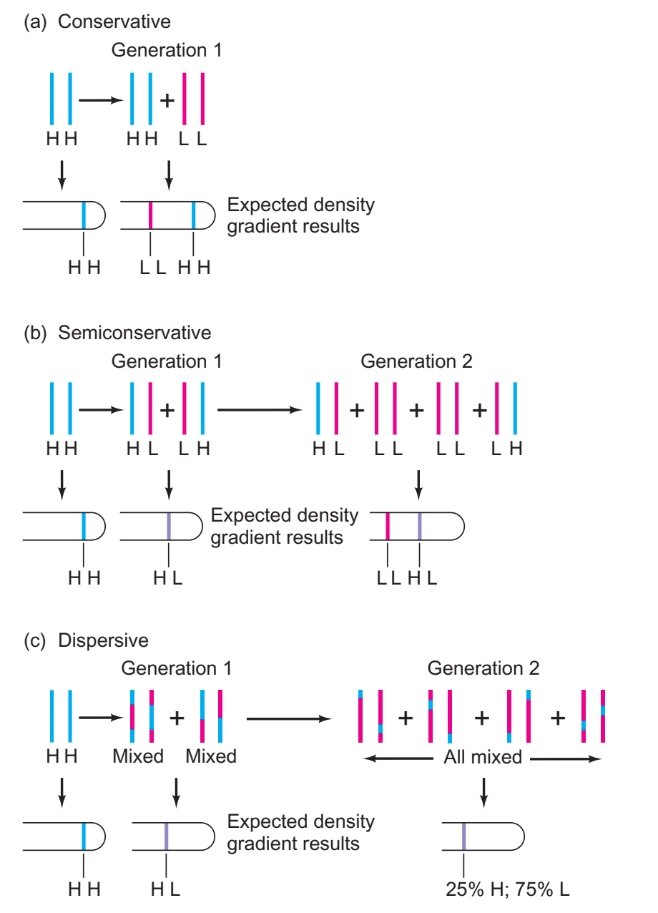{ width="560" height="777" }](../_img/dna_replication/semiconservative-models.jpg)
/// caption
蓝色表示原有重标记，粉色表示新合成的轻标记。先比较第一代：保守模型预测两带，其余两种预测中间带；第二代的预测才把半保留与分散模型进一步分开。[^fig-weaver-20-3]
///

Meselson 与 Stahl 让大肠杆菌先在含 $^{15}$N 的培养基中生长，使 DNA 获得较重的氮同位素标记，再转入含 $^{14}$N 的培养基。新合成的链主要使用轻氮，旧链仍保留重氮；取出不同时间的 DNA，就能追踪旧材料去了哪里。[^meselson-stahl]

关键在于怎样把它们分开。在 CsCl 的平衡密度梯度离心中，DNA 会聚集到与自身浮力密度相应的位置。全重 DNA、全轻 DNA 和一重一轻的杂合双链有不同的密度，因而形成不同位置的条带。重标记比例越高，DNA 的浮力密度越大，条带就越靠近梯度中密度较高的一端。

[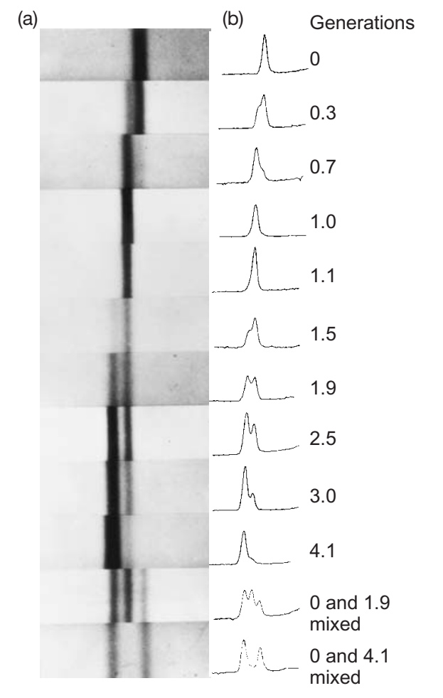{ width="430" height="678" loading="lazy" }](../_img/dna_replication/meselson-stahl-bands.jpg)
/// caption
每一横行对应右侧标出的世代数。原始重带逐渐被中间带替代；约两代时，中间与轻带并存。底部混样帮助比较各带位置，右侧曲线是条带的光密度读数。[^fig-weaver-20-4]
///

复制约一代后，主要出现一条中间密度带。这排除了“旧双链完整保留、旁边生成全新双链”的保守模型，因为后者应该同时产生重带和轻带。但只到这一步，半保留与分散模型还没有分出胜负。

再过一代，半保留模型预测：每条杂合双链分开后，旧重链会再次得到一条新轻链，原来的轻链则配上一条新轻链，于是杂合 DNA 与全轻 DNA 各占约一半。分散模型却预测新旧材料仍混在每个分子中，只是重材料的比例继续降低，主要条带应整体向轻侧移动。实验得到前一种结果。这个实验漂亮的地方，就在于两代之间的变化：第一代排除了保守模型，第二代又区分了半保留和分散模型。

!!! note "双链分开后的密度分布"

    两种模型的差别，还可以从单链的组成来理解。假设取重氮培养转到轻氮培养后的第一代 DNA，使双链完全分开：半保留模型预测，一条单链保留旧的重标记，另一条是新合成的轻链；分散模型则预测，每条单链内部都混有新旧材料。前者因而预期出现重、轻两类单链，后者则仍以中间密度的单链为主。

    这是根据模型作出的预测。若用密度实验检验，需要维持 DNA 的单链状态，并设置相应的重、轻单链对照。单双链的浮力密度不同，条带位置也应分别标定。

## DNA 的聚合反应 { #replication-chemistry }

### 模板、引物和 dNTP { #dntp }

DNA 聚合酶需要一个**引物—模板接头（primer–template junction）**。模板提供下一步配对的碱基；引物已经与模板配对，并留下可以继续延长的 3′-OH。图中的短链是引物，较长的链是模板。后续核苷酸将逐个接到引物的 3′ 端上，延长这条与模板互补的新链。

[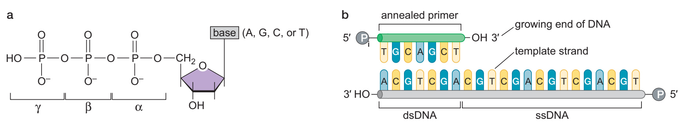{ width="750" height="140" loading="lazy" }](../_img/dna_replication/primer-template.jpg)
/// caption
左图从糖向外依次辨认 α、β、γ 磷酸；右图找到引物暴露的 3′-OH，以及它前方尚未配对的模板。模板与新生链反向平行。[^fig-gene-9-1]
///

原料是四种**脱氧核苷三磷酸（dNTP）**：dATP、dGTP、dCTP 和 dTTP。它们既提供要加入链中的核苷酸，也以三磷酸形式参与反应的能量收支。常规复制型 DNA 聚合酶不能直接把两个游离 dNTP 接成第一段新链；它需要先有这个配对好的末端，才适合继续工作。引发酶能先合成一段引物，为 DNA 聚合酶提供起步的末端。[^replication-chemistry]

### 3′ 端的延长 { #3 }

沿反应图看，引物末端的 3′-OH 进攻来袭 dNTP 的 α 磷酸，形成新的磷酸二酯键。β、γ 两个磷酸一起以焦磷酸的形式离开，后续焦磷酸水解有利于合成方向的净推进。来袭核苷酸的糖上又留下一个新的 3′-OH，于是同样的反应可以再做一次。

活性位点中的 Mg²⁺ 等二价金属离子帮助定位底物、促进 3′-OH 参与反应，并稳定反应中的电荷。聚合本身存在逆反应：在适当的焦磷酸条件下，末端核苷酸可以通过**焦磷酸解**被移走。细胞持续供应 dNTP、移除和水解焦磷酸，使净反应倾向于链的合成。[^polymerase-catalysis]

[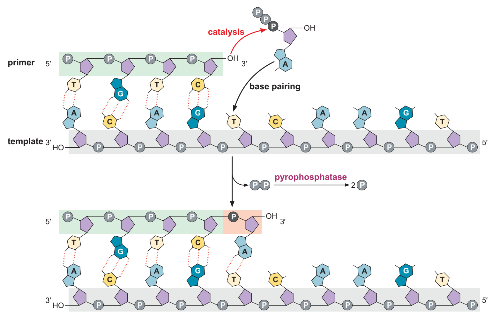{ width="680" height="431" loading="lazy" }](../_img/dna_replication/polymerization-chemistry.jpg)
/// caption
先找上图引物的 3′-OH，再在下图找到接入后新的 3′-OH。模板碱基决定配对选择，红箭头所指的是化学反应位置。[^fig-gene-9-2]
///

新链总是在 3′ 端增加核苷酸，所以把整条新链的增长方向记作 **5′→3′**；聚合酶沿模板读取的方向则是 3′→5′。图中模板和新链反向平行：聚合酶每沿模板向 5′ 端移动一步，就在新链的 3′ 端接入一个核苷酸。

聚合酶不只是把互补碱基凑在一起。它要定位引物末端、来袭 dNTP 和催化所需的金属离子，使反应基团形成合适的空间关系。许多 DNA 聚合酶的结构常用手掌、手指、拇指来描述：这是对结构形状的称呼，方便我们在三维图中找位置。

[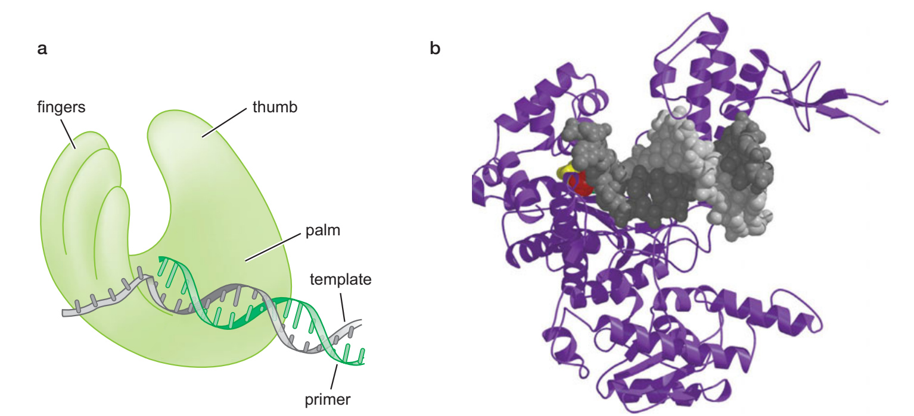{ width="690" height="315" loading="lazy" }](../_img/dna_replication/polymerase-structure.jpg)
/// caption
左图用手掌、手指和拇指标明位置，右图显示蛋白质与 DNA 的三维结构。找到 DNA 进入的位置，再把反应末端接到前一幅化学图上。[^fig-gene-9-5]
///

### 选择、校对与错配修复 { #replication-fidelity }

正确的碱基配对有利于底物进入适合催化的构象。错配不只改变两块碱基之间的氢键，也会影响引物末端的位置，使继续反应变得困难。如果错误已经接进去了，许多复制型聚合酶还能把新链末端送到另一个活性位点，切掉末端核苷酸，再回到聚合位点继续合成。

[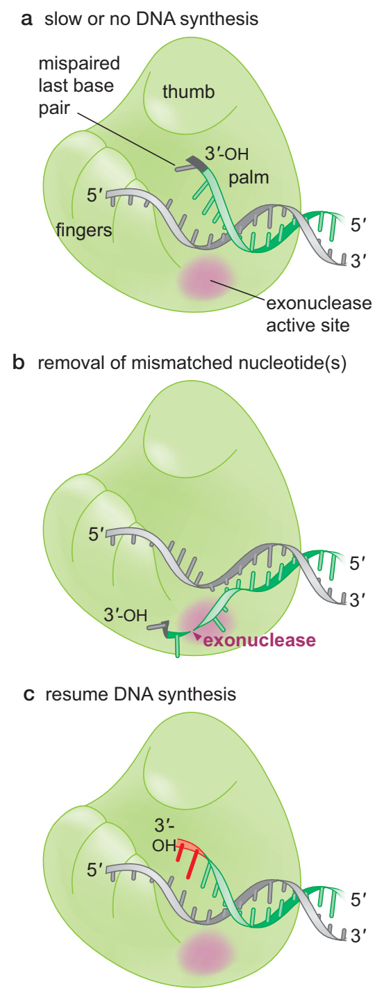{ width="410" height="1067" loading="lazy" }](../_img/dna_replication/proofreading.jpg)
/// caption
a 中错配末端难以继续延长；b 中新链 3′ 端进入外切位点；c 中修正后的末端重新合成。聚合与校对发生在不同活性位置。[^fig-gene-9-11]
///

这种 **3′→5′ 核酸外切校对**，方向与 DNA 合成相反：它从刚刚增长的末端往回切。逃过聚合酶选择和校对的错配，还可以由复制后的**错配修复**识别，并优先在新生链上纠正。错配修复处理的是已经留在 DNA 中的错误，与聚合酶延伸时的末端校对分属不同步骤。它们共同使正常细胞的复制错误达到极低的水平，常见概括在每 $10^9$ 个核苷酸一次或更低的量级；具体数值取决于物种、序列、聚合酶与测量方式。[^replication-fidelity]

dNTP 的浓度与比例也影响反应速度和误配机会。引发酶以及真核起始用的 Pol α 没有复制型聚合酶那样的完整校对能力，后来将引物区段移除、重新合成，因而也有利于提高最终产物质量。损伤跨越、复制叉重启与修复性合成的取舍，见[DNA 损伤、修复与突变](../dna_repair.md)。

### 聚合酶的分工 { #polymerase-families }

同一个细胞可以有多种 DNA 聚合酶。大肠杆菌的 Pol I 是最早被发现的一种，却不是承担大部分染色体延伸的主力：后来分离到的 Pol III 才适合与滑动钳等组分一起长距离复制。Pol I 更擅长在已有 DNA 接头附近处理引物、补缺口。发现顺序留在了编号里，工作量可没有按编号排队。[^polymerase-repertoire]

| 大肠杆菌聚合酶 | 主要用途 | 与本页机制有关的活性 |
| --- | --- | --- |
| Pol I（A 家族） | 引物处理、缺口填补与修复 | 5′→3′ 聚合、3′→5′ 校对、5′ 核酸酶活性 |
| Pol II（B 家族） | 修复性合成及部分复制重启 | 有聚合与校对能力 |
| Pol III（C 家族） | 染色体的主要延伸 | 核心酶分担聚合与校对，全酶借助钳和装载器高效复制 |
| Pol IV、Pol V（Y 家族） | 损伤跨越等反应；Pol V 的诱导和激活与 [SOS 应答](../dna_repair.md#dna-damage-response)有关 | 通常缺乏复制酶式校对；准确性取决于底物损伤与酶的组合 |

Pol I 的三个活性还能通过蛋白质片段分开研究。温和蛋白酶处理得到的较大 **Klenow 片段**保留聚合与 3′→5′ 校对，5′ 核酸酶活性位于分离出去的较小片段。实验室还使用经过改造、缺少校对的 Klenow 变体，名称相近时要看清酶的具体构成。[^polymerase-repertoire]

真核核基因组的主要复制酶来自 B 家族。Pol α–primase 是四亚基复合体：两个亚基组成引发酶部分，另外两个组成 Pol α 部分。先做 RNA、再接短 DNA，随后把接头交给长距离延伸的聚合酶。RPA 保护暴露模板并参与蛋白之间的交接；它对合成与保真度的影响取决于具体反应条件。

| 真核聚合酶 | 主要位置与工作 | 校对及辅助功能 |
| --- | --- | --- |
| Pol α | 核复制的 RNA–DNA 引物合成 | 缺少 3′→5′ 校对，随后发生聚合酶交接 |
| Pol δ | 主要延伸后随链，也参与起始、修复和填补 | 具有校对；PCNA 提高其在 DNA 上持续工作的能力 |
| Pol ε | 通常承担多数前导链延伸，与 CMG 联系紧密 | 具有校对，复制体中的连接也有助于持续合成 |
| Pol β（X 家族） | 核内碱基切除修复 | 缺少校对；5′-脱氧核糖磷酸裂解酶活性处理部分修复中间体 |
| Pol γ（A 家族） | 动物线粒体 DNA 的复制与修复 | 具有校对；人 Pol γ 由一个催化亚基与辅助亚基二聚体组成 |

在体外重构的线粒体短片段碱基切除修复中，Pol γ 还表现出 **5′-dRP lyase 活性**。无碱基（AP）位点经切开后，可留下一个 5′ 脱氧核糖磷酸残基；Pol γ 能去除这个残基，并参与缺口填补。损伤的识别与前期切割则由其他酶完成。[^pol-gamma-ber]

家族描述结构与演化关系，也帮助我们比较功能。A、B 家族横跨多类生物，例如 T7 DNA 聚合酶也属于 A 家族。C 家族包括细菌 Pol III，古菌的 PolD 属于 D 家族。X 家族还包括 Pol λ、Pol μ 等修复酶，Y 家族包括 Pol η 等[损伤跨越酶](../dna_repair.md#replication-stress-tolerance)；逆转录酶另属 RT 类群。古菌与真核的复制装置有许多同源成分，具体聚合酶仍要按谱系辨认。[^polymerase-families]

!!! note "从复制酶到 PCR 用酶"

    Taq 属于 A 家族，具有 5′ 核酸酶活性，通常缺少 3′→5′ 校对；来自古菌的 Pfu 属于 B 家族，具有校对活性。耐热性让它们适合反复经历 PCR 的高温步骤，酶的校对和末端处理能力则影响产物。商品“高保真”酶可能经过工程改造，也可能含混合组分，应按具体酶及缓冲体系判断。[^pcr-polymerases]

    聚合酶抑制也与反应化学相连：双脱氧核苷酸若被接入，就不能提供下一轮需要的 3′-OH；阿非迪霉素则能抑制若干真核复制型聚合酶。不同酶对类似物的接受程度和抑制剂敏感性不同，实验比较需要给定底物与药物条件。实际选酶与扩增用途见[PCR 的反应与用酶](../../exptech/biochem_molecular/amplification_cloning.md#pcr-chemistry-cycling)。

    阿糖胞苷的活性形式 **ara-CTP** 则保留 3′-OH，但糖环构型与正常脱氧胞苷不同。它被聚合酶接入后，可以使后续延伸变慢；校对酶能否移除它、其他聚合酶能否继续延伸，又会影响最终效果。人 Pol ε 的体外研究把“接入类似物”和“从这个末端继续合成”分别测量，观察到接入后的延伸受阻，也检测了校对活性对类似物移除的贡献。[^ara-ctp]

### 滑动钳 { #_1 }

一个聚合酶每秒能接入多少核苷酸，与它一次结合能连续合成多长，是两个问题。即使单步反应很快，如果动不动就从 DNA 上掉下来，长链复制仍会受到影响。环抱 DNA 的**滑动钳（sliding clamp）**为聚合酶提供了可随 DNA 移动的连接点。

一次结合、尚未解离时平均能接入多少核苷酸，称为**过程性或进行性（processivity）**。这是把酶“留住”的能力，与每秒反应多少次的催化速率分别测量。

[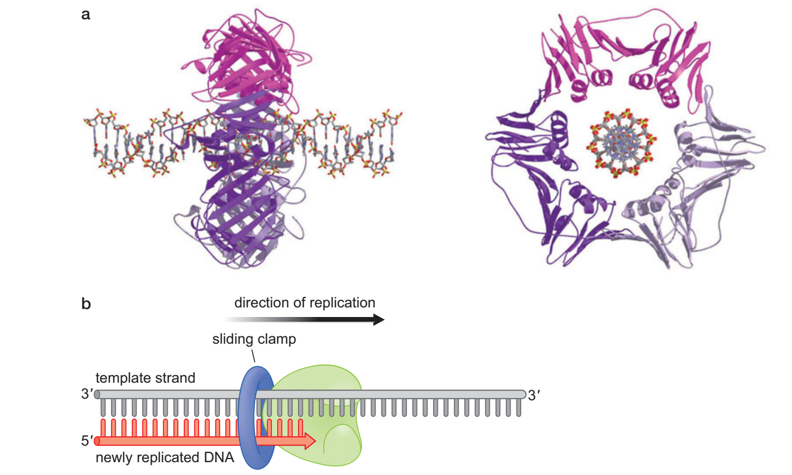{ width="680" height="408" loading="lazy" }](../_img/dna_replication/sliding-clamp.jpg)
/// caption
上排从侧面和孔口看钳环，下排显示它怎样让聚合酶与 DNA 保持联系。钳围住双链，但不把 DNA 锁死在某一个核苷酸位置。[^fig-gene-9-19]
///

细菌常用 β 钳，古菌和真核常用 PCNA。钳装载复合物在 ATP 结合与水解循环中打开钳、识别合适的引物—模板接头、将钳留在 DNA 上并释放。不同生物的钳和装载器有各自的结构组成：细菌使用细菌型钳装载复合物，古菌与真核则使用 RFC 类装载器。

大肠杆菌 β 钳由两个相同亚基成环，每个亚基有三个相似结构域；真核 PCNA 通常由三个亚基成环，每个亚基有两个相似结构域，两者因此都形成近似六域的环。PCNA 表面的结合位置还供核酸酶、连接酶、修复因子和染色质装配因子使用，复制后的处理也由此接到新生 DNA 上。[^clamp-architecture]

### Pol III 全酶 { #pol-iii-holoenzyme }

大肠杆菌 Pol III 的一个核心酶由 α、ε、θ 三种亚基组成：α 催化聚合，ε 提供 3′→5′ 校对，θ 与 ε 相联系并帮助稳定核心。加上滑动钳、装载器以及它们的连接关系，才构成能高效工作的全酶。

[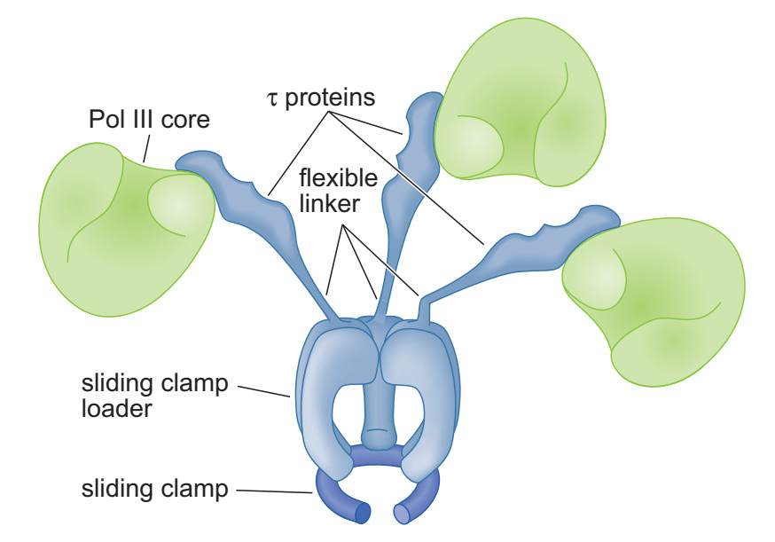{ width="560" height="391" loading="lazy" }](../_img/dna_replication/pol-iii-holoenzyme.jpg)
/// caption
绿色部分代表 Pol III 核心酶，蓝色部分连接多个核心与钳装载器。柔性连接让各聚合酶在保持联系的同时，能分别接近自己的引物末端。[^fig-gene-9-22]
///

装载器含 DnaX 蛋白产物 τ／γ、δ、δ′ 等组分，并有 χ、ψ 等辅助成分。τ 的额外结构域可以连接 Pol III 核心和 DnaB 解旋酶；γ 保留装载相关部分，却没有同样的末端连接区。教材图用三个核心酶展示一条前导链、两个后随链聚合酶之间的组织，为后面的长号模型作准备。活细胞中的组分交换与占据数会变化，图中展示的是一种经过研究的组织模型。[^pol-iii-assembly]

## 复制叉 { #replication-fork }

### 前导链与后随链 { #_2 }

复制进行时，亲代双链在一个分叉处打开，后方是已经复制的部分，前方是尚未打开的双链。这个 Y 形区域称为**复制叉（replication fork）**。以下图中向右推进的复制叉为例。

[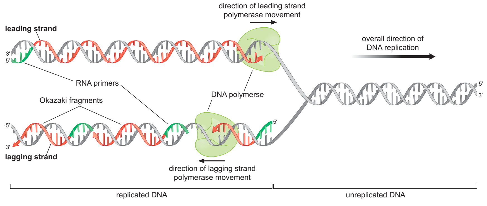{ width="760" height="323" loading="lazy" }](../_img/dna_replication/replication-fork.jpg)
/// caption
灰色为亲代模板，红色为新生 DNA，绿色短段为 RNA 引物。上侧新链的 3′ 端随叉向右延伸；下侧每个片段的 3′ 端向左延伸，但新的片段不断在靠近叉的位置启动。[^fig-gene-9-12]
///

上方那条模板以 3′→5′ 方向朝右延伸，聚合酶可以一边随复制叉前进，一边在新链的 3′ 端加原料，这条新链称为**前导链（leading strand）**。

下方模板的方向反过来了。聚合酶仍然只能延长新链的 3′ 端，所以每次合成的方向朝左，远离正在向右推进的叉。等叉继续向右打开一段模板，就需要在新的位置再起一个头，合成下一段。这条新链称为**后随链（lagging strand）**，由一段段冈崎片段连接而成。

“半不连续”说的是这种合成组织；“半保留”说的是旧链进入哪个子代双链。它们回答的问题不同，可以同时成立。正常复制叉的前导链较连续，遇到损伤、障碍或重启时也可出现间隙；这些情况要放回相应反应中看。

细菌与真核细胞的冈崎片段，长度通常也不同：在常见教材所讨论的生长条件下，大肠杆菌冈崎片段约为 1–2 kb，真核核基因组的片段常约 100–200 nt，接近核小体组织的尺度。大肠杆菌复制叉每秒可推进数百至约千个碱基对，真核核复制叉通常是每秒数十个碱基对。营养、温度、染色质与复制压力都会改变这些数值；真核依靠多个起点共同工作，完成较大的基因组。[^replication-scales]

### 解链与模板保护 { #_3 }

解旋酶利用 ATP 反应沿 DNA 移动，推动双链打开。许多复制型解旋酶是环形复合体，单链穿过中央孔道。下图展示乳头瘤病毒 E1 解旋酶的一个结构实例；单链 DNA 穿过它的中央孔道，内侧的蛋白环依次与 DNA 接触。细菌 DnaB 与真核 CMG 也采用环状结构，但亚基组成和运动方向有所不同。

[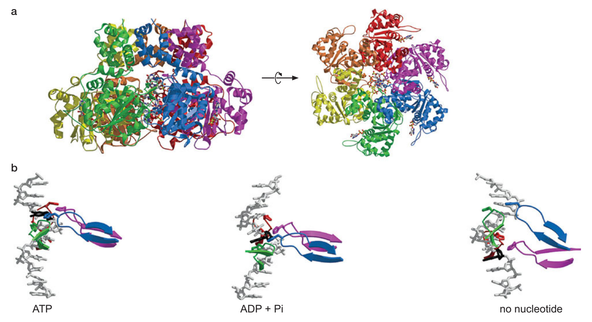{ width="740" height="403" loading="lazy" }](../_img/dna_replication/helicase-structure.jpg)
/// caption
上排从侧面和孔口看六聚体；下排比较不同核苷酸状态中接触单链 DNA 的蛋白环。下排根据不同核苷酸状态的结构，推测蛋白环如何依次牵引 DNA。[^fig-gene-9-15]
///

复制叉还会遇到结合在 DNA 上的蛋白质。大肠杆菌的辅助解旋酶 Rep 可与 DnaB 相联系，帮助复制叉越过这类障碍；UvrD 也能在一定条件下承担辅助作用，并参与多种 DNA 修复过程。[^accessory-helicases]

暴露的单链很容易局部重新配对，或折成影响复制的二级结构。细菌的 SSB、真核的 RPA，以及古菌中的 SSB/RPA 类蛋白覆盖单链，帮助维持可供复制的模板状态，也减少单链被核酸酶降解的机会。

大肠杆菌 DnaB 沿后随链模板按 5′→3′ 方向移动，真核 CMG 则环抱前导链模板，沿它按 3′→5′ 方向推进。所跟随的模板不同，它们都能位于相应复制叉的前沿。SSB 与 RPA 本身不负责催化解链，结合后还要能动态重排、向聚合酶或修复因子让出模板。SSB 的相邻结合可表现出协同性；盐浓度、结合模式及蛋白种类会影响这种协同程度。[^helicase-ssb-details]

双螺旋被打开时，拓扑问题会传到前方：如果 DNA 不能自由转动，未复制部分会积累额外扭转；叉本身的旋转又可能把缠绕转移到后方的子代分子之间。解旋酶忙着拆开碱基对，拓扑异构酶则通过受控的切割与重接来改变链的缠绕关系。

[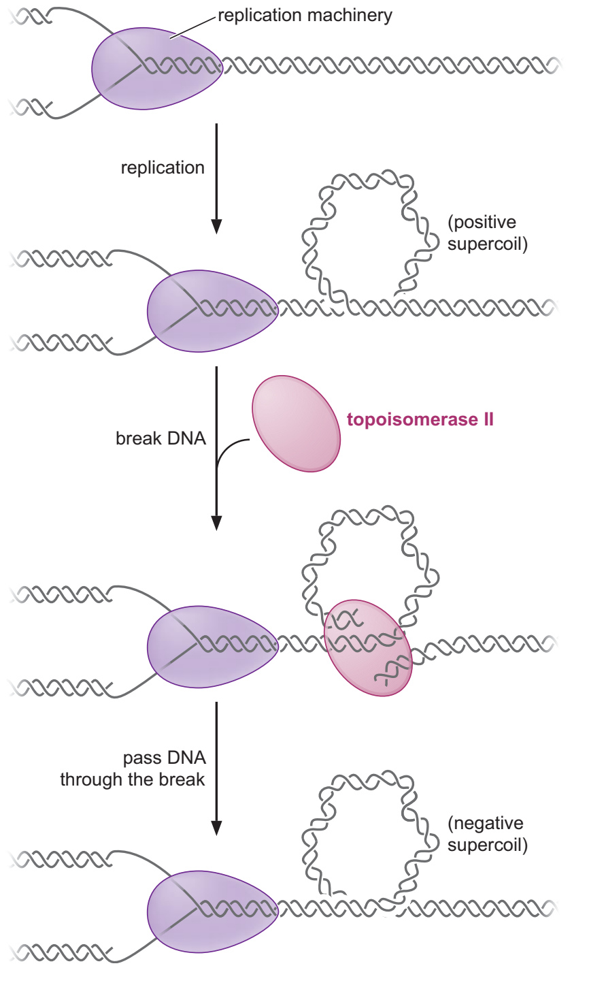{ width="420" height="712" loading="lazy" }](../_img/dna_replication/replication-topology.jpg)
/// caption
沿图看叉前方怎样积累扭转，再看暂时切开一段双链、让另一段穿过并重新连接的过程。图以细菌旋转酶相关的拓扑变化说明原理。[^fig-gene-9-17]
///

细菌 DNA 旋转酶可以引入负超螺旋，I 型或 II 型拓扑异构酶参与解除不同形式的应力；II 型酶还能解开复制产物之间的互锁。连接数的含义见[DNA 拓扑与超螺旋](../../biochem/nucleic_acid.md#dna-topology-supercoiling)。

切开 DNA 时，拓扑异构酶的酪氨酸与一个断端形成暂时的磷酸酪氨酸键，保留随后重接所需的化学连接。断端由酶控制着，待链穿越或旋转完成后再封口。常见类别可以这样比较：[^topoisomerase-classes]

| 类别 | 暂时切开的链与共价连接 | 改变拓扑的主要动作 | 能量与金属离子 |
| --- | --- | --- | --- |
| IA | 一条链；酶连到 5′ 磷酸端 | 让另一条单链穿过缺口，单次穿越使连接数改变 1 | 典型松弛酶不直接耗 ATP，通常需要 Mg²⁺ |
| IB | 一条链；酶连到 3′ 磷酸端 | 受控旋转，一次切开期间可松开多圈 | 通常不直接耗 ATP，切割—重接不依赖二价金属催化 |
| IIA | 两条链；酶连到 5′ 磷酸端 | 让另一段双链穿过，单次穿越使连接数改变 2 | ATP 与 Mg²⁺ 参与循环；包括细菌旋转酶、Topo IV 和真核 Topo II |
| IIB | 两条链；酶连到 5′ 磷酸端 | 双链穿越，单次改变连接数 2 | ATP 与 Mg²⁺ 参与；代表为 Topo VI |

这里的计量指一次链穿越，IB 的受控旋转则可以连续释放多圈。逆旋转酶把 IA 型拓扑酶与 ATP 依赖的解旋酶样部分结合，因此整条蛋白的工作仍涉及 ATP 消耗。喜树碱能稳定真核 Topo I 的切割复合物，妨碍正常重接；这一点也说明，酶原本短暂保留的断口如何成为损伤来源。[^topoisomerase-classes]

DNA 旋转酶在 ATP 驱动下可引入负超螺旋；在无 ATP 的特定体外条件下，也能较慢地松弛已有的负超螺旋。是否消耗 ATP，要连同所测的反应方向一起说明。[^gyrase-relaxation]

### 冈崎片段与长号模型 { #leading-lagging-coordination }

**引发酶（primase）**能够从头合成一段短核酸，为 DNA 聚合酶准备配对好的 3′-OH。大肠杆菌 DnaG 合成短 RNA，并与 DnaB 解旋酶动态配合。它对模板序列有偏好，体外测量中常从含 5′-CTG-3′ 的位点引发；这种偏好及周围蛋白会影响哪些位置真正启动合成。[^dnag-sequence] 许多古菌使用 PriS–PriL 类引发酶；真核 Pol α–primase 则先合成 RNA，再接上一小段 DNA。

前导链建立起始接头后，可以较长时间连续延伸；后随链必须反复引发。后随链聚合酶又与整个复制体保持联系，于是模板在它附近形成一个动态的环。环的长度随片段合成而改变，因此得名**长号模型（trombone model）**。长号演奏时，伸缩管来回移动；这里随合成伸长、又在片段完成后释放的，是后随链模板形成的环。

以下用大肠杆菌模型走一圈。先认出右侧负责开链的解旋酶，再看下方后随链模板形成的环，始终盯住正在增长的新链 3′ 端。

[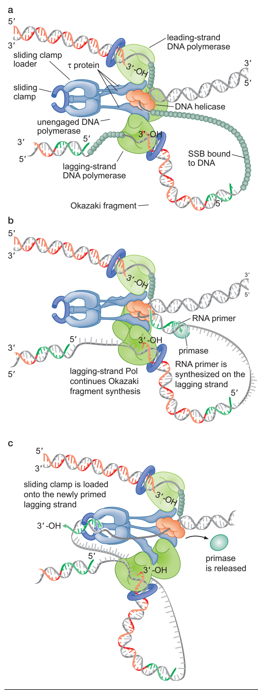{ width="470" height="1251" loading="lazy" }](../_img/dna_replication/trombone-a-c.jpg)
/// caption
a：已有冈崎片段正在延长；b：靠近解旋酶的新模板上出现 RNA 引物；c：装载器把新的钳环留在该引物—模板接头。此图裁取原图左列 a–c。[^fig-gene-9-23]
///

随着复制叉继续前进，新的单链模板暴露出来，DnaG 再放下一段 RNA 引物。钳装载器把新钳留在这个接头，一个可工作的后随链聚合酶接上去，开始下一段 DNA 合成。与此同时，前一个片段可以继续延长，直到接近它前面的片段边界。

[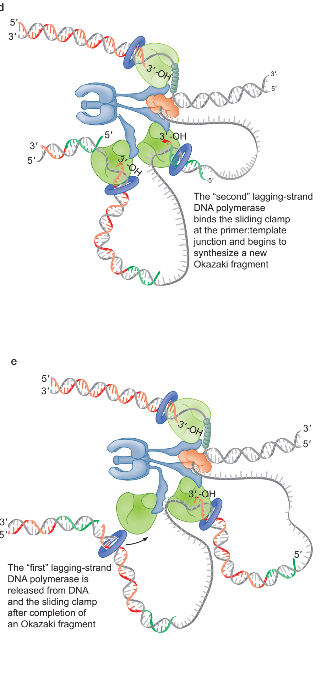{ width="490" height="1065" loading="lazy" }](../_img/dna_replication/trombone-d-e.jpg)
/// caption
d：另一后随链聚合酶接到新装载的钳上；e：前一个片段完成，其聚合酶释放并可参与后续循环。对应原图右列 d–e。[^fig-gene-9-23]
///

这张教材图画出一个前导链聚合酶和两个交替工作的后随链聚合酶，表示前一个冈崎片段尚未完成时，后一个片段已经开始合成。不同物种、复制状态和实验条件下，复制体的组分数目与连接关系会变化。图中引发、装钳、延伸与释放反复进行，让后随链合成能够跟上不断打开的模板。真核的 Pol α–primase、Pol δ 和 CMG 以另一种结构组织完成这些步骤，后面再作比较。

???+ abstract "在显微镜下看一条 DNA 变长"

    长号模型描绘了复制体内各组分的位置。若想进一步测量一个复制体走得多快、会不会中途停顿，可以把它合成的 DNA 直接放到显微镜下观察。Graham 等在 2017 年用纯化的大肠杆菌复制蛋白重构了这样的反应：DNA 的一端固定在玻璃表面，圆形模板不断进行滚环复制，产物则在液流中被拉长。

    [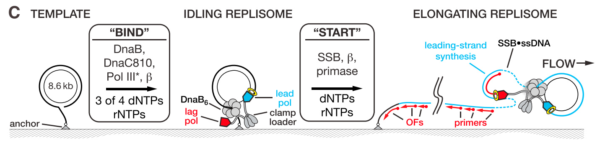{ width="740" height="175" loading="lazy" }](../_img/dna_replication/single-molecule-replication-setup.jpg)
    /// caption
    左侧为 8.6 kb 圆形模板，带生物素的尾端与表面连接；右侧箭头标出液流方向。复制产物逐渐延长，携带复制叉的圆形模板离固定端越来越远。原图 1C，示意图。[^fig-single-molecule-replication]
    ///

    染料 SYTOX Orange 使双链 DNA 发光。连续拍照，就能把圆形模板到固定端的距离换算成已合成的 DNA 长度。下图 D 是反应开始 180 秒时的视野；E 从中挑出三条分子，按时间排列它们的图像。F 再把各时刻的位置连续铺开，得到时空图：纵轴的时间向下增加，横轴表示分子长度，亮线向右延伸就意味着产物在增长。

    [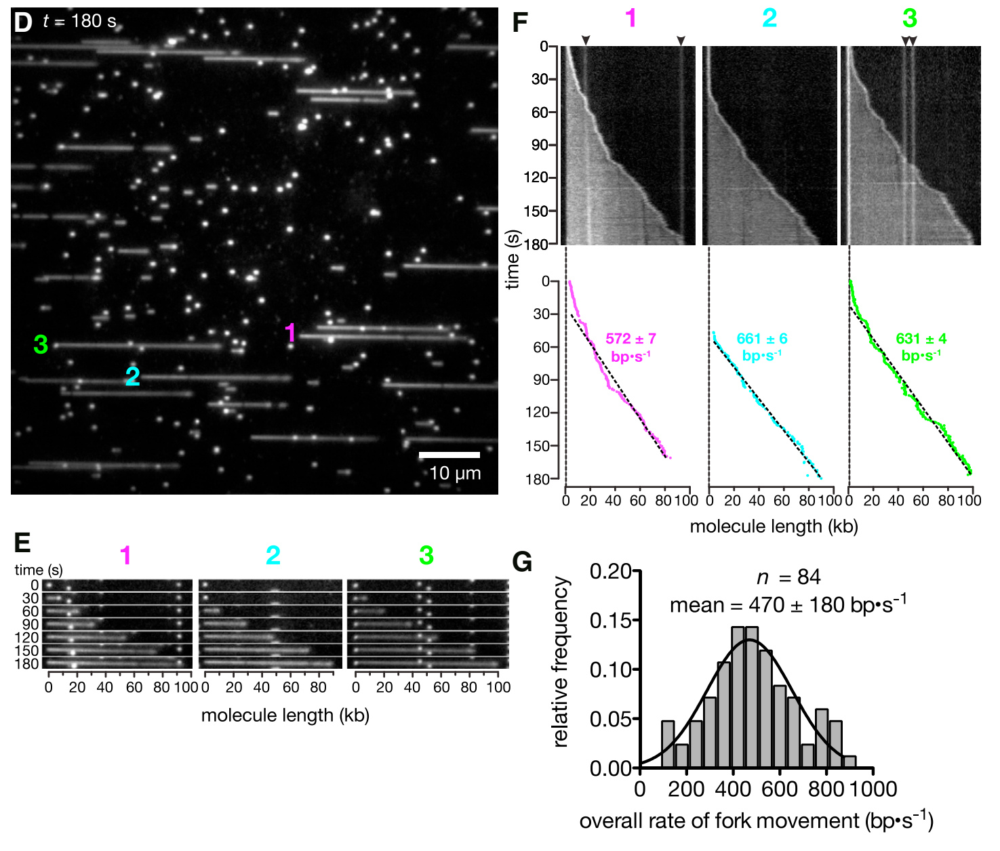{ width="740" height="630" loading="lazy" }](../_img/dna_replication/single-molecule-replication-images.jpg)
    /// caption
    D 中标出的 1、2、3 与 E、F 的三个分子对应，比例尺为 10 μm；F 下半部的拟合得到各分子的平均复制速度。G 汇总 84 个分子，在该体外条件下平均为 470 ± 180 bp/s（平均值 ± 标准差）。原图 1D–G。[^fig-single-molecule-replication]
    ///

    同一视野里的分子，延伸速度也可以不同。论文进一步分析单分子轨迹，还观察到合成中的停顿和速度变化，并通过调整反应组分分别研究前导链与后随链。这样的体外重构，让复制过程中的变化能够被逐个记录下来；群体平均得到的一条平滑曲线，可能就把这些细节藏住了。

### 冈崎片段成熟 { #rna-dna }

冈崎片段之间最初并不是一条完整的 DNA 链。下一个片段的 5′ 端还带着引物，片段之间也有需要封闭的切口。在大肠杆菌中，DNA polymerase I 利用聚合活性向前填补，同时以 5′→3′ 核酸外切活性移除前方引物，让切口的位置向前移动，称为**切口平移（nick translation）**。RNase H 也参与处理 RNA–DNA 杂交中的 RNA。

[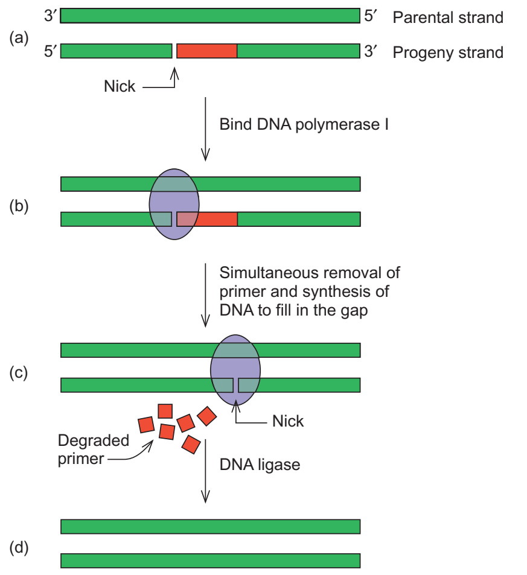{ width="480" height="524" loading="lazy" }](../_img/dna_replication/nick-translation.jpg)
/// caption
红段是待移除的引物。Pol I 在去除前方核苷酸的同时，从左侧片段的 3′ 端延长；最后的切口由 DNA 连接酶封闭。[^fig-weaver-20-15]
///

等聚合酶填满缺口后，剩下的是相邻的 3′-OH 与 5′-磷酸之间尚未连接的一处切口。DNA 连接酶在这里形成最后一个磷酸二酯键，两个片段便接成连续的链。

封口需要先活化这个 5′-磷酸。连接酶先取得 AMP，形成酶—AMP 中间体，再把 AMP 转到 DNA 的 5′-磷酸上；相邻 3′-OH 进攻后，磷酸二酯键形成，AMP 离开。ATP 依赖的连接酶从 ATP 取得 AMP，并释放焦磷酸；大肠杆菌 LigA 则使用 NAD⁺，同时释放 NMN。细菌中也有 ATP 依赖的连接酶，因此辅因子应按具体酶说明。[^dna-ligases]

真核细胞主要由 Pol δ 延伸并推开前方片段的 5′ 端，形成小瓣状结构（flap），再由 FEN1 切除。FEN1 对不同底物有不同的切割方式：除了切下 flap，还能在切口或缺口底物上表现出 5′→3′ 外切活性；它也参与[长片段碱基切除修复](../dna_repair.md#base-excision-repair)。[^fen1-activities]处理较长的 flap 时，可能还需要 Dna2 与 FEN1 协作，RNase H2 参与 RNA 的清除，最终由 DNA ligase I 封口。古菌常见 RNase H、Fen1、PCNA 和连接酶等组合，具体成员依谱系而变。[^lagging-strand-maturation]

在哺乳动物中，连接酶 I 主要参与复制及部分修复，连接酶 III 参与单链断裂修复等过程，并在线粒体 DNA 维护中发挥重要作用；连接酶 IV 与 XRCC4 等参与非同源末端连接。它们共同使用封口化学，结合伙伴和作用场景不同。相关修复路线见[单链断裂与双链断裂修复](../dna_repair.md#break-crosslink-repair)。[^dna-ligases]

???+ abstract "冈崎片段：短 DNA 为什么会先出现，再消失"

    短时间加入带放射性标记的 DNA 前体，可以优先标记刚刚合成的部分，再按产物大小分离。下面左图所示的 T4 噬菌体复制实验中，最短标记时间主要得到短 DNA；时间延长后，较长 DNA 中的标记增加。右图换成连接酶有缺陷的噬菌体，短片段会持续积累。

    [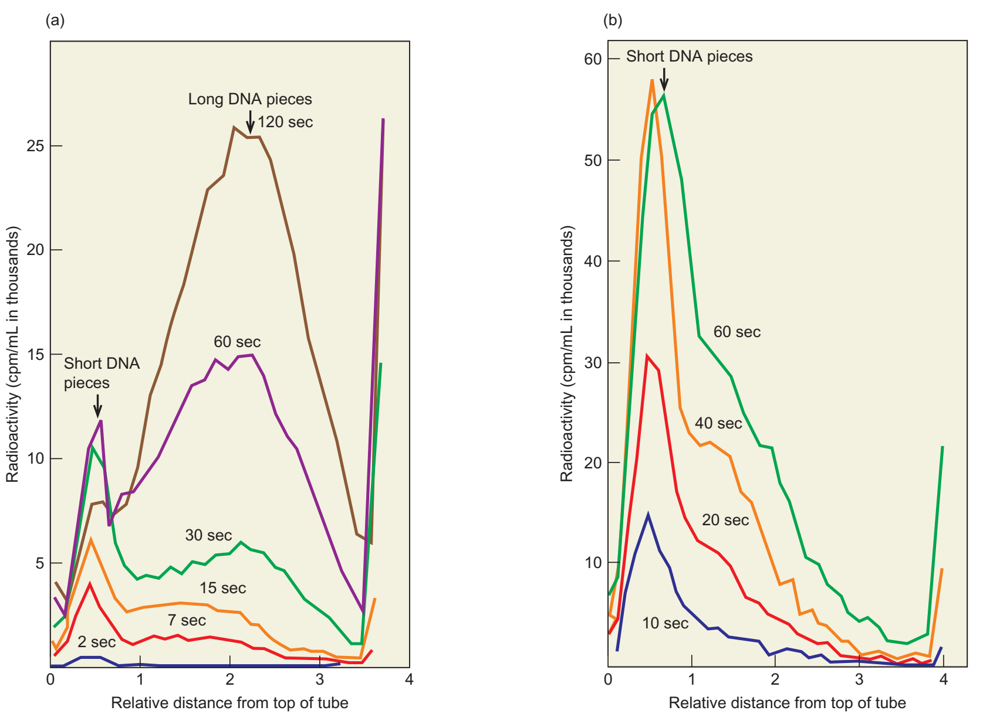{ width="730" height="522" loading="lazy" }](../_img/dna_replication/okazaki-pulse.jpg)
    /// caption
    横轴是距离心管顶部的相对距离，纵轴是放射性读数。左图中的长 DNA 随时间增多，右图的连接酶缺陷使短片段难以并成长链。这里按沉降行为分离大小，与前面的 CsCl 平衡密度实验不同。[^fig-weaver-20-6]
    ///

    另一个常用设计是**脉冲—追踪**：先短时间加入标记前体，再以大量未标记前体继续培养。若先出现的标记短片段随后进入高分子量 DNA，就支持它们是可被连接的中间产物；这与比较不同持续标记时间的样品，是两种相互补充的观察方式。

    这组证据把短产物接到了长链形成过程中，支持至少一条新链分段合成。早期某些实验中，前导链也呈现许多短片段，曾使解释更加复杂。后来在大肠杆菌中结合链特异检测与切除修复通路干预，发现新合成前导链可以长得多；误掺核糖核苷酸后的切除，是造成许多前导链断片的原因。因此，实验中提取到的短 DNA，有些是在复制时分段合成的，有些则来自后续切除；区分这两种来源，才能判断新链最初怎样形成。[^okazaki-fragments]

    还有一条较早的线索涉及尿嘧啶。大肠杆菌若把 dUTP 掺入新 DNA，尿嘧啶-DNA 糖基化酶会切除尿嘧啶碱基，后续碱基切除修复再在骨架上产生切口。1977 年的研究利用相关突变体，表明这条途径也能造成短 DNA 的积累。这里误掺的是带脱氧核糖的尿嘧啶核苷酸；它与核糖核苷酸误掺后的切除是两条不同线索，都提醒我们注意取样前发生的加工。[^uracil-fragments]

## 复制起点与许可 { #replication-origins }

### 细菌的复制起始 { #_4 }

复制叉负责向前工作，**复制起点（origin of replication）**则是它被建立起来的区域。许多起点会发出两个相背运行的叉，在染色体上形成逐渐扩大的复制泡；一个起点及其复制所覆盖的区域构成一个复制子。

[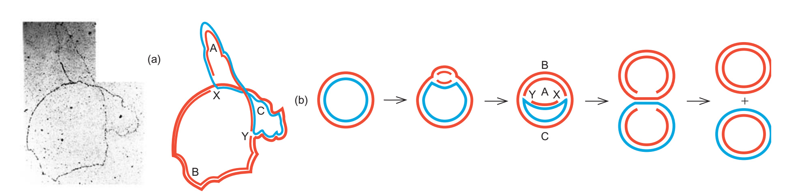{ width="760" height="186" loading="lazy" }](../_img/dna_replication/theta-replication.jpg)
/// caption
左侧为复制中分子的实际观察及描图，右侧表示复制泡沿环状 DNA 扩展，最后形成两条环。中间阶段的外形像希腊字母 θ。[^fig-weaver-20-9]
///

大肠杆菌常用一个 oriC 起点启动一轮染色体复制。ATP 结合状态的 DnaA 在起点的多个识别位点协同装配，使 DNA 解链元件打开；随后 DnaB 解旋酶被装载，引发酶与 Pol III 等合成装置加入，两个复制叉向相反方向出发。

oriC 中的 DnaA 结合位点负责招募与组织起始蛋白，邻近富含 A–T、较易打开的 DNA 解链元件则提供最先分开的区域。IHF、HU 等核质蛋白会影响 DNA 的弯曲，改变起始复合体的组装环境。DnaC 在大肠杆菌中帮助装载 DnaB；DnaB 暴露出的单链随后供 DnaG 引发。DnaG 的局部序列偏好与 oriC 的 DnaA 识别元件属于不同步骤。[^oric-control]

[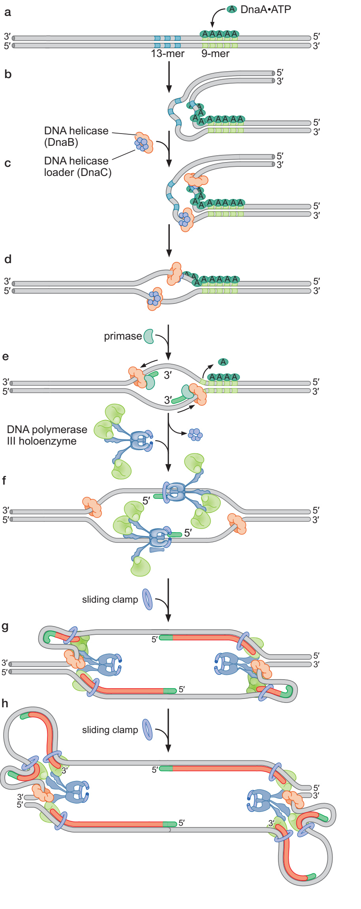{ width="460" height="1155" loading="lazy" }](../_img/dna_replication/bacterial-initiation.jpg)
/// caption
从 DnaA 结合开始，依次找 DnaB、引发酶和两套合成装置。图中的 9-mer、13-mer 概括经典起点元件，具体 oriC 位点排列比这幅组装示意更细致。[^fig-gene-9-27]
///

复制起始以后，起点还会经历一段暂时难以再次启动的时期。DnaA 的 ATP/ADP 状态、合成与结合位点滴定，以及起始后的失活过程，都会影响下一次启动。在大肠杆菌中，Dam 甲基化与 SeqA 对新复制、半甲基化 oriC 的结合，还能暂时限制再起始。

Dam 修饰的是 GATC 序列中的腺嘌呤。原来的 GATC 位点经复制后，一条链保留甲基化，另一条新链尚未完成相应修饰。SeqA 偏好结合这种半甲基化区域，使新复制的起点暂时受到隔离；Dam 随后补上新链的甲基化。与此同时，滑动钳相关的 Hda 促进 DnaA 上 ATP 的水解，降低活性 DnaA-ATP 的比例。甲基化状态、SeqA 占据和 DnaA 核苷酸状态共同影响起始时机。[^oric-control]

???+ abstract "两个复制叉都在前进吗？"

    一个 θ 形中间体有两个分叉，但仅凭静态外形，还不能测出两处是否都在合成。Prescott 与 Kuempel 先让大肠杆菌利用中等比放射性的氚标记前体，再换成更高比放射性的前体。较晚合成的区域留下更密的银粒轨迹；轨迹两端都变密，支持两处复制叉同时向外推进。[^bidirectional-label]

    [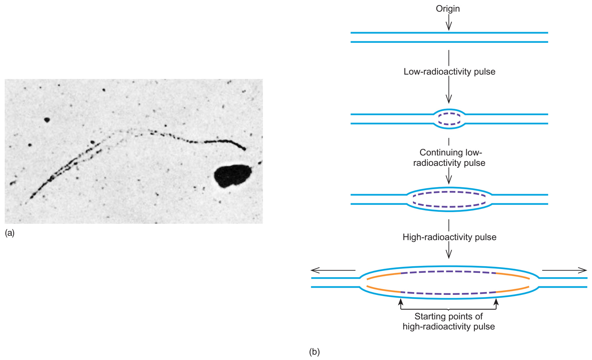{ width="760" height="463" loading="lazy" }](../_img/dna_replication/bidirectional-pulse.jpg)
    /// caption
    这张教材图展示采用相似思路的另一项实验，材料为枯草芽孢杆菌。左图的密集银粒靠近两处分叉，右图解释低标记后接高标记怎样形成这一分布。图中只显出带标记的复制区域。[^fig-weaver-20-10]
    ///

    读这种图要把“位置”接到“先后”：原点附近的 DNA 较早合成，两个分叉附近的区域较晚合成。后一次标记在两端出现，才给出了两个叉都在移动的时间信息。

### ColE1 的 RNA 调控 { #cole1-replication }

质粒 ColE1 用一段 RNA 来控制复制起步。宿主 RNA 聚合酶转录出的 **RNA II**，在起点附近与 DNA 形成稳定杂交；RNase H 处理这段 RNA 后留下可延长的 3′-OH，Pol I 从这里开始合成 DNA，后续再组装复制叉。ColE1 型复制通常沿一个方向推进。[^cole1-control]

较短的反义 **RNA I** 与 RNA II 的一部分互补。它们先通过局部环区接触，再形成更稳定配对，改变 RNA II 的折叠，使其难以形成正常引发所需的 RNA–DNA 杂交。Rom／Rop 蛋白可稳定两段 RNA 的相互作用。质粒多时 RNA I 也增多，下一轮引发受到更强抑制，于是复制频率与拷贝数联系起来。

[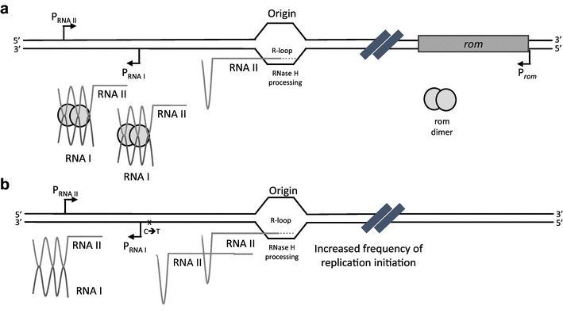{ width="700" height="395" loading="lazy" }](../_img/dna_replication/cole1-rna-control.jpg)
/// caption
沿 RNA II 找到能形成引物的路线，再看 RNA I 的配对怎样妨碍这一步。图比较原始 pMB1 型起点与 pUC19 衍生起点；后者的序列与 Rom 状态不同，不能把它们当作完全相同的拷贝数调控系统。[^fig-cole1-control]
///

ColE1 衍生载体常通过改变 RNA 配对或 Rom 调节来改变拷贝数。

!!! tip "快速生长时的多轮复制"

    在快速生长条件下，大肠杆菌完成一轮染色体复制所需时间可能长于两次分裂的间隔，于是前一轮尚未结束，下一轮就已从新复制出的起点启动。一个尚未分裂的细胞里，因而可以同时有多轮复制叉工作；这样的重叠使染色体复制能够跟上细胞的快速增殖。

### 真核复制许可 { #eukaryotic-licensing }

真核染色体更长，通常需要许多起点共同完成复制。如果同一区域重复启动，可能多复制；如果一大片区域没有及时启动，又可能留到周期结束仍未复制。细胞把准备起点与真正开动复制叉分成不同的状态。

晚 M 期至 G$_1$ 期，CDK 活性较低，ORC、CDC6 和 CDT1 帮助把两个头对头的 MCM2–7 六聚体装在双链 DNA 上。这个装载过程建立**复制前复合体（pre-replicative complex，pre-RC）**。此时起点获得了**复制许可（licensing）**，但装上的 MCM 尚未作为活性复制叉解旋酶工作。

进入 S 期，DDK 与 S-CDK 促进后续组装与激活，Cdc45、GINS 等加入，形成 **Cdc45–MCM2–7–GINS（CMG）**解旋酶。两个活性复合体分别建立相反方向的复制叉。与此同时，较高 CDK 活性、CDC6/CDT1 的降解或定位变化，以及后生动物 geminin 对 CDT1 的抑制等机制，使新 MCM 的装载受到限制。

[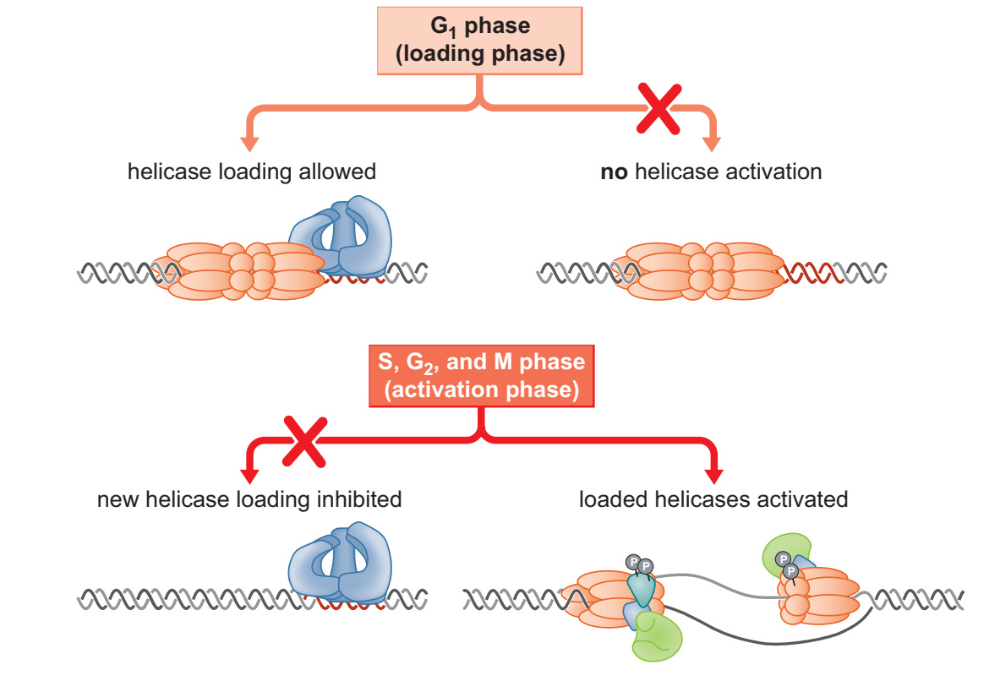{ width="680" height="463" loading="lazy" }](../_img/dna_replication/replication-licensing.jpg)
/// caption
上半部允许装载、尚未激活，下半部抑制新装载。正常核基因组的起点主要在 S 期激活；进入 G₂ 和 M 期后，新装载仍受抑制，直到下一轮许可阶段。[^fig-gene-9-33]
///

这样，某个起点可以先准备好，之后再使用；用过之后，在同一轮 S 期中又难以从头装一套新的。并非每个已获许可的起点最终都会启动，一部分会被邻近复制叉经过后被动复制，也能在复制受阻时提供备用起始机会。详细周期调控见[细胞周期中的复制许可](../../cell/cell_cycle.md#replication-licensing)。

真核 Pol α–primase 建立 RNA–DNA 引物后，主要延伸任务交给 Pol ε 与 Pol δ。在通常的未受扰动复制叉中，Pol ε 承担大部分前导链合成，Pol δ 承担大部分后随链合成；Pol δ 也参与起点附近的前导链建立以及某些重启和填补。CMG 周围还有一批辅助蛋白：Mcm10 参与复制起始和解链，Ctf4/And-1 帮助联系 Pol α–primase 与复制体，Mrc1/Claspin 以及 Timeless–Tipin 等则参与稳定复制叉、协调推进及复制压力应答。[^eukaryotic-replisome]

### 不同生物的复制系统 { #_5 }

出芽酵母起点有较明显的序列约束；后生动物常表现为范围较宽、使用概率不同的起始区，受到序列性质、核小体、转录、核内环境和发育状态影响。在动物中寻找复制起点，通常需要把序列特征与细胞内的实际起始位置、染色质状态结合起来判断。[^origin-selection]

许多古菌用 Orc1/Cdc6 类蛋白识别起点、招募 MCM，滑动钳和多种复制叉蛋白也与真核同源；染色体可能有一个或多个起点。一些古菌在实验中删除全部已知起点后，仍能依赖重组相关方式起始复制。许多含 PolD 的古菌以 D 家族聚合酶完成主要染色体复制，另一些谱系主要使用 PolB；这些聚合酶与古菌的解旋酶、滑动钳等共同组成其复制装置。[^archaeal-replication]

古菌引发酶的底物选择也有实验条件之分。例如，*Pyrococcus furiosus* 的小亚基 p41 单独测定时偏好 dNTP；与 p46 组成复合体后，体外反应中可以合成 RNA 引物。亚基组合因而也会改变引发酶的底物选择与合成产物。[^archaeal-primase]

| 工作 | 细菌代表系统 | 古菌常见系统 | 真核核基因组 |
| --- | --- | --- | --- |
| 起点识别与装载 | DnaA；DnaC 等装载 DnaB | Orc1/Cdc6 类蛋白；MCM | ORC、CDC6、CDT1 装载 MCM2–7 |
| 解链 | DnaB | MCM 及相关辅助因子 | CMG |
| 引发 | DnaG 合成 RNA | PriS–PriL 类引发酶 | Pol α–primase 合成 RNA–DNA 引物 |
| 主要延伸 | Pol III 全酶 | PolD 或 PolB，依谱系而异 | Pol ε、Pol δ 的主要链分工 |
| 滑动钳与装载器 | β 钳；细菌型装载器 | PCNA；RFC 类装载器 | PCNA；RFC |
| 单链保护 | SSB | SSB/RPA 类蛋白 | RPA |
| 片段成熟 | Pol I、RNase H、连接酶 | RNase H、Fen1、连接酶等 | Pol δ、FEN1/Dna2、RNase H2、ligase I |

## 复制终止 { #replication-termination }

复制叉大多通过与相向而来的复制叉会合而结束。两套机器越来越近，最后一段 DNA 仍要复制，引物仍要处理，后方子代分子之间的缠绕也要解除。序列已经各有一份，不等于染色体已经可以各走各的。

[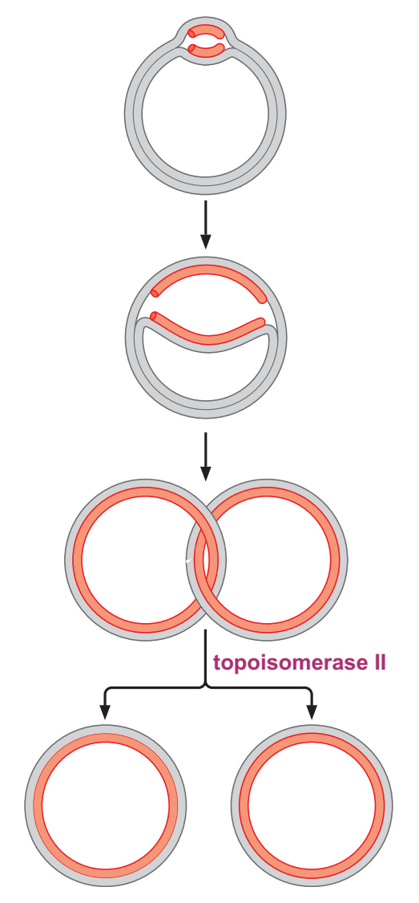{ width="390" height="840" loading="lazy" }](../_img/dna_replication/decatenation.jpg)
/// caption
跟随红色的新链看：两个子代环可以仍然互锁。暂时的双链切割、穿越和重接，使它们最终分离。[^fig-gene-9-35]
///

大肠杆菌的 Tus–Ter 系统能从特定方向阻挡复制叉，把许多会合事件限制在终止区。其他细菌可能缺少这套系统，或使用其他屏障。真核染色体大多数终止位置也由相邻复制叉的相遇决定，并不预先固定在一种通用终止序列上。

合成和拓扑处理结束后，复制体还要卸下来。在研究较充分的真核系统中，终止状态的 CMG 受到 MCM7 泛素化标记，再由 Cdc48/p97 类 ATPase 拆解并从染色质移除。若提前做这件事，复制叉会失去继续推进所需的核心装置。核糖体 DNA、着丝粒或强蛋白障碍附近，还可有局部、具方向性的复制叉屏障，需要分别分析。[^replication-termination]

### 端粒复制与维护 { #telomere-replication }

对于环状模板，总可以沿着环继续找到后面的序列；线性染色体终端却真的会走到头。先固定哺乳动物端粒的一端来看：富 G 链朝末端伸出 3′ 单链突出端，与之互补的富 C 链较短。

这个不对称的末端，使两种复制产物遇到不同问题。以前导方式合成的新 G 链，只能复制到旧 C 链的 5′ 末端；旧 G 链原来多伸出去的那一段，没有相应 C 链模板可供它照着合成。以旧 G 链为模板合成的新 C 链，则需要不断放下引物；常规复制体难以一直把末端区域完整复制下来。再加上形成新突出端所需的 5′ 端切除，末端维护不能只靠常规复制叉完成。[^telomere-replication]

**端粒酶**携带自己的 RNA 模板。它的催化蛋白称为端粒酶逆转录酶（TERT）：RNA 与染色体 G 链的 3′ 端配对，TERT 沿这段 RNA 模板延长 DNA；用完一段模板后，重新对齐，再加一轮重复。染色体末端缺少的那段模板，便由端粒酶内部的 RNA 提供。

[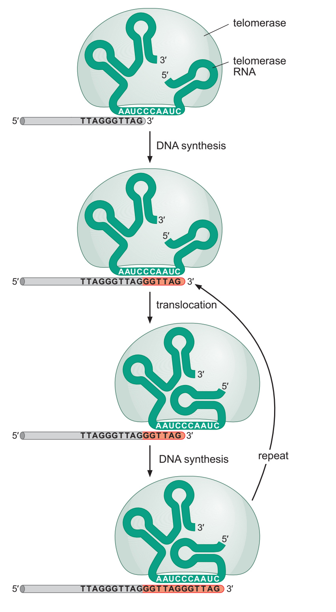{ width="460" height="837" loading="lazy" }](../_img/dna_replication/telomerase-cycle.jpg)
/// caption
绿色曲线是酶携带的 RNA，灰色与红色是 DNA。沿 DNA 的 3′ 端看每次增加的部分；模板重定位使同一段 RNA 能指导重复添加。[^fig-gene-9-38]
///

G 链延长后，互补 C 链仍要合成。CST（CTC1–STN1–TEN1）与 Pol α–primase 协作完成 C 链填补。Takai 等在 2024 年结合重构复制和细胞实验，区分了两类末端复制缺口：端粒酶维护 G 链，CST–Pol α–primase 则解决 C 链的不足。两者分别作用于一条链，共同维持端粒末端。[^telomere-two-problems]

[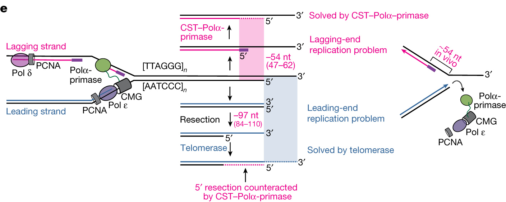{ width="750" height="300" loading="lazy" }](../_img/dna_replication/telomere-end-maintenance.jpg)
/// caption
从左侧复制叉进入中间两条路径：上方为后随端 C 链不足，下方为前导端加工与 G 链延长。粉色标出 CST–Pol α–primase 的作用，蓝色标出端粒酶作用；数值仅对应论文中的体系。[^fig-telomere-end-maintenance]
///

???+ abstract "端粒酶最初是怎样被找到的"

    Greider 与 Blackburn 在四膜虫提取物中检测到一种活性：它能向合适的端粒引物添加特定重复序列。这个实验把“末端需要额外合成”接到了可以在试管中测量的酶反应上。随后对其 RNA 组分与催化蛋白的研究，才逐步建立了今天的端粒酶机制。[^telomerase-discovery]

    [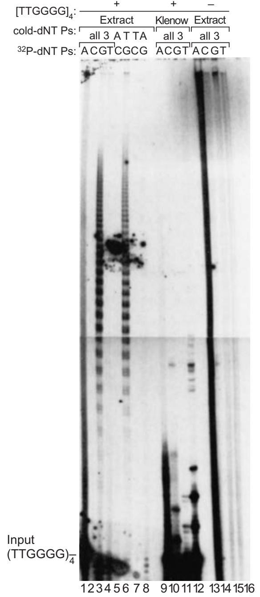{ width="330" height="756" loading="lazy" }](../_img/dna_replication/telomerase-discovery-gel.jpg)
    /// caption
    各泳道上方列出加入的提取物或酶、引物和核苷酸。第 3 泳道的周期性条带组对应端粒重复的添加；9–12 泳道改用 Klenow 片段，13–16 泳道不加端粒引物。[^fig-telomerase-discovery]
    ///

    四膜虫的这条端粒链重复序列为 TTGGGG。第 3 泳道用标记的 dGTP 显示新产物，条带组以约 6 个核苷酸为周期。第 7 泳道只提供标记 dGTP 和未标记 dTTP，也出现重复延长。第 4 泳道的标记 dTTP 当时浓度不足，没有给出同样的信号；后续提高浓度后可以检测到 T 的掺入。

富 G 序列形成的二级结构、端粒结合蛋白和复制压力，也会影响复制叉通过。端粒酶活性、末端切除与填补、端粒修剪，以及某些细胞中的重组型端粒替代延长（ALT），共同影响长度稳态。不同细胞及生理状态下，端粒长度的变化可以相差很大。末端保护与染色质结构见[染色体的末端组织](../../cell/nucleus_chromatin.md#chromosome-architecture)。

!!! info "t 环与 D 环"

    染色体天然末端需要与 DNA 断裂区别开来。在哺乳动物端粒，shelterin 蛋白结合端粒双链与单链部分，调节损伤识别和末端加工。3′ 富 G 突出端还可回折、侵入前面的端粒双链，使整段 DNA 形成较大的 **t 环（telomeric loop）**；侵入处原有的一条链被局部挤开，这个小范围的三链接头称为 **D 环（displacement loop）**。一个名称指较大的回环，一个名称指局部置换结构。[^telomere-loops]

    [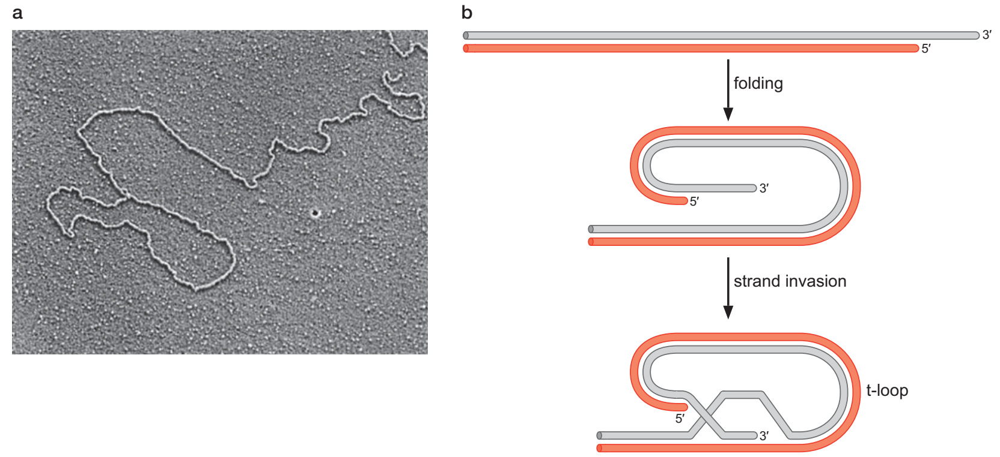{ width="730" height="334" loading="lazy" }](../_img/dna_replication/telomere-t-loop.jpg)
    /// caption
    左图是人端粒的电镜观察；右图依次表示末端回折和链入侵。最下方的大回环是 t 环，灰色 3′ 端插入双链、将原链挤开的局部是 D 环。[^fig-telomere-loop]
    ///

    t 环的形成与展开受到蛋白质调节，复制时也需要协调处理。线粒体非编码区也使用“D 环”这个名称，描述的是短 DNA 与原双链形成的局部置换结构，后面会讲到它的来源。

## 染色质重建 { #chromatin-replication }

真核 DNA 缠绕在组蛋白上，形成核小体。复制叉通过时，前方的核小体需要暂时拆开，后方新合成的 DNA 上则要重新装配核小体。亲代 H3–H4 与 H2A–H2B 可以被复制体附近的伴侣回收，重新放到两条子代 DNA 上；新合成组蛋白则补足另一部分，使复制后的 DNA 恢复相应的核小体密度。

[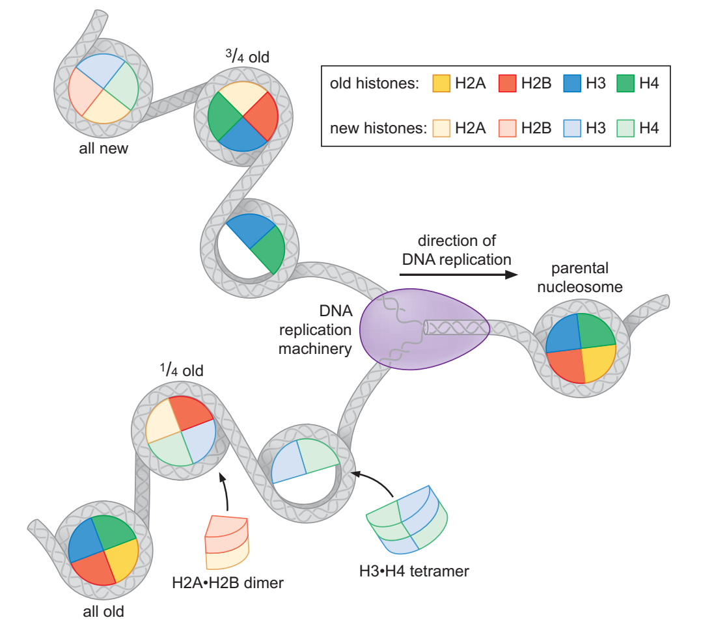{ width="650" height="578" loading="lazy" }](../_img/dna_replication/histone-recycling.jpg)
/// caption
深浅颜色区分亲代与新生组蛋白。旧组蛋白被分配到两条子代 DNA，新组蛋白补足其余位置。图示概括这种分配关系，各局部区域的实际比例可以不同。[^fig-gene-8-43]
///

MCM2、Pol α 相关转移途径及 Pol ε 辅助亚基等，分别参与不同链方向的亲代组蛋白传递；ASF1、CAF-1 等组蛋白伴侣参与递送和装配。总体分配可以近似平衡，局部却会受到转移装置和染色质环境影响。亲代组蛋白的某些修饰为后续读写酶提供线索，新组蛋白上的修饰再逐步成熟。[^parental-histone-recycling]

染色质状态就在组蛋白回收、核小体重新装配和修饰逐渐恢复的过程中延续下来。复制还与姐妹染色单体黏连的建立相协调，为后续染色体分配保留两份复制产物之间的联系。完整背景见[细胞核、染色质与核糖体](../../cell/nucleus_chromatin.md)。

## 其他复制方式 { #alternative-replication-modes }

### θ 型与滚环复制 { #_6 }

前面环状 DNA 上扩大的复制泡，在中间阶段形似 θ，因此称为 θ 型复制。许多细菌、古菌的环状染色体以及质粒，都可以形成这一类复制中间体；具体的起点数和复制方向依系统而异。

另一种做法，是先在环的一条链上产生特定切口。切口留下一个 3′-OH，聚合酶便能沿完整的互补环延伸，把原来那条被切开的链逐渐置换出去。复制可以绕着环继续进行，伸出的链也越来越长，这就是**滚环复制（rolling-circle replication）**。

[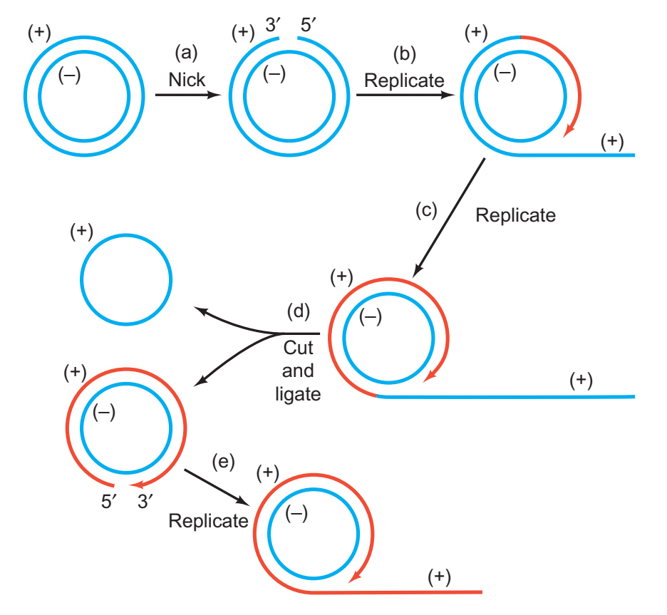{ width="550" height="507" loading="lazy" }](../_img/dna_replication/rolling-circle.jpg)
/// caption
先找切口产生的 3′ 端，再跟随红色新链沿完整蓝色模板延长。被逐出的旧链伸在环外；图最后显示产物被切出、连接成环，再合成互补链的过程。[^fig-weaver-20-12]
///

不同系统会在不同阶段切割、闭合或合成互补链，产物可以是单体，也可以先形成串联多聚体，再加工成单位基因组。多种质粒、单链 DNA 噬菌体和某些真核病毒使用滚环或相关机制。[^rolling-circle]

例如 φX174、M13 的单链 DNA 进入宿主后，需要先形成双链复制型，随后才进行后续的基因组复制。被切开链的原有 3′ 端与新合成部分共价相连，旧的 5′ 端则逐步被置换出去。不同系统的切割、互补链合成与包装安排不尽相同。某些 RNA 病毒或类病毒也采用称为“滚环”的复制方式，其模板、聚合酶和产物是 RNA，属于相似几何组织下的另一类反应。[^alternative-replication-details]

???+ abstract "滚环与局部扩增的证据"

    在小质粒 pIM13 的研究中，研究者检测到具有链特异性、对单链核酸酶 S1 敏感的 DNA 中间体。这支持了不对称复制；仅凭这一结果，尚不能把滚环与其他可能产生单链的置换过程完全区分开来。[^rolling-circle-examples]

    真核细胞也有特殊的滚环扩增实例。Hourcade 等在爪蟾卵母细胞的核糖体 RNA 基因扩增阶段，用电镜观察到滚环样中间体，支持这种方式参与局部基因扩增。这里的材料和生理阶段很具体，常规核染色体复制仍以前面讲的多个起点、双向复制叉为主。[^rolling-circle-examples]

    

    [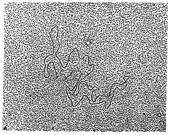{ width="340" height="264" loading="lazy" }](../_img/dna_replication/rdna-circle-em.png)
    /// caption
    独立的环状分子；原研究按分子轮廓长度判断，这个环约含 4 个 rRNA 基因单位。[^fig-rdna-rolling]
    ///

    [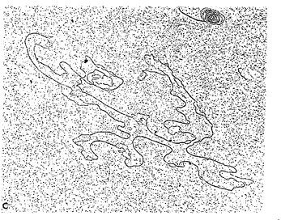{ width="340" height="267" loading="lazy" }](../_img/dna_replication/rdna-rolling-em.png)
    /// caption
    与左图比较，环外多出一条长尾。这类“环＋尾”的复制中间体支持滚环模型；原文估计环约为 3 个基因单位、尾约为 3.4 个。[^fig-rdna-rolling]
    ///

    

    基因拷贝数增加还可以由其他途径产生。例如，哺乳动物培养细胞的 **DHFR 基因扩增**研究发现了染色体断裂及断裂—融合—桥循环等过程。扩增描述的是拷贝数结果，实际怎样增加，还要看分子中间体和染色体结构。[^dhfr-amplification]

### 线粒体复制 { #_7 }

动物线粒体 DNA 常以重链与轻链命名互补的两条链。哺乳动物主要由 Pol γ、Twinkle 解旋酶和线粒体单链结合蛋白 mtSSB 组织复制，RNA 聚合酶还参与提供引物。经典链置换模型中，一条新链先开始合成，逐步暴露另一条模板上的起始区域，再启动互补链合成，因而两条链的合成不同步。

重、轻指两条链因碱基组成不同而表现出的密度差别；常用哺乳动物命名中，H 链相对富含鸟嘌呤，互补的 L 链则相对富含胞嘧啶。以经典哺乳动物链置换模型为例，新的 H 链从 $O_H$ 附近开始，以旧 L 链为模板；原有 H 链被逐步置换。当 $O_L$ 区域暴露并形成适合引发的结构后，再以旧 H 链为模板合成新 L 链。POLRMT 产生的 RNA 参与形成引物，DNA 聚合酶接着延长；RNA 是起始链的一部分，序列模板仍来自 DNA。[^mitochondrial-replication]

[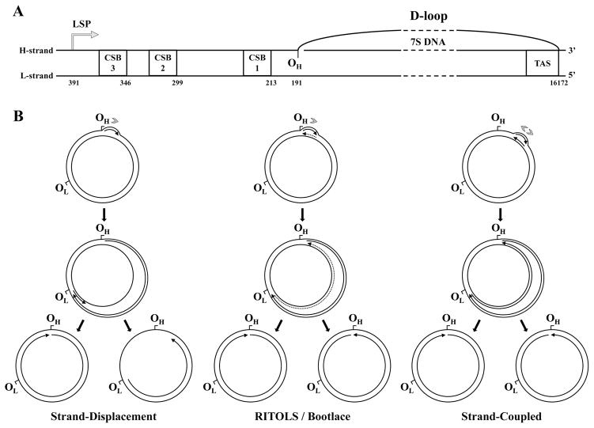{ width="760" height="547" loading="lazy" }](../_img/dna_replication/mitochondrial-models.jpg)
/// caption
A 标出非编码区中的 D 环和相关位点；B 从左到右比较三种模型。实线是 DNA，虚线是 RNA。先看两条新链是否同步形成，再看暴露模板上是否存在长段 RNA。[^fig-mitochondrial-models]
///

一些实验观察到后随链模板上广泛结合 RNA，形成称为 **RITOLS** 的模型；另一些中间体支持更为耦联的双链合成。细胞类型、复制阶段和样品处理，都可能影响检测到的结构。这些模型主要用于讨论动物线粒体。其他物种的线粒体以及叶绿体，在基因组结构、复制酶、引发与终止方式上都有差异，需要各自的实验依据。[^mitochondrial-replication]

图 A 的局部 D 环含短的 **7S DNA**：它与一条原有链配对，并置换出另一条链，形成三链区域。生成这种短产物与持续进行整圈基因组复制，需要分别观察。经典链置换图中两条链先后开始、各自较连续地合成，也不等于细胞中检出的每一种中间体都按同一途径形成。

???+ note "叶绿体与腺病毒：不同的引发办法"

    早期叶绿体研究提出过两个局部置换区起始、随后扩展会合的“双 D 环”模型。后来对植物细胞器 DNA 的观察还发现线性、分支和重组相关中间体，复制路线随物种与发育状态变化。植物细胞器使用自身的核编码聚合酶系统；动物线粒体则主要使用 Pol γ。[^plastid-replication]

    [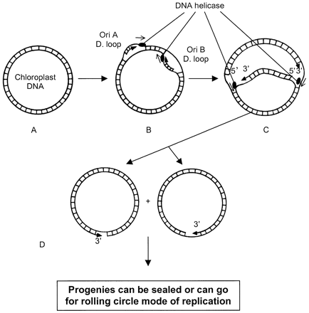{ width="420" height="426" loading="lazy" }](../_img/dna_replication/chloroplast-double-d-loop.png)
    /// caption
    B 中两个小 D 环向彼此扩展，C 中会合为较大的复制泡，随后生成 D 所示的子代分子。这是结合早期豌豆叶绿体研究整理的模型；图中解旋酶的位置和作用属于当时的机制推断。[^fig-chloroplast-double-d-loop]
    ///

    烟草叶绿体曾鉴定出 **oriA、oriB** 两类候选起点。后来删除或强烈改变这些位点的实验中，质体 DNA 仍能复制，部分材料的 DNA 拷贝数与生长受到影响。这提示烟草还存在额外起点或其他复制途径。[^plastid-origins]

    另一些早期实验发现，豌豆、菠菜、莴苣的闭合环状叶绿体 DNA 经碱或 RNase 处理后出现单链断口，支持 DNA 中含有共价连接的核糖核苷酸。这些实验检出的是 DNA 内的核糖组分；它们究竟来自引发、合成时误掺还是其他过程，还需额外证据。[^plastid-ribonucleotides]

    腺病毒的线性双链 DNA 则有另一种引发端：病毒 DNA 聚合酶把最初的核苷酸接到前体末端蛋白的丝氨酸羟基上，随后进行链置换合成。DNA 两端的倒置重复又参与被置换链后续的复制。它展示了蛋白质引发的 DNA 复制，与下一页 HBV 逆转录中的蛋白质引发可作比较，但所用模板与具体残基不同。[^adenovirus-replication]

    [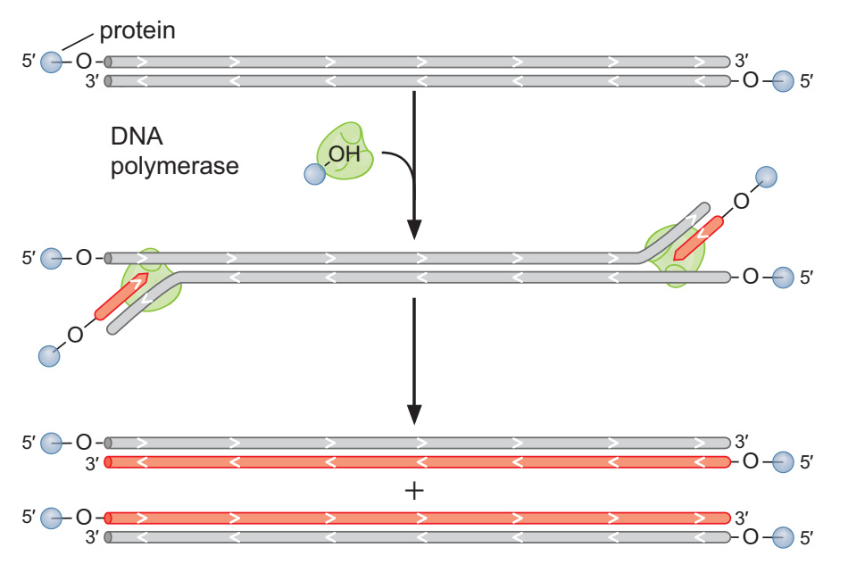{ width="490" height="326" loading="lazy" }](../_img/dna_replication/protein-priming.jpg)
    /// caption
    蓝色小球是引发蛋白，绿色是聚合酶。蛋白质提供起步的羟基，红色新链随后延长，蛋白保留在其 5′ 端。本图概括蛋白质引发；本段腺病毒的具体羟基来自丝氨酸。[^fig-protein-priming]
    ///

## 逆转录 { #reverse-transcription }

端粒酶以 RNA 为模板延长 DNA，是逆转录酶的一种。其他逆转录酶也参与病毒复制、移动遗传元件的增殖，以及部分细菌的抗噬菌体防御。

### 病毒的两次链转移 { #retroviral-reverse-transcription }

逆转录病毒需要通过 tRNA 引发、RNA 降解、两次链转移及两条 DNA 的相互延伸，重建完整末端。具体过程与分阶段图解见[逆转录病毒的两次链转移](reverse_transcription.md#retroviral-reverse-transcription)。

### 其他逆转录系统 { #reverse-transcriptase-diversity }

HBV、逆转座元件、group II intron 和 retron 使用的引物与生成的产物各有特点；系统比较及实验技术入口见[其他逆转录系统](reverse_transcription.md#reverse-transcriptase-diversity)。逆转录的完整讲解见子页，早期讨论仍保留在本页页末。

## 参考资料与延伸阅读 { #references }

本页主要依据 *Molecular Biology of the Gene* 第 7 版第 9 章，染色质装配参照第 8 章；经典复制实验及相应图版补充自 Weaver 第 5 版第 20 章。较新的机制及物种差异在相邻脚注中注明。

- Watson JD, Baker TA, Bell SP, et al. *Molecular Biology of the Gene*. 7th ed. Pearson / Cold Spring Harbor Laboratory Press; 2014。
- Weaver RF. *Molecular Biology*. 5th ed. McGraw-Hill; 2012。
- Meselson M, Stahl FW. [The Replication of DNA in Escherichia coli](https://pmc.ncbi.nlm.nih.gov/articles/PMC528642/). *PNAS*. 1958;44:671–682.
- Okazaki R, et al. [Discontinuous Synthesis of DNA during Replication](https://pmc.ncbi.nlm.nih.gov/articles/PMC305445/). *PNAS*. 1968;60:329–336.
- Burgers PMJ, Kunkel TA. [Eukaryotic DNA Replication Fork](https://www.annualreviews.org/doi/10.1146/annurev-biochem-061516-044709). *Annual Review of Biochemistry*. 2017;86:417–438.
- Graham JE, Marians KJ, Kowalczykowski SC. [Independent and Stochastic Action of DNA Polymerases in the Replisome](https://doi.org/10.1016/j.cell.2017.05.041). *Cell*. 2017;169:1201–1213.
- Takai H, et al. [CST–polymerase α-primase solves a second telomere end-replication problem](https://www.nature.com/articles/s41586-024-07137-1). *Nature*. 2024;627:664–670.

[^fig-weaver-20-3]: Weaver RF. *Molecular Biology*. 5th ed. McGraw-Hill; 2012，图 20.3，印刷页 638。本站截取教材图版区域，去除页眉与原排版正文，保留图中标记；配中文图注，未重绘。
[^meselson-stahl]: $^{15}$N／$^{14}$N 转换、密度梯度结果及不同复制模型的预测见 Meselson 和 Stahl 的[原始论文](https://pmc.ncbi.nlm.nih.gov/articles/PMC528642/)。
[^fig-weaver-20-4]: Weaver RF. *Molecular Biology*. 5th ed. McGraw-Hill; 2012，图 20.4，印刷页 638。本站截取教材图版区域，去除页眉与原排版正文，保留图中标记；配中文图注，未重绘。原始条带及曲线出自 Meselson M、Stahl FW，*PNAS*. 1958;44:671–682（[原文](https://pmc.ncbi.nlm.nih.gov/articles/PMC528642/)）。
[^fig-gene-9-1]: Watson JD, Baker TA, Bell SP, et al. *Molecular Biology of the Gene*. 7th ed. Pearson / Cold Spring Harbor Laboratory Press; 2014，图 9–1，印刷页 258。本站截取教材图版区域，去除页眉与原排版正文，保留图中标记；配中文图注，未重绘。
[^replication-chemistry]: 聚合化学、底物与引物需求、复制叉组织主要依据 Watson 等，*Molecular Biology of the Gene*，第 7 版，第 9 章（2014）；也可参阅 Alberts 等的[复制机制章节](https://www.ncbi.nlm.nih.gov/books/NBK26850/)。
[^fig-gene-9-2]: Watson JD, Baker TA, Bell SP, et al. *Molecular Biology of the Gene*. 7th ed. Pearson / Cold Spring Harbor Laboratory Press; 2014，图 9–2，印刷页 259。本站截取教材图版区域，去除页眉与原排版正文，保留图中标记；配中文图注，未重绘。
[^fig-gene-9-5]: Watson JD, Baker TA, Bell SP, et al. *Molecular Biology of the Gene*. 7th ed. Pearson / Cold Spring Harbor Laboratory Press; 2014，图 9–5，印刷页 264。本站截取教材图版区域，去除页眉与原排版正文，保留图中标记；配中文图注，未重绘。B 为与 DNA 结合的 T7 DNA 聚合酶结构，据 Doublié S 等，*Nature*. 1998;391:251–258 改编。
[^fig-gene-9-11]: Watson JD, Baker TA, Bell SP, et al. *Molecular Biology of the Gene*. 7th ed. Pearson / Cold Spring Harbor Laboratory Press; 2014，图 9–11，印刷页 269。本站截取教材图版区域，去除页眉与原排版正文，保留图中标记；配中文图注，未重绘。
[^replication-fidelity]: 聚合酶底物选择、3′→5′ 校对和复制后错配修复的分层贡献见 Alberts 等的[复制机制章节](https://www.ncbi.nlm.nih.gov/books/NBK26850/)及 Ganai 与 Johansson 的[校对综述](https://pmc.ncbi.nlm.nih.gov/articles/PMC6153641/)。
[^fig-gene-9-19]: Watson JD, Baker TA, Bell SP, et al. *Molecular Biology of the Gene*. 7th ed. Pearson / Cold Spring Harbor Laboratory Press; 2014，图 9–19，印刷页 280。本站截取教材图版区域，去除页眉与原排版正文，保留图中标记；配中文图注，未重绘。结构图据 Krishna TS 等，*Cell*. 1994;79:1233–1243 改编；其中 DNA 为模型。
[^fig-gene-9-12]: Watson JD, Baker TA, Bell SP, et al. *Molecular Biology of the Gene*. 7th ed. Pearson / Cold Spring Harbor Laboratory Press; 2014，图 9–12，印刷页 270。本站截取教材图版区域，去除页眉与原排版正文，保留图中标记；配中文图注，未重绘。
[^fig-gene-9-15]: Watson JD, Baker TA, Bell SP, et al. *Molecular Biology of the Gene*. 7th ed. Pearson / Cold Spring Harbor Laboratory Press; 2014，图 9–15，印刷页 274。本站截取教材图版区域，去除页眉与原排版正文，保留图中标记；配中文图注，未重绘。乳头瘤病毒 E1 六聚体结构实例，原结构研究为 Enemark EJ、Joshua-Tor L，*Nature*. 2006;442:270–275。
[^fig-gene-9-17]: Watson JD, Baker TA, Bell SP, et al. *Molecular Biology of the Gene*. 7th ed. Pearson / Cold Spring Harbor Laboratory Press; 2014，图 9–17，印刷页 276。本站截取教材图版区域，去除页眉与原排版正文，保留图中标记；配中文图注，未重绘。
[^fig-gene-9-23]: Watson JD, Baker TA, Bell SP, et al. *Molecular Biology of the Gene*. 7th ed. Pearson / Cold Spring Harbor Laboratory Press; 2014，图 9–23，印刷页 285。本站截取教材图版区域，去除页眉与原排版正文，保留图中标记；配中文图注，未重绘。教材据 O’Donnell M，*Current Biology*. 2001;11:R935–R946 改编；本站分两幅展示 a–c 与 d–e，保留原始配色。
[^fig-weaver-20-15]: Weaver RF. *Molecular Biology*. 5th ed. McGraw-Hill; 2012，图 20.15，印刷页 647。本站截取教材图版区域，去除页眉与原排版正文，保留图中标记；配中文图注，未重绘。
[^lagging-strand-maturation]: 真核 Pol α–primase、Pol δ、PCNA、FEN1／Dna2 和 ligase I 的多路径冈崎片段成熟见 Balakrishnan 与 Bambara 的[综述](https://pmc.ncbi.nlm.nih.gov/articles/PMC3044941/)；跨域共同功能见 Alberts 等的[复制机制章节](https://www.ncbi.nlm.nih.gov/books/NBK26850/)。
[^fig-weaver-20-6]: Weaver RF. *Molecular Biology*. 5th ed. McGraw-Hill; 2012，图 20.6，印刷页 640。本站截取教材图版区域，去除页眉与原排版正文，保留图中标记；配中文图注，未重绘。原始 T4 实验据 Okazaki R 等，*Cold Spring Harbor Symposia on Quantitative Biology*. 1968;33:129–143 改编。
[^okazaki-fragments]: 不连续合成的经典实验见 Okazaki 等的[原始研究](https://pmc.ncbi.nlm.nih.gov/articles/PMC305445/)；前导链合成与合成后切除所致断片的区分见 [2019 年大肠杆菌研究](https://pmc.ncbi.nlm.nih.gov/articles/PMC6347710/)及 Williams、Kunkel 的[评述](https://pmc.ncbi.nlm.nih.gov/articles/PMC6397534/)。
[^fig-weaver-20-9]: Weaver RF. *Molecular Biology*. 5th ed. McGraw-Hill; 2012，图 20.9，印刷页 642。本站截取教材图版区域，去除页眉与原排版正文，保留图中标记；配中文图注，未重绘。A 的放射自显影原出处为 Cairns J，*Cold Spring Harbor Symposia on Quantitative Biology*. 1963;28:43–46。
[^fig-gene-9-27]: Watson JD, Baker TA, Bell SP, et al. *Molecular Biology of the Gene*. 7th ed. Pearson / Cold Spring Harbor Laboratory Press; 2014，图 9–27，印刷页 296。本站截取教材图版区域，去除页眉与原排版正文，保留图中标记；配中文图注，未重绘。
[^fig-gene-9-33]: Watson JD, Baker TA, Bell SP, et al. *Molecular Biology of the Gene*. 7th ed. Pearson / Cold Spring Harbor Laboratory Press; 2014，图 9–33，印刷页 301。本站截取教材图版区域，去除页眉与原排版正文，保留图中标记；配中文图注，未重绘。
[^eukaryotic-replisome]: CMG、Pol α、Pol δ、Pol ε、PCNA 及冈崎片段成熟在真核复制叉中的主要分工见 Burgers 与 Kunkel 的[综述](https://www.annualreviews.org/doi/10.1146/annurev-biochem-061516-044709)。
[^origin-selection]: 后生动物起点由序列、染色质、核内结构和发育状态共同选择的证据与方法边界见 Prioleau 与 MacAlpine 的[综述](https://pmc.ncbi.nlm.nih.gov/articles/PMC5002974/)。
[^archaeal-replication]: 古菌起点数量、Orc1/Cdc6–MCM、PolD／PolB 分工及无起点复制的谱系差异见 Greci 与 Bell 的[综述](https://pmc.ncbi.nlm.nih.gov/articles/PMC7712474/)。
[^fig-gene-9-35]: Watson JD, Baker TA, Bell SP, et al. *Molecular Biology of the Gene*. 7th ed. Pearson / Cold Spring Harbor Laboratory Press; 2014，图 9–35，印刷页 303。本站截取教材图版区域，去除页眉与原排版正文，保留图中标记；配中文图注，未重绘。
[^replication-termination]: 复制叉会合、最后片段合成、拓扑解连和终止后 CMG 卸载的机制与未解决边界见 Dewar 与 Walter 的[综述](https://pmc.ncbi.nlm.nih.gov/articles/PMC6386472/)；MCM7 泛素化与 p97 依赖卸载的跨物种证据见 Low 等的[研究](https://pmc.ncbi.nlm.nih.gov/articles/PMC8695382/)。
[^telomere-replication]: 端粒复制叉障碍、前导／后随末端加工、端粒酶延伸与 CST 介导 C 链填补见 Bonnell 等的[综述](https://pmc.ncbi.nlm.nih.gov/articles/PMC8047117/)。
[^fig-gene-9-38]: Watson JD, Baker TA, Bell SP, et al. *Molecular Biology of the Gene*. 7th ed. Pearson / Cold Spring Harbor Laboratory Press; 2014，图 9–38，印刷页 306。本站截取教材图版区域，去除页眉与原排版正文，保留图中标记；配中文图注，未重绘。
[^telomere-two-problems]: Takai H, Aria V, Borges P, Yeeles JTP, de Lange T. [CST–polymerase α-primase solves a second telomere end-replication problem](https://www.nature.com/articles/s41586-024-07137-1). *Nature*. 2024;627:664–670。体外重构与细胞链长分析支持端粒酶维护 G 链、CST–Pol α–primase 维护 C 链的分工；文中测得的缩短量对应其体系与条件。
[^fig-telomere-end-maintenance]: Takai 等，*Nature*. 2024;627:664–670，图 4e。截取[出版方图 4](https://www.nature.com/articles/s41586-024-07137-1/figures/4)的模型面板，保留原标记；其中数值来自论文所研究体系，不表示所有端粒每轮固定缩短相同长度。
[^telomerase-discovery]: 四膜虫提取物对端粒引物的序列特异延伸活性见 Greider 与 Blackburn 的[原始论文](https://pubmed.ncbi.nlm.nih.gov/3907856/)。
[^fig-gene-8-43]: Watson JD, Baker TA, Bell SP, et al. *Molecular Biology of the Gene*. 7th ed. Pearson / Cold Spring Harbor Laboratory Press; 2014，图 8–43，印刷页 251。本站截取教材图版区域，去除页眉与原排版正文，保留图中标记；配中文图注，未重绘。
[^parental-histone-recycling]: 亲代组蛋白近似均衡分配、MCM2 与链偏向以及新组蛋白填补的机制见 Tian 等的[研究](https://www.nature.com/articles/s41467-023-39185-y)；染色质装配背景见[细胞核、染色质与核糖体](../../cell/nucleus_chromatin.md#nucleosome-chromatin)。
[^fig-weaver-20-12]: Weaver RF. *Molecular Biology*. 5th ed. McGraw-Hill; 2012，图 20.12，印刷页 645。本站截取教材图版区域，去除页眉与原排版正文，保留图中标记；配中文图注，未重绘。
[^rolling-circle]: 细菌质粒滚环复制的切口引发、链置换和终止机制见 Khan 的[综述](https://pmc.ncbi.nlm.nih.gov/articles/PMC232620/)。
[^fig-mitochondrial-models]: Ciesielski GL, Oliveira MT, Kaguni LS. *Animal Mitochondrial DNA Replication*. 2016，[图 8](https://pmc.ncbi.nlm.nih.gov/articles/PMC4964852/#F8)。保留完整原图并转换为 JPEG；B 由作者据 McKinney EA、Oliveira MT，*Genetics and Molecular Biology*. 2013;36:308–315 改编。
[^mitochondrial-replication]: 链置换、RITOLS 和链耦联模型及物种差异见 Ciesielski GL、Oliveira MT、Kaguni LS 的[综述](https://pmc.ncbi.nlm.nih.gov/articles/PMC4964852/)（2016）；哺乳动物复制装置与链置换过程另见 Falkenberg 的[机制概述](https://pmc.ncbi.nlm.nih.gov/articles/PMC6056714/)（2018）。

[^fig-single-molecule-replication]: Graham JE, Marians KJ, Kowalczykowski SC. [Independent and Stochastic Action of DNA Polymerases in the Replisome](https://doi.org/10.1016/j.cell.2017.05.041). *Cell*. 2017;169:1201–1213，图 1C、1D–G，印刷页 1203（[作者公开 PDF](https://kowalczykowskilab.ucdavis.edu/PDF_files/Graham%20et%20al.%20%282017%29%20Cell%20169%2C%201201-1213.pdf)第 4 页）。本站分别截取装配示意及完整的观察与测量面板，保留图中配色、标记、坐标轴与比例尺，配中文说明，未重绘。数值来自文中的体外大肠杆菌蛋白重构体系。

[^polymerase-catalysis]: Watson 等，*Molecular Biology of the Gene*（MBotG），第 7 版第 9 章，聚合反应、二价金属离子、焦磷酸释放与校对；Weaver 第 5 版第 20 章补充聚合与核酸酶活性的实验分离。
[^polymerase-repertoire]: MBotG 第 7 版第 9 章，表 9–2 及相邻正文；Weaver 第 5 版第 20、21 章，Pol I 的三种活性、Klenow 片段及细菌／真核复制酶。表中列主要分工，不能据此作跨酶、跨条件的速度或忠实性排名。
[^polymerase-families]: 聚合酶的序列／结构家族与细胞内功能是不同分类维度。MBotG 第 7 版第 9 章及 Weaver 第 5 版第 20、21 章所述酶按家族对照；Pfu 的原始鉴定见 [Uemori 等，1993](https://pubmed.ncbi.nlm.nih.gov/8441634/)。古菌的复制聚合酶还包括 D 家族，不能笼统全部列为 B 家族。
[^pcr-polymerases]: Pfu 的校对活性与耐热性参见 [Lundberg 等的原始研究](https://pubmed.ncbi.nlm.nih.gov/1761218/)；Taq、ddNTP 与 aphidicolin 的作用结合 Weaver 第 5 版复制章节和本站扩增技术专节。PCR 的产物准确性还受模板、条件与后处理影响。
[^clamp-architecture]: MBotG 第 7 版第 9 章，图 9–19、9–20 及滑动钳与装载器正文；大肠杆菌 β 钳为二聚体，每亚基三个重复结构域；真核 PCNA 为三聚体，每亚基两个结构域。
[^fig-gene-9-22]: Watson 等，*Molecular Biology of the Gene*，第 7 版，图 9–22，印刷页 284。截取 Pol III 全酶组织模型，保留核心、τ、柔性连接区与钳装载器标记。教材据 O'Donnell M, et al. *Curr Biol*. 2001;11:R935–R946，图 6 改编；未重绘。此图重点为亚复合物之间的连接，不是比例精确的原子结构。
[^pol-iii-assembly]: MBotG 第 7 版第 9 章，图 9–22、9–23；Weaver 第 5 版第 20 章的大肠杆菌 Pol III 核心与全酶。α、ε、θ 的核心分工与 τ／γ 装载复合体应分别描述；不同实验复合体的核心数及亚基组成不必完全相同。
[^replication-scales]: 代表性数量级综合 MBotG 第 7 版第 9 章及 MBoC 第 7 版第 5 章；真核冈崎片段与核小体尺度的直接测量可参见 [Smith 与 Whitehouse，2012](https://www.nature.com/articles/nature10895)。正文给常见生长条件下的数量级，并非每种生物的固定常数。
[^helicase-ssb-details]: MBotG 第 7 版第 9 章，DnaB 沿后随链模板 5′→3′ 运动，真核 CMG 沿前导链模板 3′→5′ 运动；单链结合蛋白 SSB／RPA 的覆盖、保护和蛋白交接作用需结合具体体系与结合模式理解。
[^topoisomerase-classes]: MBotG 第 7 版第 6、9 章及 Weaver 第 5 版第 20 章的拓扑酶反应。喜树碱稳定 Topo I–DNA 切割复合物见 [Hsiang 等，1985](https://pubmed.ncbi.nlm.nih.gov/2997227/)。表中连接数变化针对单次穿越的常见反应；整体蛋白的能量需求还取决于耦联结构域和所讨论的反应方向。
[^dna-ligases]: Weaver 第 5 版第 20 章与 MBotG 第 7 版第 9 章：连接酶先腺苷酸化，再活化 DNA 的 5′ 磷酸，最后由相邻 3′-OH 完成封口；细菌 NAD⁺ 型与 ATP 型连接酶、真核连接酶 I／III／IV 按具体用途区分。NAD⁺ 型反应释放 NMN，ATP 型第一步释放焦磷酸。
[^uracil-fragments]: Tye BK, et al. [Transient accumulation of Okazaki fragments as a result of uracil incorporation into nascent DNA](https://pmc.ncbi.nlm.nih.gov/articles/PMC411220/). *PNAS*. 1977。该工作检验 dUTP 掺入和尿嘧啶切除怎样增加短片段；与前面关于 DNA 中核糖核苷酸及 RNase H2 的现代实验，底物和修复路径不同。
[^oric-control]: MBotG 第 7 版第 9 章，细菌复制起始、DnaA／DnaB／DnaC／DnaG，以及 Dam、SeqA 与重新起始的调控。DnaA box 与富含 A–T 的解链元件承担不同作用；半甲基化后的 SeqA 占据不能写成 DnaA 完全无法识别任何半甲基化 DNA。
[^bidirectional-label]: Prescott DM, Kuempel PL. [Bidirectional replication of the chromosome in Escherichia coli](https://pmc.ncbi.nlm.nih.gov/articles/PMC389658/). *PNAS*. 1972;69:2842–2845。氨基酸饥饿后恢复复制，以先中等、后高比放射性的氚标记前体作放射自显影；较密标记位于轨迹两端，支持双向复制。
[^fig-weaver-20-10]: Weaver RF. *Molecular Biology*. 第 5 版，图 20.10，印刷页 643。截取 A 放射自显影和 B 脉冲标记模型，保留箭头与标记顺序。A 的实验材料为枯草芽孢杆菌，原出处 Gyurasits EB, Wake RG. *J Mol Biol*. 1973;73:55–63（教材注明图取自第 58 页）。本图与正文 Prescott–Kuempel 的大肠杆菌实验采用相近推理，但不是同一实验照片。
[^cole1-control]: RNA II 经 RNase H 处理形成引物及 RNA I 反义调控见 [Standley 等研究的图 1 与原始文献索引](https://pmc.ncbi.nlm.nih.gov/articles/PMC6309527/)；其图区分 pMB1 与缺少 Rom 且 RNA II 序列改变的 pUC19 起点。正文描述常规 ColE1 型起始路线。
[^fig-cole1-control]: Standley M, et al. [Genetic control of ColE1 plasmid stability that is independent of plasmid copy number regulation](https://doi.org/10.1007/s00294-018-0858-0). *Curr Genet*. 2019;65:179–192（2018 在线发表），图 1。采用出版方完整图版，保留 A、B 条件、RNA 与 DNA 标记，转为 JPEG，未改绘。
[^telomere-loops]: Griffith JD, et al. [Mammalian telomeres end in a large duplex loop](https://pubmed.ncbi.nlm.nih.gov/10338214/). *Cell*. 1999;97:503–514。人和小鼠来源端粒 DNA 的电镜与 TRF2 体外实验支持大 t 环及末端侵入模型；结合 MBoC 第 7 版端粒保护与 shelterin 的说明。
[^alternative-replication-details]: Weaver 第 5 版第 20 章与 MBotG 第 7 版第 9 章的滚环复制：φX174、M13 可经双链复制型中间体产生单链产物。DNA 滚环的 DNA 引发与类病毒的 RNA 滚环反应需按模板和聚合酶区分。
[^plastid-replication]: 早期双 D 环模型来自叶绿体 DNA 电镜；后续物理结构证据见 Oldenburg DJ, Bendich AJ. [Most chloroplast DNA of maize seedlings in linear molecules with defined ends and branched forms](https://pubmed.ncbi.nlm.nih.gov/14698291/). *J Mol Biol*. 2004;335:953–970。该研究对象为玉米幼苗，不能将其分子形态比例推广到所有植物与发育阶段。
[^adenovirus-replication]: MBotG 第 7 版第 9 章末端复制的蛋白质引发，与 Weaver 第 5 版病毒复制相关内容。腺病毒末端蛋白前体提供 Ser 羟基，病毒 DNA 聚合酶催化起步；倒置末端重复及链置换支持另一链形成复制模板，与 HBV 在 RNA 上的 Tyr 引发不同。

[^pol-gamma-ber]: [Identification of 5′-deoxyribose phosphate lyase activity in human DNA polymerase gamma and its role in mitochondrial base excision repair in vitro](https://pubmed.ncbi.nlm.nih.gov/9770471/). *PNAS*. 1998；本页保留体外重构与短片段修复的适用条件。
[^gyrase-relaxation]: [DNA gyrase 的正、负超螺旋松弛研究](https://pmc.ncbi.nlm.nih.gov/articles/PMC26147/)，比较不同拓扑底物与 ATP 条件；无 ATP 松弛负超螺旋不能等同于 ATP 驱动的负超螺旋引入。
[^archaeal-primase]: [Biochemical characterization of the p41–p46 complex of DNA primase from Pyrococcus furiosus](https://pubmed.ncbi.nlm.nih.gov/11584001/). *J Biol Chem*. 2001；小亚基和异二聚体的体外产物不同。

[^ara-ctp]: [The dominant role of proofreading exonuclease activity of replicative polymerase ε in cellular tolerance to cytarabine (Ara-C)](https://pmc.ncbi.nlm.nih.gov/articles/PMC5464882/)，人 Pol ε 的酶学测量及细胞遗传实验；糖环与延伸构象另见 [Sugar ring alignment and dynamics underline cytarabine and gemcitabine inhibition on Pol η catalyzed DNA synthesis](https://pmc.ncbi.nlm.nih.gov/articles/PMC11176770/)。底物接受、延伸和校对是分别测量的步骤，未恢复无条件的聚合酶敏感性排名。

[^rolling-circle-examples]: pIM13 单链中间体见 Projan SJ, et al. [pIM13 与 pE5 的复制性质研究](https://pubmed.ncbi.nlm.nih.gov/2822666/)，1987；此研究以单链中间体支持不对称复制，保留对具体方式的讨论。卵母细胞实验见 Hourcade D, Dressler D, Wolfson J. [The amplification of ribosomal RNA genes involves a rolling circle intermediate](https://pmc.ncbi.nlm.nih.gov/articles/PMC427140/). *PNAS*. 1973。
[^dhfr-amplification]: Singer MJ, et al. [DHFR 基因扩增中的早期染色体事件研究](https://pubmed.ncbi.nlm.nih.gov/10859355/)，2000。这里用于说明培养细胞基因扩增的结构途径，不把 DHFR 扩增统一归为滚环复制。
[^plastid-origins]: Scharff LB, Koop HU. [Targeted inactivation of the tobacco plastome origins of replication A and B](https://pubmed.ncbi.nlm.nih.gov/17470061/). *Plant J*. 2007;50:782–794。实验包括删除、强突变及不同起点拷贝的组合，结果支持额外复制机制或起点。
[^plastid-ribonucleotides]: Kolodner R, Warner RC, Tewari KK. [叶绿体 DNA 中共价连接核糖核苷酸的研究](https://pubmed.ncbi.nlm.nih.gov/1158895/)，1975；材料为豌豆、菠菜、莴苣。这里保留处理后单链断口的观察及其支持范围，不直接指定核糖核苷酸的来源。

[^accessory-helicases]: Guy CP, et al. [Rep Provides a Second Motor at the Replisome to Promote Duplication of Protein-Bound DNA](https://pmc.ncbi.nlm.nih.gov/articles/PMC2807033/). *Molecular Cell*. 2009。
[^dnag-sequence]: DnaG 模板识别的具体系统比较见 [Structural Insight into the Specific DNA Template Binding to DnaG primase in Bacteria](https://pmc.ncbi.nlm.nih.gov/articles/PMC5429622/)，2017，及其引用的大肠杆菌原始酶学研究。

[^fig-telomerase-discovery]: Weaver，*Molecular Biology*，第 5 版，图 21.24，印刷页 696；原图来自 Greider CW、Blackburn EH，1985，*Cell* 43:405–413，图 1A、原论文页 406。裁出完整 16 泳道图版，保留引物、核苷酸与酶的条件标记。
[^fig-telomere-loop]: MBotG 第 7 版，图 9–42，印刷页 310；左侧原始电镜来自 Griffith JD, et al. [Mammalian telomeres end in a large duplex loop](https://doi.org/10.1016/S0092-8674(00)80713-9). *Cell*. 1999;97:503–514，图 3f；右侧为教材机制模型。裁出整组图版。
[^fig-rdna-rolling]: Hourcade D, Dressler D, Wolfson J. [The amplification of ribosomal RNA genes involves a rolling circle intermediate](https://pmc.ncbi.nlm.nih.gov/articles/PMC427140/). *PNAS*. 1973;70:2926–2930，图 2A、2B，印刷页 2927。分别裁出原始电镜面板；两图不用于直接比较绝对尺寸，长度估计引自原图注。
[^fig-protein-priming]: MBotG 第 7 版，图 9–37，印刷页 304；裁出蛋白质引发的通用图解，未将教材示意当作腺病毒实验照片。
[^fen1-activities]: [Processing of branched DNA intermediates by a complex of human FEN-1 and PCNA](https://pubmed.ncbi.nlm.nih.gov/8668533/)，1996；比较分支底物内切与切口／缺口底物外切，并检验 PCNA 对两类活性的促进。
[^fig-chloroplast-double-d-loop]: Tuteja N. [Plant DNA helicases: the long unwinding road](https://doi.org/10.1093/jxb/erg246). *J Exp Bot*. 2003;54:2201–2214，图 3；采用出版方提供的完整图，未裁切或改绘。原图概括双 D 环及后续滚环的可能途径，不能据此把所有植物叶绿体复制归为这一模式。
