# 逆转录 { #_1 }

在[DNA 复制](index.md)中，我们一直让 DNA 指导新 DNA 的合成。把模板换成 RNA，会发生什么？只要酶能识别 RNA–DNA 的引物—模板接头，DNA 仍然可以从配对好的 3′-OH 继续延长，原料也仍是 dNTP。

**逆转录（reverse transcription）**就是以 RNA 为模板合成 DNA。催化它的逆转录酶（reverse transcriptase，RT）广泛出现在病毒、移动遗传元件以及某些细胞系统中。许多 RT 还能够以 DNA 为模板合成 DNA；在一个完整的逆转录过程中，两种模板甚至会轮流上场。

这里的“逆”是相对于通常从 DNA 转录 RNA 的方向而言，新生 DNA 的增长仍然是 5′→3′。中心法则所限制的是从蛋白质序列回传到核酸或蛋白质的逐位序列信息传递；RNA→DNA 属于核酸之间的信息传递。

## 逆转录酶的发现 { #reverse-transcription }

1970 年，Temin 与 Mizutani、Baltimore 分别在 RNA 肿瘤病毒颗粒中检测到 RNA 依赖的 DNA 聚合活性。这个发现为“RNA 病毒可以经 DNA 中间体延续”的认识提供了酶学证据。Baltimore 在实验中用 RNase 处理病毒颗粒，观察后续 DNA 合成是否受到影响。[^reverse-transcriptase-discovery]

[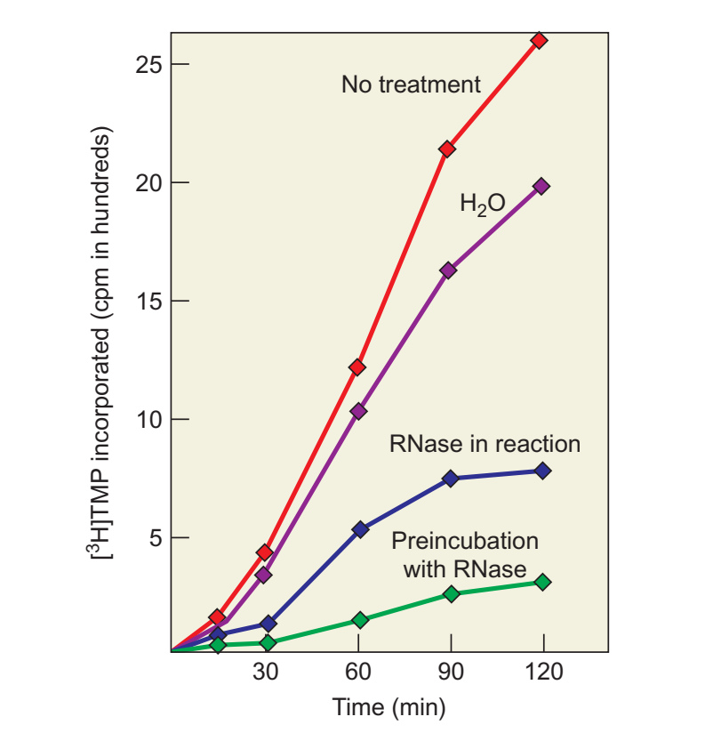{ width="500" height="519" }](../_img/dna_replication/reverse-transcriptase-discovery.jpg)
/// caption
横轴为反应时间，纵轴为进入酸不溶性产物的标记 dTMP。比较未额外处理、水预孵育、反应中加 RNase 和先用 RNase 预处理四条曲线；预处理 RNA 对后续合成的影响尤其明显。[^fig-weaver-23-20]
///

实验给病毒颗粒提供四种 dNTP，其中 dTTP 带有放射性标记，再检测进入酸不溶性产物的放射性。未作 RNase 处理时，信号随时间上升；在反应中加入 RNase，合成受到抑制；若先用 RNase 处理，再开始反应，抑制更明显。水预孵育则帮助分辨预处理操作本身的影响。

这表明，合成过程依赖可被 RNase 破坏的 RNA 组分。再结合对产物为 DNA 的鉴定，研究者确认了这里发生的是依赖 RNA 的 DNA 合成。

???+ note "RNase H 的底物"

    上面的发现实验用 RNase 处理来检验 RNA 的作用。逆转录病毒 RT 所带的 **RNase H** 活性，则识别 RNA–DNA 杂交体并切割其中的 RNA。杂交体中的 DNA 链保留下来，继续参与后续合成。

    RT 的 DNA 聚合活性与 RNase H 活性相互配合，使 RNA 模板在被复制后可以逐步移除。不同来源的逆转录酶，其亚基、辅助结构域和酶活性组合并不一致；后面用逆转录病毒作代表来讲这个过程。

## HIV 的逆转录过程 { #retroviral-reverse-transcription }

劳氏肉瘤病毒（RSV）、小鼠乳腺肿瘤病毒（MMTV）和 HIV 都是逆转录病毒。下面以 HIV-1 为例，先看看反应发生时，酶和模板在什么地方。

### 颗粒中的酶与 RNA { #hiv-particle-and-rt }

HIV-1 的包膜来自宿主细胞膜，表面的 Env 糖蛋白由 gp120 和 gp41 组成：gp120 位于膜外，参与识别细胞受体；gp41 跨膜，并参与膜融合。包膜内侧衬着基质蛋白 MA，内部的成熟衣壳 CA 则组成特征性的锥形结构。核衣壳蛋白 NC 与 RNA 结合，RT、整合酶等病毒酶也随颗粒一起进入细胞。[^hiv-particle]

颗粒装有**两份正链 RNA**，两者在靠近 5′ 端的区域通过 RNA 相互作用形成二聚体；这里的“双份”并不是双链 RNA。每份 RNA 都带有 5′ 帽和 3′ poly(A) 尾，除编码区外，还有引发、剪接和包装所需的序列。进入新细胞后，基因组 RNA 在衣壳及相关核蛋白复合体中充当逆转录模板；形成原病毒以后，宿主转录产生的新 RNA 用于后续基因表达，也为新颗粒提供基因组。[^hiv-particle]

HIV-1 RT 是 **p66/p51 异二聚体**。p66 带有聚合酶和 RNase H 两处催化中心；p51 由同一前体经蛋白酶加工而来，缺少完整的 RNase H 结构域，主要维持复合体结构。两者虽然共享相当一部分氨基酸序列，折叠方式和实际承担的工作却不同。

[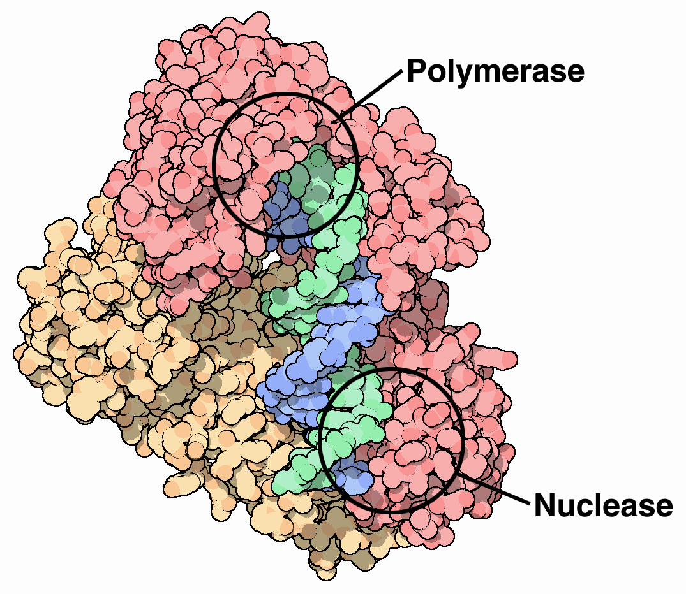{ width="520" height="451" loading="lazy" }](../_img/dna_replication/hiv-rt-structure.jpg)
/// caption
红色是 p66，黄色是 p51，蓝色和绿色为 DNA 的两条链。沿双链可以看到，聚合酶位点和 RNase H 位点相隔一段距离。此图依据 DNA 复合体结构绘制；RNase H 实际切割的底物是 RNA–DNA 杂交体中的 RNA。[^fig-hiv-rt]
///

### RNA 两端的标记 { #rna-end-elements }

RNA 需要经过逆转录，变成可供整合的线性双链 DNA。反应图中的 R、U5、PBS、PPT 和 U3，分别标出了两端的序列、引物结合处和后续引发的位置。

先把 RNA 从 5′ 到 3′ 的次序写出来。中间的大段编码区暂时省略，只留下理解末端复制所需的位置：

```text title="RNA 基因组的两端"
RNA：5′—R—U5—PBS—……—PPT—U3—R—3′
```

**R** 是两端共有的重复序列；**U5** 原来只在 RNA 的 5′ 端附近，**U3** 原来只在 3′ 端附近。**PBS（primer-binding site）**是与 tRNA 引物配对的位置；**PPT（polypurine tract，多聚嘌呤区）**则与后面正链 DNA 的引发有关。

最终双链 DNA 两端各有一个完整的 **LTR（long terminal repeat，长末端重复）**，每个 LTR 都由 U3—R—U5 组成。只写与 RNA 同向的那条 DNA，就能看出变化：

```text title="完成逆转录后的 DNA"
DNA：5′—[U3—R—U5]—PBS—……—PPT—[U3—R—U5]—3′
           左侧 LTR                     右侧 LTR
```

对比两行序列，RNA 中原本只出现一次的 U3、U5，到最终 DNA 中都各有两份。合成途中发生的两次链转移，使这些原先分居两端的序列得以在两个末端补齐。[^retroviral-reverse-transcription]

### 引发与第一次链转移 { #trna }

HIV-1 常用宿主 tRNA$^{\mathrm{Lys3}}$ 的 3′ 端作引物，其他逆转录病毒可使用不同种类的 tRNA。tRNA 与 PBS 配对后，RT 从这个 3′-OH 开始合成与基因组 RNA 互补的**负链 DNA**。

下图红色表示 RNA，蓝色表示 DNA。首先看最上方：引物靠近 RNA 的 5′ 端，而合成沿模板朝它的 5′ 端推进。RT 因而先复制 U5 和 R。到达 RNA 的 5′ 端后，这一段合成暂时停止，留下负链强终止 DNA（minus-strand strong-stop DNA）。

[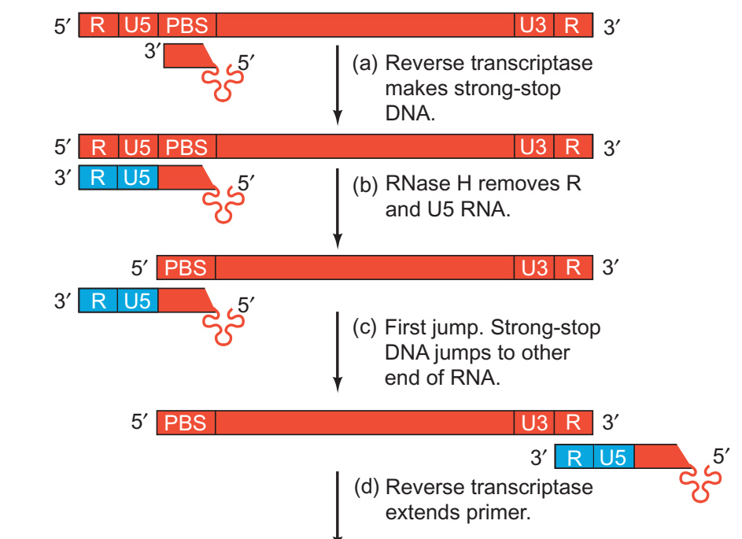{ width="630" height="458" loading="lazy" }](../_img/dna_replication/reverse-transcription-a-c.jpg)
/// caption
红色为 RNA，蓝色为 DNA，三叶形表示 tRNA。先沿新生 DNA 的 3′ 端复制 U5、R；相应 RNA 被移除后，负链末端借 R 区互补性转到 RNA 的另一端。底部箭头承接后续延长。[^fig-weaver-23-23]
///

RNase H 清除相应的 RNA 后，新合成 DNA 的 R 互补序列暴露出来。RNA 的另一端也有 R，它便能在那里重新配对；新生 DNA 的 3′ 端得到了可继续读取的模板。这就是**第一次链转移**，也称负链转移。

转移可以发生到同一条 RNA 的另一端，也可以利用颗粒携带的另一份 RNA。转移后，已经合成的 U5 和 R 互补序列保留在新生 DNA 上，它的 3′ 端与另一端的 R 配对，接着就能复制相邻的 U3。[^retroviral-reverse-transcription]

!!! tip "R 区与第一次链转移"

    RNA 两端的 R 区具有相同序列。因此，负链 DNA 在 RNA 的 5′ 端复制出的 R 互补序列，也能与 RNA 的 3′ 端 R 区配对，让已经合成的 DNA 接上另一端的模板，继续复制相邻的 U3。

    如果只破坏这处互补性，而 tRNA 引发和初始短 DNA 合成都仍正常，最初的短 DNA 仍可能形成，随后却难以按图示路径完成第一次链转移。这里区分的是引发与链转移对序列的不同依赖；真实病毒中的 R 区突变还可能影响其他功能。

### 负链延伸与正链引发 { #rna }

第一次转移后，负链 DNA 可以从 RNA 的 3′ 端附近继续复制 U3 及更前方的序列，逐渐向 RNA 的 5′ 端延伸。沿途形成 RNA–DNA 杂交，RNA 模板又被 RNase H 逐步处理。

大部分 RNA 会被移除，但 PPT 区域可以留下适合引发的 RNA 片段，提供新的 3′-OH。RT 从它开始，以已经形成的负链 DNA 为模板，合成**正链 DNA**。到这里，同一种酶已经在用 DNA 指导 DNA 合成了。

[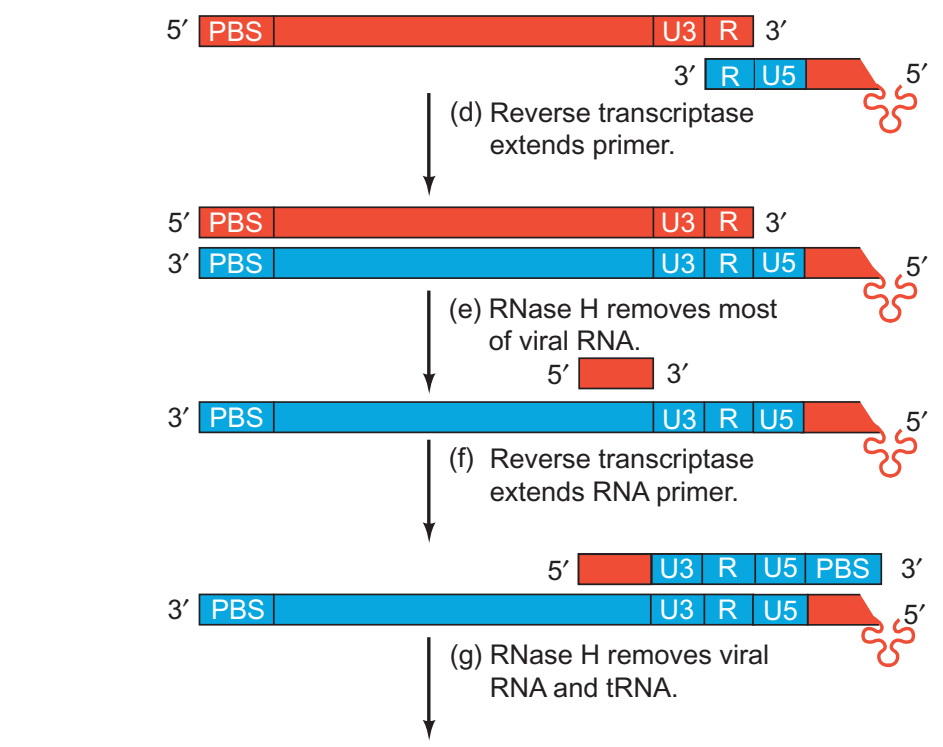{ width="680" height="539" loading="lazy" }](../_img/dna_replication/reverse-transcription-d-f.jpg)
/// caption
图从负链已转到 RNA 另一端的状态继续。大部分红色 RNA 被移除后，留下的短红段为正链提供引物；上方新蓝链逐渐复制出 U3、R、U5 及 PBS 对应序列。[^fig-weaver-23-23]
///

正链合成复制负链上的 U3、R、U5，随后复制仍与负链相连的 tRNA 引物中的相应一段，得到 PBS 对应序列。这段产物称为**正链强终止 DNA**。与此同时，负链继续复制基因组 RNA 另一端的 PBS，最终两条 DNA 的末端便有了可以相互配对的 PBS 序列。

!!! tip "先跟住一条链的 3′ 端"

    在这几幅图中，RNA 红色、DNA 蓝色，但正负两条 DNA 都是蓝色。要判断哪条正在长，先看它从什么引物起步，再找正在延伸的 3′ 端；单凭颜色无法区分正链和负链。图为基本过程示意，HIV-1 还包含中央 PPT 等更细的引发安排。

### 第二次链转移 { #dna }

tRNA 和正链 RNA 引物被处理后，互补的 PBS 区域可以彼此退火，使正链的 3′ 端转到负链另一端对应的位置，形成**第二次链转移**，也称正链转移。两条 DNA 随后互相充当模板，从各自的 3′ 端继续延伸，补齐缺少的部分。

[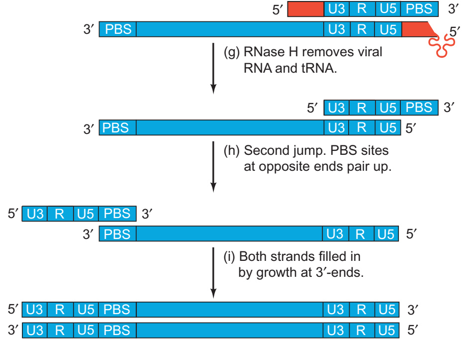{ width="680" height="504" loading="lazy" }](../_img/dna_replication/reverse-transcription-g-i.jpg)
/// caption
先比较转移前相反两端的 PBS，再看它们配对后留下的两个可延长 3′ 端。最后两端都出现 U3—R—U5，形成完整 LTR。[^fig-weaver-23-23]
///

现在再回头数 U3 和 U5，就能解释它们为什么各出现在两个末端。第一次转移让负链把 RNA 两端的序列接入同一份 DNA，正链合成和第二次转移再使这些序列在最终双链两端补齐。因此，最终 DNA 除了保存基因组内部的序列，还在两端各形成了一套完整的 LTR。

### 从病毒 DNA 到新颗粒 { #hiv-life-cycle-links }

上述反应图把链的变化分开画了出来，细胞内的逆转录、衣壳重塑和入核则有时间上的重叠。在细胞系及原代巨噬细胞中的研究发现，病毒复合体可以先入核，DNA 合成随后才完成。[^hiv-nuclear-rt]

整合酶（integrase，IN）把病毒 DNA 两端组织成整合复合体，处理末端并催化它们与宿主 DNA 的链转移；宿主酶随后完成缺口修补。两个末端在复合体中相互靠近，病毒 DNA 本身仍是线性底物。整合位点分散在基因组中，并具有染色质及转录活性相关的偏好。末端加工与连接的化学过程见[逆转录病毒整合](../dna_recombination.md#retroviral-integration)。

整合后的 **原病毒（provirus）**由宿主 RNA 聚合酶 II 转录。部分 RNA 经剪接后表达病毒蛋白，完整长度的 RNA 则可用于翻译或成为新颗粒的基因组。病毒组分在细胞膜附近装配并出芽，病毒蛋白酶切开 Gag、Gag–Pol 等多聚蛋白前体，使成熟结构蛋白与酶得以形成，衣壳也随之重新组织。抑制蛋白酶时，颗粒仍可能释放，却难以正常成熟。[^hiv-particle]

## 其他逆转录系统 { #reverse-transcriptase-diversity }

### HBV 的蛋白质引发 { #hbvdna }

乙型肝炎病毒等 hepadnavirus 的病毒颗粒携带 DNA，但复制时先转录出**前基因组 RNA（pregenomic RNA）**，随后在装配中的核衣壳内把它逆转录回 DNA。它属于 DNA 病毒，生活史中却有一个必经的 RNA 中间体。

它的起步方式也与 HIV 不同。病毒聚合酶的 terminal protein 结构域以自身酪氨酸残基提供引发羟基，最初的 DNA 因而与蛋白质共价相连。第一个核苷酸接到酪氨酸的羟基上，随后再从这个核苷酸的 3′ 端延长 DNA；病毒聚合酶就这样兼任了引物。[^hepadnavirus-reverse-transcription]

### CaMV 的 RNA 中间体 { #camv-reverse-transcription }

花椰菜花叶病毒（cauliflower mosaic virus，CaMV）也是经 RNA 中间体复制的 DNA 病毒，属于植物副逆转录病毒。它的颗粒携带带有特定位点不连续区的环状双链 DNA；DNA 进入细胞核后，经修复形成与组蛋白结合的小染色体，再由宿主 RNA 聚合酶 II 转录出长于一份基因组的 35S RNA。

这条 RNA 兼作表达模板和前基因组 RNA。CaMV 用宿主 tRNA$^{\mathrm{Met}}$ 引发负链 DNA，以保留下来的富嘌呤 RNA 片段引发正链；这与 HBV 的蛋白质引发不同。颗粒中 DNA 的不连续区与引发位置有关。CaMV 的正常复制周期可以依靠游离于染色体之外的 DNA 完成，整合并非其中必经的一步。[^camv-cycle]

[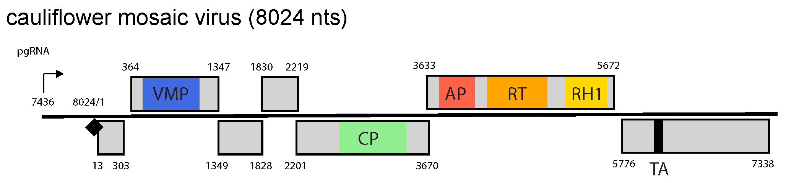{ width="760" height="177" loading="lazy" }](../_img/dna_replication/camv-genome.png)
/// caption
环状基因组在这里被展开。黑箭头表示前基因组 RNA 的转录起点，黑菱形表示 Met-tRNA 引物结合位置，两者并不重合；ORF5 中的橙色、黄色部分分别编码 RT 与 RNase H1。[^fig-camv-genome]
///

### 线粒体逆转录质粒 { #mitochondrial-retroplasmids }

脉孢菌线粒体中的 **Mauriceville、Varkud** 质粒，是在细胞器内部通过 RNA 中间体延续的逆转录质粒。Mauriceville 的转录本在 3′ 端折叠成 tRNA 样结构，末端带有 CCA；这里像 tRNA 的部分属于**模板本身**。

Mauriceville RT 可以识别这个末端并从头开始 DNA 合成，无需先接上一条 tRNA 引物。原始生化研究还显示，这种酶能以某些 tRNA 为模板，生成相应 cDNA。于是，同样出现“tRNA”这个词，在 HIV 中指引物，在这里却可以指模板或模板末端的形状。Varkud 是相关的逆转录质粒；上面关于从头引发及底物识别的具体实验结论，针对的是 Mauriceville 酶。[^mitochondrial-retroplasmids]

### 逆转座 { #rna_1 }

LTR 逆转座元件的若干步骤与逆转录病毒相似：先产生 RNA，再合成 DNA，随后整合到新的基因组位置。酵母 Ty1 甚至会在细胞内形成病毒样颗粒。这组图的上半部分是过表达 Ty1 时观察到的颗粒，下半部分来自冷冻电镜重建，可以看到蛋白质外壳的对称排列。

[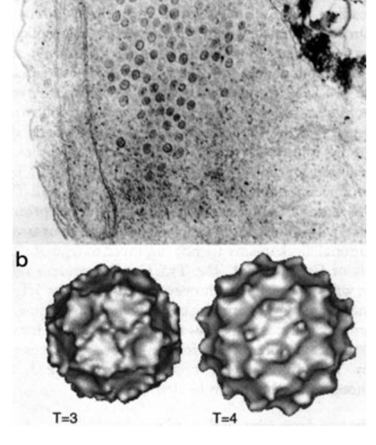{ width="460" height="544" loading="lazy" }](../_img/dna_replication/ty1-particles.jpg)
/// caption
上图为 Ty1 过表达条件下的电子致密颗粒；下图为带截短 Gag 的颗粒壳重建，T=3、T=4 表示壳体对称组织。两部分的材料和成像含义不同。[^fig-gene-12-30]
///

非 LTR 元件如 LINE，采用的典型办法是**靶位点引发逆转录（target-primed reverse transcription）**。元件编码的核酸内切活性在靶 DNA 上产生切口，切口的 3′-OH 与元件 RNA 配对，RT 就在这个靶位点开始合成 DNA。插入位置的 DNA 因而同时提供了逆转录起步所需的末端。

[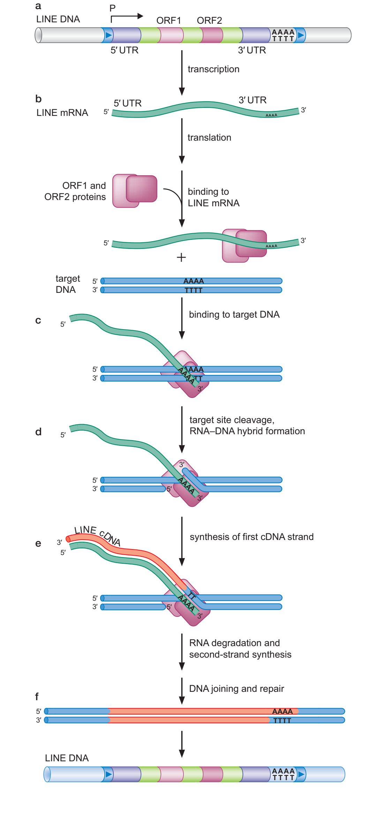{ width="520" height="1122" loading="lazy" }](../_img/dna_replication/line-target-priming.jpg)
/// caption
先看靶 DNA 的切口，再找与 RNA 配对的 3′ 端。沿这个末端形成的新 DNA，是把 RNA 序列写入新位置的起点；后续仍需处理和连接。[^fig-gene-12-26]
///

### Group II intron 的移动 { #group-ii-intron }

某些细菌和真菌线粒体的 **第二类内含子（group II intron）**既能从前体 RNA 中剪接出来，也能移动到新的 DNA 位点。其 RNA 具有核酶活性，内含子编码的蛋白则帮助 RNA 折叠、剪接，并提供逆转录活性；许多可移动成员还带有 DNA 内切酶结构域。

以具有内切酶活性的系统为例，剪接出来的内含子 RNA 与蛋白保持结合，先通过**反向剪接**接入靶 DNA 的一条链。蛋白再在对面那条 DNA 链上切出末端，留下的 3′-OH 就地引发逆转录，复制刚刚插入的内含子 RNA。随后由宿主修复反应移除 RNA、补上 DNA 并连接缺口，留下内含子的 DNA 副本。RNA 在这里先参与切断和接合，随后才被用作模板。[^group-ii-mobility]

[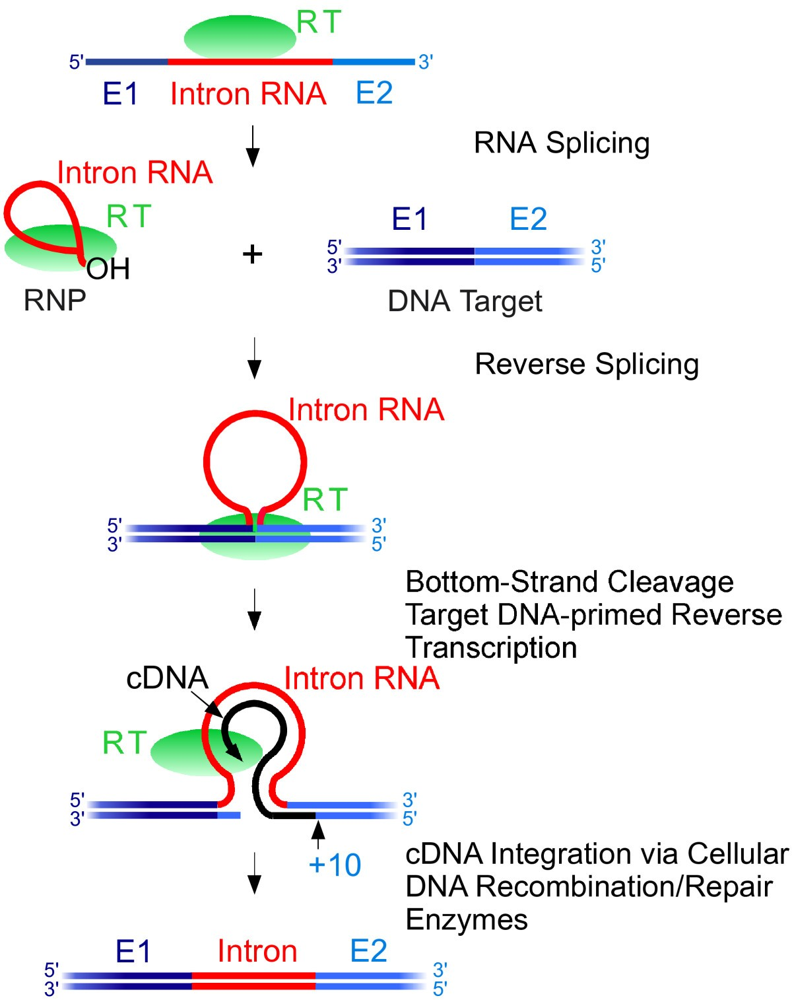{ width="600" height="757" loading="lazy" }](../_img/dna_replication/group-ii-retrohoming.jpg)
/// caption
红色是内含子 RNA，绿色是其编码的 RT，蓝色是外显子或靶 DNA，黑色是新生 cDNA。中间先把 RNA 接入一条 DNA 链，再切开对面链，用其 3′ 端引发黑色 cDNA。图示为具有内切酶活性的代表途径。[^fig-group-ii-retrohoming]
///

并非所有 group II intron 都保有完整的移动能力；有些成员缺少相应蛋白或酶活性，另一些移动途径利用复制过程中已有的 DNA 末端引发。保留自剪接能力的内含子，因此也可能已经失去移动能力。[^group-ii-mobility]

### 端粒酶 { #_2 }

端粒酶携带一小段内部 RNA 模板，反复延长染色体末端的 G 链。其催化亚基 TERT 属于逆转录酶，模板重定位使同一小段 RNA 可以指导多次重复添加；C 链填补则由另一套装置完成。具体过程见[端粒复制与维护](index.md#telomere-replication)。

### Retron 与 msDNA { #retron-rna-dna }

这类小型 RNA–DNA 分子最早在黄色黏球菌（*Myxococcus xanthus*）等黏细菌中被发现。后来研究又在部分根瘤菌和慢生根瘤菌菌株中检出 msDNA；不同菌株的分布并不一致。[^retron-distribution]

细菌 **retron** 编码非编码 RNA 与 RT。RNA 折叠后，一部分称为 **msd** 的序列充当逆转录模板，另一部分 **msr** 中的特定鸟苷则提供引发所需的 2′-OH。新 DNA 从这个核苷酸的侧面接出，以 2′–5′ 磷酸二酯键连在 RNA 上。模板 RNA 在合成过程中被 RNase H 逐步降解，留下共价相连的 RNA–DNA 分支结构，称为 **msDNA**。

[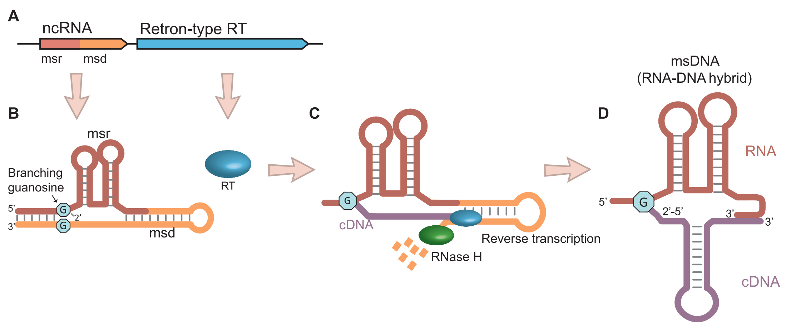{ width="740" height="308" loading="lazy" }](../_img/dna_replication/retron-msdna-synthesis.jpg)
/// caption
A、B 显示 retron 编码的 RNA 及其折叠；C 中紫色 cDNA 以 msd 为模板延长，RNase H 同时处理模板 RNA；D 标出分支点，鸟苷的 2′ 位连接着 DNA 的 5′ 端。此图为合成过程示意。[^fig-retron-msdna]
///

???+ abstract "这些 RNA–DNA 分支有什么用？"

    Millman 等在 2020 年发现，多种 retron 参与抗噬菌体防御。下图所用的系统来自大肠杆菌 200499，研究者把包含 RT、相关核酸内切酶及非编码 RNA 区域的基因片段转入实验菌株 MG1655，再用噬菌体感染。

    [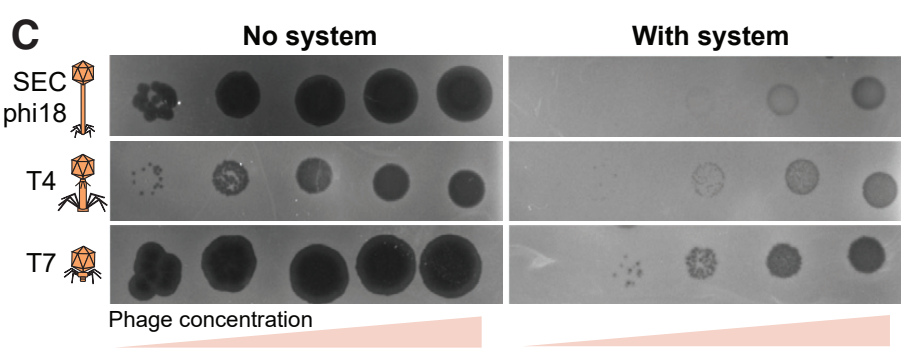{ width="700" height="273" loading="lazy" }](../_img/dna_replication/retron-phage-assay.jpg)
    /// caption
    每行对应一种噬菌体，各组浓度从左向右升高。左侧为携带 RFP 对照质粒的 MG1655，右侧带有来自 200499 的防御系统；相同浓度下比较裂解区与噬菌斑。图为三次重复的代表结果，原图 1C。[^fig-retron-defense]
    ///

    无防御系统的对照上，噬菌体可以形成明显的裂解区或噬菌斑；带入系统以后，相同稀释度下的成斑受到抑制。随后，研究者分别破坏 RT 催化位点、RNA 上参与引发的保守鸟苷或相关核酸内切酶，防御效果随之消失。这说明逆转录产物的形成与配套蛋白都参与了防御。[^retron-defense]

    同一论文还研究了另一种 retron——**Ec48**。它与含跨膜区的效应蛋白相联系；当噬菌体蛋白抑制宿主的 RecBCD 复合体时，Ec48 可被触发，使受感染细胞停止增殖或死亡，限制噬菌体继续传播。这给出了一个具体的触发机制。其他 retron 的效应蛋白与触发条件各有差异，后续结构研究也逐渐揭示了 RT、RNA–DNA 和效应蛋白怎样组成复合体。

| 系统 | 主要 RNA 模板来源 | 引发方式的代表 | 主要产物或作用 |
| --- | --- | --- | --- |
| HIV-1 等逆转录病毒 | 病毒基因组 RNA | 宿主 tRNA 的 3′ 端 | 带完整末端的双链病毒 DNA |
| HBV 等 hepadnavirus | 前基因组 RNA | 病毒聚合酶蛋白引发 | 病毒 DNA 基因组 |
| CaMV | 35S 前基因组 RNA | 宿主 Met-tRNA 引发负链 | 带特定位点不连续区的环状病毒 DNA |
| Mauriceville 逆转录质粒 | 质粒转录本 | 在 3′ tRNA 样末端从头引发 | 质粒 DNA 中间体 |
| LTR 逆转座元件 | 元件转录本 | 许多系统利用 tRNA | 可整合的 DNA 中间体 |
| LINE 等非 LTR 元件 | 元件 RNA | 靶 DNA 切口提供的 3′-OH | 靶位点上的 cDNA 与后续插入 |
| 可移动 group II intron | 剪接出的内含子 RNA | 代表系统利用靶 DNA 切口的 3′-OH | 内含子在 DNA 中的新副本 |
| 端粒酶 | 复合体内部 RNA | 染色体 G 链 3′ 端 | 端粒重复延长 |
| Retron | 编码的非编码 RNA | 特定鸟苷的 2′-OH | RNA–DNA 分支结构，许多系统参与防御 |

## 实验中的逆转录 { #reverse-transcription-in-lab }

!!! note "从链延伸看抑制剂"

    **叠氮胸苷（AZT）**是核苷类似物，进入细胞后需经磷酸化，形成 AZT 三磷酸才成为 RT 的底物竞争者。它被接入 DNA 后，糖上的 3′ 位缺少正常的羟基，下一步磷酸二酯键便难以形成。**阿德福韦**则是无环核苷酸类似物，其活性形式为阿德福韦二磷酸，可竞争 HBV 聚合酶的 dATP 底物并终止链延伸。阿德福韦本身已有一个膦酸基团，模拟核苷酸的磷酸部分；活化时再接上两个磷酸基团，因而称为二磷酸形式。[^rt-inhibitors]

    <div class="grid" markdown>

    [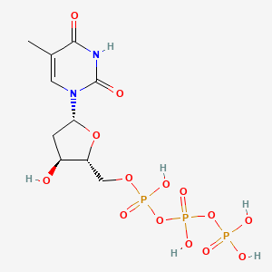{ width="300" height="300" loading="lazy" }](../_img/dna_replication/dttp.png)
    /// caption
    dTTP：找到糖环上的 3′-OH，它将参与下一轮链延伸。[^fig-rt-substrates]
    ///

    [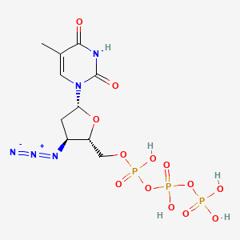{ width="300" height="300" loading="lazy" }](../_img/dna_replication/azt-triphosphate.png)
    /// caption
    AZT 三磷酸：相应位置为叠氮基，已经没有正常的 3′-OH。图中画的是活性三磷酸形式。[^fig-rt-substrates]
    ///

    </div>

    奈韦拉平等非核苷类 RT 抑制剂结合酶的别构口袋，改变催化所需的构象。沙奎那韦、利托那韦等蛋白酶抑制剂针对的则是病毒多聚蛋白的加工。不同靶点可以在同一生活史的不同环节阻断病毒增殖，这也是联合用药的酶学基础之一。这里用这些药物比较反应靶点，具体治疗方案还涉及耐药性、药代动力学及宿主毒性。[^rt-inhibitors]

    核苷类似物也可能影响宿主酶，包括线粒体 Pol γ；影响程度取决于具体类似物、活化代谢和酶对底物的选择，不同类似物对线粒体的影响也可能相差很大。[^rt-inhibitors]

RT 也是常用实验工具。通过 oligo(dT)、随机引物或特异引物，可以从不同位置开始合成互补 DNA（cDNA），再用于扩增、定量或文库构建。选择引物，就是选择哪些 RNA、哪些区域更容易进入后续分析；RNA 二级结构、完整性以及酶的过程性，也会影响所得 cDNA。

例如，RNA 降解会使长转录本难以被完整复制，稳定的局部二级结构也可能让逆转录酶停顿；所得 cDNA 因而会带有这些合成偏倚。具体操作与偏倚见[核酸扩增与定量](../../exptech/biochem_molecular/amplification_cloning.md)，文库背景见[分子克隆与构建设计](../../exptech/biochem_molecular/molecular_cloning.md#library-construction)。


!!! note "把逆转录用在基因编辑中"

    2019 年提出的 **先导编辑（prime editing）**把 Cas9 切口酶与逆转录酶连接起来。引导 RNA 也作了延长，成为 **pegRNA**：一部分负责寻找靶序列，另一部分带有引物结合区和包含预期改动的逆转录模板。

    [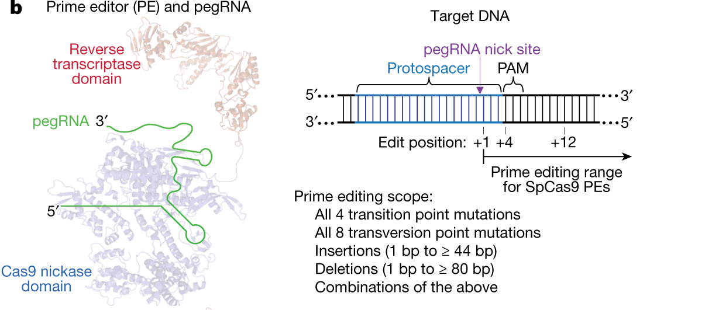{ width="740" height="323" loading="lazy" }](../_img/dna_replication/prime-editing-components.jpg)
    /// caption
    左侧为编辑复合体的结构示意，绿色是 pegRNA；右侧标出切口与编辑位置。右侧列出的改动类型和范围，概括 2019 年论文报告的实验结果。原图 1b。[^fig-prime-editing]
    ///

    沿下图 c 看，Cas9 先在靶 DNA 的一条链上产生切口，留下的 3′ 端与 pegRNA 的引物结合区配对。RT 随后以 pegRNA 为模板延长这个 DNA 末端，把所需改动合成进去。新延长的链与原有链竞争配对，后续切除、连接与 DNA 修复才使改动保留在最终双链中。

    [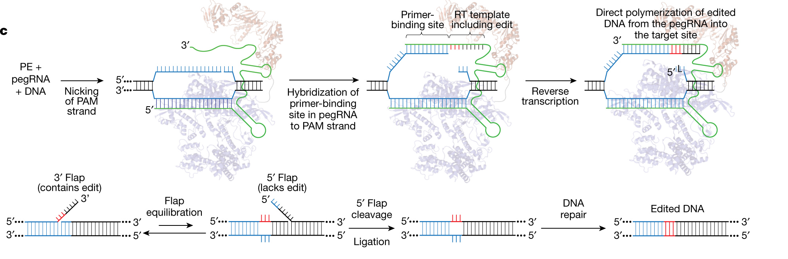{ width="740" height="244" loading="lazy" }](../_img/dna_replication/prime-editing-mechanism.jpg)
    /// caption
    先找上排切口释放的 3′ 端，再看它与 pegRNA 配对、延长。红色标出预期引入的改动；下排为新旧两段链的配对竞争，以及后续处理与修复。原图 1c，为作者提出的机制模型。[^fig-prime-editing]
    ///

    这里借用了前面已经见过的化学反应：DNA 上现成的 3′-OH 用来引发，RNA 提供要写入的序列。编辑的结果还取决于靶位点、pegRNA 设计和细胞的修复过程。

## 参考资料与延伸阅读 { #references }

本页结合 *Molecular Biology of the Gene* 第 7 版第 12 章与 Weaver 第 5 版第 23 章展开，发现实验和链转移图来自后者。HIV、HBV 和 retron 的进一步证据见相邻脚注。

- Watson JD, Baker TA, Bell SP, et al. *Molecular Biology of the Gene*. 7th ed. Pearson / Cold Spring Harbor Laboratory Press; 2014。
- Weaver RF. *Molecular Biology*. 5th ed. McGraw-Hill; 2012。
- Baltimore D. [Viral RNA-dependent DNA polymerase](https://pubmed.ncbi.nlm.nih.gov/4316300/). *Nature*. 1970;226:1209–1211.
- Temin HM, Mizutani S. [RNA-dependent DNA polymerase in virions of Rous sarcoma virus](https://pubmed.ncbi.nlm.nih.gov/4316301/). *Nature*. 1970;226:1211–1213.
- Hu WS, Hughes SH. [HIV-1 Reverse Transcription](https://pmc.ncbi.nlm.nih.gov/articles/PMC3475395/). *Cold Spring Harbor Perspectives in Medicine*. 2012;2:a006882.
- Millman A, et al. [Bacterial Retrons Function in Anti-Phage Defense](https://doi.org/10.1016/j.cell.2020.09.065). *Cell*. 2020.
- Anzalone AV, et al. [Search-and-replace genome editing without double-strand breaks or donor DNA](https://www.nature.com/articles/s41586-019-1711-4). *Nature*. 2019;576:149–157.

[^reverse-transcriptase-discovery]: RNA 肿瘤病毒颗粒中 RNA 依赖 DNA 聚合活性的两项独立原始报告见 Baltimore 的[论文](https://pubmed.ncbi.nlm.nih.gov/4316300/)以及 Temin 和 Mizutani 的[论文](https://pubmed.ncbi.nlm.nih.gov/4316301/)。
[^fig-weaver-23-20]: Weaver RF. *Molecular Biology*. 5th ed. McGraw-Hill; 2012，图 23.20，印刷页 748。本站截取教材图版区域，去除页眉与原排版正文，保留图中标记；配中文图注，未重绘。教材据 Baltimore D，*Nature*. 1970;226:1209–1211（[原始研究](https://pubmed.ncbi.nlm.nih.gov/4316300/)）改编，原图材料为 R-MLV 颗粒。
[^retroviral-reverse-transcription]: tRNA 引发、RNase H、两次链转移、PPT 正链引发及 LTR 形成见 Hu 与 Hughes 的[机制综述](https://pmc.ncbi.nlm.nih.gov/articles/PMC3475395/)。
[^fig-weaver-23-23]: Weaver RF. *Molecular Biology*. 5th ed. McGraw-Hill; 2012，图 23.23，印刷页 749。本站截取教材图版区域，去除页眉与原排版正文，保留图中标记；配中文图注，未重绘。本站按阶段截取同一幅图，部分交界状态重复显示，便于衔接；保留原图的序列标记、链端、箭头和英文步骤。
[^hepadnavirus-reverse-transcription]: hepadnavirus 以 pregenomic RNA 为中间体及 RT 自身 Tyr 蛋白引发的机制见 Hu 与 Seeger 的[综述](https://pmc.ncbi.nlm.nih.gov/articles/PMC3611959/)。
[^fig-gene-12-30]: Watson JD, Baker TA, Bell SP, et al. *Molecular Biology of the Gene*. 7th ed. Pearson / Cold Spring Harbor Laboratory Press; 2014，图 12–30，印刷页 414。本站截取教材图版区域，去除页眉与原排版正文，保留图中标记；配中文图注，未重绘。教材转载自 Craig NL 等编，*Mobile DNA II*. ASM Press; 2002；B 另注明 H. Saibil 提供。
[^fig-gene-12-26]: Watson JD, Baker TA, Bell SP, et al. *Molecular Biology of the Gene*. 7th ed. Pearson / Cold Spring Harbor Laboratory Press; 2014，图 12–26，印刷页 407。本站截取教材图版区域，去除页眉与原排版正文，保留图中标记；配中文图注，未重绘。
[^retron-defense]: retron 由非编码 RNA、RT 与 msDNA 构成并参与抗噬菌体防御的遗传证据见 Millman 等的[研究](https://doi.org/10.1016/j.cell.2020.09.065)；多组分 retron 复合体的现代结构证据见相关[研究](https://pmc.ncbi.nlm.nih.gov/articles/PMC11974896/)。

[^fig-retron-msdna]: Millman A, et al. [Bacterial Retrons Function in Anti-Phage Defense](https://doi.org/10.1016/j.cell.2020.09.065). *Cell*. 2020，补充图 S1（[作者公开 PDF](https://www.weizmann.ac.il/molgen/sorek/sites/molgen.sorek/files/2024-02/Millman%20et%20al%20Cell%202020.pdf)第 19 页）。本站截取完整 A–D 图版，保留配色、链端和分支标记，配中文说明，未重绘。
[^fig-retron-defense]: Millman 等，*Cell*. 2020，图 1C（[作者公开 PDF](https://www.weizmann.ac.il/molgen/sorek/sites/molgen.sorek/files/2024-02/Millman%20et%20al%20Cell%202020.pdf)第 4 页，稿件正文标页 3）。本站单独截取点斑实验面板，保留噬菌体名称、对照与实验组、浓度方向，未重绘。系统来源为 E. coli 200499，受体菌为 E. coli MG1655；本图不属于正文后面介绍的 Ec48 系统。
[^fig-prime-editing]: Anzalone AV, Randolph PB, Davis JR, et al. [Search-and-replace genome editing without double-strand breaks or donor DNA](https://www.nature.com/articles/s41586-019-1711-4). *Nature*. 2019;576:149–157，[图 1b、c](https://www.nature.com/articles/s41586-019-1711-4/figures/1)。本站从出版方高清图分别截取两个面板，保留标记、方向与原配色，转换为 JPEG，配中文说明，未重绘。图示描述起始版本的编辑原理与所报告范围。

[^hiv-particle]: Weaver 第 5 版第 23 章与 MBotG 第 7 版第 12 章的逆转录病毒：两份基因组 RNA、包膜与衣壳、RT 亚基以及多聚蛋白加工。HIV-1 的锥形衣壳、MA、NC、CA 与 Env 各有所在位置；RNA 的帽、poly(A) 尾及剪接信号也不能与 DNA 中的完整 LTR 混为一组结构。
[^fig-hiv-rt]: David S. Goodsell / RCSB PDB-101. [HIV Reverse Transcriptase](https://pdb101.rcsb.org/motm/33). Molecule of the Month，2002 年 9 月，第二幅结构插画，依据 [PDB 2HMI](https://www.rcsb.org/structure/2HMI)。采用官方高清 TIFF，转换为 JPEG，保留活性位点标签、亚基配色与结合 DNA，未改绘。2HMI 为结构研究复合物，插画聚焦 RT 与 DNA，未展示晶体中的全部组分。
[^hiv-nuclear-rt]: Francis AC, et al. [HIV-1 Uncoating and Nuclear Import Precede the Completion of Reverse Transcription in Cell Lines and in Primary Macrophages](https://pubmed.ncbi.nlm.nih.gov/33143125/). *Viruses*. 2020；另见 Dharan A, et al. [Nuclear pore blockade reveals that HIV-1 completes reverse transcription and uncoating in the nucleus](https://pubmed.ncbi.nlm.nih.gov/32483230/). *Nature Microbiology*. 2020。这里保留实验对象与观察范围，不为所有逆转录系统指定同一入核时序。
[^camv-cycle]: Teycheney PY, et al. [ICTV Report：Caulimoviridae](https://ictv.global/report/chapter/caulimoviridae/caulimoviridae)，Genome organization and replication；另见 [Caulimovirus 属条目](https://ictv.global/report/chapter/caulimoviridae/caulimoviridae/caulimovirus)。CaMV 的 DNA 不连续区、35S RNA、Met-tRNA 引发与非必需整合均依此区分。
[^fig-camv-genome]: [ICTV Caulimoviridae 报告](https://ictv.global/report/chapter/caulimoviridae/caulimoviridae)，图 2，CaMV 基因组图（同属报告图 1）。采用官方 PNG 原图，未裁切或重绘；保留转录起点、引物结合处、坐标和结构域颜色。
[^mitochondrial-retroplasmids]: Chiang CC, Lambowitz AM. [The Mauriceville retroplasmid reverse transcriptase initiates cDNA synthesis de novo at the 3′ end of tRNAs](https://pmc.ncbi.nlm.nih.gov/articles/PMC232306/). *Mol Cell Biol*. 1997;17:4526–4535。结合文中引用的 Varkud 质粒序列研究与 Mauriceville 转录本末端研究；tRNA 样结构属于 RNA 模板，其结构识别与从头引发并非 tRNA 引物延伸。
[^group-ii-mobility]: Zimmerly S, et al. [A group II intron RNA is a catalytic component of a DNA endonuclease involved in intron mobility](https://pubmed.ncbi.nlm.nih.gov/7585955/). *Cell*. 1995;83:529–538；反向剪接的结构证据见 [Cryo-EM Structures of a Group II Intron Reverse Splicing into DNA](https://pmc.ncbi.nlm.nih.gov/articles/PMC6662634/)。不同 group II intron 的蛋白组成与移动能力存在差异，本页过程以保留内切酶活性的可移动系统为例。
[^rt-inhibitors]: AZT 的磷酸化与活性形式见 Furman PA, et al. [Phosphorylation of 3′-azido-3′-deoxythymidine and selective interaction of the 5′-triphosphate with human immunodeficiency virus reverse transcriptase](https://pubmed.ncbi.nlm.nih.gov/2430286/). *PNAS*. 1986；阿德福韦的活化与 HBV 聚合酶底物竞争参见 [Sun 等，2007](https://bpspubs.onlinelibrary.wiley.com/doi/10.1111/j.1365-2125.2006.02728.x)。酶靶点比较结合 Weaver 第 5 版病毒复制章节及 [PDB-101 的结构说明](https://pdb101.rcsb.org/motm/33)。不同类似物与 Pol γ 的相互作用见 [Lim 等的结构位点与酶学实验](https://pubmed.ncbi.nlm.nih.gov/12742017/)，及 [AZT 掺入的动力学研究](https://pmc.ncbi.nlm.nih.gov/articles/PMC2175305/)；此处未按体外抑制强弱推定临床毒性次序。

[^retron-distribution]: 黏球菌 retron 的原始研究见 [Two independent retrons with highly diverse reverse transcriptases in Myxococcus xanthus](https://pmc.ncbi.nlm.nih.gov/articles/PMC53385/)，1989；根瘤菌菌株调查见 Rice SA, et al. [Diversity of retron elements in a population of rhizobia and other gram-negative bacteria](https://pmc.ncbi.nlm.nih.gov/articles/PMC204857/). *J Bacteriol*. 1993。

[^fig-group-ii-retrohoming]: Enyeart PJ, Mohr G, Ellington AD, Lambowitz AM. [Biotechnological applications of mobile group II introns and their reverse transcriptases](https://doi.org/10.1186/1759-8753-5-2). *Mobile DNA*. 2014;5:2，图 3。保留出版方完整机制图，未裁切；图中 +10 为所示内切酶依赖途径的切口位置，其他成员可使用不同引发途径。
[^fig-rt-substrates]: PubChem 的 [dTTP](https://pubchem.ncbi.nlm.nih.gov/compound/64968) 与 [zidovudine triphosphate](https://pubchem.ncbi.nlm.nih.gov/compound/72187) 二维结构图，分别由 PUG REST 按化合物名称取得，未改绘。图示保留数据库所用质子化表示；这里比较糖环 3′ 位，而非溶液中的电荷状态。
