# 真核基因表达调控 { #_1 }

一个神经元和一个肝细胞保留着大体相同的基因组，却制造出很不一样的蛋白质。差别从转录之前就已出现：转录因子能接近哪些DNA片段，哪些因子同时存在，哪些增强子能影响同一个启动子。RNA合成以后，剪接、运输、定位、翻译和降解又会继续改变产物。因此，“这个基因表达了多少”需要接着说明：测量的是新生RNA、成熟mRNA，还是蛋白质；观察的是哪个细胞、哪一个时刻。[^regulatory-layers]

真核生物也要随环境改变表达。酵母遇到半乳糖会诱导代谢酶，动物细胞缺铁会调整取铁与储铁，应激中的细胞则会压低大部分翻译，同时增加少数应答蛋白。本页沿着DNA、转录和RNA命运展开这些机制；操纵子、细菌的环境响应与古菌调控见[原核基因表达调控](index.md)。

启动子、增强子和RNA上的调控位点是顺式作用元件，作用依赖它们与目标核酸的物理联系；能够扩散并与这些位点结合的蛋白质或RNA则在反式发挥作用。拷贝数、染色质、亚细胞位置和出现时间，都会改变它们相遇及共同工作的机会。

## 染色质与转录调控 { #eukaryotic-transcription-control }

### 核小体的可及性 { #chromatin-accessibility-control }

转录因子识别的几对碱基可能正贴在组蛋白表面。核小体DNA会短暂解包，使其中一部分序列露出；因子的结合也能稳定较开放的状态。先锋转录因子能在某些核小体背景中先行结合，为其他因子创造条件。随后，激活因子招募的酶可以移动核小体，也可以改变组蛋白表面的化学基团，两类动作经常配合发生。[^chromatin-accessibility]

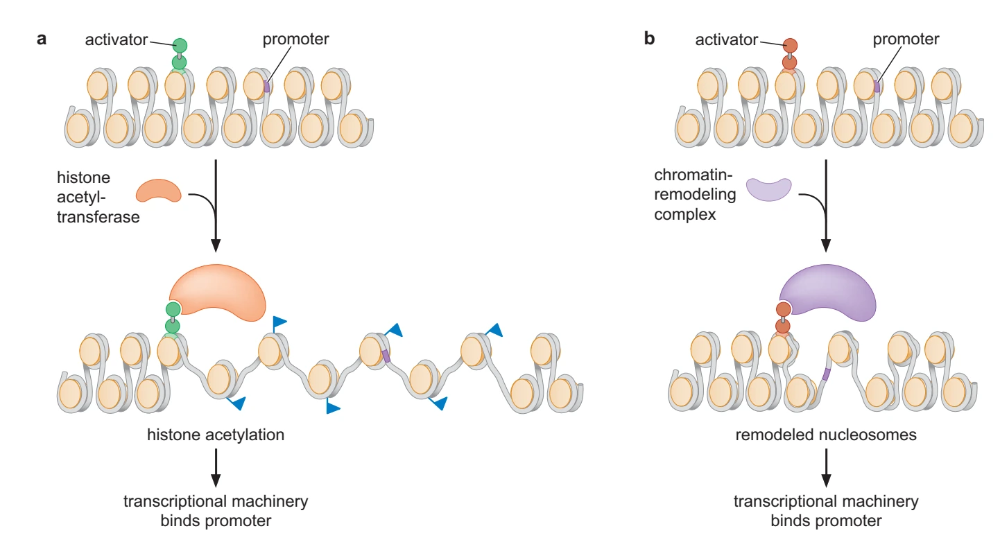{ width="820" loading=lazy }
/// caption
左侧通过组蛋白乙酰化改变染色质，右侧由重塑复合物改变核小体与启动子的位置关系。两条路径都能帮助转录装置接近DNA，使用的酶与化学反应不同。[^fig-chromatin-opening]
///

图左的组蛋白乙酰转移酶（HAT）把乙酰CoA的乙酰基转移到赖氨酸侧链。乙酰化中和这个侧链的正电荷，还为含溴结构域的蛋白提供结合位置。CBP/p300和SAGA中的乙酰转移酶都可以参与这种调节；组蛋白去乙酰化酶（HDAC）则移去乙酰基。

图右的SWI/SNF、RSC等ATP依赖重塑复合物消耗ATP，改变DNA在核小体上的位置、核小体间距或组蛋白组成。组蛋白伴侣还参与拆卸、交换和重新装配。乙酰化酶与重塑酶可以一起被招募，分别改变组蛋白的化学修饰与核小体的组织方式。

组蛋白甲基化提供的是另一类识别表面。甲基转移酶以S-腺苷甲硫氨酸（SAM）为供体，修饰赖氨酸或精氨酸；甲基化通常不消去赖氨酸的正电荷。究竟吸引谁，要看哪个残基带几个甲基。例如，H3K4me3常富集在活跃启动子附近，H3K36me3常见于被转录的基因体；H3K9me3能与HP1参与的异染色质组织相联，H3K27me3则与Polycomb抑制系统相联。相应的甲基转移酶、读取蛋白和去甲基化酶，让这些标记可以建立、维持和重设。[^chromatin-book]

“组蛋白密码”描述了组合标记携带调控信息的可能性，具体效果取决于被修饰的残基及读取蛋白。泛素化也有鲜明的位点差别：H2AK119ub与Polycomb抑制有关，H2BK120ub则参与转录及其他组蛋白修饰的调节。磷酸化、SUMO化、ADP核糖基化等还联系着DNA损伤、染色体凝缩和转录状态，很难在它们旁边各填一个永久的“激活”或“抑制”。修饰所用的供体和残基转化见[蛋白质的共价修饰](../protein_processing.md#covalent-modifications)。

组蛋白变体则改变核小体本身的组成：H2A.Z参与启动子、增强子及染色质边界的调节，CENP-A赋予着丝粒核小体特殊身份。各种变体和重塑家族见[组蛋白变体与染色质重塑](../../genetics/genomics_epigenetics.md#histone-variants-remodeling)。

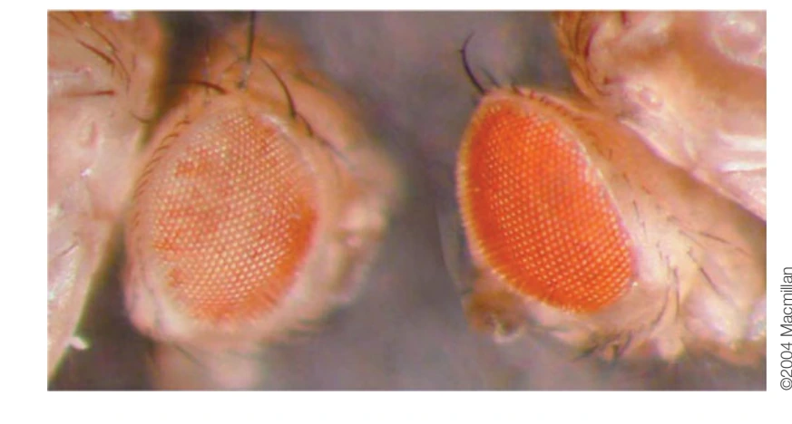{ width="420" loading=lazy }
/// caption
左侧为位置效应斑驳的复眼，右侧为红眼对照。染色体重排把正常的 *white* 基因移到异染色质附近，左侧复眼出现红色与白色区域。[^fig-pev]
///

**基因序列还在，邻居已经变了。** 果蝇 *white* 基因正常表达有助于形成红眼；靠近异染色质后，抑制状态可能扩展到这个基因，但不同细胞中扩展的范围并不一致。较早形成的状态在后续细胞分裂中保持，最终留下成片的红色或白色区域。

这类位置效应斑驳把肉眼可见的性状接到染色质状态上。改变异染色质蛋白的剂量又会改变斑驳程度，为HP1等组分的作用提供遗传学线索。即使 *white* 编码区没有再次发生突变，复眼中也能出现这样的白色区域。

### DNA甲基化与亲本印记 { #dna }

DNA甲基化也能改变因子对序列的识别。脊椎动物中常见的5-甲基胞嘧啶位于CpG；启动子CpG岛的甲基化常与稳定抑制相联，既可能影响部分转录因子结合，也可招募MeCP2等甲基化DNA结合蛋白及其共调节因子。基因体和增强子中的甲基化需要结合位置解释。植物还在CG、CHG和CHH序列上建立不同的甲基化系统，许多真菌和无脊椎动物的分布又不相同；酿酒酵母等常用模型并没有典型的DNA甲基化体系。[^chromatin-accessibility]

DNA复制后，新生链最初没有旧链上的甲基标记，原有的对称CpG位点因而变成半甲基化位点。UHRF1帮助识别这样的复制后染色质，DNMT1在新生链上补加甲基，使部分位点的状态得以延续。DNMT3A和DNMT3B参与从头建立甲基化；TET家族对5mC的氧化、后续修复以及复制时维持不足，都能参与甲基化的消退。这些过程让甲基化既能成为记忆，也能在发育中被重设。

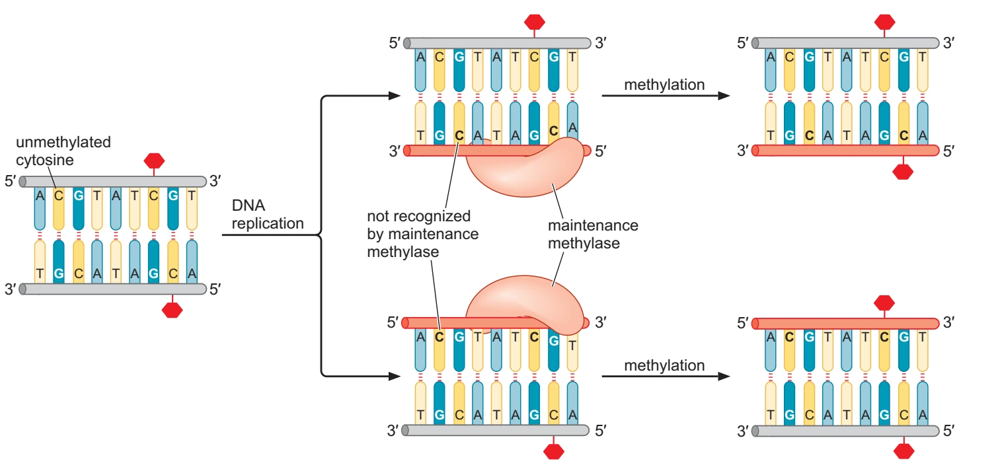{ width="800" loading=lazy }
/// caption
从左向右追踪两条复制后路线：旧链保留标记，新链需要重新修饰。图示维持甲基化的基本逻辑，细胞中DNMT1的作用还依赖UHRF1及复制相关染色质环境。[^fig-methylation-maintenance]
///

??? info "修饰蛋白的剂量与化学扰动"

    染色质调节依赖适当的蛋白剂量。CBP或p300的功能受损可引起Rubinstein–Taybi综合征；甲基化DNA读取蛋白MeCP2的功能丧失与Rett综合征有关，基因剂量增加又可造成MECP2重复综合征。写入标记和读取标记的蛋白发生变化，都会影响发育中的基因调节。[^chromatin-dosage]

    化学抑制剂也能用来扰动这些过程。伏立诺他抑制部分HDAC，使相应底物的乙酰化积累；5-氮杂胞苷既可进入RNA，其代谢物也可掺入DNA，后者可在甲基转移反应中捕获DNA甲基转移酶并降低可用酶量。这类处理会影响多种底物与细胞过程，因此药物处理后的表达改变仍需结合具体位点、酶与时间分析。[^chromatin-inhibitors]

**基因组印记**让某些等位基因按亲本来源表达。小鼠 *H19–Igf2* 区域是一个可以具体追踪的例子：母源印记控制区未甲基化，CTCF能够结合，限制下游增强子与 *Igf2* 启动子的通信；父源控制区甲基化后，CTCF结合受到阻碍，增强子可以促进 *Igf2* 表达，*H19* 则受抑制。同一段DNA的亲本来源差异，经过甲基化和蛋白结合，变成了启动子获得增强子作用的差异。[^fig-imprinting]

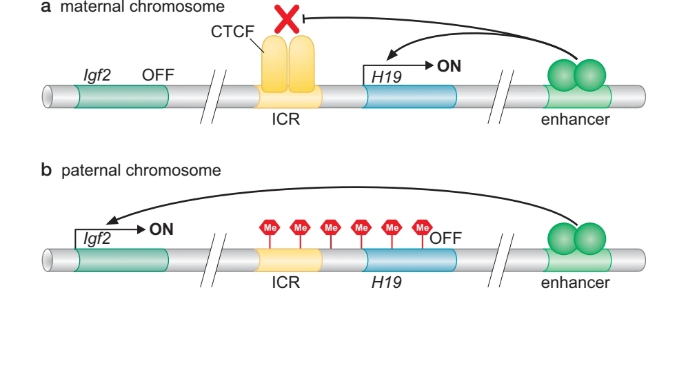{ width="740" loading=lazy }
/// caption
母源一侧的CTCF位于增强子与 *Igf2* 之间；父源控制区的甲基化改变这一关系。该图解释一个特定位点的印记机制，不代表所有印记基因都依赖CTCF。[^fig-imprinting]
///

生殖细胞发育时，原有印记会经过擦除与重新建立；体细胞维持和生殖系重设因而是两个阶段。DNA甲基化、组蛋白状态和X染色体失活的遗传边界见[基因组学与表观遗传学](../../genetics/genomics_epigenetics.md#genomic-imprinting)。仅凭低表达样本中甲基化较高，还无法判断甲基化首先导致抑制，还是随抑制与细胞组成变化而出现。

### 转录因子的结构域与组合 { #transcription-factor-combinations }

序列特异性转录因子通常有几个可以区分的功能区域：DNA结合结构域把蛋白定位到一段序列，激活或抑制结构域接触其他调节蛋白，二聚化与配体结合区域则决定它和谁搭配、何时发挥作用。结合DNA之后，因子还需要改变转录装置的组装或工作状态，表达才会随之变化。

酵母Gal4的结构域交换实验把这两步分得很清楚。完整Gal4可以结合自己的位点并激活转录；只有DNA结合区的截短蛋白仍可结合，却失去激活能力。研究者把细菌LexA的DNA结合区接到Gal4激活区上，再把报告启动子前的结合位点换成LexA位点，这个杂合蛋白也能促进报告基因表达。DNA结合区决定去哪里，Gal4激活区仍能在新的位置招募转录所需的伙伴。[^fig-gal-domain]

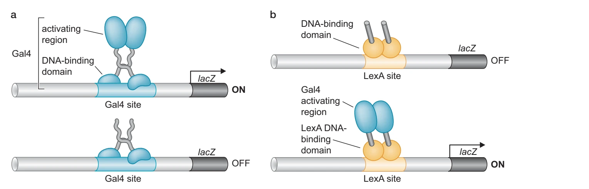{ width="840" loading=lazy }
/// caption
比较DNA结合区与激活区的组合，以及各报告构建的ON／OFF结果。图为教材整理的实验设计示意；LexA位点与杂合蛋白的DNA结合区相匹配。[^fig-gal-domain]
///

许多DNA结合结构域用一段α螺旋接触大沟，读取碱基边缘的氢键供受体与疏水基团，同时接触磷酸骨架。DNA形状、小沟宽度和邻位蛋白也会影响选择性。下面四张结构图展示了几种不同的安排。

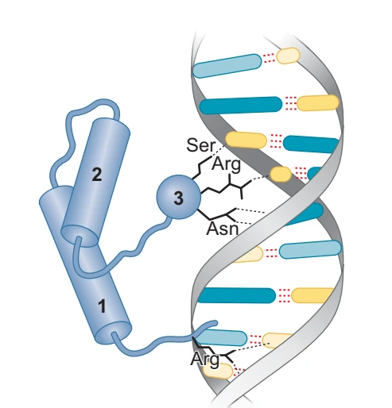{ width="310" loading=lazy }
/// caption
**同源结构域。** 约60个氨基酸组成三条主要α螺旋，第3条是主要的识别螺旋，N端臂还可接触小沟。图为酵母α2。[^fig-dna-binding]
///

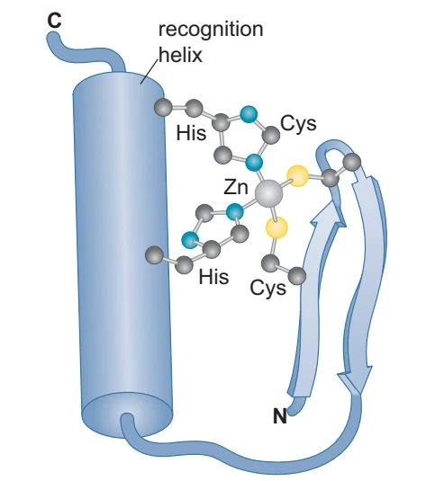{ width="310" loading=lazy }
/// caption
**C2H2锌指。** 两个Cys和两个His配位Zn，稳定ββα结构，α螺旋接触DNA；多个锌指可串联识别较长序列。[^fig-dna-binding]
///

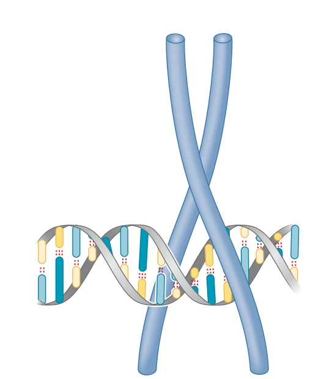{ width="310" loading=lazy }
/// caption
**bZIP。** 图中的GCN4两条长螺旋在一端形成卷曲螺旋二聚界面，另一端的碱性区分开接触DNA。拉链区的Leu常以七肽重复出现。[^fig-dna-binding]
///

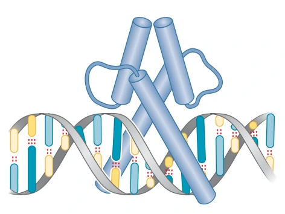{ width="350" loading=lazy }
/// caption
**bHLH。** 碱性区参与DNA识别，螺旋–环–螺旋区参与二聚化。许多成员识别E-box，其通式为CANNTG。[^fig-dna-binding]
///

锌配位结构并不限于上图的C2H2。核受体DNA结合区含两个C4锌配位单元，Gal4使用的则是Zn$_2$Cys$_6$双核锌簇；它们的折叠和DNA识别方式各有特点。翼状螺旋等其他结构也扩展了DNA结合的几何形式。同一家族的蛋白可能识别相近基序，细胞中的实际占据还要由浓度、二聚伙伴、邻位因子和核小体共同决定。[^chromatin-book]

激活结构域常含较多无序区，其中的短片段与Mediator、乙酰转移酶、重塑复合物或延伸因子接触。传统上称为酸性、富Gln或富Pro的激活区，描述的是序列组成，未规定唯一的下游伙伴。多个因子邻近结合时，可以直接相互接触，也可以通过共同的辅助蛋白稳定彼此，甚至通过打开同一个核小体帮助对方占据DNA。

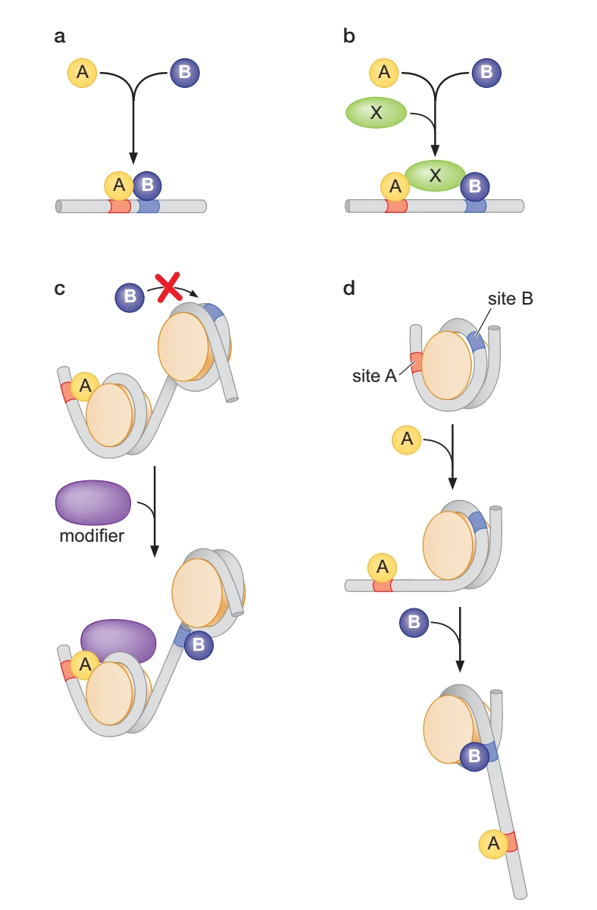{ width="350" loading=lazy }
/// caption
a、b通过蛋白间接触协作；c、d中，一个因子的结合改变了另一个位点的可及性。[^fig-cooperation]
///

图a中两个因子直接接触，一个因子结合后，另一个因子也更容易留在DNA上；图b用第三个蛋白X连接二者。图c的因子先招来重塑复合物，使核小体遮住的邻近位点露出。图d则利用核小体DNA的局部解包：一个蛋白稳定已经露出的DNA，也让旁边的序列更容易被另一个蛋白识别。

这些关系解释了为什么一个较弱位点在特定细胞中仍能有效工作：它可能有合适的邻居。也解释了组合调控为何具有细胞类型特异性——两个细胞即使拥有同一个转录因子，其他伙伴与可及位点仍可能不同。

抑制因子也可以在不同位置介入。它可以竞争重叠的DNA位点，可以遮住激活因子的作用区，可以直接抑制基础转录装置，还可以招募HDAC等共抑制复合物，改变局部染色质。一个蛋白在不同伙伴和启动子背景中甚至可能表现出不同的作用方向。

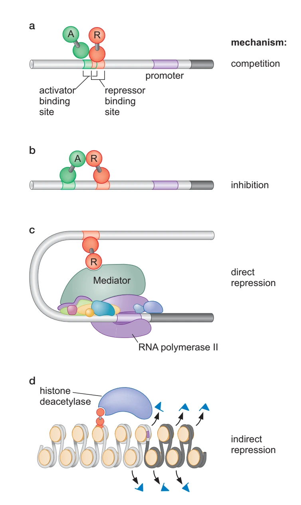{ width="350" loading=lazy }
/// caption
从上到下，抑制分别作用于DNA占位、激活区、转录机器和组蛋白状态。[^fig-repression]
///

图a的激活因子和抑制因子争用重叠位点。图b中激活因子仍在DNA上，但负责接触其他蛋白的区域被遮蔽；后面将看到Gal80提供的具体例子。

图c把抑制直接接到转录装置上。图d中抑制因子先结合自己的位点，再招募组蛋白修饰酶，因而可能影响一段区域的可及性。具有抑制作用的顺式DNA片段常称沉默子，其作用仍依赖结合蛋白、启动子和染色质环境。

### GAL系统与信号输入 { #gal }

Gal4控制酵母利用半乳糖的一组基因。没有半乳糖时，Gal4可以已经结合上游激活序列（UAS），但Gal80遮蔽它的激活区。半乳糖和ATP作用于Gal3后，Gal3与Gal80相互作用，降低Gal80对Gal4的抑制，Gal4于是能够招募共激活因子与转录装置。这里，诱导物首先被Gal3读取，DNA上的Gal4负责把这一变化接到靶基因上。[^gal-induction]

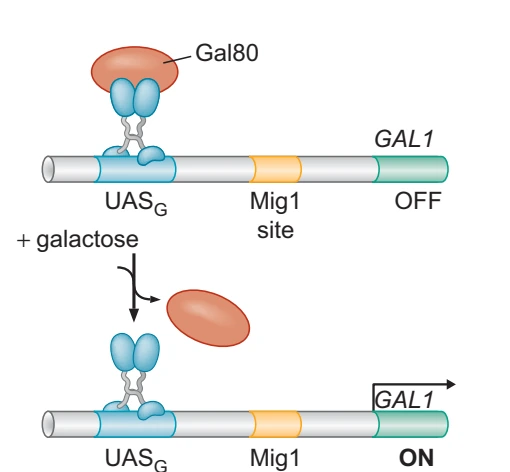{ width="400" loading=lazy }
/// caption
图示无葡萄糖条件下加入半乳糖前后的Gal4–Gal80关系，省略了实际参与感受的Gal3。Gal4的DNA结合与激活区受抑制可以同时存在；Mig1位点属于另一条碳源调节路径。[^fig-gal-sensing]
///

半乳糖的诱导作用还受其他碳源影响。葡萄糖丰富时，Mig1可参与招募Ssn6–Tup1共抑制系统，压低GAL等基因的转录；葡萄糖缺乏时，Snf1相关调节减弱这一抑制。GAL系统因此同时读取“能否利用半乳糖”和“是否仍有优先碳源”。

不同于[LacI直接感受异乳糖](index.md#lac-operon)，这里感受半乳糖、抑制激活区和识别DNA由不同蛋白承担。两种系统都能整合碳源信息，分子动作却各有安排。

细胞还通过磷酸化与去磷酸化、二聚伙伴交换、诱导因子合成、抑制蛋白降解以及核转运改变转录因子活性。例如，CREB可通过磷酸化改变共激活因子的招募；NF-$\kappa$B可随I$\kappa$B降解进入细胞核；Notch受体经蛋白水解释放胞内段，再与核内DNA结合因子协作。Smad和STAT也把细胞表面的信号接到特定基因集合。上游反应与时间关系见[细胞信号转导](../../cell/cell_signaling.md#signaling-grammar)。

核受体把配体感受与转录调控集中在同一个蛋白上。典型受体包含N端激活区、C4型DNA结合区、铰链区和配体结合区；配体改变受体构象及共调节蛋白的结合。糖皮质激素受体可在配体结合后重排与Hsp90等伴侣的关系并进入细胞核，甲状腺激素受体和视黄酸受体则常已结合DNA，配体推动共抑制与共激活复合物的交换。这些配体响应型核受体通过配体依赖的蛋白互作变化调节转录，受体所在位置和启动方式随类别而异。[^nuclear-receptors]

### 增强子与启动子的通信 { #enhancer-promoter-communication }

核心启动子组织预起始复合物；近端元件和远端增强子结合序列特异性因子，帮助招募辅助蛋白或改变局部染色质。增强子可位于基因上游、下游或内含子里，许多增强子在报告构建中翻转方向后仍能工作。作用到哪一个启动子，却受到因子组合、启动子兼容性、距离、染色质状态和三维结构的共同限制。线性位置上最近的基因只是候选靶标之一。[^enhancer-mechanisms]

DNA成环能让远端增强子与启动子接近，Mediator和其他辅助因子也可通过局部富集与短暂接触促进起始或暂停释放。某些增强子形成高度有序的复合物，例如干扰素β增强子上的多种因子协同装配；其他增强子对结合位点间距和顺序更宽容。CTCF与cohesin参与的染色质结构可限制部分接触，绝缘元件也可影响增强子通信或异染色质扩展。它们的作用依赖所处位置和结合蛋白。[^enhancer-specificity]

一个启动子往往并不持续均匀地工作。单细胞时间记录常看到一阵转录后接一段低活动期，这称为**转录爆发**。增强子可以影响爆发出现的次数、持续时间或一次爆发中的转录活动；群体平均RNA量把这些不同变化混在一起。

???+ abstract "读图：较强的增强子怎样增加RNA输出"

    Fukaya等在果蝇胚胎中比较不同增强子：让它们作用于相同的 *snail* 核心启动子和带MS2标记的 *yellow* 报告转录本，并保持插入位置等条件一致。MS2结合蛋白携带GFP，聚集在新生RNA上，使转录位点成为可以随时间记录的亮点。[^enhancer-bursting]

    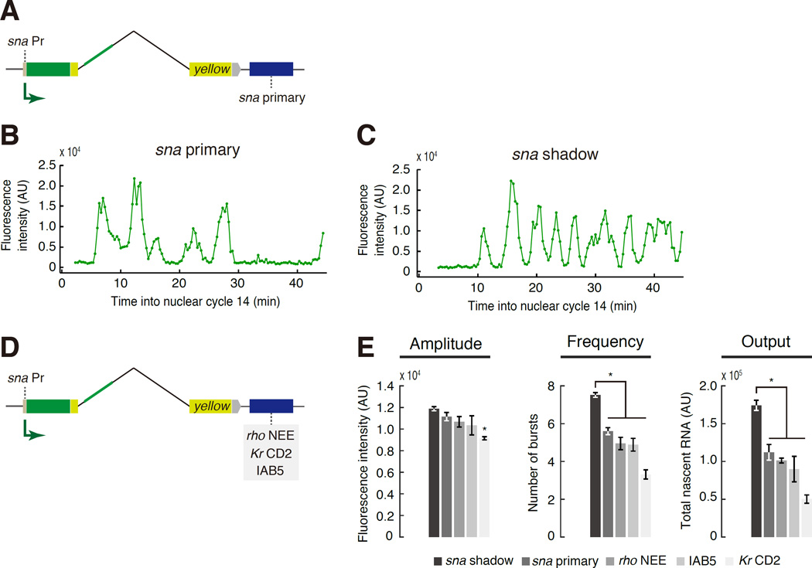{ width="880" loading=lazy }
    /// caption
    原研究图2。B、C为代表性细胞核的时间轨迹，纵轴为新生RNA位点荧光；A、D显示报告构建设计。E比较不同增强子的爆发幅度、每个细胞核在第14次核周期内的爆发次数及累计输出。[^enhancer-bursting]
    ///

    图B、C中的尖峰显示转录并非匀速进行。将不同增强子的许多细胞核合在一起统计，较强增强子通常带来更多次爆发，幅度的差异相对较小；Kr CD2的幅度也较低，所以这项实验并未把增强子的作用限定为只改变频率。

    这里的“输出”来自荧光轨迹的积分，表达为相对量；E中每组来自3个胚胎，误差条反映这3个生物学重复的标准差。荧光报告了新生RNA随时间的变化，未同时记录增强子与启动子是否直接接触。

Hi-C等方法给出的增强子–启动子接触概率，与上述转录轨迹回答不同的问题。有些接触先于激活建立，有些表达改变则不伴随大尺度接触图的明显变化。要判断某次接触是否促成某个基因的转录，还需结合时间、位点扰动和新生RNA测量。空间结构的形成机制见[三维基因组](../../cell/nucleus_chromatin.md#three-dimensional-genome)。

### 起始之后：暂停、延伸与非编码RNA { #rna }

Pol II开始转录以后仍可能停在启动子附近。DSIF和NELF参与许多动物基因的启动子近端暂停，P-TEFb的CDK9激酶通过磷酸化相关因子和Pol II羧基端结构域，帮助聚合酶进入有效延伸。这样，已经起始的聚合酶可成为后续信号调节的对象。HIV的Tat蛋白结合新生TAR RNA并招募P-TEFb，是病毒利用这一接口的实例；延伸速率与终止因子招募还会影响完整RNA产量和共转录加工。[^chromatin-book]

Pol I与Pol III也受生理状态控制。哺乳动物Pol I系统中，UBF、SL1和RRN3等因子参与rDNA起始，活跃模板比例与营养信号共同影响pre-rRNA产量。Maf1则可在相应条件下抑制Pol III转录，使tRNA和5S rRNA合成随生长状态调整。三类核RNA聚合酶的基础装置见[转录与RNA生物合成](../transcription.md#nuclear-rna-polymerases)。

长链非编码RNA（lncRNA）通常指长度超过200 nt、没有已知蛋白编码功能的一大类RNA，成员的机制相差很远。Xist能在产生它的X染色体上铺展并招募沉默相关蛋白，参与建立大范围的转录抑制；另一些lncRNA可以结合转录因子、RNA结合蛋白或目标RNA，改变蛋白的可用性、RNA加工或翻译。一个lncRNA位点的功能也可能来自启动子DNA、转录过程或剪接过程本身。[^lncrna-regulation]

因此，删掉整个lncRNA基因后观察到邻基因表达变化，还需继续区分：被删去的是一段顺式DNA元件，还是发挥作用的RNA。提前终止转录、降解成熟RNA与回补RNA产物回答的问题各不相同；RNA丰度、定位和结合伙伴的计量关系也决定提出的机制是否可行。

## DNA模板的增减与重排 { #genome-level-expression-switches }

大多数表达调节不改变基因的DNA序列；一些特定细胞和发育阶段会直接改变模板数量、片段组合或可表达位置。这些变化涉及DNA复制与修复，持续时间通常也比一次转录因子结合更长。

### 局部扩增增加模板 { #_2 }

果蝇卵巢的滤泡细胞需要在较短时间内合成大量卵壳蛋白。相应基因簇的复制起始区可反复启动，先前启动的复制叉继续向外移动，后续复制叉又从内部出发，形成层层嵌套的复制中间体，常称“洋葱皮式”复制。靠近起始区的拷贝增加较多，远处较少，扩增由此集中于特定区域。[^chorion-amplification]

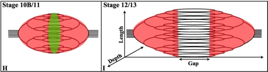{ width="650" loading=lazy }
/// caption
Claycomb 等图 1H、I：左为 stage 10B/11，右为 stage 12/13。橄榄绿表示 ORC2 集中的区域，鲑红表示 BrdU 掺入区；黑线画嵌套复制结构，是依据成像建立的模型。[^chorion-fork-model]
///

左图中，较早出发的复制叉在外侧，后续起始又在内部产生新叉，因此中央序列获得的副本最多。到右图的晚期阶段，ORC2 不再集中在起始区，也不再有新的起始，先前形成的复制叉却继续向两边推进；新合成 DNA 的 BrdU 信号相应分到两侧。这里重新启用的是特定扩增位点，其余基因组并未随之再复制一轮。[复制许可](../dna_replication/index.md#eukaryotic-licensing)讲通常怎样将装载与起始分开，而卵壳基因扩增显示了发育程序如何在局部改变这种约束。[^chorion-fork-model]

非洲爪蟾卵母细胞也会扩增rDNA，为卵发生所需的大量核糖体RNA提供模板；经典电镜研究观察到支持滚环复制的中间体。其他扩增，例如药物选择下二氢叶酸还原酶（DHFR）基因拷贝数增加，则可以通过不同的基因组重排与复制途径形成。拷贝数增加提高模板供应，最终输出仍受转录装置、染色质与产物周转的限制。[^rdna-amplification]

### 抗体基因把不同片段接成可表达序列 { #_3 }

有颌脊椎动物B细胞发育时，抗体可变区的编码序列由分散的基因片段组装。重链通常先连接D与J，再把V接到DJ之前；轻链则连接V与J。RAG1–RAG2识别片段旁的重组信号序列并切开DNA，随后DNA末端加工与连接系统接合编码端。不同片段的选用、末端切除以及TdT添加的非模板核苷酸，共同增加连接区的多样性；轻重链组合又进一步增加了抗原结合部位的多样性。[^vdj-recombination]

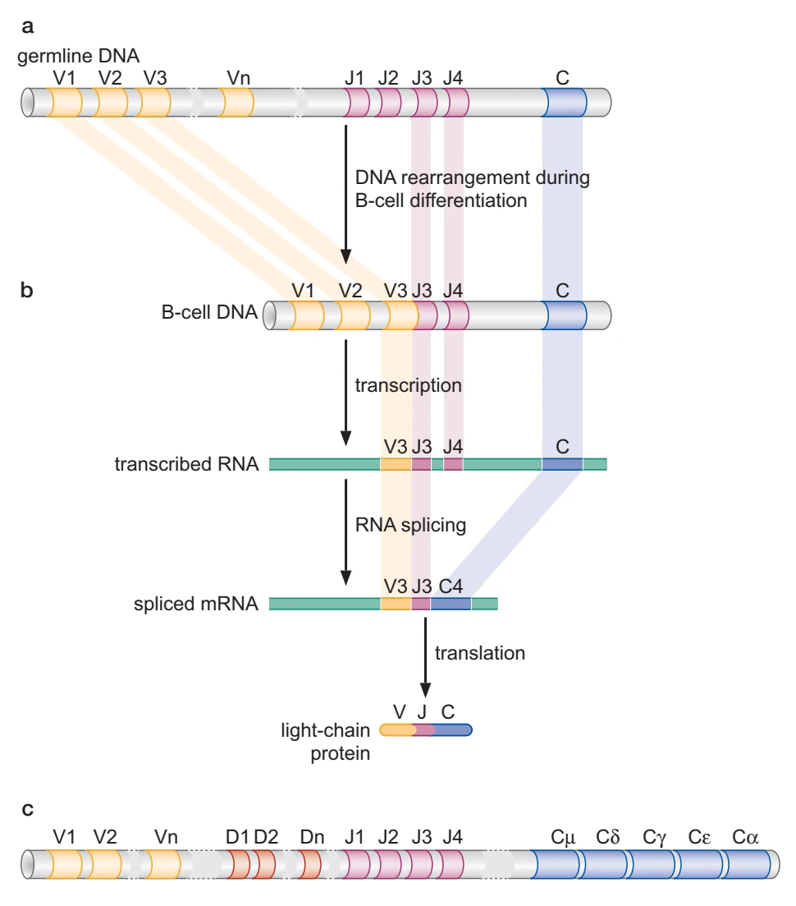{ width="650" loading=lazy }
/// caption
沿a、b向下看：V3与J3先在DNA上接合，转录后再经RNA剪接连接恒定区C。原图成熟mRNA蓝区标作“C4”，此处按恒定区C理解。c显示重链还有D片段及多种恒定区。[^fig-vdj]
///

图中两次连接改变的是不同分子。第一次删除或重排的是DNA片段；转录后，下游尚存的J4及间隔序列进入前体RNA，随后在加工中被去除。成熟轻链RNA保留已选出的VJ和恒定区C，翻译后才形成完整轻链。重组信号、切口与编码端的修复过程见[抗原受体基因重排](../../immunology/lymphocyte_development_repertoire.md#vdj-recombination)。

一次重排未必产生可用蛋白，细胞还可能继续尝试其他组合。产生功能性受体后的反馈参与限制进一步重排与另一等位基因的表达，形成等位基因排斥。能否形成并保留这一受体，取决于重排是否保持阅读框、产物能否组装，以及后续反馈是否发生。

B细胞活化后，AID引发的胞嘧啶脱氨及后续DNA修复还能产生两类结果。可变区的体细胞高频突变提供亲和力选择的材料；类别转换重组则改变已组装V(D)J下游连接的重链恒定区，使抗体可以使用IgG、IgA或IgE等不同效应部分。类别转换保留原有V(D)J组合，其主要改变发生在恒定区。[^antibody-switch]

!!! note "同一个抗体基因还会在RNA层面作选择"

    初始成熟B细胞可利用同一长前体RNA的不同加工方式共表达IgM与IgD。膜型与分泌型抗体也可通过剪接和多聚腺苷酸化位点选择，保留跨膜编码外显子或形成分泌型末端。DNA重排决定已有模板的片段组合，RNA加工继续决定这份模板产生的具体转录本。特定组织中也存在IgD类别转换，因而这里限定的是常见的初始B细胞共表达机制。[^igd-processing]

### 更换表达位点中的信息 { #_4 }

酿酒酵母交配型转换发生在 *MAT* 位点：HO核酸内切酶造成断裂后，细胞可以以沉默的 *HMLα* 或 *HMRa* 为供体复制相应信息。供体序列保留，*MAT* 的内容被替换，细胞表达的交配型随之改变。断裂后的链侵入与复制过程已在[合成依赖链退火和基因转换](../dna_recombination.md#sdsa-gene-conversion)中展开。

布氏锥虫利用**变异表面糖蛋白（VSG）**更换暴露给宿主免疫系统的表面抗原。血流型锥虫可从端粒附近的一个活跃表达位点大量表达一种 VSG，其他许多 VSG 序列保持沉默。更换表面抗原，有两条基本路线。[^vsg-switching]

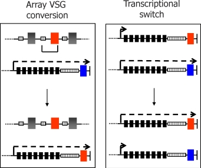{ width="500" loading=lazy }
/// caption
选取 Stockdale 等图 2 的第一与第四栏并列：左为阵列供体的基因转换，右为转录位点切换。蓝色表示原先表达的 VSG，红色为备用 VSG，长虚线箭头表示有效转录。[^vsg-two-switches]
///

先看右图：上方位点原先沉默，下方位点活跃；切换后两者的活跃状态互换，红、蓝 VSG 的 DNA 位置都没有改变。再看左图：备用的红色 VSG 序列被**复制进原活跃位点**，替换蓝色序列，原供体仍保留。这种基因转换改变了正在被转录的 DNA 内容；供体可来自不同储备区域，进一步的片段转换还可组合出嵌合序列。[^vsg-two-switches]

??? note "VSG从转录到细胞表面"

    血流型 VSG 表达位点由 Pol I 转录成多顺反子前体，随后通过反式剪接获得带帽的剪接前导 RNA 序列，并形成各自的 3′ 端；VSG 蛋白则以 GPI 锚连接在细胞表面。转录位点的选择与这些加工、定位过程相接，才最终更换表面的抗原层。[^vsg-processing]

    锥虫等动基体生物中的修饰碱基 J——葡萄糖基化的羟甲基尿嘧啶——也参与转录调节。J 与组蛋白变体 H3.V 在部分位置协作影响转录终止和基因沉默，其作用取决于基因组位置与转录装置。[^vsg-processing]

还有一些动物会在体细胞谱系真正丢失DNA。例如，马蛔虫属等线虫的程序性DNA消除使生殖系与体细胞保留的序列不同。这是一种有特定谱系和发育时序的程序，区别于多数动物细胞保留基因、通过染色质与转录调节使用它们的方式。[^dna-elimination]

## RNA命运与表达产物 { #post-transcriptional-regulation }

### 剪接、加尾与编辑 { #regulated-rna-processing }

同一基因可以使用不同启动子，产生不同的5′端；转录后的剪接、编辑和3′端形成又进一步改变成熟RNA。不同异构体可能编码不同蛋白，也可能只改变UTR，进而影响定位、翻译或降解。剪接位点的序列强度、外显子和内含子中的增强或沉默元件、SR蛋白、hnRNP及RNA结构，共同改变剪接体识别某个位点的机会。Pol II移动速度也可能改变某些位点的可用时间窗。具体的剪接化学和异构体类型见[剪接体与选择性剪接](../rna_processing.md#spliceosomal-splicing)。

果蝇体细胞性分化提供了一个完整的剪接级联。早胚中，X连锁信号基因的剂量及其作用时间窗使雌性胚胎启动 *Sex-lethal*（*Sxl*）的早期转录。随后两性都可使用维持型启动子，但雌性已有的Sxl蛋白改变自身前体RNA的剪接，跳过含提前终止密码子的外显子，于是继续生成有功能的Sxl。这一步把早期短暂差别维持下来。[^sxl-splicing]

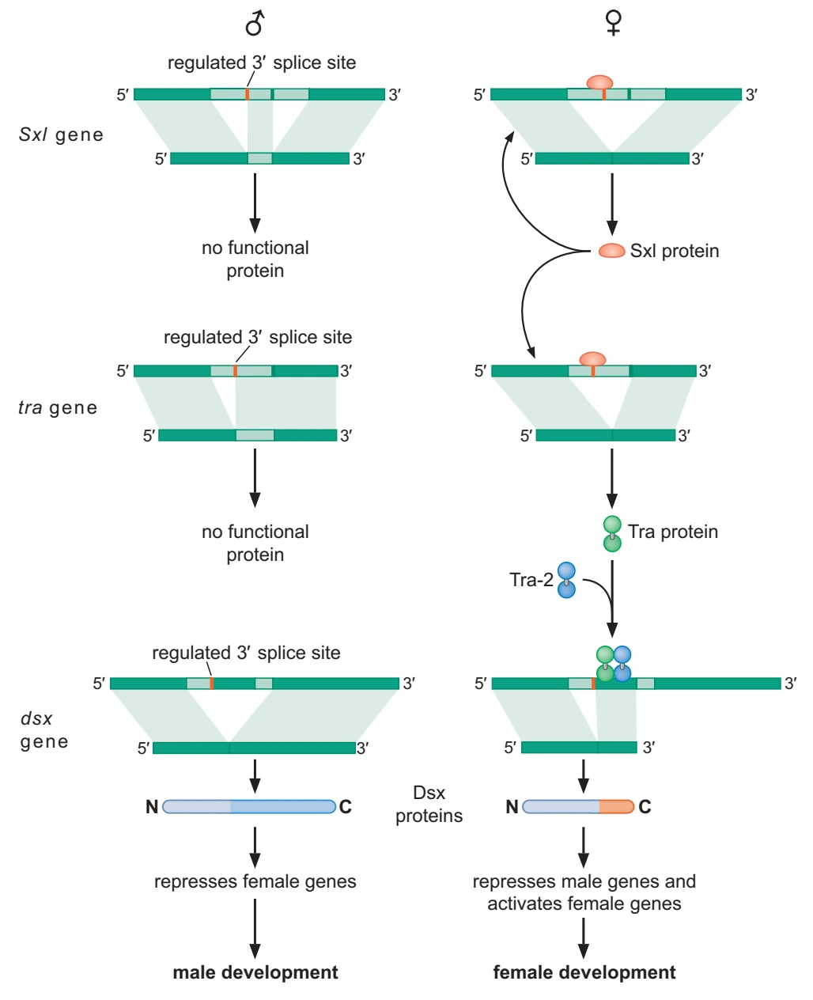{ width="800" loading=lazy }
/// caption
左侧为雄性，右侧为雌性；沿两列追踪Sxl、Tra与DSX的形成。雌性特异的剪接使功能性Sxl和Tra得以持续产生，再改变 *dsx* 的成熟RNA。[^fig-sxl]
///

Sxl接着调节 *transformer*（*tra*）的3′剪接位点选择，使雌性产生功能性Tra。Tra与Tra2及SR蛋白协作，促进 *doublesex*（*dsx*）前体RNA使用雌性特异的加工方式，生成DSX-F；缺少这一路径时形成DSX-M。DSX-F与DSX-M都是有功能的转录因子，能够调节体细胞性分化程序。剪接在这里不仅改变一种蛋白的长度，还串起了能够维持和传递细胞状态的调控链。

选择性多聚腺苷酸化可以改变3′UTR的长度，保留或移去miRNA及RNA结合蛋白位点；若不同末端涉及编码区，也会改变蛋白质的C端。RNA编辑则直接改变RNA的碱基信息：在人小肠中，APOBEC1相关编辑复合物可把载脂蛋白B转录本的CAA改成UAA，提前终止翻译，形成apoB48；肝脏通常产生较长的apoB100。两者的区别来自组织特异的RNA处理。反应装置分别见[3′端形成](../rna_processing.md#mrna-three-prime-end)和[RNA编辑](../rna_processing.md#rna-editing-modification)。

加工选择也可能引入提前终止密码子，使转录本进入无义介导降解。检测到一种低丰度异构体，只说明这种RNA能够形成；它是否积累为蛋白、是否有稳定功能，仍需相应测量。

### 输出、定位与稳定性 { #mrna-localization-stability }

成熟mRNA以信使核糖核蛋白复合物（mRNP）的形式离开细胞核。加帽、剪接、3′端形成与输出适配蛋白的装配相互联系，核内质量监控又限制未妥善加工的RNA进入胞质。到达胞质以后，RNA结合蛋白仍会读取UTR、编码区或局部结构，把mRNA接到马达、细胞骨架、细胞器表面和锚定位点；局部保护与局部降解也能形成不对称分布。[^mrna-localization]

这种分布使蛋白质能够在需要的位置合成。神经元树突中的局部翻译参与突触调节，胚胎中的RNA定位参与建立身体极性。培养神经元中的经典观察显示，Tau mRNA可分布到胞体与近端轴突，MAP2 mRNA则可延伸到树突。这里观察的是RNA所在的位置；蛋白本身的运输和结合还需要分别测量。[^neuronal-rna]

运输期间常需要暂时限制翻译，否则RNA尚未到达，蛋白已经在途中产生。

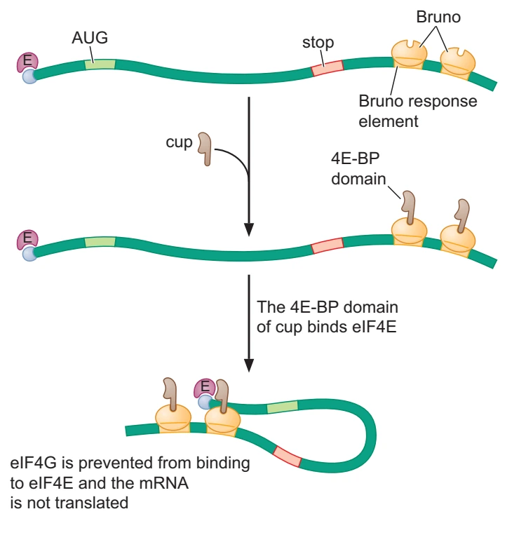{ width="410" loading=lazy }
/// caption
Bruno结合 *oskar* mRNA的3′UTR，Cup把这种结合接到5′帽附近的eIF4E，限制eIF4G装配。[^fig-oskar]
///

果蝇 *oskar* mRNA在卵母细胞中运往后极，翻译时机关系到后极的正常形成。Bruno识别其3′UTR中的调控元件，Cup可以同时与这类抑制复合物和eIF4E相互作用。帽结合蛋白eIF4E虽然仍可在RNA上，却较难与eIF4G组成有效的起始复合物。

3′UTR上的蛋白由此影响了5′端起始。到达正确位置后的RNP重排与其他调节解除抑制，使局部翻译得以发生；细胞不必等到需要蛋白的那一刻才开始转录。

mRNA的可用时间还取决于清除速度。PAN2–PAN3、CCR4–NOT等复合物参与去腺苷酸化，随后去帽可让XRN1从5′端降解RNA，外切体等装置则参与3′端方向的降解；内切核酸酶也能从内部切开RNA。UTR中的富AU元件可以招募促降解或保护RNA的蛋白，作用随结合者和细胞状态改变。P-body富集去帽、翻译抑制及周转相关组分，可见颗粒的形成却不是每条RNA降解的必经步骤。常规周转与异常RNA监控见[RNA质量控制](../rna_processing.md#rna-quality-control)。

### 铁响应：同一类位点，两种调控结果 { #_5 }

细胞缺铁时需要多摄取铁，同时减少把铁封存进铁蛋白。铁调节蛋白IRP把这两个需求接到不同mRNA上：铁蛋白（ferritin）mRNA的铁响应元件IRE位于5′UTR，IRP结合后限制翻译起始；转铁蛋白受体1（TfR1）mRNA的多个IRE则位于3′UTR，IRP结合可保护转录本免于快速降解。于是，缺铁时铁蛋白合成减少，TfR1 mRNA更稳定，细胞的取铁能力增加。铁充足时，IRP的IRE结合减弱，两个方向随之反转。[^iron-regulation]

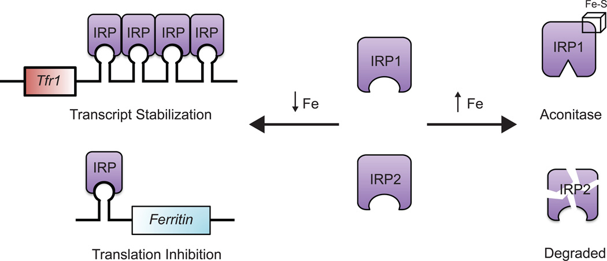{ width="780" loading=lazy }
/// caption
左侧低铁时，IRP抑制铁蛋白翻译并保护TfR1 mRNA；右侧铁充足时，IRP1装配铁硫簇，IRP2受到降解，两类RNA的调节方向反转。[^iron-regulation]
///

结合位点的位置改变了调节的环节：5′端结合影响核糖体起始装置进入，3′端结合影响RNA能存活多久。IRP1与IRP2则以不同方式读取铁状态。IRP1装配[4Fe–4S]簇后采用胞质顺乌头酸酶的构象，IRE结合能力降低；铁硫簇缺失时更利于RNA结合。IRP2没有同样的酶活性转换，高铁及适宜氧状态可稳定F-box蛋白FBXL5，使其参与的SCF泛素连接酶促进IRP2降解。[^irp2-fbxl5]

### 营养与应激中的翻译起始 { #translation-control }

帽依赖的真核翻译起始需要两类不同的准备：mRNA上的帽结合复合物要组织起来，40S小亚基也要获得eIF2–GTP–Met-tRNA$_i$起始三元复合物。营养与应激调控经常作用于这两个接口。

生长条件适宜时，mTORC1促进4E-BP磷酸化，降低它对eIF4E的结合。被释放的eIF4E得以与eIF4G结合，帮助建立帽依赖起始复合物；mTORC1活性降低时，低磷酸化4E-BP更容易占据eIF4E，限制eIF4G加入。营养、能量与生长因子怎样汇合到mTORC1，见[PI3K–Akt–mTOR通路](../../cell/cell_signaling.md#pi3k-akt-mtor)。

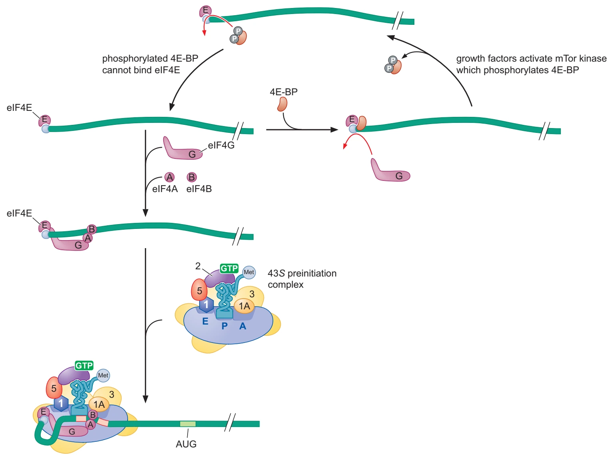{ width="730" loading=lazy }
/// caption
右侧4E-BP占据eIF4E，妨碍eIF4G结合；顶部的磷酸化使4E-BP释放eIF4E，左下方继续展示帽结合复合物装配和43S复合物招募。图中的受调控底物是4E-BP。[^fig-4ebp]
///

应激中的另一条路线称为**整合应激反应**（integrated stress response，ISR）。不同激酶读取不同输入：GCN2可响应氨基酸不足及相关核糖体状态，PERK感受内质网应激，PKR可被双链RNA激活，HRI则参与血红素缺乏等应激响应。它们都促进eIF2α磷酸化，使起始三元复合物的补充受到限制。[^translation-control]

eIF2完成一次起始后携带GDP，需要鸟嘌呤核苷酸交换因子eIF2B帮助换成GTP。eIF2α磷酸化以后，eIF2对eIF2B的作用从正常底物转为抑制，限制了交换反应。由于eIF2B的供应有限，一部分eIF2被磷酸化便可影响更大的eIF2循环池，使总体起始降低。已经在翻译的核糖体通常仍可继续延伸，短时间内蛋白质合成的变化首先来自新起始减少。

!!! note "总体翻译降低时，ATF4为什么还能增加"

    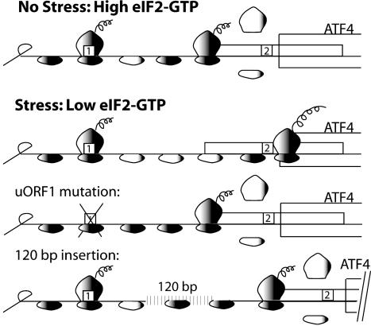{ width="480" loading=lazy }
    /// caption
    上两行比较eIF2–GTP供应充足与降低时的再起始。下两行分别改变uORF1起始位点和延长uORF1—uORF2间距，检验模型中的起始与扫描时间关系。原研究图5为机制模型。[^atf4-uorf]
    ///

    哺乳动物 *ATF4* mRNA上游有两个关键uORF。核糖体翻译过短uORF1后，部分40S仍沿mRNA扫描。三元复合物供应充足时，它很快重新获得起始能力，在下游抑制性uORF2起始；uORF2与ATF4主编码区错框重叠，因而妨碍ATF4翻译。

    eIF2α磷酸化后，重新获得三元复合物的时间延长，一部分扫描40S越过uORF2起始位点，随后才恢复起始能力，得以在ATF4主起始位点进入翻译。供应降低因此改变了起始位置的选择，使应激转录因子在总体抑制中增加。[^atf4-uorf]

    图的第三行使uORF1无法起始，扫描复合物容易直接进入抑制性uORF2。第四行在uORF1与uORF2之间插入120 nt，给扫描40S更多时间重新获得三元复合物，即使应激时也更容易在uORF2再起始；对应构建的ATF4表达因此降低。这些序列改变检验了“恢复起始能力需要时间”的解释。

    酵母GCN4也利用uORF与再起始，但具有不同的uORF布局。[GCN4的核糖体足迹图](../translation.md#translation-evidence)展示了饥饿时核糖体占据怎样向主编码区转移。

干扰素诱导的抗病毒状态还可提高PKR和2′–5′寡聚腺苷酸合成酶（OAS）等效应蛋白的表达。双链RNA激活OAS后，它合成2′–5′连接的寡聚腺苷酸，进而激活RNase L切割RNA；PKR则通过eIF2α抑制起始。这是分别作用于RNA完整性与翻译装置的两条支路。帽结构、5′UTR折叠、uORF及其他起始入口仍决定各转录本受到多大影响；eIF4E自身的磷酸化也不足以单独代表全细胞的翻译速率。[^translation-book]

### 母源mRNA的储存与启用 { #mrna }

卵母细胞预先储存许多母源mRNA，之后的成熟、受精与早期发育可以在转录受限的阶段调用它们。部分转录本保留较短的poly(A)尾并处于翻译受抑制的mRNP中，到合适阶段再延长尾部、重组蛋白伙伴，增加起始。短尾在这个背景中可以是可逆的储存状态。

在非洲爪蟾卵母细胞的经典模型中，CPE结合蛋白CPEB识别3′UTR中的胞质多聚腺苷酸化元件（CPE），与3′端加工相关因子及胞质加尾、去尾酶组成复合物。GLD2的加尾与PARN的去尾活动竞争；成熟信号推动复合物重排后，去尾作用减弱，poly(A)尾延长，更多poly(A)结合蛋白结合，从而有利于翻译。[^maternal-poly-a]

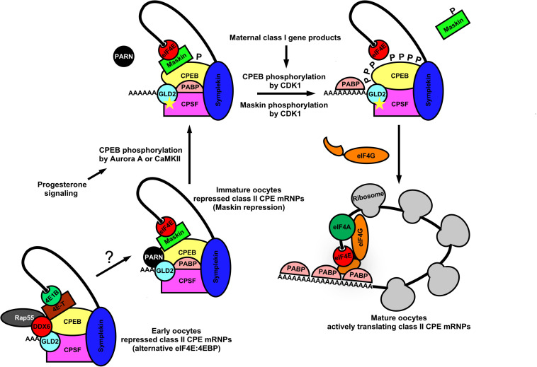{ width="800" loading=lazy }
/// caption
从中央向上，再向右、向下追踪，可以看到CPEB–Maskin模型中的PARN离去、poly(A)尾延长与翻译启用。左下方另画较早卵发生阶段的替代抑制复合物，包含eIF4E1b、4E-T等；各阶段使用的伙伴并不相同。[^maternal-poly-a]
///

这一模型还通过Maskin连接3′端与帽复合物：Maskin与CPEB及eIF4E相互作用时可限制eIF4G加入；随着加尾、PABP结合与mRNP重排，帽端的竞争关系改变。不同发育阶段、物种和转录本使用的eIF4E结合蛋白并不相同。poly(A)尾长与翻译效率的联系也会随早胚向体细胞状态转换而变化，因此尾部延长对翻译的促进作用有其特定背景。

???+ info "产物如何限制自身合成"

    poly(A)结合蛋白PABP通常帮助mRNA稳定和翻译，但在自己的mRNA上可以形成负反馈。它结合5′UTR中的富A自调控序列，并与其他蛋白组成抑制性RNP，限制自身翻译。相同蛋白接触不同RNA位置，产生的结果可以不同。[^pabp-autoregulation]

???+ info "新生微管蛋白怎样接上mRNA降解"

    微管解聚会增加可溶性 tubulin 亚基的供应，细胞可通过降低 tubulin mRNA 的稳定性来限制后续合成。识别发生在仍在翻译的核糖体上，因此这条反馈同时读到“正在合成什么”和当前的细胞状态。[^tubulin-autoregulation]

    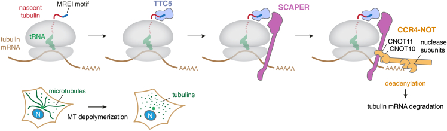{ width="750" loading=lazy }
    /// caption
    Höpfler 等图 7：上排从新生链识别走到 poly(A) 缩短，下排显示微管解聚带来的 tubulin 增加。图中的 MREI 是 β-tubulin 的 N 端基序；α-tubulin 的相应起始序列为 MREC。[^tubulin-autoregulation]
    ///

    先看核糖体出口：tubulin 新生链的 N 端露出后，**TTC5**同时识别新生链与出口周围的核糖体表面。随后，**SCAPER**与 TTC5 及核糖体结合，再经 **CNOT11**接上 CCR4–NOT 复合物。它的核酸酶亚基便能缩短正在被翻译的 tubulin mRNA 的 poly(A) 尾，使该 mRNA 进入降解。

    多余亚基由此可以减少新的供给。不过，游离 tubulin 增加后，最上游怎样解除对 TTC5 的抑制，在这项研究中仍未完全确定；图中已经建立的是核糖体识别到降解机器之间的连接。

### 小RNA把配对接到沉默机器 { #small-rna-silencing }

miRNA与siRNA的引导RNA通常约20—24 nt，通过序列配对选择目标。miRNA前体通常含发夹结构，常规动物通路经Drosha–DGCR8、输出及Dicer加工形成短RNA双链；siRNA则可由较长双链RNA加工产生。进入Argonaute复合物发挥导向作用的是其中一条链，另一条链常被去除；同一前体的两条臂也可能分别产生有功能的引导RNA。成熟体的名称如今常以5p、3p注明来源臂，名称本身不预先限定哪一条具有功能。完整生物发生过程与例外见[小RNA成熟](../rna_processing.md#small-rna-biogenesis)。

动物miRNA常以引导链第2—8位附近的种子区配对首先识别靶位点，其他配对、位点位置和局部可及性继续影响亲和力与输出。Argonaute结合后可招募TNRC6／GW182，继而连接CCR4–NOT、PAN2–PAN3及去帽相关机器，使翻译抑制与mRNA不稳定化共同发生。AGO2遇到互补范围足够广且配对合适的底物时，还能直接切割RNA。植物miRNA中较常见强互补的切割靶标，但翻译抑制也存在；具体输出由AGO、配对方式和靶标共同决定，完全或不完全互补只是其中一项条件。[^mirna-output]

???+ abstract "读图：miRNA压低了翻译，还是减少了mRNA"

    Hendrickson等向HEK293T细胞转入合成miR-124，12小时后与未加入RNA的模拟转染对照比较。研究者先通过Argonaute免疫沉淀识别候选靶标，再分别测量mRNA丰度以及mRNA在多核糖体梯度中的分布。后者用核糖体占据和密度估计单位mRNA的翻译速率，需要假定延伸速率没有系统变化。[^mirna-output]

    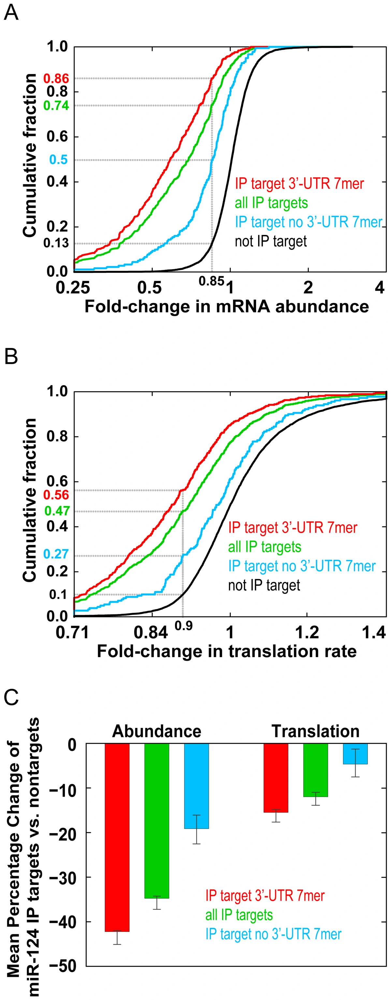{ width="460" loading=lazy }
    /// caption
    Hendrickson等图4：比较miR-124与模拟转染条件，绿色为Argonaute富集靶标，其中红色为含3′UTR七核苷酸种子匹配位点的靶标，蓝色为不含该位点的靶标；黑色为非靶标。C汇总相对非靶标校正后的平均变化，误差为bootstrap 95%置信区间。[^mirna-output]
    ///

    A、B横轴分别为miR-124相对对照的mRNA丰度和估计翻译速率，1左侧表示下降；纵轴为累计比例。靶标曲线向左移，说明更多靶标落在较低比值范围。

    在这组条件下，靶标mRNA丰度平均减少约35%，估计的单位mRNA翻译速率平均减少约12%。两项变化方向一致，RNA减少贡献了相当一部分抑制。它们并非所有miRNA的固定比例；这一次12小时测量也不能独自确定翻译抑制与RNA降解发生的先后。

一个miRNA可以影响许多转录本，一条mRNA也能同时带有多个miRNA和RNA结合蛋白位点。miRNA基因的转录、前体加工、RNA编辑以及成熟引导链的稳定性都可调节最后进入Argonaute的数量；发育时序miRNA如线虫 *lin-4*、*let-7* 因此能把时间变化接到一组靶标上。实验中常用siRNA或表达shRNA来降低目标RNA，即基因敲减；种子区脱靶、剂量及加工负担仍需要相应对照。

小RNA还可参与转录层的沉默。植物24 nt siRNA、AGO与Pol V相关新生RNA等组成RNA引导DNA甲基化路径；部分真菌和动物系统也能把小RNA识别接到组蛋白修饰或其他核内机制。piRNA与RdDM对移动元件的控制见[转座子控制](../dna_recombination.md#transposon-control)。植物和部分动物的RNA沉默还参与抗病毒防御；RNA能否在细胞间、个体内或跨物种传递，以及传递多远，都依赖具体体系。[^small-rna-book]

类病毒虽不编码蛋白，其RNA也可成为小RNA的来源；桃潜隐花叶类病毒的特定小RNA能引导宿主叶绿体HSP90 mRNA切割，从而把感染接到宿主基因表达变化。[^viroid-silencing]不同类病毒的复制区室与核酶分工见[类病毒的环状RNA复制](../../micro/viruses.md#viroids)。

??? note "一个促进表达的例子：启动子靶向小RNA与p21"

    小 RNA 的输出也有促进表达的实例。Li 等在 PC-3、MCF-7 和 HeLa 细胞中，转入与 *p21* 启动子约 −322 区域匹配的双链小 RNA **dsP21−322**，用量为 50 nM，72 小时后检测 RNA 和蛋白；对照包括 mock 与未发现与人序列有显著同源性的 dsCon-2。[^p21-rna-activation]

    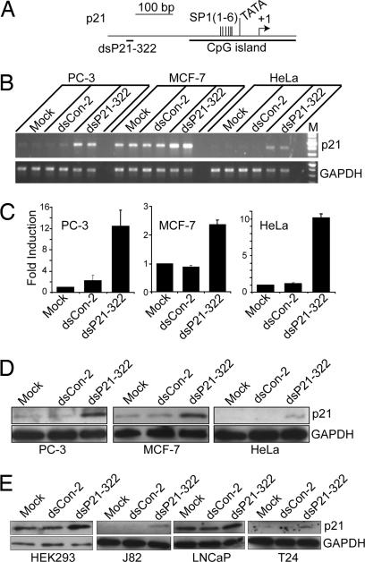{ width="480" loading=lazy }
    /// caption
    Li 等图 2：A 为靶区；B、C 为 p21 RNA 的检测与相对定量，D、E 为蛋白检测，GAPDH 为对照。C 中三个细胞系使用不同纵轴范围。[^p21-rna-activation]
    ///

    B、D 中，dsP21−322 处理的 p21 条带增强；C 相对 mock 的 RNA 增幅在 PC-3、MCF-7、HeLa 中分别约为 12.5、2.4、10.1 倍，背景依赖相当明显。论文另通过共转染敲低 Ago2，观察到诱导效应受损，支持这一路径需要 Ago2。

    这组图直接建立了特定小 RNA 处理后**稳态 mRNA 与蛋白增加**的关系。它本身不能区分转录速率与 RNA 稳定性各贡献多少，也没有直接看见小 RNA 与启动子 DNA 配对；直接靶标及中间步骤仍需分别检验。作者在所试的另一些启动子上也未获得同样激活，这一促进表达的效应仍受靶位点与实验条件限制。

## 调控网络的时间与细胞差异 { #regulatory-networks }

一个调节事件会继续改变后续调节者的数量。Gal4促进代谢系统表达，ATF4改变应激转录程序，Sxl则通过自身剪接延续早先的细胞状态。把这些关系连起来，反馈与前馈回路就具有了具体的分子内容。

负反馈中，产物抑制继续合成，可限制响应幅度并加快某些条件下回到稳态的过程。正反馈中，产物促进自身形成，足够强的非线性与合适周转条件下可以产生阈值、双稳态或记忆；一个正号箭头本身还不足以保证双稳态。若上游信号一面直接激活目标，一面较慢地激活它的抑制者，便构成非相干前馈结构，在适当参数下可产生先升后降的脉冲。RNA与蛋白质半衰期、反应延迟和亚细胞位置共同决定这些轨迹。[^network-book]

转录爆发、分子数较少时的随机波动以及细胞状态差异，又会使同一样本中的细胞表现不同。“平均表达增加两倍”可能来自大多数细胞略有增加，也可能来自响应细胞比例提高，或少数细胞出现更强爆发。时间序列和单细胞测量可以分辨这些变化。发育状态的长期维持与一次短暂应激可以使用相同的反馈关系，却不必具有相同的持续时间与可逆性。

## 怎样建立调控机制的证据 { #gene-regulation-evidence }

确定一个调节因子，常从它能否识别候选序列开始。DNA亲和纯化可以把含特定元件的DNA固定在介质上，结合并洗脱蛋白；盐浓度和洗涤条件帮助降低非特异结合，但仍需用突变序列与游离竞争DNA检验特异性。电泳迁移率变动分析（EMSA）观察结合后迁移较慢的DNA–蛋白复合物，DNase I足迹则观察蛋白保护了哪一段DNA。这些实验可以把直接结合与受保护区域具体定位出来。[^regulation-evidence]

细胞中的结合状态还需其他测量。ChIP-seq和CUT&RUN提供蛋白占据线索，ATAC-seq和DNase-seq反映可及性，Hi-C类方法测量接触概率。报告基因与序列诱变可测试某段元件在给定构建中的功能，但拷贝数、整合位置、启动子和缺少的内源染色质环境都可能改变结果。

???+ info "把结构域拆开，还能找蛋白伙伴"

    酵母双杂交利用了前面Gal4实验展示的模块性。将待测蛋白A接到DNA结合结构域，将蛋白B接到激活结构域；若二者在酵母细胞核内相互作用，激活区就会被带到报告启动子附近，使报告基因表达。[^fig-two-hybrid]

    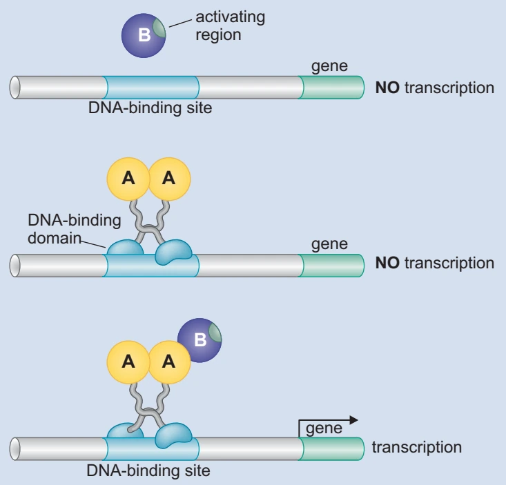{ width="480" loading=lazy }
    /// caption
    DNA结合区负责把A定位到报告元件；A与B相互作用后，B所带的激活区促进报告转录。[^fig-two-hybrid]
    ///

    实验需要检验A或B单独是否自行激活报告，以及融合蛋白是否表达并能进入相应区室。阳性结果说明在这一构建和细胞环境中能够把两个结构域带近；要确立原生细胞中的功能性互作，仍需定位、互作和功能扰动等独立证据。

接下来需要确定表达变化发生在哪一步。新生RNA标记、PRO-seq／GRO-seq与聚合酶图谱有助于观察转录，而RNA-seq测到的成熟RNA量同时受到合成与清除影响。核糖体图谱可定位核糖体，但密集占据也可能来自暂停；蛋白质组学和脉冲追踪再分别补上蛋白丰度、合成与周转的信息。前面miR-124实验把mRNA与翻译分开测量，正是因为单独一个终点无法区分这两种贡献。

较完整的机制链还需要在内源位点扰动元件或因子，观察预期的直接分子步骤和时间顺序，再通过回补、等位基因特异比较或另一种实验方法检验解释。例如，删除一个增强子后目标转录降低，若同时看到其他邻基因与细胞状态都大幅变化，就需继续区分直接作用和继发效应。结合、开放、接触与表达是可以相互支持的证据，因果方向则依赖怎样改变系统、怎样读出结果。

## 参考资料与延伸阅读 { #references }

- Watson JD, Baker TA, Bell SP, et al. *Molecular Biology of the Gene*. 7th ed. 2014. 第19章真核转录调控，第14—15章RNA加工与翻译调控；各教材图在脚注中列出图号与印刷页码。
- Mansisidor AR, Risca VI. [Chromatin accessibility: methods, mechanisms, and biological insights](https://pmc.ncbi.nlm.nih.gov/articles/PMC9683059/). 2022.
- Panigrahi A, O'Malley BW. [Mechanisms of enhancer action: the known and the unknown](https://pmc.ncbi.nlm.nih.gov/articles/PMC8051032/). 2021.
- Friedman MJ, Wagner T, Lee H, et al. [Enhancer–promoter specificity in gene transcription: molecular mechanisms and disease associations](https://pmc.ncbi.nlm.nih.gov/articles/PMC11058250/). 2024.
- Statello L, Guo CJ, Chen LL, Huarte M. [Gene regulation by long non-coding RNAs and its biological functions](https://pmc.ncbi.nlm.nih.gov/articles/PMC7754182/). 2021.
- Buxbaum AR, Haimovich G, Singer RH. [In the right place at the right time: visualizing and understanding mRNA localization](https://pmc.ncbi.nlm.nih.gov/articles/PMC4484810/). 2015.
- Marintchev A, Ito T. [eIF2B and the Integrated Stress Response: A Structural and Mechanistic View](https://pmc.ncbi.nlm.nih.gov/articles/PMC7189779/). 2020.

[^regulatory-layers]: Alberts等，[Control of Gene Expression](https://www.ncbi.nlm.nih.gov/books/NBK21057/)，*Molecular Biology of the Cell*，第4版；本页按转录前、转录与RNA命运分别展开，基础反应见相邻页面。
[^chromatin-accessibility]: Mansisidor与Risca，[Chromatin accessibility: methods, mechanisms, and biological insights](https://pmc.ncbi.nlm.nih.gov/articles/PMC9683059/)，2022。讨论核小体、修饰、转录因子和可及性测量的关系。
[^chromatin-book]: Watson等，*Molecular Biology of the Gene*，第7版，第19章，尤其DNA结合结构域、转录调节因子招募、暂停释放与表观遗传调节各节。
[^chromatin-dosage]: CBP／p300与发育的原研究见[Genetic Heterogeneity in Rubinstein-Taybi Syndrome: Mutations in Both the CBP and EP300 Genes Cause Disease](https://pmc.ncbi.nlm.nih.gov/articles/PMC1199295/)，2005；MECP2功能丧失见[Amir等](https://pubmed.ncbi.nlm.nih.gov/10508514/)，1999，剂量增加见[Van Esch等](https://pmc.ncbi.nlm.nih.gov/articles/PMC1226209/)，2005。
[^chromatin-inhibitors]: 伏立诺他的HDAC抑制机制见[DailyMed药品说明书第12.1节](https://dailymed.nlm.nih.gov/dailymed/lookup.cfm?setid=cd86ee78-2781-468b-930c-3c4677bcc092)；5-氮杂胞苷在RNA／DNA中的掺入见[AZA-MS原研究](https://pmc.ncbi.nlm.nih.gov/articles/PMC5886051/)，2018；DNA中的5-氮杂胞嘧啶捕获甲基转移酶的反应见[Santi等](https://pmc.ncbi.nlm.nih.gov/articles/PMC392062/)，1984。
[^neuronal-rna]: Litman P, Barg J, Ginzburg I. [Microtubules are involved in the localization of tau mRNA in primary neuronal cell cultures](https://pubmed.ncbi.nlm.nih.gov/7993638/). *Neuron*. 1994;13:1463–1474。原代培养神经元的原位杂交和细胞骨架相关分析，定位结论限定于相应实验对象。
[^fig-chromatin-opening]: Watson等，*Molecular Biology of the Gene*，第7版，图19–11，印刷页668。裁取教材示意图。
[^fig-pev]: Watson等，*Molecular Biology of the Gene*，第7版，图19–28，印刷页689。位置效应斑驳及 *white* 基因与异染色质邻近关系；教材注明照片引自Lippman与Martienssen，*Nature* 431:364–370（2004）图1a。
[^fig-methylation-maintenance]: Watson等，*Molecular Biology of the Gene*，第7版，图19–33，印刷页695。维持性DNA甲基化示意；DNMT1、UHRF1与TET的机制另见[DNA甲基化](../../genetics/genomics_epigenetics.md#dna-methylation)及其来源。
[^fig-imprinting]: Watson等，*Molecular Biology of the Gene*，第7版，图19–31，印刷页693。*H19–Igf2* 位点的CTCF和甲基化机制。
[^fig-gal-domain]: Watson等，*Molecular Biology of the Gene*，第7版，图19–4，印刷页661。Gal4截短和LexA–Gal4融合蛋白对相应报告构建的作用。
[^fig-dna-binding]: Watson等，*Molecular Biology of the Gene*，第7版，图19–5、19–6，印刷页662；图19–7、19–8，印刷页663。分别为α2同源结构域、C2H2锌指、GCN4 bZIP与bHLH结构。
[^fig-cooperation]: Watson等，*Molecular Biology of the Gene*，第7版，图19–16，印刷页676。四种协同结合方式。
[^fig-repression]: Watson等，*Molecular Biology of the Gene*，第7版，图19–22，印刷页682。真核转录抑制的不同作用位置。
[^fig-gal-sensing]: Watson等，*Molecular Biology of the Gene*，第7版，图19–25，印刷页686。无葡萄糖时Gal80与Gal4响应半乳糖的简化示意，图中省略Gal3。
[^gal-induction]: Watson等，第19章GAL调节部分；Jiang等，[Gene Activation by Dissociation of an Inhibitor from a Transcriptional Activation Domain](https://pmc.ncbi.nlm.nih.gov/articles/PMC2756894/)，2009。后者以活细胞GAL位点成像等检验Gal3依赖的Gal80抑制解除；不同图示中Gal80位置需结合实验条件理解。
[^nuclear-receptors]: 核受体的结构域、GR与TR／RAR的不同静息状态及所据教材见[胞内受体](../../cell/cell_signaling.md#intracellular-receptors-gases)。
[^enhancer-mechanisms]: Panigrahi与O'Malley，[Mechanisms of enhancer action: the known and the unknown](https://pmc.ncbi.nlm.nih.gov/articles/PMC8051032/)，2021。
[^enhancer-specificity]: Friedman等，[Enhancer–promoter specificity in gene transcription: molecular mechanisms and disease associations](https://pmc.ncbi.nlm.nih.gov/articles/PMC11058250/)，2024。启动子兼容性、染色质约束与增强子选择性。
[^enhancer-bursting]: Fukaya T, Lim B, Levine M. [Enhancer Control of Transcriptional Bursting](https://pmc.ncbi.nlm.nih.gov/articles/PMC4970759/). *Cell*. 2016;166:358–368，图2。比较果蝇胚胎第14次核周期中同一报告体系的不同增强子；爆发次数按观察窗口统计，荧光输出为相对量。
[^lncrna-regulation]: Statello等，[Gene regulation by long non-coding RNAs and its biological functions](https://pmc.ncbi.nlm.nih.gov/articles/PMC7754182/)，2021。
[^chorion-amplification]: Calvi BR, Lilly MA, Spradling AC. [Cell cycle control of chorion gene amplification](https://pmc.ncbi.nlm.nih.gov/articles/PMC316579/). 1998。卵巢滤泡细胞的局部DNA扩增及其发育时序。
[^rdna-amplification]: Hourcade D, Dressler D, Wolfson J. [The amplification of ribosomal RNA genes involves a rolling circle intermediate](https://pmc.ncbi.nlm.nih.gov/articles/PMC427140/). *PNAS*. 1973;70:2926–2930。非洲爪蟾卵母细胞rDNA扩增的电镜证据；不用于推断其他基因扩增均经滚环复制。
[^vdj-recombination]: Watson等，*Molecular Biology of the Gene*，第7版，第12章V(D)J重组，印刷页416起，图12–34至12–36等。RAG起始的切割及后续编码端加工、连接共同产生重排产物。
[^fig-vdj]: Watson等，*Molecular Biology of the Gene*，第7版，图12–34，印刷页417；教材据Bushman，*Lateral DNA Transfer*（2002）图11.3改编。保留原图标记，成熟mRNA中蓝色区对应恒定区C。
[^antibody-switch]: AID、体细胞高频突变与类别转换的关系另见[AID调节的原研究](https://pmc.ncbi.nlm.nih.gov/articles/PMC2597133/)；类别转换重排恒定区、保持已组装V(D)J，区别于最初的V(D)J组装。
[^igd-processing]: [Rad52 mediates class-switch DNA recombination to IgD](https://pmc.ncbi.nlm.nih.gov/articles/PMC8861003/)，2022，图1及引言区分初始B细胞的IgM／IgD RNA加工与特定条件下的IgD类别转换。
[^vsg-switching]: Boothroyd CE等，[An endonuclease-generated DNA break induces antigenic switching in Trypanosoma brucei](https://pmc.ncbi.nlm.nih.gov/articles/PMC2688456/). *Nature*. 2009;459:278–281。实验诱导活跃表达位点附近的DNA断裂，观察VSG切换与基因转换。
[^vsg-processing]: [RNA polymerase I transcribes procyclin genes and variant surface glycoprotein gene expression sites in Trypanosoma brucei](https://pubmed.ncbi.nlm.nih.gov/12796299/)，2003，以Pol I去除和RNAi检验聚合酶身份；[An assembly of nuclear bodies associates with the active VSG expression site in African trypanosomes](https://www.nature.com/articles/s41467-021-27625-6)，2022，涉及活跃位点的转录与反式剪接联系；J与H3.V的调节见[Base J and H3.V Regulate Transcriptional Termination in Trypanosoma brucei](https://pmc.ncbi.nlm.nih.gov/articles/PMC4721952/)，2016。
[^dna-elimination]: [Chromosome fusion and programmed DNA elimination shape karyotypes of nematodes](https://pmc.ncbi.nlm.nih.gov/articles/PMC11111355/)，2024。马蛔虫属等线虫的生殖系与体细胞基因组差异。
[^sxl-splicing]: Watson等，第14章；Erickson JW, Quintero JJ. [Indirect effects of ploidy suggest X chromosome dose, not the X:A ratio, signals sex in Drosophila](https://pmc.ncbi.nlm.nih.gov/articles/PMC2222971/)，2007。早胚X连锁信号剂量与发育时间窗决定Sxl早期启动，后续剪接维持状态。
[^fig-sxl]: Watson等，*Molecular Biology of the Gene*，第7版，图14–25，印刷页495。
[^mrna-localization]: Buxbaum AR, Haimovich G, Singer RH. [In the right place at the right time: visualizing and understanding mRNA localization](https://pmc.ncbi.nlm.nih.gov/articles/PMC4484810/). 2015。
[^fig-oskar]: Watson等，*Molecular Biology of the Gene*，第7版，图15–47，印刷页558。Bruno–Cup对 *oskar* 翻译起始的调节模型。
[^iron-regulation]: Ruiz JC, Bruick RK. [F-box and leucine-rich repeat protein 5 (FBXL5): sensing intracellular iron and oxygen](https://pmc.ncbi.nlm.nih.gov/articles/PMC3959624/). 2014，图1—2。区分IRP1铁硫簇／顺乌头酸酶转换与IRP2的FBXL5依赖降解。
[^irp2-fbxl5]: Salahudeen AA等，[An E3 Ligase Possessing an Iron-Responsive Hemerythrin Domain Is a Regulator of Iron Homeostasis](https://pmc.ncbi.nlm.nih.gov/articles/PMC3582197/). *Science*. 2009;326:722–726。FBXL5调节IRP2的细胞与生化证据。
[^fig-4ebp]: Watson等，*Molecular Biology of the Gene*，第7版，图15–46，印刷页557。4E-BP磷酸化改变其与eIF4E的结合。裁取示意图，去除图旁教材排版文字，未改变分子标注。
[^translation-control]: Marintchev A, Ito T. [eIF2B and the Integrated Stress Response: A Structural and Mechanistic View](https://pmc.ncbi.nlm.nih.gov/articles/PMC7189779/). *Biochemistry*. 2020;59:1299–1308。
[^atf4-uorf]: Vattem KM, Wek RC. [Reinitiation involving upstream ORFs regulates ATF4 mRNA translation in mammalian cells](https://pmc.ncbi.nlm.nih.gov/articles/PMC509193/). *PNAS*. 2004;101:11269–11274。
[^translation-book]: Watson等，*Molecular Biology of the Gene*，第7版，第15章翻译调控；OAS–RNase L的RNA识别与降解见原研究[Nucleoside modifications in RNA limit activation of 2′-5′-oligoadenylate synthetase and increase resistance to cleavage by RNase L](https://pmc.ncbi.nlm.nih.gov/articles/PMC3241635/)，2011；起始机器的反应顺序见[翻译与蛋白质生物合成](../translation.md#eukaryotic-initiation)。
[^maternal-poly-a]: Huggins HP, Keiper BD. [Regulation of Germ Cell mRNPs by eIF4E:4EIP Complexes: Multiple Mechanisms, One Goal](https://pmc.ncbi.nlm.nih.gov/articles/PMC7358283/). 2020，图3及对应正文。CPEB、GLD2、PARN和Maskin模型限定于所述卵母细胞背景。
[^pabp-autoregulation]: Patel GP, Ma S, Bag J. [The autoregulatory translational control element of poly(A)-binding protein mRNA forms a heteromeric ribonucleoprotein complex](https://pmc.ncbi.nlm.nih.gov/articles/PMC1316114/). *Nucleic Acids Research*. 2005;33:7074–7089。
[^tubulin-autoregulation]: Lin等，[TTC5 mediates autoregulation of tubulin via mRNA degradation](https://pmc.ncbi.nlm.nih.gov/articles/PMC6942541/)，2020；Höpfler等，[Mechanism of ribosome-associated mRNA degradation during tubulin autoregulation](https://pmc.ncbi.nlm.nih.gov/articles/PMC10403363/)，2023。分别解释新生链识别及SCAPER／CCR4–NOT相关降解。
[^mirna-output]: Hendrickson DG等，[Concordant regulation of translation and mRNA abundance for hundreds of targets of a human microRNA](https://pmc.ncbi.nlm.nih.gov/articles/PMC2766070/). *PLoS Biology*. 2009;7:e1000238，图4。HEK293T细胞，合成miR-124与mock转染比较，12小时；mRNA与AGO免疫沉淀每组3次，可用多核糖体分析为mock 3次、miR-124 2次；翻译速率由多核糖体分析估计，非核糖体足迹测序。TNRC6等作用机制及小RNA生物发生见[小RNA成熟](../rna_processing.md#small-rna-biogenesis)及所列来源。
[^small-rna-book]: Watson等，*Molecular Biology of the Gene*，第7版，第20章调控RNA；跨谱系生物发生与基因组沉默的装置见[RNA转录后加工](../rna_processing.md#small-rna-biogenesis)和[转座子控制](../dna_recombination.md#transposon-control)。
[^viroid-silencing]: [Small RNAs containing the pathogenic determinant of a chloroplast-replicating viroid guide the degradation of a host mRNA as predicted by RNA silencing](https://pubmed.ncbi.nlm.nih.gov/22332758/)，2012。桃潜隐花叶类病毒的特定小RNA与宿主叶绿体HSP90 mRNA切割。
[^network-book]: Watson等，*Molecular Biology of the Gene*，第7版，第22章调控网络；本页强调回路符号需与结合动力学、周转和延迟一同解释。
[^regulation-evidence]: 转录因子结合的生化方法见Watson等第19章；可及性测量及其限制见[Mansisidor与Risca](https://pmc.ncbi.nlm.nih.gov/articles/PMC9683059/)，增强子接触与因果验证见[Friedman等](https://pmc.ncbi.nlm.nih.gov/articles/PMC11058250/)。
[^fig-two-hybrid]: Watson等，*Molecular Biology of the Gene*，第7版，Box 19–1图1，印刷页664。酵母双杂交设计示意。

[^chorion-fork-model]: Claycomb JM 等. [Visualization of replication initiation and elongation in Drosophila](https://pmc.ncbi.nlm.nih.gov/articles/PMC2173051/). *J Cell Biol* (2002)，doi:10.1083/jcb.200207046，图 1H、I；裁取完整模型行，所依据的 ORC2／BrdU 成像见原图 A、B、F、G。

[^vsg-two-switches]: Stockdale C 等. [Antigenic Variation in Trypanosoma brucei: Joining the DOTs](https://pmc.ncbi.nlm.nih.gov/articles/PMC2486309/). *PLoS Biol* (2008)，doi:10.1371/journal.pbio.0060185，图 2 第一、第四栏组合，保留原面板标题；关于复制式转换的干预证据另见 Boothroyd 等原研究。

[^p21-rna-activation]: Li LC 等. [Small dsRNAs induce transcriptional activation in human cells](https://pubmed.ncbi.nlm.nih.gov/17085592/). *PNAS* 103:17337–17342 (2006)，doi:10.1073/pnas.0607015103；[开放全文](https://pmc.ncbi.nlm.nih.gov/articles/PMC1859931/)。图 2 保留 A–E；Ago2 依赖的干预见图 5。图 2C 为两个独立实验、每实验两份样本的测量，不能把其他基因上的染色质读数移作 p21 的直接证据。
