# 原核基因表达调控

大肠杆菌换一种糖来吃，并不需要先换一套基因组。它已有利用多种碳源的酶，却会随环境改变这些酶的合成量：乳糖出现时增加乳糖通透酶和β-半乳糖苷酶，氨基酸短缺时重新分配转录与翻译资源。DNA上的调控序列、能感受代谢物的蛋白质，以及正在形成的RNA结构，把环境变化接到一个个具体反应上。[^regulatory-layers]

基因表达的输出可以是RNA，也可以是蛋白质。调节转录起始能改变新生RNA的产生速率；调节终止、翻译或降解，则能改变同一份模板最终产生多少可用产物。稳态丰度反映合成与清除的共同结果，因此“mRNA变多了”还需要继续追问：是转录更快，还是降解更慢？

本页以细菌为主，随后单独介绍古菌的调控装置。染色质、增强子与真核RNA命运控制见[真核基因表达调控](eukaryotic.md)。

## 调控元件与表达单位 { #bacterial-gene-regulation }

### 顺式元件、反式因子与操纵子 { #operons-cis-trans }

**顺式作用元件**是核酸上的局部控制序列，作用于与自身物理相连的基因或RNA区段。启动子、阻遏蛋白结合的操纵序列，以及mRNA上的核糖体结合位点、发夹结构，都属于这类元件。**反式作用因子**则是可扩散的蛋白质或RNA：一个基因产生的阻遏蛋白，可以寻找同一细胞内不同DNA分子上的识别位点。

细菌常把功能有关的几个基因排列在一起，由同一个启动子产生含多个编码区的RNA。这种表达单位称为**操纵子（operon）**。调节蛋白的基因可以在操纵子旁边，也可以远在染色体另一处；只要产物能够到达靶位点，就能参与控制。[^bacterial-regulation]

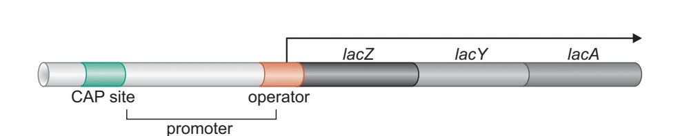{ width="670" loading=lazy }
/// caption
箭头代表由同一启动子开始的转录。CAP位点与操纵序列都在DNA上，结合它们的蛋白质由其他转录单位提供；本图只画出主要操纵序列。[^fig-lac-operon]
///

多个分散的操纵子若受同一个调节因子控制，构成**调控子（regulon）**，例如CRP控制的碳源利用基因和LexA控制的SOS基因。受到同一种刺激而共同变化的基因集合还可能包含间接响应，不一定共享一个直接结合它们的因子。

!!! info "一起转录，仍可产生不同数量的蛋白质"

    一个多顺反子mRNA上，各编码区可以有不同的翻译起始效率；内部启动子、条件性终止、RNA切割和不同区段的稳定性也会改变产量。操纵子使一组基因容易协调表达，却没有把它们锁成等量生产。古菌和少数真核谱系也有操纵子；线虫的长前体常经反式剪接和3′端形成，产生分立的成熟mRNA。

### 激活与阻遏作用在哪一步 { #activation-repression }

RNA聚合酶需要先接触启动子，再打开局部DNA，最后离开启动子进入延伸。调节蛋白可以改变其中不同的步骤。下图展示一种常见情况：聚合酶独自结合启动子的概率较低；阻遏蛋白占据重叠位点后进一步妨碍结合；激活蛋白则同时接触DNA与聚合酶，使聚合酶更容易留在启动子处。[^gene-regulation-book]

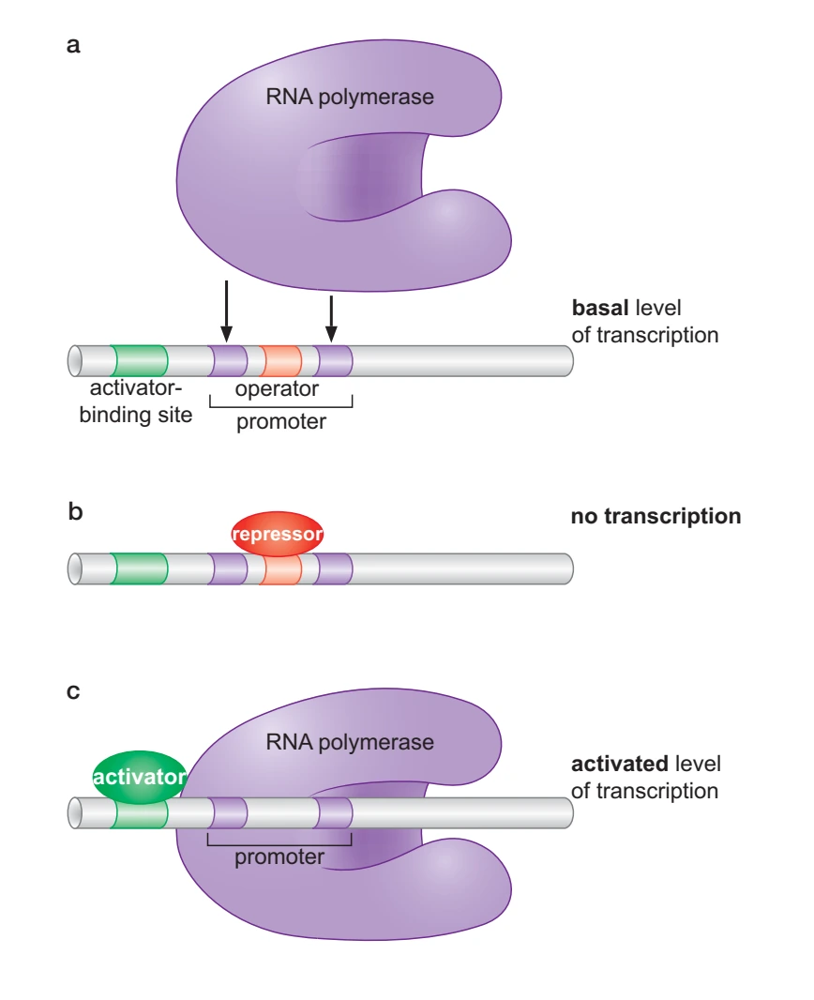{ width="370" loading=lazy }
/// caption
比较a、b、c中聚合酶与DNA接触的机会。c的激活蛋白既结合DNA，也接触聚合酶；这是“招募”的具体含义。[^fig-activation]
///

**正调控、负调控描述调节因子的作用方向。** 激活蛋白提高表达，阻遏蛋白降低表达；而“诱导”“阻遏”也常用来描述加入某种小分子后产量的变化。两套词并不一一对应：诱导物既可以解除阻遏蛋白的作用，也可以使激活蛋白开始工作。

启动子序列决定聚合酶识别、解链和启动子逃逸的动力学背景，但“组成型”并不等于“强”。一个很弱的启动子也可以持续产生少量RNA；一个强启动子也可能受到严密控制。序列与一致序列的相似程度只是判断强弱的线索之一。

DNA模板数目同样会影响输出。质粒拷贝数、染色体复制状态和rRNA基因数都会改变可用模板的数量；这些模板能产生多少RNA和蛋白质，还受聚合酶、核糖体与调控因子供给的限制。因此，基因剂量增加，并不保证最终蛋白量同比增加。

## 乳糖操纵子：两个输入怎样汇合 { #lac-operon }

### LacI读取诱导物

大肠杆菌的 *lacZ* 编码β-半乳糖苷酶，*lacY* 编码乳糖通透酶，*lacA* 编码硫代半乳糖苷转乙酰酶。前两者分别帮助分解和摄入乳糖；LacA则催化另一类反应，将乙酰基从乙酰CoA转给某些β-半乳糖苷。三个基因共同转录，*lacI* 由自己的启动子表达，产生LacI阻遏蛋白。[^lac-operon]

没有诱导物时，LacI偏好能结合操纵序列的构象。一个LacI四聚体可同时结合主操纵序列和一个辅助操纵序列，中间的DNA弯成环，使阻遏更加有效。

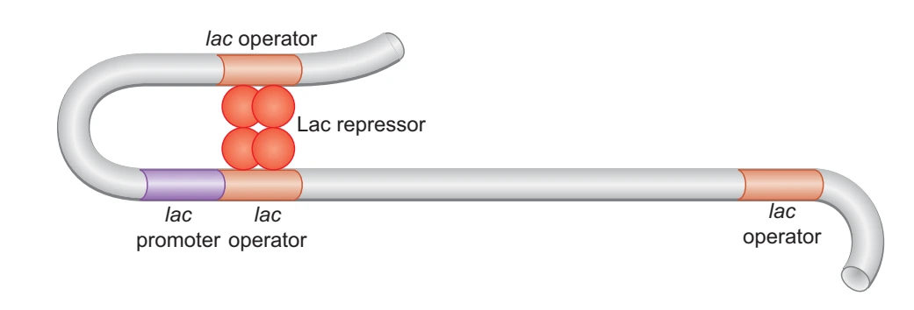{ width="650" loading=lazy }
/// caption
图中一对亚基接触主操纵序列，另一对接触上游辅助位点；下游辅助位点也能参与另一种环。连接两个位点，增强了LacI对启动子区域的有效占据。[^fig-lac-loop]
///

受阻遏的细胞仍会有少量基础表达，因而保留一点LacY和LacZ。乳糖进入后，LacZ除水解乳糖外，还能生成异乳糖；**异乳糖是与LacI结合的直接诱导物**。结合使LacI对操纵序列的亲和力降低，更多转录得以发生，新合成的LacY又增加乳糖摄入。这便接上了正反馈：已有产物帮助下一批产物更快形成。

实验中常用IPTG诱导，因为它能结合LacI，却不被LacZ作为正常底物水解。X-gal的用途不同：它被β-半乳糖苷酶作用后形成蓝色产物，主要用来报告酶活。蓝白斑实验常把二者放在同一培养基里，一个负责诱导表达，一个负责把酶活显示出来。

### CRP–cAMP读取碳源状态

LacI离开以后，*lac* 启动子仍不一定达到高表达。cAMP与**CRP（又称CAP）**结合，改变其DNA结合结构域的取向；CRP–cAMP占据启动子上游位点，接触RNA聚合酶α亚基的C端结构域（αCTD），帮助招募聚合酶。

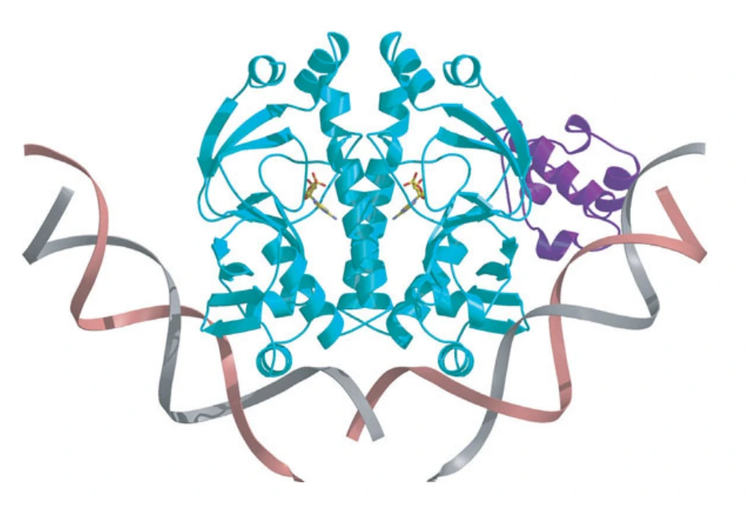{ width="450" loading=lazy }
/// caption
青色为CAP二聚体，紫色为αCTD，DNA围着CAP弯曲。两种颜色相接的部位，显示了激活蛋白与聚合酶亚基的接触界面。[^fig-cap-complex]
///

葡萄糖通过磷酸转移酶系统摄入时，会改变相关蛋白的磷酸化状态，进而影响腺苷酸环化酶与cAMP水平。未磷酸化的EIIA$^{\mathrm{Glc}}$还能抑制LacY，减少乳糖进入，这称为**诱导物排阻**。[^catabolite-control]

因此，分解代谢物阻遏同时涉及启动子激活与糖转运。同一种糖的摄取状态，可以一边改变新酶的合成，一边限制已有通透酶的活动。

| 环境与调节状态 | 典型表达结果 |
| --- | --- |
| 没有足够诱导物，LacI保持高占据 | 很低的基础表达 |
| 诱导物足够，但CRP激活较弱 | LacI阻遏可解除，表达仍因激活不足而有限 |
| 有诱导物，且CRP–cAMP能充分激活 | 较高表达 |

这是常用条件下的定性比较。实际水平还会随糖浓度、菌株、培养历史和摄取速率改变。

### 顺反实验怎样分开“位点”和“产物” { #lac-cis-trans-test }

一种突变让细胞在没有乳糖时也不断产生β-半乳糖苷酶，原因可能不止一个：细胞没有做出有效阻遏蛋白，也可能是DNA上的结合位点失效了。单看“总是表达”的表型，分不开这两种情况。

Jacob、Monod等利用部分二倍体，让同一个细胞同时带有正常与突变的 *lac* 区段。这样，两份DNA共享胞质中的蛋白质，却保留各自的顺式位点。[^lac-operon]

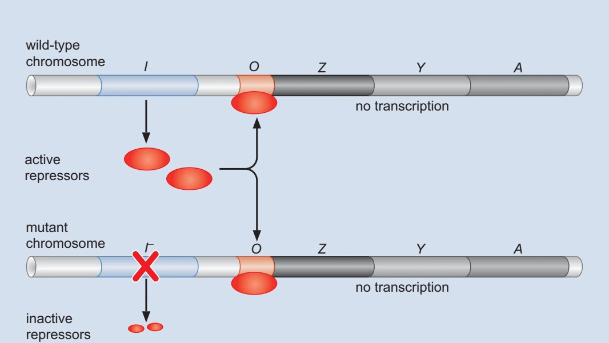{ width="520" loading=lazy }
/// caption
正常 *lacI* 产生的阻遏蛋白可以作用于另一份DNA。缺少诱导物时，两份DNA上的 *lac* 转录都受到抑制。[^fig-lac-genetics]
///

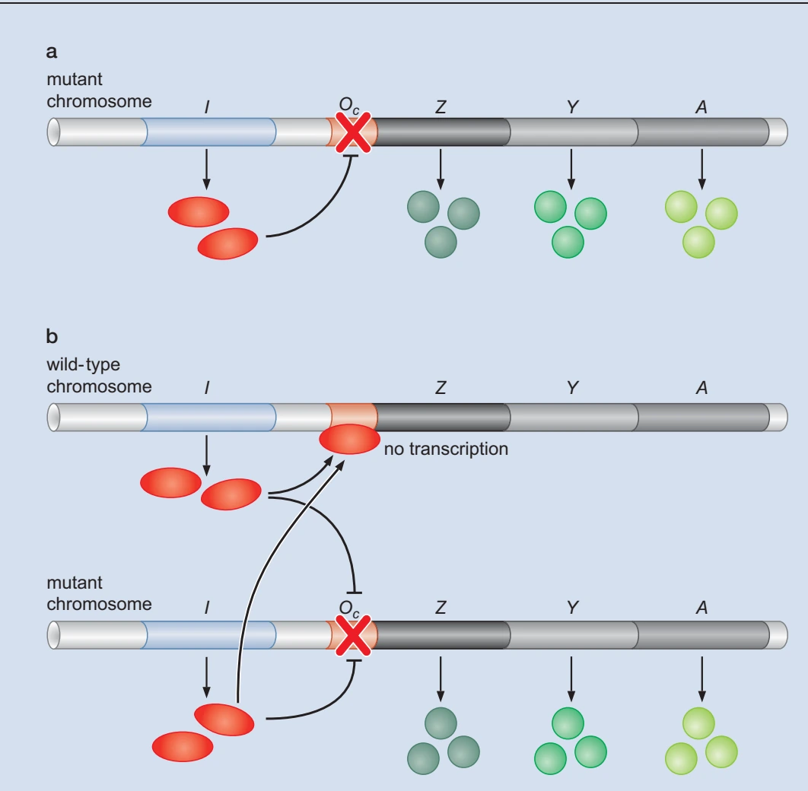{ width="380" loading=lazy }
/// caption
突变操纵序列$O^c$所连的基因继续表达；同一细胞的正常位点仍可被阻遏。a为突变副本单独存在，b为正常与突变副本共存；三种绿色分别表示LacZ、LacY、LacA。[^fig-lac-genetics]
///

若是 *lacI* 失活，另一份正常 *lacI* 可以提供可扩散的LacI，恢复受控表达：缺陷能够在**反式**被补偿。若是操纵序列$O^c$改变了LacI的识别，增加正常阻遏蛋白仍不能修复这段DNA；另一份正常操纵序列也不能越过来接管它。突变只改变与自身相连基因的控制，体现**顺式**作用。

这组遗传分析在分子结构完全清楚之前，就把“调节基因产生可扩散产物”和“DNA带有局部控制位点”分开了。上面的图是后来的机制示意，不是当年的酶活原始记录。

## 从其他操纵子看控制方式

### AraC在成环与激活之间转换 { #arac-control }

*araBAD* 编码利用L-阿拉伯糖的三种酶：AraA将其异构化为L-核酮糖，AraB使其磷酸化，AraD再产生可进入后续代谢的D-木酮糖-5-磷酸。基因在线性DNA上排成 *araB–araA–araD*，反应却按A、B、D的次序进行。

调节蛋白AraC既能抑制，也能激活。没有阿拉伯糖时，AraC二聚体偏向连接 *araO2* 与 *araI1*，形成抑制性的DNA环。结合阿拉伯糖后，它更容易占据相邻的 *araI1* 与 *araI2*，把接触聚合酶的部分放到启动子附近，促进 *P*~BAD~起始；CRP–cAMP还提供碳源状态的另一重输入。[^gene-regulation-book]

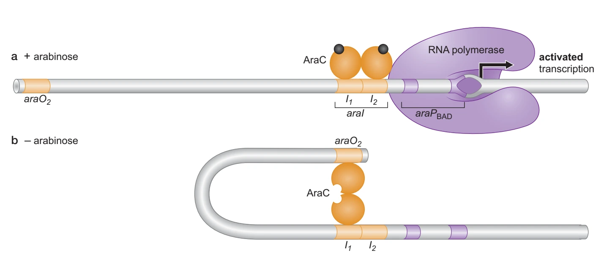{ width="700" loading=lazy }
/// caption
a中AraC结合相邻的$I_1$、$I_2$；b中一个亚基接触远处的$O_2$，中间DNA成环。图没有画出CRP，因此只展示AraC这一层控制。[^fig-arac]
///

AraC还能结合 *araO1*，压低自身启动子的转录，限制继续积累。这是转录层的自调控；*araO1* 与图中控制 *araBAD* 的$I_1$、$I_2$、$O_2$是不同位点。[^arac-autoregulation]

### MalT与GalR感受糖代谢状态 { #malt-gal-control }

**麦芽糖调控子**包含分散的运输与代谢基因。其激活蛋白MalT直接响应的关键糖配体是**麦芽三糖**，并需要ATP支持活化组装。MalP是麦芽糊精磷酸化酶，MalQ是转移葡糖基的酶；运输则由MalE等另一组蛋白承担。于是，代谢中间物麦芽三糖把糖的利用情况反馈给了激活蛋白。[^malt-control]

半乳糖系统还承担合成代谢：细胞即使没有把半乳糖当主要碳源，也可能需要UDP-半乳糖。*galETKM* 的两个相邻启动子P1、P2可以对输入作出不同反应；CRP–cAMP通常促进P1并抑制P2。GalR结合外、内操纵序列，在HU等因子和DNA拓扑的帮助下形成抑制性环；半乳糖会改变GalR的调节状态。[^gal-control]

其中GalK把半乳糖磷酸化，GalT以UDP-葡萄糖为供体进行尿苷酰转移；GalE使UDP-葡萄糖与UDP-半乳糖相互转化，GalM则促进半乳糖两种异头体之间转换。GalE的双向反应尤其能说明：这组酶既服务于糖的分解，也可提供细胞组分所需的UDP-半乳糖。

从P1或P2起始，都可以产生覆盖操纵子多个基因的RNA，最终各蛋白量还受后续转录、加工与翻译影响。双启动子使碳源分解和细胞组分合成容易兼顾，具体输出还随GalR占据、DNA超螺旋和代谢状态变化。

### 已经结合的聚合酶，还可以继续受控 { #ntrc-merr }

有些启动子已经结合聚合酶，却停在闭合复合物状态。**NtrC**响应氮代谢信号：NtrB介导的磷酸化促进NtrC形成活跃的高阶ATP酶复合物。远处DNA上的NtrC借DNA弯曲接近含σ$^{54}$的聚合酶，再利用ATP水解促进开放复合物形成。聚合酶已经到位，NtrC帮助它继续完成构象转换。[^gene-regulation-book]

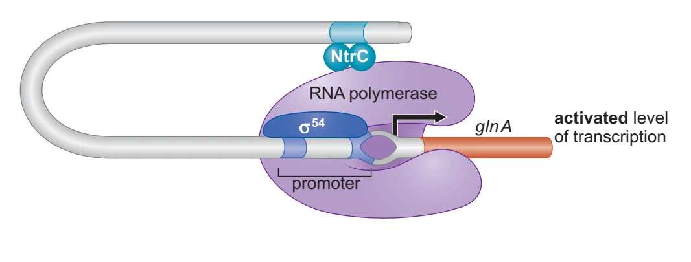{ width="560" loading=lazy }
/// caption
图将NtrC画成简化单元；实际活化涉及高阶ATP酶组装。箭头从启动子进入 *glnA*，与上游NtrC位点之间的DNA形成环。[^fig-ntrc-merr]
///

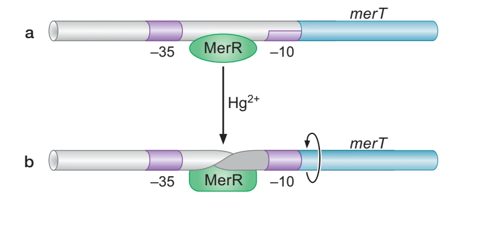{ width="450" loading=lazy }
/// caption
MerR位于−35与−10元件之间。Hg$^{2+}$改变蛋白构象后，DNA扭转使两个元件更适于被聚合酶共同识别。[^fig-ntrc-merr]
///

**MerR**则直接改变启动子DNA的空间构型。典型汞抗性启动子的−35、−10元件间隔偏长，聚合酶虽可结合，却不易有效起始。MerR结合Hg$^{2+}$后扭转中间DNA，改善两段元件的相对方位，使已经结合的聚合酶更容易开始转录。

## RNA形成时就能作出选择 { #bacterial-rna-regulation }

### trp衰减读取已氨酰化的tRNA { #trp-operon-attenuation }

大肠杆菌 *trpEDCBA* 操纵子编码色氨酸合成所需的酶。游离色氨酸结合TrpR后，提高其对操纵序列的亲和力，减少转录起始；已经起始的聚合酶还要通过 *trpL* 前导区。后一层控制称为**衰减（attenuation，也称弱化）**，关键是RNA能在几种互斥的配对方式之间选择。[^attenuation-riboswitch]

??? info "trpEDCBA产生哪些酶"

    大肠杆菌用五个结构基因承担连续的合成反应，其中有些蛋白兼具两种活性。[^trp-enzymes]

    | 基因产物 | 在色氨酸合成中的作用 |
    | --- | --- |
    | TrpE、TrpD | 共同完成由分支酸生成邻氨基苯甲酸的反应：TrpD提供谷氨酰胺酰胺转移活性，TrpE利用所供氮源；TrpD还具有后一步邻氨基苯甲酸磷酸核糖基转移活性 |
    | TrpC | 双功能蛋白，先后承担磷酸核糖基邻氨基苯甲酸异构化与吲哚甘油磷酸合成 |
    | TrpA、TrpB | 分别为色氨酸合成酶α、β亚基：前者从吲哚甘油磷酸释放吲哚，后者使吲哚与丝氨酸生成色氨酸 |

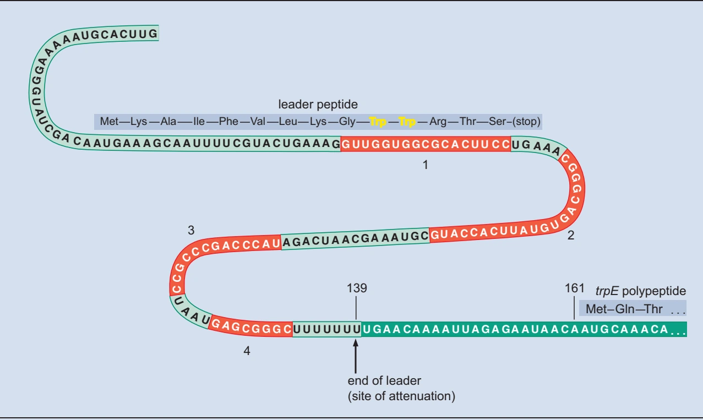{ width="760" loading=lazy }
/// caption
前导肽中两个连续Trp密码子位于第1区；红色的1、2、3、4区可参与不同茎环。第3、4区配对并接上U串，形成内在终止信号。[^fig-trp]
///

细菌的转录与翻译可以在时空上衔接：RNA刚露出一段，核糖体就开始翻译前导肽。聚合酶在前导区的暂停有助于两者协调，之后核糖体停在哪里，会决定哪段RNA能够参与配对。

1. **Trp-tRNA$^{\mathrm{Trp}}$供应充分。** 核糖体通过两个Trp密码子，在前导肽末端附近遮蔽第2区。第3、4区配对，聚合酶较多在结构基因之前终止。
2. **已氨酰化的tRNA$^{\mathrm{Trp}}$不足。** 核糖体停在第1区的Trp密码子处，第2区因此可与第3区配对。第3区被占用，第3、4区终止发夹难以形成，转录得以继续。
3. **完全没有前导肽翻译。** 第1、2区可以配对，留下第3、4区形成终止子。因此“翻译完全停止”与“核糖体在特定Trp密码子处暂停”后果不同。

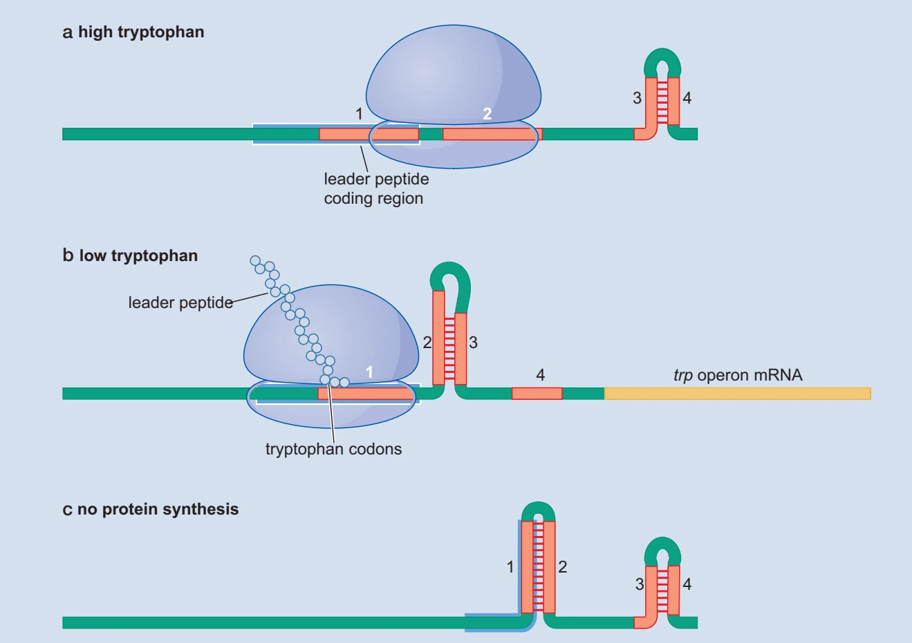{ width="620" loading=lazy }
/// caption
沿a→b比较核糖体遮住的是哪一段：b中，第1区的暂停为2–3配对留下机会，转录得以继续。再看c，没有核糖体也能形成3–4终止结构。[^fig-trp]
///

TrpR与前导区读取的是相关但不同的变量：前者主要响应游离Trp，后者把氨酰化tRNA是否足以完成翻译转成RNA结构。其他细菌可以采用不同方案：T-box前导区直接结合未氨酰化tRNA，蛋白介导的衰减则由RNA结合蛋白改变终止结构。连续Trp密码子和四段配对是 *trpL* 的具体做法。

β-内酰胺酶基因 *ampC* 的前导区提供另一种衰减输入。大肠杆菌中的遗传分析支持：在生长较快的条件下，前导区翻译起始复合物更容易形成，阻碍衰减终止结构建立，使更多转录读通。它读取翻译起始与生长状态，不依赖一串特定氨基酸密码子。[^ampc-attenuation]

### 核糖开关把配体结合接到不同输出

**核糖开关（riboswitch）**通常含两个相接部分：适配体结构域负责识别配体，表达平台改变终止、核糖体结合或RNA加工。小分子与RNA接触后稳定一种折叠，使另一种相互排斥的配对不易发生。

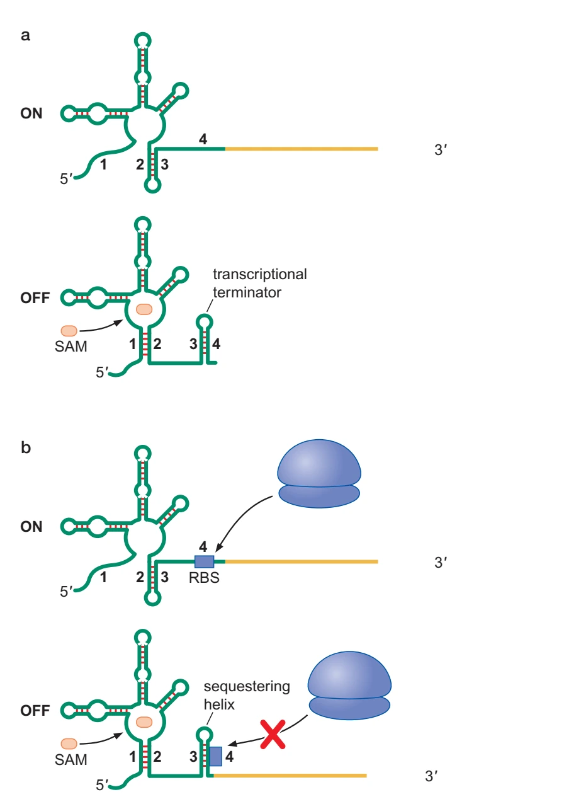{ width="380" loading=lazy }
/// caption
两种SAM响应开关都由配体改变RNA折叠，随后分别控制转录终止（a）和翻译起始（b）。b中被遮住的是核糖体结合位点RBS。[^fig-riboswitch]
///

硫胺素焦磷酸（TPP）、S-腺苷甲硫氨酸（SAM）、核苷酸和金属离子等都可以成为配体。同一类适配体接上不同表达平台，可以产生不同输出；TPP开关在某些真核系统中还会影响剪接。

RNA折叠也受到形成顺序影响。转录中的RNA只有已经合成的部分可以配对，配体必须在合适的时间窗口进入；转录速度、暂停和配体结合动力学，会共同影响开关结果。

**RNA温度计**则直接利用温度对RNA结构稳定性的影响。前导区发夹在升温后变松，使原来埋藏的核糖体结合区域更可接近，随后翻译增加。温度本身就能改变配对的稳定性，因而这类响应可以不经由化学配体。

### 小RNA与蛋白质也能改变翻译入口

一条小调控RNA（sRNA）与mRNA短程配对，既可以盖住RBS，也可以拆开原来盖住RBS的发夹。前一种抑制起始，后一种反而激活；Hfq、ProQ等RNA结合蛋白可在特定系统中帮助RNA稳定、相遇或重排。[^srna-control]

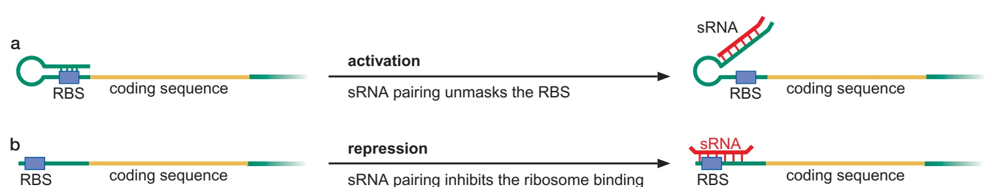{ width="760" loading=lazy }
/// caption
a中sRNA结合发夹的一侧，把RBS释放出来；b中它直接与起始区配对。互补配对本身没有固定的调控正负号。[^fig-srna]
///

某些核糖体蛋白还兼任自身翻译的反馈因子。rRNA充足时，它们优先进入核糖体装配；游离蛋白过量时，转而识别自身操纵子mRNA上与rRNA结合位点相似的结构，抑制后续合成。反馈所响应的是尚未用于装配的游离蛋白量，而不只是细胞内蛋白总量。[^ribosomal-autoregulation]

RNA配对还可以调节复制起步。ColE1质粒的反义RNA I与RNA II配对，使后者难以形成正常复制引物；质粒增多时，RNA I也随之增多，于是形成拷贝数负反馈。具体过程见[ColE1的RNA调控](../dna_replication/index.md#cole1-replication)。

RNA结构还会改变降解。5′端焦磷酸去除可帮助某些核酸内切酶识别底物；3′发夹可能阻挡外切降解，后来加上的短poly(A)尾又可提供单链入口。另一些发夹会成为核酸酶识别结构。降解体的组成和膜关联并非所有细菌一致，具体装置见[细菌RNA加工与降解](../rna_processing.md#bacterial-rna-processing)。

???+ abstract "BglG：用位点突变区分磷酸化的作用"

    大肠杆菌BglG结合新生RNA上的特定结构，阻止竞争性的终止发夹形成，使β-葡糖苷利用相关基因得以转录。转运蛋白BglF把糖摄取状态接到BglG，HPr或FruB也能传递磷酰基。不同位点和磷酸供体可以产生相反调节：BglF相关作用可抑制BglG，而HPr/FruB对特定位点的磷酸化有助于活化。2012年的重构实验把活化位点定位到His208：将其换成不能接受相同磷酰基的Ala后，HPr或FruB都不再使该蛋白出现放射性标记。[^bglg-control]

    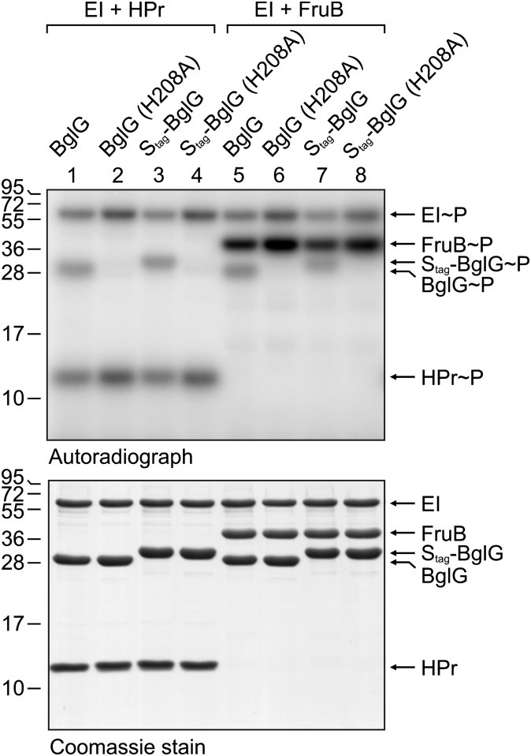{ width="520" loading=lazy }
    /// caption
    上排检测从放射性PEP传来的磷酰基，下排为平行的非放射性PEP反应，经考马斯染色显示各泳道的蛋白。1–4道使用HPr，5–8道使用FruB；2、4、6、8道均为H208A。两种标签造成不同迁移位置，野生型／突变型应在各自配对泳道内比较。[^bglg-control]
    ///

    上排条带消失而下排仍有相应蛋白，支持His208对这一路体外磷酸化必需。再结合体内活性实验，研究者将这次修饰与BglG的反终止作用联系起来。

## 把局部控制接到整个细胞 { #bacterial-global-regulation }

### 更换σ因子与双组分系统 { #sigma-two-component }

RNA聚合酶核心酶可以搭配不同σ因子，从而优先识别不同启动子集合。大肠杆菌热激时，σ$^{32}$的合成和稳定性发生变化，使伴侣蛋白、蛋白酶等应激基因增加表达；响应消退时，反馈又限制σ$^{32}$。抗σ因子的结合、受控蛋白水解和不同σ因子对核心酶的竞争，共同调节可用σ的数量。[^gene-regulation-book]

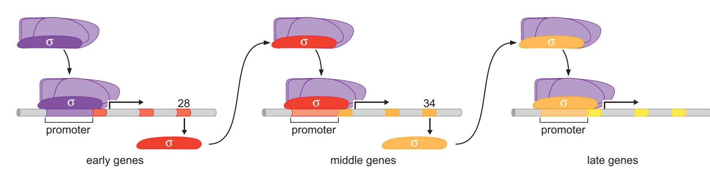{ width="760" loading=lazy }
/// caption
SPO1感染枯草杆菌后，先借宿主σ因子转录早期基因，gp28接管中期启动子，gp33与gp34参与晚期转录。图将晚期识别装置简化为一个黄色σ单元。[^fig-sigma]
///

**双组分系统**常由感受组氨酸激酶和响应调节蛋白组成。前者感知信号后在His上自磷酸化，再将磷酰基转给后者接收结构域的Asp；接收结构域变化继而改变DNA结合、寡聚化或其他输出。许多感受激酶还兼有磷酸酶活性，使系统能在输入减弱后回落。NtrB–NtrC便把这一磷酸传递接到了前面介绍的σ$^{54}$启动子。[^two-component-quorum]

感受器也可以位于胞质，响应调节蛋白还可能改变转录以外的过程。更长的磷酸接力可依次经过His、Asp、His、Asp，真核微生物和植物也使用相关元件。

### 严紧反应重新分配合成资源 { #stringent-response }

氨基酸不足时，核糖体A位遇到未氨酰化tRNA的机会增加。大肠杆菌的RelA识别相应核糖体状态，促进合成鸟苷四磷酸ppGpp和鸟苷五磷酸pppGpp，二者合称**(p)ppGpp**。SpoT及其同源蛋白还能把其他代谢输入接到合成与水解的平衡上。[^stringent-response]

(p)ppGpp会重新调整不同基因的表达。在大肠杆菌中，它与DksA等共同改变RNA聚合酶在不同启动子上的动力学，压低大量rRNA合成，同时有利于氨基酸供应、应激存活等程序。在其他细菌中，GTP池与转录因子变化可能承担更大作用。核糖体生物发生、DNA复制、代谢酶和翻译因子等也可以成为下游靶点，使资源分配随之改变。

核糖体休眠因子能使部分核糖体进入低活性的保存状态。不同细菌可形成不同的70S或100S复合物，这些结构的形成与(p)ppGpp、σ因子和其他应激网络相接，具体组合随物种和条件而异。

??? note "毒素—抗毒素系统：转录上升与毒素释放是两步"

    典型RelBE系统中，RelB结合RelE并限制其核酸酶活性；游离RelE能作用于核糖体上的mRNA，改变翻译中的RNA完整性，后续可能需要核糖体救援。某些条件下，蛋白酶对抗毒素的降解可以改变这一平衡。[^ta-control]

    应激后 *relBE* 转录增加，并不一定伴随大量游离RelE产生：反馈、蛋白合成和复合物计量关系都可能使转录与活性变化脱钩。因此，从饥饿到抗毒素降解、毒素活化乃至持留表型，每一步都需要在相应系统中分别检验。停滞复合物怎样清理，见[翻译救援](../translation.md#ribosome-rescue)。

### 群体感应与防御程序 { #quorum-crispr }

发光共生菌提供了另一个有趣输入：周围还有多少同伴，以及信号能不能留在这里。经典LuxI–LuxR型系统中，LuxI参与合成N-酰基高丝氨酸内酯（AHL）；当局部信号积累，AHL结合LuxR，使其调节包括发光相关基因在内的转录。其他细菌使用肽或不同化学类型的自诱导物。扩散、流动、空间结构和降解都改变浓度，所以**群体感应**读取的是群体与环境共同形成的化学状态。[^two-component-quorum]

**成簇规律间隔短回文重复序列及其相关蛋白（CRISPR–Cas）**也把先前经历写进后来响应，但它首先是适应性抗外源核酸系统。其三个阶段各有具体底物：[^crispr-defense]

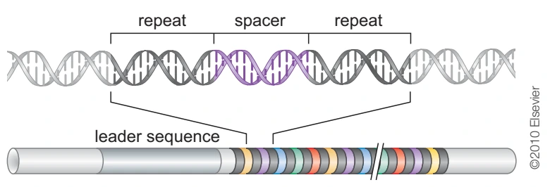{ width="600" loading=lazy }
/// caption
灰色重复单元相间排列，彩色间隔单元包含不同的序列信息；前导区位于阵列一端。阵列首先被转录，RNA加工后才形成可参与识别的crRNA。[^fig-crispr-array]
///

| 阶段 | 发生的事情 | 保留了什么信息 |
| --- | --- | --- |
| 获取 | 典型适应模块以Cas1–Cas2等将入侵来源片段整合进CRISPR阵列，常靠近前导端，同时形成新的重复单位 | 间隔序列记录可供以后识别的外源序列 |
| crRNA形成 | 阵列被转录，长前体经类型特异的加工产生引导RNA；有些系统用Cas6，典型Ⅱ型系统则涉及tracrRNA、RNase III和Cas9 | 引导RNA含间隔来源序列及必要重复来源结构 |
| 干扰 | 引导RNA与效应复合物识别匹配的DNA或RNA，再由相应核酸酶执行切割 | 靶类型、原间隔序列邻近基序（PAM）或其他上下文要求取决于系统 |

不同Cas蛋白分担这些反应。例如，Ⅰ型系统的Cas3具有解旋—核酸酶活动，可在靶标识别后参与DNA降解；某些适应模块还使用Cas4处理待整合片段，控制PAM相关选择及整合方向。[^cas-processing]

自身阵列也含相同间隔序列，系统还需要识别靶序列周围的信息，才能区分自身与入侵者。PAM、重复来源序列的识别和转录依赖性等分别用于不同类型，因此适用于一种效应器的靶标规则，未必适用于另一种。

## λ噬菌体：把控制接成时序与记忆 { #lambda-switch }

λ进入大肠杆菌后，可以进入产生子代颗粒的裂解途径，也可以建立溶原状态，基因组整合并随宿主传递。两条路线需要不同的基因表达次序：宿主聚合酶先从早期启动子转录，N蛋白帮助聚合酶越过早期终止位点，扩大可转录范围；晚期Q蛋白再控制另一组基因的延伸。N先识别新生RNA的 *nut* 位点（其中含boxB发夹），再与Nus因子共同改变延伸复合物；Q则从启动子附近的DNA识别位点装载到暂停的聚合酶，改变RNA出口附近结构。两者都能帮助读通，却从不同入口进入复合物。[^lambda-regulation]

溶原状态的维持依靠CI阻遏蛋白。CI二聚体协同占据$O_R1$、$O_R2$等位点，压低裂解启动子$P_R$，同时接触$P_{RM}$的聚合酶，促进自身 *cI* 的适量表达。浓度较高时，CI还可占据$O_R3$，限制自身继续积累。于是，同一个蛋白随浓度和占据位点改变，先促进自身合成，再限制过量积累。

Cro对这些位点的偏好不同：它优先占据与$P_{RM}$重叠的$O_R3$，压低 *cI* 的维持转录。此时若$O_R1$、$O_R2$尚未被占据，$P_R$仍可启动裂解相关基因。不同的占位次序，使同一控制区能维持不同表达状态。

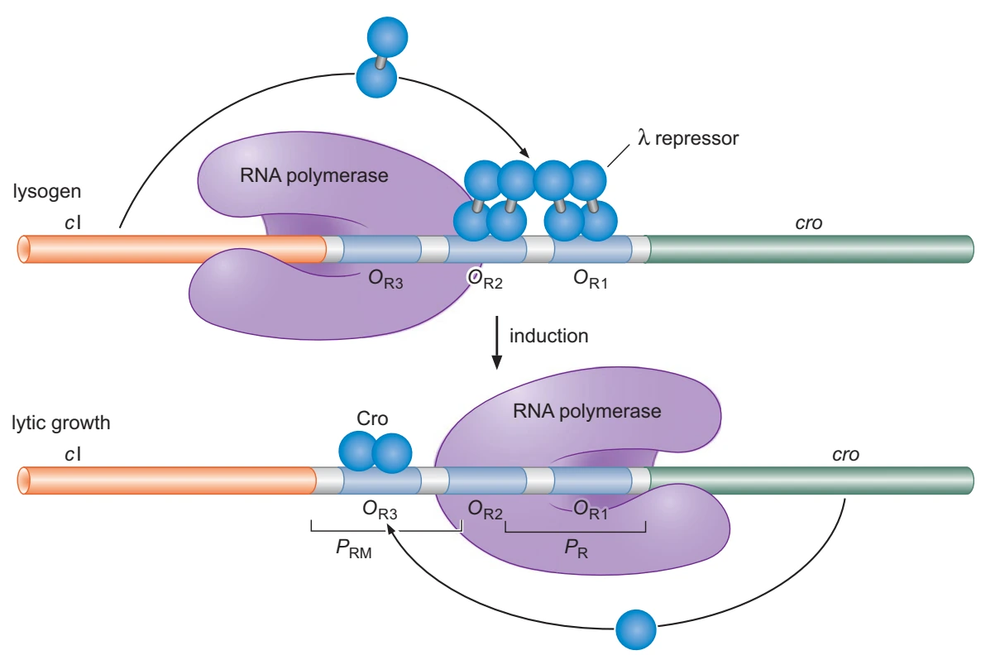{ width="680" loading=lazy }
/// caption
上图中CI既阻遏$P_R$，也帮助$P_{RM}$工作；下图Cro占据$O_R3$，抑制$P_{RM}$；$P_R$仍可工作。图展示右侧控制区的主要关系。[^fig-lambda-switch]
///

建立溶原状态还需要先产生CI。**CII**激活另一个启动子$P_{RE}$，在早期建立CI供应；随后才主要由$P_{RM}$维持。CII本身易受宿主蛋白酶控制，CIII等因子能改变其稳定性，因此宿主状态、感染条件与噬菌体基因产物会共同影响选择。

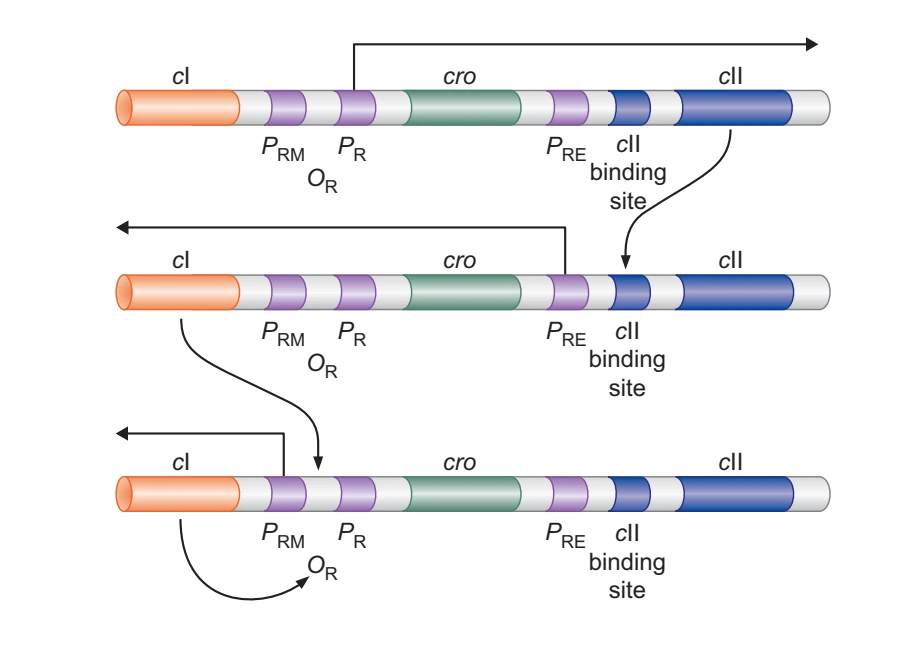{ width="500" loading=lazy }
/// caption
从上到下追踪启动子：早期表达产生CII，CII启动$P_{RE}$，CI积累后接管维持回路。“建立”与“保持”使用不同入口。[^fig-lambda-establishment]
///

DNA损伤时，活化的RecA可促进CI自切，解除对裂解程序的抑制。它与[LexA–SOS响应](../dna_repair.md#dna-damage-response)共享“损伤信号促进调节蛋白自切”的逻辑，却作用于不同调节蛋白和靶基因。整合、切除所需的DNA重组另见[λ位点特异性重组](../dna_recombination.md#natural-site-specific-systems)。

??? info "有些表达改变直接重排DNA"

    基因剂量和启动子朝向可以改变表达；某些分化程序更会切除插在基因中的DNA。丝状蓝藻 *Anabaena* PCC7120的异形胞分化中，*nifD* 内的特定插入片段经XisA等参与的重组切除，使连续的编码序列得以恢复。这里，细胞分化伴随着特定基因结构的改变。[^heterocyst-rearrangement]

## 古菌的调控组合 { #archaeal-gene-regulation }

古菌的RNA聚合酶及TBP、TFB、TFE等基础因子与真核转录装置同源，许多序列特异性调节蛋白则结合在启动子附近，阻挡或协助TBP、TFB与聚合酶结合。某些古菌具有多个TBP或TFB，可以产生不同启动子偏好：同样是改变优先表达的基因集合，古菌使用的分子装置与细菌的替代σ因子不同。[^archaeal-regulation]

在含组蛋白的古菌中，DNA包装会改变位点可及性与延伸屏障；其他谱系使用Alba、Cren7或Sul7等蛋白组织基因组。古菌的组蛋白及其调节伙伴并不等同于真核完整的核小体—修饰—重塑体系，具体组合随谱系变化。

古菌也有操纵子、小RNA及无前导转录本；*Thermococcus kodakarensis* 等系统还已鉴定出响应氟化物的核糖开关。[^archaeal-riboswitch]转录单位的组织、RNA结构和翻译入口，又为这套转录装置增加了其他调控层次。

## 从分子控制到动态响应 { #regulatory-networks }

乳糖摄入的正反馈、CI的双向自调控和σ因子级联，已经把几个基本网络关系放在具体对象上。负反馈可限制幅度、加速回落或产生适应；正反馈在合适的非线性和参数条件下可产生阈值、双稳态与记忆；前馈回路则能过滤短脉冲或塑造响应时程。RNA与蛋白寿命、信号延迟和分子数都会改变结果。更多动力学推导见[反馈、开关与振荡](../../inter/systems_dynamics.md)。

同一培养物内也可能有不同响应细胞。单个启动子的随机占据、少数调节分子的涨落，以及反馈放大，都会使群体平均掩盖单细胞差异。

???+ abstract "培养液相同，细胞却不一定同步响应"

    Choi等将荧光蛋白YFP融合到大肠杆菌染色体上的LacY，再用诱导物TMG观察单细胞响应。TMG能诱导 *lac* 表达，却不会像乳糖一样同时被细胞分解利用。[^choi-lac]

    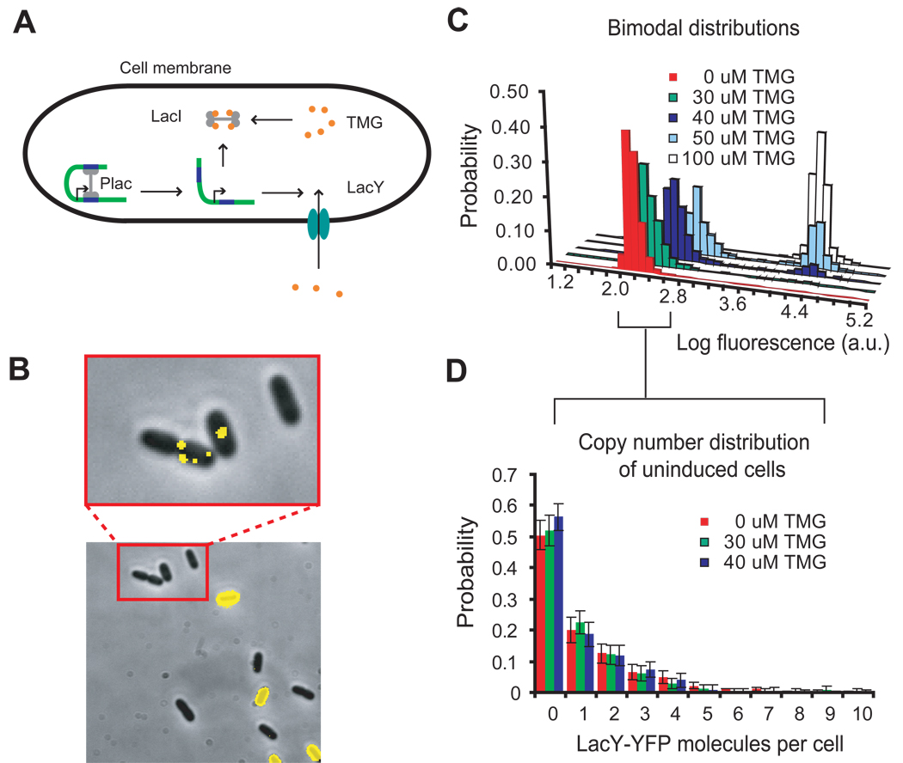{ width="760" loading=lazy }
    /// caption
    Choi等（2008）图1。B在30 µM TMG培养24小时后成像；C为不同浓度下的单细胞荧光分布；D只统计未诱导亚群的LacY–YFP分子数。[^choi-lac]
    ///

    B中可见亮细胞与暗细胞并存，C中间浓度的分布也出现两个峰。仅凭整瓶培养物的平均荧光，分不清是响应细胞的比例变了，还是每个细胞都稍微变亮。D又补充一层：未诱导细胞并非完全没有LacY，而是保留少量基础表达。图1给出了异质性的直接证据；具体是哪一次LacI解离触发切换，还需论文后续的阈值测量与操纵序列扰动来判定。

## 怎样验证一个调控机制 { #gene-regulation-evidence }

顺反实验区分可扩散产物与局部位点；结合实验与原位扰动则继续追问“谁接触谁、这次接触是否改变表达”。不同测量之间需要接得上：

| 要回答的问题 | 常用操作与读数 | 关键条件 |
| --- | --- | --- |
| 蛋白能否直接识别某段DNA或RNA | 纯化蛋白的EMSA、足迹、结合常数；突变识别位点再比较 | 阴性序列、竞争底物与蛋白活性对照 |
| 某段序列能否传递输入 | 报告基因、启动子/操纵序列定点突变、诱导物梯度 | 拷贝数、整合位置、培养阶段及报告蛋白寿命 |
| 变化发生于转录还是RNA稳定性 | 新生RNA测量、转录停止后的RNA衰减、稳态RNA比较 | 操作本身可能改变细胞状态，需用正交读数交叉检查 |
| 细胞内是否真由该因子产生该结果 | 内源位点或因子扰动、时间序列、回补与等位特异性比较 | 排除邻近基因效应和继发的生长变化 |
| 群体升高来自哪些细胞 | 单细胞荧光、单分子RNA或实时追踪 | 区分细胞比例、每细胞产量、噪声与测量背景 |

把蛋白结合与调控作用联系起来，还要看输入改变后何时出现分子动作、何时出现产物和表型，以及突变关键位点后哪一步消失。这样，结合观察才与细胞中的表达变化接上。

## 真核调控的阅读入口 { #eukaryotic-transcription-control }

真核细胞把这些基本调控逻辑接到染色质、远端增强子和核内RNA加工上。[真核基因表达调控](eukaryotic.md)从这些接口继续展开。

| 主题 | 对应内容 |
| --- | --- |
| 染色质可及性 | [核小体重塑、修饰及DNA甲基化](eukaryotic.md#chromatin-accessibility-control) |
| 转录因子组合 | [DNA识别、调控结构域与信号输入](eukaryotic.md#transcription-factor-combinations) |
| 增强子—启动子通信 | [靶基因选择、接触与转录爆发](eukaryotic.md#enhancer-promoter-communication) |
| 基因组级开关 | [拷贝数、程序性重排与DNA消除](eukaryotic.md#genome-level-expression-switches) |
| RNA加工选择 | [剪接、加尾与编辑](eukaryotic.md#regulated-rna-processing) |
| mRNA定位与稳定性 | [局部翻译、铁响应元件与RNA周转](eukaryotic.md#mrna-localization-stability) |
| 翻译起始调控 | [4E-BP、eIF2及选择性合成](eukaryotic.md#translation-control) |
| 小RNA沉默 | [Argonaute的配对识别与输出](eukaryotic.md#small-rna-silencing) |

## 参考资料与延伸阅读 { #references }

- Watson JD等。*Molecular Biology of the Gene*，第7版，第18章和第20章。
- Turnbough CL Jr. [Regulation of Bacterial Gene Expression by Transcription Attenuation](https://pmc.ncbi.nlm.nih.gov/articles/PMC6710462/). 2019。
- Wenck BR, Santangelo TJ. [Archaeal transcription](https://pmc.ncbi.nlm.nih.gov/articles/PMC7714419/). 2020。

[^regulatory-layers]: 从转录、RNA 加工与运输、翻译到 RNA／蛋白质降解的多层控制框架，见 Alberts 等的[教材章节](https://www.ncbi.nlm.nih.gov/books/NBK21057/)；各反应的化学与装置由本站相邻分子页面分别展开。
[^bacterial-regulation]: 细菌启动子强度、操纵序列、变构调节蛋白、操纵子与调控子的区别，见 Cooper 的[原核转录教材章节](https://www.ncbi.nlm.nih.gov/books/NBK9850/)和 Baron 编著教材的[细菌遗传章节](https://www.ncbi.nlm.nih.gov/books/NBK7908/)。
[^fig-lac-operon]: Watson等，*Molecular Biology of the Gene*，第7版，图18–5，书页620；裁出原图，保留内部标记。
[^gene-regulation-book]: Watson JD, Baker TA, Bell SP, et al. *Molecular Biology of the Gene*. 7th ed. Pearson; 2014，第18章及第20章；原核启动子、调节蛋白与RNA调控。
[^fig-activation]: Watson等，*Molecular Biology of the Gene*，第7版，图18–1，书页617；裁出原图，保留内部标记。
[^lac-operon]: LacI、操纵序列与诱导物的经典顺式—反式逻辑见 Cooper 的[教材章节](https://www.ncbi.nlm.nih.gov/books/NBK9850/)；多操纵序列和 DNA 成环的实验证据与模型见 Cournac 与 Plumbridge 的[综述](https://pmc.ncbi.nlm.nih.gov/articles/PMC3591992/)。
[^fig-lac-loop]: Watson等，*Molecular Biology of the Gene*，第7版，图18–12，书页625；裁出原图，保留内部标记。
[^fig-cap-complex]: Watson等，*Molecular Biology of the Gene*，第7版，图18–10，书页623；裁出原图，保留内部标记。 原结构来自Benoff等，*Science* 2002;297:1562–1566。
[^catabolite-control]: Deutscher J等。[The Bacterial Phosphoenolpyruvate:Carbohydrate Phosphotransferase System: Regulation by Protein Phosphorylation and Phosphorylation-Dependent Protein-Protein Interactions](https://pmc.ncbi.nlm.nih.gov/articles/PMC4054256/). *Microbiology and Molecular Biology Reviews*. 2014；EIIA与碳源控制。
[^fig-lac-genetics]: Watson等，*Molecular Biology of the Gene*，第7版，图Box 18–2，图1、2，书页628–629；裁出原图，保留内部标记。
[^fig-arac]: Watson等，*Molecular Biology of the Gene*，第7版，图18–19，书页634；裁出原图，保留内部标记。
[^malt-control]: Richet E, Raibaud O. [MalT, the regulatory protein of the Escherichia coli maltose system, is an ATP-dependent transcriptional activator](https://pmc.ncbi.nlm.nih.gov/articles/PMC400900/). *EMBO Journal*. 1989;8:981–987。
[^gal-control]: Cournac A, Plumbridge J. [DNA Looping in Prokaryotes: Experimental and Theoretical Approaches](https://pmc.ncbi.nlm.nih.gov/articles/PMC3591992/). *Journal of Bacteriology*. 2013;195:1109–1119；比较lac、ara与gal的成环调控。
[^fig-ntrc-merr]: Watson等，*Molecular Biology of the Gene*，第7版，图18–16、18–17，书页632；裁出原图，保留内部标记。
[^attenuation-riboswitch]: 核糖体介导、蛋白介导、T-box 和小分子核糖开关介导的衰减机制分类，见 Turnbough 的[综述](https://pmc.ncbi.nlm.nih.gov/articles/PMC6710462/)。
[^fig-trp]: Watson等，*Molecular Biology of the Gene*，第7版，图Box 20–1，图2、3，书页708；裁出原图，保留内部标记。
[^ampc-attenuation]: [Initiation of translation makes attenuation of ampC in E. coli dependent on growth rate](https://pubmed.ncbi.nlm.nih.gov/3892227/). 1985；前导区起始位点与终止结构的突变分析。
[^fig-riboswitch]: Watson等，*Molecular Biology of the Gene*，第7版，图20–3，书页704；裁出原图，保留内部标记。
[^srna-control]: Watson等，第20章图20–1；Hfq的配对与结构重排见[Rajkowitsch与Schroeder的实验](https://pmc.ncbi.nlm.nih.gov/articles/PMC2080586/)，ProQ的全局RNA结合见[Smirnov等的Grad-seq研究](https://pmc.ncbi.nlm.nih.gov/articles/PMC5068311/)，2016。
[^fig-srna]: Watson等，*Molecular Biology of the Gene*，第7版，图20–1，书页703；裁出原图，保留内部标记。
[^ribosomal-autoregulation]: Watson等，第15章“Ribosomal Proteins Are Translational Repressors of Their Own Synthesis”，图15–44，第551页。
[^bglg-control]: Rothe FM, Bahr T, Stülke J, Rak B, Görke B。[Activation of Escherichia coli antiterminator BglG requires its phosphorylation](https://pmc.ncbi.nlm.nih.gov/articles/PMC3465381/). *PNAS*. 2012；本文采用原图4全图，比较HPr/FruB与H208A。
[^fig-sigma]: Watson等，*Molecular Biology of the Gene*，第7版，图18–15，书页631；裁出原图，保留内部标记。 gp33/gp34关系见Stewart等，[The genome of Bacillus subtilis bacteriophage SPO1](https://pmc.ncbi.nlm.nih.gov/articles/PMC2666789/). *Journal of Molecular Biology*. 2009。
[^two-component-quorum]: 组氨酸激酶—响应调节蛋白的磷酸转移、激酶／磷酸酶平衡和非典型扩展见 Zschiedrich、Keidel 与 Szurmant 的[综述](https://pmc.ncbi.nlm.nih.gov/articles/PMC5023499/)；群体感应对信号产生、检测与局部环境的依赖见 Mukherjee 与 Bassler 的[综述](https://www.nature.com/articles/s41579-019-0186-5)。
[^stringent-response]: (p)ppGpp 的合成输入、RNA 聚合酶或 GTP 库依赖的输出以及物种差异，见 Urwin、Savva 与 Corrigan 的[综述](https://pmc.ncbi.nlm.nih.gov/articles/PMC11288640/)；不把一种模式外推为全部细菌。
[^ta-control]: LeRoux M, Culviner PH, Liu YJ, Littlehale ML, Laub MT. [Stress can induce the transcription of toxin-antitoxin systems without activating toxin](https://pmc.ncbi.nlm.nih.gov/articles/PMC7368831/). *Molecular Cell*. 2020；对转录、抗毒素与游离毒素活性的区分。
[^crispr-defense]: Watson等，第20章；CRISPR阵列、crRNA及DNA/RNA靶向系统。经典Ⅱ型加工证据见Deltcheva等，[CRISPR RNA maturation by trans-encoded small RNA and host factor RNase III](https://pmc.ncbi.nlm.nih.gov/articles/PMC3070239/). *Nature*. 2011;471:602–607。
[^lambda-regulation]: Watson等，第18章，第634–653页；N、Q、CI、Cro和CII分别介入λ表达时序及状态转换。
[^fig-lambda-switch]: Watson等，*Molecular Biology of the Gene*，第7版，图18–27，书页640；裁出原图，保留内部标记。 教材据Ptashne与Gann，*Genes & Signals*（2002）图1.13改编。
[^fig-lambda-establishment]: Watson等，*Molecular Biology of the Gene*，第7版，图18–31，书页647；裁出原图，保留内部标记。
[^heterocyst-rearrangement]: Brusca JS, Chastain CJ, Golden JW. [Expression of the Anabaena sp. strain PCC 7120 xisA gene from a heterologous promoter results in excision of the nifD element](https://pmc.ncbi.nlm.nih.gov/articles/PMC213375/). *Journal of Bacteriology*. 1990;172:3925–3931。
[^archaeal-regulation]: 古菌 TBP／TFB／TFE、启动子近旁调节蛋白、组蛋白／拟核蛋白与延伸控制，见 Sanders、Marshall 与 Santangelo 的[综述](https://pmc.ncbi.nlm.nih.gov/articles/PMC6842674/)及 Wenck 与 Santangelo的[综述](https://pmc.ncbi.nlm.nih.gov/articles/PMC7714419/)。
[^choi-lac]: Choi PJ, Cai L, Frieda K, Xie XS. [A stochastic single-molecule event triggers phenotype switching of a bacterial cell](https://pmc.ncbi.nlm.nih.gov/articles/PMC2819113/). *Science*. 2008;322:442–446，图1，未改图。C按原图图例包含0、30、40、50、100 µM TMG；D误差线为bootstrap标准误，且只统计未诱导细胞。

[^arac-autoregulation]: Weaver RF. *Molecular Biology*. 5th ed. 第7章，书页185–186，图7.24；AraC与araO1及自身启动子的关系。
[^trp-enzymes]: 大肠杆菌K-12的融合酶注释见UniProt [TrpGD（传统trpD产物）](https://www.uniprot.org/uniprotkb/P00904/entry)与NCBI [TrpC](https://www.ncbi.nlm.nih.gov/protein/NP_415778.3)；操纵子反应顺序见Watson等第18章及氨基酸合成教材资料。
[^fig-crispr-array]: Watson等，第7版，图20–6，书页709；据Karginov与Hannon2010年综述图1A、B改编，裁出阵列示意并保留原署名。
[^cas-processing]: Ⅰ型Cascade与Cas3见[Host nucleases generate prespacers for primed adaptation in the E. coli type I-E CRISPR-Cas system](https://pmc.ncbi.nlm.nih.gov/articles/PMC9699676/)；Cas4处理及定向获取见[Mechanism for Cas4-assisted directional spacer acquisition in CRISPR-Cas](https://pmc.ncbi.nlm.nih.gov/articles/PMC9164213/)，2021。

[^archaeal-riboswitch]: Speed MC等。[An Archaeal Fluoride-Responsive Riboswitch Provides an Inducible Expression System for Hyperthermophiles](https://doi.org/10.1128/AEM.02306-17). 2018；该物种的氟响应RNA调控。
