# 遗传物质、基因与基因组 { #_1 }

细菌分裂以后，子代通常仍会合成亲代的酶、保持相近的形态；一颗病毒进入细胞，却能让细胞生产出与它同型的新病毒。要让这些特征跨代延续，细胞或病毒必须保存一套能够复制、表达，也能够发生变异的信息。细胞用 DNA 保存基因组，一部分病毒则用 RNA。这样的认识如今很熟悉，但它最初是从细菌菌落、小鼠和噬菌体的实验中一点点辨认出来的。

本页先看这些实验怎样找到遗传物质，再沿核酸序列向下追问：哪些区段构成一个基因，多个基因怎样排列，基因以外又有什么。核酸的共价骨架、碱基配对和空间构象见[核酸与核苷酸](../biochem/nucleic_acid.md)；这里关注序列怎样成为可遗传的生物学对象。

## 遗传物质的实验证据 { #genetic-material-evidence }

### 从菌落差异到细菌转化 { #pneumococcal-transformation }

肺炎链球菌可以形成外观很不相同的菌落。有荚膜的菌株形成较光滑的 S 型菌落（smooth），失去荚膜的菌株形成较粗糙的 R 型菌落（rough）。荚膜还影响细菌在宿主体内抵抗吞噬的能力：在 Griffith 使用的小鼠感染体系中，活 S 型菌能致死，活 R 型菌则不能。[^griffith-transformation]

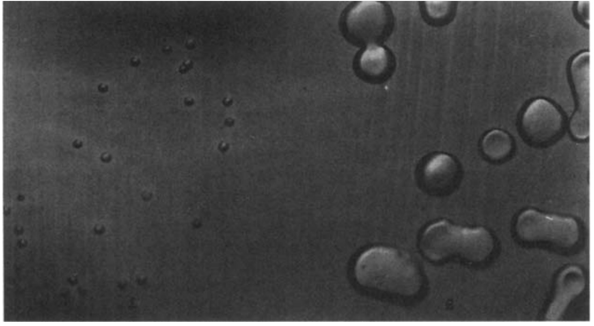{ width="580" }
/// caption
肺炎链球菌的 R 型（左）与 S 型（右）菌落。原照片出自 Avery 等1944年论文，转引自 *Lewin’s GENES XII* 图1.6，裁切保留照片。[^avery-colony-image]
///

1928年，Griffith 把活 R 型菌与加热杀死的 S 型菌混合后注射小鼠，小鼠死亡，而且体内能分离到活 S 型菌。单独注射热杀死的 S 型菌并不产生这种结果。死菌中的某种成分使活 R 型菌获得了合成相应荚膜的能力，转化后的细菌还能把这一性状传给子代。热处理并没有让死菌“复活”；改变发生在原先活着的受体菌中。

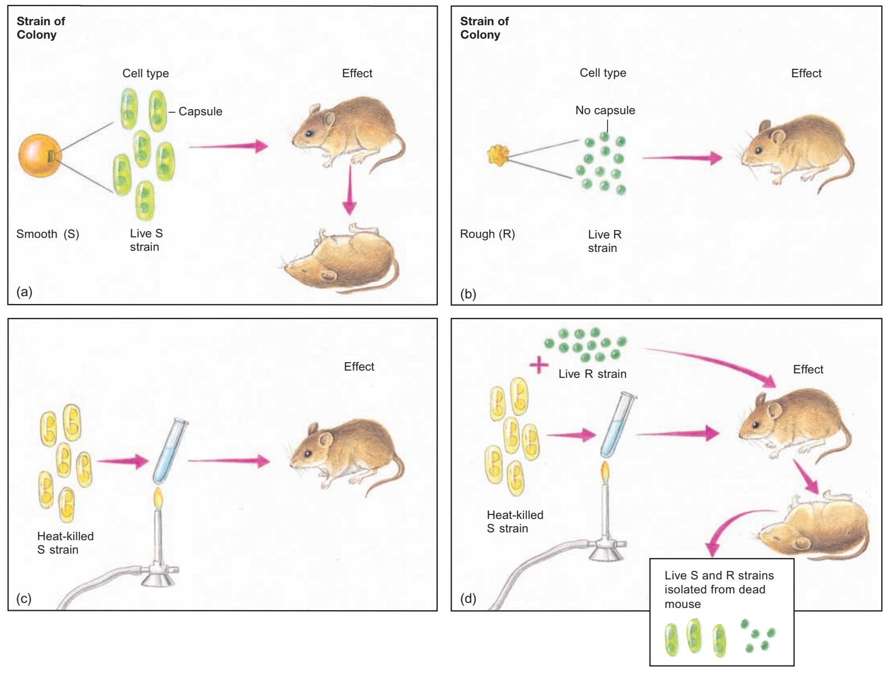{ width="760" loading=lazy }
/// caption
四组处理共同定位“转化”现象；混合组中可重新分离到活 S 型菌。实验示意，裁自 Weaver 第5版图2.2。[^weaver-transformation]
///

这个实验找到了可传递的“转化因子”，还没有辨认它的化学身份。接下来要把死菌拆开，追踪究竟是哪一类分子带着转化活性。

### 把转化活性追到 DNA { #avery-purification }

Avery、MacLeod 和 McCarty 从 S 型菌中逐步去除细胞碎片、蛋白质、RNA 和荚膜多糖，保留能够使 R 型菌转化的组分。1944年，他们报告高度纯化的活性物质具有 DNA 的化学性质；蛋白酶和 RNase 处理不使转化活性消失，降解 DNA 的处理却使活性丧失。元素组成、紫外吸收和血清学检测又从不同方向检查了制备物及其杂质。[^avery-dna]

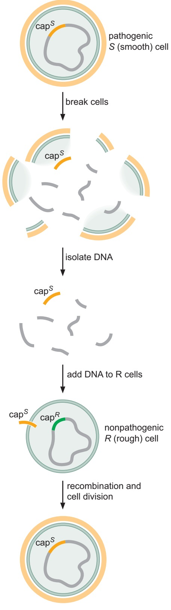{ width="240" loading=lazy }
/// caption
DNA 转化的分子解释。图中的 `cap` 表示荚膜相关遗传差异，是简化示意；裁自 Watson 等第7版图2–2。[^watson-transformation]
///

| 活性组分的处理 | 转化活性 | 对分子身份的判断 |
| --- | --- | --- |
| 蛋白酶 | 保留 | 所处理的蛋白质不是维持活性所必需的成分 |
| RNase | 保留 | 活性不依赖完整 RNA |
| 降解 DNA | 丧失 | 完整 DNA 对这项转化必需 |

纯化与酶处理配合起来，才使证据逐渐收拢到 DNA。只看到“DNA 与活性一起出现”，仍可能怀疑是某种杂质在起作用；选择性破坏 DNA 后活性也随之消失，就进一步检验了这种联系。

按照后来建立的机制，受体菌摄入供体 DNA，相关片段可通过重组进入受体染色体。受体随后表达荚膜合成所需的基因，并在分裂时复制、传递改变后的序列。因此，短暂接触死菌提取物可以留下持续的遗传变化。

### 噬菌体进入细胞的是什么 { #hershey-chase-experiment }

T2 噬菌体含有 DNA 和蛋白质，把两类物质分别作标记，就能跟踪感染时它们的去向。Hershey 和 Chase 用 $^{32}$P 标记 DNA 的磷酸骨架，用 $^{35}$S 标记蛋白质中的含硫氨基酸。这里利用的是纯化 T2 颗粒的组成差异，并不是说所有生物样品里的磷都只存在于 DNA。[^hershey-chase]

两批噬菌体分别感染大肠杆菌以后，研究者用搅拌器把附着在细胞外的噬菌体外壳甩下，再离心分开细菌沉淀与上清。大部分硫标记进入上清，较多磷标记随细菌沉淀；被去掉外壳的感染细胞仍能产生新噬菌体，亲代 DNA 的标记也能在子代中回收。由此可见，进入细胞并参与启动增殖的主要遗传成分是 DNA。

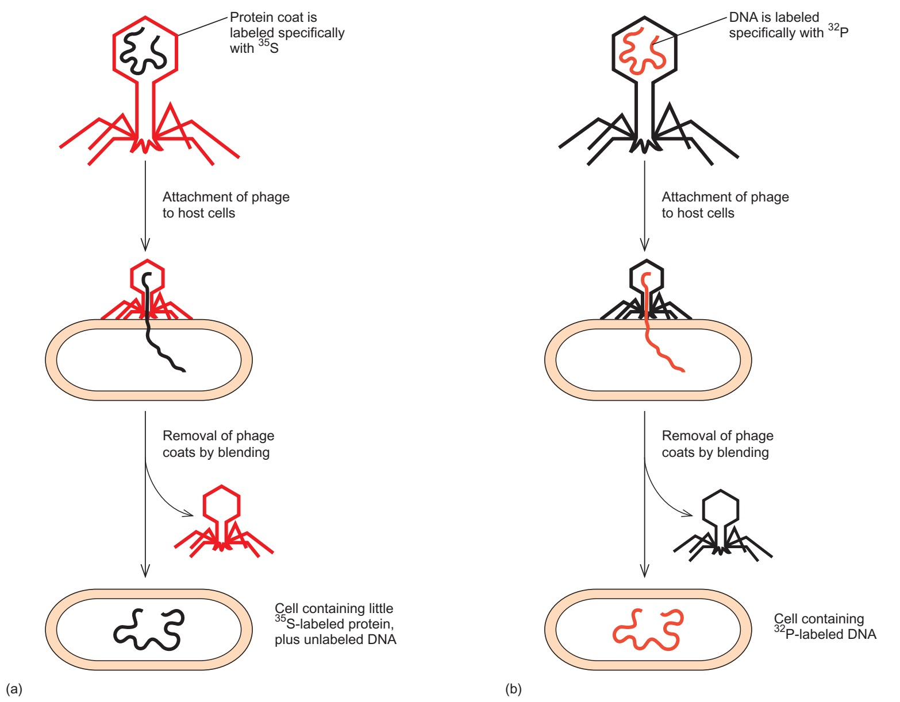{ width="730" loading=lazy }
/// caption
红色表示同位素所追踪的成分：左列标蛋白质，右列标 DNA。裁自 Weaver 第5版图2.4。[^weaver-transformation]
///

???+ abstract "原始曲线：外壳被甩下，感染能力仍在"

    下面是1952年论文的图1。横轴为搅拌时间，纵轴为相应测量量占总量的百分比。细胞外 $^{35}$S 很快升至约80%，细胞外 $^{32}$P 则约为三成；标作 *Infected bacteria* 的曲线记录能够继续产生噬菌体的感染细菌比例，始终较高。把这三条曲线放在一起，才能看出“移去大部分外壳”和“细胞仍具产噬菌体能力”同时发生。[^hershey-chase]

    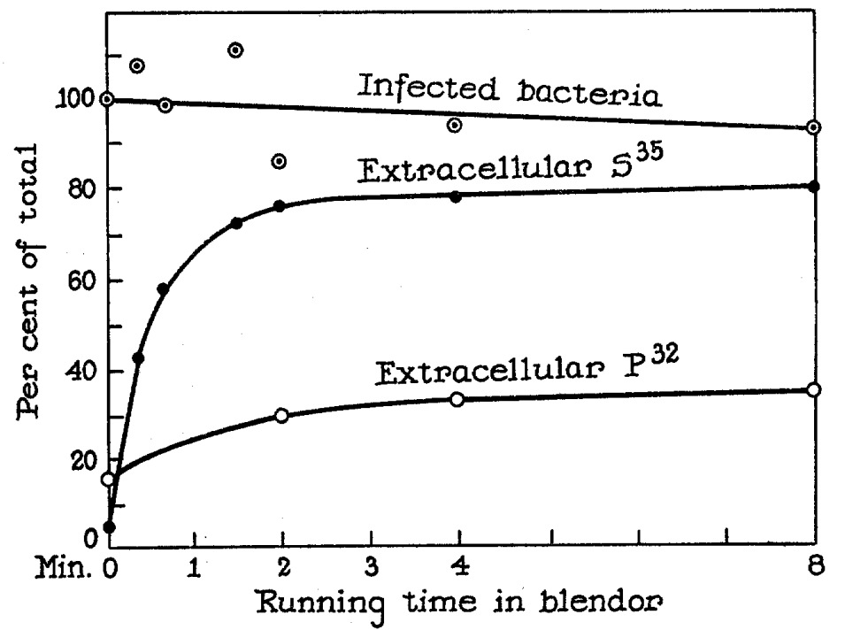{ width="620" loading=lazy }
    /// caption
    Hershey–Chase 原始图1，裁自论文第47页；硫与感染细菌的测量、磷的测量来自相近条件的两次实验。[^hershey-chase]
    ///

    曲线没有达到“所有硫都在外、所有磷都在内”那样整齐的结果。实验分离有残余，判断依据是两种成分明显不同的去向，以及去壳后感染过程仍能继续。它与细菌转化实验从不同系统共同支持 DNA 的遗传作用。

### 烟草花叶病毒的 RNA { #tmv-reconstitution-experiment }

DNA 的证据越来越充分，RNA 病毒却提出了另一个问题：它们的遗传信息是否保存在 RNA 中？Fraenkel-Conrat 和 Singer 将不同株系烟草花叶病毒的 RNA 与外壳蛋白拆开，再交叉重组为感染性颗粒。新颗粒的外壳来自一个株系，RNA 来自另一个株系，感染植物后产生的子代特征随 RNA 的来源传递。[^tmv-rna]

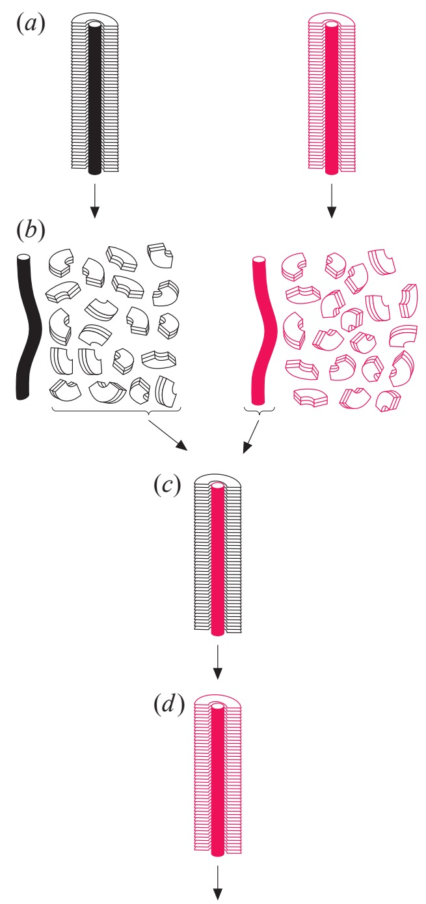{ width="255" loading=lazy }
/// caption
不同株系的 RNA 与蛋白质交叉重组。作者1999年回顾文章图1，裁切保留 a–d 示意；颜色用于区别来源。[^tmv-reconstitution-image]
///

沿图看四步：原来的两种病毒（a）先拆成 RNA 和外壳蛋白（b）；黑色外壳包住品红色 RNA，形成杂合颗粒（c）；由它感染产生的新病毒，其 RNA 与外壳都表现为 RNA 来源株系的类型（d）。

判断遗传作用时，关键在子代外壳的性质。最初包在外面的蛋白质并没有决定下一代蛋白质的类型，进入细胞的 RNA 才提供了合成新病毒成分所需的序列信息。作者曾用外壳蛋白的氨基酸组成差异等特征区别株系，这比只观察重组颗粒的外形更能回答遗传问题。

RNA 因而也能作为基因组。细胞和许多病毒以 DNA 保存遗传序列，另一些病毒及类病毒以 RNA 保存；具体是哪一种，要由所研究的系统决定。

### 中心法则与序列信息 { #central-dogma-boundary }

复制、转录和翻译把这些证据接成了熟悉的信息流：DNA 以 DNA 为模板复制，RNA 以 DNA 为模板转录，蛋白质由核糖体按照 mRNA 的密码子序列合成。RNA 还可以作为 RNA 复制和逆转录的模板。中心法则讨论的正是这种**逐残基的序列信息传递**，即一条核酸或多肽链中残基的排列，怎样决定另一条分子的排列。[^crick-central-dogma]

Crick 所限定的是：信息一旦进入蛋白质，便不能再以蛋白质的氨基酸序列为模板，逐残基返回核酸或产生另一条蛋白质序列。RNA→DNA 的逆转录属于核酸之间的信息传递，与这一限制相容。具体反应见[逆转录](dna_replication/reverse_transcription.md)。

???+ note "Crick 图里的虚线属于哪一年"

    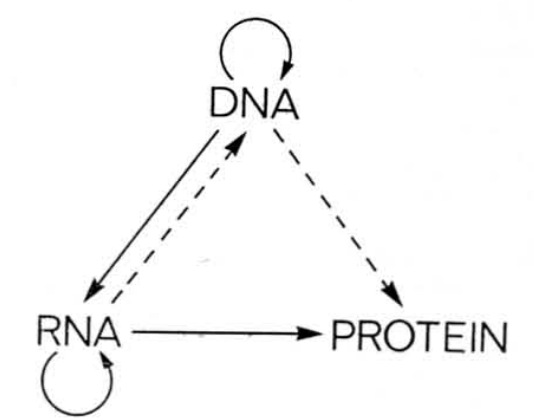{ width="420" loading=lazy }
    /// caption
    Crick 1970年论文图2，重述1958年提出的图式，裁自第561页。[^crick-central-dogma]
    ///

    这是一张历史图。实线和虚线分别表示1958年所认为较可信与可能存在的路线，不能用今天的证据状态直接解读：RNA→DNA 此后已有逆转录酶的实验证据。DNA→蛋白质曾作为特殊传递路线讨论，也不等于 DNA 能自行装配蛋白质或绕过核糖体；细胞常规翻译使用 RNA 模板。

朊粒涉及另一种可传播的信息。异常折叠的蛋白质促进同种蛋白进入相似构象，这种状态可随聚集物的增长和传播而延续；蛋白质原来的氨基酸序列仍由核酸模板编码。传播的是折叠状态，和中心法则讨论的逐残基序列复制处在不同层次。Prusiner 提出的“蛋白质性感染颗粒”（proteinaceous infectious particle）概念及疾病中的构象传播见[朊粒](../micro/viruses.md#prions)。[^prion-information]

## 基因与它的产物 { #gene-concept }

从遗传实验出发，基因是能够影响性状、可以通过重组定位的遗传单位；走到分子层次，还要找到对应的核酸序列及其产物。正向遗传学先从突变表型出发，再定位相关基因；反向遗传学先改变已知序列，再追踪 RNA、蛋白质和细胞表型怎样变化。遗传证据与分子证据由此接到同一个对象上。

对多数细胞基因，一个好用的起点是：**基因是产生一组相互关联的功能 RNA 或蛋白质产物的基因组序列。** 蛋白质编码基因先转录为 RNA，再经翻译产生多肽；rRNA、tRNA、snRNA、miRNA 等基因的功能产物则是 RNA。产物的作用可以是催化、结构支持或调控，“调节基因”和“结构基因”的传统分类不能取代对产物及作用的具体说明。[^gene-definition]

“一组产物”给可变起始、剪接和加尾留下了位置：同一基因产生的多个转录本，可能共享部分外显子，又各自包含不同区段。Gerstein 等据此将基因描述为编码一组相互关联、可能重叠的功能产物的基因组序列并集。数据库还要把这类认识转为实际注释规则，结合转录本、序列同源性和人工审校来划分基因模型。

### 转录、翻译与基因边界 { #gene-architecture }

先看一个简化的连续蛋白质编码区。RNA 聚合酶从转录起始位点出发，复制模板序列；核糖体随后从 mRNA 的起始密码子开始，按一个阅读框逐个读取密码子，遇到终止密码子释放多肽。转录和翻译的起止位置并不相同：mRNA 的5′和3′端通常还各有一段不被翻译的区域，称为5′与3′非翻译区（UTR）。

{ width="670" loading=lazy }
/// caption
转录区覆盖 UTR 与编码区，起止密码子限定图中的开放阅读框。为显示关系，示意仅用四个氨基酸的短肽；裁自 Weaver 第5版图3.20。[^weaver-gene-architecture]
///

开放阅读框（open reading frame，ORF）是具有连续翻译潜力的阅读框，通常从候选起始密码子延伸到同框的终止密码子。只要序列足够长，偶然出现短 ORF 并不稀奇。发现 ORF、检测到转录、观察到核糖体占据、确认功能产物，是逐步增加而非彼此等价的证据。非编码 RNA 中也可能偶然含有 ORF；把它归为非编码 RNA，是因为所研究的功能产物为 RNA，而非因为序列绝不可能出现起止密码子。[^refseq-annotation]

这些位置还有各自的识别信号。细菌的常见启动子含转录起点上游的 −10、−35 元件，真核 Pol II 核心启动子可以组合 TATA、起始子等元件；许多细菌 mRNA 的 Shine–Dalgarno 序列帮助核糖体定位起始密码子；真核 mRNA 上的 AAUAAA 或相关信号则参与3′端切割与加尾。它们分别服务于转录起始、翻译起始和 RNA 加工，不能合成一条通用的“基因起止线”。识别机制见[细菌启动子](transcription.md#bacterial-initiation)、[Pol II 起始](transcription.md#pol-ii-initiation)、[细菌翻译起始](translation.md#bacterial-initiation)及[真核转录终止与3′端形成](transcription.md#eukaryotic-termination)。

一个转录单位可以包含不止一个基因。细菌操纵子常把相关基因一起转录为多顺反子 RNA，每个蛋白质编码区却有自己的翻译起止位置。某些线虫也先产生多顺反子前体，再经反式剪接形成独立 mRNA。古菌常有多顺反子转录，同时具有与真核更相近的转录装置及谱系特异的内含子。转录单位、基因和成熟转录本因而未必一一对应。

!!! info "基因坐标与调控范围"

    启动子帮助转录装置选择起点，增强子可以在远处改变转录水平，同一个元件还可能影响多个基因。把这些调控作用全部画在图上，往往会超出数据库给出的基因坐标。

    数据库的 **gene feature** 是按注释规则划定的序列区间；遗传学中的 **locus（座位）** 可以指一个标记、基因或与性状相关的区域；**基因调控域**则关心哪些顺式元件在特定细胞状态下共同控制表达。阅读“某基因上游”或“某座位突变”时，先确认作者指的是哪一种范围。

### 外显子、内含子与重叠基因 { #overlapping-interrupted-genes }

许多真核基因的转录区域被内含子打断。前体 RNA 同时含有内含子与外显子，剪接去掉内含子，再把外显子连接成成熟 RNA。下图中，DNA 上相隔较远的1、2、3号外显子，在成熟 mRNA 上变成相邻区段。[^watson-gene-structure]

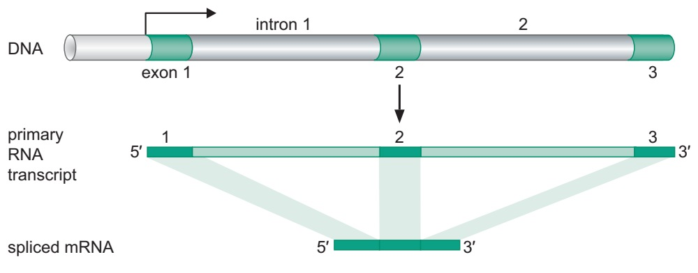{ width="690" loading=lazy }
/// caption
外显子与内含子按 RNA 加工命运区分。裁自 Watson 等第7版图8–3。[^watson-gene-structure]
///

外显子保留在成熟 RNA 中，不等于整个区段都会翻译：首末外显子常包含 UTR，非编码 RNA 的外显子也不以编码蛋白质为主要功能。内含子被剪除，也不意味着那段 DNA 没有其他作用；其中可以存在调控元件、独立基因，或用于产生小 RNA 的序列。具体剪接反应见[RNA转录后加工](rna_processing.md)。

同一前体 RNA 还可以选择不同的剪接方式。下图以肌钙蛋白 T 的互斥外显子为例：W、X、Z 被共同保留，α 与 β 二选一，便得到两种相关产物。这里是一套基因通过加工得到多个转录本。

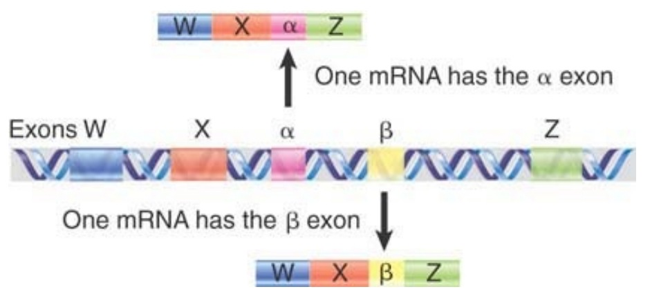{ width="650" loading=lazy }
/// caption
互斥外显子改变成熟 RNA 的组成。α、β 是图中两种可选外显子的标记；裁自 *Lewin’s GENES XII* 图3.13。[^lewin-gene-structure]
///

重叠基因则是不同基因共享一段基因组位置。它们可以位于同一条链，以不同起点或阅读框解读序列；也可以位于相反链，分别转录。病毒常借重叠编码提高有限序列的利用程度，细胞中也有反义重叠，或一个基因嵌在另一个基因内含子里的结构。

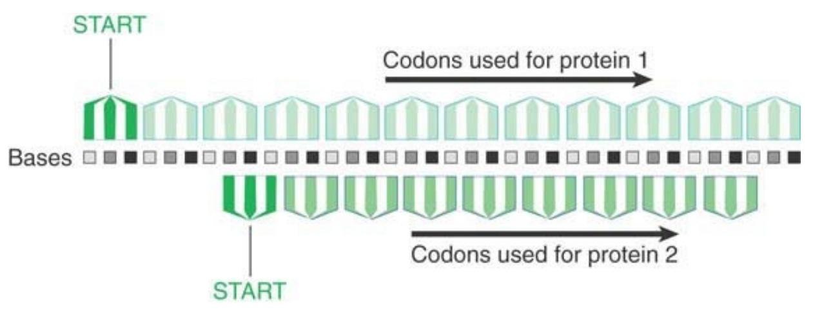{ width="650" loading=lazy }
/// caption
相同碱基按不同阅读框分组，可以编码不同氨基酸序列。裁自 *Lewin’s GENES XII* 图3.12。[^lewin-gene-structure]
///

图中把同一排碱基错开分成三联体，两个阅读框中的密码子便不同。一个碱基替换可能同时改变两个产物，也可能对其中一个是同义变化。判断突变后果时，必须沿具体链方向、阅读框和加工方式追踪。

### 基因家族与假基因 { #pseudogenes-gene-families }

一段基因组发生复制后，副本会各自积累变化。某些副本保持相似功能，某些改变表达时间、部位或蛋白质性质，也有副本失去祖先的编码能力。具有共同祖先的同源基因及相关假基因可以归入一个基因家族；串联复制产生的成员常相邻排列，形成基因簇，片段复制、全基因组复制和逆转座也能使它们分散到不同位置。[^lewin-globin]

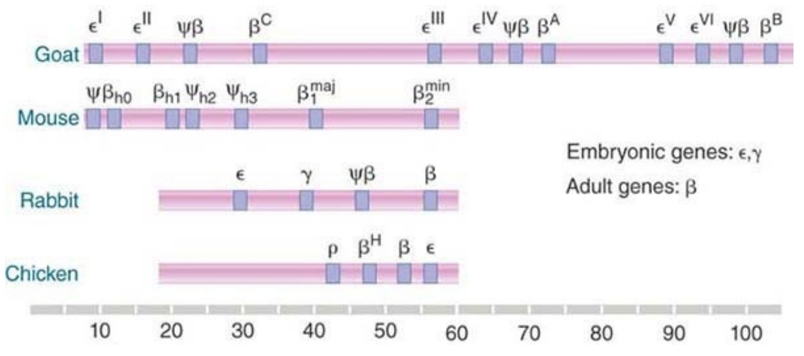{ width="760" loading=lazy }
/// caption
不同脊椎动物的 β 珠蛋白相关基因簇。ψ 标记假基因，成员数目与排列随谱系变化；裁自 *Lewin’s GENES XII* 图5.37。[^lewin-globin]
///

珠蛋白家族把几种结局放在了同一张图上：一个基因簇中有在不同发育阶段表达的成员，也夹着带 ψ 标记的假基因。假基因仍能保留与祖先的序列相似性，但可能因移码、提前终止、剪接位点或关键调控序列受损，无法再正常产生祖先蛋白质。由 DNA 复制后失活形成的，常称重复型假基因。

还有一条路从成熟 mRNA 出发：RNA 经逆转录后插入基因组，得到的拷贝通常已经没有原来的内含子，也未必带有原启动子。这样的逆转录拷贝若不能产生原功能产物，便形成加工型假基因。下图把这一路线画出来，缺少内含子正是追溯来源的重要线索。[^pseudogene-boundary]

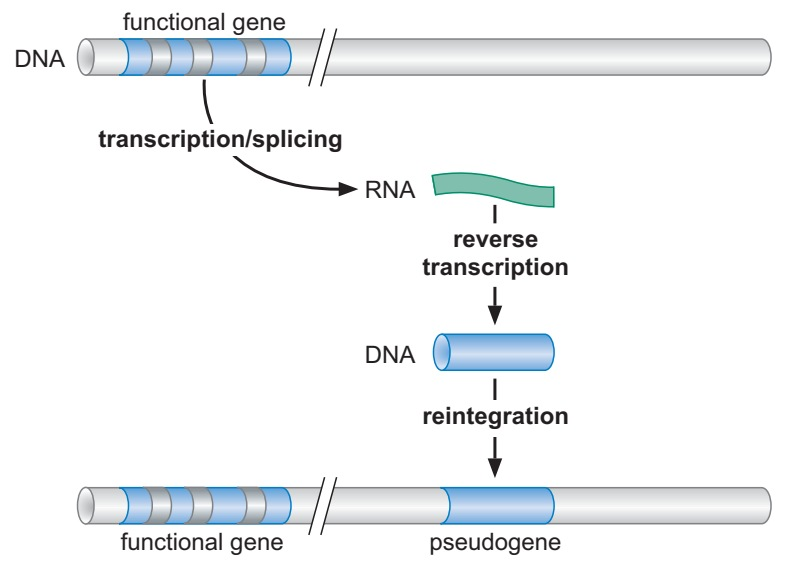{ width="580" loading=lazy }
/// caption
加工型假基因的形成示意。保留表达能力的逆转录拷贝也可成为功能性逆转录基因，不能仅凭“无内含子”判为假基因；裁自 Watson 等第7版图8–5。[^watson-gene-structure]
///

少数假基因仍可被转录，并通过 RNA、反义配对或调控元件影响其他基因，也有少数获得新的编码功能。这样的作用需要逐例验证：检测到转录回答“这里有没有 RNA”，遗传扰动及相应对照才进一步检验它在特定条件下做了什么。

!!! tip "直系同源与旁系同源"

    **直系同源（ortholog）**关系源于物种分化，**旁系同源（paralog）**关系源于基因复制。它们描述基因分开的历史，不能只看今天是否位于同一物种。属于同一家族也不保证功能相同，跨物种借用功能注释时还需比较序列、结构及实验依据。更远的同源家族可按共同结构与演化来源归入超家族，例如免疫球蛋白超家族的成员共享相应结构域，但并不都承担抗体的作用。

## 基因组怎样组织 { #genome-concept }

基因组是一个细胞、生物体或病毒所携带的整套遗传物质。真核细胞除了核基因组，还可以有线粒体、质体基因组；二倍体和多倍体细胞又各有多套同源染色体。谈“基因组大小”时，要说明是单倍体代表序列，还是某个细胞实际具有的 DNA 总量。

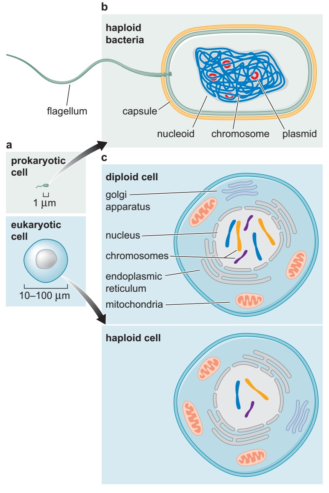{ width="480" loading=lazy }
/// caption
典型细胞中的染色体位置与倍性示意；细菌也存在多染色体、多倍体等情况。裁自 Watson 等第7版图8–1，其图据 T. A. Brown 的 *Genomes* 改编。[^watson-genome-organization]
///

染色体是能够复制、并在细胞分裂中分配的遗传单元；**复制子**则按一个复制起点及其控制的复制范围来划分。一条真核染色体通常有许多复制子，不能把染色体、DNA 分子和复制子都数成同一件东西。一个个体的细胞也未必始终携带完全一致的序列：免疫细胞的 V(D)J 重排、体细胞突变、拷贝数变化与细胞器异质性，都可以造成局部差异。

### 病毒基因组 { #viral-genomes }

病毒基因组的形式尤其多样：DNA 或 RNA、单链或双链、线形或环状，也可以分成若干节段。RNA 还需按与 mRNA 的关系区分正义、负义和双义。正义 RNA 的相应编码区可以直接被核糖体读取，负义 RNA 则必须先产生互补的 mRNA。基因组构型因而决定了感染开始后要先做什么，也决定了颗粒是否需要预先携带能工作的聚合酶。[^viral-genome-diversity]

一些噬菌体甚至改变了熟悉的四种碱基：T4 用5-羟甲基胞嘧啶替代胞嘧啶，并进一步糖基化；SPO1 用5-羟甲基尿嘧啶替代胸腺嘧啶；PBS2 的 DNA 则用尿嘧啶代替胸腺嘧啶。核酸的糖与骨架仍决定其 DNA 身份，不能只凭见到 U 就判断为 RNA。[^modified-phage-dna]

一些病毒还具有共价连接的末端蛋白、重复末端或部分双链结构。这些差别影响复制的起始和末端处理，相关路线见[DNA复制](dna_replication/index.md)、[逆转录](dna_replication/reverse_transcription.md)及[病毒基因组通向 mRNA 的路线](../micro/viruses.md#genome-expression-strategies)。

小型病毒常通过重叠基因、亚基因组 RNA、剪接、核糖体移框和终止密码子通读，从有限序列产生多种产物。基因组分节段主要改变遗传材料的组织及交换方式，本身不等于提高编码密度。RNA 病毒的基因组大小还受到聚合酶保真度、校对能力、衣壳和复制方式等共同约束；某些冠状病毒具有校对相关外切核酸酶，RNA 基因组的保真度并非一个固定值。[^viral-proofreading]

### 细菌、古菌与质粒 { #prokaryotic-genomes }

许多细菌和古菌具有一个主要的环状染色体，基因密度较高，功能相关基因常组成操纵子。细菌拟核由 DNA 超螺旋、核质相关蛋白、RNA、转录活动和大分子拥挤共同组织。古菌染色体可有多个复制起点，许多谱系使用组蛋白或其他染色质蛋白包装 DNA；其复制和转录装置在若干方面更接近真核系统。[^watson-genome-organization]

常见模式之外，也有线形染色体、多个大型染色体样复制子，以及稳定保持多个基因组拷贝的细胞。例如伯氏疏螺旋体（*Borrelia burgdorferi*）具有线形染色体及若干线形质粒，它们的双链在末端以共价闭合的发夹相接。[^borrelia-telomeres] “有几种染色体”与“每种染色体有几份”是两个问题，后者才与倍性直接相关。古菌膜脂、细胞壁和运动结构等一般特征另见[细菌与古菌](../micro/prokaryotes.md)。

质粒通常是能在宿主中独立于主要染色体复制、维持的 DNA 分子，可以环状，也可以线形；其复制仍需要宿主提供多种成分。质粒可携带抗性、代谢、毒力、共生或转移相关基因。在某种培养条件下丢失一个质粒，细胞可能照样生长；换成含抗生素或特定碳源的环境，结果便可能完全不同。质粒、噬菌体、转座元件和整合接合元件还可交换序列模块，参与可移动基因库的流动。

??? note "闭环质粒为什么能在密度梯度中单独成带"

    经典 CsCl—溴化乙锭梯度利用 DNA 的拓扑差别进行分离。溴化乙锭嵌入碱基对之间，会改变双螺旋扭转并降低 DNA—染料复合物的浮力密度。具有缺口的环状 DNA 或线形 DNA 可以旋转松弛；共价闭环分子的连接数受约束，在用于分离的染料条件下结合的染料较少，因而保持较高浮力密度，与开环和线形 DNA 分开。[^plasmid-density]

    这里分离的是特定条件下的拓扑形式，不能从“质粒”这个名称直接推出固定密度。另一条常用路线是碱裂解，利用裂解、中和后质粒与高分子染色体 DNA 不同的复性、聚集行为；步骤与质量判断见[质粒 DNA 的碱裂解](../exptech/biochem_molecular/nucleic_acid.md#plasmid-alkaline-lysis)。

### 真核染色体与细胞器基因组 { #eukaryotic-genomes }

真核核基因组通常分布在多条线形染色体上。复制起点使长 DNA 分子能够被完整复制，端粒保护染色体末端，着丝粒上建立的动粒则将染色体连接到分裂纺锤体，帮助复制后的两份分到子细胞。把 DNA 复制完，只完成了遗传的一半工作；还得把它分过去。

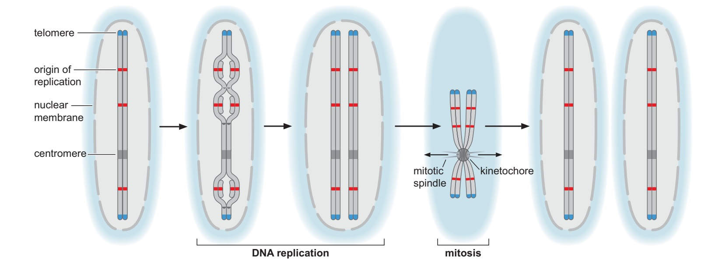{ width="800" loading=lazy }
/// caption
复制、末端保护与分配共同维持线形染色体。红色为复制起点，蓝色为端粒，灰色区为着丝粒；裁自 Watson 等第7版图8–6。[^watson-genome-organization]
///

DNA 与组蛋白及其他蛋白形成染色质，并建立动态的三维接触，详见[细胞核与染色质](../cell/nucleus_chromatin.md)。线粒体和质体基因组保留了内共生祖先的一部分基因，但绝大多数细胞器蛋白由核基因编码，再输入细胞器。核与细胞器中的几套遗传系统，借表达和蛋白运输共同维持细胞功能。

真核基因常含较长内含子，基因之间又散布调控元件、重复序列和其他非编码区域。下面把四个物种中含 RNA 聚合酶大亚基基因的一段65 kb区域排在一起：相同 DNA 长度，在大肠杆菌里可以容纳许多紧密排列的基因，在所选的人类区域里却大部分是内含子、重复和基因间序列。红色标出的同源基因仍在，周围的组织方式已经很不相同。[^watson-gene-density]

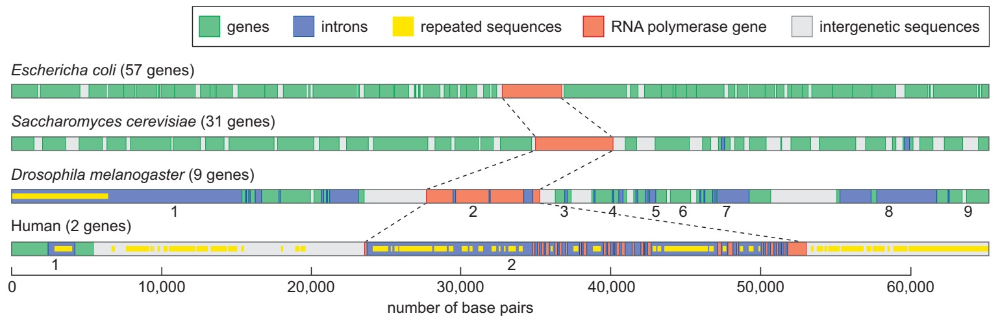{ width="820" loading=lazy }
/// caption
绿色为其他基因，蓝紫色为内含子，黄色为重复序列，红色标出 RNA 聚合酶大亚基基因，灰色为基因间序列。这是所选局部区域的比较；图中基因数不代表各物种全基因组的平均密度。裁自 Watson 等第7版图8–2。[^watson-gene-density]
///

| 系统 | 遗传材料与常见组织 | 阅读时要区别的关系 |
| --- | --- | --- |
| 病毒 | DNA 或 RNA；链数、拓扑和节段数多样 | 基因组形式、表达路线与病毒分类不是同一维度 |
| 类病毒 | 小型环状单链 RNA，不编码蛋白质 | RNA 结构与宿主酶支持复制，无病毒衣壳；两大家族的复制区室和切割机制不同 |
| 细菌 | DNA；常见主要环状染色体，可伴质粒 | 染色体种数、拷贝数与质粒数分别计数 |
| 古菌 | DNA；常见环状染色体，可有多起点与染色质蛋白 | 多顺反子组织可与真核样复制、转录装置并存 |
| 真核生物 | 核内多条线形染色体，另有细胞器 DNA | 核基因组大小、倍性和细胞器拷贝数分别描述 |

类病毒的两类滚环复制及其宿主依赖见[类病毒](../micro/viruses.md#viroids)。不同类群内部的基因密度、内含子长度、重复含量和倍性仍有很大变化，需要回到具体物种与细胞比较。

## 重复 DNA { #repetitive-dna }

### 串联重复与卫星 DNA { #tandem-satellite-dna }

一小段序列相邻重复多次，就形成串联重复。例如 `CACACACA` 可以看成 `CA` 的四次重复；若一个位点在不同个体中分别重复十次、十二次，重复阵列的长度便不同。重复单位很短的通常称微卫星或短串联重复（STR），更长的单位常归入小卫星，大片串联阵列还可组成染色体上的卫星 DNA。各名称的长度界限在不同文献中并不完全统一。[^lewin-satellite]

“卫星”原先是一个实验观察：基因组 DNA 在 CsCl 密度梯度中形成主要条带，一些重复 DNA 因序列组成等差异，在旁边形成较小的独立条带，如同主峰旁的小卫星。不能与主带分开的相似重复成分也被称作隐蔽卫星。这个名字说的是早期怎样把它分出来，不是在说它一定位于染色体的某个末端。

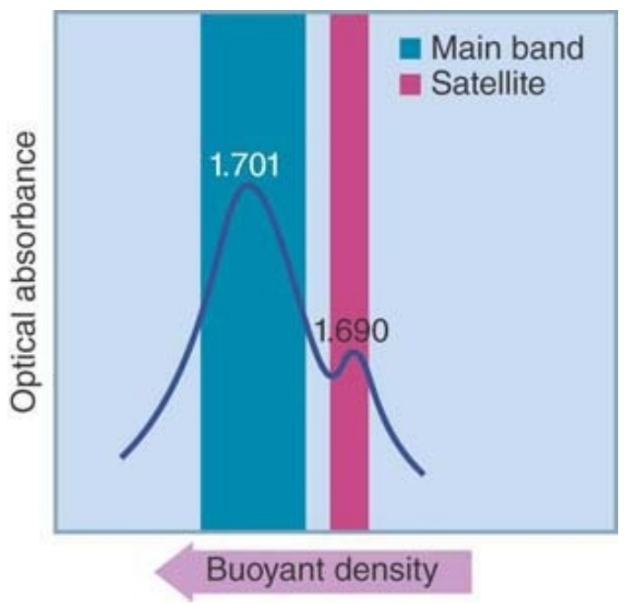{ width="330" loading=lazy }
/// caption
小鼠 DNA 的主带与卫星带示意；箭头所指方向为浮力密度增加。裁自 *Lewin’s GENES XII* 图6.11。[^lewin-satellite]
///

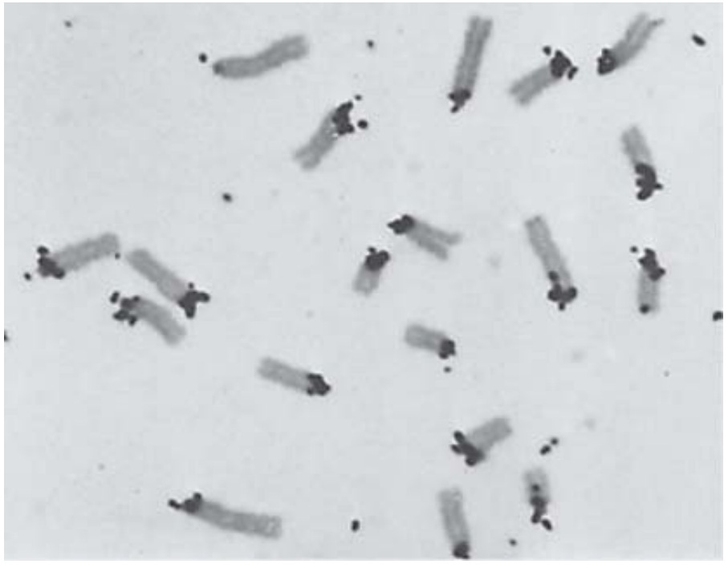{ width="390" loading=lazy }
/// caption
原位杂交显示小鼠卫星 DNA 在着丝粒附近富集。原图由 Mary Lou Pardue 与 Joseph G. Gall 提供，转引并裁自 *Lewin’s GENES XII* 图6.12。[^lewin-satellite]
///

把分离出的重复 DNA 制成杂交探针，还能看到它们在染色体上的位置。上图的黑色信号集中在小鼠染色体的着丝粒附近；这是特定卫星序列的分布，并不表示所有串联重复都只位于着丝粒。端粒重复、rDNA 阵列及遍布其他区域的短串联重复，都有各自的序列和位置。

### 重复次数怎样变成 DNA 指纹 { #dna-fingerprinting }

串联重复的长度差异可以转成可观察的条带。经典 DNA 指纹方法先用限制性内切酶切开 DNA，选择的切点位于重复阵列之外；含重复序列的片段因阵列长短不同而具有不同长度。电泳把片段按迁移率分开，再经 Southern 转印、与标记探针杂交，只显示能与探针配对的那部分片段。[^weaver-fingerprinting]

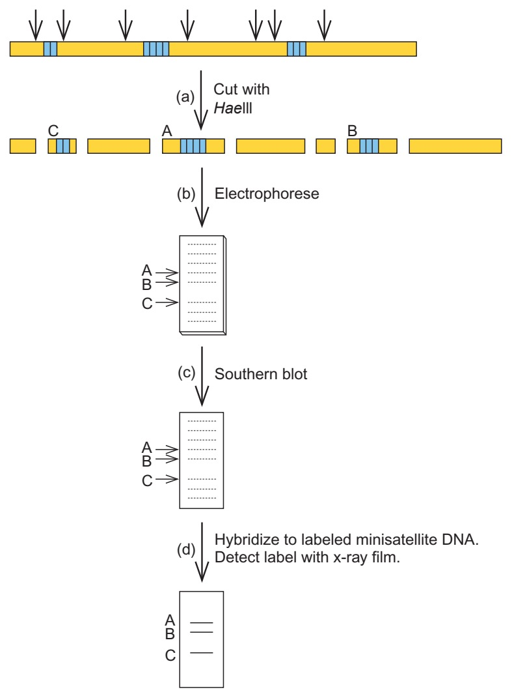{ width="355" loading=lazy }
/// caption
A、B、C 是含重复序列的三个片段；其他片段虽参与电泳，却不一定被该探针检出。裁自 Weaver 第5版图5.13。[^weaver-fingerprinting]
///

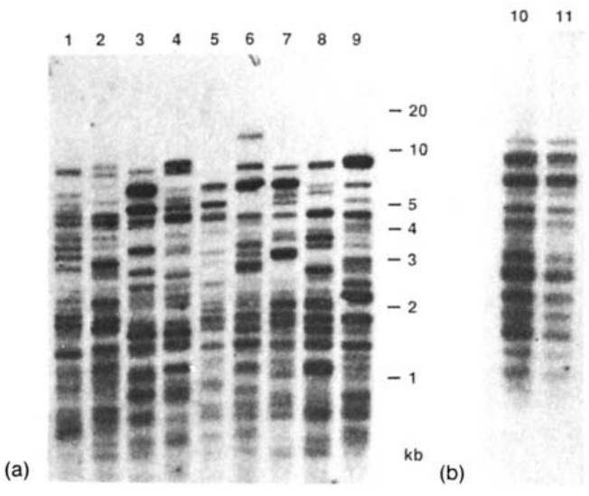{ width="420" loading=lazy }
/// caption
泳道1–9来自九个无亲缘个体，10–11来自一对同卵双生子；中间为 kb 标尺。Vassart 等1987年图1，经 Weaver 图5.14转引并裁切。[^vassart-fingerprint]
///

右图中，1–9号泳道上部的条带位置有明显差异，10和11号的条带模式却相同。10号泳道较深，是因为上样 DNA 较多，不能据此说它“多了这些基因”。这里用重复序列长度组合辨认个体；多位点探针一次显示复杂条带，针对特定位点的分型则可以分别记录等位片段。重复拷贝数也按遗传规律传递，使这类标记能用于亲缘分析。

重复次数本身还可能改变基因表达、蛋白质序列或染色体稳定性。因此，串联重复既可用作标记，也可能直接参与表型；要由具体位点的位置、序列和实验结果判断。

### 散布重复与转座元件 { #interspersed-repeats }

另一大类重复分散在基因组各处，其中很多来自转座元件。DNA 转座子通过 DNA 中间体移动，逆转座元件则先转录为 RNA，再逆转录成新的 DNA 拷贝。后者包括带长末端重复（LTR）的元件，以及 LINE、SINE 等不带 LTR 的元件。复制过程中留下的旧副本逐渐积累突变，使今天的基因组保存了大量已经失活的残迹。[^watson-transposons]

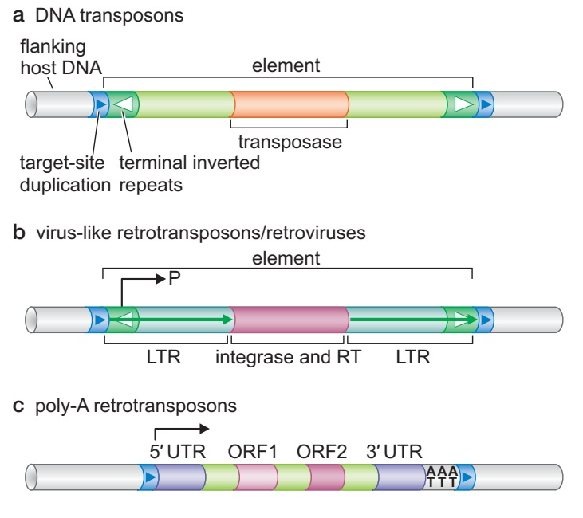{ width="630" loading=lazy }
/// caption
三类典型转座元件的结构：转座酶编码区、LTR 与整合酶／逆转录酶、非 LTR 元件的 ORF1／ORF2。裁自 Watson 等第7版图12–18。[^watson-transposons]
///

图中的 LINE 类元件可以编码 RNA 结合蛋白及逆转录相关酶，但现存拷贝中只有一部分保留活动能力。SINE 通常不编码完整的转座机器，需要借用其他元件的蛋白质；人类 Alu 序列便是熟悉的例子。转座是否自主，与一段序列对宿主是否具有调控作用，是两个不同问题。完整移动过程见[DNA重组与转座](dna_recombination.md)。

这些拷贝既可能引起插入突变，也可以提供启动子、增强子、剪接位点，或成为重组的相似序列底物。**重复与否、是否编码、是否有功能，是三种不同的分类。** 串联的 rRNA 基因与许多动物的组蛋白基因簇，是重复的功能基因；内含子可以含重复序列，也可以由低拷贝序列组成；转座元件中还可能有蛋白质编码区。

!!! info "发现转录以后，还要检验什么"

    一段 DNA 能被转录，说明它具有相应的生化活动；改变它以后出现可重复的表型，支持它在该条件下产生作用；比较序列与选择压力，还可以研究这种作用是否受到自然选择维持。三类证据回答的问题不同，不能用其中一种结果替全部非编码 DNA 判定功能比例。

### 测序之前怎样发现重复 { #repeat-renaturation }

重复序列还有一个可测的物理后果：把 DNA 打成长度相近的片段、变性，再允许互补链复性，高拷贝序列更容易遇到自己的互补伙伴，会先重新形成双链，低拷贝序列则慢一些。经典 $C_0t$ 分析以起始单链核苷酸浓度与复性时间的乘积比较进程，由此区分快、中、慢复性组分。条件与动力学解释见[复性动力学、互补性与序列复杂度](../biochem/nucleic_acid.md#renaturation-kinetics)。这使研究者在逐碱基测序之前，就能估计基因组中不同重复成分的分量。

## 基因组大小与基因数 { #genome-size-complexity }

C 值通常指一个单倍体核基因组的 DNA 含量。不同真核生物的 C 值跨越很大范围，却不能按形态复杂程度排成一条递增序列。这一观察最初称为“C 值悖论”，后来扩展为研究基因组大小成因及后果的“C 值谜题”：究竟哪些序列在扩增，哪些被清除，这些变化又怎样影响细胞和生物体？[^c-value-enigma]

前面的65 kb比较给出了一条直观线索：即使保留相应的基因，内含子、基因间区及重复 DNA 的长度也可以相差很大。转座扩增、串联重复变化、全基因组复制增加 DNA，大片段缺失和其他清除过程又减少 DNA，长期结果取决于这些过程的平衡。基因组大小与细胞大小、细胞周期及发育速率还可有统计联系，关系的方向和强度需要在具体类群中检验。

基因数也不能直接换算成生物复杂性，常见的“N 值悖论”正是在提醒这一点。相近的基因集合可以通过可变剪接、RNA 加工、蛋白质修饰和组合式调控，在不同细胞类型和发育阶段产生不同作用。把序列交给注释程序以后，短 ORF、重复和假基因可能增加误报，低表达或只在少数组织出现的转录本又容易漏掉。基因数因而还带着组装版本、样品覆盖和注释规则的影响。用致死突变筛选来估计基因数也会少计：只在其他条件下必需的基因、功能冗余的基因，以及改变后不致死的基因，都可能不在该筛选的结果中。

染色体数同样不能直接排列复杂性。染色体融合或分裂可以改变条数，却未必带来相应的基因增减；有些教材将这种不对应称为“K 值矛盾”。比较时还须统一倍性，不能把一个物种的单倍体条数与另一个物种的体细胞条数并列。

## 从参考基因组到泛基因组 { #reference-pangenome }

测序得到的是许多读段，组装根据它们的关系重建连续序列，注释再在这些序列上标出基因、转录本、重复和其他元件。如果一段重复被错误折叠成一个拷贝，或两条相似单倍型被压成一条共识序列，后续的基因数和变异判断也会改变。因此，基因坐标须和具体参考组装一起引用。RefSeq 整合基因组、RNA 与蛋白质参考记录，Ensembl 则在特定组装上结合转录、蛋白和其他证据建立基因模型。[^reference-annotation]

线性参考提供了统一的比较坐标，但一个位置通常只选取一条代表序列。2022年发表的 T2T-CHM13 组装利用长读长及互补技术，填补了此前难以解析的大量着丝粒、近端着丝粒和片段重复区域。它来自近单倍体的 CHM13 细胞系，包含22条常染色体和 X 染色体，没有 Y 染色体；它也不是普通二倍体个体的两套完整单倍型。[^t2t-genome]

泛基因组将多个个体的单倍型或组装一起纳入参考。下图把两条序列表示为穿过同一个图的不同路径：蓝色路径经过额外的 `b` 节点，在 `d`、`e` 处选择不同碱基，并以与橙色路径相反的方向穿过 `g` 节点。`g` 的正向序列为 `CTTAAA`，反向读取则取其反向互补序列 `TTTAAG`。这样，插入缺失、碱基替换和倒位就可以保存在同一个表示中。[^human-pangenome]

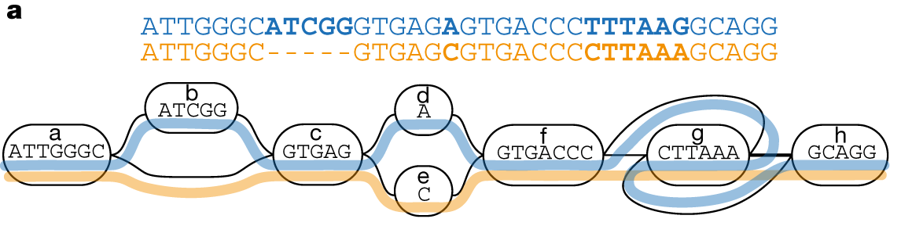{ width="780" loading=lazy }
/// caption
序列图中的两条替代路径。裁自 Liao 等2023年论文图3a，保留节点、序列和路径；此为表示原理的示意。[^human-pangenome]
///

2023年发表的人类泛基因组草图整合了47个相位化二倍体组装，纳入线性参考没有覆盖的多态序列，并改善了复杂结构变异的检测。这个历史阶段的样本集合仍不能穷尽人类多样性，群体代表性和计算方法还需要继续扩展。

!!! info "个体、参考与泛基因组"

    **个体基因组**描述某个生物或样本实际携带的序列组合；**参考组装**提供共同使用的序列与坐标；**泛基因组**容纳多个个体或单倍型，表示群体中的替代序列。前两者的差异不一定是测序错误，也可能就是个体携带了参考之外的序列。

获得序列之后，基因组学还要沿不同问题继续研究。以图谱、测序、组装和结构注释为重点的研究常归入基因组结构研究；功能基因组学则结合表达、互作和扰动实验，研究基因及其产物怎样工作。跨物种比较可以追踪基因家族与染色体区段的演化，转录组和蛋白质组研究则观察具体条件下实际产生了什么。

不同研究计划也各有对象，不能把它们都理解成“再测一遍人类基因组”：

| 计划或资源 | 主要研究对象与用途 |
| --- | --- |
| 人类基因组计划（HGP） | 建立遗传图、物理图与参考序列；图谱如何服务测序见[作图与鸟枪组装](../bioinfo/genome_analysis.md#mapping-shotgun-history) |
| HapMap 与千人基因组计划 | 前者建立常见多态性与连锁不平衡图谱，后者以群体测序扩展变异与单倍型参考；见[群体变异](../bioinfo/genome_analysis.md#variant-phasing) |
| ENCODE | 整理转录、蛋白结合、染色质等实验，寻找候选功能元件；生化活动仍需与具体功能验证区分 |
| 癌症基因组图谱（TCGA） | 联合分析肿瘤及匹配正常样本的分子特征，研究癌症相关变化，并非已列尽所有致癌突变 |
| 人类蛋白质图谱（HPA） | 结合成像、转录组和蛋白质组等数据，描绘蛋白质在组织、细胞及亚细胞位置的分布 |
| 人类蛋白质组计划（HPP） | C-HPP 按染色体编码的蛋白质组织鉴定工作，B/D-HPP 围绕生物过程与疾病展开蛋白质组研究 |

生物信息学把得到的数据转成可检索、比较和分析的对象：GenBank／ENA／DDBJ 保存核酸档案，UniProt 整理蛋白质序列与功能，PDB 保存实验结构，CATH／SCOP 进一步组织结构分类，OMIM 汇集遗传表型与相关文献。资源分工、登录号和版本见[生物数据与数据库](../bioinfo/data_databases.md#nucleotide-genome-resources)。[^genome-projects]

后续方法分别见[基因组组装、变异与比较分析](../bioinfo/genome_analysis.md)、[转录组分析](../bioinfo/transcriptomics.md)、[蛋白质组与质谱](../bioinfo/proteomics.md)及[功能注释与验证](../bioinfo/functional_annotation.md#validation-reporting)。

## 参考资料与延伸阅读 { #references }

- Watson JD, Baker TA, Bell SP, et al. *Molecular Biology of the Gene*. 7th ed. Pearson / Cold Spring Harbor Laboratory Press; 2014. 第2、8、12章。
- Weaver RF. *Molecular Biology*. 5th ed. McGraw-Hill; 2012. 第2、3、5章。
- Krebs JE, Goldstein ES, Kilpatrick ST. [Lewin’s GENES XII](https://www.jblearning.com/catalog/productdetails/9781284104493). 12th ed. Jones & Bartlett Learning; 2018. 第1、3、5、6章。

- Alberts B, Johnson A, Lewis J, et al. [DNA and Chromosomes](https://www.ncbi.nlm.nih.gov/books/NBK21074/). In: *Molecular Biology of the Cell*. 4th ed. Garland Science; 2002.
- Cooper GM. [The Organization of Cellular Genomes](https://www.ncbi.nlm.nih.gov/books/NBK9862/). In: *The Cell: A Molecular Approach*. 2nd ed. Sinauer Associates; 2000.
- Griffith F. [The Significance of Pneumococcal Types](https://pmc.ncbi.nlm.nih.gov/articles/PMC2167760/). *Journal of Hygiene*. 1928;27:113–159.
- Avery OT, MacLeod CM, McCarty M. [Studies on the Chemical Nature of the Substance Inducing Transformation of Pneumococcal Types](https://doi.org/10.1084/jem.79.2.137). *Journal of Experimental Medicine*. 1944;79:137–158.
- Hershey AD, Chase M. [Independent Functions of Viral Protein and Nucleic Acid in Growth of Bacteriophage](https://pmc.ncbi.nlm.nih.gov/articles/PMC2147348/). *Journal of General Physiology*. 1952;36:39–56.
- Fraenkel-Conrat H, Singer B. [Virus Reconstitution. II. Combination of Protein and Nucleic Acid from Different Strains](https://pubmed.ncbi.nlm.nih.gov/13436476/). *Biochimica et Biophysica Acta*. 1957;24:540–548.
- Crick F. [Central Dogma of Molecular Biology](https://www.nature.com/articles/227561a0). *Nature*. 1970;227:561–563.
- Gerstein MB, Bruce C, Rozowsky JS, et al. [What Is a Gene, Post-ENCODE? History and Updated Definition](https://genome.cshlp.org/content/17/6/669). *Genome Research*. 2007;17:669–681.
- Elliott TA, Gregory TR. [What's in a Genome? The C-value Enigma and the Evolution of Eukaryotic Genome Content](https://doi.org/10.1098/rstb.2014.0331). *Philosophical Transactions of the Royal Society B*. 2015;370:20140331.
- Nurk S, Koren S, Rhie A, et al. [The Complete Sequence of a Human Genome](https://pmc.ncbi.nlm.nih.gov/articles/PMC9186530/). *Science*. 2022;376:44–53.
- Liao WW, Asri M, Ebler J, et al. [A Draft Human Pangenome Reference](https://www.nature.com/articles/s41586-023-05896-x). *Nature*. 2023;617:312–324.

[^griffith-transformation]: Griffith 对肺炎链球菌型别转换的原始观察、动物实验和流行病学背景见其 1928 年[论文](https://pmc.ncbi.nlm.nih.gov/articles/PMC2167760/)。
[^avery-dna]: DNA 组分的纯化、酶处理、化学检测及作者对污染与解释边界的讨论见 Avery、MacLeod 和 McCarty 的[原始论文](https://doi.org/10.1084/jem.79.2.137)。
[^hershey-chase]: 两种同位素标记、搅拌分离、细胞与子代中的回收结果见 Hershey 和 Chase 的[原始论文](https://pmc.ncbi.nlm.nih.gov/articles/PMC2147348/)，曲线取图1（印刷第47页），使用[公开扫描稿](https://www.bx.psu.edu/~anton/bioinf1-2014/hershey-chase-1952.pdf)。
[^tmv-rna]: 不同烟草花叶病毒株系 RNA 与蛋白质重组后子代型别随 RNA 来源的证据见 Fraenkel-Conrat 和 Singer 的[研究](https://pubmed.ncbi.nlm.nih.gov/13436476/)。
[^crick-central-dogma]: 中心法则针对逐残基序列信息传递、允许的一般／特殊路线及“信息不能从蛋白质流出”的原始表述见 Crick 的[论文](https://www.nature.com/articles/227561a0)。本文所用历史图为该文图2，第561页，取自[Caltech公开稿](https://www.dna.caltech.edu/courses/cs191/paperscs191/CrickCentralDogma1970.pdf)。
[^prion-information]: “朊粒”概念和核酸破坏处理抗性见 Prusiner 的[原始报告](https://pubmed.ncbi.nlm.nih.gov/6801762/)；构象自模板与蛋白质遗传的现代机制边界见[相关综述](https://pmc.ncbi.nlm.nih.gov/articles/PMC8883993/)。
[^gene-definition]: 基因概念从遗传单位到功能产物集合的历史及“相互关联功能产物的序列并集”定义见 Gerstein 等的[讨论](https://genome.cshlp.org/content/17/6/669)；Ensembl 的实际聚类规则见其[基因注释说明](https://mart.ensembl.org/info/genome/genebuild/index.html)。
[^refseq-annotation]: RefSeq 的基因组、转录本和蛋白质参考记录、人工审校与自动注释来源见 NCBI 的[RefSeq 说明](https://www.ncbi.nlm.nih.gov/refseq/about/)；真核基因组注释的来源层级见 NCBI 的[注释页面](https://www.ncbi.nlm.nih.gov/refseq/annotation_euk/)。
[^pseudogene-boundary]: 加工型假基因的形成、编码缺陷与转录证据见 Harrison 等的[研究](https://pmc.ncbi.nlm.nih.gov/articles/PMC1087782/)；“转录”与“功能”需分开验证的边界也见 Gerstein 等的[基因定义讨论](https://genome.cshlp.org/content/17/6/669)。
[^viral-genome-diversity]: ICTV 的病毒属性说明按 DNA／RNA、单／双链和分节段记录基因组构型，见[病毒属性报告](https://ictv.global/report/chapter/information/information/virus_properties)；核酸类型、拓扑和正负义的一般框架见 NCBI Bookshelf 的[病毒结构与分类](https://www.ncbi.nlm.nih.gov/books/NBK8174/)。
[^c-value-enigma]: C 值、基因组大小变化机制以及与细胞和生物性状关系的跨类群综述见 Elliott 与 Gregory 的[综述](https://doi.org/10.1098/rstb.2014.0331)。
[^reference-annotation]: 参考序列作为稳定注释与比较基础的范围见 NCBI [RefSeq](https://www.ncbi.nlm.nih.gov/refseq/about/)；基因模型依赖底层组装、转录本证据和聚类规则见 Ensembl 的[注释文档](https://mart.ensembl.org/info/genome/genebuild/index.html)。
[^t2t-genome]: T2T-CHM13 对人类染色体连续组装、重复区域和既有参考缺口的补足见 Nurk 等的[研究](https://pmc.ncbi.nlm.nih.gov/articles/PMC9186530/)。
[^human-pangenome]: 47 个相位化二倍体组装、额外多态序列和结构变异检测改进见 Human Pangenome Reference Consortium 的[首版草图](https://www.nature.com/articles/s41586-023-05896-x)；序列路径示意裁自[图3a](https://www.nature.com/articles/s41586-023-05896-x/figures/3)。

[^avery-colony-image]: 菌落照片原出自 Avery、MacLeod 和 McCarty（1944），本文按 Krebs 等 *Lewin’s GENES XII* 第12版第1章图1.6转引；本地电子版PDF第75页，仅裁取照片。原论文见[DOI](https://doi.org/10.1084/jem.79.2.137)，教材信息见[出版社](https://www.jblearning.com/catalog/productdetails/9781284104493)。
[^weaver-transformation]: Weaver，*Molecular Biology*，第5版，第2章图2.2（第14页）与图2.4（第16页），分别为 Griffith 转化和 Hershey–Chase 实验的后世教学示意；裁去周围正文，保留全部面板。
[^watson-transformation]: Watson 等，*Molecular Biology of the Gene*，第7版，第2章图2–2，第23页；教材注明据 Stahl FW，*The Mechanics of Inheritance*（1964）图2.3改编。本文仅裁取图版。
[^tmv-reconstitution-image]: Fraenkel-Conrat H, Singer B. *Virus Reconstitution and the Proof of the Existence of Genomic RNA*. *Philosophical Transactions of the Royal Society B*. 1999;354:583–586，图1，第584页；图版及实验回顾取自[作者文章公开稿](https://www.rpgroup.caltech.edu/virus_bootcamp/assets/pdfs/FraenkelConratReconstitution.pdf)，该图原刊于1956年 *Scientific American*。此处为示意图裁切，不是感染植株或病毒显微照片。
[^weaver-gene-architecture]: Weaver，*Molecular Biology*，第5版，第3章图3.20，第44页；为教学简化序列，本文裁取 DNA—RNA—多肽图，保留起止位点与链方向。
[^watson-gene-structure]: Watson 等，*Molecular Biology of the Gene*，第7版，第8章图8–3（第205页）与图8–5（第207页），分别说明 RNA 剪接与加工型假基因来源。均裁取原图。
[^lewin-gene-structure]: Krebs 等，*Lewin’s GENES XII*，第12版，第3章图3.12、3.13；本地电子版PDF第317、318页。图3.13以大鼠肌钙蛋白 T 基因的3′端可变剪接为例，此处保留示意中的 W、X、α、β、Z 标记。
[^lewin-globin]: Krebs 等，*Lewin’s GENES XII*，第12版，第5章图5.37；本地电子版PDF第513页，比较山羊、小鼠、兔和鸡的 β 珠蛋白相关基因簇，本文裁取图版。图示为教材所采用的基因模型，不用于报告最新注释数量。
[^watson-genome-organization]: Watson 等，*Molecular Biology of the Gene*，第7版，第8章图8–1（第202页）与图8–6（第208页）。图8–1据 Brown TA，*Genomes*，第2版（2002）图2.1改编；两图均裁去周围正文。复制子、染色体和染色质的机制亦见本章及第9章。
[^watson-gene-density]: Watson 等，*Molecular Biology of the Gene*，第7版，第8章图8–2，第204页；选取各物种含 RNA 聚合酶最大亚基基因的65 kb区域（真核为 RNA 聚合酶 II），保留长度坐标与颜色图例。图中数量是教材所选局部区段的注释，不是全基因组统计。
[^lewin-satellite]: Krebs 等，*Lewin’s GENES XII*，第12版，第6章图6.11、6.12；本地电子版PDF第591、593页。图6.11为小鼠 DNA 的 CsCl 浮力密度示意；图6.12为小鼠卫星 DNA 的细胞学杂交照片，教材署名 Mary Lou Pardue 与 Joseph G. Gall，Carnegie Institution。本文仅裁取原图，原照片未附比例尺。
[^weaver-fingerprinting]: Weaver，*Molecular Biology*，第5版，第5章“DNA Fingerprinting and DNA Typing”，第86–88页；方法图裁自图5.13，第86页。图中 HaeIII 切点位于所示小卫星重复之外，探针只显示相应重复片段。
[^vassart-fingerprint]: Vassart G, Georges M, Monsieur R, et al. [A Sequence in M13 Phage Detects Hypervariable Minisatellites in Human and Animal DNA](https://pubmed.ncbi.nlm.nih.gov/2880398/). *Science*. 1987;235:683–684，图1；DOI：[10.1126/science.2880398](https://doi.org/10.1126/science.2880398)。本文图经 Weaver 第5版图5.14（第87页）转引并裁切，保留泳道、a/b面板与 kb标尺；泳道10的上样量高于11。
[^watson-transposons]: Watson 等，*Molecular Biology of the Gene*，第7版，第12章图12–18，第395页。本文裁取三类结构的原图；SINE 的非自主转座与 LINE 蛋白依赖见同章“Poly-A Retrotransposons”。
[^plasmid-density]: Radloff R, Bauer W, Vinograd J. [A Dye-Buoyant-Density Method for the Detection and Isolation of Closed Circular Duplex DNA](https://authors.library.caltech.edu/records/rntn6-qqp91). *PNAS*. 1967;57:1514–1521；DOI：[10.1073/pnas.57.5.1514](https://doi.org/10.1073/pnas.57.5.1514)。方法利用嵌入染料与闭环、开环 DNA 不同的结合行为。
[^viral-proofreading]: Eckerle LD, Becker MM, Halpin RA, et al. [Infidelity of SARS-CoV Nsp14-Exonuclease Mutant Virus Replication Is Revealed by Complete Genome Sequencing](https://pubmed.ncbi.nlm.nih.gov/20463816/). *PLoS Pathogens*. 2010;6:e1000896，比较 nsp14 外切核酸酶突变与复制保真度。

[^modified-phage-dna]: T4 的5-羟甲基胞嘧啶及 SPO1 的尿嘧啶羟甲基化见[原始结构研究](https://pmc.ncbi.nlm.nih.gov/articles/PMC6400193/)；SPO1以5-羟甲基尿嘧啶替代 T、PBS2含 U 的 DNA 亦用于[糖基化酶底物研究](https://pubmed.ncbi.nlm.nih.gov/6588376/)。T4 的糖基化羟甲基胞嘧啶见[修饰噬菌体 DNA 的连接研究](https://pubmed.ncbi.nlm.nih.gov/6652091/)。
[^borrelia-telomeres]: 伯氏疏螺旋体线形染色体的双向复制起点及发夹末端见[物理定位研究](https://pubmed.ncbi.nlm.nih.gov/10231498/)；染色体与线形质粒末端的结构见[端粒交换研究](https://pubmed.ncbi.nlm.nih.gov/15205414/)。
[^genome-projects]: ENCODE 的资源对象见[项目说明](https://www.encodeproject.org/help/project-overview/)；TCGA 见美国 NCI 的[项目概述](https://www.cancer.gov/ccg/research/genome-sequencing/tcga)；HPA 见其[官方介绍](https://www.proteinatlas.org/about)；HPP 及 C-HPP、B/D-HPP 的分工见 [HUPO](https://hupo.org/initiatives-2/)。
