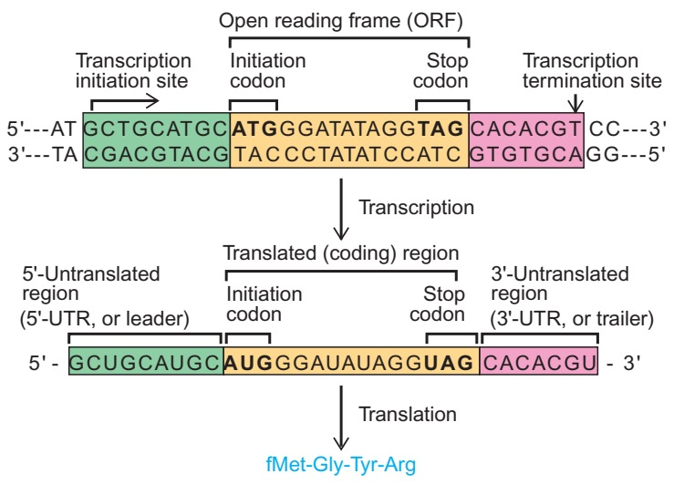

# 分子生物学

细胞增殖需要复制DNA，生长需要合成RNA和蛋白质，环境改变时又会调整这些分子的数量与去向。分子生物学沿着这些过程追问：遗传信息怎样保存和传递，哪些分子负责读取它，一条序列又怎样在具体的细胞中产生作用。

这一部分从遗传物质的实验证据出发，逐步走进复制叉、转录复合物和核糖体，再看RNA与蛋白质的加工、定位和调控。初次阅读可以沿下方的[阅读路径](#reading-path)依次前进；已有基础时，也可以从损伤修复、RNA命运或表达调控进入，回看与它相连的反应。

## 从序列走到分子机制 { #molecular-biology-scope }

一段DNA的碱基次序只是起点。聚合酶必须先找到合适的模板，蛋白质和RNA要在正确的位置装配，反应还需要底物与能量。即使序列没有变化，细胞中因子的有无、染色质的状态、分子的合成和降解速率，也会改变最后得到的产物。

这些问题与相邻学科紧密相接。生物化学解释碱基配对、成键反应和能量耦联，分子生物学进一步追踪模板选择、复合物装配与调控；细胞生物学把过程放回细胞核、拟核、膜系统和细胞周期，遗传学则追踪变异怎样影响性状并在谱系与群体中传递。同一个对象可以从这些不同尺度理解。

## 中心法则与序列信息 { #information-flow }

DNA复制把核苷酸序列传给DNA，转录把它传给RNA，翻译再把mRNA上的密码子次序转换为多肽的氨基酸次序。最后一步要靠转运RNA（tRNA）把密码子与氨基酸接起来，由核糖体催化肽键形成。下图把一个很短的蛋白质编码区放大，展示这两次读取的关系。

{ width="670" }
/// caption
从上向下看：DNA先转录成RNA；RNA中间的黄色区段按三联体读取，两端的绿色、粉色区段保留在RNA中，却不被翻译。图为简化的细菌编码区，fMet表示起始的甲酰甲硫氨酸。[^gene-expression-figure]
///

图中RNA的序列与上方DNA编码链相对应，只把T换成U；实际作为转录模板的是下面那条互补链。黄色区段内的AUG是图中采用的翻译起点，UAG使翻译终止，因而转录和翻译各有自己的边界。真实基因还可能有内含子、多个起始位点或不同的加工产物，详细关系见[基因与它的产物](genetic_material.md#gene-concept)。许多基因的功能产物本身就是RNA，例如参与核糖体结构与催化的rRNA，并不继续走向蛋白质。

中心法则讨论的是这种**逐个核苷酸或氨基酸残基的序列信息传递**。RNA也能作为模板：RNA依赖的RNA聚合酶完成RNA→RNA，逆转录酶和端粒酶完成RNA→DNA。已知系统中，蛋白质的氨基酸次序不能作为模板，逐个指定另一条蛋白质或核酸的序列；这才是中心法则所划定的边界。[^central-dogma]

!!! info "序列传递与状态改变"

    朊粒能使同种蛋白采用相似构象，传播的是折叠状态。蛋白质也能结合DNA、修饰其他蛋白或参与代谢反馈，从而改变细胞接下来读取哪些基因。这些作用都很重要，但与逐残基传递序列信息处在不同层次。RNA剪接、加尾和编辑则直接改变RNA的组成或结构，其机制在[RNA加工](rna_processing.md)中展开。中心法则的历史与朊粒的边界见[相关说明](genetic_material.md#central-dogma-boundary)。[^prion-boundary]

## 阅读路径 { #reading-path }

第一次系统学习，可以先建立基因与基因组的概念，再沿复制、转录、RNA加工、翻译和蛋白质成熟前进，最后回到调控，理解这些反应怎样随细胞状态改变。下面三个部分也可以各自成为一条复习路线。

### 保存与改变遗传信息 { #storage-and-change }

DNA要在细胞增殖过程中被准确复制，也会受到水解、氧化、辐射和复制障碍的影响。DNA损伤是其化学结构或完整性出现异常，突变则是稳定的序列改变；修复可以消除损伤，某些处理途径也可能留下变异。复制、修复和重组彼此衔接，共同影响基因组的稳定与演化。[^genome-maintenance]

**遗传物质怎样组织、怎样复制**

[遗传物质、基因与基因组](genetic_material.md)从转化和病毒实验进入，区分基因、转录单位、开放阅读框与调控元件，再比较染色体、质粒、病毒和细胞器基因组。参考基因组提供比较坐标，个体与细胞的变异要在此基础上另行描述。

[DNA复制](dna_replication/index.md)从半保留复制走进复制叉：解旋与引发怎样配合，5′→3′合成怎样处理两条反向平行的模板，冈崎片段怎样成熟并连接，DNA拓扑怎样调整，染色质又怎样重新装配。底物选择、校对和复制后错配修复共同提高保真度。[逆转录](dna_replication/reverse_transcription.md)转向RNA模板，追踪逆转录病毒的两次链转移，并比较其他逆转录系统。

**损伤怎样处理，序列怎样重排**

[DNA损伤、修复与突变](dna_repair.md)先辨认损伤，再看直接逆转、切除修复、错配修复、断裂修复和损伤耐受。可以在这里追踪一个受损位点怎样被发现、切除或绕过，以及处理后是否恢复了原序列。

[DNA重组与转座](dna_recombination.md)继续追踪DNA断开后的连接：同源序列怎样配对，位点特异性重组怎样选择伙伴，DNA转座和逆转座又怎样把序列送到新位置。复制叉受阻或断裂时，这些反应常与修复直接相接。

### 从基因到功能产物 { #gene-expression }

表达过程中的各步可以重叠发生。RNA尚未转录完，加工因子就可能已经结合；多肽尚未离开核糖体，就可能开始折叠或进入膜转运通道。顺着产物阅读，能看清相邻章节为什么需要彼此承接。

**RNA的合成与命运**

[转录与RNA生物合成](transcription.md)介绍RNA聚合酶的反应，再比较细菌、古菌、真核细胞、细胞器和RNA病毒的起始、延伸与终止。一个转录单位决定这次读取的范围，产物还带着特定末端、结构和结合蛋白。

[RNA转录后加工](rna_processing.md)追踪端加工、剪接、编辑、修饰、折叠、输出和周转。同一前体可以形成不同的成熟RNA；装配失败或在翻译中暴露异常的RNA，也可能被质量控制途径清除。

**多肽的合成与成熟**

[翻译与蛋白质生物合成](translation.md)从遗传密码和tRNA氨酰化进入核糖体，依次讲解起始、延伸、终止和回收，再看救援与程序化重编码怎样处理特殊模板。

[蛋白质成熟、定位与质量控制](protein_processing.md)继续追踪新生链：伴侣如何帮助折叠，分选信号如何引导运输，切割、共价修饰和亚基装配怎样改变功能，异常或不再需要的蛋白又怎样被降解。同一氨基酸序列的蛋白质，可以因位置、修饰、构象和寿命而有不同命运。

### 在不同条件下调节表达 { #expression-control }

基因是否被转录、RNA能保留多久、核糖体多快进入、蛋白质多快被清除，都会影响细胞中的产物数量。顺式元件提供核酸上的作用位置，反式因子通过结合这些位置或调节分子装置改变表达；它们的组合随营养、应激和细胞状态而变。

**[原核基因表达调控](gene_regulation/index.md)**

从乳糖操纵子与色氨酸衰减入手，看细菌怎样把营养信号接到转录和翻译上，再进入RNA开关、全局应答与噬菌体选择。古菌单独成节：它的基础转录装置更接近真核系统，同时具有自己的染色质与调控蛋白组合。

**[真核基因表达调控](gene_regulation/eukaryotic.md)**

从核小体怎样影响转录因子接近DNA开始，讲到增强子和启动子的通信，再追踪剪接、RNA稳定性、定位与翻译控制。不同细胞即使保留大体相同的基因组，也能通过这些环节形成不同的表达状态。

!!! tip "测到的数量对应哪一步"

    某种mRNA增多，既可能因为转录加快，也可能因为降解减慢。启动子占据、染色质开放、增强子接触、新生RNA、稳态mRNA、核糖体占据和蛋白质丰度各反映不同环节；一层的变化还可能被另一层补偿。阅读调控实验时，先找到实际测量的分子，再顺着合成、加工和清除的过程解释变化。

## 比较共同反应与不同装置 { #cross-domain-comparison }

细菌、古菌和真核生物都需要复制DNA、合成RNA、解读密码，并控制分子的寿命。沿着这些共同功能，可以比较不同生命域使用的分子装置。下图中的两种RNA聚合酶来自细菌和真核生物，大小和亚基数不同，却保留了相似的催化核心。

{ width="740" loading=lazy }
/// caption
左为水生栖热菌核心酶，右为酵母RNA聚合酶II。两大催化亚基围出中央裂隙，红色小球标出活性中心Mg²⁺；相同颜色帮助辨认对应亚基。[^polymerase-figure]
///

古菌的基础转录装置也与真核系统相近；各域的核糖体在共同核心外，又有自己的附加组分。复制机器呈现另一种关系：细菌与古菌／真核的多个核心组分来自不同的蛋白家族，却共同完成解链、引发和复制。相似的功能可能依靠同源装置，也可能由不同装置实现，具体比较见[三域RNA聚合酶](transcription.md#rnap-across-domains)与[DNA复制](dna_replication/index.md)。

每一域内部仍有很大差异。细菌可以有多条染色体、复杂RNA调控和区室化反应；古菌的复制起点与聚合酶配置并不统一；线粒体和质体的装置既保留内共生祖先的特征，也受到宿主重塑。病毒依赖宿主，又展示了更多基因组类型、聚合酶反应和表达策略。以大肠杆菌、酵母或哺乳动物为例时，要把相应系统的条件一起带上。[^universal-features]

## 实验怎样支持机制 { #molecular-evidence }

读一个机制时，可以先追踪底物怎样变成产物，再看哪些分子按什么次序参与、在什么时间和位置发生。最后回到实验：这些动作分别是怎样知道的。遗传学、生物化学、结构和成像常从不同方向接近同一个过程。

| 实验观察 | 可以追问的机制问题 |
| --- | --- |
| 改变或去掉一个基因，过程随之改变 | 该组分在这一条件下是否必要，与其他因子是上下游还是并行关系？还需考虑间接效应 |
| 在体外用纯化组分重建反应 | 哪些组分足以完成这一步，结合、催化和能量耦联的速率怎样变化？ |
| 解析复合物结构或反应中间态 | 核酸与蛋白在哪里接触，底物怎样进入活性中心？结构还需与反应和扰动证据相接 |
| 用测序、质谱或成像追踪分子 | 序列、丰度、位置或相互作用发生了什么变化，发生在哪类细胞、哪个时刻？ |
| 观察单分子运动与状态切换 | 总体平均值是否掩盖了停顿、切换或不同分子的差异？ |

例如，半保留复制的条带实验先用同位素区分新旧DNA，再由条带随世代变化来检验复制模型；它回答了亲代链怎样进入子代DNA，而复制叉上的具体酶促动作还需要其他实验。可以在[DNA复制开篇](dna_replication/index.md)跟着原始条带读一次推理。读其他章节时也一样：把观察、扰动、直接反应和时间顺序接起来，机制才逐渐有了可检验的内容。

## 参考资料与延伸阅读 { #references }

- Watson JD, Baker TA, Bell SP, et al. *Molecular Biology of the Gene*. 7th ed. Pearson / Cold Spring Harbor Laboratory Press; 2014. 本部分的主要教材；本页参照第2章与第13章。
- Weaver RF. *Molecular Biology*. 5th ed. McGraw-Hill; 2012. 第3章用于基因表达边界的入门图解。
- Crick F. [Central Dogma of Molecular Biology](https://www.nature.com/articles/227561a0). *Nature*. 1970;227:561–563.
- Alberts B, Johnson A, Lewis J, et al. [DNA Replication, Repair, and Recombination](https://www.ncbi.nlm.nih.gov/books/NBK21064/). In: *Molecular Biology of the Cell*. 4th ed. Garland Science; 2002.
- Alberts B, Johnson A, Lewis J, et al. [How Cells Read the Genome: From DNA to Protein](https://www.ncbi.nlm.nih.gov/books/NBK26887/). In: *Molecular Biology of the Cell*. 4th ed. Garland Science; 2002.
- Alberts B, Johnson A, Lewis J, et al. [Control of Gene Expression](https://www.ncbi.nlm.nih.gov/books/NBK21057/). In: *Molecular Biology of the Cell*. 4th ed. Garland Science; 2002.
- Alberts B, Johnson A, Lewis J, et al. [The Universal Features of Cells on Earth](https://www.ncbi.nlm.nih.gov/books/NBK26864/). In: *Molecular Biology of the Cell*. 4th ed. Garland Science; 2002.
- Prusiner SB. [Novel Proteinaceous Infectious Particles Cause Scrapie](https://pubmed.ncbi.nlm.nih.gov/6801762/). *Science*. 1982;216:136–144.

[^gene-expression-figure]: Weaver，*Molecular Biology*，第5版，第3章图3.20，第44页。图中用四个氨基酸表现转录、翻译起止位置的关系；裁取图版，保留原图链方向。
[^central-dogma]: Crick 对逐残基序列信息、允许的核酸模板路线和蛋白质信息流边界的完整界定见其[原始论文](https://www.nature.com/articles/227561a0)。
[^prion-boundary]: 朊粒概念及核酸破坏处理抗性见 Prusiner 的[原始报告](https://pubmed.ncbi.nlm.nih.gov/6801762/)；蛋白质构象传播与序列传递的区别见本站[遗传物质页](genetic_material.md#central-dogma-boundary)。
[^genome-maintenance]: 复制、修复、重组和转座在序列保持与演化变化中的共同位置，见 Alberts 等的[教材章节](https://www.ncbi.nlm.nih.gov/books/NBK21064/)。
[^polymerase-figure]: Watson 等，*Molecular Biology of the Gene*，第7版，第13章图13–2，第432页。裁取原图；教材据Darst提供的细菌结构与Cramer等的Pol II结构整理。
[^universal-features]: 生命系统共同分子过程及其谱系分化的总览见 Alberts 等的[教材章节](https://www.ncbi.nlm.nih.gov/books/NBK26864/)。
