# 蛋白质成熟、定位与质量控制 { #_1 }

胰岛素的成熟始于一条带信号肽的前体。进入内质网后，它先失去信号肽，再形成正确的二硫键；到达分泌颗粒后，中间一段连接肽被切走，留下以二硫键相连的A、B两条链。成熟胰岛素的作用，离不开这一路加工。

核糖体合成了氨基酸序列，蛋白质还要取得合适的结构、位置和装配伙伴。折叠、分选、切割与修饰常常交错发生：新生链尚未合成完，N端就可能开始折叠或进入内质网；已经工作的蛋白质也会继续接受修饰、改变位置，最终被更新。同一基因产生的蛋白质可以因剪接、序列变异、主链加工和共价修饰而具有不同的分子形式，称为**蛋白质分子型（proteoform）**；同一分子型还可处于不同构象和装配状态。[^proteoform-definition]

折叠、分选与成熟一路相连；持续暴露的疏水面、未装配的亚基和特定降解信号，又会把蛋白引向不同的清除路线。各区室中的伴侣、修饰酶和降解装置共同影响着蛋白质的去向。

## 新生链的折叠与装配 { #nascent-chain-folding }

### 边合成，边取得结构 { #cotranslational-folding }

一条新生肽的N端先从核糖体出口出现，C端仍连在肽酰-tRNA上。短的α螺旋可以在出口通道较宽处形成；较大的三级结构则通常要等相应序列露到通道外。对于多结构域蛋白，N端结构域开始折叠时，后面的结构域甚至还没有合成出来。[^cotranslational-folding]

这给折叠带来了一种特殊的时间顺序。试管中一条完全展开的链可以同时让许多相距遥远的残基接触；新生链只能使用已经出现的那一部分序列。随着链长增加，新接触不断成为可能，先形成的中间体也可能重排。核糖体表面、局部电荷、配体和伴侣蛋白会影响这些中间体能够维持多久。

!!! example "Anfinsen实验：同样八个半胱氨酸，为什么配对次序很重要？"

    牛胰核糖核酸酶A（RNase A）由124个氨基酸组成，八个Cys形成四条二硫键。尿素等变性剂使非共价结构松散，β-巯基乙醇再把二硫键还原成巯基；处理后的酶失去活性。如果在合适条件下移除变性剂和还原剂，链能够重新折叠、氧化，并恢复很高的酶活性。[^m1-anfinsen]

    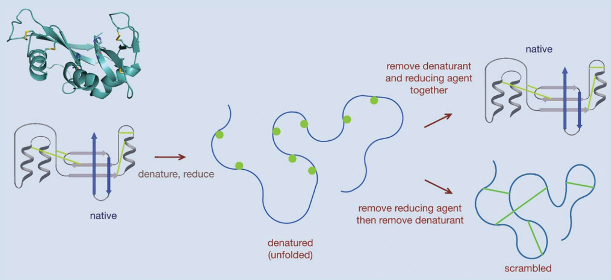{ loading=lazy }
    /// caption
    上路允许非共价折叠与二硫键形成相互配合；下路在链仍展开时先氧化，得到大量错配。教材整理的实验关系图。[^m1-anfinsen]
    ///

    若先移除还原剂，仍让尿素保持链的展开状态，八个Cys就会形成许多错误配对。随后再去掉尿素，活性恢复很差。八个位置两两配对共有$7\times5\times3\times1=105$种组合，天然配对只是其中一种。蛋白质并非靠盲抽配对碰运气：合适的非共价折叠会让特定Cys靠近，二硫键重排又允许错配被纠正。

    原始实验还把“重新氧化”与“恢复功能”分开测量。下图记录还原RNase A在pH8.2、23–24℃条件下空气氧化的过程：圆点表示巯基消失的程度，空方块表示旋光变化，三角形才是以两种底物测得的酶活性。

    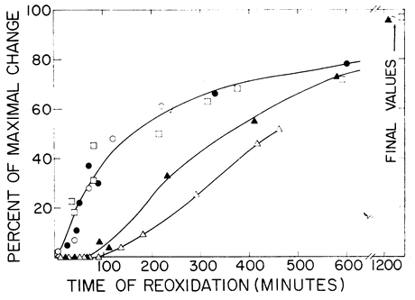{ loading=lazy width=460 }
    /// caption
    纵轴为各测量相对于最大变化的百分数；横轴为重新氧化时间，右端有断轴。原研究图1。[^anfinsen-original]
    ///

    在早期，巯基与旋光性质已经改变，活性却有明显滞后；以RNA测得的实心三角与以环状核苷酸测得的空心三角也并不完全重合。这说明化学键和整体构象发生变化，不等于每一步都直接产生活性分子。圆点归一化的是巯基消耗量，其中并不直接区分哪些二硫键已经正确配对。

    这个实验说明，RNase A的序列在适当环境中包含恢复天然结构所需的信息。细胞中还存在高浓度邻近蛋白、膜、辅因子和不断延长的新生链；这些条件解释了为什么许多蛋白质仍需要伴侣帮助。折叠的能量景观与变性条件见[蛋白质结构](../biochem/protein_structure.md#folding-denaturation)。

局部翻译速度也会改变折叠的时间窗。同义密码子替换在某些蛋白中确实能影响构象或活性，但“稀有密码子”并不是固定的暂停按钮：tRNA供给、mRNA结构和细胞状态都参与决定实际速度。核糖体测序中某处读段增多，首先说明该处核糖体占据较高，可能涉及慢延伸、碰撞、起始变化或样品处理；要把它解释成促进某个结构域折叠的停顿，还需要结构或功能证据。

### 伴侣蛋白怎样结合，又怎样放手 { #molecular-chaperones }

可溶性蛋白内部的疏水残基，在折叠完成前经常暴露于水中。这些片段可以彼此结合，也可能黏上另一条未成熟链，造成聚集。**分子伴侣（molecular chaperone）**暂时结合这些易聚集的片段，或提供隔离空间，让底物有机会继续折叠。伴侣通常不会成为成熟蛋白的一部分，也不提供决定所有底物结构的外部模板。[^molecular-chaperones]

Hsp70家族把这种暂时结合组织成一个受ATP控制的循环。它含有核苷酸结合结构域、底物结合结构域和可开合的盖状部分；两个结构域相互影响，使ATP、ADP状态对应不同的底物结合动力学。

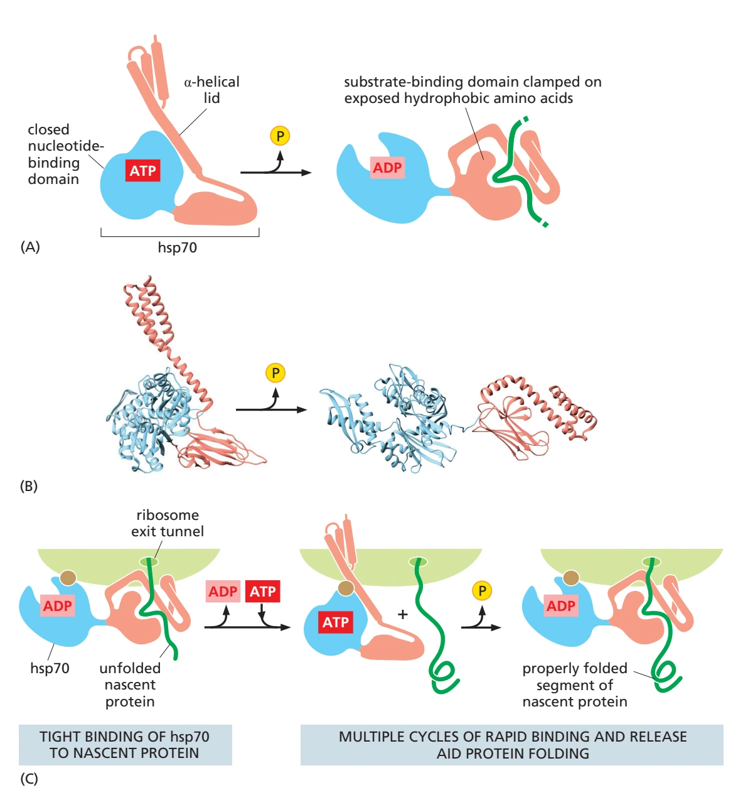{ loading=lazy }
/// caption
蓝色部分结合核苷酸，粉色部分结合多肽。图B给出相应结构，图C把循环放回新生链旁；图中省略了J蛋白与核苷酸交换因子。[^c1-hsp70]
///

1. **ATP结合态较开放。** 底物能够较快地结合和离开。
2. **水解后停留变长。** J结构域共伴侣协助递交底物并刺激ATP水解，Hsp70进入结合较紧、解离较慢的ADP态，把疏水片段暂时扣住。
3. **核苷酸交换促使释放。** 交换因子促进ADP离开，新的ATP结合后，底物结合部位重新开放。释放出来的链可以继续折叠，也可能再次被捕获。

细菌中的对应系统是DnaK–DnaJ–GrpE：DnaK属于Hsp70，DnaJ帮助捕获底物并促进水解，GrpE促进核苷酸交换。ATP驱动这一轮轮结合与释放，底物则在循环中继续尝试折叠。

伴侣蛋白GroEL采用更大的结构。大肠杆菌GroEL由两个七聚体环背靠背组成，GroES可以盖住一端。在典型循环中，未成熟链先结合环口朝内的疏水表面；ATP和GroES结合后，腔室扩大，底物被释放到较亲水的内部。其他未折叠链暂时进不来，聚集的机会便降低了。

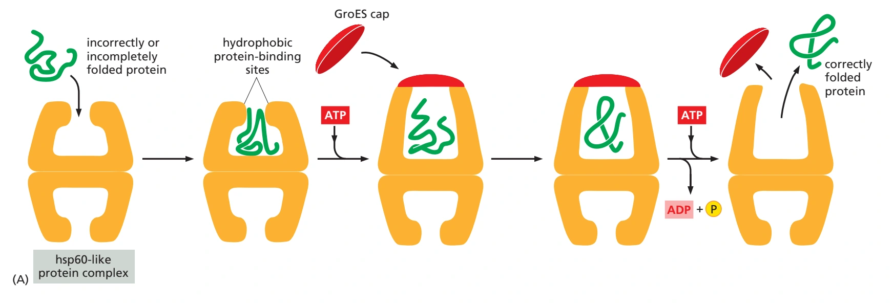{ loading=lazy }
/// caption
经典单盖GroEL–GroES循环的简图。图中画出成功折叠的出口，实际释放的底物也可能需要再次进入循环。[^c1-groel]
///

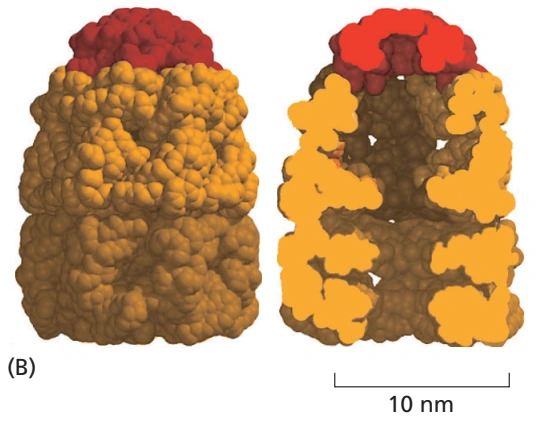{ loading=lazy }
/// caption
红色为GroES盖子，黄色为GroEL；右图剖开后可见容纳底物的空间。比例尺10nm。[^c1-groel]
///

GroEL环之间的核苷酸状态彼此影响。封闭环水解ATP后，另一环结合ATP等后续事件推动盖子与底物释放。底物没有折好，还可以再来一轮。细胞中也能形成两端都有盖子的状态，单盖示意图只代表其中一种循环方式。

GroEL属于Ⅰ型伴侣素，线粒体Hsp60/Hsp10也是同类系统。古菌的Ⅱ型伴侣素以及真核胞质TRiC/CCT使用自身的盖状结构，不配GroES；它们可接收前折叠蛋白（prefoldin）递交的底物。真核细胞的肌动蛋白、微管蛋白等便依赖TRiC/CCT成熟。

伴侣网络还有其他分工。细菌的触发因子（trigger factor）守在核糖体出口附近，能在不水解ATP的情况下包容多种新生链；真核新生链相关复合体NAC参与出口处的伴侣与靶向选择。Hsp90更多服务于激酶、受体等客户蛋白的后期成熟。古菌是否具有典型Hsp70系统随谱系变化。

### 局部反应、辅因子与亚基装配 { #folding-catalysis-assembly }

折叠途中有些步骤会特别慢。肽基脯氨酰顺反异构酶加快X–Pro肽键在顺、反构型之间转换；蛋白二硫键异构酶（PDI）催化巯基氧化、还原和二硫键重排。细菌周质中的Dsb系统也参与氧化折叠。金属、血红素、铁硫簇或黄素的装入，则可能稳定局部结构并完成活性中心；装入时间需要与定位配合，否则形成的大结构可能妨碍跨膜。

多个亚基也可以互相帮助取得结构。已经合成好的亚基能够结合另一条尚连在核糖体上的新生链；有些复合体甚至由两条新生链在合成中接触。装配界面一旦被伙伴占据，就减少了暴露疏水面的时间。[^complex-assembly]

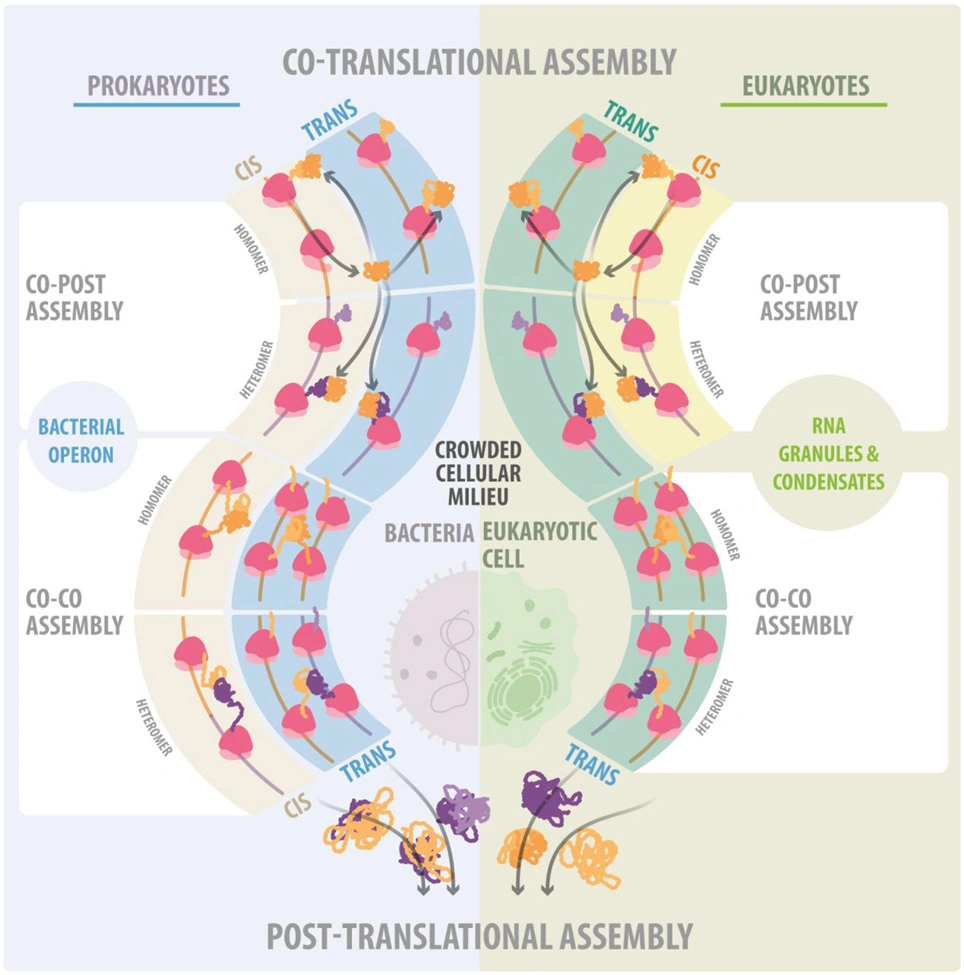{ loading=lazy }
/// caption
上半图为成熟亚基与新生链结合（co-post），下半图为两条新生链相遇（co-co）；cis、trans分别指来自同一或不同mRNA。图底部另列翻译后的装配。[^assembly-figure]
///

细菌操纵子使不同亚基可以由同一条mRNA上的相邻编码区产生。真核细胞则可通过mRNA定位、局部翻译和专用装配因子提高伙伴相遇的机会。多余亚基缺少伙伴时，原本应被埋藏的界面持续暴露，便可能转而被伴侣或降解系统识别。即使亚基能在试管中自组装，细胞内的合成位置、先后次序和装配因子仍会影响组装效率。

## 分选信号与跨膜拓扑 { #protein-targeting }

多数蛋白质在胞质核糖体上合成。新生链露出的信号可以把它引向膜；翻译完成后，核定位信号、细胞器转运肽等还会继续改变它的去向。信号不一定在N端，也可能位于C端、链内或折叠后的三维表面。剪接、替代翻译起点、磷酸化和亚基结合都能改变信号的有无与可及性。

### 细菌与古菌的Sec、SRP和Tat路线 { #prokaryotic-protein-export }

细菌信号识别颗粒（signal recognition particle，SRP）在疏水跨膜段露出时结合新生链—核糖体复合物，再经膜受体FtsY把货物交给SecYEG转位装置或YidC插入酶。许多内膜蛋白由此一边合成，一边插入膜中。大量周质蛋白和分泌蛋白则可以在翻译后，由SecB等伴侣保持可转位状态，再由SecA消耗ATP，推动肽链通过SecYEG。实际路线有交叉，SecA也能在翻译过程中参与。[^bacterial-targeting]

**Sec通常让尚未形成稳定大结构的链通过；双精氨酸转位系统Tat则能运输已经折叠的底物。** Tat信号含有特征性的双精氨酸序列，许多货物先在胞质中装入辅因子，再跨膜抵达作用位置。靶向信号与折叠要求因此密切相关：同一份辅因子若在Sec底物上装得过早，可能妨碍运输，在Tat底物上却可能是运输前的正常步骤。

古菌具有同源的SRP–FtsY、SecY及部分Tat、YidC/Oxa1家族装置，具体组合依谱系而异。跨膜之后，信号肽切除、脂质化、糖基化和折叠仍会继续。细菌与古菌没有真核的内质网—高尔基体系统，理解其蛋白去向应从自身的膜层次和细胞表面结构出发。

### 从内质网入口建立朝向 { #er-targeting-translocation }

真核分泌蛋白、许多内膜系统腔内蛋白和质膜蛋白首先进入内质网。人们最初通过无细胞翻译体系认识到，分泌蛋白往往先合成较长的前体：加入内质网来源的微粒体后，产物的一段N端序列被切除，而且蛋白进入了膜泡内部。

!!! example "微粒体实验：产物变短，还需要证明它进了膜泡"

    细胞匀浆时，内质网破碎后重新封闭成小膜泡，称为微粒体。研究者把编码分泌蛋白的mRNA放入无细胞翻译体系，比较有、无微粒体的产物。没有膜时保留较长前体；有合适膜组分时则出现加工产物。[^c1-microsomes]

    

    

    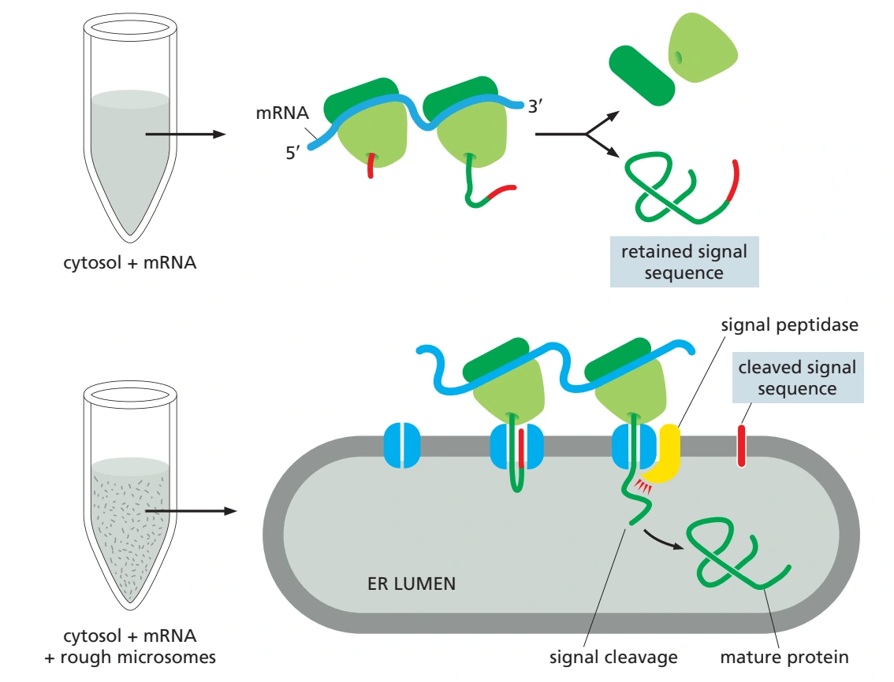{ loading=lazy }
    /// caption
    信号假说的实验关系示意。蓝色为转位装置，黄色为信号肽酶；这些分子细节是后续研究建立的模型。[^c1-microsomes]
    ///

    

    

    **长度变化检验加工，蛋白酶保护检验膜的屏障。** 在完整微粒体外加入蛋白酶，进入腔内的部分受到保护；用去污剂破坏膜后，原有保护消失。这样才能把“蛋白在膜泡里面”与“蛋白只是黏在外面”区分开。

    还可以改变加膜时机。某些分泌前体只有在链仍合成时加膜才得到有效转位，这提示信号识别与翻译同步。这种时间要求随底物而变；另一些蛋白可以在翻译结束后转位。

    

    

    **下图是一组实际的蛋白酶保护条带。** Blobel与Dobberstein在1975年的研究中，用小鼠骨髓瘤来源的粗面微粒体继续完成膜结合核糖体上的新生IgG轻链，并分析60分钟时的放射性产物。A组不加金精三羧酸（ATA），B组加入$10^{-4}\,\mathrm{M}$ ATA；每组再分有、无蛋白酶处理。[^blobel-original]

    

    

    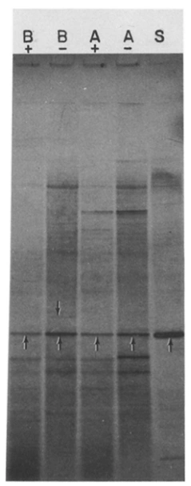{ loading=lazy width=239 }
    /// caption
    从左到右为B+、B−、A+、A−、S；S为分泌型IgG轻链，可用来对照加工后产物的位置。[^blobel-original]
    ///

    

    

    S泳道帮助确定成熟轻链的位置。A组产生的加工后链大多能抵抗外加蛋白酶；B−中还能看到位置较高的未加工链，它在B+中被降解。**加工后与未加工链受到不同程度的保护**，支持两者相对于微粒体膜具有不同可及性。

    ATA在这套体系中用于抑制新的翻译起始，但作者也讨论它影响核糖体与膜结合、甚至加工反应的可能。因此，这幅图不能单独把未加工产物的出现归因于某一个步骤。它也没有设置去污剂泳道；上文的膜破坏对照是解释蛋白酶保护实验的一般方法。

    

    

**SRP负责早期识别。** 哺乳动物SRP由一条RNA和多种蛋白组成，一端在核糖体出口附近结合疏水信号，另一端可接近延伸因子结合位置，使翻译暂时减慢。信号结合口袋富含柔性的疏水侧链，因此能够容纳序列不同、疏水性质相似的信号肽。[^er-translocation]

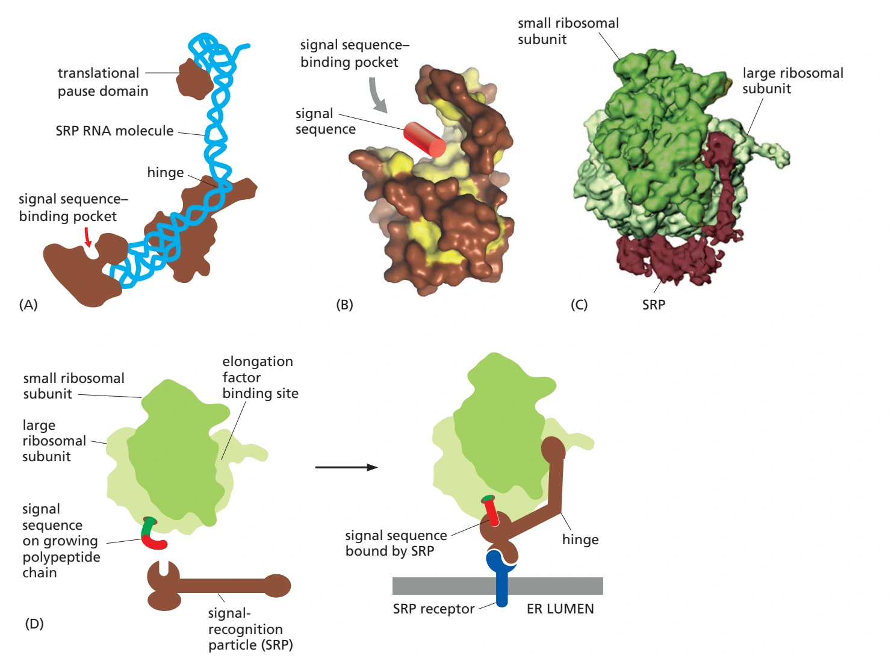{ loading=lazy }
/// caption
SRP的信号结合端位于肽链出口附近。图B的红色螺旋代表疏水信号，图D展示与膜受体的对接。[^c1-srp-structure]
///

当SRP与内质网膜上的SRP受体结合，核糖体和新生链被交给Sec61转位通道。SRP与受体的GTP结合、水解循环协调交接和回收。核糖体出口与Sec61相接后，继续延长的肽链便可向内质网腔转位。

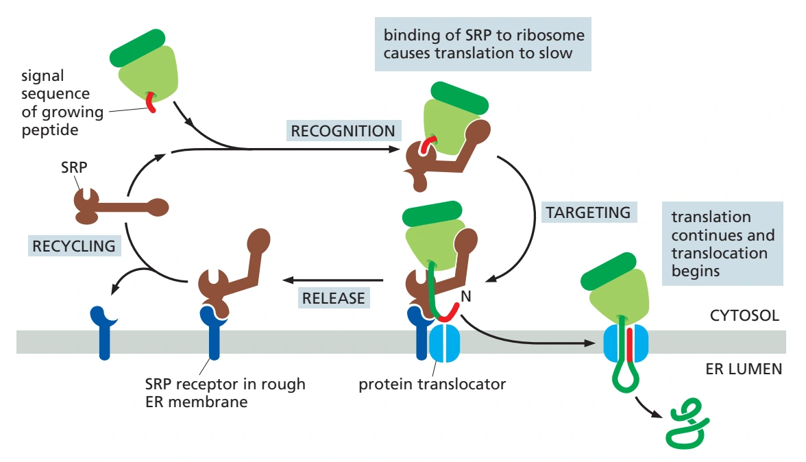{ loading=lazy }
/// caption
沿红色信号序列的去向读图：先结合SRP，再进入膜中的转位装置。核糖体本身留在胞质侧。[^c1-srp-targeting]
///

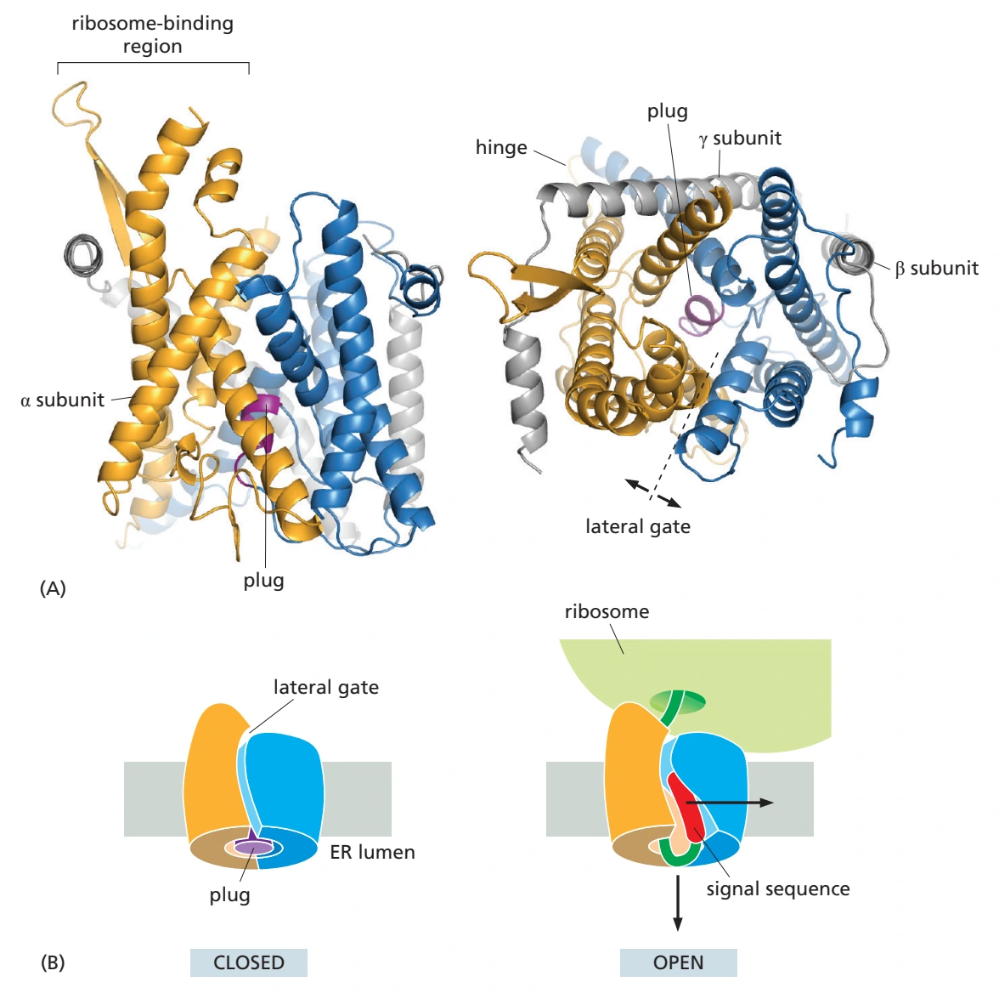{ loading=lazy }
/// caption
上图取自古菌SecY的结构（PDB：1RH5），下图示意同一家族通道的关闭与工作状态。[^c1-secy-gate]
///

**Sec61既能向腔内通行，也能向膜内侧开。** 通道中的塞状结构在非工作状态下限制小分子泄漏。信号序列插入侧向门附近后，中央通道开放，后续亲水区段得以穿膜。

如果到来的是疏水跨膜螺旋，它可以从侧向门离开通道，进入脂双层。于是同一套装置能够处理两种不同去向：可溶区段进入水相，跨膜螺旋留在膜中。

可切除的N端信号肽先启动转位，随后被腔侧的信号肽酶切除。若后面又出现一段停止转移序列，它从侧门进入膜中，余下的C端在胞质侧合成，就得到N端朝腔内、C端朝胞质的单跨膜蛋白。

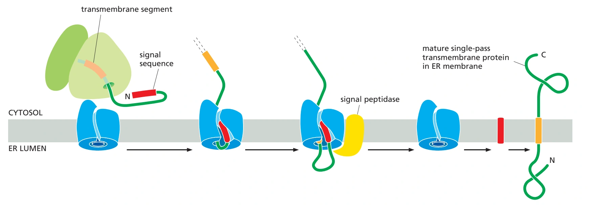{ loading=lazy }
/// caption
红色信号肽被切走，橙色跨膜段保留。追踪两者，才能看清哪一段最终锚定成熟蛋白。[^c1-cleaved-signal]
///

另一类蛋白直接用链内疏水段作为**信号锚定序列**：它既负责进入路线，又留作跨膜螺旋。疏水段两侧的电荷和N端是否已经形成稳定结构，会影响哪一端穿过膜；带较多正电的一侧通常更倾向留在胞质。

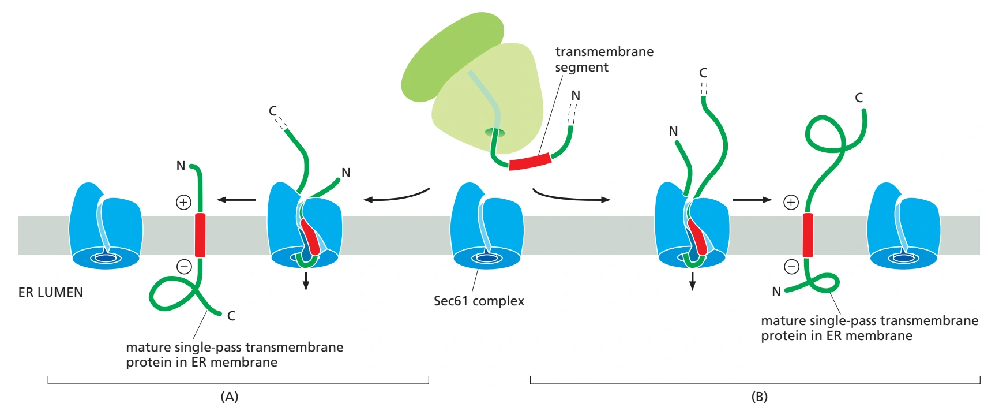{ loading=lazy }
/// caption
内部信号锚的两种朝向。图中的正电位置与哪侧留在胞质相联系。[^c1-signal-anchor]
///

多跨膜蛋白依次插入多个疏水段，弱疏水片段的稳定还可能依赖相邻螺旋及辅助装置。

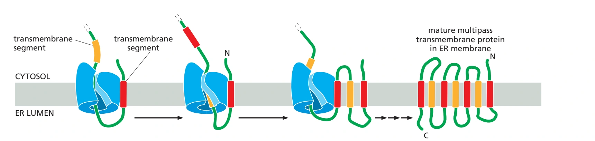{ loading=lazy }
/// caption
多跨膜蛋白插入的简化过程；实际装配还受各段疏水性与螺旋间相互作用影响。[^c1-multipass]
///

??? info "尾锚定蛋白：疏水段出现得太晚怎么办？"

    尾锚定蛋白的跨膜螺旋紧靠C端。当核糖体到达终止密码子时，这一段还藏在出口通道内；完全露出时，肽链已经释放。因此它常由翻译后途径捕获。

    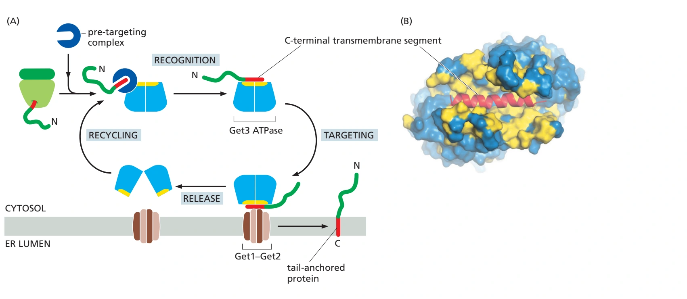{ loading=lazy }
    /// caption
    GET路线以酵母命名。图B为Get3包容疏水跨膜段的结构，红色为底物螺旋。[^c1-tail-anchor]
    ///

    GET系统的前靶向复合物先接住疏水段，再交给ATP酶Get3；膜上的Get1/Get2接受货物并协助插入，随后Get3返回胞质。哺乳动物的相应因子包括TRC40。部分尾锚定底物使用内质网膜蛋白复合体EMC等其他路线，选择与疏水性、末端长度和细胞条件有关。部分短分泌前体也可经Sec62/Sec63辅助的Sec61途径在翻译后入腔，由BiP等提供帮助。[^er-insertion-modern]

进入内质网只确定了初步拓扑，驻留、回收和输出还要读取后续信号。膜泡出芽、融合并不使货物重新穿过脂双层，因此原来朝内质网腔的结构域，沿高尔基体和分泌囊泡运输后，抵达质膜时仍朝非胞质侧。分泌通路的后续路线见[内膜系统与囊泡运输](../cell/endomembrane.md#er-protein-entry)。

### 核、线粒体、质体与过氧化物酶体 { #organelle-protein-import }

不同细胞器允许通过的货物状态并不相同。核孔能让折叠蛋白与复合体通过，而许多线粒体前体需要保持便于穿过狭窄转位孔的状态。先问清楚“穿过什么结构、哪一端先进去”，才容易理解伴侣与信号的作用。[^organelle-targeting]

| 去向 | 常见信号与识别装置 | 运输时的状态与后续步骤 |
| --- | --- | --- |
| 细胞核 | 核定位信号NLS，由输入蛋白importin等识别 | 通常可保持折叠；核内Ran-GTP促使货物释放，NLS常保留并能反复使用 |
| 线粒体基质 | 常见N端两亲性导肽；TOM、TIM23 | 胞质伴侣维持可输入状态，膜电位和ATP依赖装置参与输入；导肽常被切除 |
| 叶绿体基质 | 常见N端转运肽；TOC、TIC | 输入后常切除转运肽；前往类囊体还可能需要第二段信号和另一套装置 |
| 过氧化物酶体基质 | 常见C端PTS1／PEX5，或N端PTS2／PEX7及共受体 | 可输入已折叠甚至已装配的货物；PEX5经单泛素化与PEX1/PEX6回收 |

线粒体基质前体先由外膜TOM识别。N端穿过外膜后，与内膜TIM23路线衔接；进入基质的一段被伴侣接住，并在转运过程中或之后切除导肽。其他内膜、外膜或膜间隙蛋白各有自己的内部信号与装配装置。

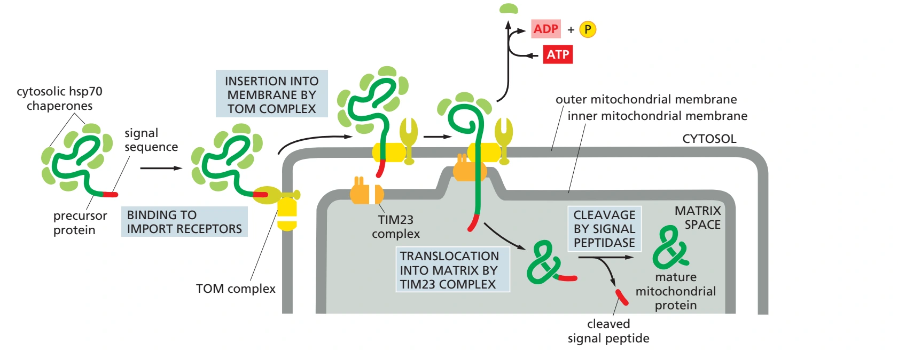{ loading=lazy }
/// caption
常见的N端导肽—基质输入路线。图中红色导肽被切除，外膜和内膜依次跨越。[^c1-mitochondrial-import]
///

质体前体也可以携带分层使用的信号。以下图为例，先出现的叶绿体转运肽使货物经过TOC/TIC进入基质；这段肽被切除后，后面的类囊体定位信号才继续发挥作用。Sec、Tat与cpSRP/Alb3等路线处理不同类囊体货物，使用的能量和折叠要求也不同。

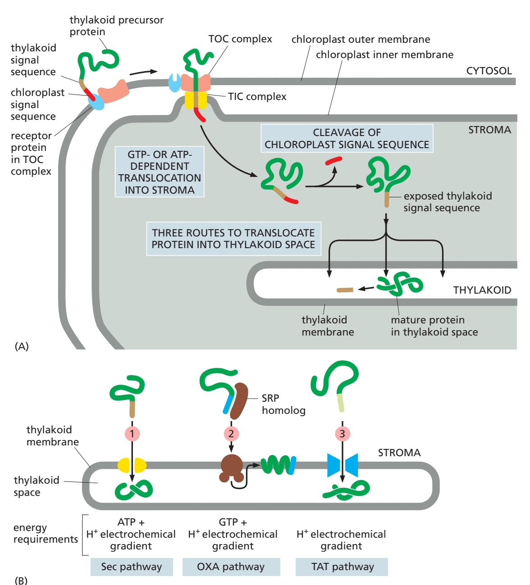{ loading=lazy }
/// caption
两段信号依次使用的模型，以及几种类囊体路线。图B中“OXA pathway”指Alb3等Oxa1家族插入装置参与的路线，其底物通常插入类囊体膜。[^c1-chloroplast-import]
///

同一基因还可通过替代翻译起点或竞争性信号产生双重定位。信号只有在受体能接触到时才起作用，亚基结合与修饰因而可以改变分选结果。[核孔与Ran循环](../cell/nucleus_chromatin.md#nuclear-pore-transport)、[线粒体输入](../cell/organelles.md#mitochondrial-protein-import)、[叶绿体发生](../cell/organelles.md#chloroplast-biogenesis)及[过氧化物酶体输入](../cell/organelles.md#peroxisome-biogenesis)分别展开各自的细胞器背景。

## 主链加工与共价修饰 { #protein-maturation }

### 切除、暴露与重新连接 { #proteolytic-processing }

刚合成的N端经常还会改变。甲硫氨酸氨肽酶能去掉许多蛋白的起始Met，是否切除主要取决于第二个残基及N端可达性。细菌起始时使用的甲酰甲硫氨酸，通常先经去甲酰化，再决定是否去掉Met。暴露出来的新N端还可被乙酰化、进一步加工或识别为降解信号。

一些N端甚至会**添加新的氨基酸**。例如真核ATE1从Arg-tRNA取得精氨酸，将它转移到适合的蛋白N端；N端Asp、Glu等可作为底物，某些氧化后的N端Cys也可进入这一途径。这里使用的是氨酰-tRNA供体，但反应发生在已经合成的蛋白上，不由核糖体逐密码子延长。加上的Arg可被特定N端降解途径读取。[^n-terminal-addition]

信号肽和细胞器转运肽常在运输时或运输后切除。许多酶与激素还带有更长的前肽：前肽能够抑制活性、帮助折叠或促进分选，待蛋白到达正确区室后再由蛋白酶切开。例如枯草杆菌蛋白酶的前肽先协助催化域取得结构，再在成熟过程中移除。[^propeptide-folding]切割也可以使蛋白失活、释放一个调控结构域，或暴露降解信号；结果取决于切在什么位置。

**胰岛素把这些事件连接成一条清楚的路线。** 前胰岛素原（preproinsulin）先靠N端信号肽进入内质网，切掉信号肽后成为胰岛素原（proinsulin）。其中B链、C肽、A链仍属于同一条主链；C肽把两端维持在适合折叠的关系中，三条二硫键在此阶段建立。[^proinsulin-processing]

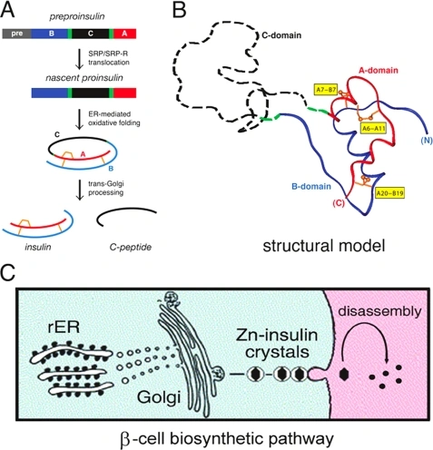{ loading=lazy width=500 }
/// caption
A为前体加工，B为胰岛素原结构模型，C把成熟与分泌路径相连。分泌颗粒内可形成锌稳定的胰岛素六聚体与晶体，分泌后再解离。[^insulin-figure]
///

胰岛素原经高尔基体进入分泌颗粒，前激素转化酶PC1/3、PC2切开连接区，羧肽酶E再修剪残留碱性残基。最终C肽释放，A、B链由两条链间二硫键相连，A链内部还有一条二硫键。单看成熟产物，很难猜到两条链最初曾由一段连接肽连在一起。

??? info "蛋白质剪接：切掉中段以后，两边还能接上"

    蛋白质剪接（protein splicing）中的内含肽称为**intein**，两侧保留片段称为**extein**。intein在前体中自催化切除，同时把两个extein用新的肽键连接。典型Ⅰ类intein通过四步化学完成这个重排。[^protein-splicing]

    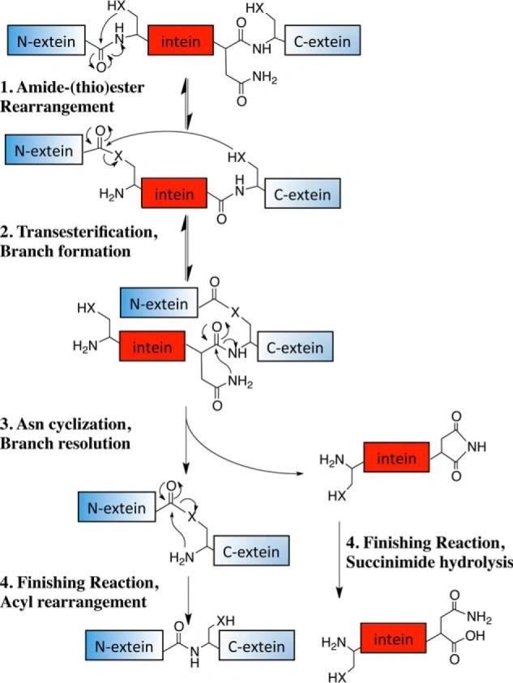{ loading=lazy width=630 }
    /// caption
    红色intein最终离开，蓝色两侧extein重新相连；X表示参与反应的O或S。右支画出intein末端琥珀酰亚胺的后续水解。[^intein-figure]
    ///

    1. intein最前端的残基通常是Cys或Ser，其侧链进攻前一个肽键，使连接处由酰胺转成更活泼的硫酯或氧酯。
    2. C端extein第一个残基的Cys、Ser或Thr侧链再次进攻，将N端extein转移过来，形成支链中间体。
    3. intein末端的Asn环化，切断它与C端extein之间的连接，释放intein。
    4. 两个extein之间剩下的酯或硫酯发生酰基迁移，形成稳定的主链肽键。

    这里描述的是典型Ⅰ类途径，其他类别可以从不同亲核步骤开始。RNA剪接体处理的是RNA，而上述反应直接重排蛋白质主链。

    一些完整intein还包含归巢内切酶结构域；只保留剪接核心的称为mini-intein。**归巢发生在DNA层面**：内切酶切开不含相应intein编码序列的等位位点，细胞用含intein的模板修复时，可把那段DNA复制进去。它解释了intein编码序列怎样传播，与蛋白质前体自剪接是两个层次。[^intein-homing]

### 小基团、小蛋白与残基转化 { #covalent-modifications }

共价修饰可以改变局部电荷、空间形状、相互作用和寿命。许多修饰可被酶加上再去掉，形成动态调节；另一些是在成熟过程中产生的较稳定化学变化。虽然习惯上统称翻译后修饰（post-translational modification，PTM），其中一部分实际上在翻译尚未结束时就已发生。

| 修饰 | 化学变化与常见供体 | 怎样影响蛋白质 |
| --- | --- | --- |
| 磷酸化 | 激酶常从ATP转移磷酰基，连接到Ser、Thr或Tyr等残基 | 改变电荷、构象或结合面；细菌双组分系统常先磷酸化His，再把磷酰基转给响应调节蛋白的Asp |
| 乙酰化、甲基化 | 乙酰-CoA提供乙酰基；S-腺苷甲硫氨酸（SAM）提供甲基 | Lys乙酰化改变其电荷；Lys、Arg的不同甲基化状态可被不同读取蛋白识别，如组蛋白修饰 |
| ADP-核糖基化 | 从NAD$^+$转移ADP-核糖，释放烟酰胺；可修饰多类受体残基 | 调节DNA损伤反应、蛋白相互作用等；不同酶的受体偏好不同 |
| 腺苷酰化（AMP化） | 从ATP转移AMP | 大肠杆菌GlnE对谷氨酰胺合成酶的Tyr进行可逆AMP化，使其活性随氮供应调节 |
| S-亚硝基化 | Cys巯基形成S–NO | 可影响活性与相互作用；与Tyr等发生的硝基化是不同化学反应 |
| 泛素、SUMO等小蛋白修饰 | 经酶级联把小蛋白的C端共价连接到底物 | SUMO常以C端Gly与底物Lys形成异肽键；泛素可参与降解、膜分选或信号，SUMO可改变相互作用、核内组织和应激响应，后果取决于位点与背景 |

真核、细菌与古菌都存在Ser/Thr/Tyr磷酸化。His—Asp磷酸传递是细菌中很有代表性的一类路线，但并不涵盖全部“原核磷酸化”。SUMO则可通过不同位点和结合蛋白调节相互作用、定位或活性。[^ptm-diversity]

!!! example "同为ADP-核糖基化，三种毒素的靶点并不相同"

    霍乱毒素可修饰Gsα的Arg，使其GTP水解受到抑制；百日咳毒素可修饰Gi/oα近C端的Cys，使其难以接受受体激活；白喉毒素则修饰真核延伸因子eEF2上的白喉酰胺（diphthamide）残基，抑制蛋白质合成。三者都利用NAD$^+$，但受体残基、作用对象和功能后果各不相同。[^adp-ribosyl-toxins]

??? info "几种改变残基本身的成熟反应"

    - **羟化与羧化。** 胶原的Pro、Lys羟化影响三股螺旋稳定及后续修饰，分泌后的交联又增强纤维性质。凝血因子中维生素K依赖的γ-谷氨酰羧化形成γ-羧基谷氨酸，有利于结合Ca$^{2+}$和相应膜表面。
    - **酪氨酸硫酸化。** 高尔基体腔内的酶以PAPS为硫酰基供体，在Tyr酚羟基上建立硫酸酯，可改变分泌蛋白和受体的结合性质。
    - **瓜氨酸化。** 肽基精氨酸脱亚氨酶使蛋白质中的Arg转成瓜氨酸，改变侧链电荷。这是通常视为不可逆的残基转化，并非在Arg上加一分子游离瓜氨酸。
    - **C端酰胺化。** 许多肽类激素的前体末端带有额外Gly。肽酰甘氨酸α-酰胺化单加氧酶系统先羟化该Gly，再裂解中间体；Gly的氮留作前一个残基末端的酰胺氮，其碳骨架作为乙醛酸离去。例如促甲状腺激素释放激素（TRH）的成熟C端是Pro–NH$_2$。
    - **羟腐胺赖氨酸修饰。** eIF5A特定位点的Lys接受来自亚精胺的氨基丁基，经脱氧羟腐胺赖氨酸中间体和后续羟化形成hypusine。这是eIF5A发挥翻译功能的重要条件。
    - **载体蛋白的辅基臂。** 酰基载体蛋白ACP从CoA取得4′-磷酸泛酰巯基乙胺基，连接到特定Ser上；末端巯基可携带酰基，随柔性臂在不同活性部位间移动，见[脂肪酸合酶](../biochem/lipid_synthesis.md#fatty-acid-synthase)。[^phosphopantetheinylation]
    - **碘化与构型转换。** 甲状腺球蛋白上的特定Tyr先被碘化、偶联，蛋白水解后释放甲状腺激素，见[氨基酸衍生的激素](../biochem/aa_synthesis.md#neurotransmitters-hormones-pigments)。一些核糖体合成的肽也会在成熟中把特定L型残基转为D型，例如芋螺毒肽contryphan中的D-Trp。部分羊毛硫抗生素中的D-Ala则来自另一种反应，例如羊毛硫抗生素lacticin 3147先把Ser脱水为脱氢丙氨酸（Dha），再立体专一地还原为D-Ala；这些例子都不是翻译时普遍使用D-氨基酸。[^peptide-stereochemistry]

    这些反应的供体、区室和酶系各不相同，可逆性及作用也随具体反应而变。[^residue-conversions]

### 糖链、二硫键与折叠检查 { #glycosylation-disulfides }

分泌通路中的典型N-连接糖基化，先在多萜醇载体上组装Glc$_3$Man$_9$GlcNAc$_2$，即含三个葡萄糖、九个甘露糖和两个N-乙酰葡萄糖胺的寡糖。寡糖基转移酶再把整条糖链转给新生蛋白的Asn侧链氮。常见识别序列为Asn–X–Ser/Thr，其中X不能是Pro；序列存在还需满足位点可及性等条件，才会实际被占据。[^glycoprotein-quality-control]

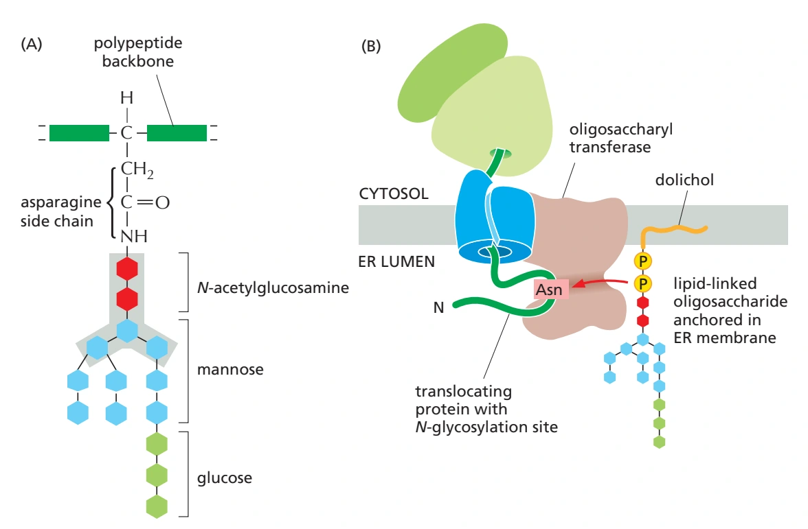{ loading=lazy }
/// caption
左图给出连接原子及糖链组成；右图把整体转移放回内质网膜上的空间位置。[^c1-n-glycan]
///

**N与O指连接原子。** 这里的N是Asn侧链的氮。黏蛋白型O-GalNAc糖基化则以Ser/Thr侧链的氧连接第一个糖，通常在高尔基体开始逐糖延伸。

胞质和细胞核还存在另一种O-GlcNAc修饰：在Ser/Thr上动态添加、移除单个N-乙酰葡萄糖胺，使用OGT、OGA等酶，与分泌通路的长糖链由不同装置加工。细菌与古菌也有N或O糖基化，但载体、连接糖、受体背景和糖链结构随谱系而变。

糖链还提供了一种可以反复改变的伴侣结合位点。新加上的N糖链去掉两个末端葡萄糖后，只剩一个末端葡萄糖，便适于结合钙联蛋白（calnexin）或钙网蛋白（calreticulin）。前者锚在膜上，后者可溶于腔内；它们把未成熟糖蛋白暂时保留在内质网，并与其他折叠因子协作。

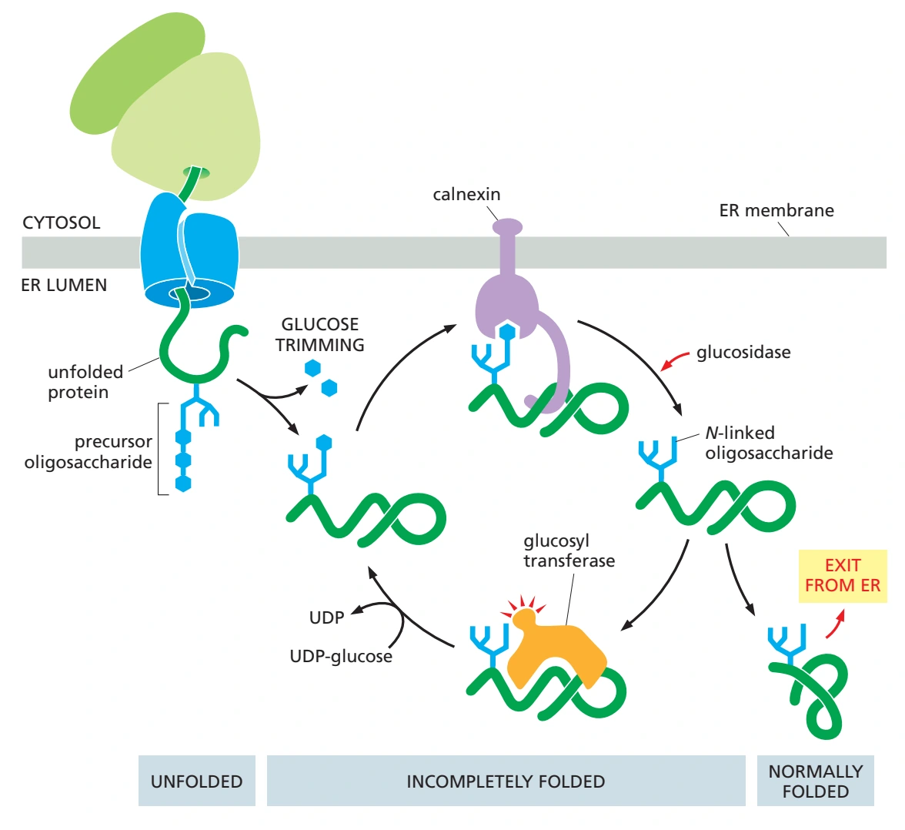{ loading=lazy }
/// caption
图中的glucosyl transferase为UGGT。它把构象检查与糖链重加葡萄糖联系起来。[^c1-calnexin]
///

最后一个葡萄糖被葡萄糖苷酶切掉后，底物从凝集素伴侣上释放。若蛋白仍未正确折叠，UDP-葡萄糖：糖蛋白葡萄糖基转移酶（UGGT）识别其非天然构象，把一个葡萄糖重新接回糖链，使它再次结合伴侣。

正确折叠的底物较少被UGGT重新标记，于是更有机会输出。糖蛋白进入高尔基体后，糖链还会继续被修剪与延伸，具体产物取决于货物、经过的酶区室和停留时间。仍滞留在内质网并持续成熟失败的糖蛋白会经历甘露糖修剪，被其他凝集素识别并送往内质网相关降解。糖链状态、蛋白构象与停留时间共同参与这次分流。

内质网的氧化环境也有利于二硫键形成。PDI活性部位的二硫键先与底物巯基反应，形成酶—底物之间的混合二硫键；底物的另一个巯基再参与交换，得到底物内部的二硫键，同时PDI被还原。PDI随后由Ero1等氧化途径再生，也能参与错误二硫键的还原和重排。

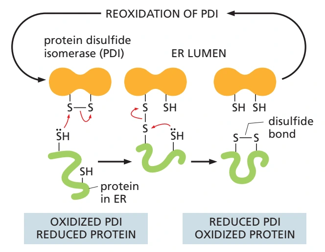{ loading=lazy width=420 }
/// caption
沿硫原子间的红色箭头追踪交换。正确配对还需结合蛋白的局部折叠；形成一条二硫键并不自动代表成熟。[^c1-pdi]
///

细菌周质中，DsbA/DsbB等促进氧化，DsbC/DsbD等则参与错配二硫键的重排。胞质通常较还原，但也存在受调的氧化还原开关，以及某些古菌中稳定的胞内二硫键。区室环境限定了常见分布，具体蛋白仍须看其氧化还原条件。

### 脂质修饰怎样把蛋白留在膜旁 { #protein-lipidation }

脂质化把疏水基团共价连接到蛋白上，但连接的位置、键型和膜朝向差别很大。N-肉豆蔻酰化、S-酰化和异戊二烯化常发生在胞质侧；GPI锚则在内质网腔侧连接，并最终把蛋白展示在质膜外侧。[^protein-lipidation]

| 方式 | 连接化学 | 膜联系的特点 |
| --- | --- | --- |
| N-肉豆蔻酰化 | 通常把C14肉豆蔻酰基以酰胺键连接到暴露的N端Gly | 可在起始Met去除后共翻译发生，也可在蛋白酶切割暴露新Gly后发生；常与其他信号共同稳定膜结合 |
| S-酰化 | 常把棕榈酰基等脂酰基以硫酯键连接到Cys | Cys不必位于末端；酶促去酰化使膜亲和性可以动态改变 |
| 异戊二烯化 | 把法呢基或香叶基香叶基连接到Cys的硫原子 | CaaX蛋白通常还切去aaX并甲基化新C端；Rab等蛋白使用其他C端模式 |
| GPI锚定 | 新形成的蛋白C端与GPI上的磷酸乙醇胺建立酰胺键 | 由糖链连接磷脂，蛋白主体位于非胞质侧；不保留原来的C端疏水肽 |

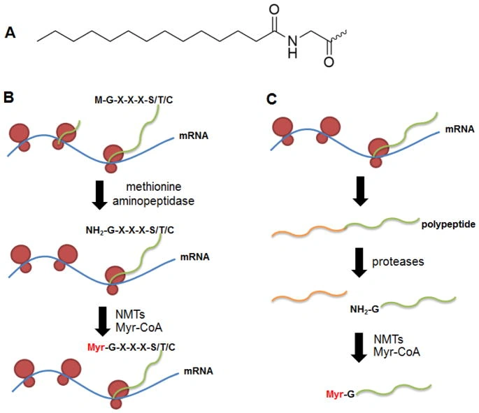{ loading=lazy width=650 }
/// caption
两条路线都先暴露N端Gly，再由N-肉豆蔻酰转移酶（NMT）利用肉豆蔻酰-CoA完成连接。[^lipidation-figures]
///

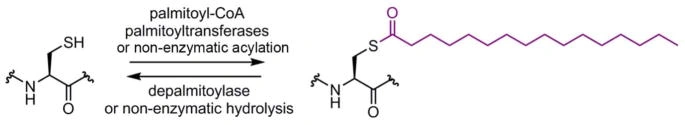{ loading=lazy }
/// caption
紫色为脂酰部分。硫酯水解可解除这种连接，图中同时列出酶促与非酶促化学的可能性。[^lipidation-figures]
///

异戊二烯化还体现了先加脂、再切肽、再甲基化的连续加工。下图上半比较两种异戊二烯基供体，中间一行沿CaaX蛋白追踪：Cys先接脂质，aaX随后切除，最后甲基化暴露的C端羧基。图底部的Rab类C端含多个Cys，使用另一种识别模式。

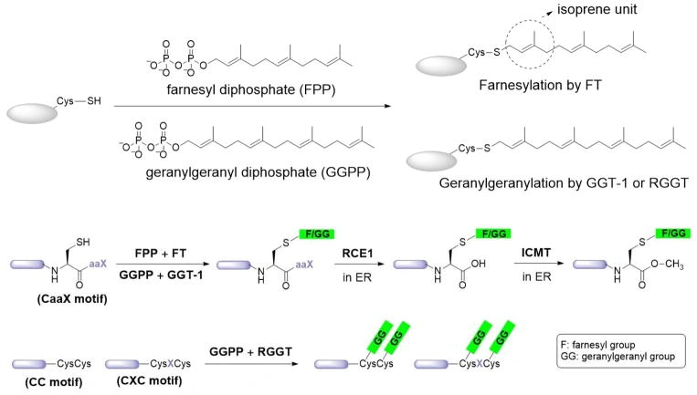{ loading=lazy }
/// caption
FPP与GGPP分别提供法呢基和香叶基香叶基；CaaX路线中的RCE1、ICMT完成末端切除与羧基甲基化。[^lipidation-figures]
///

GPI锚的安装尤其容易和跨膜螺旋混淆。前体先带着N端信号进入内质网，又靠近C端的一段疏水序列暂时留在膜上。GPI转酰胺酶切除C端信号区，同时把新C端连接到已经组装好的GPI。因此成熟蛋白是靠脂锚留在膜上，原来的疏水肽已经离开。

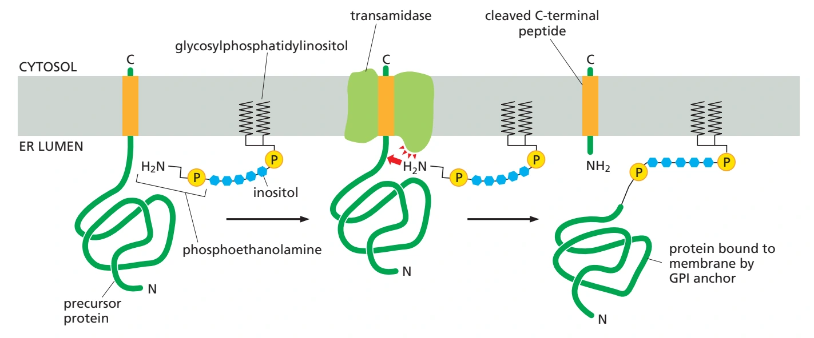{ loading=lazy }
/// caption
反应发生在内质网腔侧。末端甘露糖所连的磷酸乙醇胺提供氨基，接到蛋白的新C端。[^c1-gpi]
///

GPI锚定蛋白见于动物、真菌、植物和多类原生生物。锚的修剪、膜内侧向分布和特定磷脂酶切割，还会影响蛋白最终出现的位置与释放方式。

## 蛋白质稳态与清除 { #proteostasis-quality-control }

### 降解信号怎样出现 { #degron-recognition }

蛋白质降解信号称为**降解子（degron）**，可以是短序列、特定N/C端、磷酸化位点，或异常暴露的结构。识别过程既取决于信号本身，也取决于它能否被接触到。一个在正常复合体中被伙伴遮住的界面，亚基解离后就可能成为清除的依据。[^degron-pathways]

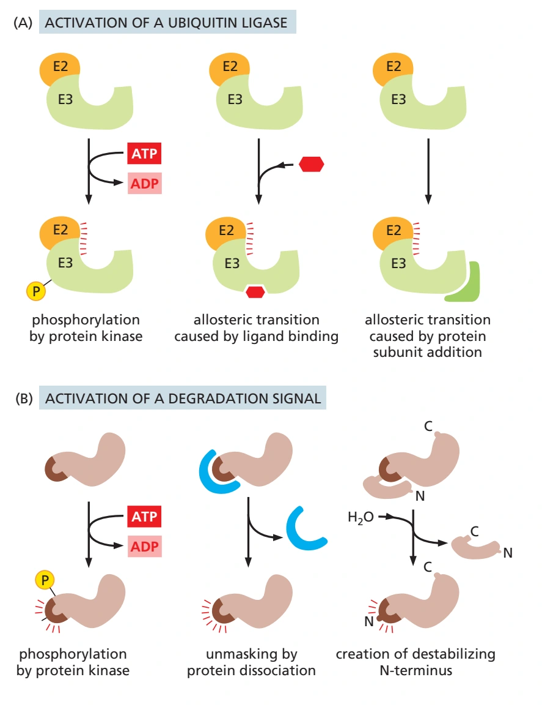{ loading=lazy }
/// caption
上排改变识别装置，下排改变底物。磷酸化、伙伴解离和蛋白水解都能使降解发生在特定时间。[^c1-degrons]
///

N端降解途径会读取末端残基、乙酰化或精氨酰化等修饰，以及相应识别蛋白能否接近它。某个蛋白酶切割后产生的新N端，就可能把原本稳定的片段转成易降解底物。C端也有相应识别途径。真核泛素依赖的支路还需要合适的泛素受体位点与后续降解装置。

磷酸化降解子则把激酶、磷酸酶与寿命相连：磷酸化形成识别面后，E3等装置才有效结合。与此同时，E3本身也可以通过修饰、配体或新增亚基被激活。细胞周期蛋白等正常蛋白的定时降解便依赖这类调控。

伴侣与降解装置会竞争同一底物。快速折叠或及时装配让疏水面被埋藏，底物便有机会离开伴侣；持续结合伴侣、暴露错误结构的分子则更可能被递交给降解系统。末端信号和泛素链的识别也受这些条件影响，蛋白质的寿命因而会随细胞状态改变。

!!! note "半衰期与总量是两种量"

    若追踪一批已经存在的蛋白，并近似按一级过程降解，可写成$N(t)=N(0)e^{-k_{\mathrm{deg}}t}$，降解半衰期为$t_{1/2}=\ln2/k_{\mathrm{deg}}$。折叠、修饰、定位和装配能改变它进入降解路线的概率，因而改变实际降解动力学。

    蛋白质的总量还受新合成输入影响。细胞分裂也会稀释每个细胞里的标记量，所以实验中观察到的标记减少，需要区分降解、分裂稀释、分泌或加工造成的检测变化。合成更快并不直接等于旧分子活得更久。[^protein-turnover-measurement]

### 标签、展开与隔离的水解腔 { #compartmentalized-proteolysis }

大规模清除蛋白质需要避免误伤。一个常见安排是把蛋白酶的活性部位藏在腔室内部，外面的识别和展开装置先选择底物，再把链穿进去。细菌的Lon、ClpXP/ClpAP、HslUV以及膜相关FtsH等ATP依赖蛋白酶，便以不同组合实现这一过程。它们使用的标签、适配蛋白与细胞位置并不相同；tmRNA–SmpB添加的ssrA标签，就是某些细菌蛋白酶识别不完整翻译产物的依据，见[停滞核糖体救援](translation.md#ribosome-rescue)。

古菌广泛使用20S蛋白酶体与AAA$^+$展开酶，也可有SAMP等泛素样标记；另一些蛋白由Lon或其他蛋白酶处理。某些细菌具有蛋白酶体及Pup标记系统，Pup的连接酶学与真核泛素系统不同。隔离水解腔的结构原则可以相似，各类装置读取的底物标签仍各不相同。[^cross-domain-proteolysis]

**真核泛素—蛋白酶体系统把识别、标记和水解分开进行。** 泛素是76个氨基酸的小蛋白，其C端羧基通常连接到底物Lys侧链的氨基，形成异肽键。E1、E2、E3的名称对应三类作用：

1. **E1激活。** ATP先使泛素C端形成腺苷酸中间体，随后泛素与E1活性位点Cys形成硫酯。
2. **E2转运。** 泛素经转硫酯反应交给E2的Cys。
3. **E3选择并促成连接。** E3识别底物，使泛素转移到相应受体。RING型E3促进E2上的泛素直接转给底物；HECT、RBR型E3则先形成E3—泛素硫酯中间体，再完成转移。[^ubiquitin-cascade]

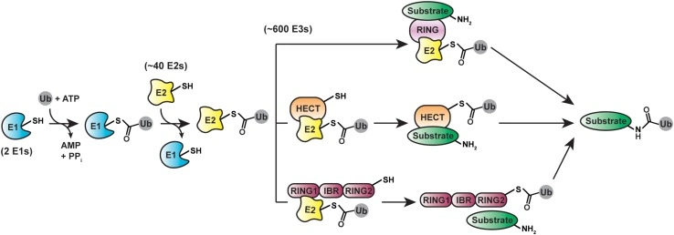{ loading=lazy }
/// caption
跟随灰色Ub及其末端的键：E1、E2上的硫酯连接，到RING支路直接转给底物；HECT、RBR支路先经过E3的Cys。图中酶数量为作者2019年对人类体系的近似统计。[^ubiquitin-figure]
///

后续泛素可继续接在已有泛素的Lys或N端，建立不同链形。K48连接链是常见的蛋白酶体递送信号，但泛素还参与DNA修复、膜分选和其他信号反应；链型、长度、分支和读取蛋白共同影响后果。去泛素化酶又能修剪或拆除这些标记。

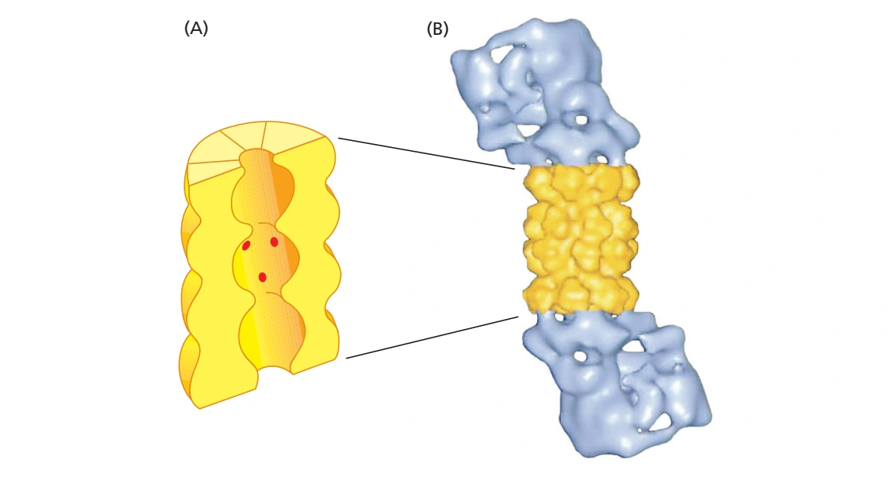{ loading=lazy }
/// caption
左图红点表示朝向内腔的催化位点；右图蓝色为19S调节颗粒，黄色为20S核心。[^c1-proteasome]
///

26S蛋白酶体由20S核心与一个或两个19S调节颗粒组成。20S的四个七聚体环按α–β–β–α叠放，催化位点位于内部β环；19S在入口处识别底物、拆除泛素，并用AAA$^+$ ATP酶环把底物展开、转运。

泛素标签把底物带到附近，适于起始的松散肽段则让展开酶能够抓住链。若一个高度稳定的结构难以被拉开，即使已经被泛素化，也未必顺利进入水解腔。

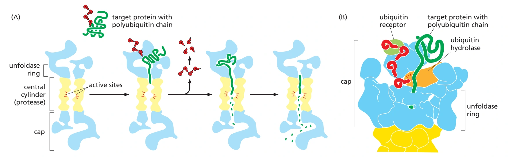{ loading=lazy }
/// caption
泛素被拆下并回收，底物链被连续送入内部。右图标出泛素受体、去泛素化酶与展开酶环。[^c1-proteasome-threading]
///

ATP水解推动展开酶环的构象变化，使其反复抓住并牵引多肽。内部蛋白酶把链切成短肽，胞质肽酶再继续水解，氨基酸回到代谢池。ATP消耗主要用于标记活化、底物展开和转运等步骤，肽键断裂本身是水解反应。具体催化与代谢去向见[蛋白质周转](../biochem/pr_aa_catabolism.md#ubiquitin-proteasome)。

### 区室质量控制、ERAD与自噬 { #eukaryotic-proteostasis }

蛋白酶体位于胞质和细胞核，内质网腔里的错误折叠蛋白需要先离开膜区室，才能进入它。**内质网相关降解（ER-associated degradation，ERAD）**把构象检查、逆向转位、泛素化和胞质抽提接在一起。糖链修剪后的凝集素识别、伴侣结合和二硫键还原，使底物得以交给膜上的降解复合物。[^er-quality-control]

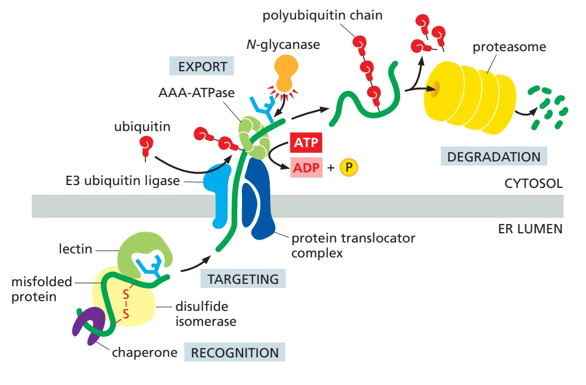{ loading=lazy }
/// caption
以内质网腔内糖蛋白为例：底物经膜复合物输出，胞质侧ATP酶完成抽提，随后去糖基化并降解。[^c1-erad]
///

ERAD复合物中的E3在胞质侧建立泛素标记，p97/VCP等AAA$^+$ ATP酶借助辅因子抓住底物，消耗ATP将它抽提出膜。不同复合物分别偏好腔内、膜内或胞质侧异常，膜蛋白也可以从侧向进入相应装置。图中的单一出口概括了多类底物各自使用的ERAD复合物。

如果内质网的折叠负荷持续超过处理能力，**未折叠蛋白反应（UPR）**会调整整个系统：降低部分新生链输入，增加伴侣与ERAD能力，并改变膜发生和应激相关基因表达。UPR是在调节总体负荷，ERAD则在处理具体底物；两者相互配合。哺乳动物IRE1、PERK、ATF6的分工见[内质网质量控制](../cell/endomembrane.md#er-proteostasis)。

更大的聚集体、整套复合物或细胞器可以进入自噬路线。大自噬用隔离膜包围货物，闭合后形成自噬体，再与溶酶体融合；伴侣介导的自噬则由伴侣识别一类可溶性底物，经溶酶体膜逐个转运。内吞膜蛋白、许多分泌通路货物和细胞外摄入物也沿内体—溶酶体路线水解。线粒体、过氧化物酶体等还具有区室内蛋白酶、输出和选择性自噬的组合，详见[自噬与氨基酸回收](../biochem/pr_aa_catabolism.md#autophagy-lysosome)。

## 怎样确认定位、加工与修饰 { #protein-processing-evidence }

一条电泳条带或一处荧光信号，通常只给出成熟过程的一部分。问题可以从“发生了哪一步”逐层推进：

| 想确定的变化 | 常用操作与观察 | 还需控制的条件 |
| --- | --- | --- |
| 前体变成成熟产物 | 脉冲标记后换成未标记底物追踪，免疫沉淀并比较条带随时间的变化 | 切割、降解和分泌都能使原条带减少；可结合蛋白酶抑制、分级分离或产物识别 |
| 蛋白进入膜泡内腔 | 蛋白酶保护、选择性透化；加去污剂后检验保护是否消失 | 膜完整性、蛋白本身耐受蛋白酶的能力及聚集造成的假保护 |
| 某段朝向膜的哪侧 | 工程化糖基化位点、跨膜交联、不同透化条件下的抗体识别 | 新加位点或标签可能改变原有插入与折叠 |
| 蛋白位于何处 | 荧光融合、共定位、邻近标记 | 过量表达、大标签和标记半径会影响结果；邻近某细胞器不等于进入其内腔 |
| 某残基带何种修饰 | 串联质谱检查母离子质量与碎片离子，必要时富集修饰肽 | 肽段鉴定、位点定位、相对丰度和位点占据率是不同层次 |

串联质谱中，沿肽链断裂产生的一系列碎片为定位提供信息：若某些碎片带有相应质量变化，而跨过候选位点之前的碎片没有，便可把修饰范围逐步缩小。研究报告中的定位概率、错误定位率和独立重复，影响我们能把结论精确到哪一个残基。仅凭相同的名义质量差也不能确定化学结构，仍要依靠可区分候选反应的证据。富集有助于找到低丰度修饰肽，但富集后的信号比例不能直接当成细胞中该位点的占据率。[^ptm-evidence]

!!! tip "修饰位点突变能回答什么"

    Ser→Ala可以阻止该位点磷酸化，同时也改变氢键与侧链性质。Asp/Glu在部分背景下能够模拟负电荷，却不具备磷酸基团相同的体积、价态和可逆读取方式。

    更完整的证据链会把加修饰酶、去修饰酶、读取蛋白、内源位点占据以及定位或活性变化接起来，再用恢复实验检验因果关系。描述实验对象时，明确序列边界、区室、修饰组合、装配状态与时间条件，往往比只报一个蛋白名称更有用。

## 参考资料与延伸阅读 { #references }

- Watson JD, Baker TA, Bell SP, et al. *Molecular Biology of the Gene*. 7th ed. 2014. 第6章，Box6–4。
- Alberts B, Heald R, Johnson A, et al. *Molecular Biology of the Cell*. 7th ed. 2022. 第6、12章。
- Krebs JE, Goldstein ES, Kilpatrick ST. *Lewin's GENES XII*. 2018. 第21章，21.12节。
- Alberts B, Johnson A, Lewis J, et al. [The Endoplasmic Reticulum](https://www.ncbi.nlm.nih.gov/books/NBK26841/). In: *Molecular Biology of the Cell*. 4th ed. 2002. 可公开阅读的教材补充。
- Waudby CA, Dobson CM, Christodoulou J. [Nature and Regulation of Protein Folding on the Ribosome](https://pmc.ncbi.nlm.nih.gov/articles/PMC7471843/). *Trends in Biochemical Sciences*. 2019;44:914–926.
- Hartl FU, Bracher A, Hayer-Hartl M. [Molecular chaperones in protein folding and proteostasis](https://pubmed.ncbi.nlm.nih.gov/21776078/). *Nature*. 2011;475:324–332.
- Saraogi I, Shan SO. [Co-translational protein targeting to the bacterial membrane](https://pmc.ncbi.nlm.nih.gov/articles/PMC3999308/). *Biochimica et Biophysica Acta*. 2014;1843:1433–1441.
- Adams BM, Oster ME, Hebert DN. [Protein Quality Control in the Endoplasmic Reticulum](https://pmc.ncbi.nlm.nih.gov/articles/PMC6589386/). *The Protein Journal*. 2019;38:317–329.
- Jiang H, Zhang X, Chen X, et al. [Protein Lipidation: Occurrence, Mechanisms, Biological Functions, and Enabling Technologies](https://pmc.ncbi.nlm.nih.gov/articles/PMC5985209/). *Chemical Reviews*. 2018;118:919–988.
- Varshavsky A. [N-degron and C-degron pathways of protein degradation](https://pmc.ncbi.nlm.nih.gov/articles/PMC6329975/). *Proceedings of the National Academy of Sciences USA*. 2019;116:358–366.
- Mills KV, Johnson MA, Perler FB. [Protein Splicing: How Inteins Escape from Precursor Proteins](https://pmc.ncbi.nlm.nih.gov/articles/PMC4031507/). *Journal of Biological Chemistry*. 2014;289:14498–14505.
- Maupin-Furlow JA. [Proteolytic systems of archaea: slicing, dicing, and mincing in the extreme](https://pmc.ncbi.nlm.nih.gov/articles/PMC7497159/). *Emerging Topics in Life Sciences*. 2018;2:561–580.
- Liu M, Weiss MA, Arunagiri A, et al. [Biosynthesis, structure, and folding of the insulin precursor protein](https://pmc.ncbi.nlm.nih.gov/articles/PMC6463291/). *Diabetes, Obesity and Metabolism*. 2018;20 Suppl 2:28–50.
- Olsen JV, Mann M. [Status of Large-scale Analysis of Post-translational Modifications by Mass Spectrometry](https://pmc.ncbi.nlm.nih.gov/articles/PMC3861698/). *Molecular & Cellular Proteomics*. 2013;12:3444–3452.

[^cotranslational-folding]: 新生链长度、翻译速度、核糖体和伴侣对折叠的影响，见Waudby等[综述](https://pmc.ncbi.nlm.nih.gov/articles/PMC7471843/)；热力学与动力学背景见本站[蛋白质结构](../biochem/protein_structure.md#folding-denaturation)。

[^molecular-chaperones]: 伴侣家族及共伴侣分工，见Hartl等[综述](https://pubmed.ncbi.nlm.nih.gov/21776078/)与Balchin等[综述](https://doi.org/10.1126/science.aac4354)。Hsp70的ATP态结构及结合循环见[原始结构与生化研究](https://pmc.ncbi.nlm.nih.gov/articles/PMC3772632/)。

[^complex-assembly]: 共翻译装配、局部翻译与未装配亚基质量控制，见Morales-Polanco等[综述](https://pmc.ncbi.nlm.nih.gov/articles/PMC11040709/)。

[^bacterial-targeting]: 细菌SRP–FtsY、SecYEG、SecA/SecB的分工见Saraogi与Shan[综述](https://pmc.ncbi.nlm.nih.gov/articles/PMC3999308/)；Sec、Tat与插膜途径见[细菌膜蛋白发生综述](https://pmc.ncbi.nlm.nih.gov/articles/PMC9099147/)。

[^er-translocation]: 内质网信号与共翻译转位，见Alberts等[教材章节](https://www.ncbi.nlm.nih.gov/books/NBK26841/)及Shao与Hegde的[膜蛋白插入综述](https://pmc.ncbi.nlm.nih.gov/articles/PMC4163802/)。较新插入装置另见尾锚定小节来源。

[^organelle-targeting]: 核输入及Ran循环见[核质运输教材章节](https://www.ncbi.nlm.nih.gov/books/NBK26932/)；线粒体与质体见[输入教材章节](https://www.ncbi.nlm.nih.gov/books/NBK26828/)；PTS、PEX5回收及折叠货物见本站[过氧化物酶体输入](../cell/organelles.md#peroxisome-biogenesis)。

[^proinsulin-processing]: 前胰岛素原转位、折叠及蛋白水解加工，见Liu等[综述](https://pmc.ncbi.nlm.nih.gov/articles/PMC6463291/)及Weiss[胰岛素原综述](https://pmc.ncbi.nlm.nih.gov/articles/PMC2740536/)。

[^protein-splicing]: Ⅰ类intein的四步化学及变体途径，见Mills等[综述](https://pmc.ncbi.nlm.nih.gov/articles/PMC4031507/)；*Lewin's GENES XII*，21.12节，图21.21、21.22。

[^glycoprotein-quality-control]: 糖链、凝集素伴侣循环与ERAD见Adams等[综述](https://pmc.ncbi.nlm.nih.gov/articles/PMC6589386/)；糖链的连接与结构名词见*Essentials of Glycobiology* [教材章节](https://www.ncbi.nlm.nih.gov/books/NBK579972/)；古菌糖基化的谱系差异见Jarrell等[综述](https://pmc.ncbi.nlm.nih.gov/articles/PMC4054257/)。

[^protein-lipidation]: 脂质化的键型、供体、底物与动态调节，见Jiang等[综述](https://pmc.ncbi.nlm.nih.gov/articles/PMC5985209/)；GPI的膜朝向见Alberts等[内质网章节](https://www.ncbi.nlm.nih.gov/books/NBK26841/)。

[^degron-pathways]: N/C端降解信号及识别条件，见Varshavsky[综述](https://pmc.ncbi.nlm.nih.gov/articles/PMC6329975/)。

[^cross-domain-proteolysis]: 古菌20S、展开酶、SAMP及跨域比较，见Maupin-Furlow[综述](https://pmc.ncbi.nlm.nih.gov/articles/PMC7497159/)；真核催化及氨基酸去向见本站[蛋白质周转](../biochem/pr_aa_catabolism.md#ubiquitin-proteasome)。

[^er-quality-control]: 内质网构象检查、ERAD及UPR见Adams等[综述](https://pmc.ncbi.nlm.nih.gov/articles/PMC6589386/)及本站[内质网蛋白稳态](../cell/endomembrane.md#er-proteostasis)。

[^ptm-evidence]: 修饰肽富集、相对定量与占据率，见Olsen与Mann[综述](https://pmc.ncbi.nlm.nih.gov/articles/PMC3861698/)；位点定位可信度见Chalkley与Clauser[评估](https://pmc.ncbi.nlm.nih.gov/articles/PMC3418845/)。

[^m1-anfinsen]: Watson等，*Molecular Biology of the Gene*，第7版，Box6–4图1，印刷页135／PDF第170页。裁取教材中的实验关系图；原始数据另见相邻图注。

[^assembly-figure]: Morales-Polanco等，[共翻译蛋白质装配综述](https://pmc.ncbi.nlm.nih.gov/articles/PMC11040709/)，图4。保留原图，区分同一mRNA与不同mRNA、同源及异源亚基的不同装配组合。

[^insulin-figure]: Weiss MA. [Proinsulin and the Genetics of Diabetes Mellitus](https://pmc.ncbi.nlm.nih.gov/articles/PMC2740536/). *Journal of Biological Chemistry*. 2009;284:19159–19163，图1。保留完整原图；B为结构模型，C为细胞路径示意。

[^intein-figure]: Mills等，[Protein Splicing: How Inteins Escape from Precursor Proteins](https://pmc.ncbi.nlm.nih.gov/articles/PMC4031507/)，图3。保留典型Ⅰ类剪接完整反应图。

[^lipidation-figures]: Jiang等，[Protein Lipidation](https://pmc.ncbi.nlm.nih.gov/articles/PMC5985209/)，依次使用图12、18、2，分别为N端肉豆蔻酰化、可逆Cys棕榈酰化与异戊二烯化。保留完整原图。

[^anfinsen-original]: Anfinsen CB, Haber E, Sela M, White FH Jr. [The kinetics of formation of native ribonuclease during oxidation of the reduced polypeptide chain](https://doi.org/10.1073/pnas.47.9.1309). *PNAS*. 1961;47:1309–1314，图1，印刷页1311。由[PMC原始扫描页](https://cdn.ncbi.nlm.nih.gov/pmc/blobs/0002/223141/ba0caa8e0d6e/pnas00213-0005.png)裁取；保留原有断轴。巯基检测分别用对氯汞苯甲酸滴定（实圆）与放射性碘乙酸反应（空圆）；空方块为旋光变化，实、空三角分别为RNA与尿苷2′,3′-环磷酸底物的活性。

[^blobel-original]: Blobel G, Dobberstein B. [Transfer of proteins across membranes. I. Presence of proteolytically processed and unprocessed nascent immunoglobulin light chains on membrane-bound ribosomes of murine myeloma](https://doi.org/10.1083/jcb.67.3.835). *Journal of Cell Biology*. 1975;67:835–851，图13、14及讨论；使用图14（印刷页846），由[公开论文PDF](https://mcb.berkeley.edu/labs/krantz/pdf/blobel%26dobberstein-transfer_of_proteins_across_membranes_I-JCB-1975.pdf)裁取五条完整泳道。A无ATA，B为10⁻⁴M ATA；+/−表示后续是否加蛋白酶，非去污剂条件。

[^ubiquitin-figure]: Deol KK, Lorenz S, Strieter ER. [Enzymatic Logic of Ubiquitin Chain Assembly](https://pmc.ncbi.nlm.nih.gov/articles/PMC6624479/). *Frontiers in Physiology*. 2019;10:835，图2。保留原图中的RING/U-box、HECT、RBR支路；图中数量是当时人类体系的近似统计。

[^c1-hsp70]: Alberts等，*Molecular Biology of the Cell*，第7版（2022），图6–83，印刷页381／PDF第420页。裁取原教材图。图B依据PDB 2KHO、4JNE。

[^c1-groel]: Alberts等，*Molecular Biology of the Cell*，第7版（2022），图6–84A、B，印刷页382／PDF第421页。裁取原教材图。分别裁取循环与结构图；结构图转引自Bukau与Horwich，Cell 92:351–366（1998），保留10nm比例尺。

[^c1-microsomes]: Alberts等，*Molecular Biology of the Cell*，第7版（2022），图12–18，印刷页702／PDF第741页。裁取原教材图。图为教材整理的实验关系及机制示意。

[^c1-srp-structure]: Alberts等，*Molecular Biology of the Cell*，第7版（2022），图12–19，印刷页703／PDF第742页。裁取原教材图。图C转引自Halic等，Nature 427:808–814（2004）。

[^c1-srp-targeting]: Alberts等，*Molecular Biology of the Cell*，第7版（2022），图12–20，印刷页704／PDF第743页。裁取原教材图。

[^c1-secy-gate]: Alberts等，*Molecular Biology of the Cell*，第7版（2022），图12–22，印刷页706／PDF第745页。裁取原教材图。结构图为古菌Methanococcus jannaschii的SecY复合物，PDB 1RH5；下图为家族机制示意。

[^c1-cleaved-signal]: Alberts等，*Molecular Biology of the Cell*，第7版（2022），图12–27，印刷页710／PDF第749页。裁取原教材图。裁去原英文图注，保留图内全部链端与膜侧标记。

[^c1-signal-anchor]: Alberts等，*Molecular Biology of the Cell*，第7版（2022），图12–26，印刷页709／PDF第748页。裁取原教材图。

[^c1-multipass]: Alberts等，*Molecular Biology of the Cell*，第7版（2022），图12–28，印刷页711／PDF第750页。裁取原教材图。

[^c1-tail-anchor]: Alberts等，*Molecular Biology of the Cell*，第7版（2022），图12–29，印刷页712／PDF第751页。裁取原教材图。图B为Get3结合跨膜螺旋，PDB 4XTR。

[^c1-mitochondrial-import]: Alberts等，*Molecular Biology of the Cell*，第7版（2022），图12–49，印刷页729／PDF第768页。裁取原教材图。

[^c1-chloroplast-import]: Alberts等，*Molecular Biology of the Cell*，第7版（2022），图12–53，印刷页734／PDF第773页。裁取原教材图。原图并列不同类囊体路线，正文区分插膜与入腔。

[^c1-n-glycan]: Alberts等，*Molecular Biology of the Cell*，第7版（2022），图12–32，印刷页714／PDF第753页。裁取原教材图。

[^c1-calnexin]: Alberts等，*Molecular Biology of the Cell*，第7版（2022），图12–34，印刷页716／PDF第755页。裁取原教材图。

[^c1-pdi]: Alberts等，*Molecular Biology of the Cell*，第7版（2022），图12–31，印刷页713／PDF第752页。裁取原教材图。

[^c1-gpi]: Alberts等，*Molecular Biology of the Cell*，第7版（2022），图12–30，印刷页713／PDF第752页。裁取原教材图。

[^c1-degrons]: Alberts等，*Molecular Biology of the Cell*，第7版（2022），图6–89，印刷页387／PDF第426页。裁取原教材图。

[^c1-proteasome]: Alberts等，*Molecular Biology of the Cell*，第7版（2022），图6–86，印刷页384／PDF第423页。裁取原教材图。图B转引自Baumeister等，Cell 92:367–380（1998）。

[^c1-proteasome-threading]: Alberts等，*Molecular Biology of the Cell*，第7版（2022），图6–87，印刷页385／PDF第424页。裁取原教材图。图A转引自Prakash与Matouschek，Trends Biochem Sci 29:593–600（2004）；B据Lander等，Nature 482:186–191（2012）。

[^c1-erad]: Alberts等，*Molecular Biology of the Cell*，第7版（2022），图12–35，印刷页717／PDF第756页。裁取原教材图。以内质网腔内糖蛋白为代表。

[^proteoform-definition]: Smith LM, Kelleher NL. [Proteoform: a single term describing protein complexity](https://pmc.ncbi.nlm.nih.gov/articles/PMC4114032/). *Nature Methods*. 2013;10:186–187. DOI:10.1038/nmeth.2369。该术语涵盖遗传变异、RNA加工和翻译后加工造成的序列与共价组成差异。

[^n-terminal-addition]: ATE1利用Arg-tRNA向蛋白N端转移Arg的结构与生化证据见[人ATE1、tRNA与肽底物复合物研究](https://pmc.ncbi.nlm.nih.gov/articles/PMC11283454/)；N端Asp、Glu及氧化Cys与Arg/N-degron途径的关系见Varshavsky的[N-degron和C-degron综述](https://pmc.ncbi.nlm.nih.gov/articles/PMC6329975/)。

[^intein-homing]: Gimble FS, Thorner J. [Homing of a DNA endonuclease gene by meiotic gene conversion in Saccharomyces cerevisiae](https://pubmed.ncbi.nlm.nih.gov/1534148/). *Nature*. 1992;357:301–306. DOI:10.1038/357301a0。VMA1系统的实验将蛋白剪接释放内切酶与DNA层面的归巢基因转换联系起来；本文所述减数分裂条件属于该研究对象。

[^ptm-diversity]: PTM类型与动态调节的概述见Spoel SH的[Orchestrating the proteome with post-translational modifications](https://pmc.ncbi.nlm.nih.gov/articles/PMC6117579/)，*Journal of Experimental Botany*. 2018;69:4499–4503。大肠杆菌谷氨酰胺合成酶AMP化与GlnE双功能调节见[结构—功能研究](https://pubmed.ncbi.nlm.nih.gov/17355124/)和[ATP—GS腺苷酰转移反应研究](https://pmc.ncbi.nlm.nih.gov/articles/PMC282957/)；S-亚硝基化与硝基化的不同产物见[分别检测S-亚硝基半胱氨酸与3-硝基酪氨酸的实验](https://pubmed.ncbi.nlm.nih.gov/12083380/)。

[^residue-conversions]: 胶原Lys羟化、糖基化与交联的联系见[Lysine post-translational modifications of collagen](https://pmc.ncbi.nlm.nih.gov/articles/PMC3499978/)；维生素K依赖的Glu羧化与Ca结合见[Vitamin K-Dependent Protein Activation](https://pmc.ncbi.nlm.nih.gov/articles/PMC9146348/)。Tyr硫酸化的PAPS供体及酯键化学见Teramoto等的[TPST2结构研究，Fig1](https://www.nature.com/articles/ncomms2593/)；Arg转为Cit见Arita等的[PAD4结构研究](https://www.nature.com/articles/nsmb799)。肽末端Gly供酰胺氮并释放乙醛酸见[肽酰甘氨酸酰胺化的同位素示踪研究](https://pmc.ncbi.nlm.nih.gov/articles/PMC1130969/)；亚精胺供基与eIF5A的deoxyhypusine／hypusine见[发现者对合成机制及原实验的回顾](https://pmc.ncbi.nlm.nih.gov/articles/PMC9117371/)。

[^protein-turnover-measurement]: 既有分子的降解动力学、半衰期分布与细胞增殖稀释的区别见[Maximum entropy determination of mammalian proteome dynamics](https://pmc.ncbi.nlm.nih.gov/articles/PMC11067036/)。正文指数式使用降解近似一级、速率常数在观察期内稳定的条件；加工改变检测信号并不必然代表整条蛋白已被降解。

[^ubiquitin-cascade]: E1形成泛素腺苷酸、E1／E2硫酯及HECT转硫酯步骤见Kochańczyk T等的[Structural basis for transthiolation intermediates in the ubiquitin pathway](https://pmc.ncbi.nlm.nih.gov/articles/PMC11374688/)，*Nature*. 2024;633:216–223。RING促进E2上的泛素直接转移见Plechanovová A等的[Structure of a RING E3 ligase and ubiquitin-loaded E2 primed for catalysis](https://pmc.ncbi.nlm.nih.gov/articles/PMC3442243/)，*Nature*. 2012;489:115–120。RBR的E3—泛素硫酯中间体证据见Wenzel DM等的[UbcH7 reactivity profile reveals Parkin and HHARI to be RING/HECT hybrids](https://pmc.ncbi.nlm.nih.gov/articles/PMC3444301/)，*Nature*. 2011;474:105–108，尤其Fig3–4。三类E3机制的比较见Buetow与Huang的[结构综述](https://pmc.ncbi.nlm.nih.gov/articles/PMC6211636/)。

[^er-insertion-modern]: Hegde RS, Keenan RJ. [The mechanisms of integral membrane protein biogenesis](https://pmc.ncbi.nlm.nih.gov/articles/PMC12108547/). *Nature Reviews Molecular Cell Biology*. 2022;23:107–124. DOI:10.1038/s41580-021-00413-2。综述区分Sec61、GET和EMC等装置所处理的拓扑及疏水性条件，并讨论Sec62/Sec63辅助的信号识别；其Fig3可用于核对各入口的膜朝向。

[^adp-ribosyl-toxins]: 不同ADP-核糖转移酶的受体化学见[Insights into the biogenesis, function, and regulation of ADP-ribosylation](https://pmc.ncbi.nlm.nih.gov/articles/PMC5922452/)。霍乱毒素与Gsα的Arg修饰见[ARH1缺失细胞和小鼠的实验](https://pmc.ncbi.nlm.nih.gov/articles/PMC1952103/)；百日咳毒素的Cys受体鉴定见West等的[transducin Cys347实验](https://pubmed.ncbi.nlm.nih.gov/3863818/)，Gi/o靶向及功能边界见[专门综述](https://pmc.ncbi.nlm.nih.gov/articles/PMC3202852/)。白喉毒素修饰eEF2中特殊His衍生残基diphthamide的化学见Van Ness等的[产物分离研究](https://pubmed.ncbi.nlm.nih.gov/7000782/)与[eEF2综述](https://pubmed.ncbi.nlm.nih.gov/16246167/)。

[^phosphopantetheinylation]: [Crystal structures of substrate binding to Bacillus subtilis holo-(acyl carrier protein) synthase reveal a novel trimeric arrangement of molecules resulting in three active sites](https://doi.org/10.1016/S0969-2126(00)00178-7). *Structure*. 2000;8:883–895。AcpS、CoA与ACP的结构及突变实验支持将CoA的4′-磷酸泛酰巯基乙胺基转移到ACP保守Ser的反应；载体臂之后以末端巯基携带酰基，与把脂肪酸直接接到蛋白上的脂质化不同。

[^peptide-stereochemistry]: Jimenez EC等的[Contryphan is a D-tryptophan-containing Conus peptide](https://pubmed.ncbi.nlm.nih.gov/8910408/)，*Journal of Biological Chemistry*. 1996;271:28002–28005，通过肽分析及化学合成核实contryphan中的D-Trp。部分羊毛硫抗生素的D-Ala经Ser脱水为Dha后再还原生成，见[LtnJ功能研究](https://pmc.ncbi.nlm.nih.gov/articles/PMC3264081/)与[NpnJ原研究](https://pmc.ncbi.nlm.nih.gov/articles/PMC4599312/)；这些路线通过脱水与还原建立D构型。

[^propeptide-folding]: Ohta Y等的[Pro-peptide as an intramolecular chaperone: renaturation of denatured subtilisin E with a synthetic pro-peptide](https://pubmed.ncbi.nlm.nih.gov/1686294/)，以合成前肽恢复变性subtilisin E活性，区分前肽的辅助折叠作用与成熟酶本身的催化作用。
