# RNA转录后加工 { #rna }

一条RNA刚从聚合酶中伸出来时，往往还不能承担最后的工作。rRNA前体中夹着要切掉的间隔区，tRNA的两端需要修整，许多真核mRNA还要接上帽、移除内含子、确定3′端。与此同时，蛋白质不断结合新生RNA，帮助它折叠、定位，并把加工完成的分子送往下一处。

**RNA加工**改变分子的边界、序列、化学结构及其结合的蛋白质。它既能把一条长前体分成几种成熟RNA，也能让同一基因产生不同转录本。加工失败的RNA则可能被核酸酶继续降解，因而我们在细胞中测到的RNA，已经经历了合成、成熟和清除的共同选择。

“转录后加工”是沿用的名称，许多步骤实际上**与转录同时进行**。例如，Pol II仍在延长RNA的3′端时，先伸出的5′端已经加帽，前方的内含子也可能开始剪接。[上一页的CTD图](transcription.md#pol-ii-elongation)说明了加工因子怎样跟随聚合酶；本页沿着RNA本身，看它的链端、内部序列和结合伙伴怎样变化。[^watson-processing]

## 切割、连接与修饰 { #processing-reaction-types }

先区分几种反应，后面的过程就容易追踪。**内切核酸酶**在链内切开磷酸二酯键，生成两个片段；**外切核酸酶**从已有末端逐个去掉核苷酸。切口产生何种末端很重要：带3′-OH和5′-磷酸的断口，与带2′,3′-环磷酸和5′-OH的断口，需要不同的连接化学。

| 加工动作 | RNA发生的变化 | 本页的例子 |
| --- | --- | --- |
| 切割与修剪 | 去掉前导序列、间隔区或多余末端 | RNase P切除tRNA的5′前导序列 |
| 添加 | 加入DNA模板没有直接指定的末端成分 | 5′帽、poly(A)尾、tRNA的CCA |
| 剪接 | 移除内含子，连接两侧外显子 | 剪接体、I/II类自剪接、tRNA剪接 |
| 编辑 | 相对于DNA模板，发生碱基转换、插入或删除 | A→I、C→U、动基体U插入/删除 |
| 化学修饰与装配 | 改变碱基或核糖，建立能工作的RNA—蛋白复合物 | 假尿苷、2′-O-甲基化、核糖体装配 |

这些反应常常交错进行。RNA折叠后，一个切点可能被藏住；蛋白结合或解旋酶重排结构后，它又会暴露。一个外切酶也可以把前体修到恰当长度，或继续消化没有及时装配的RNA。因此，理解加工既要看反应式，也要看底物在什么结构和复合物中接受反应。

## 细菌：长前体的分割与快速周转 { #bacterial-rna-processing }

细菌mRNA的合成与翻译常紧密衔接。不少mRNA可直接使用转录起点和终止区形成的末端，但也有多顺反子经切割后生成稳定性不同的片段，改变各基因产物的比例。核糖体占据、RNA二级结构和小RNA结合都会影响核酸酶能否接近切点；5′三磷酸转成单磷酸，也可使某些RNA更容易进入降解。[^bacterial-rna-processing]

不同细菌使用的装置不完全相同。大肠杆菌的**RNase E**既能切RNA，又可作为RNA降解复合体的支架，连接解旋酶RhlB、PNPase和烯醇化酶；RNase III则偏好双链RNA区域。RNase G、RNase J、RNase Y等在不同谱系中分担加工与周转，不能把一套酶名排列当作所有细菌的固定流程。

### rRNA怎样从同一条RNA中分出来

大肠杆菌的rRNA操纵子通常把16S、23S、5S rRNA与部分tRNA一起转录。下图选用的是**rrnD操纵子**，其中有三个tRNA区域。前体中的间隔序列可相互配对，形成包围rRNA区域的双链茎；RNase III切开这些茎，先把长RNA分成较小前体。随后，RNase E/G、RNase T等内切或外切酶进一步修整，具体分工随RNA种类而异。[^weaver-processing]

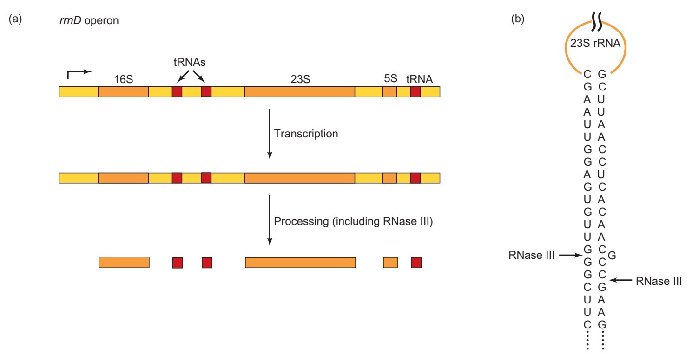{ width="740" loading=lazy }
/// caption
左：rrnD的排列和分割；右：23S rRNA两侧间隔区配对形成的茎，箭头标出RNase III切点。不同rrn操纵子的tRNA数目和位置有差异。Weaver，图16.4。[^weaver-processing]
///

rRNA折叠、修饰和核糖体蛋白结合也在这段时间里推进。已经装配的区域可以保护成熟末端，装配失败的片段则可能被RNase R、PNPase等清除。这样的相互配合，使切割不必等到“全部修饰完成”才开始。

细菌tRNA也常先从较长转录本中释放。RNase P通常切掉5′前导序列，3′端则由RNase Z或外切酶处理；末端CCA有时由基因编码，有时由CCA添加酶补上。少数细菌tRNA还带有I类内含子，需要剪接。下面的[tRNA成熟](#trna-processing)会继续解释这些末端反应及其RNA催化证据。[^trna-maturation]

!!! info "同样是加A，结果可以不同"

    细菌PAP I或PNPase在RNA的3′端添加短poly(A)或富A尾，常为3′→5′核酸酶提供一段容易抓住的单链，使原本有稳定结构的片段也能被消化。真核成熟mRNA的长poly(A)尾则常被PABP包被，参与翻译和稳定。

    核内RNA监控也会使用短A尾促进降解。尾的长度、结合蛋白和所在区室，决定它把RNA引向哪条路线。[^bacterial-rna-processing][^rna-exosome]

## 古菌：以RNA结构定位加工位点 { #archaeal-rna-processing }

古菌的RNA代谢保留了跨域同源装置，也有鲜明的自身特点。许多古菌以环状**RNA外切体（exosome）**进行3′→5′磷酸解和非模板加尾；一些谱系没有典型外切体，更多依靠RNase J、aCPSF1/FttA等核酸酶。mRNA的5′端状态、3′端富U序列、RNA结合蛋白和翻译活动，共同影响其存留时间。[^archaeal-rna-processing]

在许多古菌rRNA或tRNA前体中，加工区会折成**凸起—螺旋—凸起（bulge–helix–bulge，BHB）**结构。剪接内切酶识别这类空间排列，在两侧凸起处切开，连接酶再接合需要保留的部分。它对结构的识别，让切点不必局限于同一个线性位置。

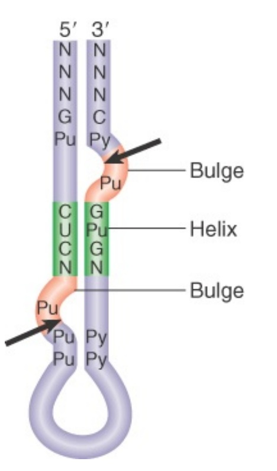{ width="230" loading=lazy }
/// caption
箭头为切点；中央双链螺旋把两侧凸起定位到酶的活性位点。图示为典型BHB，实际还存在多种变体。Krebs等，图19.37。[^genes-processing]
///

古菌pre-rRNA的间隔区可通过这种方式切除，之后再修剪成熟末端。**box C/D与box H/ACA小RNP**则以引导RNA配对定位核糖甲基化和假尿苷化；它们与真核核仁中的相应装置同源。

古菌tRNA通常也需要RNase P、tRNase Z和CCA添加酶，但内含子位置比典型真核tRNA更灵活。分裂tRNA基因、环状置换基因以及BHB变体，都可以经加工得到共同的成熟结构。

极少数系统甚至省去某一步：例如 *Nanoarchaeum equitans* 可直接转录出没有5′前导序列的tRNA，从而不再需要RNase P承担这一切割。[^archaeal-rna-processing][^trna-maturation]

## 真核mRNA的两端 { #eukaryotic-mrna-ends }

### 5′帽：把第一个核苷酸保护起来 { #mrna-capping }

许多Pol II转录本长到几十个核苷酸时，加帽酶就已经接近新生5′端。这个末端起初带三个磷酸；加帽时先去掉最外面的γ磷酸，再从GTP转移一个GMP，以特殊的**5′–5′三磷酸桥**与RNA相接，最后给帽鸟嘌呤的N7位甲基化。甲基供体是S-腺苷甲硫氨酸（SAM）。[^mrna-capping]

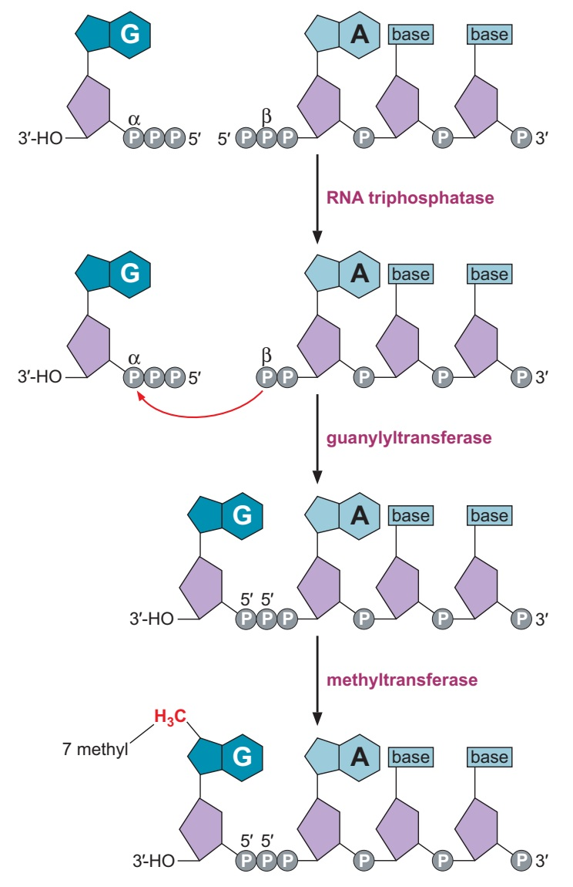{ width="360" loading=lazy }
/// caption
从上向下依次为RNA三磷酸酶、鸟苷酰转移酶和甲基转移酶的反应。左侧新加G的方向与原RNA相反。Watson等，图13–24。[^watson-processing]
///

新加的G不是RNA正常延长时的“下一个碱基”：两个核苷的5′端相向连接，使普通5′→3′外切酶难以直接从这里进入。

**cap 0**具有m⁷G帽；在此基础上，第一个转录核苷酸的核糖2′-OH再甲基化，形成**cap 1**；前两个转录核苷酸均有2′-O-甲基化，则称**cap 2**。这些名称描述结构，具体分布因生物和RNA而异。

核内**帽结合复合体（CBC）**识别帽，参与首个内含子剪接、3′端形成，并与NXF1依赖的mRNP输出相衔接。RNA进入胞质后，结合伙伴逐步更换，eIF4E等翻译起始因子通过帽招募后续装置。[^mrna-capping]

??? note "snRNA的帽与装配"

    帽也参与非编码RNA的运输。以哺乳动物部分Sm型snRNA为例，它们输出到胞质后先装配Sm蛋白核心，帽再超甲基化为**N²,N²,7-三甲基鸟苷帽**，随后入核继续成熟。U6等走不同路线，不能把这一次序推广到全部snRNA。[^snrna-maturation]

    Pol II产物也并非终身保留最初的帽：后续切割、去帽或再加帽都能改变其末端状态。

### 3′端：先切开，再加尾 { #mrna-three-prime-end }

多数哺乳动物蛋白质编码转录本的3′端由一组RNA序列元件界定。**CPSF**识别上游AAUAAA或相关信号，**CstF**等结合下游富GU序列，其他因子共同组装；其中核酸内切酶**CPSF73**切开RNA，产生可供延长的3′-OH。[^mrna-polyadenylation]

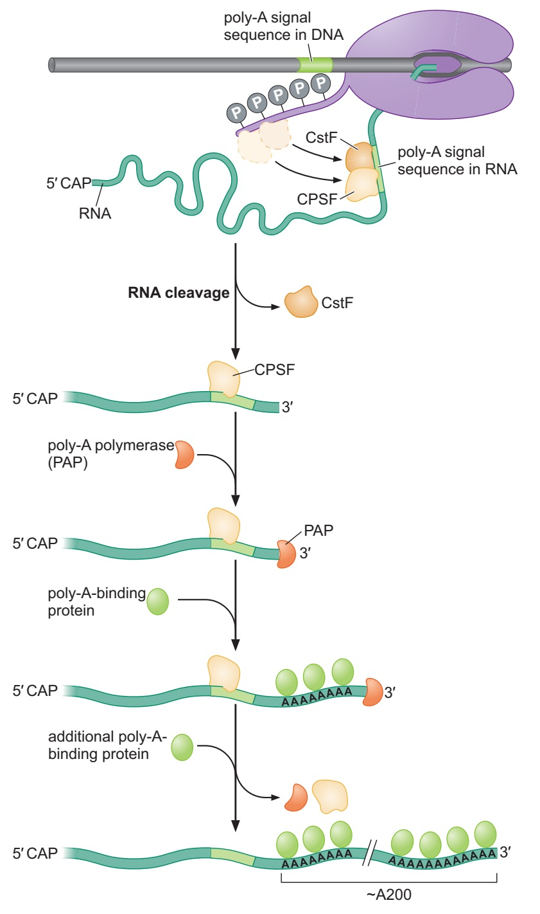{ width="340" loading=lazy }
/// caption
聚合酶继续转录时，上游RNA已可被切下并加尾；尾中的A由PAP无模板加入。图中约200个A是典型示意值。Watson等，图13–25。[^watson-processing]
///

**poly(A)聚合酶（PAP）**以ATP为底物，在切出的3′端逐个加入A，因而poly(A)尾不需要DNA上存在一长串对应的T。核内PABPN1结合新尾，促进连续延伸；输出后，胞质PABP参与尾的保护和翻译调节。

RNA切下与聚合酶终止是两个相连的事件：下游RNA仍可留在Pol II上继续生长，随后才进入[切割耦联的转录终止](transcription.md#eukaryotic-termination)。

多数核编码mRNA的终止密码子已经位于编码区内，加尾发生在其下游。一个有趣的特例是哺乳动物部分**线粒体mRNA**：加工后的编码末端只有U或UA，加A后补成UAA终止密码子。[^mitochondrial-polya]

同一基因往往有多个可用切割位点。**可变加尾（alternative polyadenylation，APA）**若发生在3′ UTR中，会增减miRNA或RNA结合蛋白的作用位点；若选择内含子或编码区内的位点，还可能改变蛋白质C端。位点使用受到顺式序列、加工因子浓度、RNA结合蛋白、转录速度和染色质状态影响。短3′ UTR减少了哪些调控元件，比“短转录本是否更容易翻译”这个笼统比较更有解释力。[^alternative-polyadenylation]

!!! info "不加poly(A)尾的组蛋白mRNA"

    后生动物的**复制依赖型组蛋白mRNA**通常使用另一套3′端识别方式：SLBP结合末端茎环，U7 snRNP识别下游元件，CPSF73等完成切割。这里形成稳定而可翻译的mRNA，不依赖普通长poly(A)尾。这个例子限定于相应组蛋白转录本，不能扩展为所有组蛋白mRNA都无尾。[^alternative-polyadenylation]

## 剪接体怎样连接外显子 { #spliceosomal-splicing }

### 从不连续杂交看见分裂基因

1977年，腺病毒晚期mRNA与病毒DNA的杂交实验揭示：成熟RNA的各段，可以对应DNA上彼此分隔的区域。实验者把纯化mRNA与适当DNA片段退火，再用电镜观察RNA—DNA杂合分子。RNA配上互补DNA链，会置换另一条DNA链，形成**R-loop**。[^split-gene-experiments]

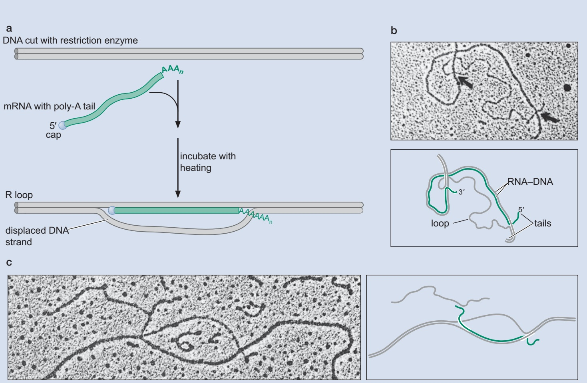{ width="750" loading=lazy }
/// caption
a为杂交原理；b为hexon mRNA的杂合体，RNA两端伸出；c为fiber mRNA与不同DNA区域配对的实例。绿色示意RNA，灰色示意DNA。Watson等Box 14–1图2，转引Berget等与Chow等1977年电镜结果。[^split-gene-experiments][^watson-processing]
///

读这组图时，要把三种结构分开：被RNA置换出来的是**DNA单链**；RNA的3′ poly(A)尾本来就不由DNA直接编码；而一些5′端RNA可与基因组的另一处DNA配对，说明成熟mRNA把相隔的序列接到了一起。正是杂交位置和序列的对应，支持分裂基因与剪接的解释，不能把电镜中任意一个环都称为内含子。

### 两次转酯化与套索

内含子的两端不是随意切开。主要剪接体识别**5′剪接位点、分支点、聚嘧啶区和3′剪接位点**等信号。多数U2型内含子以GU开始、以AG结束；分支点附近有一个参与催化的腺苷A。下图中的序列是人类共识，不表示每个内含子逐字相同。[^watson-processing][^spliceosome]

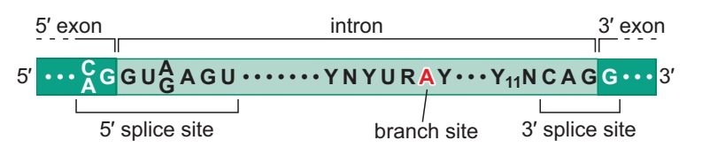{ width="630" loading=lazy }
/// caption
信号位于内含子及其边界附近。Y为嘧啶，R为嘌呤，N为任意碱基。Watson等，图14–3。[^watson-processing]
///

第一次反应由分支A的**2′-OH**进攻5′剪接位点的磷酸。上游外显子被释放，留下3′-OH；内含子的5′端则接到分支A的2′氧上，形成特殊的**2′–5′磷酸二酯键**。内含子因此成为带尾巴的环，称为**套索（lariat）**。

第二次反应中，上游外显子新露出的3′-OH进攻3′剪接位点，把下游外显子接上。两外显子之间形成普通的3′–5′磷酸二酯键，套索内含子释放。

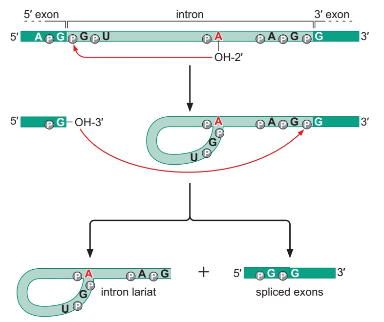{ width="460" loading=lazy }
/// caption
两次转酯化：先形成套索，再连接外显子。红箭头指亲核进攻。Watson等，图14–4。[^watson-processing]
///

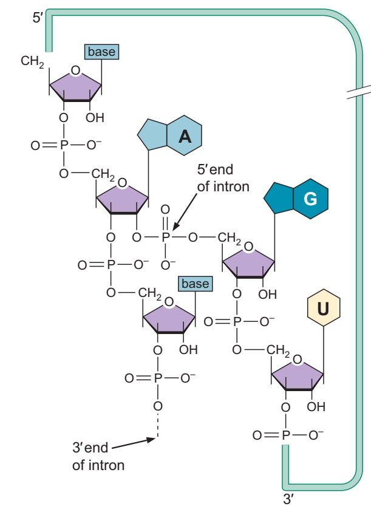{ width="300" loading=lazy }
/// caption
分支A仍保留主链上的3′–5′连接，又以2′位连接内含子的5′端。Watson等，图14–5。[^watson-processing]
///

这两步**转酯化**以旧键交换新键，不需要每形成一个连接就直接水解一分子ATP。不过，细胞内剪接还包含装配、RNA解旋、错误底物淘汰和复合物拆卸，这些步骤要消耗ATP。反应式中的能量平衡与整个机器的能量需求，是两个尺度的问题。

### snRNA轮流接触同一段底物

剪接体由小核RNA及其结合蛋白组成的**snRNP**和许多辅助蛋白动态装配。RNA之间的配对不仅用于识别底物，也参与搭建催化中心。U1首先与5′位点配对；U2随后占据分支区，使分支A从双链中凸出，暴露可反应的2′-OH。[^spliceosome]

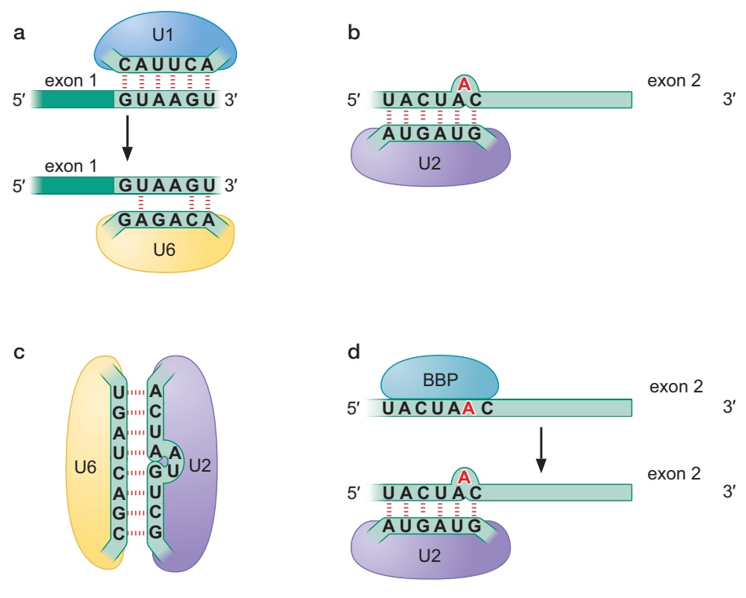{ width="690" loading=lazy }
/// caption
a：U6接替U1接触5′位点；b：U2配对后分支A凸出；c：U2与U6配对；d：U2取代早期分支点结合蛋白。示意序列来自酵母。Watson等，图14–6。[^watson-processing]
///

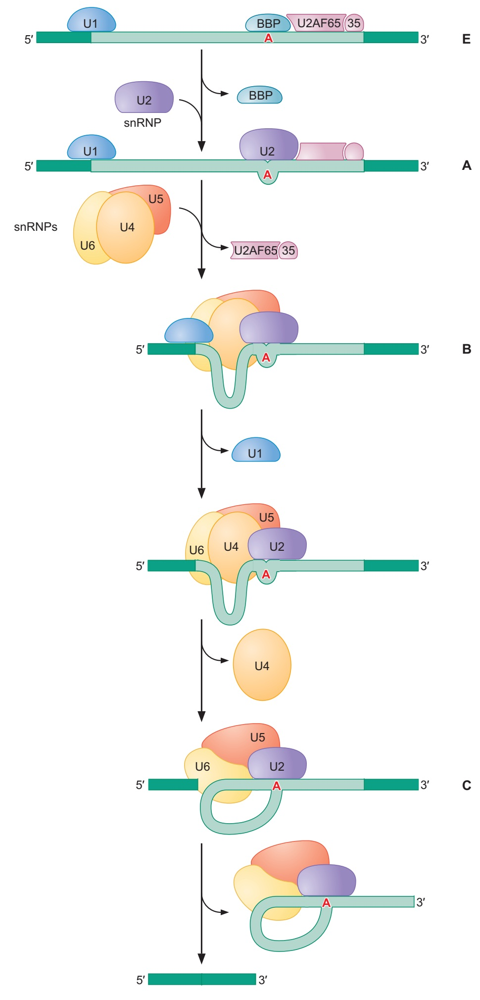{ width="350" loading=lazy }
/// caption
从上向下为经典装配路径。实际组装可共转录发生，部分接触与因子释放的次序存在变化。Watson等，图14–7。[^watson-processing]
///

在早期复合物中，SF1/分支点结合蛋白与U2AF等帮助识别分支区和3′侧信号；U2结合后，**U4/U6·U5三联snRNP**进入。

U4起初与U6配对，使U6保持未激活状态。后续重排解除这组配对，U1与U4退出相应接触；U6接触5′位点并与U2共同形成RNA催化核心，**U5帮助两侧外显子对齐**。Prp8等蛋白提供结构支撑，ATP依赖的重排酶控制这些转换。

完成两次反应后，mRNA释放，套索与剪接体被拆解，各snRNP得以再次使用。因此，剪接体并不是一把沿RNA滑动的固定“剪刀”，其活性中心是在正确底物上逐步建立的。

???+ abstract "改变U1，能否救回突变的剪接位点"

    Zhuang与Weiner在HeLa细胞中表达腺病毒E1A基因。这个基因可选择不同5′位点，产生9S、12S和13S转录本；用RNase保护实验，可以按受保护片段的长度区分这些产物。[^u1-compensation]

    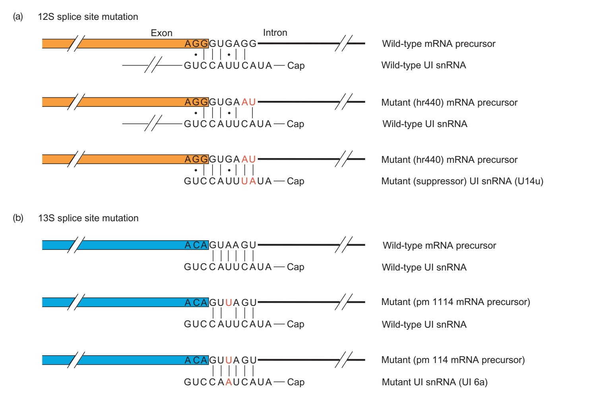{ width="700" loading=lazy }
    /// caption
    上组破坏12S位点与U1的配对，再改变U1恢复配对；下组对13S位点做类似操作。红字为改动碱基。Weaver，图14.12。[^weaver-processing]
    ///

    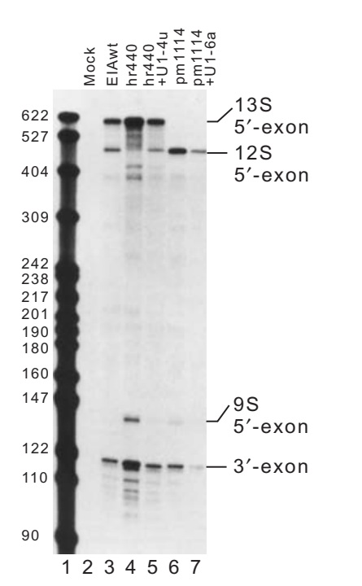{ width="300" loading=lazy }
    /// caption
    1为长度标准，2为假转染，3为野生型；4/5为12S位点突变及其U1补偿，6/7为13S位点突变及其U1补偿。原胶转引于Weaver图14.13。[^u1-compensation][^weaver-processing]
    ///

    先看**3→4→5道**：12S信号因位点突变消失，加入能恢复配对的U1后重新出现。这一“底物突变—RNA补偿”的结果，把U1与5′位点的碱基配对同实际剪接联系起来。

    再看**6→7道**：13S位点的另一种突变即使恢复了与U1的配对，也没有恢复剪接。底物还要通过其他识别和催化步骤，U1配对只是其中一环。原实验因而同时给出了支持证据和适用边界。

### 外显子选择与不同的剪接装置

真核内含子可很长，仅靠短GU/AG信号难以可靠选点。SR蛋白可结合**外显子剪接增强子（ESE）**，帮助两侧招募U1、U2AF等，让一个外显子的边界先被识别；随后，相邻外显子上的机器再跨内含子组织起来。不同hnRNP和其他调控蛋白则可遮蔽位点、改变RNA构象或影响因子招募。[^watson-processing]

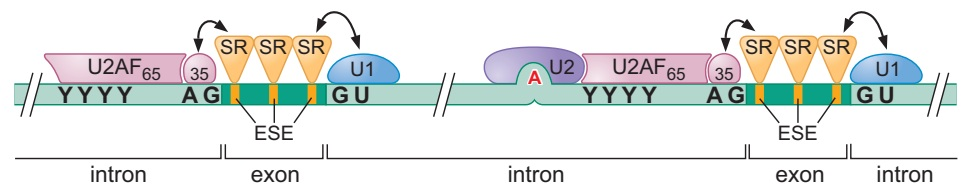{ width="680" loading=lazy }
/// caption
SR蛋白位于外显子内部，U2AF靠近上游3′位点，U1靠近下游5′位点。这种跨外显子的识别称为外显子定义。Watson等，图14–11。[^watson-processing]
///

**可变剪接（alternative splicing）**由此具有调控空间：某个外显子可以被保留或跳过，边界可以前后移动，两个外显子可以互斥，部分内含子也可能保留。其后果既可能改变蛋白序列，也可能只改变UTR或把转录本送入无义介导的降解。

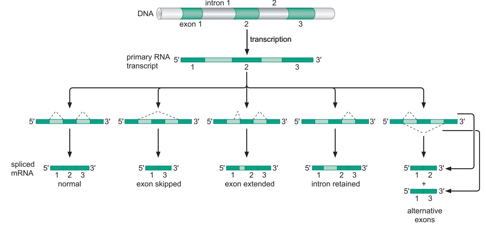{ width="760" loading=lazy }
/// caption
从同一前体出发的几种产物。图中“exon extended”表示使用另一剪接边界；内含子保留产物不一定能稳定翻译。Watson等，图14–15。[^watson-processing]
///

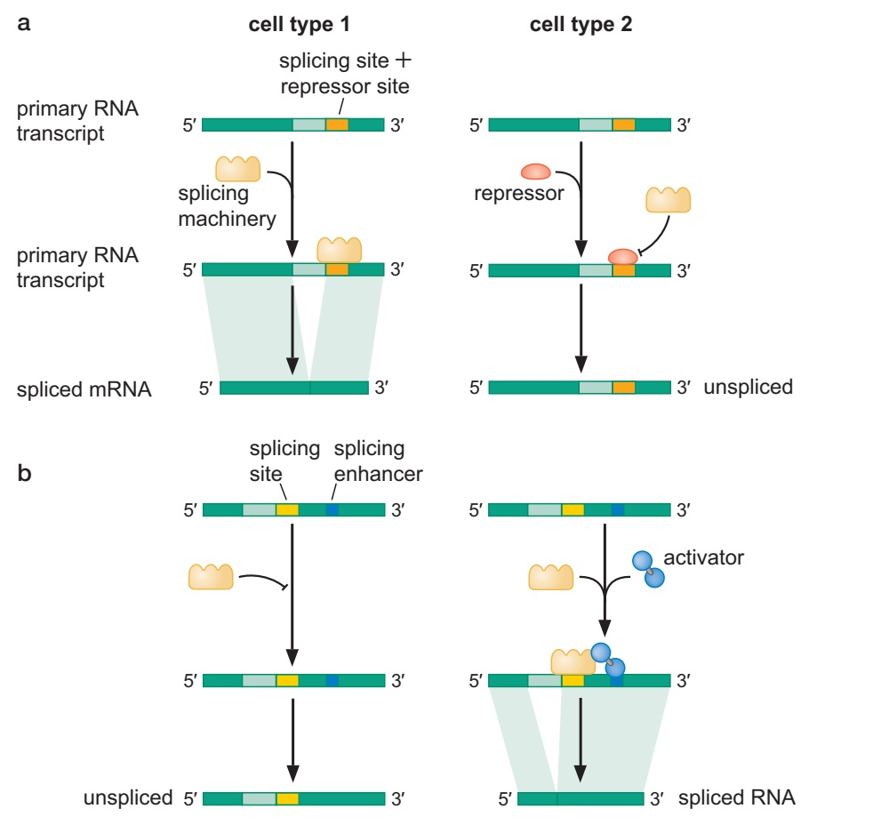{ width="400" loading=lazy }
/// caption
上：抑制蛋白阻止位点使用；下：激活蛋白帮助招募剪接机器。Watson等，图14–22。[^watson-processing]
///

同一前体在两种细胞中遇到的调控蛋白不同，就可能采用不同剪接方案。图中的增强子或沉默子都属于**RNA顺式元件**，其作用由结合蛋白及位置决定。

测到一个新接头，说明至少存在相应RNA产物；要确认它编码稳定且有功能的蛋白，还需要完整异构体、翻译和扰动证据。[基因与转录本的对应关系](genetic_material.md#gene-concept)中进一步讨论了这一层次。

可变剪接使用同一DNA产生不同RNA；**外显子重排（exon shuffling）**则涉及演化中的DNA重组，改变的是基因本身的组合。二者所处的层次不同。

少量**U12型内含子**由次要剪接体处理：U11、U12、U4atac、U6atac与共享的U5承担相应角色。这类内含子既可有AU–AC边界，也可有GU–AG边界，因此不能只按末端两个碱基区分主要与次要剪接体。[^minor-spliceosome]

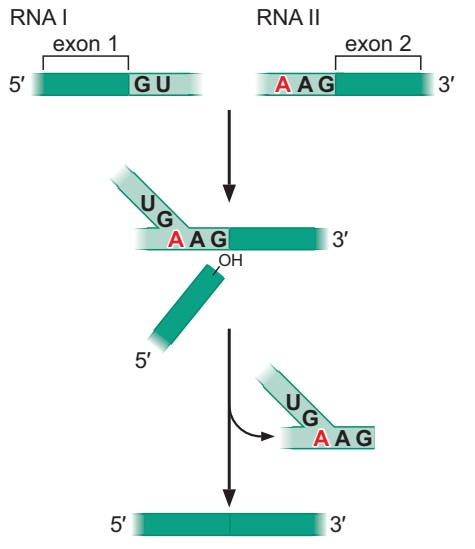{ width="270" loading=lazy }
/// caption
反式剪接把两条RNA接合，释放Y形分支副产物。Watson等，图14–12。[^watson-processing]
///

**反式剪接（trans-splicing）**让两个外显子来自不同前体。锥体虫等动基体生物给多数mRNA接上带帽的剪接前导序列（spliced leader）；这一反应与相邻转录本的加尾相配合，可从多顺反子前体中释放单个mRNA。部分线虫也广泛使用剪接前导序列。[^trans-splicing]

细胞器中还有另一种情况：分开转录的II类内含子片段折叠到一起，再完成反式剪接。它与上述剪接体反应都能跨分子连接RNA，但使用的催化装置不同。

## RNA自身参与催化：自剪接内含子 { #self-splicing-introns }

在一些rRNA、tRNA及细胞器转录本中，内含子RNA本身可以折成催化结构。**I类内含子**结合游离鸟苷或含鸟苷的核苷酸，利用其**3′-OH**进攻5′剪接位点；随后仍由上游外显子的3′-OH连接下游外显子，释放线性内含子。鸟苷可以是G、GMP、GDP或GTP，关键是可反应的3′-OH，而不是靠水解GTP推动两步转酯化。[^self-splicing][^watson-processing]

**II类内含子**通常由内部腺苷的2′-OH发起，释放套索。这与剪接体的反应化学非常相近，只是催化RNA的来源不同：前者主要由内含子自己提供折叠结构，后者由多个snRNA与前体共同建立中心。

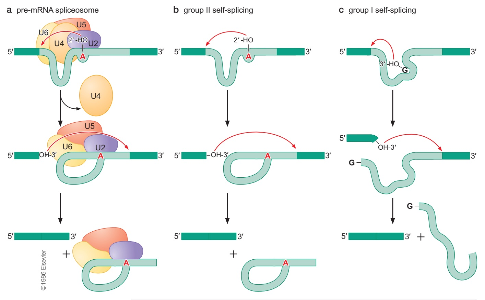{ width="760" loading=lazy }
/// caption
从左到右为剪接体、II类与I类内含子。可比较第一步的进攻基团与最终释放的内含子形状。Watson等，图14–8，据Cech的反应比较整理。[^watson-processing]
///

???+ abstract "四膜虫内含子：把转录与剪接分开"

    Cech研究组研究四膜虫26S rRNA中的I类内含子。为了检验RNA能否在没有细胞剪接蛋白的条件下反应，他们用大肠杆菌RNA聚合酶转录克隆的四膜虫DNA片段，随后**去蛋白并纯化RNA**，再把前体放入含GTP、Mg²⁺和盐的剪接体系。[^cech-self-splicing]

    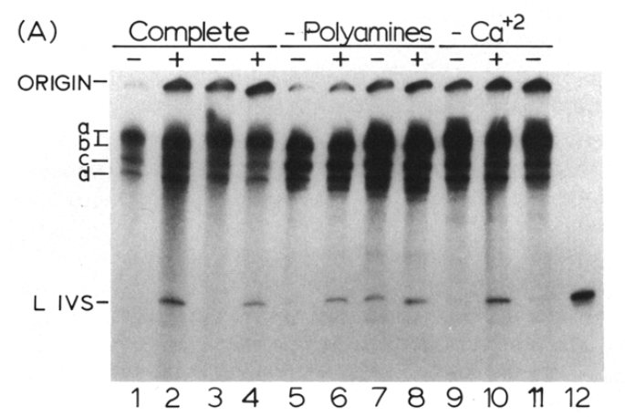{ width="650" loading=lazy }
    /// caption
    Kruger等1982年图3A。前10道中，各对泳道的−/＋表示纯化后是否再进行剪接孵育；L IVS为线性内含子，12道提供该产物的参照。[^cech-self-splicing]
    ///

    先比较1/2道和3/4道：转录分别进行了30或60分钟，同一批纯化RNA再接受剪接条件后，出现与L IVS相应的条带。去掉蛋白后，**纯化RNA仍能在适当条件下释放内含子**，支持RNA本身参与催化。

    这张胶直接显示的是内含子释放。两侧外显子是否准确连接，原论文还用另一组核酸酶保护与产物分析确认；不能仅凭一条内含子带就读出全部连接细节。

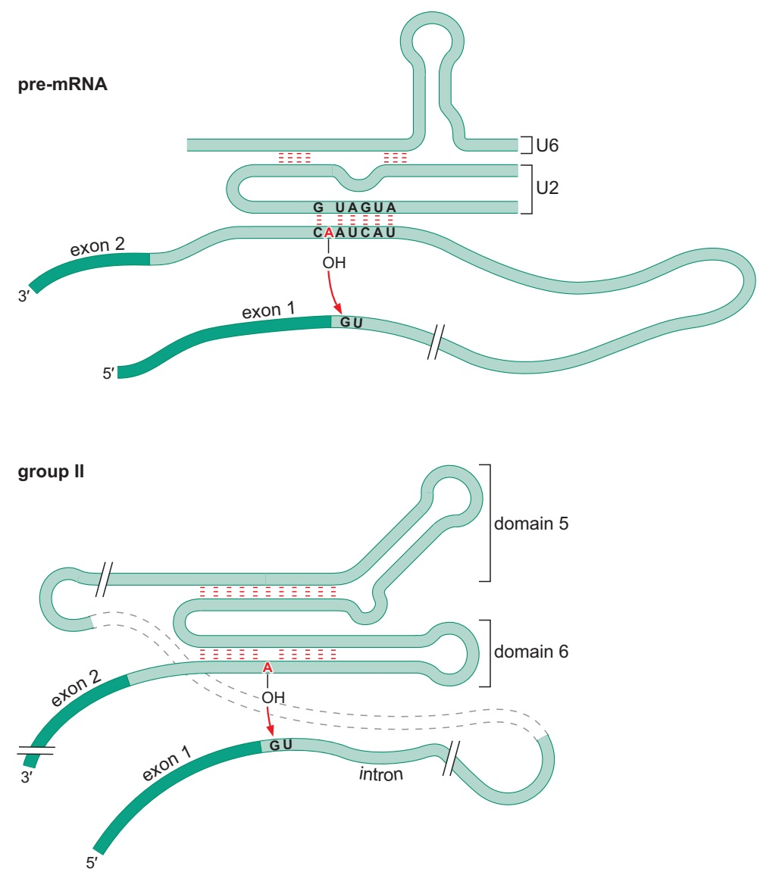{ width="420" loading=lazy }
/// caption
上：前体与U2/U6；下：II类内含子的关键区域。此图强调RNA排列相似，省略了大量蛋白和其他结构域。Watson等，图14–9。[^watson-processing]
///

“自剪接”描述某些RNA在合适体外条件下能够完成反应。细胞内的折叠环境更复杂，许多I/II类内含子仍依赖蛋白质促进成熟；II类内含子常借助maturase等因子，部分还编码逆转录酶并能作为移动元件活动。

剪接体与II类内含子不仅产生相似套索，其RNA催化核心与两金属离子机制也有深层相似性，支持二者的演化联系。I类、II类、剪接体内含子和tRNA内含子应按结构及化学区分，编号并不代表一条从简单到复杂的共同序列。[^self-splicing][^spliceosome]

## rRNA：切割与核糖体装配交错进行 { #rrna-processing }

哺乳动物Pol I合成的**47S前体rRNA**含18S、5.8S和28S rRNA，以及外部与内部转录间隔区（ETS、ITS）。早期修剪产生45S等中间体；接下来的切割逐步分出小亚基和大亚基的RNA路线。Pol III单独转录5S rRNA，后者再进入大亚基装配。[^rrna-processing]

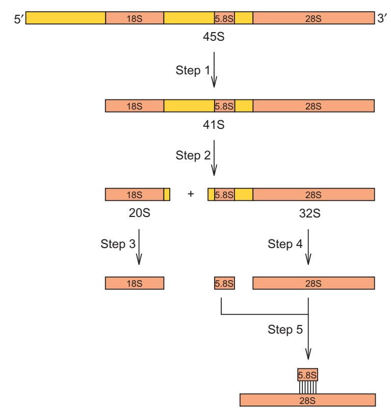{ width="410" loading=lazy }
/// caption
从45S中间体开始的人HeLa细胞经典简图；47S的早期处理未画出。实际存在替代次序，其他物种的前体名称也不同。Weaver，图16.2。[^weaver-processing]
///

U3等核仁小RNP、核酸酶、RNA解旋酶和装配因子在核仁中持续重塑前体。切割改变RNA之间的连接，蛋白结合和RNA折叠则逐步建立核糖体的空间结构。

**RNase MRP**是参与切割的RNP。例如在出芽酵母中，它可切开ITS1的A3位点，为后续5.8S rRNA的5′端成熟提供入口。它与下文引导核苷酸修饰的snoRNP承担不同反应。[^rnase-mrp]

5.8S与28S仍通过配对一起进入大亚基；5.8S与细菌23S rRNA的5′区域具有同源关系。pre-40S和pre-60S输出后，还要在胞质继续完成末端成熟、因子释放及功能检查。核仁内的空间组织见[核仁与核糖体发生](../cell/nucleus_chromatin.md#nucleolus-nuclear-bodies)。

### 引导RNA怎样把修饰酶带到一个核苷酸上

许多rRNA修饰由**小核仁RNA（snoRNA）**定位。snoRNA既可来自独立或多顺反子转录本，许多也从宿主基因的内含子中加工而来。snoRNA与目标附近序列配对，把某个核苷酸放到复合体中的催化蛋白旁；引导RNA提供位置，蛋白质完成相应化学反应。[^rrna-processing]

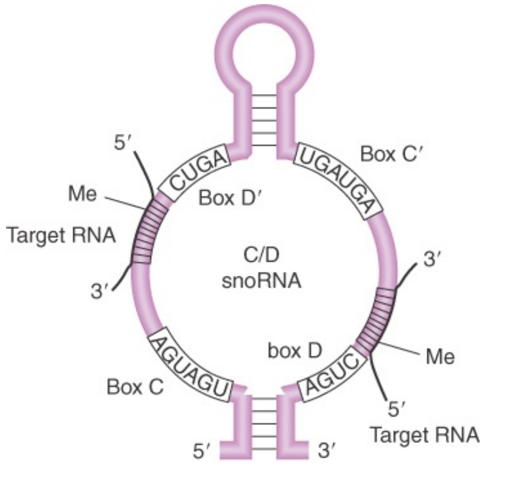{ width="350" loading=lazy }
/// caption
box C/D snoRNA的引导区与靶RNA配对，Me标出甲基化位置。Krebs等，图19.42。[^genes-processing]
///

**C/D型snoRNP**中的fibrillarin以SAM为甲基供体，催化核糖2′-O-甲基化。引导区与D或D′盒的相对距离，帮助定位目标核苷酸。

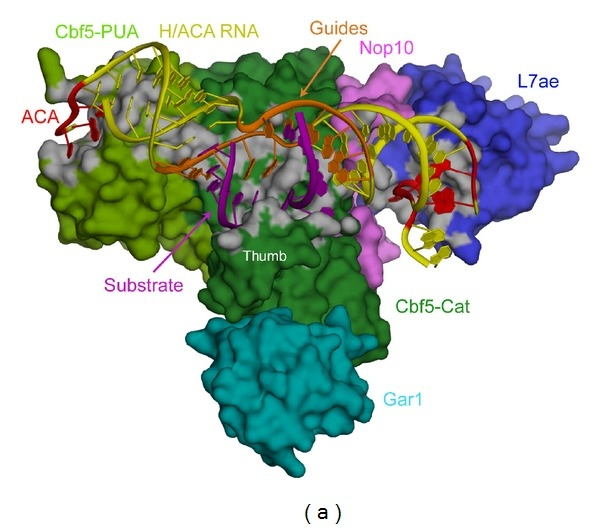{ width="440" loading=lazy }
/// caption
古菌 *Pyrococcus furiosus* 的同源H/ACA复合体结构：橙色为引导区，紫色为底物，深绿色为Cbf5催化域。Yip等图6a，据Duan等结构研究整理。[^haca-structure]
///

**H/ACA型snoRNP**中的dyskerin/Cbf5催化假尿苷化。靶U在口袋中暴露，其两侧配对帮助确定位置。图用古菌同源装置显示这种空间关系，真核复合体的组分与RNA构架有所不同。

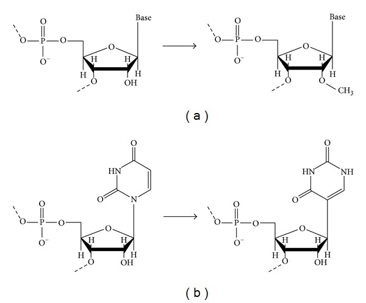{ width="550" loading=lazy }
/// caption
a：核糖2′-O-甲基化；b：尿苷转为假尿苷Ψ，N1–C1′连接变为C5–C1′。两种化学反应也存在于真核rRNA中。Yip等，图3。[^archaeal-rna-processing]
///

修饰常集中在核糖体功能中心附近，能影响局部折叠、稳定性和相互作用；另一些snoRNA主要帮助前体折叠或切割。要判定某个位点的作用，需要把修饰检测与酶活、装配和核糖体功能联系起来。它们并不是一组用来标记“这一段保留、那一段剪掉”的通用记号。

## tRNA：准确的末端与成熟构象 { #trna-processing }

成熟tRNA必须把反密码子和携带氨基酸的受体端放到正确空间位置。前导/拖尾序列的移除、CCA添加、内含子剪接及多种修饰，都围绕这一共同结构展开，但不同谱系可以使用不同装置到达它。[^trna-maturation]

### RNase P切出5′端

RNase P通常在成熟tRNA第一个核苷酸之前切开，去掉5′前导序列。细菌、古菌以及许多真核核内系统中的RNase P是RNA—蛋白复合物；植物细胞核与若干细胞器等则使用**纯蛋白型RNase P（PRORP）**承担相同切割。

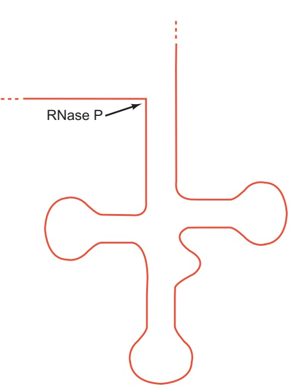{ width="320" loading=lazy }
/// caption
箭头定位成熟5′端；切割同时依赖酶对tRNA整体结构的识别。Weaver，图16.5。[^weaver-processing]
///

???+ abstract "RNase P的RNA亚基能独立工作吗"

    大肠杆菌RNase P含M1 RNA和C5蛋白。把两者分开，再用带5′前导序列的tRNA前体作底物，可以直接问：哪一部分保留了切割能力？Altman的诺贝尔演讲展示了不同Mg²⁺条件下的这组反应。[^altman-rnase-p]

    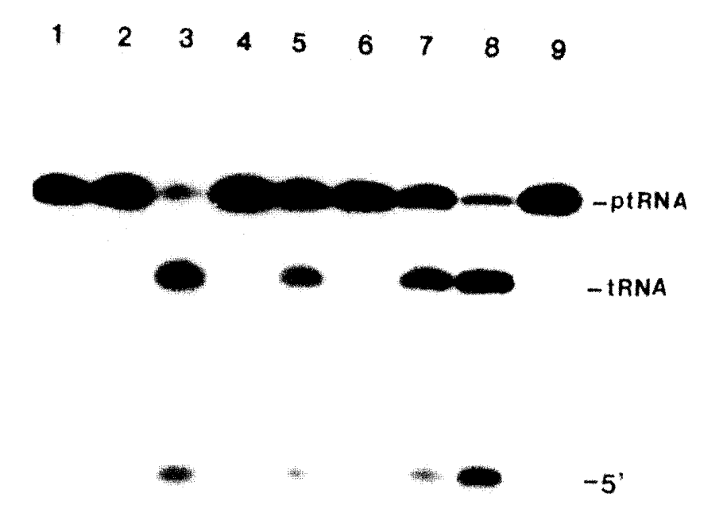{ width="620" loading=lazy }
    /// caption
    p-tRNA为前体，tRNA与5′分别为成熟tRNA和前导片段；完整保留9道。1–3道为10 mM MgCl₂，4–8道为100 mM，9道为C5单独、10 mM。Altman讲稿图7。[^altman-rnase-p]
    ///

    **2与3道**比较低Mg²⁺条件下M1单独与M1+C5：加入蛋白后出现明显产物。**4与5道**比较高Mg²⁺下的底物对照与M1单独：没有C5，RNA仍能完成切割。高Mg²⁺在体外帮助RNA形成可催化状态，因而揭示了RNA亚基的催化能力。

    其余泳道还改变了蛋白比例和PEG条件，不能合在一起归纳成“加蛋白总会更快”。尤其这里的高Mg²⁺条件不是细胞内条件；细胞中的C5有助于底物识别与高效催化，RNA可独立反应并不意味着蛋白无用。

### 3′端、CCA与少见的逆向添加

tRNA的3′拖尾可由tRNase Z或外切酶去除。随后，**CCA添加酶**利用tRNA的结构和自身活性中心，按次序选择C、C、A，无需一条互补核酸模板；末端A为后续氨酰化提供受体。已有基因编码CCA的tRNA，也可能通过同类酶修复受损末端。[^trna-maturation]

另一个特别的末端是组氨酸tRNA的**G−1**。在酵母等系统中，Thg1把G加在tRNA的5′端，形成少见的3′→5′核苷酸添加；细菌的这一G常由基因编码。不同生物的HisRS识别规则有差异，并非所有真核胞质tRNA^His^都必须保有G−1。[^thg1]

### tRNA内含子的切除与连接

细菌某些tRNA的I类内含子可以自剪接；古菌与真核的许多tRNA内含子则由**剪接内切酶**先切开两侧边界，再由连接酶接合半分子。典型真核tRNA内含子靠近反密码子环，酶同时读取成熟tRNA结构和局部构象；古菌的BHB识别允许更灵活的位置。[^trna-maturation]

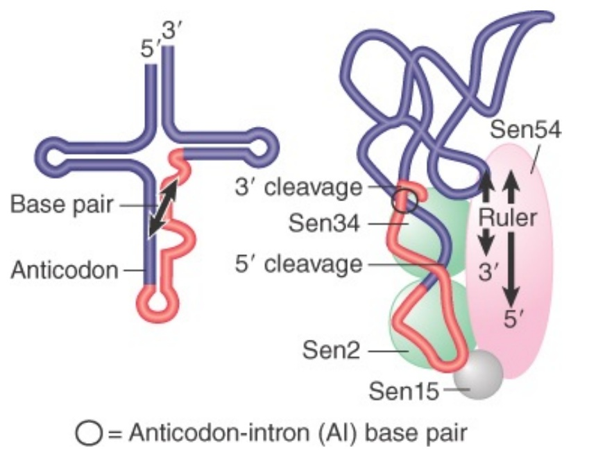{ width="560" loading=lazy }
/// caption
出芽酵母中，Sen2与Sen34承担两个切口的催化，其他亚基帮助定位。Krebs等，图19.36。[^genes-processing]
///

这类内切留下的不是普通DNA连接酶熟悉的断口：上游半分子以**2′,3′-环磷酸**结束，下游半分子以**5′-OH**开始。接下来怎样处理，存在两种值得比较的路线。

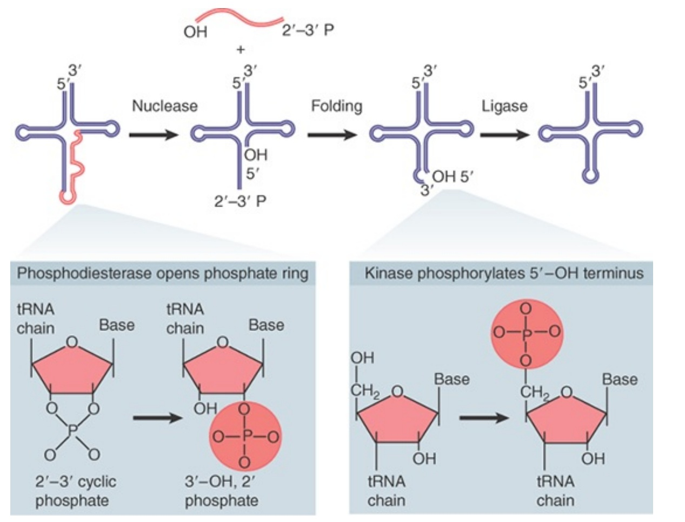{ width="710" loading=lazy }
/// caption
图示出芽酵母式端点处理：开放环磷酸后留下3′-OH和2′-磷酸，另一端则由5′-OH变成5′-磷酸。Krebs等，图19.38；后续去除2′-磷酸未画出。[^genes-processing][^trna-ligation]
///

| 阶段 | 出芽酵母Trl1/Tpt1路线 | 人类RTCB路线 |
| --- | --- | --- |
| 准备末端 | Trl1开放环磷酸，产生3′-OH、2′-磷酸；再把另一端5′-OH磷酸化 | 经3′-磷酸中间体处理上游末端，保留另一端5′-OH |
| 接合 | ATP依赖的连接反应生成3′–5′键，连接处仍带2′-磷酸 | RTCB使用GTP活化，经鸟苷酸化中间体连接3′-磷酸与5′-OH |
| 后续处理 | Tpt1把2′-磷酸转移给NAD⁺，产生ADP-核糖1″,2″-环磷酸等产物 | 不留下酵母式的连接处2′-磷酸 |

这张表按两个具体系统比较，避免把酵母的三步端点处理套到所有真核生物。人类RTCB在多蛋白复合体及辅助因子参与下工作；古菌和细菌中也有RtcB家族成员。[^trna-ligation]

tRNA还带有假尿苷、二氢尿苷、肌苷及多种碱基/核糖修饰。它们有的影响整体折叠，有的影响氨酰tRNA合成酶识别，有的改变反密码子解码；某项修饰缺失的后果取决于具体tRNA、密码子使用、温度和应激，不能只按“修饰总数”判断成熟程度。

!!! info "CCA也能变成降解标记"

    CCA添加酶还能参与结构检查。对于部分结构不稳定、具有相应受体茎及5′端GG等条件的tRNA或tRNA样RNA，酶可再次加入CCA，留下**CCACCA**尾，将其引向降解。稳定tRNA与这些底物在酶上的折叠行为不同，使同一装置既能完成成熟，又能标记不合适的结构。[^ccacca]

## RNA编辑与化学修饰 { #rna-editing-modification }

### 脱氨怎样改变RNA读法

**RNA编辑（RNA editing）**使RNA在特定位点与DNA模板给出的序列不同。动物ADAR1/ADAR2可在双链RNA中把腺苷A脱氨为**肌苷I**；I的配对性质接近G，因此逆转录和翻译常把该位置读作G。少数事件改变编码信息，大量A→I编辑则位于重复序列形成的非编码双链区，帮助减少内源双链RNA被误当作异常输入而触发先天免疫。[^adar-editing]

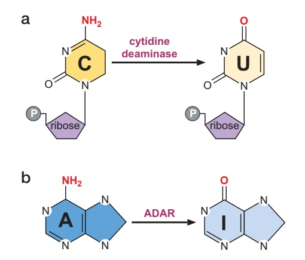{ width="420" loading=lazy }
/// caption
两种反应都移除碱基上的氨基，却改变不同碱基。A→I的化学产物是肌苷，不能直接写成把A变成G。Watson等，图14–31。[^watson-processing]
///

**APOBEC1复合体**提供了清楚的C→U实例。在人小肠中，apoB mRNA的一个CAA谷氨酰胺密码子被编辑成UAA终止密码子，产生较短的apoB48；人肝脏中相应位点通常不这样编辑，产生apoB100。一个核苷酸的改变，便把同一基因的产物接到不同脂蛋白代谢任务上。这种组织分工不能原样推广到所有哺乳动物。[^watson-processing]

陆生植物线粒体和质体中的编辑以C→U为主，部分谱系还有U→C。PPR蛋白等识别特定位点，编辑可恢复保守氨基酸、补出起始或终止密码子，也可作用于非编码RNA。具体位点的功能，需要结合编辑缺失后的分子和生理表型判断。[^organelle-rna-editing]

### gRNA引导U的插入与删除

锥体虫等动基体生物的线粒体采用另一种大规模改写方式：**引导RNA（gRNA）**与待编辑mRNA配对，编辑复合体切开不匹配区域，再加入或去掉U，最后连接断口。常见gRNA多数由线粒体小环DNA编码，但也有大环编码的gRNA以及COII等顺式引导例外。[^organelle-rna-editing]

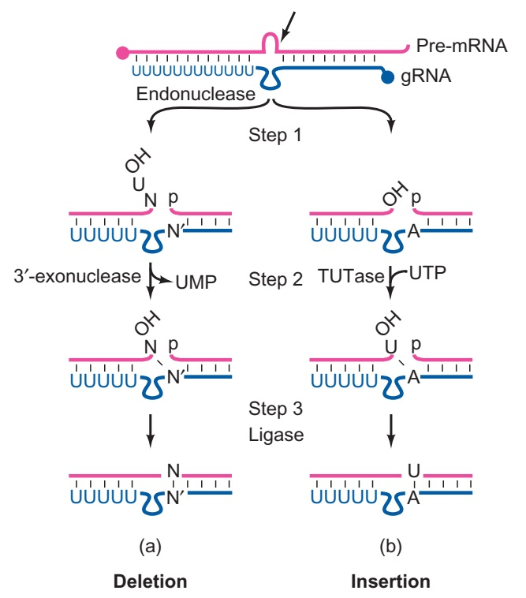{ width="380" loading=lazy }
/// caption
粉色为mRNA，蓝色为gRNA；左为删除，右为插入。加入的U来自UTP，gRNA提供配对信息。Weaver，图16.18。[^weaver-processing]
///

gRNA的5′锚定区先配到待编辑区的下游。局部配对关系把需要改变的位置呈现给内切酶：

- **插入**时，末端尿苷酰转移酶（TUTase）从UTP加入UMP，使上游片段新形成的3′端与gRNA相配。
- **删除**时，U特异性外切酶去掉多余的末端U。
- 配对合适后，RNA连接酶封合两个mRNA片段。

连续编辑可逐步建立下一条gRNA的锚定位点，整体常沿mRNA的3′→5′方向推进。gRNA并不把自身的U剪下来“赠给”mRNA；插入原料与引导信息来自不同分子。

### m⁶A等修饰怎样影响RNA的命运

化学修饰还包括m⁶A、m⁵C、假尿苷和2′-O-甲基化等。以哺乳动物mRNA的**N⁶-甲基腺苷（m⁶A）**为例，METTL3–METTL14复合体在适当序列与结构环境中催化甲基化，偏好DRACH相关位点；其中D为A/G/U，R为A/G，H为A/C/U，中间A是候选修饰位。[^rna-modifications]

含YTH结构域的蛋白等识别因子结合部分修饰位点后，可影响剪接、输出、翻译或降解；去甲基化酶则受底物与区室限制。“写入者—读取者—擦除者”有助于整理分工，但一个DRACH序列不等于一个真实m⁶A位点，一个富集峰也不能独自说明该位点怎样改变表达。

## 加工、输出与RNA质量控制 { #rna-quality-control }

完成加工的RNA同时携带一套结合蛋白。帽结合蛋白、剪接后留下的标记、3′端结合因子及输出适配蛋白，共同影响它能否经核孔进入胞质；未正确加工或装配的RNA，则更容易被滞留并交给核内降解装置。这个选择并非由单一蛋白盖上“合格章”，而是多个结合与反应状态的综合结果。[^rna-exosome]

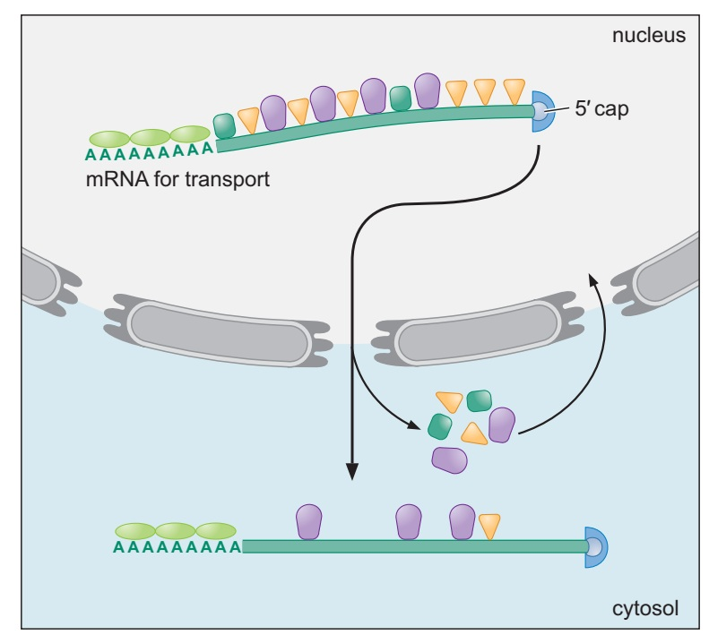{ width="480" loading=lazy }
/// caption
mRNP经核孔后继续重塑，为翻译建立新的结合状态。图中为概念示意，未把全部蛋白分别命名。Watson等，图14–33。[^watson-processing]
///

真核胞质mRNA的常规降解多先由**PAN2–PAN3、CCR4–NOT**缩短poly(A)尾。随后，DCP1/DCP2去帽，XRN1从5′→3′降解；另一条路线由Ski复合体协助外切体从3′→5′清除。

核内外切体需要辅助因子解开RNA结构并投递底物。MTR4及TRAMP、NEXT、PAXT等不同适配系统参与这些过程，把间隔区碎片、异常前体、装配失败的mRNP和许多短寿命转录本交给降解装置；这些辅助系统的分布与主要底物因谱系而异。[^rna-exosome]

### 翻译还能暴露RNA上的问题

核糖体是否正常延伸和终止，给质量控制提供了另一组线索。三类常见通路可按触发情景比较。[^translation-coupled-surveillance]

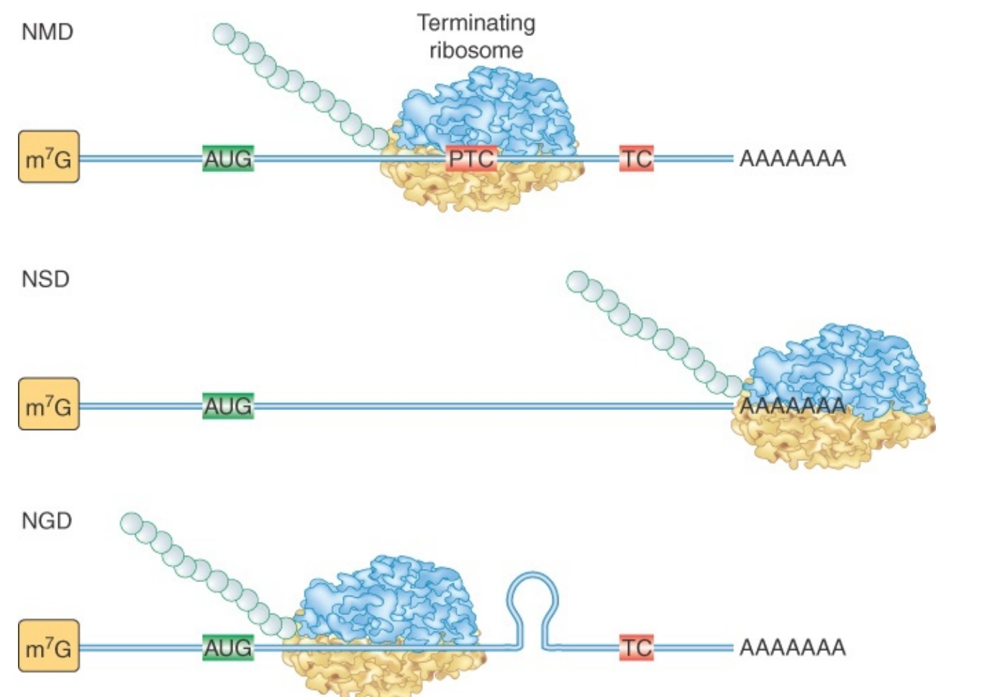{ width="680" loading=lazy }
/// caption
上为NMD，中为NSD，下为NGD的典型底物示意；PTC为提前终止密码子，TC为通常终止位置。Krebs等，图20.12。[^genes-processing]
///

| 通路 | 主要线索 | 需要结合的上下文 |
| --- | --- | --- |
| 无义介导的mRNA降解（NMD） | 终止发生在不合适的位置或mRNP环境中 | 哺乳动物下游外显子接合复合体（EJC）、3′ UTR构象和UPF因子等；不同谱系规则不同 |
| 无终止降解（NSD） | RNA缺少可用的终止密码子 | 核糖体可读入poly(A)区或到达截短末端，救援与降解相联 |
| 无进展降解（NGD） | 延伸严重受阻，常形成核糖体碰撞 | 受阻原因、碰撞构象和后续RNA切割/核糖体拆分 |

这些通路也调节部分正常转录本。例如，可变剪接有意生成一个易触发NMD的异构体，就能降低可积累的mRNA。核糖体救援及新生肽质量控制的后续装置见[翻译页面](translation.md#ribosome-rescue)。

细菌的**tmRNA–SmpB**也把RNA与蛋白质质控连在一起。对于缺少终止密码子、核糖体停在截短末端等底物，丙氨酰化tmRNA先以类似tRNA的方式接受新生肽，再切换到自身短阅读框，给肽链加上降解标签并经终止释放核糖体；RNase R等帮助清除问题RNA。SmpB与下游mRNA通道的关系有助于辨别此类底物，正常翻译中A位短暂空着并不自动触发救援。[^tmrna-selection]

## 小RNA的成熟与装载 { #small-rna-biogenesis }

miRNA、siRNA和piRNA将短RNA序列装载到Argonaute家族蛋白中，使其按配对关系寻找靶标。它们的前体来源和成熟路线不同，长度虽有典型范围，却不能单独作为分类依据。[^mirna-biogenesis][^rnai-mechanism]

### 动物miRNA：从发夹到引导链

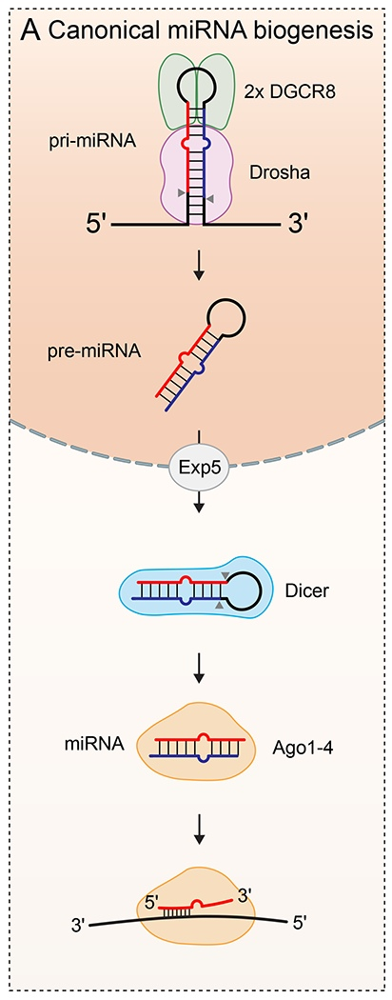{ width="350" loading=lazy }
/// caption
经典动物miRNA路线。红、蓝为发夹两臂；装载后保留引导链，另一链被去除。Shang等2023年图1A，裁取该面板。[^mirna-biogenesis]
///

miRNA基因转录出的**pri-miRNA**包含局部发夹，既可来自独立转录单位，也可位于其他转录本的内含子或外显子区域。核内Drosha–DGCR8组成的Microprocessor识别发夹与两侧RNA，把它切成**pre-miRNA**。

Exportin-5帮助前体输出；胞质Dicer再切开近环端，形成约22 nt的双链体。典型RNase III切割产物具有**5′单磷酸、3′-OH与2 nt的3′突出端**，可被后续装载机器识别。

双链体的一条成为**引导链**并保留在AGO中，另一条作为乘客链被去除。两臂都有可能在适当条件下贡献成熟miRNA，不能预先把其中一条固定称为“无用链”。

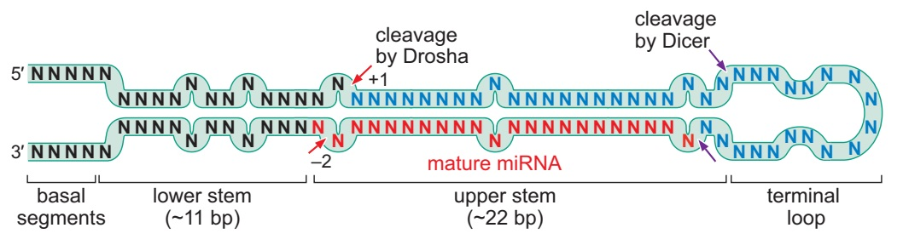{ width="730" loading=lazy }
/// caption
发夹底部与环端提供定位参照，红色标出成熟miRNA一臂。图中长度为经典模型的近似值。Watson等，图20–14。[^watson-processing]
///

成熟miRNA与AGO形成miRISC。动物miRNA常以靠近5′端的**种子区（seed）**配对启动靶标识别，再受其余配对和靶RNA环境影响；常见结果是招募去腺苷酸化、去帽装置并抑制表达。若配对足够广泛且AGO具备催化能力，也可直接切割靶RNA，例如哺乳动物AGO2。[^mirna-biogenesis]

!!! note "非经典路线保留了什么"

    **mirtron**先由剪接与去分支产生发夹前体，可绕过Drosha。**miR-451**的短发夹则可绕过Dicer，由AGO2切割后再修剪。共同终点是形成可工作的引导RNA—AGO复合物，不能要求每一个miRNA都走齐图中所有步骤。[^mirna-biogenesis]

### siRNA：长双链RNA怎样成为短引导片段

siRNA通常来自较长双链RNA，Dicer或Dicer样酶把它切成短双链，再装入AGO。**Dicer切前体，具有切割活性的AGO切靶RNA**；两种切割发生在不同阶段。[^rnai-mechanism]

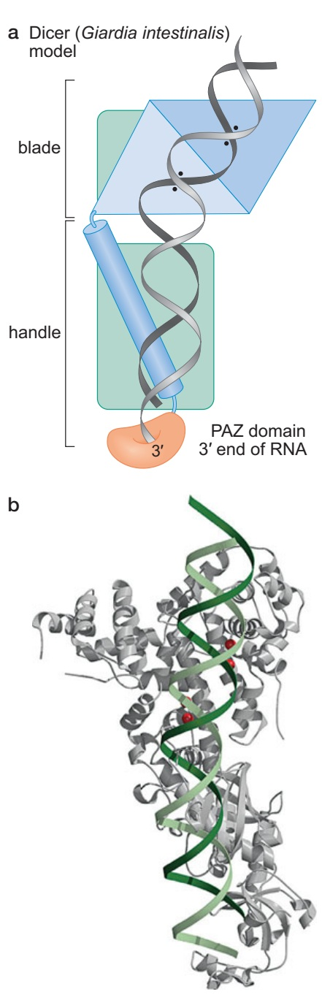{ width="240" loading=lazy }
/// caption
贾第虫Dicer的“分子尺”模型与结构：PAZ区接触RNA末端，两个RNase III区构成切割端。RNA为结构上的模型放置。Watson等图20–16，据MacRae等结构研究。[^watson-processing]
///

酶先识别双链RNA的末端，再利用末端结合区与催化位点之间的距离定位切口，因而产生相对集中的长度分布。不同Dicer的结构域、辅助因子和底物进入方式不同，图示贾第虫酶不能代表所有真核Dicer的完整构架。

植物、真菌和部分无脊椎动物还有RNA依赖的RNA聚合酶（RdRP），能产生或扩增次级双链RNA；果蝇和哺乳动物没有同一套扩增装置。某些植物与线虫系统还能传播沉默信号，或让其影响持续到后代，这些性质同样有物种和条件限制。

哺乳动物细胞中的长双链RNA还可触发先天免疫反应。有效长度受到递送、底物结构和细胞状态影响，不能用“21或30个碱基”画出跨物种的固定有效/无效边界。

???+ abstract "短RNA片段来自前体，还是被切掉的靶mRNA"

    Zamore等把带放射性标记的双链RNA加入果蝇胚胎提取物，再用高分辨率凝胶观察产物。正义链、反义链或两条链都可以分别标记，并设置有无对应靶mRNA的条件。[^rnai-short-products]

    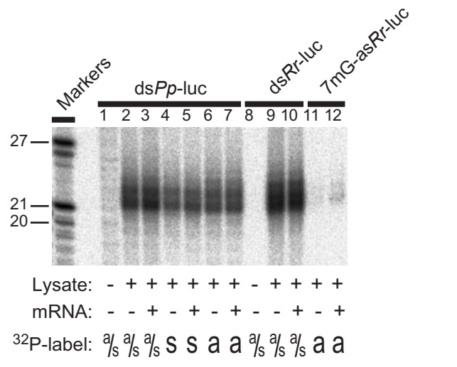{ width="580" loading=lazy }
    /// caption
    1–10道使用双链前体，11/12道为带帽反义单链Rr-luc RNA，分别不加/加入靶mRNA。下方列提取物、靶mRNA及标记链条件；左为长度标准。Weaver图16.26，转引Zamore等2000年图3。[^rnai-short-products][^weaver-processing]
    ///

    加入提取物后，双链RNA产生约21–23 nt短片段；比较2与3道等有无靶mRNA的组合，可见**短片段形成不需要靶mRNA先存在**。这支持它们由触发沉默的双链前体生成，而非只是靶mRNA降解留下的碎片。

    后续的引导链装载和靶切割需要另外检验。这张胶说明短RNA的来源与长度，不能单独判定哪条链最终进入AGO。

### 植物小RNA与动物piRNA

植物miRNA主要由核内DCL1加工；DCL2/3/4与RDR家族则参与形成不同siRNA群，再交给有不同偏好的AGO。其中，**24 nt siRNA**可进入RNA引导的DNA甲基化，另一些小RNA通过切割RNA、抑制翻译或特定组织间移动发挥作用。[^rnai-mechanism]

动物**piRNA**多从单链前体经不依赖Dicer的加工形成，装入PIWI蛋白；部分系统通过ping-pong循环扩增。3′端常由Hen1家族甲基转移酶进行2′-O-甲基化，例如哺乳动物HENMT1、果蝇Hen1/Pimet。其加工、装载和定位帮助保护生殖系等细胞中的基因组，具体转座抑制实例见[转座子的控制](dna_recombination.md#transposon-control)。[^pirna-biogenesis]

| 小RNA类别 | 常见前体与加工 | 主要装载对象 |
| --- | --- | --- |
| 动物经典miRNA | 局部发夹，经Drosha与Dicer两次加工 | AGO |
| siRNA | 较长双链RNA，经Dicer/DCL加工；部分生物有RdRP扩增 | AGO |
| piRNA | 单链前体，不依赖Dicer；部分系统有ping-pong | PIWI |

小RNA后续怎样招募RNA降解或染色质调控装置，以及为何同一个miRNA可调节多个靶标，见[小RNA介导的表达调控](gene_regulation/eukaryotic.md#small-rna-silencing)。

## 怎样验证一个加工事件 { #rna-processing-evidence }

RNA加工同时改变长度、末端、序列和结合状态，一种检测通常只显示其中一面。**Northern blot**能比较前体与产物的长度和丰度；引物延伸、RNase保护及5′/3′ RACE可定位边界；短读长RNA-seq适合检测剪接接头，却未必把相隔很远的外显子与加尾位点连成同一条完整RNA，长读长分析能补充这一信息。

解释结果时，还要考虑逆转录、PCR、连接偏好和RNA降解带来的伪影。编辑研究尤其需要比较**同一样本的DNA与RNA**，排除SNP、旁系同源基因和比对错误；修饰研究则要区分抗体富集、化学转换、质谱与直接RNA测量各自能提供的分辨率。

机制证据可以逐步相接：先证明前体与产物的关系，再改变候选位点或因子，最后用恢复实验、纯化组分反应或结构解释作用。上面的U1补偿突变、去蛋白的自剪接反应和RNase P组分重组，分别把序列识别、催化能力与蛋白辅助作用拆开检验。

若要筛查核酸序列或构象差异，可继续读[核酸杂交与分子探针](../exptech/biochem_molecular/molecular_probes.md#conformation-variant-scanning)中的DGGE、SSCP和DHPLC。

## 参考资料与延伸阅读 { #references }

- Watson JD等. *Molecular Biology of the Gene*. 7th ed. Chapters 13、14、20。
- Weaver RF. *Molecular Biology*. 5th ed. Chapters 14–16。
- Krebs JE, Goldstein ES, Kilpatrick ST. *Lewin’s GENES XII*. 12th ed. Chapters 19–20。
- Kruger K等. [Self-splicing RNA: autoexcision and autocyclization of the ribosomal RNA intervening sequence of Tetrahymena](https://doi.org/10.1016/0092-8674(82)90414-7). *Cell*. 1982;31:147–157。
- Guerrier-Takada C等. [The RNA moiety of ribonuclease P is the catalytic subunit of the enzyme](https://pubmed.ncbi.nlm.nih.gov/6197186/). *Cell*. 1983;35:849–857。

- Deutscher MP. [Twenty years of bacterial RNases and RNA processing: how we've matured](https://pmc.ncbi.nlm.nih.gov/articles/PMC4371297/). *RNA*. 2015;21:597–600.
- Yip WS, Vincent NG, Baserga SJ. [Ribonucleoproteins in archaeal pre-rRNA processing and modification](https://pmc.ncbi.nlm.nih.gov/articles/PMC3608112/). *Archaea*. 2013;2013:614735.
- Galloway A, Cowling VH. [mRNA cap regulation in mammalian cell function and fate](https://pmc.ncbi.nlm.nih.gov/articles/PMC6414751/). *Biochimica et Biophysica Acta - Gene Regulatory Mechanisms*. 2019;1862:270–279.
- Liu J, Lu X, Zhang S, Yuan L, Sun Y. [Molecular insights into mRNA polyadenylation and deadenylation](https://pmc.ncbi.nlm.nih.gov/articles/PMC9570436/). *International Journal of Molecular Sciences*. 2022;23:10985.
- Tian B, Manley JL. [Alternative polyadenylation of mRNA precursors](https://pmc.ncbi.nlm.nih.gov/articles/PMC5483950/). *Nature Reviews Molecular Cell Biology*. 2017;18:18–30.
- Tholen J, Galej WP. [Structural studies of the spliceosome: bridging the gaps](https://pmc.ncbi.nlm.nih.gov/articles/PMC9762485/). *Current Opinion in Structural Biology*. 2022;77:102461.
- Phizicky EM, Hopper AK. [tRNA processing, modification, and subcellular dynamics: past, present, and future](https://pmc.ncbi.nlm.nih.gov/articles/PMC4371247/). *RNA*. 2015;21:483–485.
- Turi Z, Lacey M, Mistrik M, Moudry P. [Impaired ribosome biogenesis: mechanisms and relevance to cancer and aging](https://pmc.ncbi.nlm.nih.gov/articles/PMC6520011/). *Aging*. 2019;11:2512–2540.
- Nishikura K. [A-to-I editing of coding and non-coding RNAs by ADARs](https://pmc.ncbi.nlm.nih.gov/articles/PMC4824625/). *Nature Reviews Molecular Cell Biology*. 2016;17:83–96.
- Read LK, Lukeš J, Hashimi H. [Trypanosome RNA editing: the complexity of getting U in and taking U out](https://pmc.ncbi.nlm.nih.gov/articles/PMC4835692/). *WIREs RNA*. 2016;7:33–51.
- He PC, He C. [m⁶A RNA methylation: from mechanisms to therapeutic potential](https://pmc.ncbi.nlm.nih.gov/articles/PMC7849164/). *The EMBO Journal*. 2021;40:e105977.
- Bresson S, Tollervey D. [Surveillance-ready transcription: nuclear RNA decay as a default fate](https://pmc.ncbi.nlm.nih.gov/articles/PMC5881035/). *Open Biology*. 2018;8:170270.
- Monaghan L, Longman D, Cáceres JF. [Translation-coupled mRNA quality control mechanisms](https://pmc.ncbi.nlm.nih.gov/articles/PMC10548175/). *The EMBO Journal*. 2023;42:e114378.
- Wilson RC, Doudna JA. [Molecular mechanisms of RNA interference](https://pmc.ncbi.nlm.nih.gov/articles/PMC5895182/). *Annual Review of Biophysics*. 2013;42:217–239.
- Shang R, Lee S, Senavirathne G, Lai EC. [microRNAs in action: biogenesis, function and regulation](https://pmc.ncbi.nlm.nih.gov/articles/PMC11087887/). *Nature Reviews Genetics*. 2023;24:816–833.

[^watson-processing]: Watson JD等. *Molecular Biology of the Gene*. 7th ed. Chapter 13图13–24、13–25（印刷页459–460）；Chapter 14图14–3至9、11、12、15、22、31、33与Box 14–1图2（印刷页469–504）；Chapter 20图20–14、20–16（印刷页717–718）。本文裁取教材图版，具体图号见各图注；实验和结构图的原始来源另在相应图注/脚注说明。

[^bacterial-rna-processing]: 细菌 mRNA、rRNA、tRNA 的加工与质量控制及不同 RNase 组合见 Deutscher 的[综述](https://pmc.ncbi.nlm.nih.gov/articles/PMC4371297/)；RNase E／J／Y 启动周转和谱系差异见[细菌 mRNA 降解综述](https://pmc.ncbi.nlm.nih.gov/articles/PMC4431577/)。

[^weaver-processing]: Weaver RF. *Molecular Biology*. 5th ed. Chapters 14–16。图14.12–14.13见印刷页404–405，图16.2、16.4、16.5、16.18、16.26分别见473、474、475、482、490页（本地PDF页为印刷页加22）。图16.18据Seiwert 1996年的编辑反应整理；本文裁取原图，不沿用相邻正文中已被修正的通则。

[^trna-maturation]: RNase P、tRNase Z、CCA添加、tRNA内含子和跨域装置差异见 Phizicky 与 Hopper 的[综述](https://pmc.ncbi.nlm.nih.gov/articles/PMC4371247/)及[RNase P 综述](https://pmc.ncbi.nlm.nih.gov/articles/PMC3904588/)。

[^rna-exosome]: 核内RNA外切体、MTR4/TRAMP和异常RNA监控 见 Bresson 与 Tollervey 的[综述](https://pmc.ncbi.nlm.nih.gov/articles/PMC5881035/)；胞质去腺苷酸化、去帽、XRN1与外切体路线见[mRNA 降解综述](https://pmc.ncbi.nlm.nih.gov/articles/PMC4615280/)。

[^archaeal-rna-processing]: 古菌前体rRNA的BHB切割、C/D及H/ACA小RNP与修饰见 Yip 等的[综述](https://pmc.ncbi.nlm.nih.gov/articles/PMC3608112/)；tRNA/rRNA剪接内切酶的底物范围见[古菌剪接内切酶研究](https://pmc.ncbi.nlm.nih.gov/articles/PMC7714728/)。

[^genes-processing]: Krebs JE, Goldstein ES, Kilpatrick ST. *Lewin’s GENES XII*. 12th ed. Chapter 19图19.36–19.38、19.42及snoRNA来源段（本地PDF2001）；Chapter 20图20.12。本地电子版PDF分别为1992–1994、2003、2078页。图19.38用于出芽酵母端点处理，RTCB与Tpt1化学另据原研究核对。

[^mrna-capping]: m⁷G帽的形成、CBC介导的加工/输出和帽状态差异见 Galloway 与 Cowling 的[综述](https://pmc.ncbi.nlm.nih.gov/articles/PMC6414751/)。

[^snrna-maturation]: Mouaikel J等. [Interaction between the small-nuclear-RNA cap hypermethylase and the spinal muscular atrophy protein, survival of motor neuron](https://pmc.ncbi.nlm.nih.gov/articles/PMC1319203/). *EMBO Reports*. 2003。经典Sm型snRNA的胞质Sm核心装配、帽超甲基化和回核次序亦见[SMN复合体研究](https://pmc.ncbi.nlm.nih.gov/articles/PMC135628/)。

[^mrna-polyadenylation]: CPSF73切割、PAP加尾、PABPN1及去腺苷酸化的结构和机制见 Liu 等的[综述](https://pmc.ncbi.nlm.nih.gov/articles/PMC9570436/)。

[^mitochondrial-polya]: Ojala D, Montoya J, Attardi G. [tRNA punctuation model of RNA processing in human mitochondria](https://pubmed.ncbi.nlm.nih.gov/7219536/). *Nature*. 1981;290:470–474。人线粒体RNA加尾及其转录本特异作用亦见[Nagaike等2005年研究](https://pubmed.ncbi.nlm.nih.gov/15769737/)。

[^alternative-polyadenylation]: APA对3′ UTR和编码区的不同后果及位点选择因素见 Tian 与 Manley 的[综述](https://pmc.ncbi.nlm.nih.gov/articles/PMC5483950/)；U7/SLBP依赖的组蛋白mRNA 3′端形成 见[CPSF73 综述](https://pmc.ncbi.nlm.nih.gov/articles/PMC8364479/)。

[^split-gene-experiments]: Berget SM, Moore C, Sharp PA. [Spliced segments at the 5′ terminus of adenovirus 2 late mRNA](https://doi.org/10.1073/pnas.74.8.3171). *PNAS*. 1977;74:3171–3175；Chow LT, Gelinas RE, Broker TR, Roberts RJ. [An amazing sequence arrangement at the 5′ ends of adenovirus 2 messenger RNA](https://doi.org/10.1016/0092-8674(77)90180-5). *Cell*. 1977;12:1–8。本文使用Watson教材转引的原电镜及配套示意，保留各面板，不将RNA尾部与被置换DNA混称内含子。

[^spliceosome]: 主要剪接体的组装、RNA重排、两次转酯化和催化中心结构见 Tholen 与 Galej 的[综述](https://pmc.ncbi.nlm.nih.gov/articles/PMC9762485/)及 Alberts 等的[教材章节](https://www.ncbi.nlm.nih.gov/books/NBK26887/)。

[^u1-compensation]: Zhuang Y, Weiner AM. [A compensatory base change in U1 snRNA suppresses a 5′ splice site mutation](https://scholars.duke.edu/publication/665918). *Cell*. 1986;46:827–835。实验胶为原图1A，经Weaver图14.13转引；配对设计为教材图14.12。12S补偿恢复与13S补偿未恢复需分别解释。

[^minor-spliceosome]: U12型内含子与U11/U12/U4atac/U6atac等snRNP的底物和结构特征见[次要剪接体综述](https://pmc.ncbi.nlm.nih.gov/articles/PMC3584512/)。

[^trans-splicing]: 剪接前导序列的反式剪接在动基体生物、线虫等生物中的装置和产物见[跨物种综述](https://pmc.ncbi.nlm.nih.gov/articles/PMC3795323/)。

[^self-splicing]: I/II类内含子的亲核基团、套索化学及其与剪接体的联系见 Alberts 等的[教材章节](https://www.ncbi.nlm.nih.gov/books/NBK26887/)。

[^cech-self-splicing]: Kruger K, Grabowski PJ, Zaug AJ, Sands J, Gottschling DE, Cech TR. [Self-splicing RNA: autoexcision and autocyclization of the ribosomal RNA intervening sequence of Tetrahymena](https://doi.org/10.1016/0092-8674(82)90414-7). *Cell*. 1982;31:147–157。图裁自[作者所在大学公开PDF](https://dosequis.colorado.edu/courses/methodslogic/papers/Cech1982.pdf)图3A（印刷页150），保留12道；第1–4道为完整转录条件，第5–8道去多胺，第9–11道去Ca²⁺，第12道为线性内含子参照。去蛋白后的追加剪接孵育为30分钟；本图直接显示内含子释放，外显子连接还需同文图6等证据。

[^rrna-processing]: 真核前体rRNA切割、snoRNP修饰和前核糖体装配 见 Turi 等的[综述](https://pmc.ncbi.nlm.nih.gov/articles/PMC6520011/)；核仁空间组织与当前页的分工见[细胞核页面](../cell/nucleus_chromatin.md#nucleolus-organization)。

[^rnase-mrp]: Schmitt ME, Clayton DA. [Nuclear RNase MRP is required for correct processing of pre-5.8S rRNA in Saccharomyces cerevisiae](https://pubmed.ncbi.nlm.nih.gov/8247008/). *Molecular and Cellular Biology*. 1993；ITS1与A3加工及更多底物见[后续酵母研究](https://pmc.ncbi.nlm.nih.gov/articles/PMC2704079/)。

[^haca-structure]: Yip等[古菌rRNA加工综述](https://pmc.ncbi.nlm.nih.gov/articles/PMC3608112/)图6a，裁取结构面板；原研究为Duan J, Li L, Lu J, Wang W, Ye K. [Structural mechanism of substrate RNA recruitment in H/ACA RNA-guided pseudouridine synthase](https://doi.org/10.1016/j.molcel.2009.05.005). *Molecular Cell*. 2009;34:427–439。底物颜色按实际图版的紫色说明；综述图注将其写为红色，与图中标签颜色不一致。

[^altman-rnase-p]: Altman S. [Enzymatic Cleavage of RNA by RNA](https://www.nobelprize.org/uploads/2018/06/altman-lecture.pdf). Nobel lecture, 1989，图7（印刷页634，PDF第9页）。图中底物为大肠杆菌pre-tRNA^Tyr^；1/4为底物对照，2/5为M1 RNA，3/6为M1+C5，7为M1 RNA加4% PEG、无C5，8增加C5至20倍过量，9为C5单独。1–3及9道为10 mM MgCl₂，4–8为100 mM。原始RNA催化研究为Guerrier-Takada C等，[The RNA moiety of ribonuclease P is the catalytic subunit of the enzyme](https://pubmed.ncbi.nlm.nih.gov/6197186/)，*Cell*. 1983;35:849–857；本文所用图号属于Nobel讲稿。

[^thg1]: Jackman JE, Phizicky EM. [tRNAHis guanylyltransferase adds G−1 to the 5′ end of tRNAHis by recognition of the anticodon, one of several features unexpectedly shared with tRNA synthetases](https://pmc.ncbi.nlm.nih.gov/articles/PMC1464847/). *RNA*. 2006;12:1007–1014。部分真核tRNA^His^及HisRS采用不同识别规则，见[Rao与Jackman的原研究](https://pmc.ncbi.nlm.nih.gov/articles/PMC4338351/)。

[^trna-ligation]: 出芽酵母Tpt1以NAD⁺接受2′-磷酸的化学见[Spinelli等原研究](https://pubmed.ncbi.nlm.nih.gov/9826666/)；人类RTCB/HSPC117复合体见Popow J等，[HSPC117 is the essential subunit of a human tRNA splicing ligase complex](https://pubmed.ncbi.nlm.nih.gov/21311021/)，*Science*. 2011。RtcB家族的GTP活化及3′-磷酸/5′-OH连接化学见[Tanaka等2011年研究](https://pubmed.ncbi.nlm.nih.gov/22045815/)与[2012年中间体研究](https://pmc.ncbi.nlm.nih.gov/articles/PMC3458531/)。

[^ccacca]: Wilusz JE, Whipple JM, Phizicky EM, Sharp PA. [tRNAs marked with CCACCA are targeted for degradation](https://pmc.ncbi.nlm.nih.gov/articles/PMC3273417/). *Science*. 2011;334:817–821；结构不稳定底物在酶上重折叠的机制见[2015年结构研究](https://pmc.ncbi.nlm.nih.gov/articles/PMC4329729/)。这不是所有异常tRNA的共同标记。

[^adar-editing]: ADAR对双链RNA的A→I编辑、重编码与先天免疫功能 见 Nishikura 的[综述](https://pmc.ncbi.nlm.nih.gov/articles/PMC4824625/)及 Eisenberg 与 Levanon 的[综述](https://www.nature.com/articles/s41576-018-0006-1)。

[^organelle-rna-editing]: 植物细胞器C→U/U→C编辑及PPR因子 见 Hao 等的[综述](https://pmc.ncbi.nlm.nih.gov/articles/PMC8511385/)；动基体生物gRNA引导的U插入/删除 见 Read 等的[综述](https://pmc.ncbi.nlm.nih.gov/articles/PMC4835692/)；大环编码及COII顺式引导例外见[原研究](https://pmc.ncbi.nlm.nih.gov/articles/PMC500885/)。

[^rna-modifications]: METTL3–METTL14、m⁶A位点环境与识别蛋白介导的后续作用 见 He 与 He 的[综述](https://pmc.ncbi.nlm.nih.gov/articles/PMC7849164/)。

[^translation-coupled-surveillance]: NMD、NGD与NSD的触发线索、核糖体碰撞和正常调控底物见 Monaghan 等的[综述](https://pmc.ncbi.nlm.nih.gov/articles/PMC10548175/)。

[^tmrna-selection]: tmRNA–SmpB与停滞核糖体结构见[Neubauer等2012年研究](https://pubmed.ncbi.nlm.nih.gov/22422985/)；下游mRNA影响适应与肽转移的动力学见[2014年原研究](https://pmc.ncbi.nlm.nih.gov/articles/PMC4201823/)。原mRNA缺少可供解码的下游序列，比笼统的“空A位”更能界定这里的底物。

[^mirna-biogenesis]: 经典/非经典动物miRNA加工与Argonaute装载见Shang等的[综述](https://pmc.ncbi.nlm.nih.gov/articles/PMC11087887/)；本文经典路线图裁自其图1A。

[^rnai-mechanism]: Dicer、Argonaute、引导链选择、靶切割与谱系差异见 Wilson 与 Doudna 的[综述](https://pmc.ncbi.nlm.nih.gov/articles/PMC5895182/)；植物AGO/DCL/RDR分工见[植物 RNAi 综述](https://pmc.ncbi.nlm.nih.gov/articles/PMC4790879/)。

[^rnai-short-products]: Zamore PD, Tuschl T, Sharp PA, Bartel DP. [RNAi: double-stranded RNA directs the ATP-dependent cleavage of mRNA at 21 to 23 nucleotide intervals](https://doi.org/10.1016/S0092-8674(00)80620-0). *Cell*. 2000;101:25–33。图3经Weaver图16.26转引；本页解读前体生成短RNA的反应，不把提取物体系的ATP需求推广为所有Dicer的固有要求。

[^pirna-biogenesis]: Hen1家族的piRNA末端甲基化见[小鼠研究](https://pubmed.ncbi.nlm.nih.gov/17652135/)与[果蝇Pimet研究](https://pubmed.ncbi.nlm.nih.gov/17606638/)；哺乳动物初级piRNA加工、PIWI装载和部分系统中的ping-pong扩增 见 Fu 与 Wang 的[综述](https://pmc.ncbi.nlm.nih.gov/articles/PMC4114582/)。
