# 转录与RNA生物合成 { #rna }

一段DNA序列可以被反复读取，每次留下一个RNA分子。细胞由此产生供翻译的mRNA，也产生构成核糖体的rRNA、搬运氨基酸的tRNA，以及参与剪接、修饰、切割和定位的多种RNA。**转录（transcription）**把模板中的序列信息带入RNA；产物何时开始合成、能否合成完整，又会影响后续加工和表达。

先沿着一条新生RNA走一遍：它的第一个核苷酸在启动子附近加入，3′端留在聚合酶中不断延长，已经合成的5′端则先伸到酶外。整条RNA尚未完成，别的蛋白就可以结合它；在细菌中，核糖体甚至已经开始翻译。等聚合酶到达终止区，RNA与模板分开，酶也得到回收。我们下面依次看这几个阶段，再比较古菌、真核细胞核、细胞器和RNA病毒的不同装置。[^watson-transcription]

## 模板链、转录泡与成键反应 { #transcription-chemistry }

### RNA怎样从DNA上读出来

**DNA依赖的RNA聚合酶（RNA polymerase，RNAP）**沿模板链的3′→5′方向移动，选择与模板碱基互补的ATP、GTP、CTP和UTP，让RNA按5′→3′方向增长。下图省去了聚合酶，便于看清三条链的去向：前方DNA打开，绿色RNA只在新生末端与模板保持一小段配对；后方两条DNA重新合拢，RNA从双链中分出来。

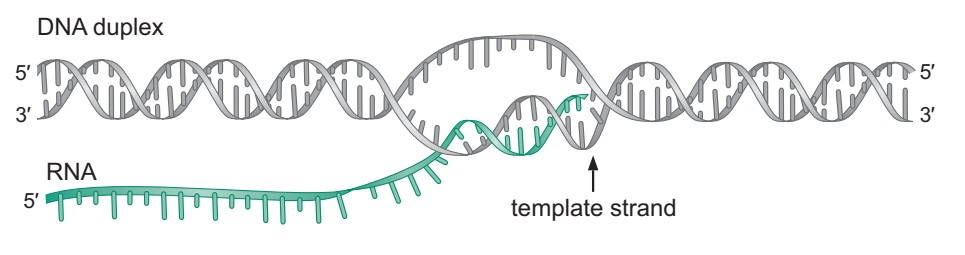{ width="680" }
/// caption
灰色为DNA，绿色为RNA，图中转录向右进行。RNA的5′端先离开，仍在增长的3′端位于右侧。Watson等，图13–1。[^watson-transcription]
///

在典型多亚基聚合酶的延伸复合物中，DNA解开的**转录泡**通常覆盖约12–14 bp的DNA区段，其中RNA与DNA真正配对的**杂合区**通常只有8–9个碱基对。泡中还有没有与RNA配对的单链DNA，因此这两个长度不能混用。酶向前一步，前端再打开，后端再闭合，转录泡便随之移动。[^transcription-bubble-size]

对一个转录单位而言，被读取的DNA链叫**模板链**，另一条叫**编码链**。如果把新生RNA和编码链都按5′→3′写出，二者序列对应，只是RNA用U取代T。启动子给定了这个局部的方向：相邻基因可以朝相反方向转录，同一条染色体链在这里是模板链，到了另一个基因处便可能是编码链。

!!! info "以转录起点为坐标"

    第一个被转录的核苷酸记为 **+1**；沿转录方向往前是下游，往后是上游。上游位置用负数，下游用正数，通常不设0位。因此，−10元件位于起点上游，+20位置已经处于转录区。

    启动子是帮助起始机器定位的DNA序列区域，其范围不必全部位于+1之前。后面会看到，Pol III识别的一些启动子元件就在要被转录的序列内部。

### 第一个键与后续延长

RNA聚合酶能够**从头起始**。它先在起点附近定位最初的两个NTP，让第一个NTP的3′-OH进攻第二个NTP的α-磷酸，形成第一个磷酸二酯键。此后，同一种化学反应不断发生在RNA末端：

$$
\mathrm{RNA}_{n}\text{–}3^{\prime}\mathrm{OH}+\mathrm{NTP}
\longrightarrow\mathrm{RNA}_{n+1}+\mathrm{PP_i}
$$

进入的NTP失去β、γ两个磷酸，成为链内的核苷酸残基；最初那个NTP的5′端则可保留三磷酸。许多细菌转录本以A或G起始，但具体选择受启动子、模板和NTP浓度影响。后来加帽、去磷酸或核酸酶切割，又会改变RNA的末端状态。[^watson-transcription]

成键反应依靠活性中心的Mg²⁺等二价金属离子协同定位反应基团、促进亲核进攻并稳定电荷。在细菌、古菌和真核细胞核的多亚基酶中，**桥螺旋（bridge helix）**与**触发环（trigger loop）**还随底物结合发生构象变化。正确碱基配对、核糖2′-OH的识别和活性中心闭合共同提高选择性，使酶优先使用合适的NTP。[^multisubunit-rnap]

长距离转录还会扭动DNA。在聚合酶和DNA不能自由旋转的条件下，酶前方容易积累正超螺旋，后方容易积累负超螺旋。拓扑异构酶通过暂时切开并重接DNA释放应力，染色质和相邻转录活动也会改变局部状态；相关量的定义见[DNA拓扑与超螺旋](../biochem/nucleic_acid.md#dna-topology-supercoiling)。

## 三域聚合酶与转录周期 { #rnap-across-domains }

细菌、古菌和真核细胞核的RNA聚合酶有共同的进化来源。它们的亚基数目不同，却都形成夹持核酸的中央裂隙，同源的两大催化亚基在裂隙深处组成活性中心。把细菌核心酶和酵母Pol II放在一起，便能看到这种相似性。[^multisubunit-rnap]

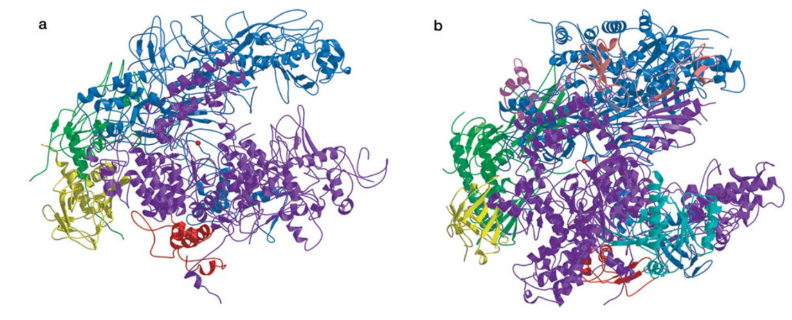{ width="740" loading=lazy }
/// caption
左为水生栖热菌核心酶，右为酵母Pol II；对应亚基采用相同颜色，红色小球标出活性中心Mg²⁺。教材据Darst提供的细菌结构与Cramer等的Pol II结构整理，图13–2。[^watson-transcription]
///

细菌通常用一套核心酶转录各类RNA，再更换σ因子选择不同启动子。古菌也主要使用一套多亚基酶，其起始因子更接近真核系统。真核细胞核则分化出Pol I、Pol II和Pol III，把不同RNA基因交给各自的起始装置识别。

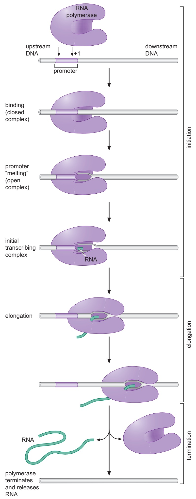{ width="290" loading=lazy }
/// caption
启动、延伸和终止的共同过程。此图省略了各类酶所需的辅助因子。Watson等，图13–3。[^watson-transcription]
///

**起始**时，聚合酶和起始因子识别启动子，局部打开DNA，把模板放入活性中心。这里同时决定起点与方向。

**延伸**时，酶逐个加入核苷酸。DNA、RNA和蛋白之间的接触足以保持稳定，又能在每次移位时重排，让酶连续合成长RNA。

**终止**时，原本稳定的RNA–DNA–蛋白复合物被拆开。RNA释放与聚合酶离开模板相互关联，但在某些系统中，RNA末端的切割加工会先发生。

下文出现的“闭合复合物”“开放复合物”，分别描述起始区DNA仍为双链，或已经局部打开的状态；“起始”包含了这些状态之间的转变。

!!! note "还有其他合成RNA的酶"

    噬菌体T7、线粒体和部分质体使用另一支**单亚基RNA聚合酶**，其构架与上述多亚基酶不同。它们仍可利用DNA模板合成RNA。

    **多聚核苷酸磷酸化酶（PNPase）**在细胞内主要参与RNA的磷酸解和代谢；反向反应可在体外以NDP为底物、无需模板地延长RNA。它的发现对早期RNA研究很重要，但这种非模板聚合不能承担从基因序列读取信息的转录。[^weaver-transcription]

## 细菌怎样选择并离开启动子 { #bacterial-initiation }

### σ因子与启动子元件

典型细菌核心酶由 **α₂ββ′ω** 组成。β与β′形成催化裂隙；两个α亚基的N端结构域帮助装配，C端结构域可以伸向启动子上游，接触DNA或调控蛋白；ω帮助核心酶装配和稳定。核心酶结合σ因子后成为**全酶（holoenzyme）**，才具有高效识别特定启动子集合的能力。[^bacterial-initiation]

以大肠杆菌σ⁷⁰为例，许多启动子有−35和−10两段元件，常见共识序列分别为 **TTGACA** 和 **TATAAT**。两段之间常隔约17 bp。σ的不同区域接触这两处序列，把起点附近的DNA按合适方向放到聚合酶上；富AT的上游UP元件还能由α亚基C端识别。

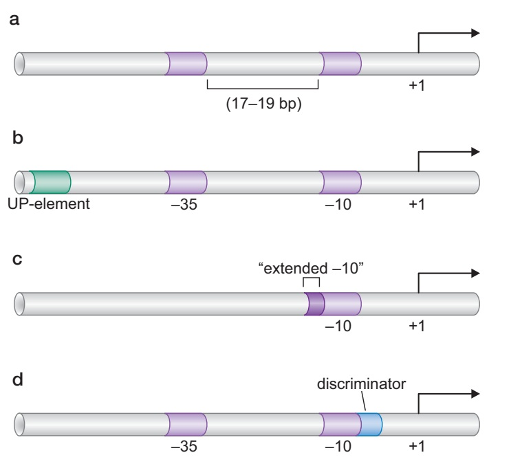{ width="450" loading=lazy }
/// caption
σ⁷⁰类启动子的几种构成。不同启动子可依靠不同接触组合，图中的各类元件不必同时出现于同一启动子。Watson等，图13–5。[^watson-transcription]
///

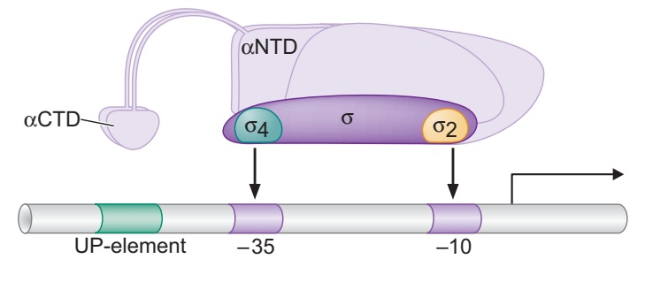{ width="460" loading=lazy }
/// caption
σ₄接触−35区，σ₂接触−10区；α-CTD通过柔性连接区接触更上游的DNA。Watson等，图13–7。[^watson-transcription]
///

???+ abstract "共识序列是怎样读出来的"

    把许多已确认的启动子按起点与相应元件对齐，再统计每个位置A、T、G、C的频率，就能得到共识。下图整理了约300个大肠杆菌启动子的频率；在某些位置，最常见碱基占明显优势，其他位置则分散得多。

    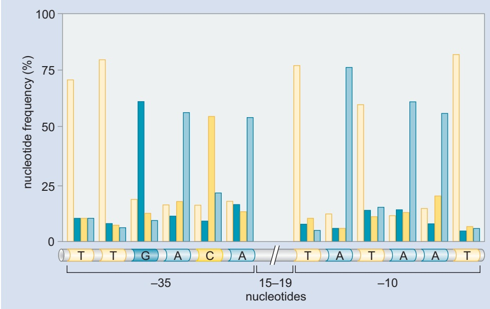{ width="620" loading=lazy }
    /// caption
    横轴为两个元件内的位置，纵轴为碱基出现频率；中间省略间隔区。Watson等，Box 13–1图1，转引Alberts等的统计图。[^watson-transcription]
    ///

    写成TTGACA或TATAAT，读起来很利落，却把图中那些低一些的柱子藏掉了。实际启动子允许变异，也可以用其他元件补偿较弱的接触。启动子“强”通常指在给定条件下起始较频繁，还取决于结合、开链、逃逸和调控蛋白等步骤，不能由它与共识的相似程度单独算出。

更换σ因子可以把同一核心酶重新分配给另一组基因。大肠杆菌σ³²参与热休克应答，σ²⁸参与鞭毛等运动相关基因的表达，σ⁵⁴则参与包括氮同化在内的特定调控程序。

### DNA开链与最初的短RNA

全酶先结合双链启动子，形成**闭合复合物**；随后起点附近DNA打开，形成**开放复合物**。σ⁷⁰类体系中，σ₂可以稳定已经从双链翻出的非模板链碱基。下图以−10元件为例：−11位A和−7位T进入蛋白表面的结合口袋，原来和它们配对的模板链便获得进入活性中心的机会。[^bacterial-initiation]

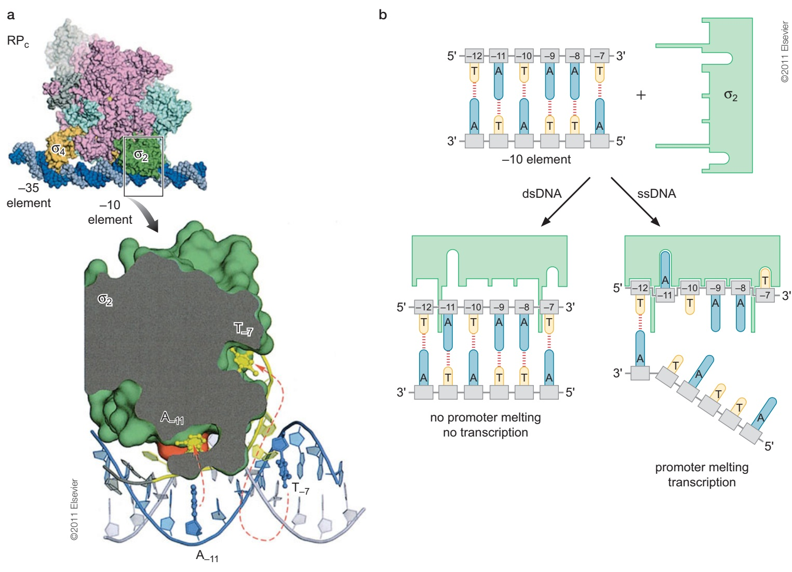{ width="760" loading=lazy }
/// caption
左为σ₂与单链−10区的结构关系，右为碱基翻出与口袋结合的解释图。Watson等，图13–8；据Feklistov与Darst、Liu等2011年的结构研究与图解整理。[^watson-transcription]
///

σ⁷⁰体系的这一步通常不需要额外水解ATP来开链，蛋白–DNA结合与构象变化可推动转变。**σ⁵⁴是一个值得记住的不同例子**：它常稳定在关闭状态，需要NtrC一类ATP酶激活因子用ATP水解驱动重排，才容易形成可起始的开放复合物。[^sigma54-activation]

最初的RNA很短，与模板的配对也少，复合物还抓着启动子。聚合酶可以在不整体离开原位的情况下，把更多下游DNA拉入内部，让解开的DNA积在酶中。这叫**DNA挤缩（DNA scrunching）**。在这个阶段，酶可能反复合成、释放几个核苷酸长的短RNA，即**流产起始（abortive initiation）**。

RNA继续长大后，原有的空间和接触逐渐容不下它：σ的部分区域需要挪开，RNA出口重新安排，启动子接触也被打破。聚合酶完成**启动子逃逸（promoter escape）**，进入稳定延伸。σ与核心酶的接触随之重排，但并非每个σ都立即脱离；一些复合物会把σ保留到延伸阶段，并在特定序列发生σ依赖的暂停。[^bacterial-initiation]

???+ abstract "聚合酶没离开启动子，RNA怎么已经长了？"

    Kapanidis等把荧光染料分别标在大肠杆菌σ⁷⁰全酶和lacCONS启动子的特定位置，用单分子FRET比较开放复合物与初始转录复合物。实验先加入起始二核苷酸ApA，再加入UTP、GTP，使RNA最长只能延伸到7 nt，便于把观察限制在启动子逃逸之前。[^scrunching-experiment]

    对这组染料而言，FRET增强通常对应间距缩短。先看下图A：酶的前缘与下游DNA之间，主要分布峰向较高FRET移动；再看B：酶后缘与上游DNA之间，距离基本不变。酶已经读入了更多模板，上游接触却仍留在原处。

    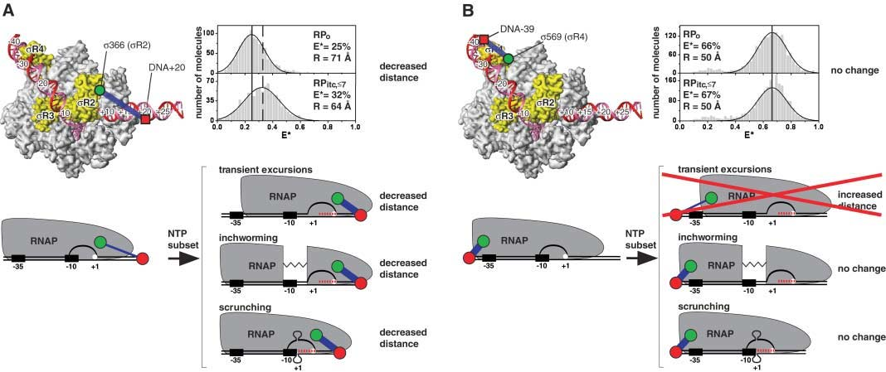{ width="800" loading=lazy }
    /// caption
    A标记σ的366位与DNA +20位，B标记σ的569位与DNA −39位。RPo为开放复合物，RPitc≤7为受限的初始转录复合物；下方画出不同模型的预测。Kapanidis等2006，Fig. 2。[^scrunching-experiment]
    ///

    再把两个染料都放到DNA上，分别位于−15和+15处。初始转录时，这两段DNA之间的FRET也增强，推算距离由约76 Å缩到72 Å。结合酶内其他测距结果，研究者支持DNA被拉入聚合酶、在内部挤缩的模型。

    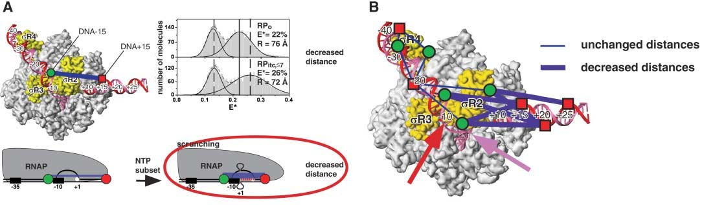{ width="800" loading=lazy }
    /// caption
    A为DNA–DNA测距，B汇总保持不变或缩短的距离。A中低FRET小峰主要来自游离DNA；B的DNA路径是解释模型。Kapanidis等2006，Fig. 4。[^scrunching-experiment]
    ///

    这些分布来自许多单分子的测量，给出的是距离变化的证据，并非一台聚合酶活动的连续录像。RNA继续长大后，挤缩的DNA与增长中的RNA可以共同促使接触重排，最终进入逃逸。

## 延伸、回退与相邻反应 { #elongation-coupling }

### 活性中心怎样往前一步

延伸时，刚加完一个核苷酸后，聚合酶需要相对RNA–DNA杂合区向前移位一个核苷酸，使下一处模板碱基进入加料位置。下图中，a为尚未移位的状态，b为已经前移，c为新的NTP进入。红箭头标的是酶内同一参照位置；观察绿色RNA的3′端相对它的位置，就能跟上这一步变化。[^watson-transcription]

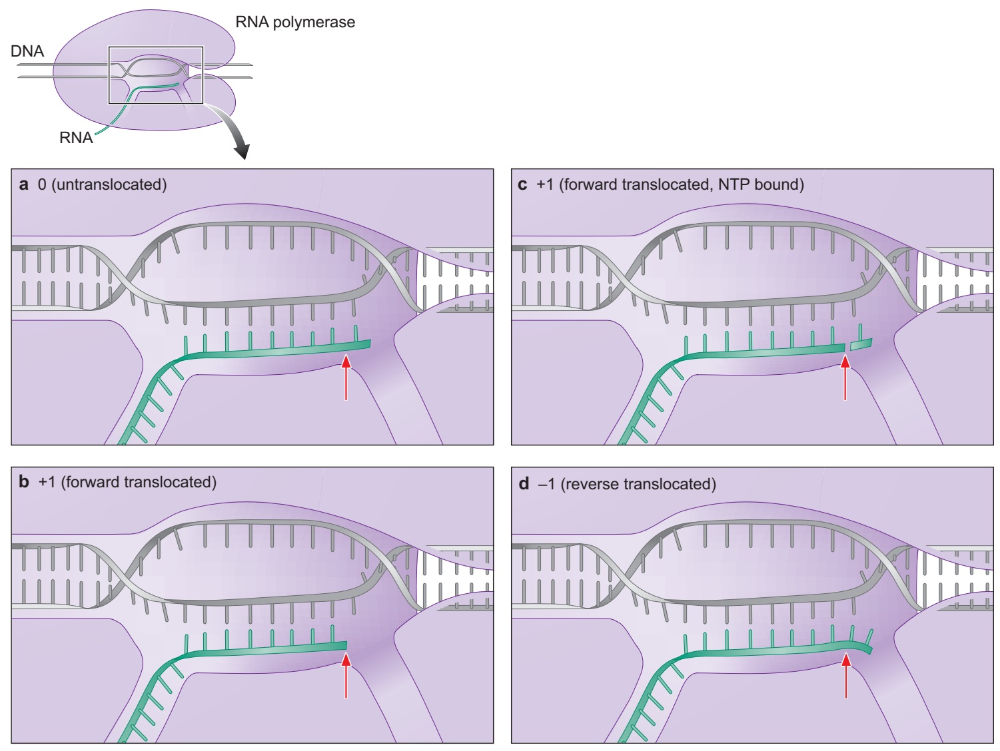{ width="760" loading=lazy }
/// caption
a→b→c表示正常延伸中的一段过程；d是回退的另一种状态，RNA末端已偏离可加料的位置，并非c之后必经的下一步。Watson等，图13–11，据Ebright图解。[^watson-transcription]
///

DNA序列、RNA发夹、NTP供应、DNA结合蛋白、核小体、扭转应力或损伤，都能让聚合酶减速或暂停。短暂停顿可以留出RNA折叠、因子结合的时间；若复合物沿模板反向移动，即发生**回退（backtracking）**，RNA的3′端会从活性中心偏出，甚至进入次级通道，暂时不能接受下一个NTP。[^transcription-elongation]

恢复延伸有几种可能：复合物重新向前移动，使末端回到原位；或者聚合酶切掉伸出的RNA，暴露一个位置合适的新3′-OH。细菌Gre、古菌TFS和真核TFIIS可促进这种转录本切割。它们帮助停滞复合物恢复，但无辅助因子时，聚合酶也具有一定的内在切割活性。

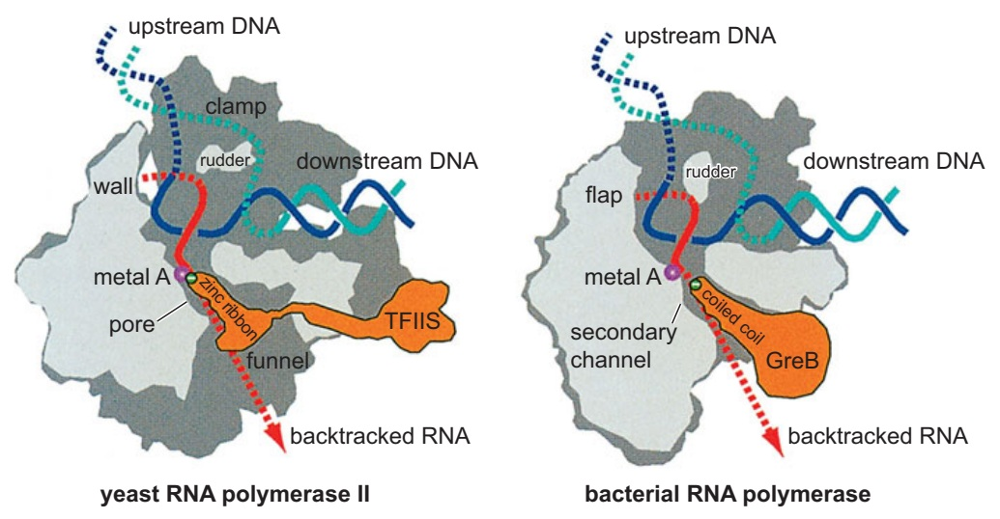{ width="710" loading=lazy }
/// caption
TFIIS与GreB都从次级通道接近催化中心，促进RNA切割；图中虚线表示推测的回退RNA位置。两者功能相似，并不据此判定为同源蛋白。Watson等，图13–22，据Conaway等图解。[^watson-transcription]
///

错配常使延伸变慢，也更容易触发回退与切割，因此这条路线还参与转录校正。转录错误可能影响这一次产生的RNA及其翻译产物，通常不会把错误写回DNA。它与DNA复制校对所保护的遗传信息处在不同层次。

### RNA还没写完，翻译和修复已经接上

细菌没有核膜隔开转录与翻译。只要新生mRNA的核糖体结合区已经露出，核糖体就可能开始翻译，跟在聚合酶后方前进。领先核糖体可遮住Rho的RNA结合区，阻止部分RNA结构形成，也可能推动回退的聚合酶。

一些转录–翻译复合物中，NusG的一端接触RNA聚合酶，另一端接触核糖体蛋白uS10，成为两者之间的连接；NusA又能改变这些接触与整体构象。这样的复合物称为**expressome**。它的紧密程度取决于物种、基因和生理状态，枯草芽孢杆菌等系统中的聚合酶可以明显领先核糖体。空间上允许同时发生，并不保证每次都锁在同一个复合物中。[^transcription-translation-coupling]

若模板链上有体积较大的DNA损伤，聚合酶可能在损伤处停滞。细菌Mfd作用于停滞复合物，能推动、移走聚合酶，并与UvrA参与的修复装置衔接；哺乳动物则由CSB、CSA、UVSSA等组织Pol II停滞后的响应。这个入口使正在转录的模板链优先接受**转录偶联核苷酸切除修复**。两类细胞采用的装置并非简单一一同源，后续双侧切割与补回DNA的过程见[核苷酸切除修复](dna_repair.md#nucleotide-excision-repair)。[^transcription-coupled-repair]

## 细菌转录的两类终止方式 { #bacterial-termination }

### 发夹与富U序列

一条RNA要在合适处结束，必须拆开已经相当稳定的延伸复合物。典型的细菌**内在终止（intrinsic termination）**利用新生RNA本身的结构：RNA先出现能形成稳定茎环的倒置重复，后面紧接一段富U序列。

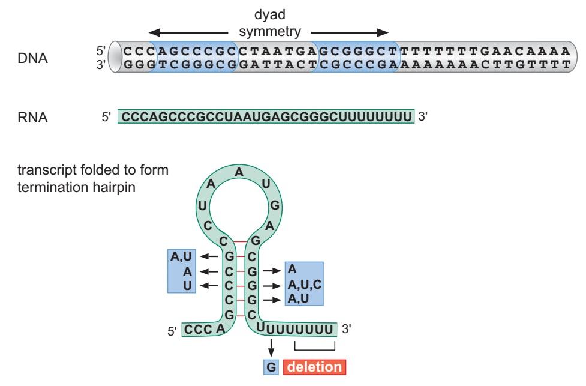{ width="460" loading=lazy }
/// caption
以色氨酸操纵子衰减子为例：RNA的两段互补序列折成茎，随后是U区。图旁标出的替换或缺失会扰乱终止。Watson等，图13–13，据Yanofsky1981年图版整理。[^watson-transcription]
///

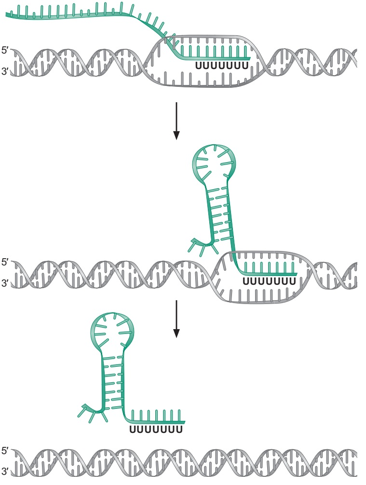{ width="330" loading=lazy }
/// caption
发夹形成和RNA释放的简化模型。这里省略了聚合酶及其接触变化。Watson等，图13–14。[^watson-transcription]
///

聚合酶在终止区暂停时，RNA出口附近的两段互补序列有时间配对。发夹形成会扰动RNA与酶的接触，而此时活性中心附近的rU–dA杂合区较易分离；这些变化共同促成RNA释放。NusA、发夹长度、U区构成以及邻近序列都会改变终止效率，因此需要把发夹、杂合区和暂停放在同一个复合物中理解。[^bacterial-termination]

### Rho沿RNA促进终止

另一类终止需要蛋白因子**Rho**。它由六个亚基组成，能够结合暴露的新生RNA，利用ATP水解沿RNA按5′→3′方向易位。适合装载的rut区域往往较少形成稳定二级结构，且常富C；正在翻译的核糖体会遮住这些RNA，降低Rho利用它们的机会。

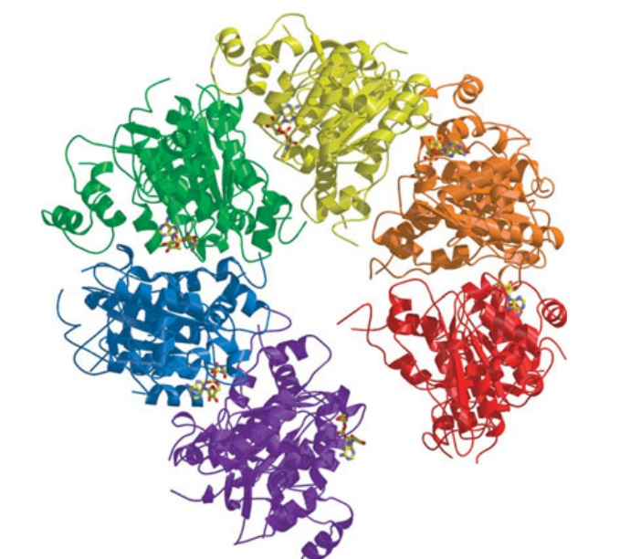{ width="370" loading=lazy }
/// caption
Rho的开环结构，每种颜色表示一个亚基；此结构图没有显示RNA。Watson等，图13–12，据Skordalakes与Berger2003年的结构。[^watson-transcription]
///

经典模型中，Rho沿RNA追上暂停的聚合酶，促使延伸复合物解体。Rho还可以预先与转录机器接触，因此实际终止不必都从一个游离的Rho“追逐”开始。

它可通过与聚合酶的接触、构象变化和对RNA–DNA杂合区的作用促成终止。于是，一段迟迟没有被翻译、已经失去正常核糖体保护的RNA，更容易进入这条路线。Rho也帮助限制异常或外源DNA的转录。[^bacterial-termination]

两类终止机制的效率都会受到序列与因子浓度影响，同一条转录本上的翻译状态也能改变它最终在哪里结束。

## 古菌的起始与终止 { #archaeal-transcription }

古菌通常使用一套由约11–13个亚基组成的RNA聚合酶，其核心结构更接近真核Pol II。起始时，**TBP**结合启动子的TATA元件，**TFB**接触邻近BRE并帮助定位聚合酶，**TFE**可稳定开链状态。这里已经能看到后面真核通用因子的亲缘关系。[^archaeal-transcription]

进入延伸后，Spt4/5帮助稳定延伸复合物，TFS促进回退RNA的切割。在古菌Saccharolobus solfataricus中，染色质免疫沉淀测序还显示Spt4/5与Elf1在起始后依次招募，随转录机器分布在基因上。[^archaeal-elf1]古菌组蛋白或其他染色质蛋白也会改变DNA可及性与聚合酶通行；同时，古菌没有核膜，转录和翻译可以发生功能耦联。

许多古菌聚合酶在非模板链短串T所对应的富U RNA处终止，通常不要求先形成细菌式的上游发夹。部分谱系还利用aCPSF1／FttA一类核酸酶切割新生RNA，促进因子依赖的终止。

## 真核细胞核的三种聚合酶 { #nuclear-rna-polymerases }

### RNA产物的分工

真核细胞核的Pol I、Pol II和Pol III来自共同祖先，各自带有专门的亚基和起始装置。先看常见产物，随后再看怎样通过实验把这些分工辨认出来。[^eukaryotic-rnap-division]

| 聚合酶 | 主要产物 | 读这些名称时需要的条件 |
| --- | --- | --- |
| Pol I | 大rRNA前体 | 哺乳动物前体含18S、5.8S、28S rRNA；人类初级47S经早期加工形成45S，5S另行转录 |
| Pol II | 绝大多数pre-mRNA，多类长非编码RNA、miRNA前体及部分snRNA、snoRNA | 同一个长转录本可经加工产生多个成熟RNA，不能把成熟RNA名称当成独立转录单位 |
| Pol III | tRNA、5S rRNA、U6 snRNA、7SL、7SK、RNase P RNA等较短RNA | 具体基因与谱系有例外；例如端粒酶RNA的聚合酶归属不能跨物种一概而论 |

snRNA、snoRNA、miRNA、piRNA、lncRNA、tmRNA、gRNA和端粒酶RNA等名称，有的依功能命名，有的依长度或位置命名；有些来自更长前体的加工。它们的成熟路线见[RNA转录后加工](rna_processing.md)。

**布氏锥虫提供了一个很醒目的例外**：Pol I除了转录rRNA，还转录VSG表达位点和procyclin基因，参与生成编码表面蛋白的RNA。它们后来通过反式剪接等加工获得成熟mRNA的结构。这也提醒我们，编号说明的是酶的亲缘与构架，分工仍要在具体生物中验证。[^trypanosome-pol-i]

???+ abstract "怎样把Pol III与tRNA、5S rRNA联系起来"

    分离出三种聚合酶活性以后，还要知道它们在细胞核里各自合成什么。Weinmann与Roeder利用α-鹅膏蕈碱（α-amanitin）提供了一种对应办法：先比较纯化酶的药物敏感性，再看核内特定RNA的合成在哪个浓度范围受到抑制。[^amanitin-experiment]

    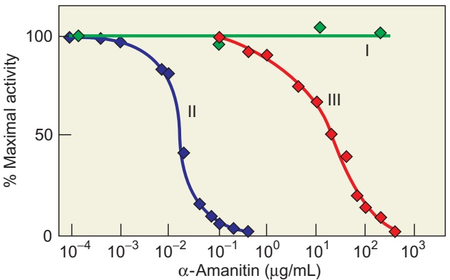{ width="560" loading=lazy }
    /// caption
    横轴为α-鹅膏蕈碱浓度，采用对数刻度，单位µg/mL；纵轴为相对聚合活性。此制备中，Pol II在远低于Pol III的浓度下受到抑制。Weaver，图10.4，据Weinmann与Roeder1974年结果改绘。[^weaver-transcription][^amanitin-experiment]
    ///

    接着，研究者让小鼠骨髓瘤细胞的分离细胞核在不同药物浓度下合成带放射性标记的RNA，收集释放到上清中的小RNA，用聚丙烯酰胺凝胶分离。凝胶再被切成连续薄片，逐片计数放射性；相邻泳道的标记RNA帮助确定5S与4S附近的位置。

    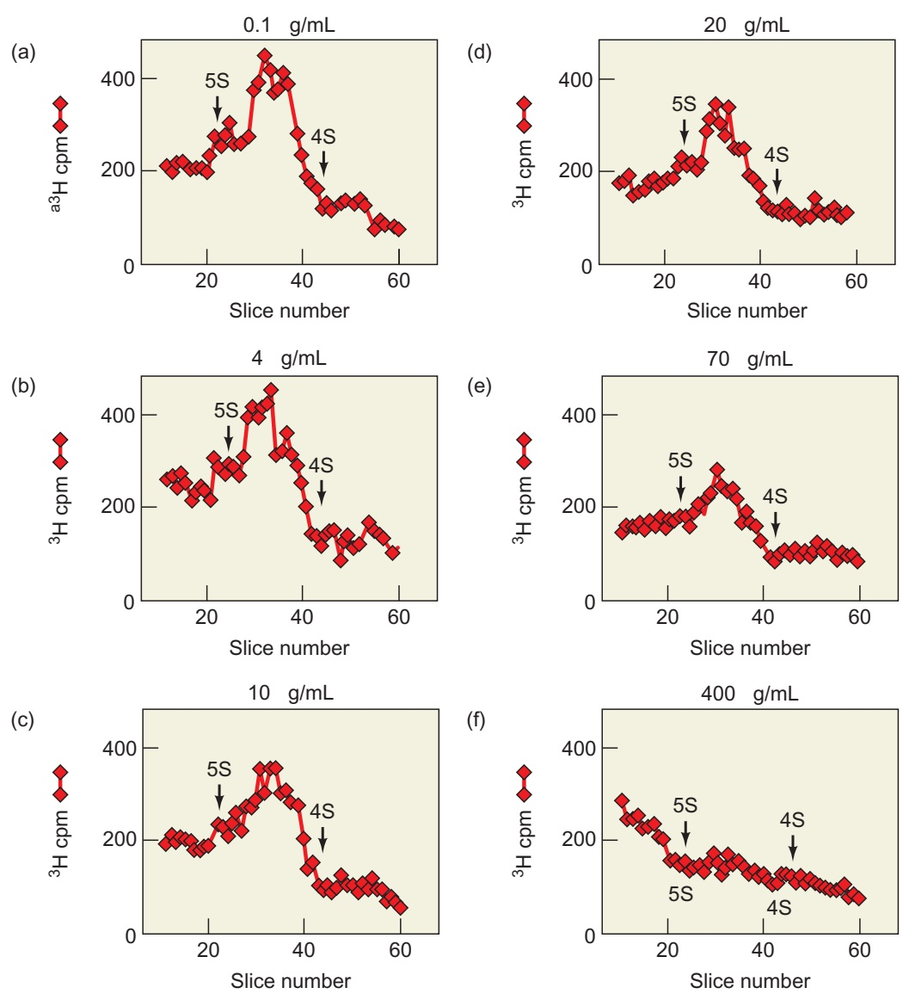{ width="650" loading=lazy }
    /// caption
    a–f分别为0.1、4、10、20、70、400 **µg/mL**；教材图内部分µ字形缺失，所有面板均按此单位读取。横轴是凝胶切片号，纵轴为放射性计数；4S附近包括tRNA前体。Weaver，图10.5，据Weinmann与Roeder1974年结果整理。[^weaver-transcription][^amanitin-experiment]
    ///

    在已经足以强烈抑制Pol II的低剂量下，这些小RNA仍能合成；到更高、接近抑制Pol III的浓度时，5S与前体4S RNA的信号才明显下降。两组敏感性相互吻合，支持Pol III承担这些RNA的转录。这里测的是指定体系内的新生RNA，不能把剂量表直接搬到另一物种或完整细胞中。

### Pol I与Pol III怎样定位起点

哺乳动物Pol I启动子通常可分为起点附近的核心区和更上游的UCE。含有TBP的SL1复合物识别核心区，UBF改变DNA构象并参与建立活跃复合物，RRN3则帮助把可起始的Pol I带到这里。UBF也影响启动子逃逸等后续步骤。SL1对rDNA启动子具有物种选择性，例如人和小鼠的SL1不能简单互换来支持对方启动子的转录。[^pol-i-pol-iii]

Pol III的部分启动子位于转录区内部。以tRNA基因为例，内部A、B box由TFIIIC识别，再把含TBP的TFIIIB定位到起点上游，随后招募Pol III。A、B box分别位于编码tRNA的D臂和TΨC臂相关区段；同一段DNA因而同时受到启动子识别和RNA结构的约束。

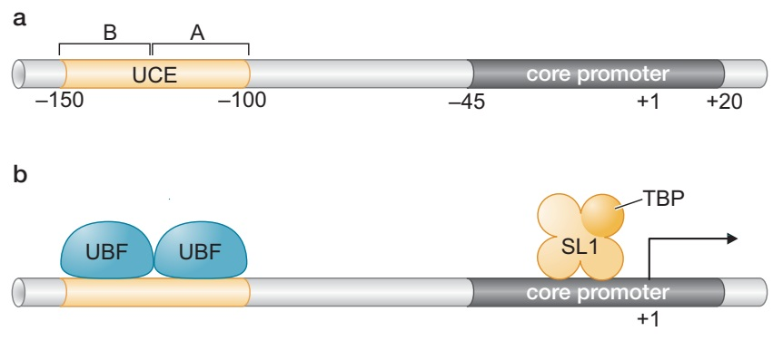{ width="470" loading=lazy }
/// caption
人类Pol I启动子的示意位置；SL1中含TBP，图未画出全部招募因子。Watson等，图13–27。[^watson-transcription]
///

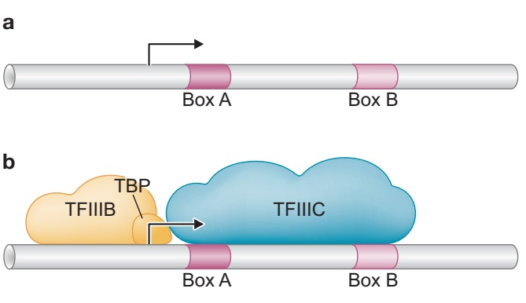{ width="470" loading=lazy }
/// caption
Pol III的tRNA基因启动子。上图示内部元件，下图示起始因子的空间关系。Watson等，图13–28。[^watson-transcription]
///

Pol III还有其他起始架构。5S rRNA基因先由TFIIIA识别内部控制区，再组装TFIIIC、TFIIIB；U6等第三类启动子的主要元件则位于转录区上游。三种核内聚合酶都能用到TBP，却把它放入了不同的复合物。[^pol-i-pol-iii]

!!! note "植物的Pol IV和Pol V"

    陆生植物还从Pol II谱系分化出Pol IV和Pol V。Pol IV参与生成RNA引导DNA甲基化所需的小RNA前体，Pol V生成帮助定位沉默复合物的RNA。它们在沉默通路中承担专门工作，Pol I–III仍继续完成通常的RNA合成。[^weaver-transcription]

## Pol II的启动子识别与开链 { #pol-ii-initiation }

### 核心启动子与预起始复合物

Pol II的核心启动子可组合TATA box、起始子Inr、TFIIB识别元件BRE、下游元件DPE等。每种元件为特定因子提供接触机会，但不存在一个被所有Pol II启动子共同保留的元件。下图把多种已知元件放在一条坐标轴上，方便比较位置；一个实际启动子通常只采用其中一部分。[^pol-ii-initiation]

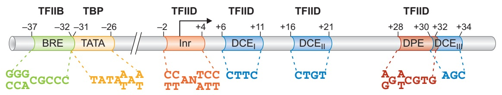{ width="760" loading=lazy }
/// caption
TATA、Inr、BRE与多种下游元件的示意位置。图示元件组合与位置来自特定启动子研究，不能当作每个基因都具备的一条完整序列。Watson等，图13–15。[^watson-transcription]
///

核心启动子以外，近端GC盒和CCAAT盒等元件可结合调控蛋白。例如Sp1识别GC盒，影响起始机器的招募与活性；它与直接组织预起始复合物的核心元件承担不同层次的作用。[^weaver-transcription]

在经典含TATA启动子的体外组装中，**TFIID**先通过TBP与TAFs接触核心启动子；**TFIIA**帮助稳定结合，**TFIIB**把启动子与携带TFIIF的Pol II连接起来。随后TFIIE与TFIIH参与，形成**预起始复合物（preinitiation complex，PIC）**。这时，DNA、聚合酶和通用因子已经按起始需要排列好，但还需要开链和最初RNA的合成。

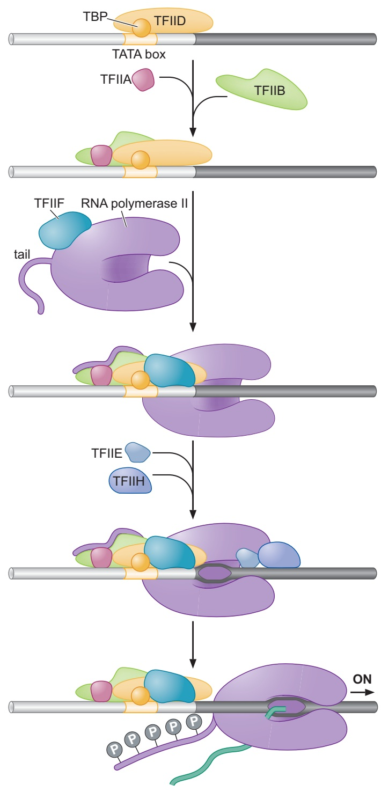{ width="340" loading=lazy }
/// caption
含TATA启动子上的一种体外组装路径，便于定位通用因子的作用。Watson等，图13–16。[^watson-transcription]
///

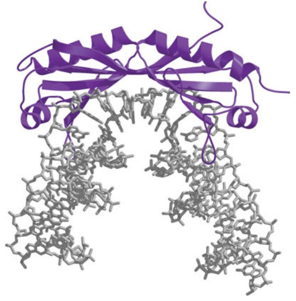{ width="370" loading=lazy }
/// caption
TBP结合DNA小沟，使DNA明显弯折。教材据Nikolov等的结构绘图，两侧延伸DNA为补建模型。Watson等，图13–17。[^watson-transcription]
///

TBP的名字是“TATA结合蛋白”，它与DNA的结合并非只是在序列上贴一个标记。蛋白使小沟张开、DNA弯曲，为其他因子的相对位置创造条件。

在无TATA启动子和细胞内染色质背景中，TAFs、其他识别因子以及预先结合的复合物会改变装配路径。“DABFEH”可以帮助回想经典重构顺序，但细胞不必每次都按这个字母队列逐一集合。

### 开链、CTD磷酸化与调控蛋白

TFIIH中有两项需要分开的活动。**XPB**利用ATP水解驱动下游DNA易位，帮助打开起点附近DNA；**CDK7**则属于激酶模块，磷酸化Pol II最大亚基RPB1的C端重复区，即**CTD（C-terminal domain）**。开链为合成提供模板，CTD修饰则改变后续因子的结合。[^pol-ii-initiation]

新生RNA增长后，需要越过TFIIB等起始接触，Pol II也逐步离开启动子。细胞内的起始效率还取决于DNA是否可接近，以及调控蛋白能否把合适的辅助因子带来。增强子结合蛋白可接触Mediator，Mediator再与Pol II起始机器相连；染色质重塑复合物和组蛋白乙酰转移酶等则改变核小体与DNA的可及性。

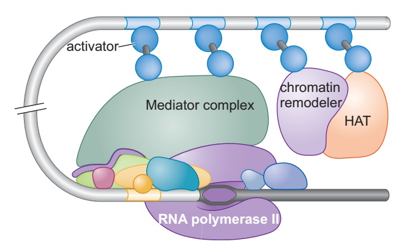{ width="550" loading=lazy }
/// caption
Mediator、染色质重塑因子与HAT参与起始的示意关系，DNA弯曲使远近因子可以接触。Watson等，图13–19。[^watson-transcription]
///

这样的接触可以提高复合物形成或进入后续步骤的概率。它们如何解释细胞类型差异和信号应答，见[转录因子的组合占位](gene_regulation/eukaryotic.md#transcription-factor-combinations)与[增强子–启动子通信](gene_regulation/eukaryotic.md#enhancer-promoter-communication)。

## Pol II延伸与RNA加工 { #pol-ii-elongation }

许多后生动物基因的Pol II离开起点后，会在启动子近端暂停。**DSIF**和**NELF**帮助稳定这一状态；**P-TEFb**等因子的磷酸化改变Pol II及暂停因子的接触，促使复合物进入持续延伸。已经起始的聚合酶因此仍可以受调控，细胞不必只在“是否结合启动子”这一步作选择。[^pol-ii-chromatin]

沿基因体前进时，Pol II面对的是缠绕在组蛋白上的DNA。核小体局部解开后，酶才能接近模板；FACT、Spt6、PAF1复合物、染色质重塑和组蛋白修饰系统帮助维持通行，并在酶后方恢复组蛋白–DNA组织。经过一次转录，核小体并不会普遍从整条基因上永久消失。

### CTD把加工因子带到新生RNA旁

CTD含有多份七肽重复，共识为 **YSPTSPS**，即Tyr–Ser–Pro–Thr–Ser–Pro–Ser。它从聚合酶伸出，靠近新生RNA出口；不同残基的磷酸化、去磷酸化及其他修饰，让沿途加工因子有机会结合。这里既有空间上的接近，也有随转录阶段变化的结合偏好。[^pol-ii-chromatin]

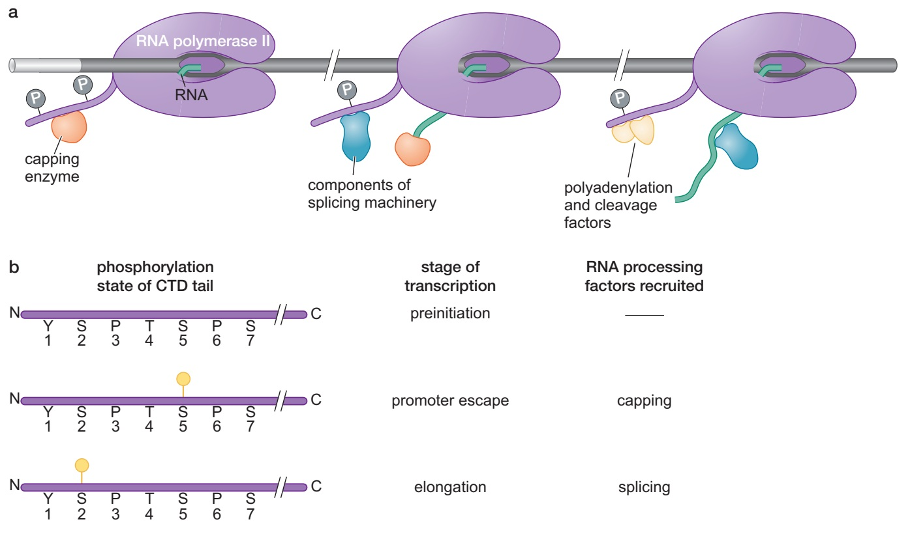{ width="760" loading=lazy }
/// caption
CTD与加工因子结合的简化图，下方突出Ser5、Ser2的阶段性变化。Watson等，图13–21。[^watson-transcription]
///

起始和早期延伸时，Ser5磷酸化较为突出，有助于招募5′加帽装置。RNA刚伸出几十个核苷酸，加帽已经可以开始。随后，Ser2磷酸化通常在基因体延伸及3′端加工阶段增加，参与组织相应的延伸和加工因子；剪接体也可以在内含子仍从聚合酶输出时装配。

图中把几个阶段画成容易区分的状态，实际CTD上并不是所有七肽同时切换。不同修饰的分布会重叠，加工因子也同时识别RNA和其他蛋白。转录速度、暂停及染色质改变了这些反应可用的时间窗口；共转录加工很普遍，但某些剪接或最终修剪仍会延续到聚合酶离开以后。加帽、剪接和末端反应的化学步骤见[RNA加工](rna_processing.md#eukaryotic-mrna-ends)。

## 真核转录怎样结束 { #eukaryotic-termination }

### Pol II的切割、加尾与终止

多数哺乳动物蛋白质编码基因的Pol II会先转录出加尾信号，例如AAUAAA及其周围序列。CPSF、CstF等结合新生RNA，**CPSF73**在下游切开RNA。此时产生了两个不同的末端：上游RNA得到将要加poly(A)的3′端；下游RNA则得到一个新的5′端，同时其3′端仍留在向前走的Pol II中。[^pol-ii-termination]

**XRN2**从下游RNA新暴露的5′端开始按5′→3′方向降解。随着Pol II减速、因子接触和构象变化，XRN2可以赶上转录复合物，参与促成终止。这就是“鱼雷（torpedo）”模型的核心。另一些变化降低了延伸复合物的稳定性，通常归入变构模型；两者可以共同作用。

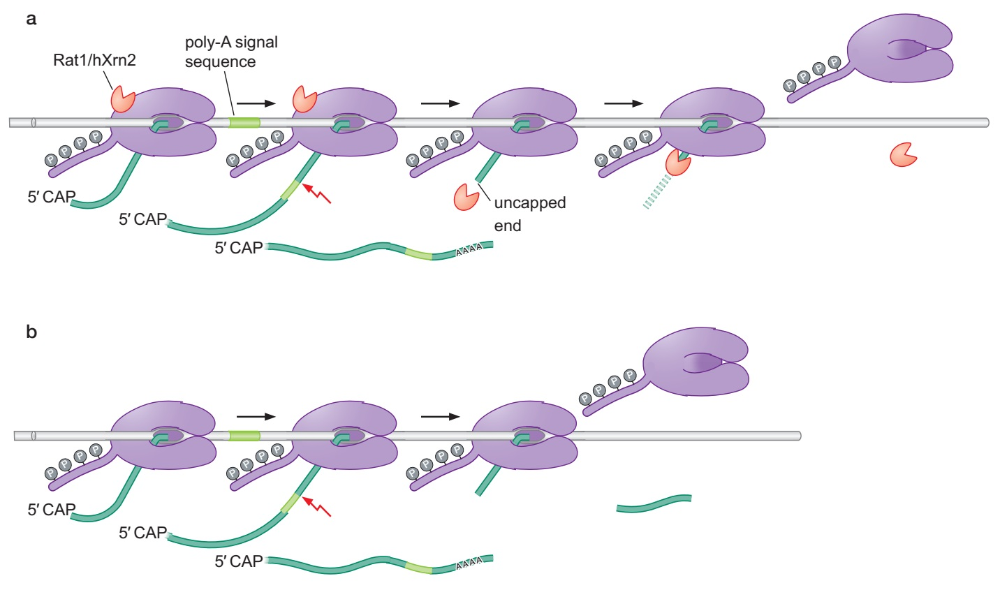{ width="760" loading=lazy }
/// caption
上方为鱼雷模型，下方为变构模型的历史图解。上图可先找出RNA切口，再跟踪下游无帽RNA与Xrn2／Rat1；两套变化并不互相排斥。Watson等，图13–26，据Luo与Bentley2004年图解。[^watson-transcription][^pol-ii-termination]
///

!!! tip "三个不同的位置或事件"

    **加尾信号**是加工装置识别的RNA序列；**切割位点**决定上游RNA的末端；**终止区**是Pol II最终停止并离开DNA的位置。聚合酶往往已经越过切割位点一段距离，RNA末端加工才与终止共同完成。

    poly(A)由加工酶添加，不是Pol II沿着DNA模板抄出的一串A。复制依赖型组蛋白mRNA、snRNA等Pol II产物使用不同的3′端形成装置，不能一律套用上述加尾路线。

???+ abstract "切开RNA以后，聚合酶还会走多远"

    Eaton等在人HCT116细胞中给XRN2加上可诱导降解的AID标签，加入auxin 2 h后观察新生转录。mNET-seq捕获仍与Pol II相连的RNA 3′端，因此能显示聚合酶在基因末端及其下游的分布。[^eaton-termination]

    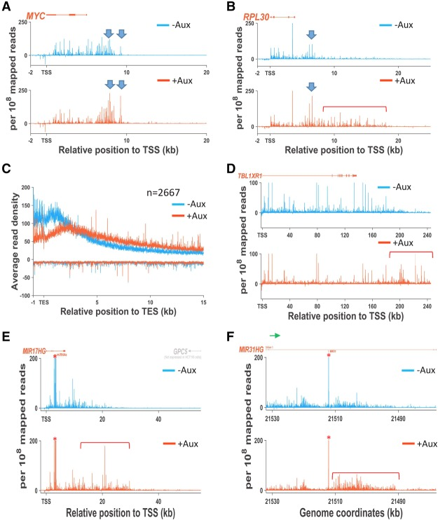{ width="625" loading=lazy }
    /// caption
    蓝色−Aux为对照，橙色+Aux为XRN2耗竭；A、B为MYC与RPL30，C把2,667个基因按转录末端TES对齐，D–F展示其他位点。Eaton等2018，Fig. 3。[^eaton-termination]
    ///

    先看A、B的基因末端：耗竭XRN2后，下游橙色信号拖得更远；C显示这一趋势不限于一个基因。它支持XRN2帮助聚合酶及时终止。纵轴为归一化读段丰度，不能读成成熟mRNA的总量；部分尖峰还可能来自RNA加工切口。

    同一研究用另一种标签处理CPSF73：DHFR不稳定标签在TMP存在时受到保护，撤去TMP后，CPSF73逐渐减少。这样可以接着检验，在鱼雷开始追赶之前，RNA切割这一步出了问题会怎样。

    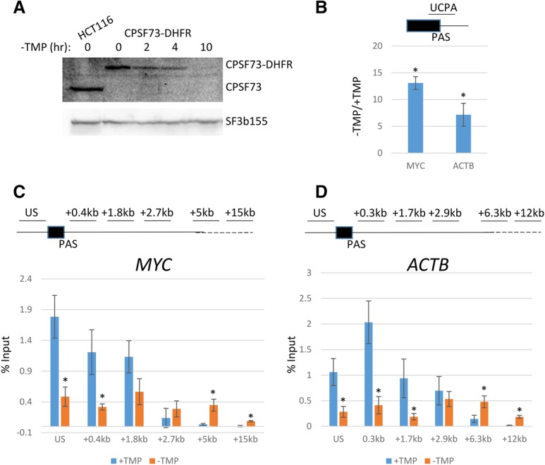{ width="773" loading=lazy }
    /// caption
    A为撤TMP后0、2、4、10 h的蛋白变化；B用RT-qPCR测跨越未切开加尾位点的RNA（UCPA）；C、D用Pol II ChIP比较MYC、ACTB末端各位置。蓝色+TMP为对照，橙色−TMP为耗竭；其余比较采用撤药10 h。Eaton等2018，Fig. 5。[^eaton-termination]
    ///

    B中未切开位点的RNA增加，C、D中较远下游位置的Pol II占据增加，把“切割受损”与“未能及时终止”联系起来。两种耗竭系统的标签和处理时间不同，不能把这两张图当成同条件下谁作用更强的比较；其中CPSF73催化活性本身的必要性，还要结合论文的活性位点突变回补实验判断。

### Pol I与Pol III的终止

哺乳动物Pol I可以由TTF-I结合rDNA终止区，协同后续转录本释放与酶回收；不同物种采用的终止因子差异较大。Pol III则能识别非模板链的短串T，在相应RNA的富U末端暂停并释放，通常不需要细菌内在终止子那样的上游GC发夹。[^pol-i-pol-iii]

## 线粒体与质体的转录 { #organelle-transcription }

### 线粒体的单亚基聚合酶

哺乳动物线粒体采用噬菌体型单亚基聚合酶 **POLRMT**。它与细胞核Pol I–III的亲缘关系不同，所需的起始因子也随之改变。**TFAM**结合并弯曲启动子DNA，帮助聚合酶定位；**TFB2M**帮助打开并稳定起始区，**TEFM**则提高进入延伸后的过程性，使聚合酶更容易完成长转录本。[^mitochondrial-transcription]

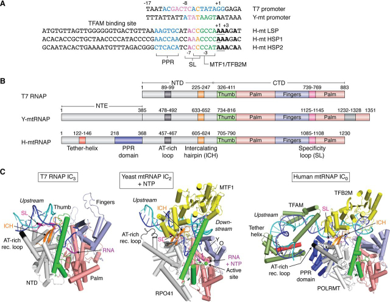{ width="640" loading=lazy }
/// caption
A比较启动子序列，B比较结构域，C比较起始复合物。T7、酵母线粒体、人线粒体分别含3 bp RNA–DNA、2 bp RNA–DNA加下一NTP、无NTP的复合物，不能读成同一反应的三个连续时刻。Basu等2020，Fig. 2。[^mitochondrial-transcription]
///

先看C右侧的人线粒体复合物：TFAM位于弯曲的上游DNA处，TFB2M靠近开链区，POLRMT包围模板与活性中心。再与左侧T7比较，核心聚合酶仍保留同一家族的构架，线粒体系统却增加了帮助识别和稳定启动复合物的因子。

线粒体DNA两条链的启动可以产生长的多顺反子前体，再经切割释放rRNA、tRNA和mRNA。部分从轻链启动子LSP产生的短RNA还能成为线粒体DNA复制的引物：同一种RNA合成反应，在不同停留位置和加工条件下，接到了不同用途。哺乳动物的HSP／LSP及其因子组合不能直接当成所有真核线粒体的统一布局。

### 质体的两类酶

陆生植物质体同时采用两种来源不同的装置：**PEP**是质体编码的细菌型多亚基核心酶，σ因子和多种伴随蛋白由细胞核编码；**NEP**是细胞核编码的噬菌体型单亚基酶，合成后被输入质体。[^plastid-transcription]

两者转录的基因有重叠，贡献随质体发育与环境变化。比如，一个基因可以具有分别被两类酶识别的启动子，细胞便能在不同阶段改变使用比例。PEP与光合相关基因表达关系密切，NEP也承担许多基础功能基因的转录，但不能据此把两者划成互不重叠的两张基因表；其他藻类和质体谱系也未必保留同样的双酶配置。

## 以RNA为模板合成RNA { #rna-dependent-rna-synthesis }

**RNA依赖的RNA聚合酶（RNA-dependent RNA polymerase，RdRP）**沿RNA模板合成互补RNA，产物仍按5′→3′方向增长。多数RNA病毒利用病毒编码的RdRP复制基因组并产生mRNA。RNA的“正”“负”以能否与mRNA同向对应来命名：正链RNA可具有mRNA的编码方向，负链则必须先合成互补正链，才能进入翻译。[^viral-rdrp]

这里要分开两个产物去向。**基因组复制**产生全长基因组或供其合成的互补模板；病毒**转录**产生供翻译的mRNA。在某些正链病毒中，同一类全长RNA可以承担两种用途；另一些病毒则另外产生亚基因组mRNA。

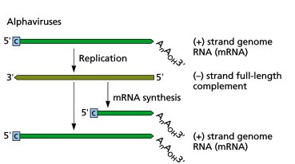{ width="460" loading=lazy }
/// caption
甲病毒：全长负链既是新基因组的模板，也用于产生较短的亚基因组mRNA。绿色为正链，橄榄色为负链，蓝框C表示帽。Burrell等图4.6右上面板，转载Flint等图版，裁切。[^viral-rdrp]
///

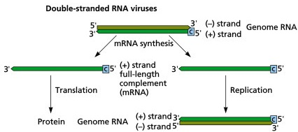{ width="460" loading=lazy }
/// caption
双链RNA病毒：正链产物可进入翻译，也可作为合成负链的模板。图中仅画一个基因组节段。Burrell等图4.6右下面板，转载Flint等图版，裁切。[^viral-rdrp]
///

沿“replication”箭头可以找到全长互补链，沿“mRNA synthesis”则找到供翻译的产物。甲病毒另外合成较短的mRNA；双链RNA病毒产生的正链则分到翻译和复制两种用途。下面再看三个具体实例，比较模板怎样进入这些反应。

### 三条具体的合成路线

**脊髓灰质炎病毒**的正链基因组进入细胞后，可以直接翻译一个多聚蛋白，随后切割产生包括RdRP在内的病毒蛋白。复制先生成负链模板，再由负链生成更多正链。病毒蛋白VPg经尿苷化后参与引发RNA合成，新正链可以继续翻译，也可以被包装。这个过程无需产生冠状病毒那样的一套嵌套亚基因组RNA。[^picornavirus-rna]

**水疱性口炎病毒（VSV）**是非分节负链RNA病毒的一个例子。负链不能直接翻译，所以病毒颗粒必须带入可工作的聚合酶。聚合酶可沿基因组逐基因生成mRNA；切换到复制模式时，则在核蛋白等参与下合成连续的全长正链抗基因组，再把它复制成新负链基因组。逐基因mRNA与全长抗基因组承担不同任务，末端与合成控制也不同。[^viral-rdrp]

**轮状病毒**把分节双链RNA保留在转录活性的双层颗粒内，由其中的聚合酶读取负链，向外输出带帽、通常无poly(A)尾的正链mRNA。新正链一方面供翻译，另一方面被选择和包装；随后在正在组装的颗粒内合成互补负链，恢复双链基因组。颗粒内转录向胞质提供mRNA，同时把双链基因组保留在颗粒中。[^rotavirus-rna]

这些实例也说明，是否依赖蛋白引物、生成亚基因组RNA、在衣壳内合成，以及产物带不带帽和尾，都需要落到病毒类群。病毒分类、进入与装配可继续读[病毒与亚病毒因子](../micro/viruses.md#genome-expression-strategies)；逆转录病毒经DNA中间体延续的路线见[逆转录](dna_replication/reverse_transcription.md)。

细胞自身也能利用RdRP。植物、许多真菌及部分动物等保留了参与小RNA扩增或RNA沉默的RdRP，但它们并非所有真核生物共有。因而，RNA→RNA的信息传递既是许多病毒复制的核心，也被一些细胞用于调节和防御。[^cellular-rdrp]

## 怎样测量和扰动转录 { #transcription-evidence }

一条DNA能结合聚合酶，还不足以证明它在细胞内启动了正确的转录。5′端定位、新生RNA检测、聚合酶占据、启动子突变和体外重构，可以分别回答“从哪里开始”“现在是否正在合成”“蛋白在哪里”以及“哪些组分足够产生反应”。几种证据接起来，才容易把启动子、转录单位与调控步骤对应好。

**EMSA**观察蛋白结合后核酸迁移的变化；**DNase I足迹**比较有无蛋白时DNA的受保护区。它们可以显示结合及其序列选择性，但本身不报告RNA是否被合成。实验操作和对照逻辑见[EMSA](../exptech/biochem_molecular/molecular_probes.md#emsa)与[DNase I足迹](../exptech/biochem_molecular/molecular_probes.md#footprint-affinity)。稳态RNA量还同时受加工和降解影响；某种mRNA减少，既可能因为合成变慢，也可能因为它消失得更快。

抑制剂能帮助拆分反应步骤，但必须与实验对象和处理条件一起使用：

| 工具 | 常用的机制线索 | 解释时的条件 |
| --- | --- | --- |
| 利福霉素类，如利福平 | 结合细菌聚合酶，阻碍早期短RNA继续延长 | 已经建立的长RNA延伸复合物与初始合成的敏感性不同 |
| Streptolydigin（链霉溶菌素） | 限制催化中心附近构象变化，抑制RNA延长 | 可用来比较延伸与利福霉素敏感的早期步骤 |
| α-鹅膏蕈碱 | 结合真核聚合酶并抑制核苷酸加入／移位；Pol II常高度敏感 | Pol I、III与物种间敏感性不同，前面的曲线来自指定酶制备和剂量 |
| 肝素 | 带负电的多糖，可与DNA竞争结合游离细菌RNA聚合酶，在体外限制重新起始 | 需先确认目标复合物对肝素挑战稳定；这里利用的是游离酶被捕获，而非β′亚基的专一抑制 |
| 放线菌素D | 嵌入DNA，妨碍模板上的核酸合成 | 浓度、序列、细胞摄取与处理时间都会改变结果，不能当作所有系统中的单一步骤开关 |
| 虫草素（3′-脱氧腺苷） | 进入腺苷代谢，可影响RNA合成与3′端形成 | 对加尾和RNA命运的作用具有基因及细胞条件差异，RNA减少不等于只抑制聚合酶 |

这些药物的选择性提供了可检验的机制线索；具体结论仍需要纯化酶、新生RNA、末端或稳定性测量来区分。[^transcription-inhibitors]

## 参考资料与延伸阅读 { #references }

- Watson JD等. *Molecular Biology of the Gene*. 7th ed. Chapter 13，印刷页429–464。
- Weaver RF. *Molecular Biology*. 5th ed. Chapters 6、10–12。
- Kapanidis AN等. [Initial Transcription by RNA Polymerase Proceeds Through a DNA-Scrunching Mechanism](https://doi.org/10.1126/science.1131399). *Science*. 2006;314:1144–1147.
- Weinmann R, Roeder RG. [Role of DNA-Dependent RNA Polymerase III in the Transcription of the tRNA and 5S RNA Genes](https://doi.org/10.1073/pnas.71.5.1790). *PNAS*. 1974;71:1790–1794.
- Eaton JD等. [Xrn2 accelerates termination by RNA polymerase II, which is underpinned by CPSF73 activity](https://pmc.ncbi.nlm.nih.gov/articles/PMC5830926/). *Genes & Development*. 2018;32:127–139.
- Saecker RM, Record MT Jr, deHaseth PL. [Mechanism of bacterial transcription initiation: RNA polymerase–promoter binding, isomerization to initiation-competent open complexes, and initiation of RNA synthesis](https://pmc.ncbi.nlm.nih.gov/articles/PMC3440003/). *Journal of Molecular Biology*. 2011;412:754–771.
- Santangelo TJ, Artsimovitch I. [Termination and antitermination: RNA polymerase runs a stop sign](https://pmc.ncbi.nlm.nih.gov/articles/PMC3125153/). *Nature Reviews Microbiology*. 2011;9:319–329.
- Gehring AM, Walker JE, Santangelo TJ. [Transcription regulation in Archaea](https://pmc.ncbi.nlm.nih.gov/articles/PMC4936096/). *Journal of Bacteriology*. 2016;198:1906–1917.
- Archuleta SR, Goodrich JA, Kugel JF. [Mechanisms and functions of the RNA polymerase II general transcription machinery during the transcription cycle](https://pmc.ncbi.nlm.nih.gov/articles/PMC10886972/). *Biomolecules*. 2024;14:176.
- Russell J, Zomerdijk JCBM. [The RNA polymerase I transcription machinery](https://pmc.ncbi.nlm.nih.gov/articles/PMC3858827/). *Biochemical Society Symposium*. 2006;73:203–216.
- Turowski TW, Tollervey D. [Transcription by RNA polymerase III: insights into mechanism and regulation](https://pmc.ncbi.nlm.nih.gov/articles/PMC5095917/). *Biochemical Society Transactions*. 2016;44:1367–1375.
- Eaton JD, West S. [An end in sight? Xrn2 and transcriptional termination by RNA polymerase II](https://pmc.ncbi.nlm.nih.gov/articles/PMC6150625/). *Transcription*. 2018;9(5):321–326.
- Webster MW, Weixlbaumer A. [Macromolecular assemblies supporting transcription–translation coupling](https://pmc.ncbi.nlm.nih.gov/articles/PMC8632081/). *Transcription*. 2021;12:103–125.
- Basu U, Bostwick AM, Das K, Dittenhafer-Reed KE, Patel SS. [Structure, mechanism, and regulation of mitochondrial DNA transcription initiation](https://pmc.ncbi.nlm.nih.gov/articles/PMC7939475/). *Journal of Biological Chemistry*. 2020;295:18406–18425.
- Yagi Y, Shiina T. [Recent advances in the study of chloroplast gene expression and its evolution](https://pmc.ncbi.nlm.nih.gov/articles/PMC3933795/). *Frontiers in Plant Science*. 2014;5:61.
- Ferrero D, Ferrer-Orta C, Verdaguer N. [Viral RNA-dependent RNA polymerases: a structural overview](https://pubmed.ncbi.nlm.nih.gov/29900492/). *Subcellular Biochemistry*. 2018;88:39–71.

[^watson-transcription]: Watson JD等. *Molecular Biology of the Gene*. 7th ed. Chapter 13，印刷页429–464（PDF页464–499）。本站所用图按图13–1、2、3、5、7、8、11–17、19、21、22、26–28及Box 13–1图1裁取，具体图号见各图注。结构图、实验整理图与机制示意按原书来源分别注明，裁切保留关键标记。
[^transcription-bubble-size]: Watson等第13章对延伸杂合区的描述，以及Krebs等 *Lewin’s GENES XII* 第17章17.2节、图17.5（本地PDF1685）：典型转录泡约12–14 bp，RNA–DNA杂合区约8–9 bp。不同起始或暂停构象的长度可改变。
[^multisubunit-rnap]: 多亚基 RNA 聚合酶的共同钳形结构、RNA–DNA hybrid、bridge helix、trigger loop 和两金属催化框架见 Archuleta 等的[机制综述](https://pmc.ncbi.nlm.nih.gov/articles/PMC10886972/)及延伸结构的[综述](https://pmc.ncbi.nlm.nih.gov/articles/PMC9398977/)。
[^weaver-transcription]: Weaver RF. *Molecular Biology*. 5th ed. Chapters 6、10–12；图10.4–10.5位于印刷页247（PDF269），为Weinmann与Roeder1974年实验的教材整理图。PNPase与RNA聚合反应的区别、肝素限制游离酶重结合见第6章；GC盒／CCAAT盒见印刷页262–263。
[^bacterial-initiation]: σ 因子、−10／−35 元件、open complex、DNA scrunching、abortive initiation 及 σ retention 的证据见[细菌起始机制综述](https://pmc.ncbi.nlm.nih.gov/articles/PMC3440003/)和[σ 因子选择性综述](https://pmc.ncbi.nlm.nih.gov/articles/PMC7046172/)。
[^sigma54-activation]: σ⁵⁴与ATP依赖激活见Watson等第18章，印刷页630–631；[ATP ground- and transition states of bacterial enhancer binding AAA+ ATPases support complex formation with their target protein, sigma54](https://pubmed.ncbi.nlm.nih.gov/17437715/)给出核苷酸状态、σ⁵⁴接触和开链之间的研究证据。
[^scrunching-experiment]: Kapanidis AN, Margeat E, Ho SO, Kortkhonjia E, Weiss S, Ebright RH. [Initial Transcription by RNA Polymerase Proceeds Through a DNA-Scrunching Mechanism](https://doi.org/10.1126/science.1131399). *Science*. 2006;314:1144–1147，Fig. 2、4；图片直接提取自[作者实验室公开PDF](https://groups.physics.ox.ac.uk/genemachines/group/kapanidis%20et%20al_Science06.pdf)。实验体系为大肠杆菌σ⁷⁰全酶与lacCONS启动子，受限NTP使初始RNA不超过7 nt。
[^transcription-elongation]: 暂停、backtracking、RNA 3′ 端切割及 Gre／TFS／TFIIS 相似的切割促进功能见[转录延伸综述](https://pmc.ncbi.nlm.nih.gov/articles/PMC4674076/)和[结构综述](https://pmc.ncbi.nlm.nih.gov/articles/PMC9398977/)。
[^transcription-translation-coupling]: NusG／NusA expressome 的结构状态及物种间耦联差异见 Webster 与 Weixlbaumer 的[综述](https://pmc.ncbi.nlm.nih.gov/articles/PMC8632081/)和 Wang 等的[结构研究](https://pmc.ncbi.nlm.nih.gov/articles/PMC7566311/)。
[^transcription-coupled-repair]: Mfd作用于停滞转录复合物的单分子证据见 Howan 等的[研究](https://pmc.ncbi.nlm.nih.gov/articles/PMC3475728/)；Mfd与UvrA／UvrAB的后续衔接见[2016年单分子重构](https://www.nature.com/articles/nature19080)；真核 CSB 介导的 TC-NER 组织及基因组证据见[机制综述](https://pmc.ncbi.nlm.nih.gov/articles/PMC8205993/)。
[^bacterial-termination]: intrinsic terminator、Rho–rut 装载、ATP 驱动易位以及不同细菌终止信号差异见 Santangelo 与 Artsimovitch 的[综述](https://pmc.ncbi.nlm.nih.gov/articles/PMC3125153/)及 Washburn与Gottesman的[延伸与终止综述](https://pmc.ncbi.nlm.nih.gov/articles/PMC4496710/)。
[^archaeal-transcription]: TBP–TFB–TFE 起始、Spt4/5／TFS 延伸、oligo(dT) 和因子依赖终止见[古菌转录综述](https://pmc.ncbi.nlm.nih.gov/articles/PMC7714419/)及[转录调控综述](https://pmc.ncbi.nlm.nih.gov/articles/PMC4936096/)。
[^archaeal-elf1]: Blombach F, Fouqueau T, Matelska D, Smollett K, Werner F. [Promoter-proximal elongation regulates transcription in archaea](https://pmc.ncbi.nlm.nih.gov/articles/PMC8448881/). *Nature Communications*. 2021;12:5524。此处使用该研究的因子招募与基因上分布证据，不把它表述为Elf1通道作用的直接结构测定。
[^eukaryotic-rnap-division]: Pol I、II、III 的结构同源性、主要转录本和专一因子见 Archuleta 等的[Pol II 综述](https://pmc.ncbi.nlm.nih.gov/articles/PMC10886972/)、Russell 与 Zomerdijk 的[Pol I 综述](https://pmc.ncbi.nlm.nih.gov/articles/PMC3858827/)及 Turowski 与 Tollervey 的[Pol III 综述](https://pmc.ncbi.nlm.nih.gov/articles/PMC5095917/)。
[^trypanosome-pol-i]: Günzl A等. [RNA polymerase I transcribes procyclin genes and variant surface glycoprotein gene expression sites in Trypanosoma brucei](https://pubmed.ncbi.nlm.nih.gov/12796299/). *Eukaryotic Cell*. 2003;2:542–551。
[^amanitin-experiment]: Weinmann R, Roeder RG. [Role of DNA-Dependent RNA Polymerase III in the Transcription of the tRNA and 5S RNA Genes](https://doi.org/10.1073/pnas.71.5.1790). *PNAS*. 1974;71:1790–1794。对象为小鼠骨髓瘤细胞；比较分离聚合酶及分离细胞核的RNA合成。具体读图采用Weaver图10.4–10.5，4S附近包括前体tRNA，5S峰未在该测定中严格区分成熟体与稍长前体。
[^pol-i-pol-iii]: 哺乳动物 SL1–UBF–RRN3 组装和 Pol I promoter escape 见 Russell 与 Zomerdijk 的[综述](https://pmc.ncbi.nlm.nih.gov/articles/PMC3858827/)；Pol III 三类启动子、TFIIIA／TFIIIC／TFIIIB 和 oligo(dT) 终止见[Pol III 机制综述](https://pmc.ncbi.nlm.nih.gov/articles/PMC4884153/)。
[^pol-ii-initiation]: Pol II core promoter 的组合多样性、TFIID–TFIIH、Mediator、XPB 开链和 CDK7–CTD 作用见 Archuleta 等的[综述](https://pmc.ncbi.nlm.nih.gov/articles/PMC10886972/)及[共激活因子综述](https://pmc.ncbi.nlm.nih.gov/articles/PMC11088444/)。
[^pol-ii-chromatin]: Pol II 暂停、productive elongation、FACT／Spt6 与核小体拆装的结构证据见[Pol II 转录周期综述](https://pmc.ncbi.nlm.nih.gov/articles/PMC10886972/)和[染色质延伸结构综述](https://pmc.ncbi.nlm.nih.gov/articles/PMC11649447/)。
[^pol-ii-termination]: CPSF73 切割、polyadenylation signal、XRN2 torpedo 与构象变化共同促进终止的证据见 Eaton 与 West 的[综述](https://pmc.ncbi.nlm.nih.gov/articles/PMC6150625/)及 Eaton 等的[条件性耗竭研究](https://pmc.ncbi.nlm.nih.gov/articles/PMC5830926/)。
[^eaton-termination]: Eaton JD, Davidson L, Bauer DLV, Natsume T, Kanemaki MT, West S. [Xrn2 accelerates termination by RNA polymerase II, which is underpinned by CPSF73 activity](https://pmc.ncbi.nlm.nih.gov/articles/PMC5830926/). *Genes & Development*. 2018;32:127–139，Fig. 3、5。图5误差棒为至少三次独立实验的SD，星号表示P<0.05；其B按各基因未剪接转录本归一化。正文图取自Europe PMC原归档JPEG。
[^mitochondrial-transcription]: 哺乳动物 POLRMT–TFAM–TFB2M 起始、TEFM 延伸、polycistronic transcription 及复制引物接口见[线粒体转录机制综述](https://pmc.ncbi.nlm.nih.gov/articles/PMC6699104/)和 Basu 等的[机制综述](https://pmc.ncbi.nlm.nih.gov/articles/PMC7939475/)。
[^plastid-transcription]: 陆生植物质体 PEP／NEP 的不同进化来源、σ 因子和发育分工见 Yagi 与 Shiina 的[综述](https://pmc.ncbi.nlm.nih.gov/articles/PMC3933795/)及[质体基因表达综述](https://pmc.ncbi.nlm.nih.gov/articles/PMC10504595/)。
[^viral-rdrp]: Burrell CJ, Howard CR, Murphy FA. [Virus Replication](https://pmc.ncbi.nlm.nih.gov/articles/PMC7173592/). *Fenner and White’s Medical Virology*. 2017:39–55（2016年在线），图4.6转载自Flint等 *Principles of Virology* 第4版。本文按具体类群区分RNA复制与mRNA合成；图中分节段病毒只画一个节段。
[^picornavirus-rna]: ICTV [Picornaviridae](https://ictv.global/report/chapter/picornaviridae/picornaviridae)，Genome organization and replication：正链基因组与多聚蛋白、VPg尿苷化和正负链引发。此处以脊髓灰质炎病毒说明，图中的甲病毒提供了另一种亚基因组RNA策略。
[^rotavirus-rna]: ICTV [Rotavirus](https://ictv.global/report/chapter/sedoreoviridae/sedoreoviridae/rotavirus)，Genome organization and replication：双层颗粒中的转录、正链RNA包装与颗粒内负链合成。
[^cellular-rdrp]: Watson等 *Molecular Biology of the Gene* 第7版，第20章印刷页713–714、图20–11，介绍RdRP参与RNA干扰信号扩增；物种间保留与缺失不能由病毒RdRP的普遍性推定。
[^transcription-inhibitors]: 利福霉素、streptolydigin和α-鹅膏蕈碱的酶学比较见Weaver第6、10章及本页所引延伸机制综述；虫草素对加尾与RNA命运的条件性影响见[2012年细胞研究](https://pmc.ncbi.nlm.nih.gov/articles/PMC3504674/)。
