# 翻译与蛋白质生物合成 { #_1 }

一条mRNA上有A、U、G、C，多肽里却是另一套化学性质各异的氨基酸。两者之间没有天然的“字母相似性”：把它们接起来的是tRNA。氨酰-tRNA合成酶先为tRNA接上相应的氨基酸，tRNA再用反密码子辨认mRNA上的三联体；核糖体把这些适配体放到合适的位置，选择底物、催化肽键，并向下一个密码子移动。

翻译沿mRNA的5′→3′方向进行，新生肽链从N端向C端延长。下面先看密码子与tRNA怎样对应，再跟随一次起始、延伸、终止和核糖体回收。肽链在合成途中就可能开始折叠、接受分选；这些过程在[蛋白质成熟、定位与质量控制](protein_processing.md)中继续展开。

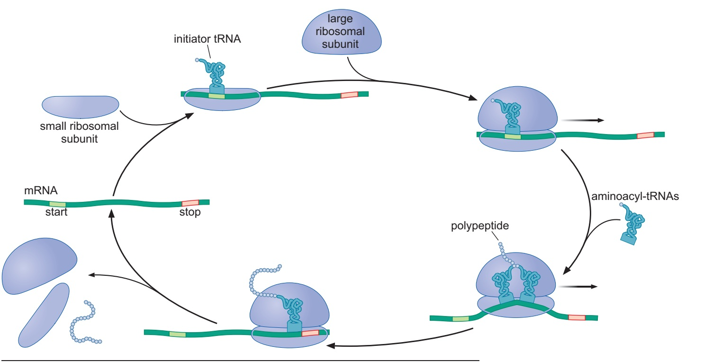{ width="680" loading=lazy }
/// caption
一轮翻译开始时，小亚基、起始tRNA与mRNA在起始密码子处组装；大亚基加入后反复接入氨基酸，遇到终止信号再释放多肽并回收亚基。[^m1-cycle]
///

## 遗传密码与阅读框 { #genetic-code }

标准遗传密码有64种三联体，其中61种指定氨基酸，UAA、UAG、UGA通常作为终止信号。多种密码子可以指定同一种氨基酸，称为**简并性**；在给定的解码系统中，一个有义密码子通常又有明确的主要含义。例如，UUU和UUC都指定苯丙氨酸。

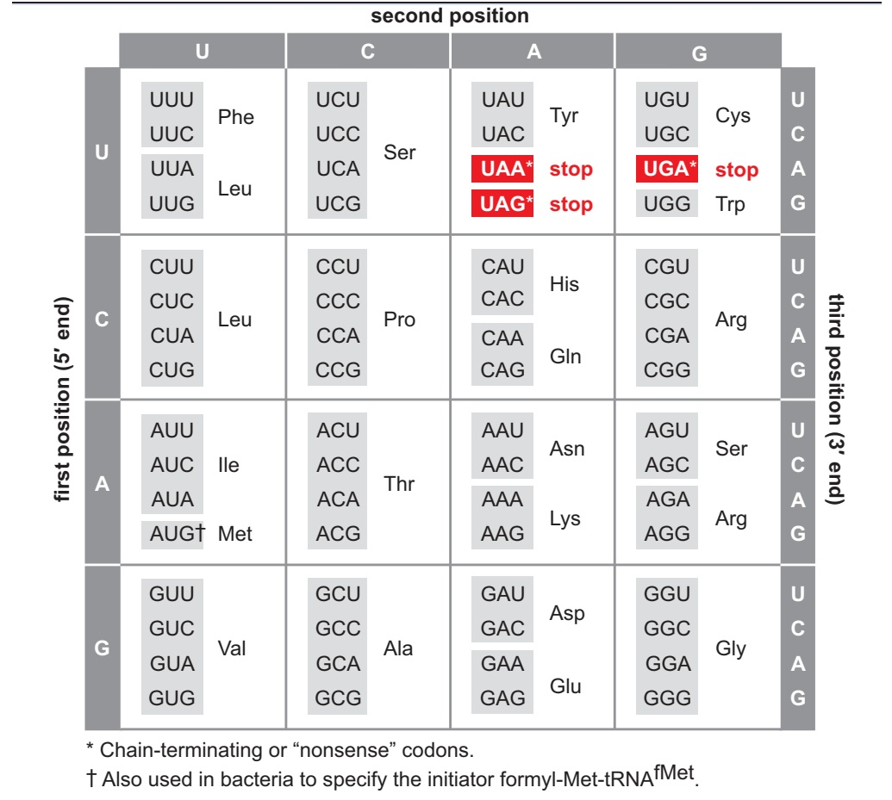{ width="620" loading=lazy }
/// caption
按RNA的5′→3′方向查表：第一位在左侧，第二位在上方，第三位在各格内部。第三位变化常产生同义密码子；第二位为U的一整列都指定疏水氨基酸，显示密码表并非毫无规律的排列。[^m1-code]
///

一段RNA可以从三个不同位置开始分组。起点只错开一个核苷酸，后续三联体就会全部改变。正常延伸按连续、不重叠的三联体读取，起始步骤把核糖体放入其中一个**阅读框**，之后才有“下一个密码子”的确定含义。

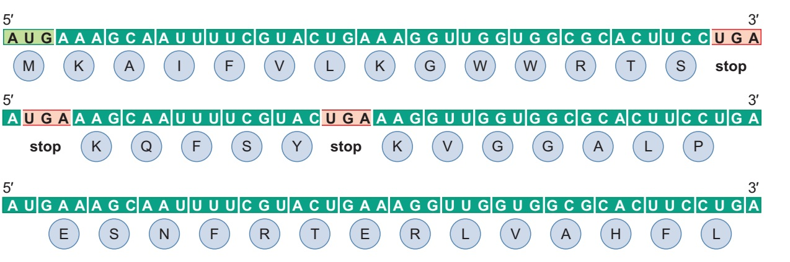{ width="680" loading=lazy }
/// caption
三个分组使用同一段序列。上行从AUG开始，读出不同于另外两行的氨基酸序列；下方某些分组很快遇到终止密码子。图是在比较分组方式，不表示细胞同时翻译全部三框。[^m1-frames]
///

!!! info "ORF与CDS"

    开放阅读框（open reading frame，ORF）是序列上未被同框终止密码子截断、具有潜在编码能力的一段阅读框；许多软件还要求从候选起始密码子开始。编码序列（coding sequence，CDS）则是注释为编码某一蛋白质产物的序列。真核基因的CDS可以在基因组上分布于多个外显子中。因此，找到长ORF提供了候选对象，实际翻译仍要由表达、核糖体或蛋白质证据支持。

### 密码表是怎样读出来的

1961年，Nirenberg和Matthaei在大肠杆菌无细胞提取物中加入人工合成的poly(U)。这种模板不论从哪里开始分组三联体，读到的都是UUU，产物中便大量掺入苯丙氨酸。这是破解密码表的第一个突破口。随后，随机共聚RNA、重复序列RNA和定义清楚的短RNA把其余对应关系逐步补齐；Holley等人测定tRNA序列，则让“适配体”从一个设想变成了可以逐个核苷酸研究的分子。Nirenberg、Khorana和Holley因相关工作共同获得1968年诺贝尔生理学或医学奖。[^genetic-code-history]

???+ abstract "文献简读：poly(U)让哪一种氨基酸进入产物"

    研究者先预孵育大肠杆菌S30提取物，降低原有模板造成的背景，再加入poly(U)、放射性标记苯丙氨酸和能量再生体系。反应后用三氯乙酸沉淀、洗去游离标记，测定进入酸不溶性产物的放射性。

    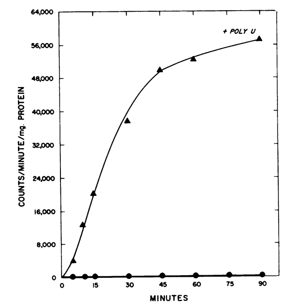{ width="440" loading=lazy }
    /// caption
    三角形为加poly(U)，近底线圆点为未加poly(U)的对照；纵轴为每毫克提取物蛋白对应的放射性计数。原论文图6，35℃、poly(U) 10 μg/mL。[^polyu-experiment]
    ///

    苯丙氨酸计数上升，还需要回答：poly(U)是否只是普遍提高了所有氨基酸的掺入？下表比较了不同标记底物组。每组都有零时处理、不加poly(U)和加poly(U)的条件，苯丙氨酸组的增加尤其显著；结合产物鉴定，支持poly(U)指定聚苯丙氨酸的合成。

    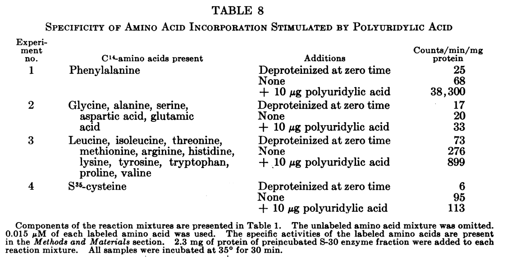{ width="700" loading=lazy }
    /// caption
    原论文表8：苯丙氨酸单列，若干其他氨基酸合并测试，半胱氨酸另用³⁵S标记。各组标记比活度不同，读图应比较同组加模板前后的变化，不能把跨组计数直接换算为产物组成。[^polyu-experiment]
    ///

    这项实验建立了U序列与苯丙氨酸之间的对应，却没有单独测出一个密码由几个核苷酸组成。把结果写成“UUU指定苯丙氨酸”，还结合了三联体读取的其他证据。

三核苷酸—核糖体结合实验又把“读码”从整条多肽合成中分离出来。给核糖体加入一个确定的三联体和带放射性标记的氨酰-tRNA，同源配对会增加该tRNA在核糖体上的结合；硝酸纤维素滤膜保留核糖体复合物，游离tRNA则较易通过。比较不同三联体促进哪一种氨酰-tRNA结合，就能逐项指派密码子。这里测量的是结合，不必等待形成长肽链。[^triplet-binding]

标准密码在生命中高度保守，也存在稳定的重指派，例如脊椎动物线粒体将UGA读取为色氨酸。另一些变化只发生在特定mRNA的局部：同一细胞中，一个UGA可以通常终止，却在特定信号和因子支持下插入硒代半胱氨酸。基因组采用哪套密码、局部程序化重编码和偶发翻译错误，要分别判断。[^genetic-code-variation]

### 摆动配对与同义密码子 { #wobble-decoding }

密码子和反密码子反向平行配对，因此密码子的第三位，对着反密码子5′端的第一位，也就是常用tRNA编号中的34位。核糖体对前两对碱基的几何要求较严格，第三对容许一定范围的非Watson–Crick配对。一个tRNA于是能够读取几个同义密码子，而无需为61个有义密码子逐一配备61种不同的反密码子。

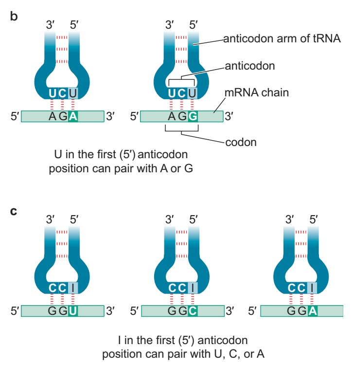{ width="360" loading=lazy }
/// caption
图中反密码子以3′→5′显示，右端才是其5′端。U可与密码子第三位A或G配对；I为肌苷，在经典摆动关系中可识别U、C或A。[^m1-wobble]
///

| 反密码子5′端碱基 | 经典摆动规则允许的密码子第三位 |
| --- | --- |
| C | G |
| A | U |
| U | A、G |
| G | C、U |
| I | U、C、A |

这张表给出基本配对关系。实际tRNA的34位和邻近位置常被修饰，识别范围可被扩展或收窄；部分细胞器还采用更宽的解码方式，不能仅凭未修饰碱基的字母推断全部配对。

同义密码子的使用也不均匀。这既受基因组碱基组成影响，也与tRNA供应、基因表达和选择有关。tRNA的丰度与充氨水平、mRNA结构、相邻密码子及新生肽都会影响局部延伸速度。一个较少使用的密码子有时造成停顿，有时为共翻译折叠提供时间；密码子适应指数（CAI）描述相对于参考基因集的使用偏好，不能单独给出蛋白质的实际合成速率。

## tRNA的结构与充氨 { #trna-aminoacylation }

### 从三叶草到L形

tRNA的三叶草图记录的是哪些区段彼此配对。靠近5′和3′端的序列形成受体茎，其余部分构成D臂、反密码子臂、可变区和T臂。D环得名于其中常见的二氢尿嘧啶；T环常含核糖胸苷、假尿苷和胞苷，所以也称TΨC环。修饰的具体种类与位置因tRNA而异。

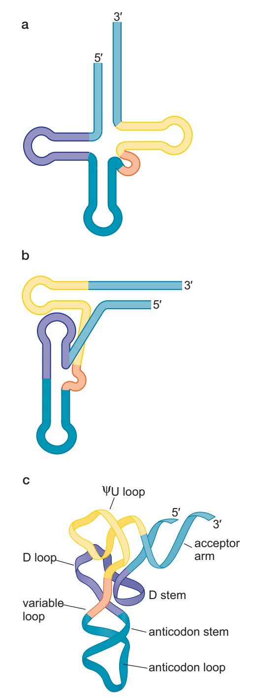{ width="270" loading=lazy }
/// caption
三幅图用同一套着色，把三叶草各臂对应到L形空间结构。[^m1-trna]
///

在三维空间中，受体茎与T茎近似共轴，D茎与反密码子茎形成另一段堆叠；D环和T环之间的长程相互作用把两段接成L形。稳定结构既靠碱基配对，也靠堆叠、骨架相互作用和离子环境。

L形的一端伸出3′-CCA，另一端展示反密码子，两端相距约7 nm。这个距离恰好让同一个tRNA一端参与mRNA解码，另一端伸入大亚基的肽键反应中心。前体如何获得完整末端、剪去内含子并接受修饰，见[RNA加工中的tRNA成熟](rna_processing.md#trna-processing)。

### 氨酰-tRNA合成酶连接氨基酸与tRNA

氨酰-tRNA合成酶（aminoacyl-tRNA synthetase，aaRS）先让氨基酸的羧基与ATP反应，形成酶结合的**氨酰-AMP**并释放焦磷酸；随后把氨酰基转移给tRNA末端腺苷A76的羟基，释放AMP。产物称为氨酰-tRNA，也常说这个tRNA已经“充氨”。[^aars-chemistry]

$$
\begin{aligned}
\mathrm{AA+ATP}&\rightarrow\mathrm{AA\! -\! AMP+PP_i}\\
\mathrm{AA\! -\! AMP+tRNA}&\rightarrow\mathrm{AA\! -\! tRNA+AMP}
\end{aligned}
$$

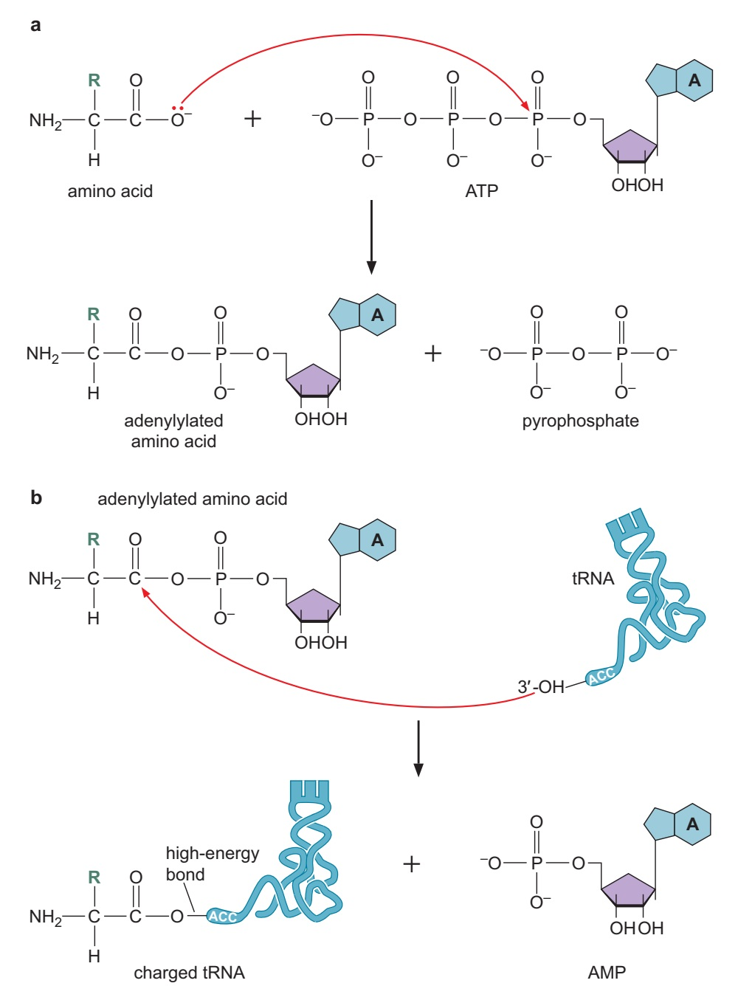{ width="400" loading=lazy }
/// caption
上半部生成氨酰-AMP，下半部把氨酰基转移给tRNA。图示为直接连接3′-OH的情况；生成的酯键保留了随后肽酰转移所需的化学势能。[^m1-charging]
///

两步合计消耗**一个ATP分子**，产物是AMP；加上焦磷酸水解，通常计作两个高能磷酸键当量。连接在tRNA上的，是氨基酸的羧基。核糖体下一步使用这条酯键的能量，不需要再为每次肽键形成另消耗一个ATP。

aaRS分为Ⅰ、Ⅱ两类，活性位点骨架和结合tRNA受体端的方式不同。Ⅰ类通常先把氨酰基接到2′-OH，Ⅱ类通常接到3′-OH，但有例外，如Ⅱ类PheRS先接2′-OH；氨酰基也可在这两个位置间转移。参与肽酰转移时，底物处于合适的3′连接构象。

一套aaRS可识别携带不同反密码子、但接受同一种氨基酸的**同工受体tRNA**。它读取的不只是反密码子：受体茎中的碱基对、紧邻CCA的73位区别碱基、可变臂及整体形状都可能成为身份元件。比如AlaRS识别tRNA^Ala^时，受体茎的G3·U70碱基对很关键；SerRS则能借长可变臂等特征识别具有不同反密码子的丝氨酸tRNA。[^aars-fidelity]

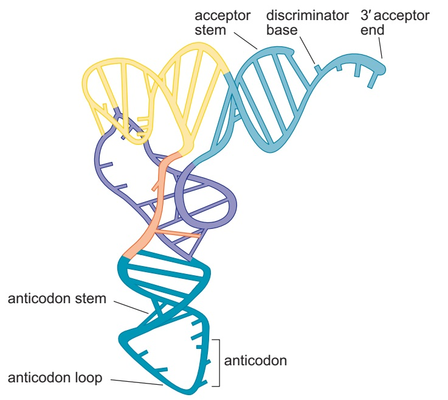{ width="400" loading=lazy }
/// caption
aaRS识别所需的身份元件分布在tRNA的不同部位；每种合成酶使用其中不同的组合，并非只检查一个反密码子。[^m1-identity]
///

有些细胞并没有二十种一一对应的直接充氨酶。例如缺少GlnRS的系统可以先生成Glu-tRNA^Gln^，再由酰胺转移酶把已连接的谷氨酸改成谷氨酰胺；Asp-tRNA^Asn^也可经类似的间接路线形成Asn-tRNA^Asn^。这些Glu-tRNA^Gln^和Asp-tRNA^Asn^是正常的合成中间物，随后对氨基酸的化学改造才完成正确充氨。[^aars-chemistry]

### 充氨的准确性与双筛选

氨基酸之间有时只差一个很小的基团。异亮氨酸和缬氨酸便相差一个亚甲基：IleRS的合成位点容易挡住过大的氨基酸，却可能让较小的缬氨酸混入。一个补救办法是在另一处设校对位点，水解错误的活化中间物或误充氨tRNA，同时使正确的异亮氨酸产物避开水解。

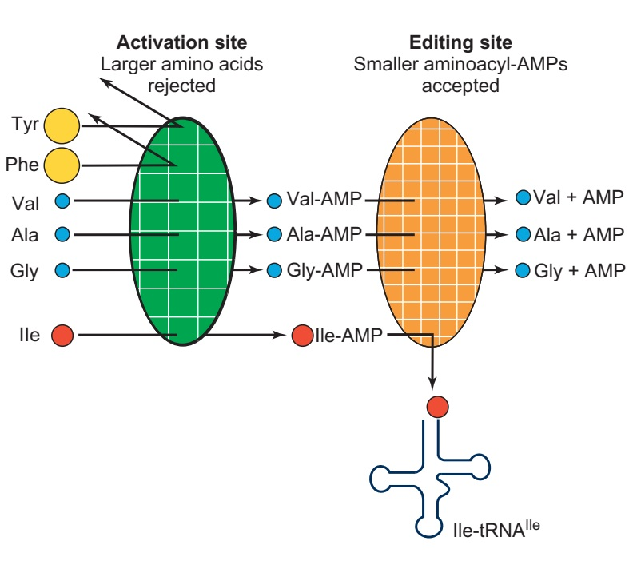{ width="470" loading=lazy }
/// caption
绿色合成位点排除过大或形状不合适的底物；橙色校对位点清除可进入其中的较小错误底物，正确的Ile产物保留。此图画出氨酰-AMP层面的简化模型，实际aaRS还可在氨酰基转移给tRNA后校对。[^m2-double-sieve]
///

不同aaRS的选择能力、转移前和转移后校对贡献并不相同，也有独立的校对蛋白清除误充氨tRNA。核糖体主要检查密码子—反密码子的配对，很难逐次鉴定远在tRNA另一端的氨基酸身份；充氨这一关因而直接关系到遗传密码是否被正确落实。

???+ abstract "把tRNA上的半胱氨酸改成丙氨酸"

    Chapeville等人在1962年先让带标记的半胱氨酸接到其正常tRNA上，再用Raney镍还原脱硫，把已连接的Cys改成Ala，而保留tRNA。这样便把通常一起变化的两个因素拆开了：携带者仍是tRNA^Cys^，末端的氨基酸却已变成Ala。

    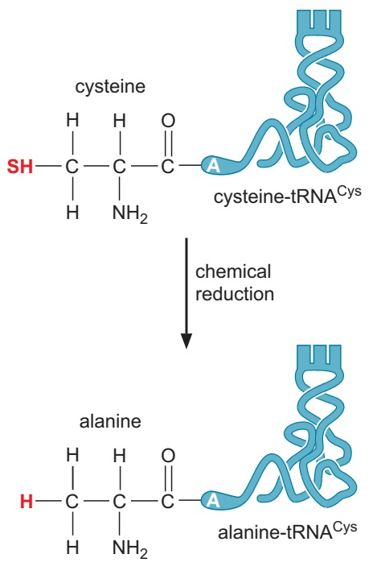{ width="300" loading=lazy }
    /// caption
    教材对实验原理的示意：左侧已连接的Cys变为Ala，tRNA及其反密码子保留。[^misacylated-trna]
    ///

    人工poly(UG)模板通常促进Cys而非Ala掺入；换上Ala-tRNA^Cys^后，它仍能促使这个tRNA携带的Ala进入产物。这说明，模板选择主要跟随tRNA的身份。核糖体能够接受这种错配底物，也就解释了为什么aaRS的充氨准确性如此关键；这不等于所有误充氨tRNA在活细胞里都能逃过其他选择和校对。

## 核糖体的两个中心与三个位置 { #ribosome-translation-cycle }

小亚基形成**解码中心**，接触mRNA与tRNA的反密码子；大亚基形成**肽酰转移酶中心**（peptidyl-transferase center，PTC），容纳相邻tRNA的CCA末端。大亚基内还有一条新生肽出口通道。从反密码子到氨基酸末端之间的距离，由tRNA的L形结构跨接起来。

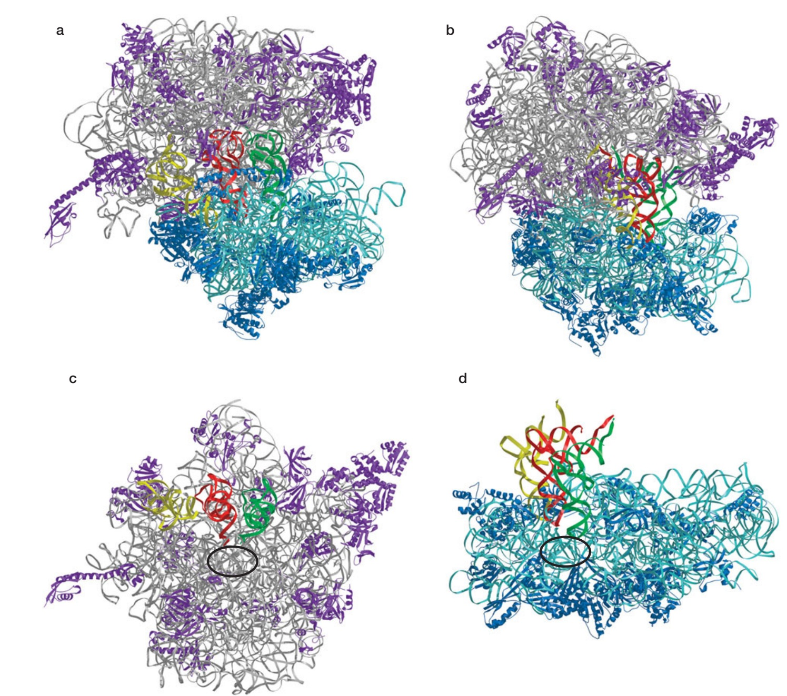{ width="670" loading=lazy }
/// caption
a、b为两个方向的完整核糖体；c、d分别展示大、小亚基面对界面的视图。E、P、A位tRNA依次为黄、红、绿，圈出的区域分别是大亚基的PTC和小亚基的解码中心。[^m1-ribosome]
///

| 位点 | 一个典型延伸循环中的作用 |
| --- | --- |
| A位，氨酰位 | 接受新的氨酰-tRNA；成键后，整条肽链暂时转移到这里的tRNA上 |
| P位，肽酰位 | 成键前携带已有肽链；起始tRNA也直接定位到P位 |
| E位，出口位 | 接纳并释放已失去氨酰基的tRNA |

这些名称描述功能位置，不能当作tRNA永久不变的身份。一次成键刚完成时，P位tRNA已经空载，A位tRNA反而携带了肽链；接下来还要经过转位，才能恢复进入下一轮反应的排列。

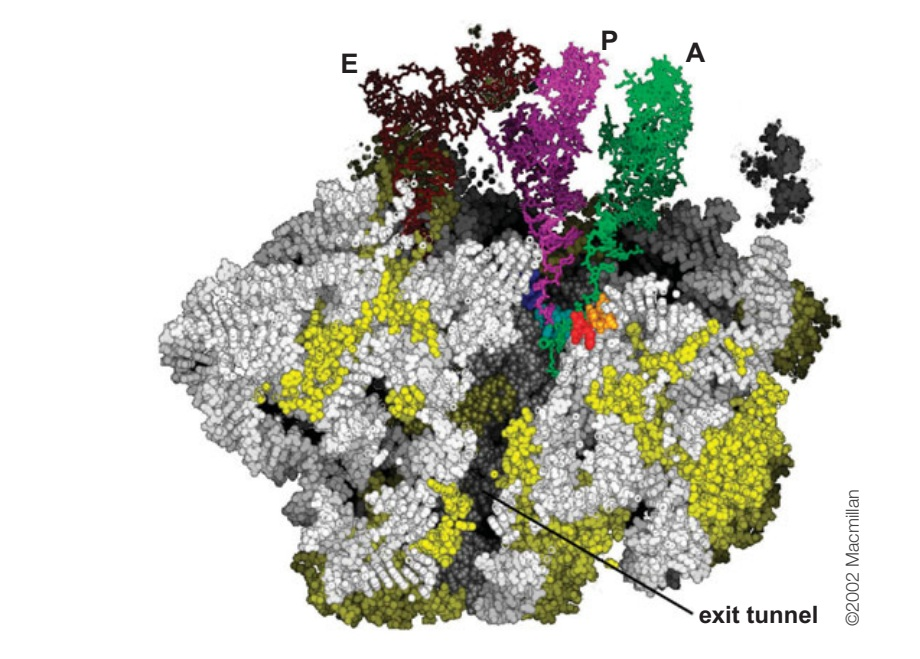{ width="380" loading=lazy }
/// caption
大亚基剖面中的空腔连通PTC与出口；rRNA为白色，蛋白质为黄色。上方的tRNA末端靠近通道入口，新生肽沿通道向外伸出。[^m1-tunnel]
///

PTC核心主要由rRNA组成，核糖体蛋白帮助稳定结构、结合因子和调节构象。新生链伸出后，可被伴侣蛋白或信号识别颗粒接触；长度足够的结构域甚至能在整条蛋白释放之前折叠。出口通道本身也会与某些新生肽发生特异相互作用，影响后续延伸。

细菌常见70S核糖体由30S和50S亚基组成，真核细胞质80S由40S和60S组成。S是沉降系数，取决于颗粒形状和摩擦性质，数值不相加。rRNA、蛋白质组成和核糖体生物发生见[核糖体结构与装配](../cell/nucleus_chromatin.md#ribosome-architecture)。

## 翻译起始 { #translation-initiation }

起始要完成三件相互关联的事：招募mRNA、安置起始tRNA，并使选定的起始密码子对准P位。大亚基加入后，起始tRNA已经在P位，A位留给第二个氨基酸。各系统的主要差别集中在如何找到并确认这个起点。

### 细菌的起始tRNA与核糖体结合位点 { #bacterial-initiation }

细菌的起始tRNA与延伸用的甲硫氨酸tRNA不同。MetRS先为起始tRNA接上甲硫氨酸，甲酰转移酶再使用10-甲酰四氢叶酸提供的甲酰基，生成fMet-tRNA^fMet^。起始tRNA的受体茎与反密码子茎等结构有利于甲酰化、IF2识别和P位定位；例如大肠杆菌起始tRNA的受体茎顶端存在不配对的C1与A72，反密码子茎有三个连续G–C碱基对。这些是具体结构特征，不宜一概推广到所有谱系。[^m1-bacterial-initiation]

许多细菌mRNA的起始密码子上游有**Shine–Dalgarno序列**（SD序列）。它与16S rRNA靠近3′端的反SD序列配对，使AUG等起始密码子接近小亚基P位。SD的序列、与起始密码子的距离及其可接近性共同影响起始；藏在稳定茎环中的互补序列未必能有效招募核糖体。

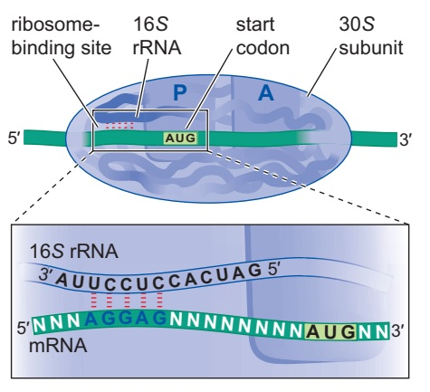{ width="450" loading=lazy }
/// caption
下方放大显示mRNA与16S rRNA反向平行配对；SD本身位于AUG上游，把AUG定位到P位附近。[^m1-sd]
///

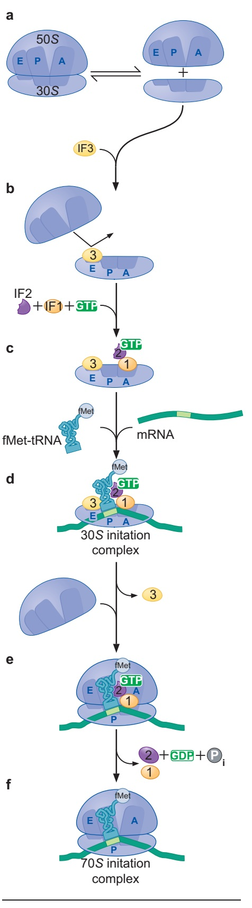{ width="280" loading=lazy }
/// caption
沿a→f追踪起始tRNA：它直接定位到P位，直到50S加入、IF2完成GTP循环并离开后，才准备开始延伸。图概括一种组装路线，mRNA与起始tRNA的先后结合并非唯一顺序。[^m1-bacterial-initiation]
///

**IF1**占据小亚基A位附近，帮助建立起始构象；**IF3**抑制过早的大小亚基结合，并参与排除不合适的起始复合物；**IF2–GTP**稳定起始tRNA与小亚基的结合，并促进随后50S加入。

起始密码子与起始tRNA建立合适配对后，复合物发生构象调整。50S的加入促使IF2水解GTP，起始因子相继释放，得到P位携带fMet-tRNA、A位空出的70S起始复合物。

AUG最常见，GUG、UUG等在适当起始环境中也能由起始tRNA读取。此时第一个氨基酸仍来自fMet-tRNA；同一个GUG位于ORF内部时，则通常由延伸用tRNA读取为缬氨酸。甲酰基和起始甲硫氨酸还可能在蛋白成熟时被去掉，所以成熟蛋白的N端不一定保留fMet。

并非所有细菌mRNA都具有明显SD。部分有5′前导序列的mRNA使用其他招募方式；**无前导序列mRNA**（leaderless mRNA）的起始密码子接近5′端，可通过不同的亚基或70S招募路线起始。其频率及因子依赖随物种变化。SD是重要机制，却不是扫描每个细菌ORF时都应找到的固定`AGGAGG`字符串。[^prokaryotic-initiation]

### 古菌的起始 { #archaeal-initiation }

古菌具有70S型核糖体，但起始因子的核心更接近真核同源物。起始tRNA携带未甲酰化的甲硫氨酸；三亚基的aIF2–GTP携带Met-tRNA~i~，aIF1、aIF1A参与起始位点选择，aIF5B促进大亚基加入。古菌mRNA通常没有真核m⁷G帽，可使用SD引导或无前导序列的起始，不同门类的转录本组成差别很大。[^archaeal-initiation]

在因子同源关系上，细菌IF1对应aIF1A/eIF1A，IF2对应aIF5B/eIF5B；真核eIF2虽然也运送起始tRNA，却不是因为编号“2”就与细菌IF2一一对应。命名跨过三个域以后，数字确实不能代替亲缘关系。

### 真核细胞质的帽识别与扫描 { #eukaryotic-initiation }

真核细胞质中，起始tRNA通常在mRNA被招募之前，就同40S小亚基和起始因子形成**43S预起始复合物**。eIF2–GTP携带Met-tRNA~i~构成三元复合物，eIF1、eIF1A、eIF3和eIF5等共同稳定适于扫描和选择起点的状态。另一边，mRNA的5′帽先被eIF4E识别；eIF4G作为支架，连接eIF4E、eIF4A及小亚基一侧的招募因子。eIF4E、eIF4G、eIF4A合称**eIF4F**，eIF4B等辅助eIF4A解开RNA局部结构。[^eukaryotic-initiation]

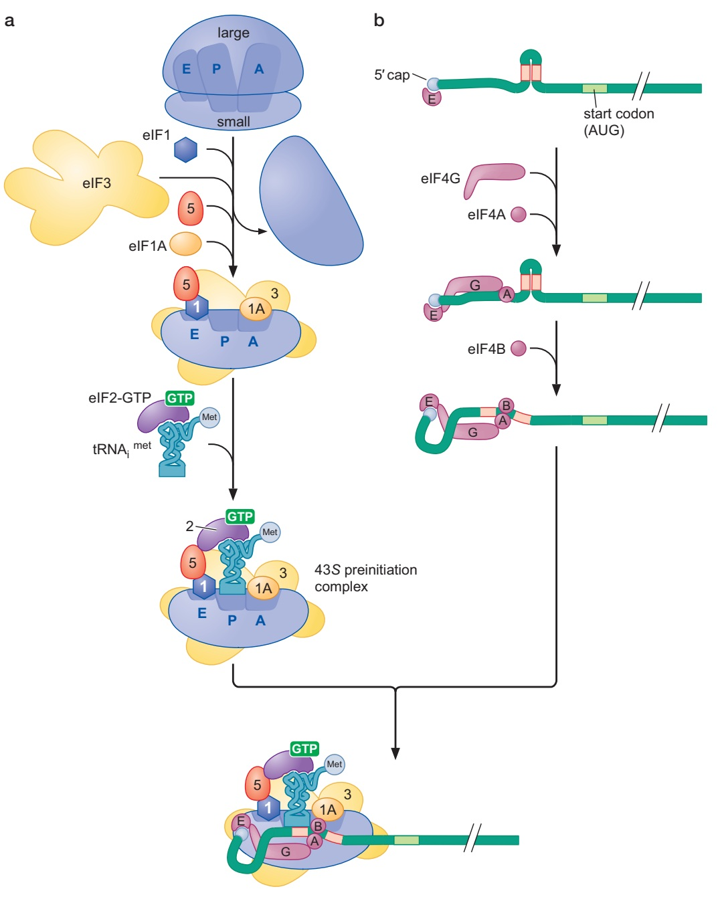{ width="620" loading=lazy }
/// caption
左侧是40S与起始tRNA的准备，右侧是mRNA帽端的准备；两支汇合，才形成在mRNA上寻找起始密码子的复合物。[^m1-eukaryotic-initiation]
///

eIF4G还可与poly(A)结合蛋白PABP相互作用，提高mRNA招募和后续翻译的效率。这提供了5′端与3′端协同作用的分子联系，但不要求每一条正在翻译的mRNA始终保持闭合圆环。

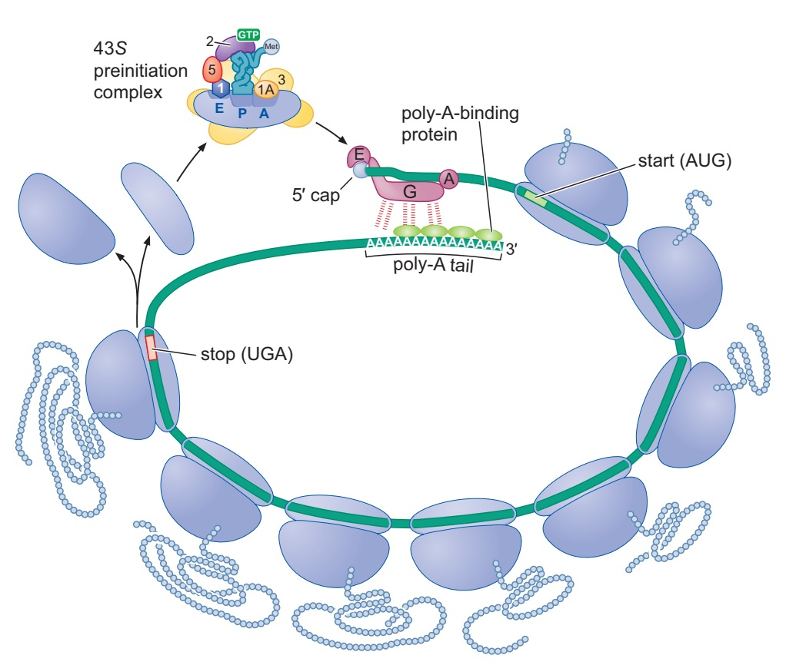{ width="520" loading=lazy }
/// caption
闭环模型强调帽结合装置、eIF4G与PABP之间的相互作用。[^m1-closed-loop]
///

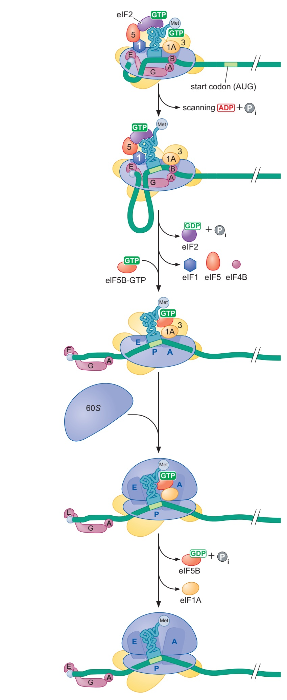{ width="280" loading=lazy }
/// caption
复合物沿5′前导区扫描，选中起点后转入亚基结合。图把eIF2的GTP水解和产物释放合并绘制；二者在机制上可分开，正文区分其时序。[^m1-eukaryotic-initiation]
///

结合mRNA后的复合物沿5′→3′扫描，起始tRNA的反密码子不断检验候选密码子。ATP用于RNA解旋和相关重排，费用随前导区结构等条件而变。哺乳动物常见的Kozak环境可概括为`(gcc)gccRccAUGG`，其中R是嘌呤A或G，AUG中A编号为+1；−3位嘌呤和+4位G尤其有利于起始。

识别合适AUG后，起始tRNA更稳定地进入P位，eIF1移开，预起始复合物转入闭合状态。eIF5能促进eIF2的GTP水解，但水解可在起点确认前发生；**受起点选择严格控制的是无机磷酸P~i~的释放**。随后eIF2–GDP等离开，eIF5B–GTP促进60S加入，再完成自己的一轮GTP水解和释放，形成可延伸的80S核糖体。eIF2–GDP由eIF2B促进核苷酸交换后才能再用。[^eif2-phosphate]

### 一个mRNA上的多个起始机会

第一个AUG常被采用，但弱起始环境可能被扫描复合物越过，称为**遗漏扫描**。某些转录本还能从CUG、GUG等近同源密码子起始，产生不同N端或小蛋白；仅凭序列找到这些候选位点还不够，需要核糖体定位与蛋白产物证据。

较短的上游ORF（uORF）提供另一层调节。核糖体翻译uORF并终止后，一部分40S可留在mRNA上继续扫描；重新获得起始三元复合物后，才可能在下游起始。uORF长度、间隔与因子供应会改变再起始概率。

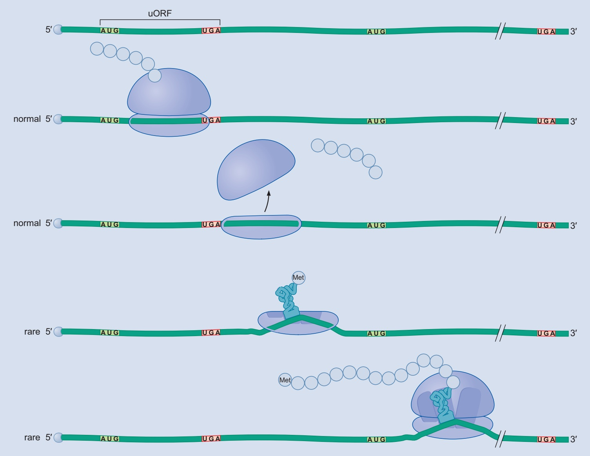{ width="670" loading=lazy }
/// caption
图中多数核糖体在uORF终止后离开，少数40S继续扫描并重新获得起始tRNA；“rare”表示这一路线在图示条件下较少发生，不是所有uORF的固定效率。[^m1-uorf]
///

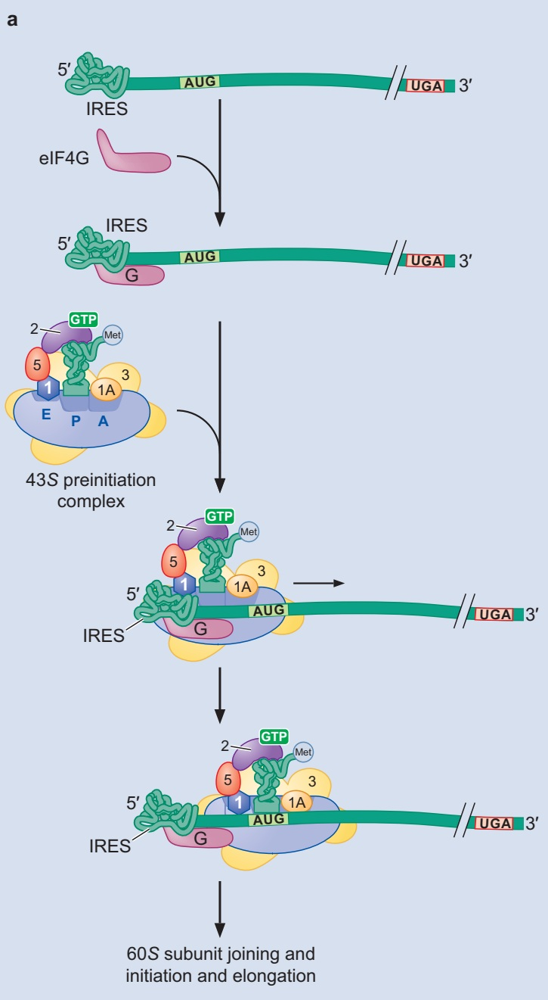{ width="300" loading=lazy }
/// caption
脊髓灰质炎病毒IRES绕过帽结合步骤，与eIF4G等协同招募起始装置。这里只绘出部分关键因子。[^m1-ires]
///

**内部核糖体进入位点**（internal ribosome entry site，IRES）通过RNA结构及不同的辅助蛋白，从mRNA内部招募核糖体。不同IRES的要求相差很大：脊髓灰质炎病毒IRES仍使用许多常规起始因子，蟋蟀麻痹病毒的基因间区IRES则可模拟tRNA—mRNA配对结构，在不使用常规起始因子与起始tRNA的情况下进入延伸。

帽依赖扫描、遗漏扫描、uORF后再起始和IRES招募，在招募位置、所需因子及起点确认步骤上各有差异。[^eukaryotic-initiation]

## 翻译延伸 { #translation-elongation }

一轮延伸可分为氨酰-tRNA选择、肽酰转移和转位。下面先以细菌为例追踪这三步，再比较同源因子的分工。

### 先读码，再让氨酰端进入反应中心

EF-Tu–GTP与氨酰-tRNA形成三元复合物，将其送到A位。此时反密码子端能够接触mRNA，但氨酰末端仍被EF-Tu握住，尚未进入PTC。这样的先后关系，使核糖体有机会在成键之前检查配对。

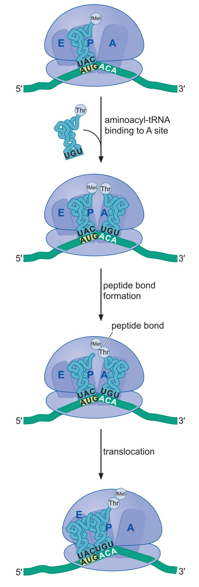{ width="260" loading=lazy }
/// caption
上方P位tRNA携带已有肽链；A位加入新底物后，肽链转移到A位tRNA，再随转位进入P位。下一轮于是从相同的位置排列开始。[^m1-elongation]
///

小亚基解码中心接触密码子—反密码子双链的小沟，辨认前两对碱基是否具有合适几何形状。以大肠杆菌编号为例，16S rRNA的A1492、A1493和G530参与这套检查。它们识别配对形状，而不是简单比较“两个氢键还是三个氢键”。

正确的配对有利于核糖体闭合及EF-Tu的GTP酶激活。EF-Tu水解GTP并离开后，氨酰-tRNA的CCA端还要摆入PTC，这一步称为**适应进入**（accommodation）。近同源tRNA有时通过前一关，却仍会在这一步被拒绝。

因此，选择分布于两个阶段：GTP水解前的初始选择，以及水解后的动力学校对。正确底物更快向前反应、错误底物更易解离，两者共同提高准确性。[^translation-fidelity]

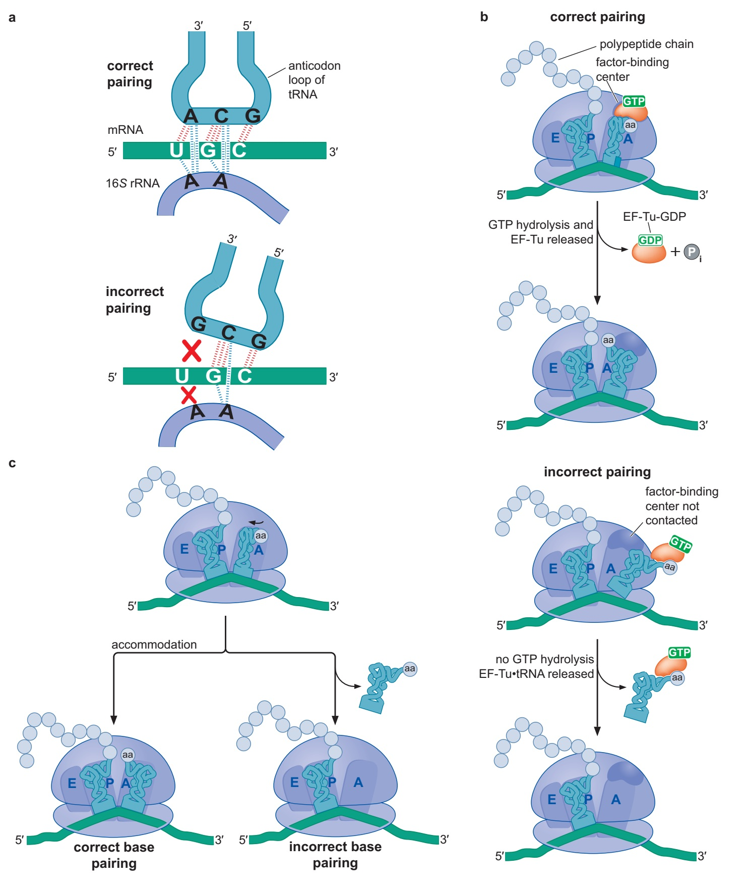{ width="650" loading=lazy }
/// caption
a示意解码中心对配对几何的检查；b比较能否有效激活EF-Tu；c显示释放EF-Tu后，tRNA仍可能在进入PTC的途中解离。图中的正确／错误分支是主导路径，真实反应存在有限的误接纳概率。[^m1-selection]
///

### 肽酰转移：整条肽链换一只tRNA

A位氨基酸的α-氨基进攻P位肽酰-tRNA的酯羰基，形成新的肽键。原来的肽链连同它最后一个氨基酸，整体转移到A位氨基酸的氨基上；P位tRNA失去肽链，A位tRNA则携带延长一个残基的产物。新接入残基的羧基仍通过酯键连接自己的tRNA，供下一轮使用。

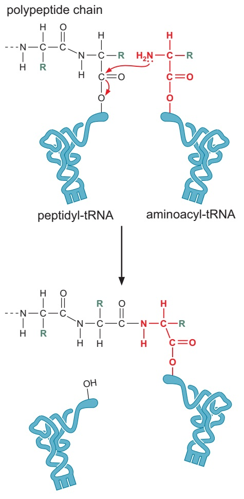{ width="320" loading=lazy }
/// caption
红色箭头标出亲核进攻与成键关系。反应前后，肽链都以C端连接tRNA；新的残基被加到C端，N端则早已合成并向出口方向伸出。[^m1-peptide-chemistry]
///

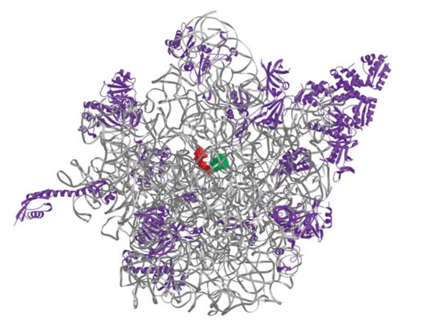{ width="380" loading=lazy }
/// caption
大亚基中的rRNA为灰色，蛋白质为紫色；红、绿两条tRNA的3′端相邻，伸到以rRNA为核心的反应区。[^m1-ptc]
///

PTC把两个底物定位到有利于反应的构象，rRNA、tRNA和水分子组成的氢键网络协助质子转移。核糖体因而是一种核酶，不过“RNA催化”并不表示周围蛋白质毫无作用：例如细菌L27的末端可接近反应区，帮助稳定底物。尤其有趣的是，P位tRNA末端A76的2′-OH也参与催化——这个底物不仅携带肽链，还给反应提供了一个重要的化学基团。[^ribosome-catalysis]

???+ abstract "文献简读：只改tRNA末端一个羟基"

    Weinger等人在2004年比较了末端A76正常、2′-OH被H取代（dA76）或被F取代（fA76）的tRNA。先让标记的fMet与Lys形成二肽，再经过一次转位，使fMet–Lys-tRNA进入P位；随后给A位加入嘌呤霉素，检验P位二肽能否转移给它。

    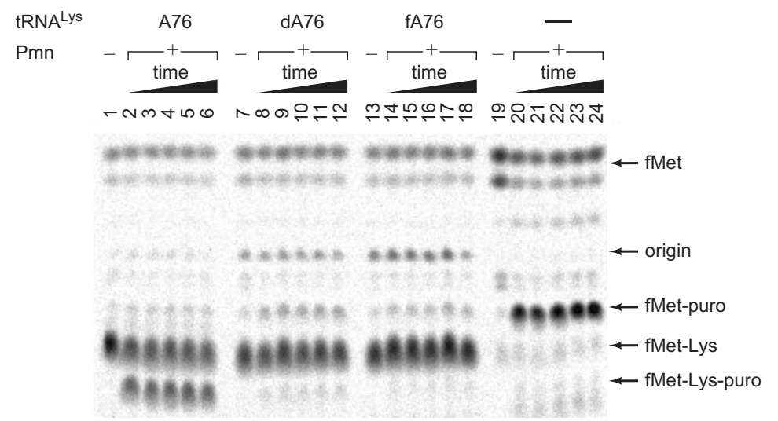{ width="650" loading=lazy }
    /// caption
    A76、dA76、fA76各占六道：第一道不加嘌呤霉素，其后反应10秒、1分钟、6分钟、1小时、24小时。最右一组不加Lys-tRNA，用于识别fMet与fMet–puromycin产物；图为薄层电泳后的放射性成像。[^weinger-experiment]
    ///

    正常A76组很快出现下方的fMet–Lys–puromycin条带；dA76和fA76组则保留大量二肽，长时间后仍几乎不形成对应产物。相关实验还检查了底物结合和其他反应步骤，说明这种缺陷不能简单归因于tRNA完全进不了核糖体。

    这个结果有力支持A76的2′-OH参与肽酰转移。至于它与水及rRNA怎样组成具体质子传递网络，还需要结构、动力学和其他化学替换共同约束；一张产物图本身不会直接拍下质子移动的路径。

### 转位与因子再生

肽链转移后，两条tRNA的氨酰端倾向于先在大亚基上改变位置，而反密码子暂时仍留在小亚基原处：原A位tRNA进入**A/P杂合态**，原P位tRNA进入**P/E杂合态**。斜线前后分别表示其在小、大亚基上的位置。这一变化伴随亚基相对旋转，并与小亚基头部摆动等动作相互耦联。

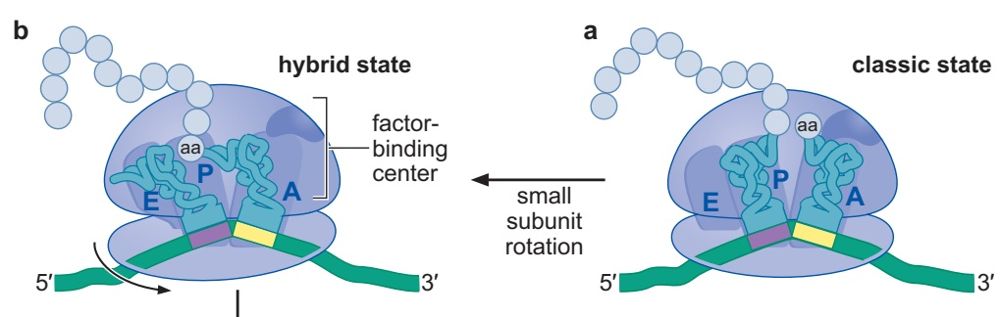{ width="600" loading=lazy }
/// caption
图中从右侧经典态转向左侧杂合态时，tRNA的3′端已换位，反密码子与mRNA尚未完成对应转位。两端不必作为刚性整体同时移动。[^m1-translocation]
///

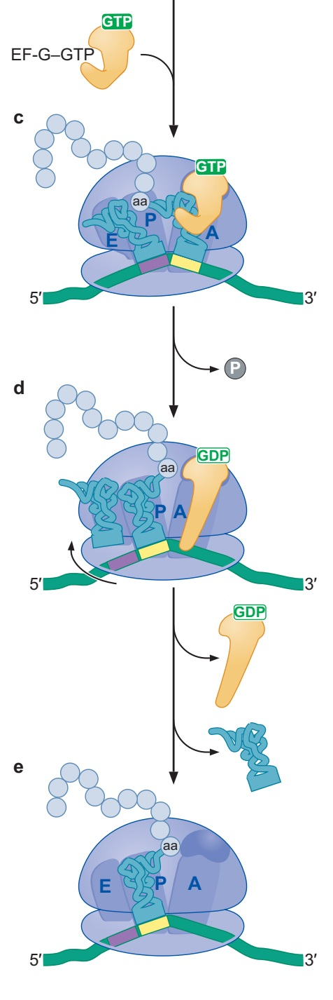{ width="250" loading=lazy }
/// caption
EF-G稳定转位过程中的构象，GTP水解与后续重排促进mRNA—tRNA前移。完成后肽酰-tRNA到达P位，下一密码子进入A位。[^m1-translocation]
///

EF-G–GTP结合核糖体后促进转位。tRNA反密码子与mRNA协调移动，核糖体相对模板沿5′→3′前进一个密码子；肽酰-tRNA由A位到P位，空载tRNA经E位离开。EF-G的GTP水解、无机磷酸释放、核糖体解锁与复位共同控制反应速度和方向，让这个循环快速而有方向地向前进行。

EF-Tu与EF-G在核糖体上的结合区域部分重叠，交替工作。离开的EF-Tu–GDP需要**EF-Ts**促进GDP释放，再结合GTP，才能携带下一只氨酰-tRNA。EF-Ts是鸟嘌呤核苷酸交换因子，负责帮助换核苷酸，并不把GDP直接磷酸化成GTP。

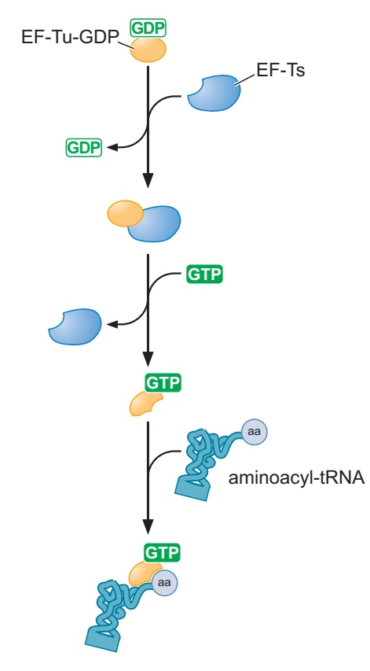{ width="270" loading=lazy }
/// caption
EF-Tu结合EF-Ts后释放GDP，重新结合GTP再接纳氨酰-tRNA；这个循环把一次递送接到下一次递送。[^m1-efts]
///

| 作用 | 细菌 | 古菌 | 真核细胞质 |
| --- | --- | --- | --- |
| 递送延伸用氨酰-tRNA | EF-Tu | aEF1A | eEF1A |
| 促进转位 | EF-G | aEF2 | eEF2 |
| 促进递送因子核苷酸交换 | EF-Ts | 相应谱系的交换因子 | eEF1B复合物 |

共同反应核心相近，不代表因子配置完全一样。例如酵母等真菌还使用ATP酶eEF3，促进晚期转位及E位tRNA释放。[^fungal-eef3]

!!! note "翻译的能量花在哪里"

    每接入一个延伸残基，典型主路径包括一次充氨（ATP→AMP）和两次GTP循环：一次用于tRNA递送与选择，一次用于转位。这通常折算为四个高能磷酸键当量，其中直接为肽酰转移提供化学势能的是预先形成的酯键。

    若只计算一条含$n$个残基肽链的充氨与$n-1$轮延伸，得到$2n+2(n-1)$个当量；起始、终止、亚基回收、真核扫描及额外校对等费用另计。这里计的是高能磷酸键当量，并包含ATP和GTP两类核苷酸的消耗；它不同于ATP分子数。

多个核糖体可同时翻译一条mRNA，形成**多核糖体**（polysome）。密度取决于起始频率和各处前进速度，也会受结构、底物供应、新生链和碰撞影响，并没有跨系统固定的核糖体间距。细菌中，转录与翻译可以在同一胞质空间重叠，部分基因还形成RNA聚合酶—核糖体耦联复合物；真核核编码mRNA则先完成核内加工并输出，再由胞质核糖体读取。

## 终止与核糖体回收 { #termination-recycling }

终止密码子进入A位后，常规氨酰-tRNA不能像读取有义密码子那样完成解码，**释放因子**接替它进入。细菌RF1识别UAA和UAG，RF2识别UAA和UGA；它们在解码中心辨认终止信号，同时将保守GGQ基序伸向PTC，使水分子能够参与P位肽酰-tRNA的酯键水解。肽链游离的C端由此释放。

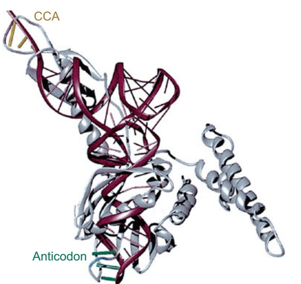{ width="360" loading=lazy }
/// caption
深红色tRNA和灰色RF1在空间上有相似的延伸范围，但RF1通过蛋白质—RNA接触识别密码子，没有核酸反密码子。[^m1-release]
///

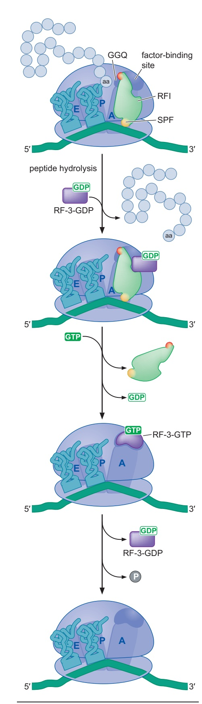{ width="260" loading=lazy }
/// caption
RF1的密码子识别区与GGQ基序分别接近小亚基解码中心和大亚基PTC。RF3的GTP循环促进RF1/RF2周转；肽链释放后仍须回收核糖体。[^m1-release]
///

释放肽链并不会自动把核糖体拆开。细菌的**核糖体回收因子RRF**与EF-G协同拆分终止后的复合物，IF3等帮助清除残留tRNA与mRNA并抑制亚基过早重联。终止负责断开肽链与tRNA的连接，回收则使大小亚基能投入下一轮翻译。

真核eRF1能够识别三个终止密码子，eRF3–GTP促进终止复合物重排与肽链释放。ATP酶**ABCE1**随后参与拆开80S，残留在40S上的mRNA和tRNA还要由其他回收或起始因子清除。古菌aRF1与ABCE1使用同源核心，但具体辅助因子和终止信号偏好仍随谱系变化。[^termination-recycling]

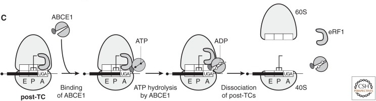{ width="730" loading=lazy }
/// caption
从左到右，ABCE1结合仍带eRF1的终止后复合物（post-TC），促进ATP依赖的亚基拆分。右侧40S还保留mRNA与去酰tRNA，因此拆开80S之后仍有清理步骤。图为Hellen综述图3C的机制概括。[^abce1-figure]
///

终止效率也受邻近核苷酸、新生链以及mRNP环境影响。在真核中，PABP与终止装置的空间关系也会影响正常终止和监控的竞争。因此，释放因子接触的是处于具体分子环境中的密码子，终止强弱不能只由三个字母决定。

## 细胞器中的翻译 { #organelle-translation }

线粒体与质体的翻译装置来自细菌祖先，又经过长期基因丢失、核基因接管和谱系特异改造。细胞器核糖体保留共同解码与催化核心，外围rRNA和蛋白质却可以有很大变化。例如哺乳动物线粒体rRNA显著缩小、蛋白质比例上升，植物线粒体则可具有扩展的rRNA；不同谱系因而形成了组成和结构各异的线粒体核糖体。

| 系统 | 起始与底物特点 | 与细胞整体的联系 |
| --- | --- | --- |
| 哺乳动物线粒体 | mRNA常无前导或只有很短前导；一套mt-tRNA^Met^通过甲酰化状态等差别参与起始或延伸；采用与标准表不同的部分密码指派 | 12S、16S rRNA由线粒体基因组编码，大量核糖体蛋白和翻译因子从胞质输入；不能据其他谱系的tRNA输入推断哺乳动物也依赖同样路线 |
| 植物质体 | 保留更多细菌型组分，部分mRNA利用SD样元件，也存在其他起始方式；典型被子植物质体具有16S、23S、5S和4.5S rRNA | 某些RNA编辑可恢复起始密码子；5′非翻译区结合蛋白及光照、发育条件也参与调节，许多必需蛋白来自核编码[^plastid-translation] |

细胞器翻译同膜上复合物装配紧密联系。核编码亚基需要输入，细胞器编码亚基则就地合成，两边的供应必须协调。[^organelle-translation]

## 停滞、核糖体救援与质量控制 { #ribosome-rescue }

翻译并非匀速前进。某些暂停有助于折叠或表达调控；但截短mRNA、损伤、异常结构、底物不足或新生肽与出口通道的作用，都可能使核糖体长时间停滞。细胞要同时处理三个相连的对象：问题mRNA、仍占用着模板的核糖体，以及尚连在tRNA上的不完整肽链。

### 细菌tmRNA：先接肽链，再成为模板

**转移—信使RNA**（transfer-messenger RNA，tmRNA）兼具tRNA样结构域和一段可翻译的短阅读框；在大肠杆菌中由`ssrA`编码。AlaRS给其CCA末端接上丙氨酸，**SmpB**与tRNA样结构域结合，补充普通tRNA反密码子臂所在区域的结构和功能。tmRNA虽然能携带氨基酸，却没有用来读取一个普通A位密码子的反密码子。

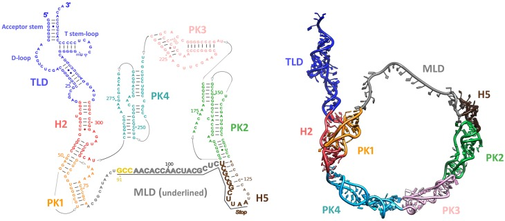{ width="700" loading=lazy }
/// caption
左侧蓝色TLD为tRNA样结构域，灰色MLD含恢复翻译用的阅读框，黄色为恢复密码子；右侧是依据结构和冷冻电镜密度拟合的模型。两端的tRNA样部分与内部编码段属于同一条RNA。[^tmrna-structures]
///

带有丙氨酸的tmRNA–SmpB可由EF-Tu递送。它特别适于救援到达截短mRNA末端、A位缺少可读取密码子且下游mRNA通道空出的核糖体。SmpB的C端尾进入这段通道；若正常mRNA仍占据下游位置，就会妨碍复合物顺利进入并完成肽转移。即使发生初始结合，完整的下游mRNA仍可在GTP水解后的适应进入／肽转移阶段，促使tmRNA–SmpB被排除。[^bacterial-ribosome-rescue][^tmrna-selection]

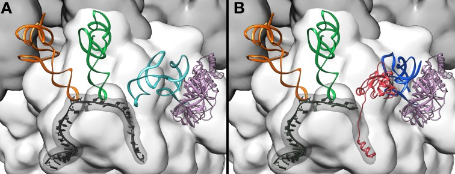{ width="680" loading=lazy }
/// caption
A为普通tRNA递送复合物，黑色mRNA沿通道延伸；B中蓝色tmRNA的TLD与红色SmpB进入，SmpB尾部占据原本容纳下游mRNA的位置。图按结构模型比较两种复合物。[^tmrna-structures]
///

成功进入后，P位肽链转移给tmRNA携带的丙氨酸。EF-G促进转位，原问题mRNA被移出，tmRNA自己的编码区进入解码通道；接下来核糖体读取tmRNA的短阅读框，为原肽链续上一段降解标签，再在该阅读框的终止密码子处正常终止。这就是**反式翻译**。以大肠杆菌为例，常见SsrA标签共11个残基，第一个Ala来自充在tmRNA上的氨基酸，其余由tmRNA编码区指定。标签可被ClpXP等蛋白酶识别，RNase R等则参与问题mRNA的周转。

没有tmRNA参与时，细菌还可能使用其他救援因子。**ArfA**感知相应的截短mRNA环境并招募RF2，用RF2的GGQ基序促使肽链释放；**ArfB**则自身携带GGQ催化区，能够直接参与释放。它们的物种分布、调控和底物偏好不同，也不会像tmRNA一样给肽链接上同一种编码标签。

### 真核碰撞与新生链处置

在真核细胞中，一个停滞核糖体若被后方核糖体追上，会形成特定的**碰撞界面**。这个界面比单纯“速度变慢”提供了更明确的异常信号。以哺乳动物为例，泛素连接酶**ZNF598**识别相应碰撞构象并修饰小亚基蛋白，**ASCC复合物**随后促进停滞复合物拆分。不同停滞底物还可进入其他处理路线。

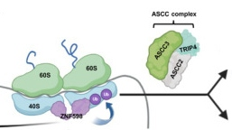{ width="330" loading=lazy }
/// caption
紫色ZNF598接近两个核糖体的碰撞界面，Ub标出泛素修饰；右上方为ASCC的主要组分。此处仅展示碰撞识别与ASCC参与的前段。[^rqc-collision-figure]
///

拆开后的60S若仍携带肽酰-tRNA，就进入**核糖体相关质量控制**（ribosome-associated quality control，RQC）。**NEMF**识别这种大亚基—肽酰-tRNA组合，帮助定位泛素连接酶**LTN1/Listerin**，使可接近的新生链被泛素化，随后交给蛋白酶体处理。有些底物还可在不读取mRNA的情况下由NEMF相关机制继续加上短尾，改变其暴露与降解机会，具体组成和后果取决于系统与底物。[^eukaryotic-rqc]

**ANKZF1**负责的释放涉及另一种化学：它切开tRNA的末端RNA，释放仍携带末端核苷酸的新生肽。这里被切的是RNA磷酸二酯键，不是正常终止中由释放因子促成的肽酰酯键水解。Yip等的重构实验定位到末端CCA的切除；剩余tRNA经过端修复并由TRNT1补回CCA后，还可再利用。[^ankzf1-cleavage]

Pelota–HBS1L–ABCE1则能参与处理缺少可用A位密码子、mRNA在通道内适于救援的停滞复合物。它与碰撞触发的ASCC途径在底物与步骤上有所区别。

!!! info "提前终止怎样联系到mRNA降解"

    在典型哺乳动物的EJC依赖型无义介导降解（NMD）中，剪接留下的外显子连接复合物EJC随mRNA输出。正常延伸会移去经过的EJC；若核糖体提前终止，下游EJC可能仍在，通过UPF等因子的相互作用促进监控和降解。常用的“终止密码子位于最后一个外显子接合处上游约50–55 nt以上”是这一类底物的经验规则，参照的是**接合处**，不是EJC中心。

    EJC并不是NMD唯一的识别线索，也不是所有符合距离条件的转录本都同样敏感。NMD还调控一批正常mRNA；无终止降解（NSD）和延伸受阻相关降解（NGD）又有不同触发背景。核糖体救援与mRNA降解相互配合，但提前终止并不必然先形成碰撞，再走同一条RQC路线。相关底物比较见[RNA质量控制](rna_processing.md#rna-quality-control)。[^nmd-ejc]

核糖体本身也可能有功能缺陷。酵母的**非功能rRNA降解**（nonfunctional rRNA decay，NRD）研究区分了18S和25S rRNA缺陷引出的不同处理途径：小亚基解码缺陷可与停滞和救援因子相联系，大亚基某些缺陷则涉及泛素化、复合物拆解及后续RNA清除。其中蛋白酶体处理相关蛋白，rRNA则由RNA降解装置清除。[^nrd]

## 程序化重编码 { #translational-recoding }

正常延伸努力保持阅读框，某些基因却利用精确的序列、RNA结构和因子环境，使一部分核糖体改变常规读取方式。结果可以是更长的蛋白、融合蛋白，或从被间隔开的编码区生成一条连续肽链。

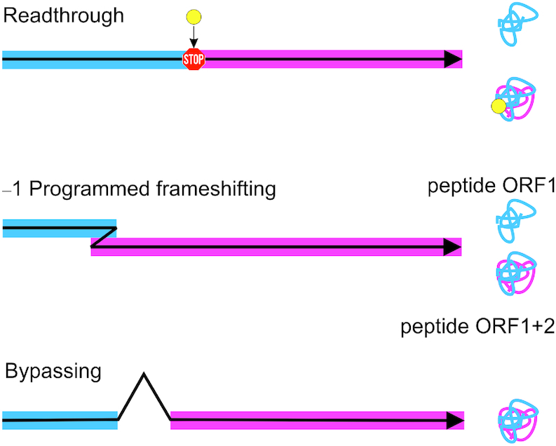{ width="620" loading=lazy }
/// caption
通读继续使用原阅读框；移框改变后续三联体分组；跳跃翻译越过一段RNA后恢复。图右显示由这些路径产生的不同肽链关系。[^translational-recoding]
///

### 移框、通读与跳跃

**程序化移框**常发生在易滑移序列附近，并受下游茎环、假结等结构造成的动力学变化影响。例如HIV-1的`gag`与`pol`利用−1移框产生少量Gag–Pol融合产物，使两类蛋白保持合适比例；大肠杆菌RF2的合成则使用受终止效率影响的+1移框。移框不是每次都发生，也不总能解释成转位机械地少走或多走一个核苷酸。

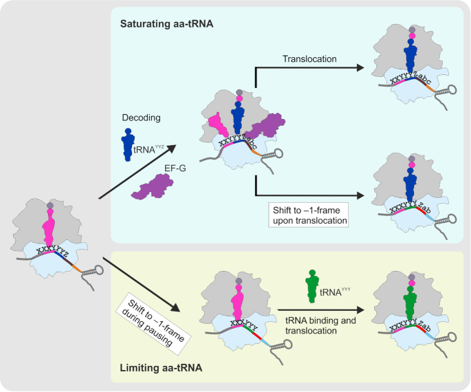{ width="610" loading=lazy }
/// caption
上方蓝区示意两条tRNA在转位后期共同滑移的路线；下方黄区示意氨酰-tRNA供应不足时，P位tRNA在暂停阶段滑移。相同的最终−1阅读框，可以通过不同动力学路径到达。[^translational-recoding]
///

**终止密码子通读**发生在近同源tRNA与终止装置竞争、并获得局部环境支持时：插入一个氨基酸后，核糖体继续在原阅读框延伸，直到后续终止位点。终止密码子本身、其后+4位及更远的RNA结构都可能影响效率。一部分植物病毒利用通读调节复制相关蛋白比例；通读产物是否有功能，还需具体实验证据。

???+ abstract "T4噬菌体gene 60：跳过的是RNA，不是肽链"

    T4噬菌体`gene 60`的编码信息被一段约50 nt的非编码间隔打断，核糖体可从一个Gly密码子附近“起跳”，在下游对应Gly密码子处重新建立配对并继续翻译。已合成的肽链始终由肽酰-tRNA携带；旁路过程中并不需要先剪掉这段RNA。

    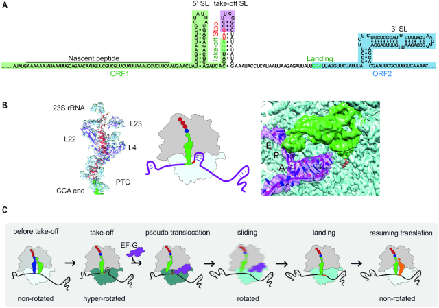{ width="700" loading=lazy }
    /// caption
    A标出起跳、着陆位点及相关茎环；B结合结构展示新生肽与出口通道、A位短茎环的关系；C为不同状态衔接的机制模型，模糊的核糖体表示移动过程。[^translational-recoding]
    ///

    新生肽与出口通道接触，起跳位点附近的RNA结构参与暂停和构象变化；肽酰-tRNA反密码子暂时解除原配对，再在着陆位点恢复。这里的“跳”描述解码位置的跨越。

### 硒代半胱氨酸与吡咯赖氨酸

**硒代半胱氨酸**（selenocysteine，Sec）是半胱氨酸中硫被硒替代的对应物，侧链为含硒的硒醇基。一些谷胱甘肽过氧化物酶、硫氧还蛋白还原酶和甲酸脱氢酶利用Sec的化学性质。它不是先作为游离氨基酸被普通合成酶接上tRNA，而是在专门的tRNA^Sec^上合成：SerRS先接入丝氨酸，再改造其侧链。

| 系统 | tRNA上合成Sec的主要路线 | UGA处递送 |
| --- | --- | --- |
| 细菌 | Ser-tRNA^Sec^经SelA转化，硒来自SelD生成的硒磷酸 | SelB结合Sec-tRNA^Sec^和编码区内、UGA附近的SECIS结构 |
| 古菌／真核 | PSTK先把Ser-tRNA^Sec^转成磷酸丝氨酰-tRNA^Sec^（Sep-tRNA^Sec^），SepSecS再转化为Sec-tRNA^Sec^ | 真核通常由3′ UTR的SECIS、SBP2和eEFSec共同支持递送；古菌的SECIS识别与递送因子配置不同于真核体系 |

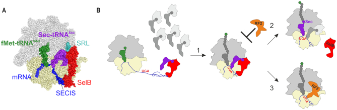{ width="700" loading=lazy }
/// caption
A为细菌核糖体上的SelB–Sec-tRNA结构；B显示SelB与SECIS的联系如何提高Sec递送机会。成功插入后继续延伸，递送失败则可能由RF2促成终止；此图不表示真核远端SECIS的完整路线。[^sec-routes]
///

**吡咯赖氨酸**（pyrrolysine，Pyl）的路线不同：两个赖氨酸分子经PylB、PylC、PylD等酶的作用形成Pyl，再由PylRS直接连接tRNA^Pyl^。某些产甲烷古菌及细菌用这套装置读取UAG，常见例子是参与甲基胺利用的甲基转移酶。在这些生物中，UAG终止与Pyl读取可以并存，具体结果还取决于读取环境。天然Sec与Pyl扩展了编码氨基酸的种类，却使用了不同的合成、tRNA识别与mRNA语境。[^genetic-code-variation][^pyl-synthesis]

## 翻译抑制剂 { #translation-inhibitors }

药物与毒素能把核糖体循环卡在不同阶段，因此既用于干预微生物，也为辨认翻译步骤提供了工具。解释药物时，要问它接触哪个位点、阻碍哪一步，以及作用是否依赖特定序列与细胞环境。

| 靶点或步骤 | 例子 | 主要作用与条件 |
| --- | --- | --- |
| 氨酰-tRNA进入A位 | 四环素类 | 在细菌小亚基上影响氨酰-tRNA的容纳 |
| 解码中心 | 链霉素、卡那霉素等氨基糖苷类 | 改变解码构象，可提高误读；同类药物也可能以转位等其他步骤为主要受影响环节 |
| PTC附近 | 氯霉素、林可酰胺类、噁唑烷酮类 | 占据不同位置，影响底物定位和反应；药物与新生肽、进入氨基酸的组合可改变抑制程度 |
| 新生肽出口通道 | 红霉素等大环内酯 | 许多情形下造成序列依赖的停滞，并非封死所有肽链的通用塞子 |
| 延伸因子周转 | kirromycin、夫西地酸 | 分别使EF-Tu或EF-G难以按正常循环从核糖体释放 |
| 真核细胞质延伸 | 放线酮、茴香霉素 | 前者主要干扰转位，后者作用于PTC附近 |

结构选择性、药物进入、外排和耐药装置共同决定细胞反应。细菌、古菌、真核细胞质和细胞器的差别不能只用70S／80S标签预测。[^ribosome-antibiotics]

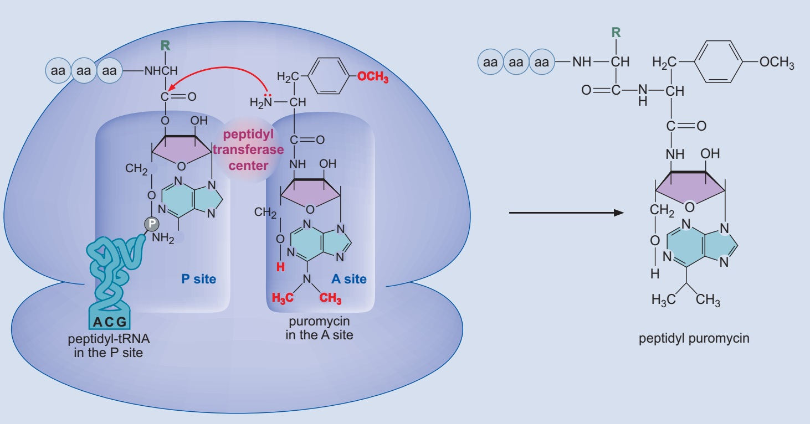{ width="430" loading=lazy }
/// caption
嘌呤霉素进入PTC附近，接受P位tRNA上的肽链；产物肽酰-嘌呤霉素不能像完整tRNA那样继续参与转位和延伸，因此肽链提前释放。[^m1-puromycin]
///

**嘌呤霉素**模拟氨酰-tRNA的3′端，能在细菌和真核翻译中接受肽链。它把“底物末端是否足够参与肽酰转移”变成了可操作的实验，上面的A76替换研究正利用了这一点。

**白喉毒素**以NAD为供体修饰eEF2上的白喉酰胺残基，使延伸因子失活。**蓖麻毒素**去除大亚基rRNA帚曲霉素—蓖麻毒素环中的特定腺嘌呤，断的是碱基与核糖间的糖苷键；**α-帚曲霉素**则在这一关键区域切RNA磷酸二酯主链。两者都可破坏翻译因子作用，却不是相同的切割反应。[^ribosome-toxins]

大肠杆菌素E3还可特异切割16S rRNA靠近3′端的解码相关区域。这会损伤解码中心并抑制翻译。非翻译靶点的药物，如抑制肽聚糖合成的β-内酰胺类和抑制DNA拓扑异构酶的喹诺酮类，见[微生物生长控制](../micro/growth_control.md)。

## 怎样观察翻译 { #translation-evidence }

翻译证据可以回答不同的问题：有没有新生蛋白、核糖体在哪里、某处为何停顿，以及最后是否产生了完整产物。放射性或稳定同位素脉冲标记直接追踪新合成蛋白；起始、移框和通读报告系统比较特定信号的输出，但报告序列、拷贝数与细胞背景会改变结果。

???+ abstract "Dintzis怎样判断肽链从N端向C端生长"

    如果一条肽链早已合成一半，这时才给细胞加入标记氨基酸，那么很快完成的产物，只会在最后合成的那一段带上较多标记。Dintzis在1961年利用这个时间差，在15℃下给兔网织红细胞短时加入³H标记亮氨酸，再分析刚完成的血红蛋白。

    他把短时标记样品与长时间用¹⁴C亮氨酸均匀标记的血红蛋白混合，分离α、β链，再用胰蛋白酶切成肽段。各段的³H／¹⁴C比值可校正亮氨酸数目与回收量的差别。于是，横向比较肽段时，看到的更接近“这个片段在短时间内合成了多少”。

    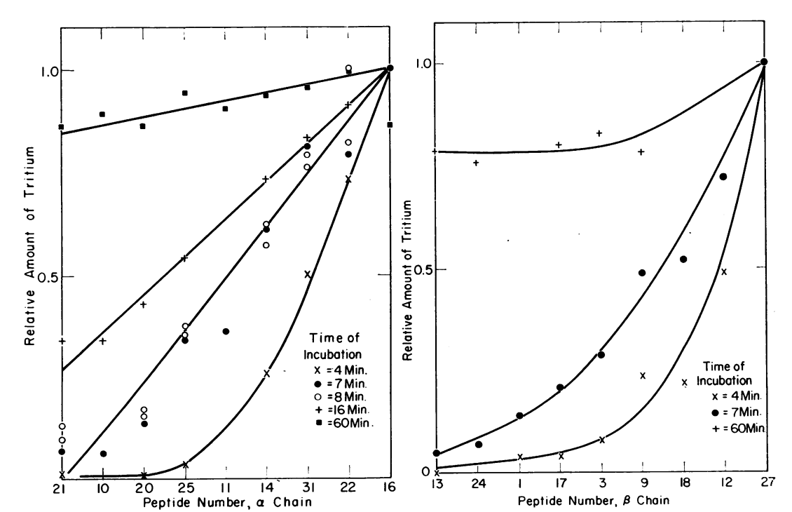{ width="740" loading=lazy }
    /// caption
    左为α链，右为β链；短时间曲线差别大，延长孵育后趋于均匀。横轴是按标记结果排列的肽段编号，并非当时已经确定的整条N→C序列坐标。原论文图5。[^dintzis-experiment]
    ///

    图中先出现强标记的片段，应靠近最后合成的链端。但究竟是哪一端，还要另做定位：研究者用羧肽酶从C端切去残基，把强标记的末端片段定位到C端附近。将时间梯度与这一独立定位结合，才支持多肽由N端向C端逐步延长。15℃是实验中减慢过程的条件，图上的分钟数不代表通常体内合成一条血红蛋白链所需的时间。

### 从多核糖体到核糖体足迹

在蔗糖密度梯度中，游离亚基、单核糖体和结合不同数量核糖体的mRNA可形成不同沉降组分。测定各组分的核酸吸收，并用RT-qPCR或其他方法追踪某条mRNA，可以判断它怎样分布于轻、重组分。但重多核糖体既可能表示起始频繁，也可能表示延伸受阻、核糖体拥挤。

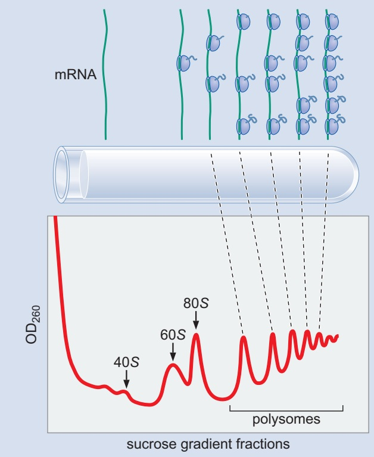{ width="400" loading=lazy }
/// caption
曲线示意260 nm吸收，不是蛋白浓度或某一条mRNA的专属信号；需另检测各级分中的目标RNA，才能判断其核糖体负载。[^m1-polysomes]
///

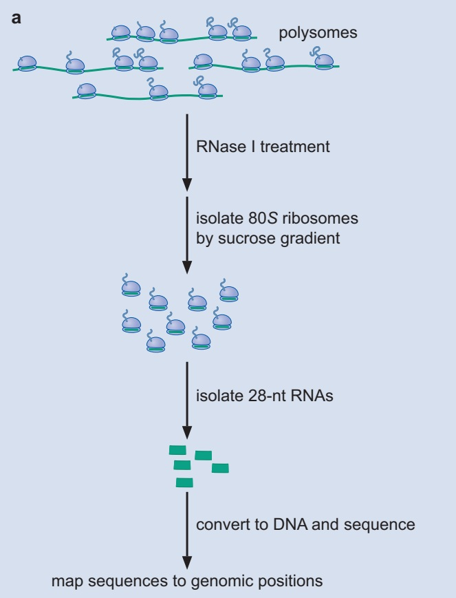{ width="290" loading=lazy }
/// caption
核糖体足迹测序先降解未受保护RNA，再分离核糖体保护片段，转为cDNA测序。图中28 nt是一种典型选择，实际足迹长度随物种、核糖体状态和实验条件变化。[^m1-profiling]
///

**核糖体足迹测序**（ribosome profiling，Ribo-seq）把保护片段映射回转录本，可观察三核苷酸周期、起始位点和局部停顿。它记录核糖体占据的近似分布，密度同时受装载、前进、终止和碰撞影响；与RNA-seq归一化比较得到的“翻译效率”也不是直接测出的每秒完整蛋白产量。核酸酶偏好、片段长度选择、比对方法以及放线酮等预处理都可能改变局部峰。[^translation-evidence]

???+ abstract "读图：饥饿时，GCN4的核糖体分布怎样改变"

    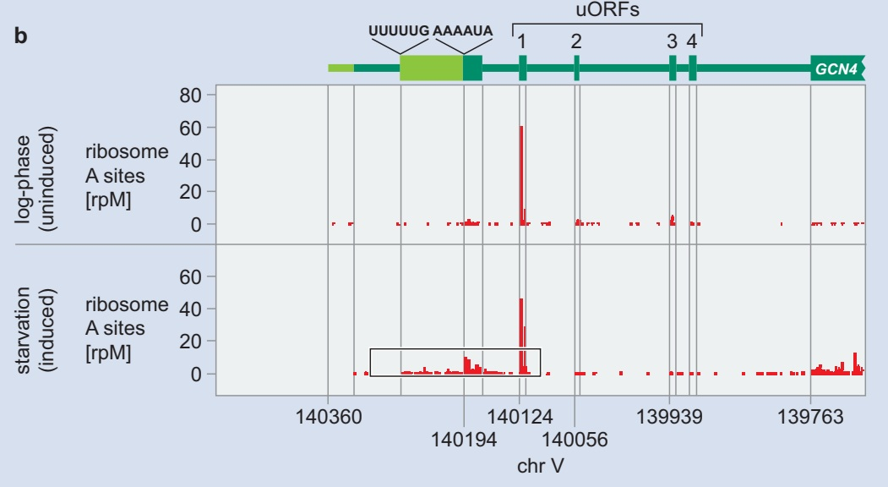{ width="680" loading=lazy }
    /// caption
    上方为对数生长期未诱导条件，下方为氨基酸饥饿；纵轴为归一化足迹信号，横轴为酵母第V染色体坐标，图中坐标向右递减。这里比较的是GCN4转录本不同区段的核糖体占据。[^m1-profiling]
    ///

    GCN4上游有多个uORF。氨基酸充足时，翻译过uORF1后继续扫描的40S较快重新获得起始三元复合物，容易在下游抑制性uORF起始；饥饿时，三元复合物供应下降，一部分40S越过这些uORF，之后才重新获得起始能力，从而提高主GCN4编码区的翻译。

    图中饥饿条件下，主编码区起始部分的信号上升，与这套再起始模型相符。不过，仅有占据曲线仍不能单独排除延伸速度变化；结合起始因子扰动、uORF突变和Gcn4蛋白量，才能把分布变化联系到具体机制。营养与应激如何改变三元复合物供应，见[翻译起始调控](gene_regulation/eukaryotic.md#translation-control)。

若要主张一个非AUG起点、小ORF或重编码产物实际存在，还应结合完整蛋白与N端／C端肽段的质谱、起始位点标记和遗传扰动。序列有潜力、核糖体曾占据、产生稳定功能蛋白，是逐步增强而并不等价的证据。

## 参考资料与延伸阅读 { #references }

- Watson JD等. *Molecular Biology of the Gene*. 7th ed. 2014. Chapters 15–16。
- Weaver RF. *Molecular Biology*. 5th ed. 2012. Chapters 18–19。
- Alberts B, Johnson A, Lewis J, et al. [From RNA to Protein](https://www.ncbi.nlm.nih.gov/books/NBK26829/). In: *Molecular Biology of the Cell*. 4th ed. Garland Science; 2002.
- Rubio Gomez MA, Ibba M. [Aminoacyl-tRNA synthetases](https://pmc.ncbi.nlm.nih.gov/articles/PMC7373986/). *RNA*. 2020;26:910–936.
- Sonenberg N, Hinnebusch AG. [Regulation of translation initiation in eukaryotes: mechanisms and biological targets](https://pmc.ncbi.nlm.nih.gov/articles/PMC3610329/). *Cell*. 2009;136:731–745.
- Schmitt E, Coureux PD, Kazan R, et al. [Recent Advances in Archaeal Translation Initiation](https://pmc.ncbi.nlm.nih.gov/articles/PMC7531240/). *Frontiers in Microbiology*. 2020;11:584152.
- Hellen CUT. [Translation Termination and Ribosome Recycling in Eukaryotes](https://pmc.ncbi.nlm.nih.gov/articles/PMC6169810/). *Cold Spring Harbor Perspectives in Biology*. 2018;10:a032656.
- Ferrari A, Del'Olio S, Barrientos A. [The Diseased Mitoribosome](https://pmc.ncbi.nlm.nih.gov/articles/PMC8278227/). *FEBS Letters*. 2021;595:1025–1061.
- Janssen BD, Hayes CS. [The tmRNA ribosome-rescue system](https://pmc.ncbi.nlm.nih.gov/articles/PMC3358797/). *Advances in Protein Chemistry and Structural Biology*. 2012;86:151–191.
- McGirr T, Onar O, Jafarnejad SM. [Dysregulated ribosome quality control in human diseases](https://pmc.ncbi.nlm.nih.gov/articles/PMC11880988/). *The FEBS Journal*. 2025;292:936–959.
- Rodnina MV, Korniy N, Klimova M, et al. [Translational recoding: canonical translation mechanisms reinterpreted](https://pmc.ncbi.nlm.nih.gov/articles/PMC7026636/). *Nucleic Acids Research*. 2020;48:1056–1067.
- Mukai T, Lajoie MJ, Englert M, Söll D. [Rewriting the Genetic Code](https://pmc.ncbi.nlm.nih.gov/articles/PMC5772603/). *Annual Review of Microbiology*. 2017;71:557–577.
- Lin J, Zhou D, Steitz TA, Polikanov YS, Gagnon MG. [Ribosome-Targeting Antibiotics: Modes of Action, Mechanisms of Resistance, and Implications for Drug Design](https://pmc.ncbi.nlm.nih.gov/articles/PMC9176271/). *Annual Review of Biochemistry*. 2018;87:451–478.
- Ingolia NT, Hussmann JA, Weissman JS. [Ribosome Profiling: Global Views of Translation](https://pmc.ncbi.nlm.nih.gov/articles/PMC6496350/). *Cold Spring Harbor Perspectives in Biology*. 2019;11:a032698.

[^m1-cycle]: Watson JD等. *Molecular Biology of the Gene*. 7th ed. 2014，图15–14，印刷页523。裁取原教材图。

[^m1-code]: Watson JD等. *Molecular Biology of the Gene*. 7th ed. 2014，图表16–1，印刷页574。裁取原教材图。

[^m1-frames]: Watson JD等. *Molecular Biology of the Gene*. 7th ed. 2014，图15–1，印刷页511。裁取原教材图。

[^genetic-code-history]: 遗传密码破译、tRNA结构及三位获奖者的贡献见Nobel Prize Outreach的[1968年诺贝尔生理学或医学奖资料](https://www.nobelprize.org/prizes/medicine/1968/summary/)；基本机制见Alberts等的[教材章节](https://www.ncbi.nlm.nih.gov/books/NBK26829/)。

[^polyu-experiment]: Nirenberg MW, Matthaei JH. [The dependence of cell-free protein synthesis in E. coli upon naturally occurring or synthetic polyribonucleotides](https://pmc.ncbi.nlm.nih.gov/articles/PMC223178/). *PNAS*. 1961;47:1588–1602。本文裁取原图6（p1598）与表8（p1599）；对照、产物鉴定和密码长度边界见原文及表7、9。

[^triplet-binding]: Nirenberg M, Leder P. [RNA codewords and protein synthesis: the effect of trinucleotides upon the binding of sRNA to ribosomes](https://pubmed.ncbi.nlm.nih.gov/14172630/). *Science*. 1964;145:1399–1407。

[^genetic-code-variation]: 稳定密码子重指派、Sec／Pyl与人工扩码见Mukai等的[综述](https://pmc.ncbi.nlm.nih.gov/articles/PMC5772603/)。

[^m1-wobble]: Watson JD等. *Molecular Biology of the Gene*. 7th ed. 2014，图16–2b、c，印刷页576。裁取原教材图。

[^m1-trna]: Watson JD等. *Molecular Biology of the Gene*. 7th ed. 2014，图15–5，印刷页515。裁取原教材图。

[^aars-chemistry]: aaRS两步氨酰化、Ⅰ／Ⅱ类结构和间接氨酰化路线见Rubio Gomez与Ibba的[综述](https://pmc.ncbi.nlm.nih.gov/articles/PMC7373986/)。

[^m1-charging]: Watson JD等. *Molecular Biology of the Gene*. 7th ed. 2014，图15–6，印刷页516。裁取原教材图。

[^aars-fidelity]: tRNA身份元件、转移前／后校对及独立校对蛋白见Rubio Gomez与Ibba的[综述](https://pmc.ncbi.nlm.nih.gov/articles/PMC7373986/)；适配体关系见Alberts等的[教材章节](https://www.ncbi.nlm.nih.gov/books/NBK26829/)。

[^m1-identity]: Watson JD等. *Molecular Biology of the Gene*. 7th ed. 2014，图15–7，印刷页517。裁取原教材图。

[^m2-double-sieve]: Weaver RF. *Molecular Biology*. 5th ed. 2012，图19.34，印刷p631（本地PDF p653）；裁取IleRS双筛选示意。

[^misacylated-trna]: Chapeville F等. [On the role of soluble ribonucleic acid in coding for amino acids](https://pmc.ncbi.nlm.nih.gov/articles/PMC220908/). *PNAS*. 1962;48:1086–1092。实验使用poly(UG)；配图为Watson等第7版图15–10（印刷p519）的原理示意，经裁切。

[^m1-ribosome]: Watson JD等. *Molecular Biology of the Gene*. 7th ed. 2014，图15–19，印刷页526。裁取原教材图。

[^m1-tunnel]: Watson JD等. *Molecular Biology of the Gene*. 7th ed. 2014，图15–21，印刷页527。裁取原教材图。

[^m1-bacterial-initiation]: Watson JD等. *Molecular Biology of the Gene*. 7th ed. 2014，图15–25，印刷页530。裁取原教材图。起始tRNA的结构与甲酰化另见印刷页528–530。

[^m1-sd]: Watson JD等. *Molecular Biology of the Gene*. 7th ed. 2014，图15–23，印刷页528。裁取原教材图。

[^prokaryotic-initiation]: SD引导、非SD有前导及无前导起始的分布与装配差异见Schmitt等的[古菌起始综述](https://pmc.ncbi.nlm.nih.gov/articles/PMC7531240/)及Leiva与Katz的[无前导翻译综述](https://pmc.ncbi.nlm.nih.gov/articles/PMC9031893/)（2022）。

[^archaeal-initiation]: 古菌aIF1、aIF1A、aIF2、aIF5B及mRNA招募的多样性见Schmitt等的[综述](https://pmc.ncbi.nlm.nih.gov/articles/PMC7531240/)。

[^eukaryotic-initiation]: eIF4F、43S招募、扫描、起点选择与闭环模型见Sonenberg与Hinnebusch的[综述](https://pmc.ncbi.nlm.nih.gov/articles/PMC3610329/)；非AUG起始与小ORF的足迹证据见Ingolia的[方法综述](https://pmc.ncbi.nlm.nih.gov/articles/PMC4917602/)（2016）。

[^m1-eukaryotic-initiation]: Watson JD等. *Molecular Biology of the Gene*. 7th ed. 2014，图15–26、15–28，印刷页531、536。裁取原教材图。

[^m1-closed-loop]: Watson JD等. *Molecular Biology of the Gene*. 7th ed. 2014，图15–27，印刷页532。裁取原教材图。

[^eif2-phosphate]: Algire MA, Maag D, Lorsch JR. [Pi release from eIF2, not GTP hydrolysis, is the step controlled by start-site selection during eukaryotic translation initiation](https://doi.org/10.1016/j.molcel.2005.09.008). *Molecular Cell*. 2005;20:251–262。酵母重构实验区分GTP水解与无机磷酸释放。

[^m1-uorf]: Watson JD等. *Molecular Biology of the Gene*. 7th ed. 2014，图Box 15–3图1，印刷页533。裁取原教材图。

[^m1-ires]: Watson JD等. *Molecular Biology of the Gene*. 7th ed. 2014，图Box 15–3图2a，印刷页534。裁取原教材图。

[^m1-elongation]: Watson JD等. *Molecular Biology of the Gene*. 7th ed. 2014，图15–29，印刷页537。裁取原教材图。

[^translation-fidelity]: GTP水解前的初始选择、水解后的动力学校对和适应进入见Zaher与Green的[翻译保真度综述](https://pmc.ncbi.nlm.nih.gov/articles/PMC3691815/)（2009）；结构联系另见Lin等的[核糖体靶药综述](https://pmc.ncbi.nlm.nih.gov/articles/PMC9176271/)。

[^m1-selection]: Watson JD等. *Molecular Biology of the Gene*. 7th ed. 2014，图15–31，印刷页539。裁取原教材图。

[^m1-peptide-chemistry]: Watson JD等. *Molecular Biology of the Gene*. 7th ed. 2014，图15–16，印刷页524。裁取原教材图。

[^m1-ptc]: Watson JD等. *Molecular Biology of the Gene*. 7th ed. 2014，图15–32，印刷页540。裁取原教材图。

[^ribosome-catalysis]: 核糖体结构和延伸循环见Alberts等的[教材章节](https://www.ncbi.nlm.nih.gov/books/NBK26829/)；rRNA与底物tRNA参与催化见Strobel与Cochrane的[RNA催化综述](https://pmc.ncbi.nlm.nih.gov/articles/PMC2184879/)（2007）。

[^weinger-experiment]: Weinger JS, Parnell KM, Dorner S, Green R, Strobel SA. [Substrate-assisted catalysis of peptide bond formation by the ribosome](https://doi.org/10.1038/nsmb841). *Nature Structural & Molecular Biology*. 2004;11:1101–1106。原图3a经Weaver第5版图19.17（印刷p615）转引，本文裁取电泳结果与完整道号；底物结合等对照需结合原文其他实验。

[^m1-translocation]: Watson JD等. *Molecular Biology of the Gene*. 7th ed. 2014，图15–34a–e，印刷页542。裁取原教材图。

[^m1-efts]: Watson JD等. *Molecular Biology of the Gene*. 7th ed. 2014，图15–36，印刷页544。裁取原教材图。

[^fungal-eef3]: Ranjan N, Pochopien AA等. [Yeast translation elongation factor eEF3 promotes late stages of tRNA translocation](https://doi.org/10.15252/embj.2020106449). *The EMBO Journal*. 2021;40:e106449。结合冷冻电镜和动力学分析eEF3促进晚期转位与E位tRNA释放的作用。

[^m1-release]: Watson JD等. *Molecular Biology of the Gene*. 7th ed. 2014，图15–38、15–39，印刷页547。裁取原教材图。

[^termination-recycling]: eRF1／eRF3、ABCE1与终止后40S清理见Hellen的[综述](https://pmc.ncbi.nlm.nih.gov/articles/PMC6169810/)；细菌RF1／RF2、RF3与RRF–EF-G见Watson等第15章印刷页544–550。

[^abce1-figure]: Hellen CUT. [Translation Termination and Ribosome Recycling in Eukaryotes](https://pmc.ncbi.nlm.nih.gov/articles/PMC6169810/). 2018，图3C；从原图裁取正常终止后ABCE1回收面板。

[^plastid-translation]: 质体rRNA结构见Bieri等2017年[菠菜叶绿体核糖体结构](https://pmc.ncbi.nlm.nih.gov/articles/PMC5694952/)；SD作用见Scharff等2017年[反SD突变研究](https://pmc.ncbi.nlm.nih.gov/articles/PMC5757275/)。发育及编辑相关性见Chotewutmontri与Barkan的[2016年研究](https://pmc.ncbi.nlm.nih.gov/articles/PMC4945096/)，光照调节见其[2018年研究](https://pmc.ncbi.nlm.nih.gov/articles/PMC6095610/)；5′端结合蛋白的具体机制见Prikryl等的[PPR10研究](https://pmc.ncbi.nlm.nih.gov/articles/PMC3017144/)。

[^organelle-translation]: 线粒体核糖体的谱系改造、哺乳动物单一mt-tRNA^Met^的甲酰化分工及翻译因子见Ferrari等的[综述](https://pmc.ncbi.nlm.nih.gov/articles/PMC8278227/)；核糖体组成的站内接口见[细胞核页面](../cell/nucleus_chromatin.md#ribosome-architecture)。质体来源另列于相应脚注。

[^tmrna-structures]: Giudice E, Macé K, Gillet R. [Trans-translation exposed: understanding the structures and functions of tmRNA-SmpB](https://pmc.ncbi.nlm.nih.gov/articles/PMC3968760/). *Frontiers in Microbiology*. 2014;5:113。tmRNA二级／三维图取自图2；普通tRNA与tmRNA–SmpB比较取自图5，后者汇合Schmeing等2009与Neubauer等2012的结构。

[^bacterial-ribosome-rescue]: tmRNA–SmpB、SsrA标签、mRNA周转与替代救援因子见Janssen与Hayes的[综述](https://pmc.ncbi.nlm.nih.gov/articles/PMC3358797/)。

[^tmrna-selection]: Neubauer C等的[tmRNA–SmpB核糖体结构研究](https://pubmed.ncbi.nlm.nih.gov/22422985/)（2012）；Kurita D等. [Rejection of tmRNA·SmpB after GTP hydrolysis by EF-Tu on ribosomes stalled on intact mRNA](https://pmc.ncbi.nlm.nih.gov/articles/PMC4201823/). *RNA*. 2014。后者定位完整下游mRNA对后续适应进入／肽转移的影响。

[^rqc-collision-figure]: McGirr T, Onar O, Jafarnejad SM. [Dysregulated ribosome quality control in human diseases](https://pmc.ncbi.nlm.nih.gov/articles/PMC11880988/). *The FEBS Journal*. 2025;292:936–959。裁取图1的碰撞识别与ASCC部分，清除裁图边缘相邻图的残字／残边；未改变保留的因子、泛素或箭头。下游反应另据原始研究。

[^eukaryotic-rqc]: 碰撞识别、泛素化、ASCC拆分和NEMF–LTN1新生链处置见McGirr等的[综述](https://pmc.ncbi.nlm.nih.gov/articles/PMC11880988/)；ANKZF1的切割化学另据原始研究。mRNA监控接口见[RNA质量控制](rna_processing.md#rna-quality-control)。

[^ankzf1-cleavage]: Yip MCJ等. [Mechanism for recycling tRNAs on stalled ribosomes](https://doi.org/10.1038/s41594-019-0211-4). *Nature Structural & Molecular Biology*. 2019；tRNA端修复见Yip等2020年的[ELAC1研究](https://pubmed.ncbi.nlm.nih.gov/32075755/)。ANKZF1切除末端RNA，肽链仍与被切下的末端相连。

[^nmd-ejc]: Watson等第7版第15章印刷页565–567，图15–51／15–52，结合Hellen的[终止综述](https://pmc.ncbi.nlm.nih.gov/articles/PMC6169810/)理解终止环境与NMD。50–55 nt指终止位置到下游外显子接合处的经验距离，不是到EJC中心的距离。

[^nrd]: Cole SE等. [A convergence of rRNA and mRNA quality control pathways revealed by mechanistic analysis of nonfunctional rRNA decay](https://doi.org/10.1016/j.molcel.2009.04.017). *Molecular Cell*. 2009；Fujii K等的[25S rRNA非功能降解研究](https://pmc.ncbi.nlm.nih.gov/articles/PMC3365426/)（2012）。正文限定酵母实验，不把所有rRNA监控归为同一路线。

[^translational-recoding]: Rodnina MV等. [Translational recoding: canonical translation mechanisms reinterpreted](https://pmc.ncbi.nlm.nih.gov/articles/PMC7026636/). *Nucleic Acids Research*. 2020;48:1056–1067。本文重编码路线、−1移框与T4跳跃图分别取自图1、5、6，均为作者整理的机制／结构图。

[^sec-routes]: 合成路线见Xu XM等2007年的[真核Sec生物合成研究](https://doi.org/10.1371/journal.pbio.0050004)与Mukai等[综述](https://pmc.ncbi.nlm.nih.gov/articles/PMC5772603/)；古菌差异见2024年[Asgard古菌Sec装置研究](https://pmc.ncbi.nlm.nih.gov/articles/PMC11227280/)。配图取Rodnina等2020年[综述图3](https://pmc.ncbi.nlm.nih.gov/articles/PMC7026636/)，只展示细菌SelB–SECIS体系。

[^pyl-synthesis]: Gaston MA等. [The complete biosynthesis of the genetically encoded amino acid pyrrolysine from lysine](https://pmc.ncbi.nlm.nih.gov/articles/PMC3070376/). *Nature*. 2011；UAG终止与Pyl读取并存的边界见Alkalaeva等的[终止研究](https://pmc.ncbi.nlm.nih.gov/articles/PMC2857517/)（2009在线，2010卷期）。

[^ribosome-antibiotics]: 解码中心、PTC和出口通道靶药及序列依赖抑制见Lin等的[综述](https://pmc.ncbi.nlm.nih.gov/articles/PMC9176271/)；大环内酯的序列选择性另见Kannan等的[足迹研究](https://pmc.ncbi.nlm.nih.gov/articles/PMC4234590/)（2014）。

[^m1-puromycin]: Watson JD等. *Molecular Biology of the Gene*. 7th ed. 2014，图Box 15–5图1，印刷页553。裁取原教材图。

[^ribosome-toxins]: 白喉毒素对eEF2的ADP核糖基化、蓖麻毒素去嘌呤化与α-帚曲霉素切RNA的区别见Watson等第7版Box 15–5及Weaver第5版第19章；它们作用于不同化学键。

[^dintzis-experiment]: Dintzis HM. [Assembly of the peptide chains of hemoglobin](https://pmc.ncbi.nlm.nih.gov/articles/PMC221568/). *PNAS*. 1961;47:247–261。本文裁取图5（p255）；羧肽酶末端定位见pp258–259、表4。图5的肽段编号按标记量／时间关系排列，方向判断不能只靠横轴。

[^m1-polysomes]: Watson JD等. *Molecular Biology of the Gene*. 7th ed. 2014，图Box 15–6图1，印刷页561。裁取原教材图。

[^m1-profiling]: Watson JD等. *Molecular Biology of the Gene*. 7th ed. 2014，图Box 15–6图2a、b，印刷页562。裁取原教材图。GCN4数据转引自Ingolia NT等. [Genome-wide analysis in vivo of translation with nucleotide resolution using ribosome profiling](https://doi.org/10.1126/science.1168978). *Science*. 2009;324:218–223，图5A。

[^translation-evidence]: 足迹测序、三核苷酸周期、起始／停顿分析和实验偏差见Ingolia等的[综述](https://pmc.ncbi.nlm.nih.gov/articles/PMC6496350/)与Andreev等的[方法综述](https://pmc.ncbi.nlm.nih.gov/articles/PMC5314775/)（2017）。
